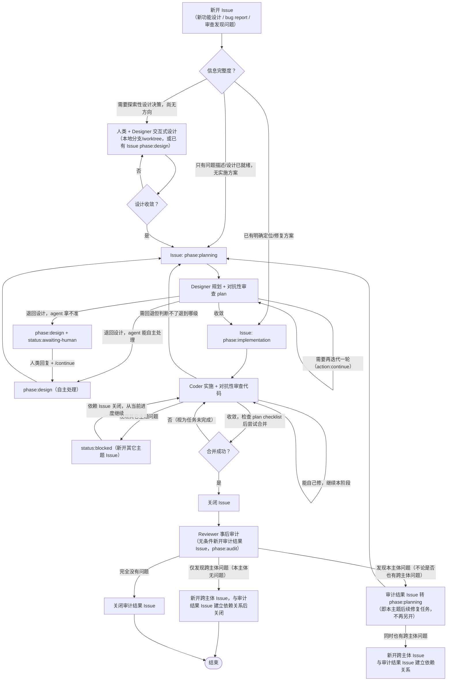

# coding-flow

> 状态：架构、协议、四个角色的执行流程与 workflow 实现均已完成初版（见文末「状态」章节的剩余细节清单）；本文件记录的是已经确定的架构与协议，是权威、自包含的规范来源——不依赖本仓库以外的任何文档。

## 用途

不是传统团队协作的 GitHub 工作流（分支策略/CI/发版），而是一套异步、事件驱动、人在回路的多 Agent 软件开发协作系统：不同角色的 AI Agent 分别承担设计、规划、实施、独立审查的具体工作，人类只在 agent 判断自己无法独立决策时介入。基础设施完全复用 GitHub 原生能力：

- **Issue** = 每个主题（feature/module）的状态机载体 + 全过程历史记录
- **GitHub Actions** = 角色 agent 运行的沙箱执行环境
- **Issue 结构化评论 + `@` owner / assign** = 调度依据 + 唤醒人类的信号
- **本机常驻 Scheduler 会话** = 唯一的调度入口，兼接受人类直接指令

## 核心模型：三个嵌套的迭代周期

```
周期一（设计-规划收敛周期）：设计 ⇄ 规划
周期二（实施收敛周期，含周期一）：[设计 ⇄ 规划] ⇄ 实施
周期三（审查修复周期，最外层，含周期二）：独立审查 → 按需重入 [设计 ⇄ 规划 ⇄ 实施] 任意一级
```

- 回退落点、收敛判定均由 agent 自主判断，不设外部硬性门槛。
- 人类的唯一强制介入点是**初始设计阶段**（人机协同产出设计文档，设计文档的具体规范由另一个独立 skill 负责，不在本 skill 范围内）。此后所有阶段，agent 判断自己能处理就自主处理，判断超出能力边界才请求人类。
- **Issue 与设计文档的先后顺序不强制约定，只求最终一致**：常见、方便的做法是人类先在本地独立分支/worktree 中与 Designer 交互式设计（此时还没有主题 Issue，不受 Scheduler 管辖），设计收敛后再通知 Scheduler 新建 Issue；但也允许先开 Issue 再补设计。Scheduler/Designer 不假定过程顺序，只看当下实际状态决定新 Issue 该从哪个 phase 起步（设计文档已就绪 → 直接 `phase:planning`；尚未就绪 → `phase:design`），见「Issue 状态机」转换总览。
- **任务入口不止"从设计出发"一种，但都汇入同一套状态机**：新功能（从设计出发）、bug report、独立审查发现的问题，这三类触发来源**处理方式完全相同**——都是同一套三层迭代周期，区别只在于从哪个 phase 进入，不是三套并行流程：
  - 起始 phase 由**该 Issue 当下已具备的信息完整度**决定，不由来源类型决定：已有设计文档就绪 → `phase:planning`；已有明确的定位/修复方案 → `phase:implementation`；只有问题描述、没有方案（典型的新提交 bug report）→ `phase:planning`（先定位根因、明确修复范围，再进入实施）。
  - Reviewer 审计结果 Issue 按「Reviewer 触发」已定义的规则固定从 `phase:audit` 转 `phase:planning`，是同一原则的特例。
  - 不管从哪个 phase 进入，**回退逻辑完全复用现有状态机**：bug fix 过程中如果发现是设计层面的问题，一样退回 `phase:design`，走同一套"agent 能自主处理 / 需要人类"的判断（见「Issue 状态机」转换总览），不需要为 bug fix 或审查处理额外定义新流程。

## 角色分发（`args`）

| args | 角色 | 运行位置 | 详情 |
|---|---|---|---|
| `init` | — | 本机 | 项目初始化，实现见 [scripts/init.py](scripts/init.py)：拷贝 skill 目录、落地 labels、workflow yaml 模板、看板发布集成设施 |
| `scheduler` | Scheduler | 本机常驻会话，不进 Action | [references/scheduler.md](references/scheduler.md) |
| `designer` | Designer | 1）用户本地分支/worktree（交互式设计，通常在 Issue 创建前，但不强制）2）Action（规划模式，Scheduler 派发） | [references/designer.md](references/designer.md) |
| `coder` | Coder | Action（Scheduler 派发） | [references/coder.md](references/coder.md) |
| `reviewer` | Reviewer | Action（Scheduler 派发或人类指定范围触发） | [references/reviewer.md](references/reviewer.md) |

**对抗性审查不是独立角色/独立入口**，而是 Designer（针对设计文档、plan）、Coder（针对代码）各自流程内部的一个环节——每个角色审查的对象和标准不同，具体标准写在各自的 reference 文件里，不抽公共模块。能力范围内可修复的当场修复重审，修复不了则上报 Scheduler，本轮运行结束，Issue 进入等待人类状态。

**两层审查的区别**：Coder 内置的对抗性审查是**合并前门禁**，收敛是合并进 main 的前提条件（合并动作由 Coder 自己执行）；Reviewer 是**合并后独立事后审计**，此时原 Issue 已关闭（关闭即任务完结的历史记录，不再重新打开），发现的问题一律新开 Issue——同主题的新 Issue 引用原 Issue（延续关系，如 "continues #N"），跨主题的新 Issue 与原 Issue 建 `blocked_by` 依赖。门禁具体要不要包含测试/lint 等 CI 项是目标项目自身分支保护规则的事，本 skill 不硬编码，只保证自己负责的对抗性审查已收敛。

**身份：不设独立 GitHub 身份**。Scheduler/Designer/Coder/Reviewer 全部使用同一 GitHub 身份操作（提交、评论、PR），不为审查角色单独注册 bot 账号。审查的"独立性"完全靠**同一次运行内启动一个独立子 agent session** 做对抗性验证（先产出、再由独立 session 挑刺），不依赖身份隔离。

**非交互式任务一律用 Claude Code 的动态 Workflow 工具实现**：Designer/Coder/Reviewer 在 Action 中运行时都是非交互式的（没有人类实时在场），凡是内部需要多步骤/多 agent 协作的环节——最典型的就是"先产出、再由独立子 agent session 做对抗性验证"这个模式——都应该写成 Claude Code 的 Workflow 脚本（`agent()`/`pipeline()`/`parallel()`），而不是单一 prompt 里临时手工拼凑多轮调用。这是 Claude Code 层面的编排机制，与 GitHub Actions workflow yaml（角色运行的沙箱环境）是两回事，不要混淆。

## Issue 粒度与依赖关系

- Issue 按**主题/模块**开设（不按阶段、不按子任务拆分），装着该主题在三层周期中反复迭代的完整历史（评论时间线）。新开 Issue 时正文按 [templates/issue-body.md](templates/issue-body.md) 填写（触发来源、范围、依赖关系），不是空白正文——Scheduler/Designer 后续判断从哪个 phase 起步、要不要建 `blocked_by`，都依赖这里的信息。
- 若迭代中牵出另一个主题的问题/需求，为该主题新开独立 Issue，两者建立依赖关系（`blocked_by`，见下），当前 Issue 进入阻塞态直到依赖收敛（依赖 Issue 被关闭）。如果只是需要依赖方的某个设计结论而非完全交付，不建强依赖，直接把结论抄进当前 Issue 评论当上下文。

## Issue 状态机

### 两组 Label

- **阶段 label（互斥）**：`phase:design` / `phase:planning` / `phase:implementation` / `phase:audit`（Reviewer 审计结果 Issue 的起始 phase；若发现本主体问题会转 `phase:planning` 继续存活成修复任务，否则跑完即关闭，见「Reviewer 触发」）。新建主题 Issue 的起始 phase 不固定，取决于设计文档当时是否已就绪：已就绪则直接 `phase:planning`（常见情形——设计通常已在本地分支/worktree 里做完）；未就绪则 `phase:design`。`phase:design` 同时也是规划/实施中途需要退回设计时会重新进入的状态。
- **控制状态 label（互斥，缺省 = 正常运行中）**：`status:awaiting-human`（当前阶段内部审查发现自己权限内修不了，已上报，等人类）/ `status:blocked`（等待另一个主题 Issue 收敛）

### 驱动机制：结构化评论是调度依据，不是 label 变化事件

每次角色运行结束时，在 Issue 上追加一条**结构化评论**：人类可读的叙述正文（骨架见 [templates/status-comment.md](templates/status-comment.md)）+ 一段隐藏的机器可解析块（HTML 注释包裹 YAML，Markdown 渲染后人类看不到）：

```markdown
（人类可读的叙述，说明这一轮做了什么、为什么，need_human 时在此处 @ 仓库 owner）

<!-- coding-flow:status
schema: 1
role: designer            # scheduler | designer | coder | reviewer
phase: planning            # 当前所处阶段
action: advance            # continue | advance | revert | need_human | blocked | done
next_phase: implementation # 仅 advance/revert 需要
blocked_by: 123            # 仅 blocked 需要，依赖的 Issue 编号
question: "..."            # 仅 need_human 需要，给 Scheduler 转发用的问题摘要
run_id: 8421765330-planning-3
-->
```

Scheduler 用 `gh api .../issues/<N>/comments --paginate` 取全部评论，从后往前找**第一条含结构化块的评论**解析（不是字面最后一条，人类的自由回复可能排在后面；具体实现见 `references/scheduler.md`「结构化评论解析的具体实现」），据此决定下一步派发，**不依赖 `issues:labeled` 等原生事件**——同阶段内部再迭代一轮时 label 不变，原生事件不会触发，所以调度决策必须以结构化评论为准。Label 仍同步更新，作为人类可读的当前状态镜像。

**人类回复不强制格式**：`status:awaiting-human` 期间人类可以自由格式、分多条评论回复，Scheduler 不解析语义，原样交给下一轮 agent 做上下文。人类回复完毕后另发一条**只包含 `/continue`** 的评论作为终止信号——Scheduler 只认这个字面指令来判断"人类说完了，可以摘掉 `status:awaiting-human` 重新派发"。

**唤醒人类**：`action: need_human` 时在评论正文里 `@` 提及仓库 owner（`gh repo view --json owner` 取值）并把 Issue `assign` 给 owner；解除后下一轮摘掉 assignee。已知限制：若执行身份与 owner 是同一账号（单人项目常见），GitHub 不会对自我操作产生主动通知，此时退化为被动标记（出现在 "Assigned to you" 列表），真正的主动唤醒依赖 Scheduler 本机会话轮询发现后直接汇报。

### Issue 正文 vs 评论

两者职责不同，不能混用：

- **正文（body）= 当前生效的权威快照，覆盖式更新**，只在"这个 Issue 现在是什么"发生变化时才改：创建时按 [templates/issue-body.md](templates/issue-body.md) 填触发来源/范围/依赖；Designer 每次产出新版 plan → 覆盖式更新正文里的 plan 部分（[templates/plan.md](templates/plan.md)），不是每次发新评论——不然评论历史里堆几十个版本的 plan，没法一眼看出现在生效的是哪版；Reviewer 审计完成 → 把最终发现写进正文（[templates/review-findings.md](templates/review-findings.md)），这是一次性快照，转 `phase:planning` 开始修复之后不再改这部分，代表"审计当时的结论"，是历史事实。
- **评论（comment）= 不可变的历史事件流，只追加，不回改**：每轮角色运行结束的结构化评论（骨架见 [templates/status-comment.md](templates/status-comment.md)）——只讲这一轮做了什么、为什么，不重复贴一遍完整 plan/findings（正文已经有）；人类的自由回复；`/continue` 信号。
- Scheduler 的调度决策规则不受影响，仍然只看"最新结构化评论"的机器块；但 plan/findings 的**内容**去正文取，不用去评论历史里翻哪条是最新版本。

### 及时更新 Issue，准确反映进度

**每个角色在运行期间，每开始/完成一项具体工作（plan 里的一个任务项、审查的一个检查维度等），都要立刻更新 Issue，不能只在整个运行结束时才更新一次**：

- 开始一项工作前，发一条轻量评论说明"现在开始做 X"；完成后**两件事都要做**：发一条评论说明"X 做完了，结果是……"，**并且**把正文里 plan 对应的 checklist 项勾选掉（`- [ ]` → `- [x]`）——评论和正文更新不是二选一，评论负责"过程记录"，正文的勾选状态负责"当前进度一眼可见"，见「Issue 正文 vs 评论」。
- 目的是让 Issue 在**任何时刻**都能准确反映当前进度——哪怕运行中途被超时强杀、或者人类随时点进来看，也能看到做到哪一步了，而不是一片空白直到运行结束才突然冒出一条总结。
- **关键约束：这些中途的进度评论不带 `coding-flow:status` 机器块**——只有整个运行结束时的最后一条评论才带。中途评论如果也带机器块，会被 Scheduler 的轮询逻辑误判成"这一轮已经结束，可以调度下一步"，提前触发不该发生的派发。

**并发更新（多个 subagent 同时在跑，见「非交互式任务一律用 Claude Code 的动态 Workflow 工具实现」）时的安全规则**：

- **发评论天然并发安全**，每条评论都是独立的创建操作，不存在"读-改-写"竞争——多个并行 subagent（比如用 `parallel()` 同时处理 plan 里的几个独立任务项）可以各自直接发评论报告自己的进度，不需要互相协调。
- **改正文不是并发安全的**——正文更新是"取当前全文 → 改动某一部分 → 整体写回"，两个 subagent 同时做这件事，后写的会覆盖先写的、把对方的改动悄悄丢掉。**同一次运行里，正文的写入只能由一个步骤做**：并行的 subagent 只允许发评论汇报各自的完成情况，不允许各自直接改正文；等 `parallel()` 汇聚完所有结果之后，由汇聚之后的下一个步骤统一做一次正文更新（比如一次性把这一批任务对应的 plan 勾选状态全部改掉），而不是每个 subagent 各自去抢着改。

### 关闭 Issue 前检查 plan checklist

Coder 收敛、准备合并前（见 `references/coder.md`「合并」），要先扫一遍 Issue 正文里 plan 的勾选状态，**不能带着未勾选的条目直接关闭 Issue**——未勾选的条目要么是工作确实遗漏了，要么只是状态没同步更新，两种情况都不能放任不管：

- 实际已经做完、只是没同步勾选 → 补勾选。
- 确实没做/被砍掉 → **新开一个 Issue 追踪**（正文按 [templates/issue-body.md](templates/issue-body.md)，触发来源写明来自哪个 Issue 的遗留任务），不建 `blocked_by`（遗留任务是独立后续工作，不阻塞当前 Issue 收敛）。

目的是防止"检查/合并都通过了，但 plan 里还有条目没处理"这种遗漏在 Issue 关闭后彻底消失、无迹可查。

### 转换总览



`status:blocked` 解除后**从当前进度继续跑，不重新从该 phase 起点跑一遍**（要求各角色中间产出必须持久化——如实施中的分支提交、Issue 上的 plan/设计内容——而不是只存在于某次运行的临时上下文里）。

**循环依赖检测**：每轮轮询/恢复对账时，用所有 `status:blocked` Issue 的 `blocked_by` 关系建依赖图做环检测。发现环则环上 Issue 一律转 `status:awaiting-human`，交给人类打破循环，不再等待自动收敛。

**Reviewer 触发**：两条路径，都经 Scheduler 派发——1）合并触发：Scheduler 发现某主题 Issue 收敛并合并后自动派发一次审计；2）用户主动触发：人类要求 Scheduler 派 Reviewer 审计指定范围。

**Reviewer 产出规则**（核心目的：审计结果必须被追踪、不丢失，且按主题分类归档）：

- **无条件新开一个"审计结果 Issue"**（`phase:audit`），记录本次审计的范围与结论，不管有没有发现问题——这保证审计结果不会因为"什么都没发现"就被随手丢弃、无迹可查。
- **发现本主体（被审计主题自身）的问题** → 该审计结果 Issue 本身转 `phase:planning`，直接成为本主题的后续修复任务，**不再额外新开一个"本主题"的 Issue**。
- **发现跨主体的问题** → 为每个涉及的其它主题新开一个 Issue，与审计结果 Issue 建立依赖关系（保持"按主题分 Issue"的分类原则）。
- **例外**：完全没发现本主体问题、只发现跨主体问题时，审计结果 Issue 没有本主题的待办事项——建好与跨主体 Issue 的依赖关联后直接关闭，不需要让它继续存活成一个修复任务。

### Plan 文档的存放约定

- **Issue 是 plan 的唯一权威、跨运行持久存储**——plan 内容落在 **Issue 正文**（不是评论），具体结构见 [templates/plan.md](templates/plan.md)（任务清单 + 验收标准 + 边界情况，不是自由格式）。每次迭代**覆盖式更新正文**，不是每次发一条新评论积累多个版本（见「Issue 正文 vs 评论」）。
- `.claude/plan/`（不纳入版本控制）是**单次运行期间的临时工作文件**：运行开始时从 Issue 拉取当前 plan 内容落盘成本地文件，供对抗性审查 subagent 以文件路径引用做验证；运行结束前把最终版本写回 Issue，本地文件用完即弃。因为随时可从 Issue 重新推导，Action 的 ephemeral runner 每次全新沙箱也没有影响。

## Skill 封装与复用

所有角色收敛为**一个 skill**，通过 `args` 区分入口/模式，不拆成多个 skill。

**`init` 把整个 `.claude/skills/coding-flow/` 目录一次性拷贝进目标项目、提交入库**——不搞运行时从别处拉取 skill 内容的机制。这样角色 workflow 里只需要普通的 `actions/checkout`，Claude Code 自然就能在本地找到 skill；也不需要一个自定义 GitHub Action 来做"装 CLI + 放置 skill"这件事——CLI 的安装/认证交给官方的 [`anthropics/claude-code-action`](https://github.com/anthropics/claude-code-action)，`templates/workflows/*.yml` 里的角色 workflow 直接 `uses: anthropics/claude-code-action@v1`，把 `prompt` 设成 `/coding-flow <role> <args>` 去调用对应角色。

这是一个显式的权衡：skill 内容是**在 `init` 时"vendor 一份进去"**，不是运行时动态引用最新版本——目标项目要拿到 coding-flow 后续的规则更新，需要重新跑一次 `init`（覆盖式，幂等）。换来的好处是角色 workflow 极其简单（checkout + 一个 action 调用），不需要跨仓库引用、不需要维护自己的 action 发布流程，也允许目标项目在拷贝后按需本地微调这份 skill 内容。

`dashboard-render.yml` 是确定性脚本任务，不需要 `anthropics/claude-code-action`，直接用 checkout 之后本地已有的 `templates/dashboard/render.py` + `index.html.template`。

**`init` 的范围**：拷贝整个 `.claude/skills/coding-flow/` 目录 + 落地 `labels`（创建 phase:*/status:* 等 label）+ workflow yaml 模板（拷贝到目标项目的 `.github/workflows/`）+ 看板发布所需的集成设施（见下）；不涉及分支保护规则等仓库级配置，那些留给使用者自己按需设置。

## 看板：调度状态可视化

- **生成者**：独立的 `dashboard-render` GitHub Actions workflow（查询 Issue 状态、套用模板、commit + push），由 Scheduler 在每轮轮询循环结束后发现状态有变化时派发（状态无变化则跳过派发，避免空跑）；渲染逻辑本身不放在 Scheduler 的本地进程里。实际渲染由 `templates/dashboard/render.py`（纯标准库 + `gh` CLI，不需要额外依赖）完成：拉取所有打了 `phase:*` 标签的 Issue，解析每个 Issue 最新一条结构化评论，套用 `index.html.template` 里的 `<!-- CODING_FLOW_ISSUES -->` 标记生成表格。
- **发布方式**：GitHub Pages，用独立的 `gh-pages` 分支承载生成的静态 HTML，不占 main、不走 PR/审查流程——看板是纯衍生展示物，由 `dashboard-render` workflow 直接 commit + push。
- **内容**：汇总所有打开主题 Issue 的 phase、status、`blocked_by` 依赖链、最新结构化评论摘要、`status:awaiting-human` 时具体等待回答的问题。
- **本地副本**：`dashboard-render` workflow 跑完后，Scheduler 从 `gh-pages` 分支拉取刚发布的内容镜像一份到本机 `.claude/dashboard/index.html`（不纳入版本控制）——这一步只是把已发布内容同步到本地文件系统，不是重新渲染。
- **`init` 新增的集成设施**：创建/确保 `gh-pages` 分支存在（orphan 分支 + 初始占位 `index.html`）；通过 `gh api repos/{owner}/{repo}/pages` 启用 GitHub Pages 指向 `gh-pages` 分支根目录。

## 凭证与权限

- 三个角色 workflow 加上 `dashboard-render` 统一用 `workflow_dispatch` 触发，由 Scheduler 显式 `gh workflow run` 派发（角色 workflow 带 `issue_number`、`phase` 等 input），不使用 `issues:labeled` 等原生事件触发。
- 权限收紧：Coder 需要 `contents: write` 但只操作专属分支（分支命名由 Scheduler 决定并通过 `workflow_dispatch` input 传给 Coder，格式 `<prefix>/issue-<N>-<slug>`，`prefix` 不固定为 `feat`，按 Scheduler 对该 Issue 性质的判断而定，如 fix/chore/refactor，`slug` 与该 Issue 保持一致；Coder 不自己发明分支名），按自身流程走 PR 合并、不直接 push main；main 是否用分支保护规则强制挡住直接 push 由目标项目自行决定，本 skill 不要求、不假设。Designer/Reviewer 只需要 `contents: read` + `issues: write` + `pull-requests: write`，不需要代码写权限。
- 各运行调用 `anthropics/claude-code-action` 走环境变量认证（而不是 action 的 `anthropic_api_key` input）：`ANTHROPIC_AUTH_TOKEN`（secret）+ `ANTHROPIC_BASE_URL`/`ANTHROPIC_MODEL`/`CLAUDE_CODE_EFFORT_LEVEL`（repo/org variables，非敏感信息，不是 secret）。`ANTHROPIC_BASE_URL` 指向自建的 Anthropic 兼容网关时，同一套配置也能直接用。`init` 时提示用户配置。
- **Git/GitHub 操作凭证必须用独立 PAT（secret 名 `CODING_FLOW_PAT`），不能用默认 `GITHUB_TOKEN`**：默认 `GITHUB_TOKEN` 发起的 push/PR 不会级联触发目标仓库里 `on: push`/`on: pull_request` 的其他 workflow（GitHub 防递归的平台限制），会导致"门禁的其余部分交给项目自己的 CI 去卡"这条设计失效。Coder（以及任何需要 push/开 PR 的角色）统一用这个独立 PAT，`init` 时提示用户配置。**这个 PAT 通常是仓库/组织级权限，而 Coder 会拿着它自主 `gh pr merge` 合并进 main——如果不给 main 配置分支保护规则（required review/status checks），等于允许同一身份的 agent 自产自审自合并，没有外部强制门槛**；`init` 完成后会用醒目提示提醒这一点，是否设置由使用者决定。

## 目录结构

```
.claude/skills/coding-flow/
├── SKILL.md                     # 本文件：唯一入口 + 完整共享规范
├── references/
│   ├── scheduler.md              # 调度者：轮询、派发、幂等、离线恢复、看板发布结果的本地镜像
│   ├── designer.md               # 交互式设计 + 规划，内含对设计文档/plan 的对抗性审查环节
│   ├── coder.md                  # 实施，内含对代码的对抗性审查环节，收敛后触发合并
│   └── reviewer.md               # 独立事后审计
├── templates/
│   ├── workflows/
│   │   ├── designer-planning.yml   # 用 anthropics/claude-code-action 运行 designer
│   │   ├── coder-implementation.yml # 用 anthropics/claude-code-action 运行 coder
│   │   ├── reviewer-audit.yml      # 用 anthropics/claude-code-action 运行 reviewer
│   │   └── dashboard-render.yml    # 确定性脚本任务，渲染看板 + push 到 gh-pages
│   ├── labels.yml                  # phase:*、status:* 等 label 定义清单
│   ├── issue-body.md                # 新开主题 Issue 的正文模板
│   ├── plan.md                      # plan 文档模板
│   ├── review-findings.md           # Reviewer 审计结果的产出格式
│   ├── status-comment.md            # 结构化评论里"人类可读叙述"部分的骨架
│   └── dashboard/
│       ├── index.html.template     # 看板静态骨架，render.py 渲染时套用
│       └── render.py               # 看板渲染脚本（纯标准库 + gh CLI，无额外依赖）
└── scripts/
    └── init.py                     # `init` 入口的实际实现：拷贝 skill 目录、落地 labels/workflow/看板集成设施
```

## 状态

全部完成初版实现：架构与协议、四个角色的执行流程与 prompt 文案、四个 workflow 的具体 job steps（用官方 `anthropics/claude-code-action` 运行 Claude Code，`dashboard-render` 例外，是确定性脚本）、`labels.yml`、看板模板与渲染脚本（`render.py`）、`init` 的实现（`scripts/init.py`）、Scheduler 主循环的具体实现（`references/scheduler.md`：轮询驱动机制、结构化评论解析命令、`gh workflow run`/`run-name` 幂等检查的具体命令）、审计范围输入格式约定、交互式设计引导 checklist。

**唯一不能在这里彻底定死的一项**：`anthropics/claude-code-action` 的具体 `with:` 参数名（如认证/权限相关的输入名）以其当前发布版本文档为准——这是外部依赖的接口细节，接入真实环境时对照 https://github.com/anthropics/claude-code-action 核对即可，不是本仓库这边的架构缺口。
