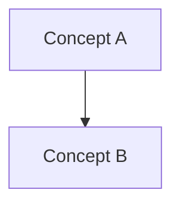
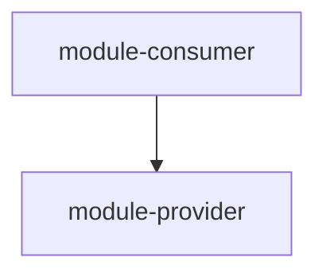
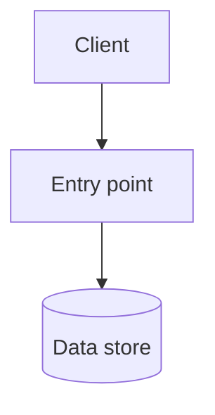

<!--
Template for architecture.md. Delete every comment block before committing.

Delete a conditional section outright when its trigger does not hold; never
leave an empty heading. Delete a cross-cutting heading only when the concern
genuinely does not exist in the system.

Every diagram is Mermaid and carries prose. A section holding a diagram and
nothing else is incomplete.
-->

# Architecture

## Overview

<The system's shape and its decomposition into modules.>

<!--
Required when the Implementation Status table lists more than one top-level
module. Core Concepts is the first H3 of the Overview; a short lead paragraph
may precede it, and its absence is not a defect. A relationship table is
allowed; a definition table is not. Link the project glossary once for the
terms' definitions; never restate one. Reference the ADR that records a
decision; never restate its rationale.
-->
### Core Concepts

<For each concept a reader must hold to follow this document: how it relates
to the others, its lifecycle, and what it survives.>

| Concept | Relationship | Lifecycle and scope |
|---|---|---|
| <concept> | <how it relates> | <what it survives> |

<The lifecycle view the diagram encodes, and the constraints the prose carries.>

### Design Mainline

<The problems the design must solve, the mechanism for each, and where the
mechanism is specified. The table carries at least one data row; the three
columns are required.>

| Problem | Mechanism | Where it is specified |
|---|---|---|
| <problem> | <mechanism> | <section> |

## Module Dependency Graph

<The direction rule the graph obeys, what an arrow means, and the constraints
the shape encodes.>

## Logical Deployment Architecture

<What runs where, and which boundaries are process boundaries.>

<!-- Conditional: include only when the system runs as more than one process or replica. -->
## Physical Deployment Architecture

<!-- Conditional: include only when call chains are non-trivial. -->
## Inter-Module Call Relationships

<!-- Conditional: include only when data moves across module boundaries. -->
## Data Flow

## Cross-Cutting Design

### Error Model

### Authentication and Authorization Boundaries

### Data Consistency and Transaction Boundaries

### Concurrency Model

### Failure and Degradation

### Observability

### Performance and Capacity Targets

### Security Boundaries

## Architecture Invariants

<The rules the system must not violate. These are what a review adjudicates
against, so each one is stated so that a violation is recognizable.>

## Implementation Status

<!--
One line per top-level module, linking to that module's own document.
Roll-up only: the module document is authoritative and holds the detail,
and a module whose sub-modules have their own documents rolls them up in
its subdirectory's README.md. A sub-module never gets a row here.

State the status and nothing more. Status is one of
Implemented / Partially implemented / Not implemented.
-->

| Module | Status |
|---|---|
| [<module-name>](modules/design-<slug>.md) | Implemented |
| [<module-name>](modules/<slug>/design-<slug>.md) | Implemented |
