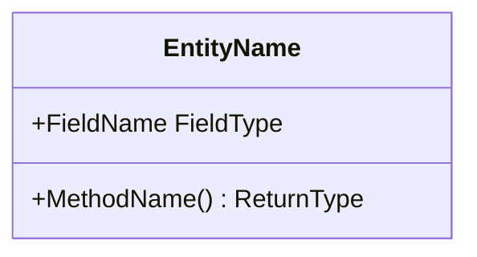

<!--
Template for a module design document, modules/design-<slug>.md. Delete every
comment block before committing.

The section order is fixed so modules can be read against each other. Delete
a section marked applicable-only when it does not apply; keep the order of
the rest.

The slug is lowercase kebab-case, matches the module's directory or package
name in the code, and never changes.

Module in context and Reading guide are prose before the fixed sections, not
headings: the fixed order starts at Responsibilities. Keep Reading guide only
when the document is long enough that it cannot be read linearly.
-->

# <Module name>

<Module in context: where this module sits in the system, what it owns, what
it does not own, and the one-sentence mental model a reader should hold
before the responsibility list.>

<!-- Keep only when the document is long enough that it cannot be read
linearly; delete otherwise. -->
<Reading guide: which sections a first reader takes in order, which are
reference, and whether the race cases are a final self-check.>

## Responsibilities

<What the module does, and what it owns. Each responsibility states the
action the module performs and the result or boundary it produces; a bare
list of owned tables, queues or artifacts belongs to Core Data Structures,
not here.>

### Non-Responsibilities

<What the module explicitly does not own, and which module owns it instead.>

<!--
Optional, and rare. Delete unless this document gives a word a meaning of
its own that the reader would not arrive at unaided. A term that holds
project-wide belongs to the project glossary, never to both; a term
registered here states the scope it applies to.

Every entry carries the term's English counterpart -- the word the English
documentation and the code's identifiers reuse. It is what keeps one term
from becoming two words in translation. A document written in English
omits the English column.
-->
## Glossary

| Term | English | Scope | Definition |
|---|---|---|---|
| <term> | <the word the documentation and the code use> | <where this meaning applies> | <what it means there> |

## External Interface Contract

<What other modules may call, and what stability is promised. Signatures or
pseudocode only, trimmed to the part that carries design meaning. Examples
are not required to compile.>

## Dependencies

<What this module depends on, and how that satisfies the architecture
invariants.>

## UML Diagrams

<!--
Select diagram types by fact, never to fill this template:
  class diagram    core data structures and their relationships
  sequence diagram cross-module interaction
  state diagram    entities with a lifecycle
  activity diagram branch-heavy flows
When the module holds no corresponding fact, draw nothing.
-->

<What the diagram below fixes: the constraints and the invariants its
structure cannot show. Every diagram carries prose; a section holding a
diagram and nothing else is incomplete.>

## Core Data Structures

<!-- Applicable only: keep in a module with a state machine. Delete otherwise.
The third column names the actor -- the component itself or the entity it
manages -- and does not repeat the first column. Name the actor in the header
when it is the same for every row. One row per state; merge substate values
into their parent row and explain them, unless the module treats them as
first-class states. Keep the row to one sentence and list many substates after
a colon. Chinese column names: 状态 | 一句话含义 | 当前动作 | 直觉画面. -->
### State at a Glance

<The closed value set states which values exist; this table states what each
value means in operation.>

| State | What it means | What is happening | Mental image |
|---|---|---|---|
| <state> | <one sentence> | <action> | <image> |

## Core Algorithms and Flows

<!--
Complexity analysis is required for performance-sensitive algorithms and is
not required for procedural flows.
-->

<!-- Applicable only: delete when the module has no core flow a reader must internalize.
Place this at the start of Core Algorithms and Flows, before the exhaustive
tables, and point to it from the Reading guide. Chinese heading: 走查. -->
### Worked Example

<One core flow a reader must internalize: the initial state, the event or
call sequence, and the persisted state after each step. A sequence diagram
shows message order; this trace shows what the persisted state becomes.>
<!-- Applicable only: delete when the module has no non-trivial failure behaviour. -->
## Error and Failure Semantics

<Failure modes, retry behaviour, idempotency, degradation.>

<!-- Applicable only. -->
## Concurrency and Transaction Boundaries

<!-- Applicable only. -->
## Extension Points

## Implementation Status

<!--
Status is one of Implemented / Partially implemented / Not implemented.
State the status and nothing more -- no explanation, no list of what is
missing. Every entry that claims implementation carries a code anchor:
path plus symbol name, never a line number.
-->

| Capability | Status | Code |
|---|---|---|
| <capability> | Implemented | `path/to/file.go` `SymbolName` |
| <capability> | Partially implemented | `path/to/file.go` `SymbolName` |
| <capability> | Not implemented | — |
