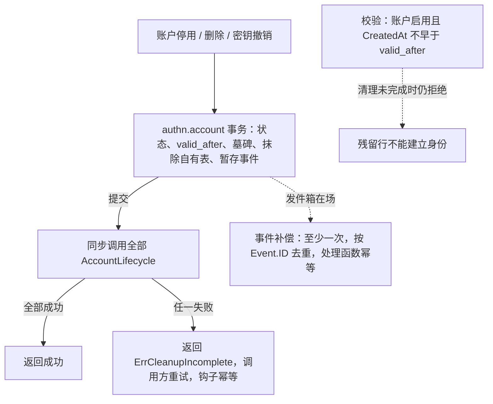

# 账户停用、删除与密钥撤销的清理：本模块事务加钩子加事件补偿，`valid_after` 兜底

## 背景

账户停用、账户删除与服务密钥撤销之后，持有该账户数据的其他模块要跟着清理：登录会话行与刷新令牌、多因素的种子与公钥、短信挑战行。这些数据各归声明它的模块，账户存储不持有它们（[ADR-authn-accounts](adr-authn-accounts.md)）。

约束如下：

- **每个模块只在自己的事务里写自己的表。** `pkg/db` 没有跨模块传递事务句柄的通道；别的模块的表可能因模块未纳入而不存在，往不存在的表里写会让账户事务本身失败。
- **依赖方向固定。** 会话与因素模块依赖账户模块取账户事实，账户模块不能反向依赖它们，否则构造期成环。账户模块对它们的取用只能是可选的：`Requires` 只写排他功能，并立的功能一律经 `ResolveAll` 取（[ADR-authn-wiring](adr-authn-wiring.md)）。
- **持有账户相关数据的模块集合不封闭。** 宿主可以纳入别的持有以账户为键的数据的模块，账户模块不能为每一种枚举调用点。
- **清理在结构上无法原子。** 账户事务提交之后，进程可能在清理之前崩溃，某个模块的清理也可能失败。
- **停用与删除是安全动作，且不论清理是否做完都必须安全。** 停用之后，该账户的会话与令牌不能再建立身份；删除之后，个人数据与机密（TOTP 种子，[REF-rfc6238](../references.md)、通行密钥公钥）随账户一并移除，不只是不可用（REQ-platform-admin-014）。
- **服务账户的会话行与登录会话的终结方式不同。** service 种的行每个服务密钥一行，由密钥换取令牌时复用，随密钥终结；`revoked_at` 是终态，已撤销的行不复活（[ADR-authn-session](adr-authn-session.md)）。
- **事件发布因装配而异。** 事务发件箱在场时，事件在账户事务里暂存、提交之后由中继至少一次地发布，订阅方按 `Event.ID` 去重；发件箱缺席时，事件至多是尽力发布，崩溃会丢。

## 考虑过的选项

### 账户事务里同时撤销会话、删除因素与短信挑战

账户模块在停用或删除的同一个事务里，直接写会话、因素、短信各表。

**否决**：违反每个模块只写自己的表。别的模块的表可能不存在，账户事务因此在未纳入这些模块的装配里失败；`pkg/db` 没有把事务句柄交给另一个模块的通道，要做就得让账户模块拿到别的模块的 `*gorm.DB`（[REF-gorm](../references.md)）与表结构，这些表的迁移集随之耦合到账户模块。这个方案能给出的原子性，也只在所有模块同库、同方言、同时存在时成立。

### 账户模块直接依赖会话、因素、短信模块并调用它们

账户模块 `Requires` 会话、因素、短信的能力接口，停用与删除时逐个调用。

**否决**：会话与因素模块依赖账户模块，反向依赖使构造期成环。即便把调用改成可选取用，账户模块仍要在包里认识这些具体模块的接口，每新增一个持有账户数据的模块都要改账户模块。纳入的模块集合由宿主决定，这是账户模块无法预知的信息。

### 只发事件，由订阅方清理，不设同步钩子

账户事务里暂存事件，各模块订阅后自行清理，账户模块不做任何同步调用。

**否决**：发件箱缺席的装配里事件没有至少一次保证，崩溃即丢，清理没有任何触发点。同步管理动作（停用账户的管理面路由）也得不到清理结果：调用方无从知道清理是否做完，无法在清理失败时返回失败、让调用方重试。事件只适合作为同步路径之外的补偿。

### 只靠 `valid_after` 与账户状态，不做任何清理

停用与删除只改账户行；校验时检查账户状态与 `valid_after`，会话行、因素与挑战行留在原处。

**否决**：判据可以让残留的行不能建立身份，达不到抹除。TOTP 种子、通行密钥公钥与会话行是个人数据与机密，删除账户之后留在库里，库转储即泄露；会话行与刷新令牌行永久累积。判据只适合作兜底。

### 停用时撤销 service 种会话行

`AccountDisabled` 对 browser、token 与 service 种会话一并撤销。

**否决**：`revoked_at` 是终态，`ForCredential` 遇已撤销的行返回 `ErrSessionRevoked`，不复活。停用之后再启用，服务客户端持有仍有效的密钥，却换不出令牌，只能轮换密钥。若放开已撤销行的复活，则任何能触达撤销路径的操作（含对 service 令牌的 `Tokens.Revoke`）都成为复活行的入口。service 行因此只经撤销密钥与删除账户终结，停用靠 `valid_after` 使其失效，再启用后由 `ForCredential` 重置 `created_at` 恢复。

### `Passwords.Set` 内部撤销该账户的会话

口令写入成功后，由 `Passwords` 自己调用会话模块撤销其余会话。

**否决**：`Passwords` 由账户模块交付，这样做让账户模块依赖会话模块，与本记录否决的反向依赖相同；而 `Passwords.Set` 的调用者还包括不经处理器的运维重置路径，撤销哪一条会话（`except`）只有持有当前会话的处理器知道。

### 本模块事务加同步钩子加事件补偿，`valid_after` 兜底

**采纳**，见决策。

## 决策

采纳：账户停用、删除与服务密钥撤销采用本模块事务加同步钩子加事件补偿，正确性的底线由 `valid_after` 与账户状态承担，不靠清理做完。设计文档 `design-authn-account` 承载迁移表与钩子的全部行为，`design-authn-session` 承载会话有效性的判定，本记录只定判据。

**账户事务只写账户的表。** 状态、`valid_after`、墓碑与个人数据的抹除、发件箱事件都在 `authn.account` 的事务里完成；账户事务不写会话、因素、短信各表。

**提交之后同步调用钩子。** 根包定义 `AccountLifecycle`（`AccountDisabled`、`AccountEnabled`、`AccountDeleted`、`ServiceSecretRevoked`；恢复方向见 [ADR-authn-account-restoration](adr-authn-account-restoration.md)）。持有以账户为键的数据的模块实现它（当前为 `authn.session`、`authn.mfa`、`authn.sms`、`authz.policy`；判据是持有以账户为键的数据，名单是例举而非封闭集），实现并立、不排他，`authn.account` 经 `ResolveAll` 取用。钩子在账户事务提交之后同步调用；任一钩子失败时，账户的状态已经生效，调用返回 `ErrCleanupIncomplete`，调用方重试同一调用。每个钩子幂等：数据已清、账户已停用、已启用或已删除时返回成功。

**事件补偿。** 发件箱在场时，实现钩子的模块另订阅 `authn.account.status-changed` 与 `authn.account.deleted`，重做自己的清理，至少一次、按 `Event.ID` 去重，处理函数幂等。发件箱缺席的装配里，提交与钩子之间的崩溃窗口没有补偿，抹除不保证；残留行不能用于认证，启动诊断以 Warn 说明。

**`valid_after` 与账户状态是底线。**

- 停用与删除都把账户的 `valid_after` 前移，再启用时不回退。
- 会话有效性判据含账户状态与 `valid_after`：账户启用，且会话 `CreatedAt` 不早于账户 `valid_after`。判据的取用路径、缓存与建立身份时的重复校验由 `design-authn-session` 与 `design-authn-account` 承载。
- 钩子未做完时，残留的会话行与刷新令牌不能换出有效身份；账户之后重新启用，旧会话也不复活。
- service 种会话行只经撤销服务密钥与删除账户终结：停用靠 `valid_after` 使其失效，重新启用之后由 `Sessions.ForCredential` 以仍有效的密钥恢复。

**改口令、删因素、解绑不是账户的迁移。** `Passwords.Set` 不撤销会话；由调用它的处理器在操作成功之后调用 `Sessions.RevokeAccount(except)`，使 `Passwords` 不依赖会话模块。删因素同样由它的用户面 DELETE 路由在操作成功之后撤销，`MFA.Remove` 自己不撤销、也不对会话作任何承诺。

## 后果

- 账户模块的事务边界不依赖其他模块是否纳入：在没有会话、因素、短信模块的装配里，账户的停用与删除照常完成，钩子集合为空。
- 停用后的请求拒绝不依赖清理成功。缓存命中的副本在会话检查缓存有效期内仍放行，这与会话撤销共用同一个生效时延上界。
- 新增持有账户数据的模块只需实现 `AccountLifecycle`，账户模块不改。
- 清理失败对调用方是可见的：同步管理动作得到 `ErrCleanupIncomplete`，状态已生效，重试补完。

**接受的代价：**

- **抹除不是原子的。** 账户事务提交与各模块清理之间存在窗口，账户已删除而别的模块的行尚在；窗口内这些行不能用于认证，但仍存在于库中。
- **无发件箱的装配里抹除不保证。** 提交之后、钩子完成之前进程崩溃，且没有事件补偿，会话、因素、短信各表里的行会长期残留，只有再次对同一账户重试调用才会清掉；而已删除账户的重试入口是否存在取决于调用方。启动诊断的一行 Warn 是唯一的提示。
- **`ErrCleanupIncomplete` 把重试责任交给调用方。** 状态已生效而调用返回错误，调用方需要区分「状态没变」与「状态已变、清理待补」，管理面按 503 应答、要求重试同一调用。
- **每次建立身份多一次账户快照检查。** 校验后端与 `Sessions.Status` 对同一判据做双重校验，换来钩子遗漏时的安全；账户快照自身有缓存有效期，滞后上界与会话检查缓存相同。
- **改口令与解绑的会话撤销靠调用约定。** `Passwords.Set` 不替调用方撤销会话，处理器漏调 `Sessions.RevokeAccount` 时旧会话不会被撤销；这一约束由处理器的测试守住，类型系统不强制。
- **停用再启用之后，service 客户端要重新换令牌才恢复。** 换令牌之前该账户的 service 行判无效，客户端持有的访问令牌不会自行复活。

## 失效条件

- **`pkg/db` 提供跨模块传递事务句柄的通道，且这些模块在同一装配里必然同时存在。** 此时同一事务内清理成为可行，抹除可以原子；本记录的钩子与事件补偿并用的做法中，事件补偿可以去掉。
- **发件箱的发布不再保证至少一次，或事件的 `Event.ID` 在重发时改变。** 事件补偿的去重与幂等假设失效，需要另立清理的触发机制。
- **假设：`Sessions.Status` 把账户启用与 `valid_after` 写进判据后，cookie、访问令牌与刷新令牌各条路径确实共用它，且钩子失败时仍判无效。** 守住它的测试：钩子失败时 `Sessions.Status` 判无效；账户停用后重新启用，旧会话仍无效；删除账户之后各模块的表里没有该账户的行（含 TOTP 种子与通行密钥公钥）。任一测试无法写成，或写成后失败，本记录的底线断言不成立。
- **假设：`Sessions.ForCredential` 的原子取或建在所支持的各数据库方言下成立。** 由并发首次调用只建一行的测试守住；不成立时 service 行恢复的路径需要重新设计。
- **合规要求连标识都不得留存。** 墓碑行保留标识，本决策不满足这一要求，需要另议。
- **宿主要求停用时 service 会话行即刻终结，而不接受 `valid_after` 的失效。** 此时需要引入可复活或可重建的终态，推翻 service 行只经密钥终结的判据。
