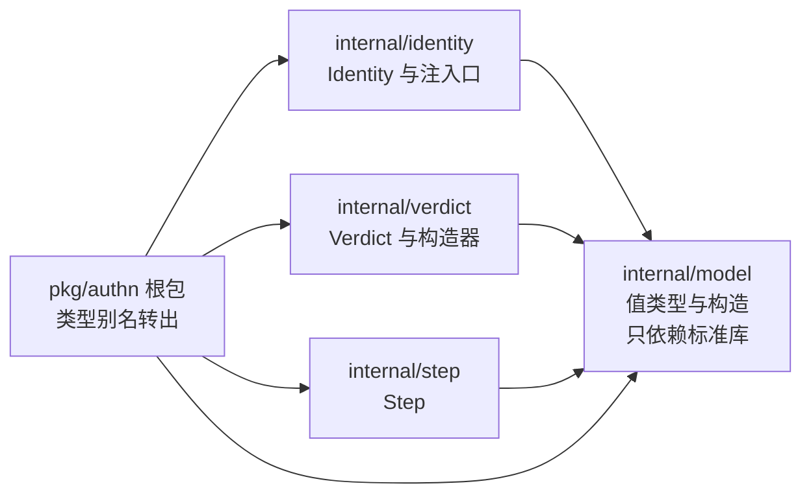

# 身份以账户为中心：Account、Actor、责任键 Key、类型落点

## 状态

已接受

## 背景

身份是网关盖章后写进请求上下文的那一份事实，授权、限流、审计、租户准入与日志都把它当作已核实的输入（[ADR-authn-verdict-2026-10-10](adr-authn-verdict-2026-10-10.md)）。身份的形状要同时满足以下几组约束。

**归属前提不再成立。** 以「后端名/主体」作身份串的前提，是各校验后端各占一片互不相交的主体空间。账户成为 authn 内的全局表之后，同一个人经口令、会话、令牌等不同路径到达的是同一个账户，身份串却随路径而异；归属表、`Separator`、`Identity.Owner()` 与主体的归属绑定随之没有对象（[ADR-authn-credential-dispatch-2026-10-10](adr-authn-credential-dispatch-2026-10-10.md)、[ADR-authn-accounts-2026-10-10](adr-authn-accounts-2026-10-10.md)）。

**冒充使请求牵涉被冒充者与管理员。** 冒充中的请求同时与被当作请求方的被冒充者、真正动手的管理员相关（[ADR-authn-impersonation-2026-10-10](adr-authn-impersonation-2026-10-10.md)）。下游每一层都要回答「这次请求算谁的」，而授权、限流额度、审计的行动者列要的答案不同。

**下游不透明地使用 `Key()`。** 限流以 `Key()` 作计数键，`audit/journal` 以它写 `actor` 列，`settings` 的写入与删除的 `actor` 参数由调用点传入、authn 之上的管理面传 `Key()`。限流、`audit/journal` 与 `settings` 的 `actor` 参数都不解析它的内部形态。限流按 `Key()` 计数，键的取值为 `string(Actor())`，与 [ADR-ratelimit-dimension-2026-09-22](adr-ratelimit-dimension-2026-09-22.md) 的计数方式兼容。

**身份要携带事实，但不携带角色与租户。** 网关与授权按类型取登录会话、认证方式、保障等级、认证时刻等事实。令牌与身份默认不带角色，授权实时查询；网关在租户解析之前运行，认证时没有租户。身份的属性集对每个校验后端都是可选的，[ADR-tenant-resolution-2026-09-21](adr-tenant-resolution-2026-09-21.md) 中「租户取自请求面、不从身份派生」的前提成立。

**身份的保证依赖于类型的落点。** 根包被 `tenant/resolve`、`audit/journal`、`ratelimit` import，根包新增的任何 import 都进入 `tenant/resolve`、`audit/journal`、`ratelimit` 的依赖闭包，所以根包只依赖标准库与 authn 自己的内部包（[ADR-authn-packaging-2026-10-10](adr-authn-packaging-2026-10-10.md)）。`Identity`、`Verdict`、`Step` 不可字面构造，它们的签名要引用账户标识、方式、等级、`Principal` 一类值类型，而这些值类型也出现在根包的导出面上。Go 不允许在根包里为别的包定义的类型声明方法，根包用类型别名转出一个类型时，方法只能写在真身所在的包里。

**可强制的边界是 Go 的包边界。** 字段不导出只在包内成立，`internal` 目录限定谁能 import；「只有 authn 树内能读内部字段」与「请求链上的身份只由网关写入」都落在字段不导出与 `internal` 目录上。

## 考虑过的选项

### `Key()` 沿用「后端名/主体」

保留 `owner + "/" + subject` 的形式，身份仍带归属限定。

**否决**：归属退役后没有 owner 可拼。同一个人经两条路径得到两个身份串，限流额度被拆成两份，审计里同一个行为人以两个名字出现，这正是账户全局化要消除的现象。

### `Key()` 取 `Account()`，即生效主体

计数键与审计的行动者列都取被当作请求方的那个账户。

**否决**：冒充时限流额度算到被冒充者头上。管理员借冒充许多账户，得到许多个互相独立的额度桶，绕开自己的限额；被冒充者的额度被管理员的动作耗尽。审计把管理员的动作记在被冒充者名下，归责倒置：行动者列写下的不是动手的人。

### 删掉 `Key()`，让下游各自取 `Actor()` 或 `Account()`

身份只暴露 `Account()` 与 `Actor()`，计数键与行动者由每个消费者自己选。

**否决**：下游需要的是「按真正动手的人」这一把稳定的键，且只有一个正确答案。把定义留给每个消费者各选一次，将来新增的消费者（授权的审计、配额）选错一次就是一次静默的归责错误或额度错误。定义写在一处，错误只会出现在这一处，也只需要一条测试守住。

### 保留 `Subject()` 并改义

`Subject()` 继续存在，改为返回账户标识。

**否决**：同名异义。旧 `Subject()` 的含义是后端主体空间里的名字，已不存在；改义后依赖它的宿主代码照常编译、含义已变。删除使这些代码在编译期现形。

### 身份带角色与租户列表

身份携带账户在各租户内的角色，下游直接读。

**否决**：令牌与身份默认不带角色，授权实时查询，身份里的角色快照会在撤销之后继续生效；网关在租户解析之前运行，认证时没有租户可供列举。成员关系是表，由租户准入层与授权按请求期的租户查询。

### 冒充者与被冒充者作为两个独立身份写进上下文

上下文里同时存在「操作者身份」与「被冒充者身份」，各有一个注入口与读取函数。

**否决**：下游每一层都要决定读哪一个，错读一次就是越权或错误归责，且没有机制发现错读。单一身份加 `Actor()` 把选择变成调用点上显式的一行。

### 认证方式、会话标识等事实放进属性袋

身份只有一个字符串到字符串的属性集，方式、等级、会话标识、冒充范围、提供方都以保留键放在其中。

**否决**：授权与网关要按类型取这些值，放进袋子就得靠保留键防伪造，每个读取点各自解析字符串；键拼写错误成为静默的缺值，缺值又落在放宽的一侧。属性集因此只承载宿主与 IdP 映射出的业务属性，且不得与类型化字段竞争。

### 保障等级用整数分数或自由字符串

等级为可比较的数值或任意文本，由后端自定含义。

**否决**：各档含义无从定义，也无从与租户策略的要求比较。等级取有序的小闭集，零值读作未陈述。

### 值类型的真身放在根包

`AccountID`、`Principal` 等直接定义在根包，`Identity` 等真身放在内部包并 import 根包。

**否决**：内部包 import 根包而根包又要 import 内部包以转出身份类型，成为导入环。

### 全部真身放进同一个内部包

值类型、`Identity`、`Verdict`、`Step` 都定义在一个内部包里，根包别名转出。

**否决**：去掉了环，却使 `Identity` 的不导出字段与注入口、`Verdict` 的不导出字段、`Step` 的内部状态落在同一个包作用域内：包内任何一处代码都能读写另一个类型的字段，「判决由构造器产生」与「身份只由网关注入」各自按类型成立的性质，退化为同一个包内的约定。

### 根包定义包装类型，转发到内部真身

根包声明自己的 `Identity` 结构体，持有内部类型的值并逐个转发方法。

**否决**：根包类型与内部类型成为两个不同的类型，内部包里的签名与根包之间需要来回转换；每个方法的转发手写，漏转发或转发走样不会被编译器发现。别名使方法集随真身走，没有第二份实现。

### 身份的写入口只限网关一个包

写入方名单只有网关；登录引擎要为审计行取得行动者时，不写上下文。

**否决**：审计的记录接缝没有行动者字段，`audit/journal` 只从上下文里的身份读行动者（[ADR-authn-events-and-audit-2026-10-10](adr-authn-events-and-audit-2026-10-10.md)）。登录与 SSO 回调发生在没有身份的豁免路由上，登录成功那一行的行动者必须是刚认定的账户，只能经一个携带该身份的上下文交给 `Audit.Record`。要让登录引擎完全不写上下文，就要给审计的记录接缝加行动者字段，那是审计模块对外接缝的变化，由审计模块自己裁定，不由认证模块的需要驱动。

### 写入口对 authn 树内的包不设限，靠约定

`internal/identity` 只靠 `internal` 目录限定：树外的包 import 不了，树内的包都可以。

**否决**：`internal` 目录只拦得住 `pkg/authn` 之外的包。树内的校验后端、会话与登录方法各包都能调用注入口，写出一个没有经过网关出口检查的身份。这是「请求链上的身份只由网关写入」在树内唯一没有机制守住的一半；靠约定守住的性质，在新增一个包的时候就失效，并且没有任何信号。

### 晚于 `now` 的认证时刻读作不新鲜

`Satisfies` 把认证时刻晚于 `now` 的身份判为不满足任何带 `MaxAge` 的要求。

**否决**：网关盖章放过不晚于自己的时钟加一个固定余量的认证时刻，余量是为认证它的副本或 IdP 与本副本之间的时钟偏差留的（取值由设计文档承载）。同一段偏差在盖章处被容忍、在判定处被拒绝，刚完成认证的用户经时钟偏慢的副本到达要求新鲜认证的路由时，会被要求再认证一次。

### `FromContext` 在上下文里没有身份时回落，注入口导出

沿用 `log` 的形态：`FromContext` 在上下文里没有身份时回落一个缺省身份，注入口是导出的。

**否决**：两者要承载的东西不同。logger 有默认值而身份没有，回落等于把一个匿名请求读成某个主体；导出注入口等于让链上任何一层改写身份，而认证的全部意义就是这件事只发生一次、只由一个地方决定。因此 `FromContext` 无回落，没有身份时第二个返回值为假；注入口只在 authn 树内可达（[ADR-log-context-2026-09-13](adr-log-context-2026-09-13.md)）。

### 账户为中心的单一身份，责任键取实际操作者，值类型落在叶子内部包

**采纳**，见决策。

## 决策

采纳：身份以账户为中心，不再带归属；`Key()` 是恒等于 `string(Actor())` 的责任键；值类型落在不依赖任何 authn 包的内部叶子包，不可字面构造的类型各占一个内部包，根包以类型别名转出。字段全集、读取函数的语义与 `Requirement` 的判定由 design-authn 承载，本记录只写判据。

**账户标识：`Account()` 与 `Actor()`**

- `Account()` 是生效主体：授权与审计把这次请求当作「谁的请求」的那个账户，冒充时是被冒充者。`Account()` 与生效主体是同一个值，不设单独的字段。
- `Actor()` 是实际操作者：不冒充时与 `Account()` 相同，冒充时是真正动手的管理员。`Impersonating()` 即 `Actor()` 不等于 `Account()`。
- 身份是单一的，没有第二份「被冒充者身份」。

**责任键**

- `Key()` 取实际操作者。定义只有 design-authn 一处载体；下游不透明地使用它，不重复定义，也不解析它。
- 授权不取 `Key()`：判定主体是 `Account()`。冒充期间按被冒充账户的权限判，发起者的权限不生效。
- 限流按真正动手的人计数，冒充不占用被冒充者的额度；审计的行动者列记真正动手的人，归责不落到被冒充者头上。
- `Subject()` 与 `Owner()` 删除，不改义保留。

**身份的类型化字段**

类型化字段的全集是封闭的，清单由 design-authn 承载。判据如下。

- 没有角色，没有租户；冒充限定的租户范围是唯一例外，它是对本次冒充的限定，不是账户与租户的关系。
- 属性集对每个校验后端都是可选的，承载宿主与 IdP 映射出的业务属性，不承载任何类型化事实。租户仍取自请求面，成员关系是表，不是属性。
- 后端名取自 `Verifier.Name()`，重新认证的挑战方案名按凭据载体确定，两者都由网关盖章，不取自后端交出的 `Principal`。其余事实取自 `Principal`，经网关逐项核对后写入（[ADR-authn-verdict-2026-10-10](adr-authn-verdict-2026-10-10.md)）。
- 保障等级是有序的闭集，零值读作未陈述，网关盖章时按单因素处理。

**读取与注入**

- `FromContext` 无回落：没有身份时第二个返回值为假，不返回任何缺省身份。
- 身份的注入口只在 authn 树内可达，写入方是一份封闭名单，由依赖测试断言：名单之外的包在非测试文件里 import 注入口即失败。包边界只拦得住 authn 树之外，树内其余各包由这条断言拦。名单的成员与各自的理由：
  - 网关：请求链上唯一的写入方，写之前先过出口检查。
  - 登录引擎：只为一次审计记录派生携带新认定身份的上下文，交给那一次 `Audit.Record`，不交给处理器或流程的下一步，不进请求链，也不经出口检查。
  - 测试构造口 `authntest`：供其他模块的测试得到身份。
  - 根包：只转出读取面，不转出注入口。
- 网关对本次请求命中的路由登记的访问级别由 `AccessFromContext` 单独报告，零值表示网关没有对这次请求作过决定。消费者据此区分路由豁免、可选认证且无凭据、受守且必有身份与网关缺席，不以 `FromContext` 的真假去猜。
- `Verdict` 与 `Identity` 的内部字段读取是包级函数，不是方法：方法会随别名带到任何包，包级函数才留得住「只有 authn 树内能读内部字段」。

**认证强度要求**

- 路由对认证强度的最低要求带 `Local` 标志。`Local` 为真时不采信 IdP 声明的多因素，账户安全类操作与冒充发起使用 `Local`。多因素等级只在一处合成，见 [ADR-authn-mfa-2026-10-10](adr-authn-mfa-2026-10-10.md)。
- `Satisfies` 的失败方向是拒绝：零值身份不满足任何要求；`MaxAge` 为负时无人满足；要求新鲜度而 `now` 为零值（时钟没有设置）或认证时刻为零值，不满足。唯一读作宽松的一档是晚于 `now` 的认证时刻：读作不过期，容忍的是网关盖章允许的那一段时钟偏差。条件的全文由 design-authn 承载。

**类型落点**

- 值类型连同构造函数与比较，真身在 `internal/model`，具体清单由 design-authn 承载。`internal/model` 不 import 任何 authn 包，只依赖标准库。
- `Identity`、`Verdict`、`Step` 的真身分别在 `internal/identity`、`internal/verdict`、`internal/step`，各自 import `internal/model`，彼此不 import。
- 根包用类型别名转出类型，用 `const`、`var` 与薄包装函数转出常量、哨兵与构造函数。别名类型的方法定义在真身包里，根包不字面声明它们。
- 判据：能被 `Identity`、`Verdict`、`Step` 中不止一个引用的值类型落在 `internal/model`；带不可字面构造性质的类型落在各自的真身包。

## 后果

`Key()` 的定义只有一处，下游的代码不动：授权按 `Account()` 判定，冒充时是被冒充的账户；限流仍按 `Key()` 计数，冒充计在实际操作者名下；审计的 `actor` 列的写法不变、语义是实际操作者；冒充时的被冒充者经 `Account()` 在审计明细里另有一栏。

同一个人经任何后端到达同一个账户，得到同一个责任键，限流额度与审计行为人不再随认证路径分裂。

身份的类型化字段由编译器检查，读取点不解析字符串；网关盖章的核对项与这些字段一一对应。

根包的依赖闭包保持为标准库加 authn 自己的内部包；`internal/model` 是所有值类型的唯一落点，别的 authn 包不为取得类型而互相依赖。

**接受的代价：**

- **`Key()` 的取值形态静默改变，签名不变。** 取值不再带 `/`，零值身份的 `Key()` 由 `"/"` 变为 `""`。编译通过的调用方（限流、审计日志、示例宿主，以及宿主自写的消费方）静默得到新值；按旧形态写死的策略串、看板条件与测试断言失效而不报错。已落库的审计 `actor` 是旧形态，新旧并存于同一列，按行为人聚合的历史查询要同时识别新旧形态；限流计数键是临时数据，不需迁移。缓解手段是：该变更作为宿主可见面的不兼容变更登记；一条断言 `Key()` 等于 `string(Actor())` 的测试守住定义。
- **未识别不能由 `Key()` 是否为空判断。** 零值身份的 `Key()` 是空串，消费者以 `FromContext` 的第二个返回值判断有没有身份；把空串当作「已识别的某个主体」或把非空当作「已识别」都是错的。
- **「按人的稳定键」只靠约定与一条测试保持。** 新的消费者绕开 `Key()`、自行选 `Account()` 作计数键或行动者，编译器不会拦截，冒充场景下的归责倒置会随之重现。单一身份加 `Actor()` 把选择变得显式，没有把选错变得不可能。
- **`Identity` 变大且含切片与映射。** 按值传递每次请求多拷贝一次，切片与映射字段在读取时返回副本。
- **不带角色与租户，授权每次请求自己查。** 需要角色的处理器与租户准入层承担一次查询或缓存，身份里没有可以直接读的快照。
- **登录引擎是名单里唯一不经出口检查的写入方。** 它派生的上下文不流入请求链这一点靠登录引擎自己的测试守住，不靠类型守住；该上下文一旦交给处理器或流程的下一步，一个没有经过出口检查的身份就进了请求链。
- **新增写入方要改名单。** 名单之外的包新增对注入口的 import，依赖测试即失败；确要新增写入方时，名单与本记录一起改，不绕过这条断言。
- **晚于 `now` 的认证时刻读作不过期。** 新鲜度窗口最多多出网关盖章余量那么长；认证时刻的上界由网关的出口检查给出，`Satisfies` 不再另判。
- **`Local` 使 IdP 声明的多因素在账户安全类操作与冒充发起上不算数。** 经企业 SSO 登录、且 IdP 已做多因素的用户，做这类操作仍要本地验证过的因素；账户没有本地因素时这类操作不可达。
- **别名转出使根包的源码里看不到 `Identity` 的方法集。** 读者与文档工具要追到内部包才能读到方法；根包导出面的变化要靠依赖测试与导出面清单守住，不能只靠读根包。新增值类型时要先判断它落 `internal/model` 还是某个真身包。
- **消费者必须处理 `AccessUnknown`。** 零值是「网关没有作过决定」，读到它的代码不得把它当作豁免或当作已认证；`AccessFromContext` 与 `FromContext` 成为一对要一起读的函数。
- **同名删除不留过渡。** 依赖 `Subject()` 或 `Owner()` 的宿主代码在编译期现形，一次性改写，没有兼容期；不改义保留则会带着改变了的含义继续运行。

## 失效条件

- 假设「按人的稳定键只有一个正确答案」，答案是真正动手的人。这个假设的一个分支已经兑现：授权要按被当作请求方的账户判定，冒充期间按被冒充账户的权限行事。身份因此有两把用途固定的键，不需要新增字段：授权取 `Account()`，限流、审计与设置归责取 `Key()`。若再出现第三种用途（例如按租户内账户计费的配额），它应在这两种之间择一并在消费点写明，不能另立定义。守住这一点的是代价一节所列的责任键定义测试，以及新增下游消费者时对该定义的复核。
- 假设登录引擎派生的上下文只交给那一次审计记录。若出现需要把它交给处理器或流程的下一步的用法，名单里登录引擎一项失去依据：要么让该身份先过出口检查并改由网关写入，要么另开不携带身份的审计接缝。守住这个假设的是登录引擎自己的测试，断言派生的上下文不出现在请求链上。
- 假设晚于 `now` 的认证时刻只来自盖章余量之内的时钟偏差。若出现不经出口检查交出认证时刻的路径，读作不过期不再有上界，要重新比较「读作不新鲜」的选项。
- 假设一次冒充只有一个操作者。若允许链式冒充或委托到多跳，`Actor()` 作为单一值的形状不足以表达，要重新裁定。
- 若身份面需要承载对每个校验后端都必答的应用属性，「租户取自请求面、不从身份派生」的论证要与 [ADR-tenant-resolution-2026-09-21](adr-tenant-resolution-2026-09-21.md) 重新比较，属性集对每个后端可选这一前提随之失效。
- 若出现必须读取并改写 `Identity` 内部字段的包外使用者，包级读取函数与 `internal` 目录的组合不再够用，身份的读写接口要重新划分。
- 若 Go 允许在根包为别名所指的外包类型声明方法，类型落点中「方法只能写在真身包」的约束消失，别名转出与真身分包的选项要重新比较。
