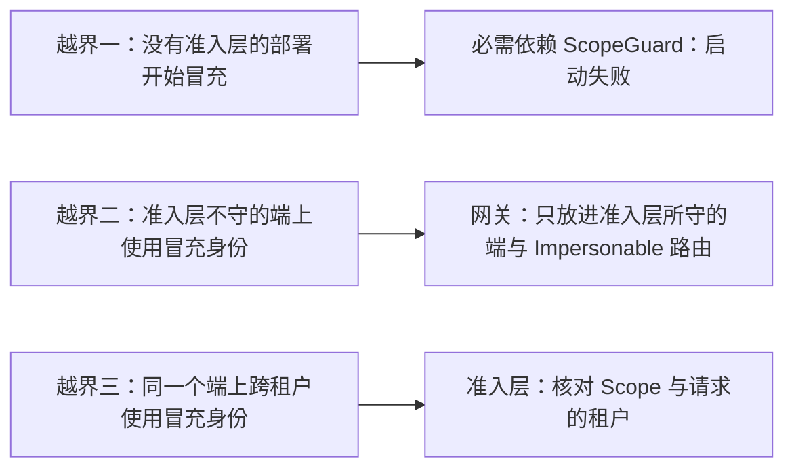

# 冒充：有期限的记录、结构性限制、租户范围的联合执行、审计先于动作

## 背景

管理员需要以某个租户内某个成员的视角操作业务，用于代为排查与代为处理（REQ-platform-admin-022）。这个动作的风险在于：被冒充者的身份在管理员手里生效；影响面若不收口，会越出一个租户；事后若没有记录，无从问责。冒充的形状要同时满足下列事实。

**冒充要能被问到、被撤销、被限时。** 「谁冒充过谁、在哪个租户、因为什么、持续到何时」要有可按目标查询的来源；管理员的会话结束、管理员或目标被停用、目标退出租户时，冒充要随之失效；冒充中的每个请求，实际操作者始终是管理员，限流与审计按管理员计，被冒充者的额度不能被借来耗尽（[ADR-authn-identity](adr-authn-identity.md)）。

**哪些限制由 authn 强制，取决于限制的性质。** 授权不在 authn 内，「谁有权冒充谁」经判定接缝 `Decider` 取得，缺席时全拒，可由宿主或授权模块实现（[ADR-authn-decision-seam](adr-authn-decision-seam.md)）。宿主写的判定可能过宽，而身份层面的事实不依赖角色：发起者是谁、认证有多新、目标在哪个租户、冒充持续多久、有没有留下审计。这些事实由 authn 知道，也只有 authn 能在不认识角色的前提下核对（[ADR-authn-scope](adr-authn-scope.md)）。

**租户范围的执行点不在 authn 自己的处理器里。** 被冒充的身份要访问的是业务路由，不是 `/api/v1/auth/*`。账户是全局的，授权按（账户，租户）绑定，冒充因此也要按租户收口。成员关系的事实归 `pkg/authn`，请求期的成员判定放在 tenant 目录的 `tenant.admission`，`pkg/authn` 的子包不 import `pkg/tenant`，两个目录只经根包的 `ScopeGuard` 与 `Memberships` 相接（[ADR-tenant-admission](adr-tenant-admission.md)）。哪些端有租户解析、哪些路由豁免了租户解析，是宿主在各端上的配置，认证层读不到（[ADR-authn-guarantees](adr-authn-guarantees.md)）。

**审计的写入有自己的约束。** 审计的接缝级写入另占一条连接、不加入调用方的事务；在调用方事务开着时调用它，单写者的 SQLite 上等的是调用方自己占着的写锁，只开一条连接的库上等的是调用方占着的那条连接，等满界后以 `ErrWriteFailed` 失败（[ADR-audit-failure](adr-audit-failure.md)）。强制档审计放进开着的事务，永远写不成功。

**到期与各类失效没有写入方。** 到期、会话结束、停用与成员被移除都不是一次写操作，只体现为「此刻是否仍然有效」的读时判断。一条已经失效的记录仍然是未结束状态；每个管理员会话同时至多一条未结束的记录由唯一约束守住，约束看的是未结束状态，不看有效与否。

**发起者的认证本身要可信（REQ-platform-admin-023）。** 多因素里短信是受限认证器；攻击者可以抢先在受害管理员名下登记因素，用它换取冒充（[ADR-authn-mfa](adr-authn-mfa.md)）。

## 考虑过的选项

### 为被冒充者另开一个会话与 cookie

「以某人身份登录」：冒充开始时为被冒充者建一条会话，浏览器端换用这枚 cookie。

**否决**：新会话的主体就是被冒充者，管理员与被冒充者之间的关联要另存一份；撤销管理员会话不会连带它；被冒充者的会话清单里会混进一条不属于他的会话；冒充 cookie 与管理员自己的 cookie 并存的规则更复杂，每条规则都要独立测试。

### 在发起者的会话上加「当前冒充谁」字段，不另存记录

会话行上记被冒充者与租户，结束时清字段。

**否决**：冒充的开始与结束没有独立的对象可撤销、可审计、可按目标查询，字段一清，「谁冒充过谁」无从回答；API 端没有会话可挂，要另想办法。

### 每个请求带 `X-Impersonate` 头

无状态冒充：请求头指出代谁操作，网关逐请求核对。

**否决**：没有开始与结束，没有期限，没有理由，无法在一处审计与撤销；请求头可被任何转发层原样带走，操作者链随之失真。

### RFC 8693 令牌交换端点作为一般机制

管理员用自己的令牌向交换端点换取以目标为主体的令牌。

**否决**：交换端点要引入客户端注册、受众与范围的整套模型，而需求只有「管理员代某账户」这一个场景；一般机制的开放面也大于需要的开放面。令牌里的 `act` 声明本身适用，只借用它。

### 全局冒充：不限租户

冒充记录不带租户，被冒充者的身份在全系统生效。

**否决**：影响面是整个系统，一次冒充覆盖被冒充者所属的全部租户，授权的粒度却是（账户，租户）；租户边界被冒充整体越过。

### 冒充令牌可刷新，允许嵌套，允许冒充服务账户

冒充令牌附带刷新令牌；冒充中的身份可再发起冒充；服务账户可作为冒充目标。

**否决**：可续期使冒充成为长寿命凭据，期限形同虚设；嵌套使操作者链失去意义；服务账户的凭据是机器密钥，没有可对质的人，冒充它没有「代人操作」的语义。

### 全部限制交给 `Decider`

authn 只询问接缝，不自己核对任何条件，包括认证强度、目标状态与租户范围。

**否决**：宿主写的判定可能过宽，底线不应取决于宿主的实现；保障等级是认证事实，由 authn 判，`Decider` 判的是「谁能冒充谁」。接缝缺席时的行为也由此失去落点：缺席全拒只能挡住「没有任何判定」，挡不住一个什么都放行的判定。

### 租户范围只由 `tenant.admission` 在请求带租户上下文时强制

准入层核对冒充身份的 `Scope` 与请求的租户，其余不管。

**否决**：没有租户上下文的路由（宿主 admin 端的全局资源、没装准入层的部署）冒充身份一样通过，被冒充者的身份在租户之外照样生效，范围形同虚设。准入层只能核对它看得见的请求，它看不见的端要由网关挡在外面，没有准入层的装配要在启动时失败。

### 强制档审计与插入记录放在同一个事务里

事务内先写审计、再插记录，同提交同回滚。

**否决**：审计接缝另占一条连接、不加入调用方的事务，在事务里调用它在 SQLite 上等锁失败，强制档永远写不成功。

### 到期与失效只在读时判定，不落库

`Active` 对失效的记录答「否」，但不更新记录，记录保持未结束。

**否决**：已失效而未结束的记录继续占着唯一约束，同一管理员会话在记录到期后再次开始冒充会得到冲突；记录的结束原因也没有写入方，「谁因何结束」只剩读时的推断，历史查询答不出来。

### 冒充中允许改口令、增删标识与因素等账户管理

冒充身份与被冒充者本人在账户管理上不作区分。

**否决**：冒充者借此可以永久接管目标账户，期限与审计都拦不住已经改掉的凭据。

### 不要求审计落点，审计写失败时照常开始

审计尽力而为，失败只记日志。

**否决**：一次没有记录的冒充无法事后问责；宁可在审计库不可用时不能冒充，也不留下一次无据可查的冒充。

### 结束冒充时轮换会话令牌

**否决**：轮换使旧令牌立即脱钩，轮换的条件更新以旧令牌为前提，结束请求落定时仍在途的、带旧令牌的请求因此被拒绝为 401，客户端要在这个窗口里把 401 与会话失效区分开。清除标识之后有效性判定已使会话回到发起者自己的身份，旧令牌此后只有发起者自己的权限，轮换在降权时换来的只是让冒充期间可能泄露的令牌失效，代价与收益不对等。开始冒充时的轮换保留：它使升权之前就已存在的旧令牌脱钩，升权前被截获的令牌不会带着冒充能力继续可用。这个轮换也有一个在途请求被拒的窗口，但它的边界由发起方掌握——写入何时发出、何时落定是客户端自己的事实，客户端据此在窗口内丢弃旧凭据下的无人登录应答（auth-core 的 `beginIdentityTransition()`，见 [design-web-auth-core](../design/modules/web/design-web-auth-core.md)），而不必把窗口内的 401 与会话失效混为一谈。

### 有期限的记录，结构性限制，租户范围联合执行，审计先于动作

**采纳**，见决策。

## 决策

采纳：冒充是 `authn_impersonations` 里一条有期限、有理由、限定一个租户的记录，由 `authn.impersonation` 排他交付；authn 自己强制一组不依赖 `Decider` 的结构性限制，租户范围由网关、准入层与必需依赖联合执行，强制档审计在事务之外、动作之前写，到期与失效在读时判定、惰性落库。表的形状、限制的逐条条件、开始的步骤顺序与失败处置、各结束原因的写入点、被拒操作清单与审计字段由 design-authn-impersonation 承载，本记录只定判据。

**载体与身份。**

- 冒充是一条记录，不是一枚新的凭据，也不是身份上的开关。
- 浏览器端，开始冒充时轮换会话令牌，结束冒充时只清除会话行上的标识、不轮换，旧令牌继续有效。
- 浏览器端，管理员自己会话的行指向这条记录；API 端，体现为一枚短命的冒充访问令牌，不改管理员的会话，且不发刷新令牌。会话与令牌每个请求都查同一个判断 `Impersonation.Active`，记录一失效，它们一致失效（会话与令牌的承载细节见 design-authn-session、design-authn-token）。
- 冒充中的 `Identity`：`Account()` 是被冒充者，`Actor()` 与 `Key()` 始终是管理员，`Scope()` 是该租户，`Impersonating()` 为真，`Assurance()` 封顶单因素，因此任何要求多因素的路由对冒充身份天然不满足。

**结构性限制的判据：身份层面的事实由 authn 强制，「谁有权」交 `Decider`。** `Decider` 只能在这些限制之上进一步收紧，不能放宽。限制分为下列四组，分组是封闭集；各组的条件与检查次序见 design-authn-impersonation 的「结构性限制」：

- 发起者：覆盖发起者的认证事实，包括身份是否已处于冒充中、认证是否由本模块本地验证、强度与新鲜度、认证方式与因素的成熟度，以及账户的种类与状态。
- 目标：覆盖目标账户的存在、状态、种类、受保护标记，以及目标在该租户内的成员关系；成员关系读库，不经缓存。`protected` 是宿主打在要保护的账户上的人工标记，authn 不认识超级管理员。
- 参数：覆盖租户与理由的必填、期限的上界；不存在全局冒充，期限不超过发起者会话的剩余寿命。
- 并发：同一管理员会话任一时刻至多一条未结束的记录，由唯一约束守住。

违反的应答按性质分开。目标与参数类的硬性限制答 `impersonation-restricted`，且不区分是哪一条，避免向发起者泄露目标账户的状态；发起者的认证强度或新鲜度不足答 401 `insufficient_user_authentication`，要求管理员先做加强认证，该情形只涉及发起者自己的状态，没有需要隐瞒的信息；发起者名下没有启用已满规定时长的非短信因素答 403 `factor-not-seasoned`，加强认证解不了这一条，只能等因素启用满规定时长；没有会话可绑与并发冲突各有自己的哨兵（`ErrImpersonationNeedsSession`、`ErrImpersonationActive`）。被拒的尝试尽力写一条结果为 `denied` 的审计行。没有登记任何因素的账户因此永远不能冒充别人。冒充期间，改变认证事实或目标凭据与会话的操作、再次发起冒充、全部管理面，一律由 authn 的处理器答 `impersonation-restricted`；冒充时是否只读等业务约束，由授权与宿主读 `Identity.Impersonating()` 与 `Actor()` 自行决定，authn 不替它们写 403。冒充身份不受租户的「要求多因素」与「要求 SSO」约束：这些策略证明的是目标本人的身份，冒充按定义不是目标本人，发起者的强认证已在开始时核验。

**租户范围由网关、准入层与必需依赖联合执行。**

- `authn.impersonation` 把准入层交付的 `ScopeGuard` 当必需依赖，没有准入层的装配在启动时失败（取用与构造序见 [ADR-authn-wiring](adr-authn-wiring.md)）。
- 网关对冒充身份只放进准入层所守的端，以及登记为 `Impersonable` 的路由，其余答 401（登记语义见 [ADR-authn-exemption](adr-authn-exemption.md)）。
- `tenant.admission` 核对冒充身份的 `Scope()`：与请求的租户不符，或请求没有租户上下文，一律答 404，与「非成员」同形，不写 403（design-tenant-admission）。

三个执行点各挡一种越界：缺少必需依赖，没有准入层的部署仍能开始冒充；缺少网关的端限制，准入层不守的端上冒充身份与被冒充者本人无异；缺少准入层的范围核对，同一个端上租户 A 的冒充身份可以访问租户 B。「限定一个租户」只有这些执行点合起来才是结构性的。

**审计先于动作，强制档写在事务之外。**

- 判据：审计接缝的写入另占一条连接、不加入调用方的事务，所以强制档审计必须在记录事务之外、在动作之前写，绝不在开着的事务里调用它与事件发布。步骤顺序与每一步失败的处置见 design-authn-impersonation 的「开始的顺序」与「开始失败的处置」。
- 强制档审计写失败（含审计不接收写入）即 503，冒充不开始。
- 结束不受审计失败阻止：结束是向安全方向的动作，失败写 Error 日志。
- 冒充的理由只进审计与记录本身，不进事件：事件载荷的顶层字段会被审计写进明细。同一顺序适用于全部管理面写操作（[ADR-authn-decision-seam](adr-authn-decision-seam.md)、[ADR-authn-events-and-audit](adr-authn-events-and-audit.md)）。

**到期与失效惰性落库。**

- 显式结束、管理面撤销、到期、管理员会话结束、管理员或目标被停用、目标不再是该租户的有效成员，全部体现为同一个判断 `Active` 为假。
- 除显式结束与撤销外，这些成因没有主动的写入方；`Active` 读到失效时用幂等的条件更新落库，`Start` 的事务先把本会话上已失效而未结束的记录落库结束，再插入新记录。
- 冒充会话读到记录失效时按未冒充处理，管理员回到自己的身份，不是 401；冒充令牌读到失效即被拒，因为那是一枚专为冒充签发的令牌。
- 记录永不由 authn 清除，保留期是宿主的合规策略；它同时是「谁冒充过谁」按目标查询的来源。

## 后果

冒充有可撤销、可审计、可按目标查询的对象；管理员始终是责任主体，被冒充者的额度与会话清单不受牵连；租户范围不依赖宿主的单点配置；没有审计落点就没有冒充；认证强度与目标状态的底线不取决于宿主写的判定。

**接受的代价：**

- 被冒充者不知情：authn 没有通知通道，`authn.impersonation.started` 事件是宿主接通知的钩子。
- 发起者的强认证新鲜度与非短信要求给冒充操作带来摩擦；没有登记任何因素的账户不能冒充别人，这是设计内的结果。
- 冒充中 authn 自己的敏感路由一律不可用，管理员做这些事要先结束冒充；冒充在要求 SSO 或多因素的租户里绕过了这些策略（对目标本人而言），代价由发起者的强认证要求与审计补偿。
- 审计库不可用时冒充开不了，结束不受此限。强制档审计在事务之外、动作之前，动作失败时审计里是一条 `granted` 加一条补写的 `failed`，审计行不是「动作发生过」的证明。
- 结束冒充不轮换会话令牌：冒充期间可能泄露的会话令牌在结束之后仍然有效，权限只是发起者自己的；在途请求不会因结束而被拒。开始冒充的轮换则有一个在途请求被拒的窗口：客户端在窗口内丢弃旧凭据下的无人登录恢复应答，被拒的请求保留自己的 401，窗口结束后再读才落定；窗口边界靠发起方自己的写入时序，服务端不发信号。
- 经 Go 接口的直接调用（宿主自己的命令）不受 `Decider` 限制，是运维手段。
- 准入层所守的端上，租户解析豁免的业务路由没有租户上下文，冒充身份在网关一侧仍到得了它们，对它们的拒绝完全落在准入层对「无租户上下文」的判定上；准入层不守的端只放冒充身份进 `Impersonable` 路由，宿主的 admin 一类端对冒充身份是 401。这些情形都靠宿主的端配置，`ScopeGuard.Covers` 只说明准入层守哪些端，不核对宿主有没有在那些端上开解析豁免，这一性质写为非保证（[ADR-authn-guarantees](adr-authn-guarantees.md)）。
- 「不得冒充谁」（例如不得冒充权限更高或同级的账户）authn 做不到，它不认识角色；这是 `Decider` 的实现方的责任，也是对授权承诺的一部分。
- 每个冒充期间的请求多一次对记录与目标账户快照的读取，由进程内缓存摊薄；记录失效到各副本上的校验后端察觉之间，最多相差一个缓存期，之后才按未冒充处理或拒绝。冒充令牌短命，要续只能重新发起。
- 冒充理由是管理员写的自由文本，可能含个人信息，随记录长期保留，是已知残留（[ADR-authn-accounts](adr-authn-accounts.md)）。

## 失效条件

- 部署要求被冒充者在冒充期间或之后收到通知，且要求由 authn 保证送达时，`authn.impersonation.started` 事件加宿主钩子的形状不足，需要重议通知通道的归属。
- 支持场景要求一次冒充跨越多个租户，或要求全局冒充时，按租户收口的判据不再成立，需要重议记录与准入层的范围核对。
- 审计接缝改为能加入调用方的事务、或强制档写入不再另占连接时，事务之外先写再补 `failed` 行的顺序不再必要，需要重议。
- 授权模块落地后，若「不得冒充谁」要求在身份层面的限制里体现，结构性限制与 `Decider` 的分界需要重议。
- 假设：部分唯一索引（未结束的记录按会话唯一）在各个受支持的方言下写法兼容且迁移可用。守住它的是并发开始冒充的测试：同一会话上并发两次开始，恰一次成功、另一次得 `ErrImpersonationActive`，且记录到期之后再次开始可以成功。
- 假设：强制档审计在事务之外写，在 SQLite 文件库（默认 `IMMEDIATE` 事务）上可以成功。守住它的是该库上的开始冒充测试：开始必须成功，审计行存在，事务内没有调用审计。
- 假设：`authn.gate` 对 `ScopeGuard` 的可选取用，与准入层在链上的位置（阶段与阶段内的 `After`，只定链序）不构成构造环；准入层在授权阶段，该阶段在记录与限流之内、在授权层之外。守住它的是同时纳入网关、准入层与冒充模块的装配测试，断言构造成功，没有准入层时冒充模块以缺少提供者失败，且链序与锚点符合预期。
- 假设：准入层对范围不符、无租户上下文与非成员的应答形状相同，都是 404。守住它的是准入层的表驱动测试，并有一条端到端测试：租户 A 的冒充身份访问租户 B 的路由得 404，访问不受准入层守且未登记 `Impersonable` 的端得 401。
- 假设：冒充记录失效的各个成因（到期、会话结束、管理员或目标停用、成员移除、撤销）都使 `Active` 为假，且落库后同一会话可再次开始。守住它的是逐成因的测试，每个成因一条，断言记录的结束原因被写入、会话端回到管理员自己的身份、令牌端被拒。
