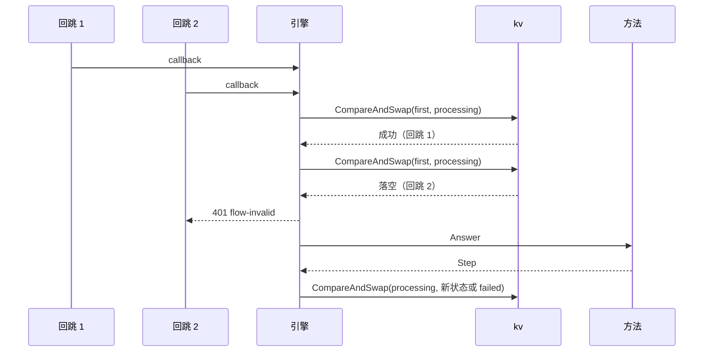

# 登录引擎：方法只交出事实，流程记录放 kv，比较并交换由引擎做

## 背景

登录由多种第一因素构成：口令、短信验证码、通行密钥（[REF-webauthn](../references.md)）、社交登录、企业 OIDC（[REF-openid-connect-core](../references.md)）与 SAML（[REF-saml2](../references.md)）、微信的网站应用（[REF-wechat-website-login](../references.md)）与公众号（[REF-wechat-oa-web-auth](../references.md)）入口。这些方式的步数不同，有的一步完成，有的要往返客户端，有的要把用户代理送到外部提供方再等回跳。第一因素之后还有一串与方式无关的动作：把证明解析成账户或开户、按策略判定是否需要第二因素或登记因素、建登录会话或发令牌，以及在已登录的身份上关联外部身份、加强认证、登记因素（[ADR-authn-scope](adr-authn-scope.md)、[ADR-authn-mfa](adr-authn-mfa.md)）。

约束如下：

- 外部回跳携带的授权码与 SAML 断言只允许消费一次。并发的两次回跳、重放、浏览器重复提交都必须有且只有一个胜者。
- 回跳请求来自 IdP 页面发起的跨站导航，请求本身不能证明它出自发起流程的那个浏览器。`state` 与 `InResponseTo` 各自只证明请求与某个流程对得上，不证明流程与浏览器对得上。
- OAuth 与 OIDC 的回跳是跨站的顶层 `GET` 导航；SAML 的 HTTP-POST 绑定由 IdP 页面把断言跨站 POST 到 ACS。`SameSite=Lax` 与 `Strict` 的 cookie 不随跨站 POST 发送（[REF-rfc6265bis](../references.md)）。仓库的静态检查用 gosec 的 G124（[REF-gosec](../references.md)），它要求每个 cookie 写成 `Secure`、`HttpOnly`，`SameSite` 取 `Lax` 或 `Strict`。
- 流程状态是短命的：有效期以分钟计，丢失的后果是用户重新开始，不会放宽任何校验。按丢失的方向判，它属于 kv，不属于 db（[ADR-authn-state-placement](adr-authn-state-placement.md)）。kv 提供 `CompareAndSwap`，不提供枚举与“取并删”。
- 第三方方法也要能接入。方法作者不应需要理解流程存储、账户解析与会话。
- 每个方法单测时不应需要 HTTP 与存储。
- 登录端点与被保护的路由同址，401 的 `WWW-Authenticate` 由网关按各端的校验后端生成，其中 `Basic` 仅当口令表后端在场时出现（[ADR-authn-credential-dispatch](adr-authn-credential-dispatch.md)）。浏览器里同源页面的 `fetch` 收到带 `Basic` 挑战的 401 会弹出原生口令框。
- 开始流程与登录前的各步都没有身份，不能经 `pkg/ratelimit` 限流，失败退避与枚举防护另有契约（[ADR-authn-throttling](adr-authn-throttling.md)）。

## 考虑过的选项

### 每个方式一个专用端点

每个方式各自挂 `/login/password`、`/login/sms` 之类的端点，各自处理第二因素、开户与关联。

**否决**：第二因素判定、账户解析、开户与关联、终态动作在每个端点里重复一遍，每个方式各带一份状态机与流程记录。失败应答的形态与时机、退避、枚举防护要在每个端点各保一份，漏一处即成枚举预言机。加强认证、关联外部身份、登记因素这些“已登录之后再证明一次”的目的无处可挂，只能再各开一组端点。新增一个方式就新增一组路由。

### 流程状态放 db

流程记录写入 `authn_*` 表，每步以条件更新保证一次性。

**否决**：流程是高频短命状态，每次登录尝试，包括尚未出示任何凭据的开始请求，都成为一次写库，匿名流量可以直接放大成数据库写负载。流程丢失的方向是拒绝而不是放宽，db 提供的持久与可枚举在这里没有用处；kv 的过期时间与比较并交换已经满足一次性与短命的要求。

### 流程状态放客户端

状态序列化进签名 cookie 或令牌，随每次请求带回，服务端不存流程。

**否决**：一次性消费无法靠服务端的原子操作保证。授权码与断言的重放、并发重复提交只能靠额外的服务端状态去拦，那就是流程存储本身。客户端持有状态还使 `state`、PKCE（[REF-rfc7636](../references.md)）校验串、`nonce` 这类对外部提供方保密的值落到客户端可读的位置。

### 方法自己对流程记录做比较并交换

`Answer` 拿到流程存储，自己把“正在交换”“已消费”写进记录。

**否决**：`Answer` 是不持有流程存储的调用，一次调用内也无法提交中间状态。并发的两次回跳读到同一份旧记录，都去换授权码，败者要等 `Answer` 返回后才被挡住，此时授权码已被换过两次，一次性不成立。每个第三方方法都要重复这段并发敏感的代码，实现错一处即成重放口。

### 被拒的 submit 一律作废流程

任何一步被拒绝都把流程置为失败。

**否决**：口令表单与短信验证码天然允许在同一流程内再次提交；短信码本身另有每码的尝试上限，与“首次错误即作废”矛盾。回跳类的一步不同：授权码与断言已被消耗，保留流程没有可再用的东西。因此 submit 类被拒保留流程，callback 类被拒作废。

### 绑定只用 cookie，或只用请求头

流程令牌只放 cookie，或只在响应体里交给脚本、由脚本放请求头。

**否决**：只用 cookie，非浏览器客户端没有 cookie 罐，无法接入。只用请求头，浏览器端的脚本必须读到并保管绑定秘密，XSS 即可取走，绑定对登录 CSRF 与流程固定的防线随之失效。因此由开始请求指定载体：cookie 为缺省，只设 cookie、响应体不含绑定秘密；请求头载体只在显式选择时才把秘密放进响应体。

### 流程 cookie 取 `SameSite=None`

`None` 的 cookie 随 SAML 的跨站 POST 送到 ACS，ACS 直接比对绑定。

**否决**：`None` 的 cookie 随发往该主机的每个跨站请求发出，它对流程端点之外没有权限只靠它承载不透明值来保证，不靠浏览器策略；G124 把它判为不安全的 cookie。它换来的只是让绑定随 SAML 的跨站 POST 到达；同站转投（ACS 答一页把表单以同源导航转交出去的页面，见下文采纳的选项）用 `Lax` 的 cookie 做到了同一件事。

### 只靠 `RelayState` 绑定

回跳时不比对 cookie，只以 `RelayState` 与 `InResponseTo` 把应答与流程对上。

**否决**：两者只证明应答与某条流程对得上，不证明流程与浏览器对得上。攻击者以自己发起的流程拿到的有效应答投进受害者的浏览器，受害者即被登入攻击者的账户。授权应答必须与发起它的用户代理绑定，这正是 RFC 9700 第 2.1 节与第 4.7.1 节为防这类登录 CSRF 给出的要求（[REF-rfc9700](../references.md)）。

### 只给 SAML 另设一个 `SameSite=None` 的 cookie

OAuth 与 OIDC 用 `Lax` 的流程 cookie，SAML 的流程另写一个 `None` 的 cookie 供 ACS 比对。

**否决**：仍有一个 `None` 的 cookie，跨站暴露与 G124 的判定都还在；另多一个载体与第二份绑定比对。

### ACS 暂存表单，再 `303` 到一个同站 `GET`

ACS 把收到的表单写进 kv，`303` 到一条同站的 `GET` 路由，由它带着 cookie 取出暂存的表单处理。

**否决**：跨站 POST 引起的重定向链上，浏览器只带 `Lax` 的 cookie，不带 `Strict` 的会话 cookie，登录完成时撤销不了旧会话；暂存是一次在任何绑定比对之前的匿名写；登录在一个 `GET` 上完成，状态改变落在安全方法上。

### 推迟绑定比对

ACS 不比对绑定，先交方法验断言，结果等浏览器带着 cookie 来认领。

**否决**：方法要在没有绑定的情况下消费一次性的断言，`LoginMethod` 的约定与“先比对绑定、再置处理中、再调方法”的次序都要改。

### 流程 cookie 取 `SameSite=Lax`，SAML 的跨站 POST 经同站转投

ACS 不处理回跳，只答一页转投页，把收到的表单以同源导航 POST 到续接路由；续接路由带着 `Lax` 的流程 cookie，过跨源检查，按回跳处理。

**采纳**，见决策。

### authn 自己处理器的 401 沿用网关的挑战

登录、答复、回跳处理器的 401 与网关自产的 401 取同一份 `WWW-Authenticate`，含 `Basic`。

**否决**：这些 401 表示登录失败、流程失效、需要关联或需要加强认证，并不是在要求 Basic 凭据。同源单页应用的 `fetch` 收到带 `Basic` 的 401，浏览器弹出原生口令框，把应用自己的登录界面挤掉。

### 登录引擎统一持有流程，方法只交出证明

一台引擎持有流程记录、绑定、迁移与终态动作，方法只实现 `LoginMethod` 接口，回答“这个人证明了什么”。

**采纳**，见决策。

## 决策

采纳：登录是一台以流程记录为载体的多步状态机，引擎在 `authn/login`；方法只回答证明了什么，引擎做其余一切，包括每次状态迁移的比较并交换。

- **方法与引擎的分工。**
  - `LoginMethod` 是非排他接口，经 `core.ResolveAll` 取用。方法只交出“这个人证明了什么”的事实，不判定保障等级；保障等级只在 `authn.mfa` 一处合成（[ADR-authn-mfa](adr-authn-mfa.md)）。引擎据事实解析账户，不信任方法对账户存在与否的任何断言。
  - 账户解析、开户与关联、MFA 判定、建会话与发令牌由引擎做。方法不碰 HTTP、gin（[REF-gin](../references.md)）、会话、令牌，也不读写流程记录，所以能脱离 HTTP 与存储单测。
  - **目的的服务范围按方法交出的来源字段定。** 目的是封闭集，方法只服务它能产出证明的其中一部分：产出 `External` 的社交与企业方法服务 `login`、`link` 与 `step-up`（外部绑定经 `link` 建立与解绑），口令与短信方法服务 `login` 与 `step-up`；`enroll` 是登记第二因素，由 `MFA.Enroll` 承担，不经任何第一因素方法（[ADR-authn-mfa](adr-authn-mfa.md)）。空目的在读到参数之前被拒。
  - `Proof` 的字段、方法回答的种类、方法的准入条件与故障收口见 authn-login，第三方方法同受约束。
- **流程记录与比较并交换。**
  - 流程记录存 kv，键由流程令牌的哈希导出，有有效期上限。引擎对每次状态迁移做 `CompareAndSwap(旧, 新)`；交换落空说明被并发改动，当前请求按流程失效拒绝，不重试。
  - 回跳类的一步，引擎在调用方法之前先把记录交换成“处理中”：并发的第二次回跳败于这一步，授权码至多换一次，SAML 断言至多处理一次。停在“处理中”的记录，即进程崩溃而方法没有返回的情形，一律按失效处理，用户重新开始。
  - 被拒绝的一步是否保留流程，按该步是否消耗了一次性凭据区分：submit 类被拒保留流程并设答复次数上限，callback 类被拒作废流程。次数上限与迁移表见 authn-login。
  - kv 不可用时开始与继续流程都答 503；已建立的登录会话在 db，不受影响。
- **绑定。** 每条流程绑定发起它的浏览器或客户端：流程令牌是随机数，库里只存哈希，回跳与每次答复都比对绑定。载体由开始请求指定，缺省为 cookie，且 cookie 载体不把绑定秘密放进响应体。流程 cookie 取 `SameSite=Lax`，以 `__Host-` 前缀限定为无 `Domain`、`Path=/`、`Secure`。cookie 的其余属性与请求头载体见 authn-login。
- **SAML 的跨站 POST 经同站转投。** ACS 在跨源检查的旁路之内，不读流程、不写 kv、不调方法，只答一页转投页：页面把收到的表单字段转义后原样写进一个表单，目标固定为同一提供方的续接路由，由带 nonce 的脚本以同源导航提交。续接路由不在旁路之内，带着 `Lax` 的流程 cookie 与 `Strict` 的会话 cookie，按回跳比对绑定、调方法。页面的形状与响应头见 authn-login。
- **按目的的终态动作。** 目的是封闭集：`login`、`link`、`step-up`、`enroll`。`login` 建登录会话或发令牌对；其余三种是在已登录身份上的操作，完成发生在 `Open` 的路由上、网关没有读会话，所以引擎先复核记录里的发起会话仍有效且账户一致，复核通过后才执行各自的动作。完成动作的逐项次序与事件见 authn-login。
- **IdP 发起的 SAML。** 提供方行允许时，转投之后没有流程 cookie 的续接 POST 由引擎当场新建一条登录流程并直接置“处理中”，其余同回跳。方法不创建流程记录。
- **统一的 `flows` 路由。** 全部目的与方式共用一组 `flows` 路由，加上回跳路由与方式列表；新增方式不新增路由。路由、请求、响应与错误码的全集见 authn-login。
- **authn 自己处理器的 401 不带 `Basic`。** 这些处理器答的 401 只带 `Bearer`（[REF-rfc6750](../references.md)）与 `Cookie` 挑战；网关自产的 401 沿用网关为该端生成的挑战（authn-gate）。
- **认证前限流自备。** 开始流程与登录前各步的失败退避、枚举防护走 [ADR-authn-throttling](adr-authn-throttling.md) 的契约，不经 `pkg/ratelimit`。

## 后果

流程引擎、流程记录、绑定与迁移表由 `authn/login` 一处持有。一次性的保证只依赖 kv 的 `CompareAndSwap` 原子性，一处实现、一处测试。第三方方法只需实现 `Begin` 与 `Answer`，并满足准入条件。MFA、关联、加强认证、登记因素复用同一台状态机，各方式之间的失败应答的形态与时机由引擎一处保证。

**接受的代价：**

- 没有内置登录页，只提供 JSON 接口；`authn/login` 唯一的 HTML 响应是 ACS 的转投页，它只转交表单，不是登录页。请求字段是扁平字符串的并集，换来方式之间格式一致。
- 流程记录里存有 PKCE 校验串，kv 的读权限要按凭据对待。能读 kv 的人，再加受害者的授权码，才能完成交换；授权码一次有效且短命，回调还要求流程绑定，这一风险被接受。
- 一个浏览器同一时刻只有一条浏览器端流程，因为只有一个流程 cookie：第二个标签页开始新流程会顶掉第一个。
- 回跳类的步骤一旦被拒绝就作废，用户重新开始；停在“处理中”的记录也只能重新开始，进程崩溃的窗口里已被消耗的授权码不会复用。
- 开始流程无需凭据，每次开始在 kv 写一条小记录，到期自清；入口层面的洪泛限流是宿主的部署责任。
- SAML 的 SP 发起登录多一次同源往返：ACS 答转投页，浏览器再 POST 到续接路由。不运行脚本的浏览器要用户点一次按钮，不运行页面的客户端要自己 POST 到续接路由。
- 任何站点都能借转投把一份表单以同源 POST 送进续接路由，续接路由对此只靠流程绑定与方法的校验；投进来的另一流程的应答被拒时，受害者进行中的流程作废，用户重新开始。
- IdP 发起的 SAML 没有可比对的流程绑定，当场建的流程防不了登录 CSRF；该方式由提供方行的设置缺省关闭，开启是宿主的明确选择（[ADR-authn-sso](adr-authn-sso.md)）。
- 引擎对每次方法调用另设时间预算，方法超时按不可用收口，用户看到的是 503 而不是 401。
- 方法的 panic 由引擎收口为该方法故障，一个方法的缺陷不会拖垮其他方法，但会让该方法在修复前持续答 503。

## 失效条件

- 假设：kv 的各个实现对 `CompareAndSwap` 都满足“只在当前值等于旧值时写入”，包括并发写入者抢先时的重新判定。任一实现被发现在并发下两个交换都成功，授权码至多换一次的保证即失效。守住它的测试是对每个 kv 实现并发提交同一次回跳，断言只有一个越过“处理中”这一步。
- 假设：通行密钥的仪式数据序列化后放得进方法私有字节的上限。该大小未经测量，守住它的测试是按允许的凭据清单增长测量序列化大小；放不下时放宽上限或收窄凭据清单。
- 假设：跨站的顶层 POST 不带 `SameSite=Lax` 的 cookie，ACS 因此凭 cookie 处理不了回跳。守住它的测试在浏览器一侧是 `starters/demo/web/e2e/specs/journey-saml-sign-in.spec.ts` 的两条用例，在 Chromium 里由另一站点的页面自动提交表单到 ACS，断言请求的 `Sec-Fetch-Site` 为 `cross-site` 且不带流程 cookie；在服务端一侧是 `pkg/authn/login` 的 `TestACookielessCrossSitePostToTheCallbackIsAnsweredTheBouncePage`，断言 ACS 对这样的请求只答转投页。
- 假设：同源页面自动提交的表单带 `Lax` 与 `Strict` 的 cookie，`Sec-Fetch-Site` 为 `same-origin`。守住它的测试在浏览器一侧是同一规格在 Chromium 里走完转投，断言续接请求的 `Sec-Fetch-Site` 为 `same-origin` 且带流程 cookie，这是 `Lax` 的一半；浏览器里没有预先存在的会话，`Strict` 的会话 cookie 一半没有浏览器一侧的断言。服务端一侧是 `pkg/authn/sso/saml` 的 `TestAnSPInitiatedLoginCompletesThroughTheBounce`，以这样的请求走完整条链。
- 假设：跨源检查的旁路只覆盖 ACS，不覆盖续接路由。守住它的测试是 `pkg/authn/login` 的 `TestACrossSiteCallbackPostIsAllowed` 与 `TestACrossSitePostToTheResumeRouteIsRefusedBeforeTheHandler`。
- 流程状态出现需要持久的内容，即丢失会放宽校验而不是让流程失败，该内容改放 db（[ADR-authn-state-placement](adr-authn-state-placement.md)）。
- 浏览器不再让同源页面自动提交的表单带上 `Lax` 的 cookie，转投换不回绑定，SAML 的绑定方式需要重新设计。
