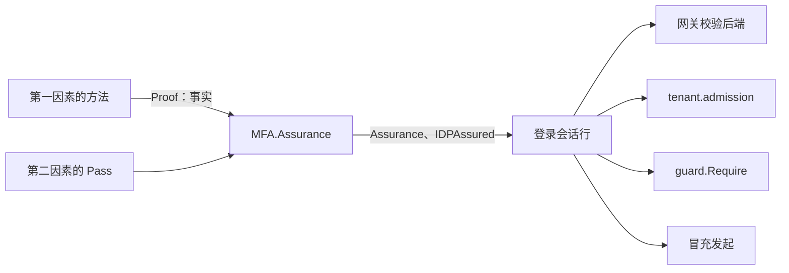

# 多因素：因素是并立的接口，编排与保障等级只在 authn.mfa 一处合成

## 背景

第一因素通过之后，登录还要回答与第一因素的种类无关的问题：是否需要第二因素，需要时由哪一种因素去证明，以及这次登录最终证明到了什么强度。强度随登录会话记录，被网关的校验后端、请求期的租户准入、宿主与授权模块的 `guard.Require`、冒充发起各自读取，读到的值决定敏感动作放行与否。

约束如下：

- 内置的因素种类有 TOTP（[REF-rfc6238](../references.md)）、短信码与 WebAuthn（[REF-webauthn](../references.md)）（通行密钥），第三方可另行实现；各种因素有自己的密码学与状态，而策略、失败退避、审计与事件对每种因素的要求相同。
- 强度由多处读取。任何一处自行判断，都会在边界情形上与其他处分歧，分歧的方向是某处放行了另一处会拒绝的请求。
- 登录时账户是全局的，请求指向的租户在登录时没有确定值（[ADR-authn-accounts](adr-authn-accounts.md)）；账户自己的成员关系在账户解析之后是可读的。一个全局账户可属多个租户，每个租户的管理员只管理自己租户的 IdP 登记行，对别的租户没有权限。
- 第一因素的方法可由第三方实现，方法只回答“这个人证明了什么”，不做其余判断（[ADR-authn-login-flow](adr-authn-login-flow.md)）。
- 账户尚无任何因素时，持口令者与真用户不可区分。authn 不含邮件通道，只留发送接口；不提供恢复码，找回途径与代价另有记录（[ADR-authn-mfa-recovery](adr-authn-mfa-recovery.md)）。
- 企业 IdP 断言里的 `amr`、`acr` 是外部声明，应用自己验证这些声明才算合规（OWASP ASVS 6.8.4，[REF-owasp-asvs](../references.md)）。
- 短信与 PSTN 带外认证被 NIST SP 800-63B（[REF-nist-sp-800-63b](../references.md)）列为受限认证器，且短信同时可作第一因素与第二因素。
- `pquerna/otp`（[REF-pquerna-otp](../references.md)）的 `Validate` 只回布尔值，不报命中的计数器，没有重放防护；`go-webauthn`（[REF-go-webauthn](../references.md)）不防同一份仪式数据被消费两次，也不替调用方把断言后的签名计数落库。
- 状态按丢失的方向放置（[ADR-authn-state-placement](adr-authn-state-placement.md)）：因素登记簿与 TOTP 的重放计数器丢失会放宽校验，属于 db。

## 考虑过的选项

### 每个因素自带策略、退避、审计与登记

每种因素各自实现“该账户是否要求我”“失败几次后退避”“写审计与事件”“登记的各步”，登录引擎对每种因素分别调用。

**否决**：同样的退避、审计与事件在每种因素里重复，漏一处即出现不退避或不留痕的因素，攻击者选那一种。第三方因素的作者要自己保证这些横切行为。策略与保障等级跨因素才有意义（“账户有任何有效因素”“种类须与第一因素不同”），逐因素实现无处合成。

### 因素登记簿分散在各因素子包

每个因素子包各持一张表，记录自己种类的因素。

**否决**：账户删除要对每个因素级联，登录要统一列出账户的因素并剔除种类相交者，登记上限与最后一个因素的删除保护都要跨种类判断。登记簿分散后这些操作要逐子包调用并自行汇总。因此统一的登记簿放 `authn.mfa`，只有种类专属的数据（TOTP 种子、通行密钥的凭据）才放各因素子包。

### 第一因素的方法与各校验后端自报或自判强度

方法在交出的结果里带上强度，或网关、租户准入、`guard.Require` 各自从方式集推导。

**否决**：第三方方法能报出高于实际的强度，而校验后端无从核对。各读取处各持一份推导规则，规则一变要同步多处，漏改的一处与其他处对同一会话给出不同结论。强度只能有一个计算处，其余处读已记录的结果。

### 在多因素之上另设抗钓鱼档

强度的取值增加“抗钓鱼”，使 WebAuthn 与其他多因素可区分。

**否决**：没有需求要求区分。非零取值为单因素与多因素，加上零值，已能表达全部现有判定。需要排除短信的租户，关闭短信因素，或经 `Decider` 判定，不需要新的等级。

### 默认采信 IdP 断言里的 `amr` 与 `acr` 抬高强度

企业 IdP 声明做过多因素，登录会话即记多因素。

**否决**：应用自己验证这些声明才合规（OWASP ASVS 6.8.4），IdP 不给声明时按最低强度。默认采信等于把任一提供方的配置当作本地验证。因此默认不采信，采信要提供方行显式开启，并附下面决策里的全部前提。

### IdP 声明的多因素覆盖账户已登记的因素，并被所有租户的 `require-mfa` 采信

IdP 声明了多因素，则账户不必再答自己登记的因素；该强度在任何租户都算数。

**否决**：违反策略只加严不放宽。任一租户的管理员在自己的 IdP 行上开启信任，就能使一个全局账户在别的租户满足 MFA 要求，并凭该强度删除用户自己登记的因素。因此仅在账户没有任何因素且没有强制时采信，只在该提供方所属的租户内计数，账户安全类操作不采信。

### 租户级 MFA 强制在登录时按范围线索判

登录时按“范围线索”判断目标租户是否要求 MFA，要求则强制第二因素。

**否决**：登录时账户全局，目标租户没有确定值，任何线索都能被绕开：先在无租户的范围登录，再去访问要求 MFA 的租户。范围线索不是判据。

登录时的判据改为账户自己的成员关系：第一因素通过、账户确定之后，读该账户全部 active 成员关系的租户的有效值；任一租户要求而账户没有因素时，这次登录只能登记，登记完成后重证口令并用新因素通过第二因素。请求期仍由 `tenant.admission` 对既有会话执行同一份要求。两者回答的是不同的问题：登录时判“这次登录能否以低于多因素的强度完成”，请求期判“这条既有会话能否进入该租户”。

### 记住此设备

通过第二因素后在客户端留下信任标记，一段时间内免答。

**否决**：服务端无从证明设备身份，标记就是对第二因素的绕过；被窃的 cookie 就是免除 MFA 的凭据。代价是需要第二因素的用户每次登录都要答第二因素。

### 第二因素与第一因素同种类

短信登录之后允许用短信因素作第二因素。

**否决**：两者走同一条通道，对 SIM 劫持而言等于一个因素，“口令加短信登录再加短信因素”得到的多因素是名义上的。因此第二因素的认证方式不得与第一因素已有的方式相交。

### TOTP 校验直接用库的 `Validate`

沿用 `pquerna/otp` 的布尔校验。

**否决**：`Validate` 不防重放，也不报命中的计数器，无法与已用的计数器比较。同一个码在有效窗口内可以被反复使用。

### TOTP 的重放计数器放 kv

最近使用的计数器存 kv，带过期时间。

**否决**：kv 丢键，重放窗口就重新打开，而丢失的方向是放宽校验。计数器放 db 的一列，用条件更新判胜负（[ADR-authn-state-placement](adr-authn-state-placement.md)）。

### 登录期间登记的因素计入本次登录的强度

登记完成即升为多因素会话。

**否决**：只知道会话的人抢在真用户之前登记自己的 TOTP，立即得到多因素会话，并凭它删因素、解绑、创建服务密钥，真用户随后被一个自己不拥有的因素锁在门外。登记完成因此不升会话；本次会话期间登记的因素只在加强认证里再次证明口令之后加强会话，最高权限的动作另要求启用已满一段时间的因素。

### 首次登记因素要求带外证明

账户尚无因素时，登记前要出示管理员发放的一次性登记令牌，或发往已验证手机的短信码。

**否决**：带外证明依赖邮件通道，而 authn 没有邮件通道；改用管理员发令牌则需要一套发令牌的流程与表；短信码只覆盖有已验证手机的账户。以“最高权限动作要求启用已满一段时间的因素”限制抢先登记的危害范围，首次登记按信任首次使用接受。

### 每种因素各开登记端点

TOTP、短信、WebAuthn 各自挂一组登记路由，自行处理新鲜度检查、流程状态与绑定。

**否决**：登记是多步的，WebAuthn 要在两步之间保存仪式数据，每种因素各带一份流程状态、绑定与一次性消费，与登录引擎重复（[ADR-authn-login-flow](adr-authn-login-flow.md)）。仪式数据放进引擎的流程记录后，`authn.mfa` 与 WebAuthn 子包都不必依赖 kv。登记的前置检查分散到各组路由，漏检即出现可被盗用会话悄悄加因素的入口。

### 因素自行停用自己的登记行并发事件

克隆告警时因素直接写登记簿把自己置为停用，并发布 `authn.factor.changed`。

**否决**：`Factor` 接口是单向的，由 `MFA` 驱动因素，因素不持有登记簿也不该写它；把停用与发布会散到每个因素实现，第三方因素漏一处即留下可用的克隆凭据，而这正是横切行为应当集中的地方（与“每个因素自带策略、退避、审计与登记”同因）。因素只把事实交回：以拒绝的成因送出。

### 因素是并立接口，`authn.mfa` 排他编排并只在一处合成强度

**采纳**，见决策。

## 决策

采纳：`Factor` 是非排他并立的接口，`MFA` 由 `authn.mfa` 排他交付；因素的登记、策略、发码、校验与保障等级的合成都在 `MFA`。强度只在 `MFA.Assurance` 计算，读取处不得自行推导，第一因素的方法只交出事实。

- **接口与编排的分工。**
  - `Factor` 经 `core.ResolveAll` 取用，只被 `authn.mfa` 取到；因素实现只做密码学与自己的状态。登录引擎只经 `MFA` 驱动因素，不直接取 `Factor`。
  - 因素把事实交给 `MFA` 的通道是拒绝的成因：WebAuthn 的凭据疑似克隆时以 `authn.ErrFactorFlagged` 作 `StepRefused` 的成因，`MFA.Verify` 据它停用该因素行并发布 `authn.factor.changed`（`flagged`）。接口因此不含因素回写登记簿的方法。
  - 失败退避、审计记录与事件发布是横切行为，在 `MFA` 统一做，因素实现不做。
  - `authn.login` 硬依赖 `MFA`。装配里没有某个因素种类的实现，而账户有该种类的有效因素时，按“该因素不可用”处理，不得当作账户没有因素。
  - 接口签名、方法集、表与路由见 design-authn-mfa。
- **因素种类。** 内置的种类是 TOTP、短信码与 WebAuthn，第三方可另行实现。
  - TOTP 的校验必须有重放防护：命中的计数器须大于已用的最大计数器，并以 db 的条件更新判胜负，不依赖库的布尔校验。校验算法见 design-authn-mfa。
  - 短信因素复用 `authn.sms` 的验证码引擎（[ADR-authn-sms](adr-authn-sms.md)）。
  - WebAuthn 的库类型不出其子包；全局账户对应单一 RP ID。通行密钥可作第一因素，也可作第二因素。
- **策略只加严，不放宽。**
  - 任一层策略不得抵消另一层。账户已有有效因素时，即使第一因素是声明了多因素的 IdP，也必须用账户自己的因素。
  - 租户级策略有两处执行点，回答不同的问题。登录时由登录引擎经 `authn.TenantMFARequirement` 读账户自己的成员关系：任一租户要求而账户没有因素时，这次登录只能登记，登记后重证口令并用新因素通过第二因素，登录期间不发放会话。请求期由 `tenant.admission` 对认证时刻不早于起算时刻的既有会话执行同一份要求（[ADR-tenant-admission](adr-tenant-admission.md)）。登录时判定不接受请求里的范围线索。
  - 第二因素的认证方式不得与第一因素已有的方式相交。账户只有同种类因素时该次登录无法完成，应答 `login-failed`，用户走管理员重置。
  - 不提供记住设备：除第一因素本身已证明两类因素（带用户验证的通行密钥）外，每次登录都答第二因素。
  - 各层策略的定义与判定顺序见 design-authn-mfa，键见 design-authn-config。
- **强度只在一处合成。**
  - 强度只在 `MFA.Assurance` 计算，合成依据是已证明的因素种类。第一因素的方法不报强度；校验后端、请求期准入、`guard.Require` 与冒充发起读登录会话行里已记录的强度，不重新判断。
  - 强度的非零取值是封闭集：单因素与多因素。合成的输入与判据见 design-authn-mfa。
  - 登录会话与令牌的承载见 [ADR-authn-session](adr-authn-session.md)、[ADR-authn-token](adr-authn-token.md)。
- **IdP 声明默认不采信。** 采信须同时满足的前提是封闭集，由 design-authn-mfa 承载；前提中必有提供方行显式开启，且账户没有任何有效因素、没有强制登记。采信抬高的多因素是 IdP 的声明，不是本地验证过的因素：它只在该提供方所属的租户内算数，设了 `Requirement.Local` 的动作不采信它。
- **本次会话期间登记的因素不抬高登记它们的这次登录的强度。** 登记完成即结束的登录，会话记单因素；要得到多因素，须下一次登录，或做加强认证，其中本次会话期间登记的因素须在账户再次证明口令之后使用。租户要求引起的登记是同一规则在登录内的实现：登记不结束登录，账户在同一条流程里重证口令，再用刚登记的因素通过第二因素。
- **账户安全类操作要求本地验证过的因素。** 判据是操作能改变账户的凭据或身份绑定，或授予更高权限；删除与重置因素、解绑与关联外部身份、改口令、添加用户名、把邮箱或手机选作或取消登录方式、设置默认联系地址、删除标识、创建服务密钥、冒充发起是该判据的例举，不是封闭集，逐项名单见 design-authn-mfa。冒充发起与管理员重置因素另要求发起者名下有启用已满一段时间的非短信因素。短信因素允许登记与使用，在冒充与重置他人因素的强认证里不计。判定接口见 [ADR-authn-decision-seam](adr-authn-decision-seam.md)，冒充的限制见 [ADR-authn-impersonation](adr-authn-impersonation.md)。
- **因素登记只有一个入口。** 登记是登录引擎的 `enroll` 目的，经 `flows` 路由推进，由 `MFA` 驱动各步。账户尚无因素时的首次登记按信任首次使用，不要求带外证明。WebAuthn 的仪式数据放在流程记录的私有字节里。步骤与前置新鲜度要求见 design-authn-mfa。

## 后果

强度只有一个计算处，网关、租户准入、`guard.Require` 与冒充发起读到的是同一个已记录的值。新增或替换因素种类只涉及实现 `Factor` 的包，策略、退避、审计与事件不随之改动。因素登记簿统一，账户删除、因素列表与种类相交的剔除各做一遍。登记只有一个入口，前置检查与流程状态只在登录引擎里实现。

**接受的代价：**

- 短信因素与短信登录易受 SIM 劫持与号码携转影响，发送前的风险信号检查不做。“口令加短信”按多因素计，需要排除的租户关闭短信因素，或经 `Decider` 判定。
- 没有记住设备，以第二因素达成多因素的用户每次登录都要答第二因素；带用户验证的通行密钥第一因素不再要求第二因素。
- 首次登记因素是信任首次使用：账户尚无因素时，只知道口令的人抢先登记，可得到一个普通的多因素会话。最高权限的动作要求启用已满一段时间的因素，所以抢先登记换不到它们，但真用户在这段时间里被自己不拥有的因素锁在门外，要靠管理员重置。
- 没有登记任何因素的账户永远不能发起冒充，这是 `MFA.Seasoned` 的直接结果。
- 本次会话期间登记的因素不抬高登记它们的这次登录的强度；用户登记后须重新登录，或在加强认证里再次证明口令，才得到多因素会话。
- 默认不采信 IdP 的多因素声明，企业 SSO 用户在账户已登记因素时仍要答本地因素。IdP 声明的多因素在别的租户不算数，同一账户在别的租户的 `require-mfa` 下须有本地因素。提供方所属租户的管理员对自己租户内请求的 MFA 判定有话语权，这是企业 SSO 的信任边界。
- 账户只有同种类因素时，一次登录无法完成，用户只看到 `login-failed`，运维从日志与事件发现。
- 强度合成集中在一处，该处的缺陷影响所有读取处，该处的测试因此承担全部判定的覆盖。
- TOTP 种子在库里是加密列，但应用进程能解密，应用被攻破等于种子泄露。算法取 SHA-1 以兼容主流认证器。TOTP 依赖各副本时钟同步，不做漂移校正，漂移出一步就持续失败。校验窗口固定为前后各一步，不做成设置。
- 通行密钥只支持单一 RP ID 与一组来源，不支持每租户一个域名；证明格式取 `none`，不做认证器型号白名单；可同步的通行密钥签名计数恒为 0，检测不到克隆。RP ID 的启动校验不核对公共后缀表（[REF-public-suffix-list](../references.md)），是残余风险。
- `go-webauthn` 是 0.x 版本，`go.mod` 固定版本，升级要读其迁移说明并排空在途仪式。
- 管理员重置因素是找回链上最弱的一环，其代价记在 [ADR-authn-mfa-recovery](adr-authn-mfa-recovery.md)。

## 失效条件

- 假设：TOTP 的条件更新（`last_counter` 小于命中计数器才写入）在 `pkg/db` 支持的每个方言下，并发提交同一个码时恰好一个得到影响行数 1，不依赖 `RETURNING`。守住它的测试是对每个方言并发提交同一个码，断言只有一次通过、其余为重放。
- 假设：`go-webauthn` 的 `go.mod` 所要求的工具链版本在 `pkg` 模块下可编译，并与同模块的其他依赖并存。守住它的测试是 `pkg` 模块的构建与依赖图检查；不能并存时 WebAuthn 子包需要另立模块。
- 假设：WebAuthn 的仪式数据序列化后放得进流程记录私有字节的上限，该假设与测试见 [ADR-authn-login-flow](adr-authn-login-flow.md)。
- 假设：`go-webauthn` 在新计数不大于旧计数且不全为零时才置克隆告警，同步通行密钥恒报 0 时不误伤。守住它的测试是计数恒为 0 的连续断言全部通过。
- 出现邮件通道，首次登记的带外证明可以实现，信任首次使用的代价与 [ADR-authn-mfa-recovery](adr-authn-mfa-recovery.md) 的找回途径需要重新评估。
- 出现需要把抗钓鱼本身作为准入条件的租户策略，且用 `Decider` 与关闭短信因素无法满足，保障等级需要新增取值，合成处仍只有 `MFA.Assurance`。
- 出现每租户一个域名的通行密钥需求，单一 RP ID 的前提失效，凭据与 RP ID 的绑定要重新设计。
- 任一读取处出现在已记录的强度之外自行推导强度的代码，等级只在一处合成的前提即被破坏，该处须改为读已记录的值。
