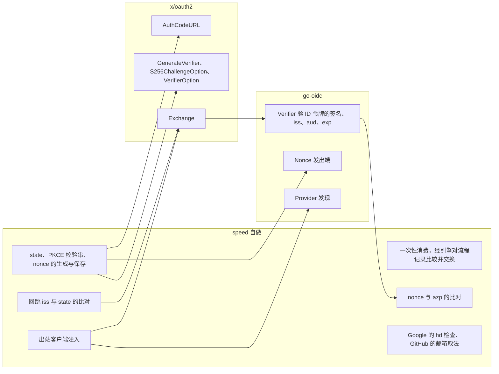

# 社交与企业 OIDC 的校验桥：go-oidc 加 x/oauth2，state、PKCE、nonce 自做

## 状态

已接受

## 背景

登录方式里走授权码流程的有 Google、GitHub 与企业 OIDC。Google 与企业 OIDC 是 OIDC，授权服务器签发 ID 令牌；GitHub 是 OAuth 2.0，没有 ID 令牌，身份要靠访问令牌读它的接口得到。企业 OIDC 的 issuer 来自租户管理员的输入，每个租户一份，因此既要按租户装配，也要把发现文档、密钥集、令牌端点的地址当作外部输入对待。这些路径共用同一桩事务：开始时生成并保存防伪造与防重放的材料，回跳时校验，换取授权码，验证令牌，把外部身份交给登录引擎（[ADR-authn-login-flow-2026-10-10](adr-authn-login-flow-2026-10-10.md)）。外部身份如何绑定账户由另一条决定承载（[ADR-authn-external-binding-2026-10-10](adr-authn-external-binding-2026-10-10.md)）。

约束来自已有的决定：

- 登录流程记录存 kv，状态迁移由引擎做比较并交换，授权码至多换一次；这部分的存放位置与原子性判据已定，桥只提供记录里要存的内容（[ADR-authn-login-flow-2026-10-10](adr-authn-login-flow-2026-10-10.md)、[ADR-authn-state-placement-2026-10-10](adr-authn-state-placement-2026-10-10.md)）。丢失这类记录只会让流程失败，不会放宽任何校验。
- 根包只放接口与数据类型，第三方库落在叶子包里，库的类型不出现在根包的接口面上（[ADR-authn-packaging-2026-10-10](adr-authn-packaging-2026-10-10.md)、[ADR-module-packaging-2026-09-22](adr-module-packaging-2026-09-22.md)）。
- 所有出站请求走受限的出站客户端，因为目的地址来自外部输入（[ADR-authn-sso-2026-10-10](adr-authn-sso-2026-10-10.md)）。

候选库对授权码流程各环节的责任归属不同。下表按各库已发布版本的源码核对；「调用方」指 speed 一侧的代码。

| 库 | PKCE 校验串的生成 | 保存校验串与 state | `state` 的生成与比对 | `nonce` 的发出与比对 | ID 令牌验签 |
|---|---|---|---|---|---|
| `golang.org/x/oauth2` | 提供 `GenerateVerifier`、`S256ChallengeOption`、`VerifierOption` | 调用方 | 调用方 | 不涉及 | 不涉及，不是 OIDC 库 |
| `github.com/coreos/go-oidc/v3` | 不涉及 | 调用方 | 调用方 | 提供发出端 `oidc.Nonce`；比对由调用方，库的注释写明不校验 | 做，含 `iss`、`aud`、`exp` |
| `github.com/markbates/goth` | 不生成 | 存在 gorilla 会话 cookie | 生成，也接受请求里指定的 `state`；授权地址里的 `state` 为空时不比对 | 无 | OIDC provider 不验签 |
| `github.com/zitadel/oidc/v3` | 提供，绑在 cookie 上 | cookie | 调用方给生成函数，存 cookie | 库自带的授权地址处理器不发；校验器缺省要求令牌里的 `nonce` 为空 | 做 |
| `github.com/hashicorp/cap` | 提供 | 调用方保存库返回的 `Request` 对象 | 库生成，在 `Exchange` 内比对 | 库发出并比对 | 做 |

除 cap 外，`state`、PKCE 校验串与 `nonce` 的「生成、保存、一次性消费、过期」没有一个库替调用方做完。因此选哪个库不改变这部分工作量，改变的是库其余部分与 speed 的契合度。

go-oidc 另有会静默放过校验的缺口：`UserInfo` 取回的 `sub` 不与 ID 令牌的 `sub` 比对；构造 `Provider` 与取密钥集、取 userinfo 的 HTTP 请求在未注入客户端时走没有超时的 `http.DefaultClient`。

## 考虑过的选项

### 采用 goth 的整套回调处理

goth 以进程级全局的 provider 注册表、gorilla 会话 cookie 与路由辅助一体提供登录回调，下含 Google、GitHub、通用 OIDC 与微信的 provider。

**否决**：

- 它的状态保存与回调处理绑在自己的 cookie 与路由辅助上，而桥的状态落在 kv 的流程记录里、provider 要按租户动态装配；绕开这些之后只剩 provider 层可用，这一层的校验不足：OIDC provider 自行解码 ID 令牌，只比对 `aud`、`iss`、`exp`，不验签、不核 `nonce`、不发 PKCE；`state` 可由发起方在请求里指定，授权地址里的 `state` 为空时回跳不比对。
- Google provider 不是 OIDC 流程：走 userinfo 接口，访问令牌放在查询串里，响应里没有邮箱是否已验证的字段，`hd` 只在原始数据里。
- 对 `pkg/go.mod` 增加的模块数倍于首选方案（首选只增加 go-oidc、go-jose/v4、x/oauth2），其中包含与登录无关的路由库。

### 采用 zitadel/oidc 的依赖方包

zitadel/oidc 的 `rp` 包提供发现、授权地址处理器、授权码换取处理器与 ID 令牌校验，覆盖 `azp`、`acr`、`auth_time` 与 `nonce`。

**否决**：

- `state` 与 PKCE 校验串绑在 cookie 与 `http.HandlerFunc` 上；桥的记录在 kv，入口模块是 gin。绕开处理器、只用换码与校验器之后，能力与 go-oidc 加 x/oauth2 等价，而对 `pkg/go.mod` 多出数个首选方案没有的模块。
- 校验器的 `nonce` 缺省要求令牌里的值为空，授权地址处理器不发 `nonce`；使用它就得逐项改写缺省，改写点与自做相同。

### 采用 hashicorp/cap，把 state、nonce、PKCE 的校验放进库里

cap 的 `Request` 对象持有 `state`、`nonce` 与 PKCE 校验串，`Exchange` 依次校验 `state`、`redirect_uri` 白名单、请求有效期、PKCE、ID 令牌与 `nonce`，`UserInfo` 要求传入期望的主体。

**否决**：

- 许可证是 MPL-2.0，文件级弱 copyleft；其余候选均为 Apache-2.0、BSD-3-Clause 或 MIT。
- 同时带入 go-jose 的 v3 与 v4，内嵌的 go-oidc 版本落后于独立可得的版本，升级节奏由 cap 的发版决定；依赖是候选里最多的，含 `testify` 等来自非测试文件的测试库。
- `Request` 对象仍要由调用方在两次请求之间保存，里面是 PKCE 校验串与 `nonce` 这类秘密，保存位置、过期与一次性消费照旧要自己做；库只接走比对。
- 放进库里的收益只是少写 `state`、`nonce`、PKCE 的比较；保存、过期与一次性消费照旧自做，收益不抵上述许可证与依赖面的代价。

### Google 走 x/oauth2 的 google 子包加 userinfo

Google 不作为 OIDC 对待：用 `x/oauth2/google` 的端点与默认凭据支持，换码后读 userinfo 接口得到邮箱与标识。

**否决**：

- 这条路径不验证 ID 令牌，`iss`、`aud`、`exp`、`nonce` 都不在校验之内，邮箱是否已验证、`hd` 也得不到 ID 令牌那样带签名的声明。
- 子包会把 `compute/metadata` 一个模块带进依赖图；只 import `x/oauth2` 根包与 go-oidc 时没有它。
- Google 与企业 OIDC 的校验路径因此分叉成两套，同一类缺陷要在两处测。

### GitHub 引入 go-github

用 go-github 读 `/user` 与 `/user/emails`。

**否决**：桥只读 `/user` 取数字 `id`、读 `/user/emails` 取邮箱列表，自写是几十行代码；go-github 覆盖整个 GitHub API，为这两个只读调用引入它，依赖面与升级面都覆盖了桥用不到的部分，其依赖足迹也未核实。

### go-oidc 加 x/oauth2，校验材料自做

go-oidc 做发现与 ID 令牌校验，x/oauth2 做授权地址、换码与 PKCE 助手；库不做的环节由 speed 在桥里补齐。

**采纳**，见决策。

## 决策

采纳：社交与企业 OIDC 的校验桥以 go-oidc 验证 ID 令牌、x/oauth2 构造授权地址与换取授权码并提供 PKCE 助手为骨架；库不做的环节由 speed 自己生成、保存、校验与注入。Google 与企业 OIDC 共用同一条 OIDC 路径；GitHub 在同一座桥上走 OAuth 2.0 分支。

图只标明各环节归属，校验次序以 design-authn-login 为准。

- **分工。**
  - x/oauth2 承担授权地址、换码与 PKCE 校验串的生成与携带；go-oidc 承担发现、签名校验与 `iss`、`aud`、`exp` 的核对，对 Google 的无 scheme `iss` 特例也由它处理。
  - speed 承担库明说或实际不做的环节。判据是这一句，下列各项是已核对的例举，不是封闭集：`state`、PKCE 校验串、`nonce` 的生成、保存与一次性消费，`state` 与 `nonce` 的比对，多受众时 `azp` 等于 `client_id` 的核对，出站客户端的注入。`state` 由桥自己生成，不接受请求指定；PKCE 一律 S256。
  - 记录的存放、原子性与授权码至多换一次由登录引擎的比较并交换保证，桥不另做（[ADR-authn-login-flow-2026-10-10](adr-authn-login-flow-2026-10-10.md)）。
- **userinfo。** 桥的校验路径只读 ID 令牌里的声明，不调用 userinfo。go-oidc 的 `UserInfo` 不核对 userinfo 的 `sub` 与 ID 令牌的 `sub`，桥不让这一缺口进入校验路径；任何将来引入的 userinfo 读取先比对 `sub`，是它进入桥的前提。
- **出站客户端。** 桥的全部出站请求以 `oidc.ClientContext` 注入的受限客户端发出，注入一次对 go-oidc 与 x/oauth2 同时生效；库在未注入时使用无超时的默认客户端，因此「未经注入的出站调用」本身是缺陷。受限客户端的约束见 design-authn-sso。
- **三条提供方路径。** Google 与企业 OIDC 共用同一条 OIDC 路径；GitHub 走 OAuth 2.0 分支，自写对 `/user` 与 `/user/emails` 的读取，不引入 go-github。`redirect_uri` 的构造与回跳 `iss` 的比对、GitHub 的邮箱取法、`email_verified` 的处理、Google 的 `hd` 检查、企业 OIDC 提供方对象的缓存与失败语义，都是这些路径的实现细节，见 design-authn-login 与 design-authn-sso；企业 OIDC 与按租户的 IdP 登记的关系见 [ADR-authn-sso-2026-10-10](adr-authn-sso-2026-10-10.md)。
- **库类型不出根包。** `oauth2.Config`、`oidc.IDToken` 等库类型只出现在登录方式与企业 SSO 所在的叶子包里；桥交给引擎的是 speed 自己的外部身份类型。
- **微信不在这座桥上。** 微信没有 PKCE、没有 `nonce`、没有 ID 令牌，其客户端与理由见 [ADR-authn-wechat-2026-10-10](adr-authn-wechat-2026-10-10.md)。

## 后果

校验链上的每一环都有归属：库做的与自己做的在上图与决策里分别列出，没有靠「库应该会做」成立的环节。依赖面小：对 `pkg/go.mod` 只增加 go-oidc、go-jose/v4 与 x/oauth2，许可证为 Apache-2.0 与 BSD-3-Clause，go-jose/v4 与 JWT 访问令牌共用。`state` 与 PKCE 校验串落在 kv 的流程记录里，不绑 cookie 加密方式，多副本与按租户装配的 IdP 不受影响。Google 与企业 OIDC 一条路径，同一类缺陷只在一处修、一处测。

**接受的代价：**

- 每一项自做的校验都需要负向测试，缺任何一项都是静默放过，库不会报错。例举的负向用例（非封闭集）：`state` 缺失、被改动、重放；`nonce` 缺失或不符；`azp` 不符；`iss` 不符或回跳 `iss` 与提供方不符；回跳路径与流程记录里的提供方不一致；`hd` 不符；GitHub 的邮箱只有 `primary` 而未 `verified`、或只有 `/user` 里的公开邮箱；未经注入客户端的出站调用。
- 选择 cap 可以得到的「比对做进库里」被放弃：`state`、PKCE、`nonce` 的生成、保存、一次性消费与过期全由 speed 维护，库升级不会自动带来这部分的修正。
- go-oidc 每次构造 `Provider` 都发一次发现请求且不缓存，提供方对象的缓存与失效由 speed 承担；密钥集随提供方对象存活，轮换靠库在 `kid` 未命中时重取。
- GitHub 的 `/user` 与 `/user/emails` 读取由 speed 维护：响应形状、分页与限流行为的变化要自己跟进，go-github 不再兜底。
- Google 是否要求或接受 PKCE 未核实，桥照常发 S256；该假设见失效条件。
- 微信那一支的 CSRF 防线比其他提供方少一层，该代价由它自己的记录承担。

## 失效条件

- 假设：Google 的授权端点接受 S256 的 `code_challenge`，令牌端点接受 `code_verifier`，且不因此拒绝请求。该行为未经核实。守住它的测试是针对 Google 的联调用例：带 PKCE 完成一次登录；若被拒，Google 一支不再发 PKCE，回跳的 `state`、`nonce` 与流程绑定要重新评估其余防线。
- 假设：go-oidc 的 `UserInfo` 不核对 `sub`，`Verifier` 不校验 `nonce`，桥因此不调 userinfo、自己比对 `nonce`。库在这两点上的行为改变只会使桥的补充项成为重复；桥的校验路径出现 userinfo 请求而没有 `sub` 比对，则是缺陷。守住它的测试是用记录请求的模拟 IdP 走完整条回跳，断言没有 userinfo 请求，并断言缺 `nonce`、错 `nonce` 的 ID 令牌被拒绝。
- 假设：go-oidc 在未注入时才使用默认客户端，注入后发现、密钥集与 userinfo 全经注入的客户端。守住它的测试是把进程的默认客户端与默认传输换成一律失败的实现，桥的全部用例仍通过。
- 假设：GitHub 的 `/user/emails` 中 `primary` 且 `verified` 的一条代表已验证的主邮箱。守住它的测试是模拟服务端的用例：仅 `primary`、仅 `verified`、两者都无、仅 `/user` 有公开邮箱，这些用例的邮箱都为空且 `EmailVerified` 为假，只有两者齐备的一条产生邮箱。
- 负向测试矩阵无法随库版本维持，或自做的环节在实现中反复漏掉：重新评估 cap。cap 的否决理由是 MPL-2.0 许可证、同时带入 go-jose 的 v3 与 v4、内嵌的 go-oidc 落后；这些理由全部消失时，cap 是可重新考虑的选项。
- 假设：回跳里带 `iss` 参数的授权服务器，其值与发现文档的 issuer 逐字相等。某个 IdP 的写法稳定不同（尾部斜杠、无 scheme 之类）时，该 IdP 的回跳会全部被拒。守住它的测试是企业 OIDC 联调用例：带 `iss` 参数的回跳通过，改动一个字符后被拒；出现这类 IdP 时，例外由新记录说明。
