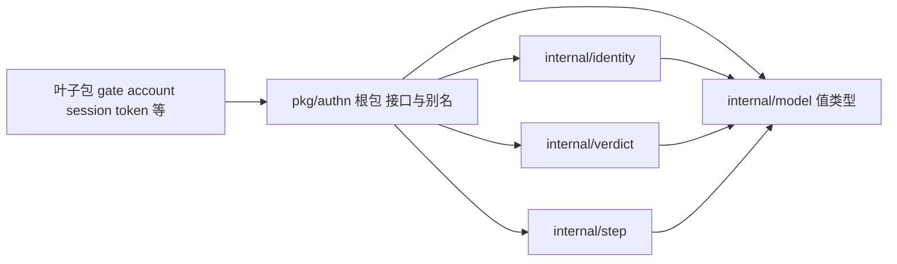

# 包与模块的打包：根包只放接口，一个功能一个叶子包一个模块

## 状态

已接受

## 背景

`pkg/authn` 交付的功能彼此独立，各自绑定不同的第三方库：SAML、通行密钥、OIDC、JWT、会话库。宿主的 `go.mod` 由它 import 的包决定，未被 import 的包所绑的库不进它的 `go.mod`，宿主的 `go.sum` 与实际下载则会经被 import 包的测试闭包带上同一 Go module 内其余实现所绑的库（[ADR-module-packaging-2026-09-22](adr-module-packaging-2026-09-22.md)）。短信发送方的厂商 SDK 不在此列：发送能力抽为顶层能力模块 `pkg/sms`，厂商 SDK 随它住在 `pkg/sms` 的载体叶子包下（[ADR-sms-capability-2026-10-13](adr-sms-capability-2026-10-13.md)）。

登记随 import 发生，import 一个包即执行它的 `init`，该包登记的模块随之进入可用集（[ADR-module-registration-2026-09-13](adr-module-registration-2026-09-13.md)）。根包是每个子包与每一处读取身份的代码都要 import 的包：`pkg/tenant/resolve`、`pkg/audit/journal`、`pkg/ratelimit` 都 import 它，根包新增的任何 import 随之进入这些包的依赖闭包。

身份、判决与登录步骤的类型要求包外不可字面构造，只有 authn 目录之内能注入；它们同时要出现在根包的签名里。Go 的 `internal` 规则使 `pkg/authn/internal/...` 只能被 `pkg/authn/` 之下的包 import，不可字面构造由此成立；根包要在签名里引用这些类型，又不能与真身包互相 import。Go 不允许在包内为非本包的类型声明方法，别名 `type Identity = identity.Identity` 指向的仍是真身包的类型，方法只能在真身包里定义。

一个模块只有一个实例，`core.Resolve[T]` 对它做 `v.(T)`；构造期的交付核对逐个检查 `Provides` 里声明的接口，缺一个即 `ErrUndeliveredCapability`。同名而签名不同的方法让一个类型无法同时实现两个接口。宿主与测试可以为某个已登记模块预置实例，预置时同样过这一核对（[ADR-supplied-instance-2026-10-08](adr-supplied-instance-2026-10-08.md)）。

排他是提供方对自身的声明，消解只针对排他交付，传播禁用那些声明排他且表态 `StateAuto` 的提供者，触发条件是该功能有提供者表态 `StateEnabled`；纯非排他的功能不进入消解，它的多个提供者照常并存（[ADR-module-enablement-2026-09-21](adr-module-enablement-2026-09-21.md)）。未声明 `Prepare` 的模块等同于表态 `StateAuto`。

配置输入项的清单收集自全部已注册模块，同一路径上的两份声明只要都被 import 就是冲突，且该冲突在收集阶段检出，早于排他消解。

`pkg/db` 不提供跨模块传递事务句柄的通道，跨模块传递一个进行中的事务不在它的契约内；别的模块的表可能因该模块未被纳入而不存在，迁移集按声明集取材（[ADR-module-resources-2026-09-21](adr-module-resources-2026-09-21.md)）。

登录方式名由 `LoginMethod.Name()` 返回，是单个字符串，全局唯一；多因素的 `Factor.Kind()` 同形。

## 考虑过的选项

### 根包登记网关模块

`pkg/authn` 既定义功能接口与身份类型，又登记网关模块；其余功能各住子包。

**否决**：根包是每个子包的编译前提，也是每一处读取身份的业务代码的 import。根包登记模块，这些 import 就都把一个 HTTP 入口层带进可用集，「本二进制有没有认证入口」不再由宿主自己的 import 决定。根包还要随之占用一个模块名与一个配置命名空间，无从绕开。

### 一个大模块交付全部功能

一个模块、一个包，承载网关、账户、会话、令牌、多因素、SSO、短信与全部登录方式。

**否决**：全部第三方库进每个宿主的 `go.mod`，只需要口令表的宿主也要背负 SAML、通行密钥与短信 SDK。一个模块只有一份 `Requires`、一个配置命名空间与一次表态，每种方式的必填配置无法按「启用才必填」表达，缺一种方式的配置即整个模块启动失败。排他与并立两种形态在一个模块内都表达不出来：消解只作用于模块之间。

### 提供套件包一次纳入全部模块

增设一个包，import 全部 authn 子包，宿主只 import 它。

**否决**：套件包要 import 全部子包，登记随 import 发生，全部库被链接进每个宿主，包粒度的依赖裁剪随之丧失。

### 每个子包一个 Go module

`pkg/authn` 之下每个叶子包各持一份 `go.mod`。

**否决**：依赖清单那一面的隔离已由包粒度达成，拆成独立 Go module 不在其上再增加隔离，只多出各自的 `go.mod`、`go.sum`、跨 Go module 引用的协调与版本序列；仓库的实现只有 `pkg` 一个 Go module，要拆须举证该功能的独立发布节奏（[ADR-module-packaging-2026-09-22](adr-module-packaging-2026-09-22.md)），这里没有这样的需求。

### 挂路由与网关由同一个模块交付

`authn.gate` 同时交付 `Gate` 与内部的路由挂载接口 `mount.Mounter`。

**否决**：`Gate` 与 `Mounter` 各有一个同名的 `Optional` 方法而签名不同，同一个实例无法同时实现 `Gate` 与 `Mounter`，构造期交付核对即失败。宿主或测试预置自己的 `Gate` 替身时，被迫同时实现一个宿主 import 不到的内部接口，预置在构造期即以 `ErrUndeliveredCapability` 失败；既有的装配测试覆盖了预置外来 `Gate` 的用例。

### 一个模块交付多个登录方式名

微信的网站应用与公众号共用一个模块，由它报告多个入口名。

**否决**：一个实例只能报一个 `Name()`。让接缝改为返回方法列表，则每个取用登录方式的消费方都多一层展开，唯一性检查也要对列表逐项做；按入口名拆成各自的模块，各自一份配置与必填校验，改动面更小。

### 全部表放进账户模块的一份迁移集

账户、会话、令牌、因素、SSO、冒充、短信验证码的表都由账户模块声明与迁移。

**否决**：各功能有自己的依赖与替换方式，宿主可以只要账户而自写会话。表归声明它的模块，一个模块的迁移集才能随该模块的纳入与否增删。

### 校验后端各自排他交付

校验后端子包照既有功能目录的形状办：各自排他交付同一个功能，由消解选出生效的那一个。

**否决**：两个后端同时在场即为排他冲突，启动失败并点名双方；多个校验后端并存是这个功能存在的前提，不是要消解的冲突。

### 内置口令表排他交付校验功能并取默认表态

内置口令表声明排他并取 `StateAuto`，其余后端非排他并表态 `StateEnabled`，借传播规则换取「配了别的后端，内置就让位」。

**否决**：并存要的语义是「内置是兜底的，别人来了仍排在链上最后」，传播只表达得出「没人显式启用我就独占，有人显式启用我就整个退出」。同侪显式启用时，内置被传播禁用，驱动没有任何一处报错，唯一的信号是一行启动诊断。仍然启用的提供者里没有表态 `StateEnabled` 者时传播不触发，裁决因其中混着一个排他声明而判 `ErrExclusiveViolated`，整组启动失败。让传播表达出「兜底提供者」要改写消解算法，该算法的传播与裁决两步由 [ADR-module-enablement-2026-09-21](adr-module-enablement-2026-09-21.md) 保留，代价落在全部模块头上。

### 根包只放接口，一个功能一个叶子包一个模块

**采纳**，见决策。

## 决策

采纳：`pkg/authn` 根包是接口包，叶子包各自登记一个模块。

**根包的依赖与类型落点。**

- 根包不登记模块，也不导出模块名常量。根包的非测试 import 限于标准库与 `pkg/authn/internal/model`、`pkg/authn/internal/identity`、`pkg/authn/internal/verdict`、`pkg/authn/internal/step`（封闭集）。标准库之内含 `net/http` 的类型，不含 gin。这些内部包只依赖标准库与 `pkg/authn/internal/model`；`pkg/authn/deps_test.go` 守的是根包的传递闭包不含第三方库、不含 gin。
- 值类型连同它们的方法与构造函数，真身在 `internal/model`，`internal/model` 不 import 任何 authn 包。`Identity`、`Verdict`、`Step` 的真身分别在 `internal/identity`、`internal/verdict`、`internal/step`，它们 import `internal/model`，所以签名里能引用值类型。依赖方向单向：`model` 被各真身包与根包 import，各真身包被根包 import。
- 根包用类型别名转出类型，用 `const`、`var` 与薄包装函数转出常量、哨兵与构造函数。别名类型的方法只在真身包里定义，根包不声明它们；设计文档里列在根包的身份与判决方法签名，是别名类型的方法集，不是根包的函数声明。

**模块的划分。**

- 每个独立交付的功能一个叶子子包、一个模块；第三方库只落在叶子包里，根包与内部包不绑库。判据沿用 [ADR-module-packaging-2026-09-22](adr-module-packaging-2026-09-22.md)：一个子包所绑的库，只有 import 它的宿主才背负。
- 按租户配置的 IdP 是数据，进表，不是模块；可插拔的形态限于下列（封闭集）：每种方式一个模块，并非排他地交付根包定义的能力接口；或单模块内写入窗口里的登记面。
- 网关与路由挂载分属 `authn.gate` 与 `authn.mount`，各自成模块；`authn.mount` 交付内部的 `mount.Mounter`，经网关的公开登记面成对登记路由与访问级别。预置自己 `Gate` 替身的宿主因此只需实现 `Gate`。
- 挂路由的模块一律经 `mount.Mounter` 挂路由，不自行向入口登记。

**排他与并立。** 判据是该功能是否「必须恰有一个」：必须恰有一个的功能由提供方声明排他，由消解保证唯一；可以多个并存的功能一律非排他，每个提供方各为一个模块，`Exclusive` 一律留空。哪些功能属于哪一类、每个模块交付什么，由 [design-authn](../design/modules/design-authn.md) 的模块清单承载。

- 每个模块必须声明 `Prepare`，且只表态 `StateEnabled`，不得为 `StateAuto`：是否运行是命令树上的决定，不是配置能推断的结论。
- 每个模块的配置与设置命名空间取模块名；两个模块不声明同一输入项路径，也不让一个路径同时是某模块的叶子与另一个模块的内部节点。
- 构造期取用的写法见 [ADR-authn-wiring-2026-10-10](adr-authn-wiring-2026-10-10.md)：`Requires` 只写排他功能，并立功能一律 `ResolveAll`。凭据如何分派给并立的 `Verifier` 见 [ADR-authn-credential-dispatch-2026-10-10](adr-authn-credential-dispatch-2026-10-10.md)。

**能力接口与实例。**

- 同一模块交付的各能力接口，方法名两两不相交；同名方法只在签名相同时才可并存，此时一个方法同时满足两个接口。新增能力接口时，先对同模块已交付的接口查重名。
- 每个模块在包内以 `var _ authn.X = (*product)(nil)` 对它交付的每个能力接口做编译期断言，并在装配测试里用真实注册表对该模块跑一遍交付核对（`assertDelivered`）。
- 一个模块一个实例、一个登录方式名、一个 `Factor.Kind()`。需要多个入口名的提供方拆成多个模块：微信网站应用与公众号分别是 `authn.login.wechat-web` 与 `authn.login.wechat-mp`，各自一份配置与必填校验。

**表的归属。**

- 表归声明它的模块，各表的归属见 [design-authn](../design/modules/design-authn.md) 的模块清单。账户存储住 `authn/account`，经 `pkg/db` 读写；其他 authn 子包与授权模块只经根包的能力接口读写账户，拿不到 `*gorm.DB`。
- 每个模块只在自己的事务里写自己的表。账户停用与删除之后别的模块的清理不写进账户的事务（[ADR-authn-account-lifecycle-2026-10-10](adr-authn-account-lifecycle-2026-10-10.md)）。
- 带表的模块各带自己的迁移集；施加迁移的命令要把它们静态级纳入。

## 后果

根包的依赖闭包由 `deps_test.go` 机械守住，`tenant/resolve`、`audit/journal`、`ratelimit` 不会经根包被带进 gin、数据库或任何第三方库。包外拿不到内部包的 import 权，身份与判决的不可字面构造、只在 authn 树内注入的性质因此由编译器强制。

「本二进制有没有认证入口」由宿主是否 import 网关子包决定；读取身份的业务代码 import 根包，不因此把任何模块带进可用集。

宿主的 `go.mod` 按功能裁剪：只用内置口令表的宿主，`go.mod` 里不出现 SAML、通行密钥与短信库，也不需要数据库功能的任何提供者。完整模块图（`go list -m all`、`go mod download all`）仍会看到全部实现所绑的库。

网关的唯一性由消解强制，认证层自己不必再防两个网关同在。多个校验后端、登录方式与因素并存是正常形态，消解对纯非排他的功能不做任何事——不禁用、不去重、不报错、不排序。

每个模块有自己的模块名与配置命名空间，同时 import 多个实现不会在输入项清单的收集阶段撞车，模块在启动诊断与启用结果查询中的身份也是唯一的。

**接受的代价：**

- **模块多，宿主在命令树上逐个点名，带表模块要静态级纳入。** 点名与迁移纳入的漏写各有什么失败形态，见 [ADR-authn-wiring-2026-10-10](adr-authn-wiring-2026-10-10.md)，不在本记录重述。
- **根包的类型转出多一层。** 每个转出的值类型要在 `internal/model` 与根包各声明一次，别名类型的方法在 godoc 里归在真身包名下，根包的转出面要与内部包手工保持同步。
- **同一个 Go module 里并存多个重型库。** `pkg/go.mod` 与 `go.sum` 随之变大，宿主不 import 的子包所绑的库不进它的 `go.mod`，但进整图。这个 Go module 的 require 声明是全部实现的并集，依赖预算只能在包的 import 面上判。
- **网关的表态不得为 `StateAuto`，这条约束没有机制强制。** 排他加 `StateAuto` 正是传播要禁用的那一格：另一个模块交付同一个功能并表态 `StateEnabled` 时，网关被传播禁用，它的 `New` 与 `Init` 都不执行，驱动没有任何一处报错，整端无认证放行，唯一的信号是一行启动诊断。拦得住的是表态：网关显式表态 `StateEnabled` 之后，同一装配在消解阶段即失败于 `ErrExclusiveViolated` 并点名双方。
- **并立功能的 `Exclusive` 必须留空，同样是一条纸面规则。** 任一提供方写成 `true`，同侪取默认表态时整组启动失败，同侪显式启用时它自己被传播禁用而不报错。一个子包因此能单方面决定同一功能下其余提供方的命运。
- **同一功能的多个提供方之间没有机制赋予的次序，也没有机制赋予的身份。** 非排他的多个提供者只能整体取出，取回的实例不带模块名，谁认领哪些凭据由功能接口自己回答（[ADR-authn-credential-dispatch-2026-10-10](adr-authn-credential-dispatch-2026-10-10.md)）。
- **方法名两两不相交与每个模块的交付断言是约定加测试，不是类型系统的保证。** 新增能力接口时漏查重名，在编译期的 `ambiguous selector` 或装配测试的交付核对处才暴露。

## 失效条件

- 若消解规则演进出「兜底提供者」这一档——声明排他的默认实现在别人显式启用之后仍然留在提供者集合里，而不是整个退出——则「并立功能一律非排他」不再必要，本记录对并立功能排他性的约束不再适用。
- 若 `core` 取消「一个模块一个实例」，则能力接口方法名两两不相交、一个模块一个登录方式名与一个 `Factor.Kind()` 这些约束失去依据。
- 若某个叶子功能的消费者要求脱离其余功能单独引入，或它的发布节奏必须独立，则把它拆为独立 Go module，目录边界已经就位（[ADR-module-packaging-2026-09-22](adr-module-packaging-2026-09-22.md)）。
- 假设：同一个 Go module 内并存的第三方库编译兼容。已验证兼容的组合是：TOTP、WebAuthn、SAML 库与 go-oidc 同在；各家短信发送方 SDK 同在（随发送能力住在顶层 `pkg/sms` 的载体叶子包下，仍在同一个 `pkg` 模块里）。其余组合的兼容性未验证。守住它的是对整个 `pkg` 模块的构建与依赖整理检查（`make check` 的 build 与 tidy-check）：引入任一库的变更须使它们通过，不通过即该库不能与其余库并存于同一 Go module。
