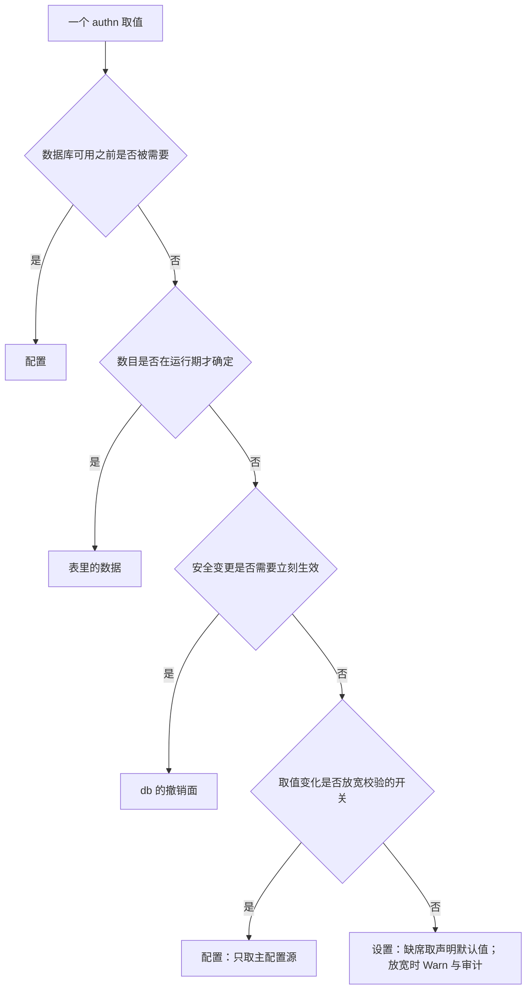

# 配置与设置的分界、放宽开关、秘密的存放

## 状态

已接受

## 背景

`pkg/authn` 的取值覆盖网关参数、口令派生的资源上限、会话与令牌时长、退避与短信预算、多因素与冒充的策略、租户级强制策略，也覆盖客户端密钥、签名私钥、因素种子这类秘密，以及放宽校验的开关。每一类取值要落在配置、设置、表里的数据三处之一，秘密另有存放形态的选择。

**既有的划界判据。** 一个值属于配置，当且仅当它在数据库可用之前就被需要；按租户或按运行时场景取不同值的值落在设置一侧，这是该判据的推论（[ADR-config-scope-2026-09-13](adr-config-scope-2026-09-13.md)）。判据把设置缺席时的降级交给使用方，使用方各自定义。

**设置的既有性质**（[design-settings](../design/modules/design-settings.md)）：

- 值以文本明文存库。`Sensitive` 只遮蔽变更事件的载荷与 `Declared` 的默认值，`Get` 与 `List` 照常交出敏感项的值。
- 写入面不判权限，访问控制由宿主负责（[ADR-settings-scope-2026-09-21](adr-settings-scope-2026-09-21.md)）。写入时判取值域，读取不判。
- 读取走内存快照，变更经 `settings.changed` 事件与周期刷新传播，最坏延迟是刷新间隔。
- 设置模块自身要求 `db` 与事件总线；快照在设置模块的 `Init` 装载之前，读取报 `ErrNotLoaded`。

**配置的既有性质**（[design-config](../design/modules/design-config.md)）：

- 输入项的来源是主配置源、环境变量、命令行的任意组合，`Origins` 的零值是主配置源加环境变量。命令行参数会进入命令行历史与进程列表。
- `Sensitive` 约束配置模块自己的输出面：错误文本不复述值、帮助输出不回显默认值、必须带说明。它不向日志模块登记脱敏规则；脱敏规则由持有值的模块登记（[ADR-log-redaction-2026-09-13](adr-log-redaction-2026-09-13.md)）。

**数据库加密列。** 加密列的密钥是 `db` 的根密钥。根密钥缺失不是 `db` 的启动失败，到第一条触及加密列的语句才失败（[ADR-db-encryption-2026-09-29](adr-db-encryption-2026-09-29.md)）。

**约束。**

- 只使用口令表的宿主没有数据库与事件总线，不能为几个退避参数而被迫运行二者。
- 放宽校验的开关一旦在运行期被改动，校验立即变弱；启动诊断的 Warn 只在启动时写。
- 设置的写入面可以被租户管理员界面、宿主的通用设置界面或任何持有写权限的主体到达，authn 对这些主体没有控制。
- 秘密一旦进入设置，随 `Get`、`List` 与库转储明文流出。

## 考虑过的选项

### 阈值与时长放配置

会话时长、令牌时长、退避参数、短信预算等调参类取值写进配置，启动时读一次。

**否决**：这些值不在「数据库可用之前就被需要」之列，不满足配置的判据。放进配置使它们无法按租户取值、无法在运行期调整；遭遇短信轰炸而紧急关闭某个登录方式要重启全部副本。

### 一切取值放设置，放宽开关一并放入

不区分取值是否会放宽校验，凡运行期可变的值都放设置，开关与调参共用同一机制。

**否决**：设置的写入面没有访问控制。拿到设置写权限的主体能在运行期把 `signup` 改成开放、把 `auto-link` 改成按已验证邮箱关联、把令牌校验对会话状态的检查关掉，而启动诊断里的 Warn 只在启动时写，改动之后没有任何一行日志。放宽开关的写入口因此必须在设置的写入面之外。

### 放宽开关取环境变量与命令行

放宽开关与其他配置项取默认来源，环境变量与命令行都可以给出。

**否决**：环境变量与命令行是部署层最容易被覆盖的来源，一次容器环境的差异就能无声改变一台副本的校验强度，同一份主配置源在副本间不再是一致的权威。放宽开关取主配置源，使生效值只来自一份可审阅、可版本化的文件。

### 秘密允许取命令行，或放进设置

客户端密钥、口令表条目等秘密可以由命令行参数给出；需要运行期轮换的秘密放设置。

**否决**：命令行参数进命令行历史与进程列表。设置的值明文存库，`Get` 与 `List` 照常交出，`Sensitive` 只遮事件与 `Declared`；签名私钥放设置还要多副本轮换的协调。

### 签名私钥与 SAML 私钥放数据库加密列

私钥与因素种子同样存在加密列里，轮换经管理面完成。

**否决**：`db` 根密钥已是全部加密列的单点，再放进签名私钥会让该单点连带令牌的签名，根密钥的任何一次事故同时变成签发权的事故。签名私钥放文件，令牌的签名不依赖数据库；文件挂载是多副本环境里承载密钥的常见方式。

### 设置作为 authn 模块的必需依赖

authn 的各模块在 `Requires` 里对设置写必需，所有退避、时长与预算一律从设置读。

**否决**：设置模块自己要求 `db` 与事件总线，只用口令表的宿主被迫为几个退避参数运行数据库与事件总线。设置对 authn 的模块写成可选依赖，缺席时取声明的默认值。

### 读设置出错一律回落声明默认值

任何设置读取失败都回落默认值并继续。

**否决**：强制类开关的默认值是「不强制」，回落等于放行。读设置出错的方向因开关的性质而异，不能共用一条规则。

### 放宽方向的默认值（`signup` 开放、`auto-link` 按已验证邮箱、`check-session` 关闭）

缺省即宽松，要求严格的宿主自己收紧。

**否决**：违反默认拒绝。忘记配置的宿主得到最弱的校验，且没有任何信号。

### 口令表的缓存容量与并发放设置

与口令表的缓存时长、退避参数同放设置，运行期可调。

**否决**：缓存容量与并发信号量在构造时分配，要在设置可读之前就定下，满足配置的判据。同一个模块的缓存时长与退避参数是设置，与其余 authn 模块用同一机制；分界在值本身，不在模块。

### 经 `Decider` 控制 `sms.allowed-prefixes` 的写入

`sms.allowed-prefixes` 的写入由 `authn.admin` 的 `Decider` 判定，通用设置界面不得写它。

**否决**：设置没有按键的写入钩子，通用设置界面照样能写这一项，经 `Decider` 的路径拦不住绕行。能做到的控制是事后可见。

### 按判据划界，放宽开关只取主配置源，落库或落盘的秘密只存哈希、加密列与文件

**采纳**，见决策。

## 决策

采纳：authn 的取值按下列判据落位；放宽开关只取主配置源；本模块落库或落盘的秘密只以哈希、数据库加密列、文件存放，启动必须项的秘密经配置给出。逐项的键、类型、缺省值与取值域列在 [authn-config](../design/modules/design-authn-config.md)，本记录不复述。

**划界。**

- 划界沿用 [ADR-config-scope-2026-09-13](adr-config-scope-2026-09-13.md) 的判据：一个值属于配置，当且仅当它在数据库可用之前就被需要。放宽开关与决定守护面的清单按写入面是否有访问控制归类，是对该判据的单列例外，见下文「放宽开关只取主配置源」。
- 构造时分配的大小与启动必须项是配置。括号内为例举，不是封闭集：构造时分配的大小（口令表的缓存容量与并发、口令派生的并发与内存预算），启动必须项（凭据提供方的客户端标识与密钥、签名与 SAML 私钥的文件路径、对外基址、依赖方标识、短信厂商密钥、cookie 的域与 `SameSite`）。
- 会话与令牌的时长、口令策略、退避与口令表的缓存时长、短信的位数与有效期与预算、MFA 的策略、冒充的时限、SSO 的出站超时、租户的强制策略是设置。名单是判据的例举，不是封闭集。
- 数目在运行期才确定的实体（每个租户的 IdP、账户、会话、服务密钥）既不是配置也不是设置，是表里的数据。

**设置对 authn 的模块是可选依赖。**

- 设置缺席时，取值取声明的默认值，行为与默认值下的设置完全一致，只是不可调整。这是 [ADR-config-scope-2026-09-13](adr-config-scope-2026-09-13.md) 接受的降级，不是配置。
- 读设置出错的方向由开关的性质定：强制类开关读不出来按拒绝；调参类取值读不出来取声明默认值并记 Error。
- 在自己的 `Init` 里读设置的模块对设置写 `Optional`；请求路径上的读取不受此限。
- 安全参数的缺省取满足规范要求的最严取值；设置声明的取值域下限使宿主无法经设置把口令哈希参数配到最低要求之下。

**放宽开关只取主配置源。**

- 放宽开关是取值变化即放宽校验的开关，按这条判据归入，新增的同类开关一并归入。当前的开关集合与各自的放宽值见 [authn-config](../design/modules/design-authn-config.md) 的放宽开关一节。
- 放宽开关的 `Origins` 只取主配置源，环境变量与命令行都改不了，也不放进设置。决定守护面的清单同样只取主配置源。
- 放宽开关取放宽值时，启动诊断每一项单独写一行 Warn（[authn-config](../design/modules/design-authn-config.md)）。

**其余可运行期改动的安全项。**

- 退避、短信预算、`allowed-prefixes`、`disabled-methods` 这类可运行期改动的安全项放设置。authn 订阅 `settings.changed`，改到更宽松的取值时写一行 Warn，并经审计接缝记一条尽力档记录 `authn.settings.relaxed`；记录只含键名与方向，不含值。
- 需要立刻生效的安全变更（撤销）不走设置，走 db 的撤销面（[ADR-authn-state-placement-2026-10-10](adr-authn-state-placement-2026-10-10.md)）。
- `AGENTS.md` 写入硬要求：`authn.*` 与 `tenant.admission.*` 的设置不得对租户或普通管理员开放写权限。

**秘密的存放。**

- 本模块落库或落盘的秘密只有下列三种形态，这一名单是封闭集：哈希（口令、令牌、验证码、服务密钥）、数据库加密列（因素种子、IdP 客户端密钥）、文件（JWT 签名私钥、SAML 私钥）。
- 启动必须项的秘密（社交登录、微信、短信厂商的客户端密钥这类）经配置给出，不落库，不进设置，不在上一条的集合内。
- 秘密不进命令行，不进设置。秘密类配置项取 `Origins` 的零值（主配置源加环境变量，不含命令行），标 `Sensitive` 并带 `Description`。
- 配置里的敏感项只放启动必须项的秘密。
- 每个持有秘密配置值的模块把该值另登记为日志的字面量匹配器；`Sensitive` 不替它登记。
- 带加密列的模块在 `Start` 里各做一次加密列往返自检，失败即终止启动，使 `db` 根密钥缺失在启动时报出，不拖到第一条触及加密列的语句（[authn-config](../design/modules/design-authn-config.md)）。

[ADR-authn-events-and-audit-2026-10-10](adr-authn-events-and-audit-2026-10-10.md) 载明 `authn.settings.relaxed` 的契约；依赖不可用时的失败方向见 [ADR-authn-failure-2026-10-10](adr-authn-failure-2026-10-10.md)。

## 后果

放宽开关的生效值只来自一份主配置源，运行期没有任何经设置写入面改动它的路径。设置写入面的访问控制缺口被收窄为：持有写权限的主体只能在不放宽开关的范围内改动退避、预算与前缀名单这类取值，并且改到更宽松时留有 Warn 与审计的痕迹。

只使用口令表的宿主不必运行数据库与事件总线；设置缺席时全部调参类取值取默认值。

本模块落库或落盘的秘密形态是封闭集，新增的这类材料要归入其中一种，不得新增形态；启动必须项的秘密经配置给出，不落库。

**接受的代价：**

- 每个设置项带取值域，由一份表守住全貌（[authn-config](../design/modules/design-authn-config.md)）；设置快照在每个副本内存里含全部租户的全部行。
- 设置变更在副本之间最终一致，最坏延迟是刷新间隔；租户刚开启强制策略后，最长数分钟内个别副本仍放行。写非按租户回落的键的租户层不起作用且不报错，设置没有「该键只许全局」的声明。
- 设置的写入面仍无访问控制，持有写权限的主体可以把退避、预算与前缀名单改到更宽松；authn 只提供事后可见，不提供阻止。阻止依赖宿主的管理面以及 `AGENTS.md` 的硬要求，authn 无法检查宿主是否遵守。
- 放宽开关、客户端密钥、口令表、签名密钥文件改动后要重启，无重启轮换要求把它放进设置，而那意味着明文存库或放宽路径向写入面敞开，均不接受。
- 单一的 `db` 根密钥保护全部加密列；根密钥轮换时退役密钥只解不写，加密列在下次写入时换到新钥，authn 不提供批量重加密。
- 签名私钥与 SAML 私钥的文件权限只能 Warn，无法强制。
- 缺项是启动失败而不是静默缺席，错误点名缺的那一项。
- 每个持有秘密配置值的模块要自己登记日志的字面量匹配器，漏登记不报错，遮蔽与否取决于登记。

## 失效条件

- 设置模块新增按键的写入钩子或「该键只许全局」「该键只许某类主体写」的声明：放宽开关与 `allowed-prefixes` 的落位要按新的访问控制能力重新评估。
- 设置改换存储，或设置的值改为加密存放：「设置明文存库」这一前提不再成立，秘密不进设置的理由要重写。
- 假设：审计的语句级明细不带加密列的列值。含加密列的模型经模型路径写入，这一假设尚未核实；守住它的测试是「审计行里不得出现秘密字节」，该测试不通过则秘密存放中数据库加密列这一形态要重新评估。
- 假设：`settings.changed` 事件载荷足以让订阅方判定「改到更宽松」的方向，不必另读旧值。守住它的测试是对每个放宽方向的键写入并断言 Warn 与审计记录出现；不成立则订阅方要自己维护上一份取值。
- 部署需要不重启的客户端密钥或签名密钥轮换：文件加重启的形态不再满足，要引入密钥管理服务的接缝，本记录的文件形态要被取代。
