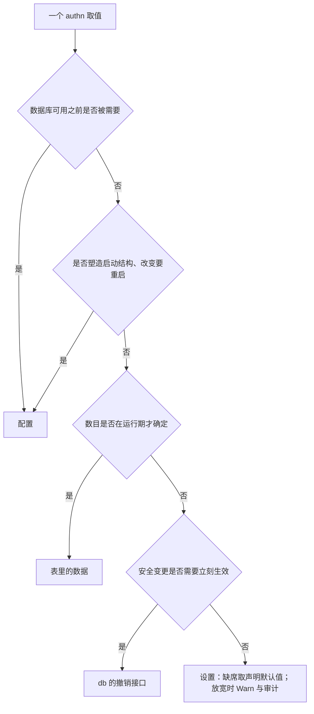

# 配置与设置的分界、放宽开关、秘密的存放

## 背景

`pkg/authn` 的取值覆盖网关参数、口令派生的资源上限、会话与令牌时长、退避与短信预算、多因素与冒充的策略、租户级强制策略，也覆盖客户端密钥、签名私钥、因素种子这类秘密，以及放宽校验的开关。每一类取值要落在配置、设置、表里的数据三处之一，秘密另有存放形态的选择。

**既有的划界判据。** 一个值属于配置，当且仅当它在数据库可用之前就被需要，或它塑造一个启动结构、改变它要求重启；其余的值属于设置，按租户或按运行时场景取不同值的项同样落在设置一侧，这是该判据的推论（[ADR-config-scope](adr-config-scope.md)）。判据把设置缺席时的降级交给使用方，使用方各自定义。

**设置的既有性质**（design-settings）：

- 值以文本明文存库。`Sensitive` 只遮蔽变更事件的载荷与 `Declared` 的默认值，`Get` 与 `List` 照常交出敏感项的值。
- 设置模块自身不做授权判定（[ADR-settings-scope](adr-settings-scope.md)）。框架的设置管理面把全局层写入定为平台域 `authz.PlatformDomain` 的 `settings.write` 判定，并在每次写之前落一条强制档审计（[design-settings-admin](../design/modules/settings/design-settings-admin.md)）。写入时判取值域，读取不判。
- 设置没有按键的写控制：`settings.write` 不区分键，也没有按键的写入钩子，持有该权限的主体可以改任何一个已声明的键。
- 读取走内存快照，变更经 `settings.changed` 事件与周期刷新传播，最坏延迟是刷新间隔。
- 设置模块自身要求 `db` 与事件总线；快照在设置模块的 `Init` 装载之前，读取报 `ErrNotLoaded`。

**配置的既有性质**（design-config）：

- 输入项的来源是主配置源、环境变量、命令行的任意组合，`Origins` 的零值是主配置源加环境变量。命令行参数会进入命令行历史与进程列表。
- `Sensitive` 约束配置模块自己的输出内容：错误文本不复述值、帮助输出不回显默认值、必须带说明。它不向日志模块登记脱敏规则；脱敏规则由持有值的模块登记（[ADR-log-redaction](adr-log-redaction.md)）。

**数据库加密列。** 加密列的密钥是 `db` 的根密钥。根密钥缺失不是 `db` 的启动失败，到第一条触及加密列的语句才失败（[ADR-db-encryption](adr-db-encryption.md)）。

**约束。**

- 只使用口令表的宿主没有数据库与事件总线，不能为几个退避参数而被迫运行二者。
- 放宽校验的开关一旦在运行期被改动，校验立即变弱；启动诊断只覆盖启动时的取值，运行期改动需要另外的可见性。
- 设置的全局层写入可以来自租户管理员界面、宿主的通用设置界面、宿主自己的代码（含 seed 这类命令）或任何持有平台域 `settings.write` 的主体；只有经框架 `settings.admin` 管理面的写入才有平台域判定与强制档审计，其余路径由宿主自己鉴权。authn 无法限制某个键的写权限，也无法阻止能到达写入接口的主体改它。
- 秘密一旦进入设置，随 `Get`、`List` 与库转储明文流出。

## 考虑过的选项

### 阈值与时长放配置

会话时长、令牌时长、退避参数、短信预算等调参类取值写进配置，启动时读一次。

**否决**：这些值不在「数据库可用之前就被需要」与「塑造启动结构、改变要重启」两条之列，不满足配置的判据。放进配置使它们无法按租户取值、无法在运行期调整；遭遇短信轰炸而紧急关闭某个登录方式要重启全部副本。

### 一切取值放设置，含构造期分配与启动必须项

不区分取值是否在数据库可用之前就被需要，凡可调整的值都放设置，开关与调参共用同一机制。

**否决**（放宽开关除外）：构造时分配的大小与启动必须项在设置快照可读之前就要定下；设置模块自己要求 `db` 与事件总线，快照在它的 `Init` 才装载。把口令表的缓存容量、凭据提供方的客户端密钥或签名密钥文件路径放进设置，会让这些值在需要它们的时刻读不到，并把最小装配拖进数据库。放宽开关不在被否决之列：它们在数据库可用之前不需要，运行期改动要立即生效，按判据落在设置，见决策。

### 放宽开关取环境变量与命令行

放宽开关取主配置源、环境变量与命令行三个来源（`OriginPrimary|OriginEnv|OriginFlag`，并给 `FlagName`）；`Origins` 的零值只含前两个。

**否决**：环境变量与命令行是部署层最容易被覆盖的来源，一次容器环境的差异就能无声改变一台副本的校验强度，同一份主配置源在副本间不再是一致的权威。放宽开关因此不取环境变量与命令行；它们是设置项，生效值是设置里写的值与声明默认值。

### 秘密允许取命令行，或放进设置

客户端密钥、口令表条目等秘密可以由命令行参数给出；需要运行期轮换的秘密放设置。

**否决**：命令行参数进命令行历史与进程列表。设置的值明文存库，`Get` 与 `List` 照常交出，`Sensitive` 只遮事件与 `Declared`；签名私钥放设置还要多副本轮换的协调。

### 签名私钥与 SAML 私钥放数据库加密列

私钥与因素种子同样存在加密列里，轮换经管理面完成。

**否决**：`db` 根密钥已是全部加密列的单点，再放进签名私钥会让该单点连带令牌的签名，根密钥的任何一次事故同时变成签发权的事故。签名私钥放文件，令牌的签名不依赖数据库；文件挂载是多副本环境里承载密钥的常见方式。

### 设置作为 authn 模块的必需依赖

authn 的各模块在 `Requires` 里对设置写必需，所有退避、时长与预算一律从设置读。

**否决**：设置模块自己要求 `db` 与事件总线，只用口令表的宿主被迫为几个退避参数运行数据库与事件总线。设置对 authn 的模块写成可选依赖，缺席时取声明的默认值。

### 读设置出错一律回退声明默认值

任何设置读取失败都回退默认值并继续。

**否决**：强制类开关的默认值是「不强制」，回退等于放行。读设置出错的方向因开关的性质而异，不能共用一条规则。放宽开关的声明默认值取严的一端，读不出来按该严格值取值，这是「出错方向由开关性质定」的一个用例，不是统一回退。

### 放宽方向的默认值（`signup` 开放、`check-session` 关闭）

缺省即宽松，要求严格的宿主自己收紧。

**否决**：违反默认拒绝。忘记配置的宿主得到最弱的校验，且没有任何信号。

### 口令表的缓存容量与并发放设置

与口令表的缓存时长、退避参数同放设置，运行期可调。

**否决**：缓存容量与并发信号量在构造时分配，要在设置可读之前就定下，满足配置的判据。同一个模块的缓存时长与退避参数是设置，与其余 authn 模块用同一机制；分界在值本身，不在模块。

### 经 `Decider` 控制 `sms.allowed-prefixes` 的写入

`sms.allowed-prefixes` 的写入由 `authn.admin` 的 `Decider` 判定，通用设置界面不得写它。

**否决**：设置没有按键的写入钩子，通用设置界面照样能写这一项，经 `Decider` 的路径拦不住绕行。能做到的控制是事后可见。

### 按判据划界，放宽开关是设置，落库或落盘的秘密只存哈希、加密列与文件

**采纳**，见决策。

## 决策

采纳：authn 的取值按下列判据落位；放宽开关是设置；本模块落库或落盘的秘密只以哈希、数据库加密列、文件存放，启动前就要读到的秘密经配置给出。逐项的键、类型、缺省值与取值域列在 authn-config，本记录不复述。

**划界。**

- 划界沿用 [ADR-config-scope](adr-config-scope.md) 的判据：一个值属于配置，当且仅当它在数据库可用之前就被需要，或它塑造一个启动结构、改变它要求重启。放宽开关不单列：它们在数据库可用之前不需要，运行期改动的取值要在运行期生效，按判据落在设置；决定守护范围的清单、影响启动结构的值是装配期与启动期的输入，按同一判据落在配置。
- 构造时分配的大小与启动前就要读到的取值是配置。括号内为例举，不是封闭集：构造时分配的大小（口令表的缓存容量与并发、口令派生的并发与内存预算），启动前就要读到的取值（凭据提供方的客户端标识与密钥、签名与 SAML 私钥的文件路径，[REF-saml2](../references.md)、对外基址、依赖方标识、短信厂商密钥、cookie 的域与 `SameSite`，[REF-rfc6265bis](../references.md)）。
- `authn.gate.call-budget` 留在配置，尽管它每次后端调用都要读。网关的生产闭包不得含 `pkg/settings`（`pkg/authn/gate/deps_test.go` 的 `forbidden` 断言），而读设置要把 `pkg/settings` 及其下层（数据库、事件）带进闭包，网关就不再是存储不可用时作答的那一层。它的落位按网关的闭包边界判，不按读取频次判。
- 会话与令牌的时长、口令策略、退避与口令表的缓存时长、短信的位数、有效期与预算、MFA 的策略、冒充的时限、SSO 的出站超时、租户的强制策略是设置。名单是判据的例举，不是封闭集。
- 数目在运行期才确定的实体（每个租户的 IdP、账户、会话、服务密钥）既不是配置也不是设置，是表里的数据。

**设置对 authn 的模块是可选依赖。**

- 设置缺席时，取值取声明的默认值，行为与默认值下的设置完全一致，只是不可调整。这是 [ADR-config-scope](adr-config-scope.md) 接受的降级，不是配置。
- 读设置出错的方向由开关的性质定：强制类开关读不出来按拒绝；调参类取值读不出来取声明默认值并记 Error；决定写出产物的写路径设置（`authn.account.password-algorithm`）读不出来或越域时令写失败，不替换为默认值。
- 在自己的 `Init` 里读设置的模块对设置写 `Optional`；请求路径上的读取不受此限。
- 安全参数的缺省取满足规范要求的最严取值；设置声明的取值域下限使宿主无法经设置把口令哈希参数配到最低要求之下。

**放宽开关是设置。**

- 放宽开关是取值变化即放宽校验、且改动要在运行期生效的开关，新增的同类开关一并归入。当前的开关集合与各自的放宽值见 authn-config 的放宽开关一节。仅开发用的 `authn.gate.mount.allow-insecure` 与 `authn.sso.allow-private-egress` 在启动期决定基址校验、cookie 名称与出站客户端，改动要重启，按构造期的判据落在配置，不在这一条之内。
- 每一项声明严格的缺省值：`authn.account.signup` 缺省 `closed`，`authn.token.check-session` 缺省 `true`。放宽值分别是 `open` 与 `false`。
- 各模块在每次决定时读当前值，不把值冻结在构造期；设置缺席或读取出错时取声明默认值，即严格一侧，读取出错另记 Error。
- 运行期改动到放宽方向时，声明该键的模块订阅 `settings.changed`，写一行 Warn 并记一条尽力档审计记录：Action `authn.settings.relaxed`，Object 是键名，Outcome `relaxed`，Detail `{"change": direction}`。记录与日志只含键名与方向，不含值。改动到严格方向不写。启动时取值已经是放宽值时，写同一行 Warn。
- 配置不再承载这两项。旧配置里仍写着它们的宿主在启动时按未知键失败，错误点名该键，这是宿主可见的破坏性变更。
- 声明只有一处：`authn.account.signup` 由 `pkg/authn/account` 声明，`authn.token.check-session` 由 `pkg/authn/token` 声明；登录引擎按路径读取 `authn.account.*`，不重复声明。
- 决定守护范围的清单（`authn.gate.endpoints`、`authn.gate.trusted-origins`、`tenant.admission.endpoints`）仍是配置：它们在装配期决定路由挂到哪个端、跨源检查信谁，数据库可用之前就要定下。

**不单列的理由。** 旧划界把放宽开关单列为「只取主配置源」，理由是设置的写入接口没有访问控制。这个理由对设置能力本身仍然成立：`pkg/settings` 不做授权判定，宿主自己的写入口（含 seed 这类命令）由宿主自己鉴权。改变结论的是框架可选的 `settings.admin` 管理面：宿主纳入它时，它把全局层写入定为平台域 `settings.write` 判定，并在每次写之前落一条强制档审计。缺的仍是按键的写控制，而这个缺口对已经放在设置里的退避、预算与前缀名单同样存在。把放宽开关留在配置补不上按键控制，只是把改动推到重启之后，使运行期改动没有 Warn 与审计。新的落位让放宽开关与其余安全项走同一条控制：经管理面写入时受平台域判定并留强制档审计，authn 在放宽方向另写 Warn 与 `authn.settings.relaxed`。残留风险是宿主自建的写入口不受这套控制：它绕开管理面时既不判定 `settings.write` 也不留强制档审计，authn 无法发现，只能事后从自己的 Warn 与 `authn.settings.relaxed` 看出放宽。

**其余可运行期改动的安全项。**

- 退避、短信预算、`allowed-prefixes`、`disabled-methods` 与放宽开关这类可运行期改动的安全项放设置。authn 订阅 `settings.changed`，改到更宽松的取值时写一行 Warn，并经审计接口记一条尽力档记录 `authn.settings.relaxed`；记录只含键名与方向，不含值。
- `authn.login.disabled-methods` 可关闭的方法集合排除 `password`。写入时由设置的取值域拒绝含 `password` 的取值；库中原生值含 `password` 时，读取侧把它过滤掉（口令方式照常可用）并记 Error。理由见 [ADR-authn-password-method-required](adr-authn-password-method-required.md)。
- 需要立刻生效的安全变更（撤销）不走设置，走 db 的撤销接口（[ADR-authn-state-placement](adr-authn-state-placement.md)）。
- `AGENTS.md` 写入硬要求：`authn.*` 与 `tenant.admission.*` 的设置不得对租户或普通管理员开放写权限。

**秘密的存放。**

- 本模块落库或落盘的秘密只有下列三种形态，这一名单是封闭集：哈希（口令、令牌、验证码、服务密钥）、数据库加密列（因素种子、IdP 客户端密钥）、文件（JWT 签名私钥，[REF-rfc7519](../references.md)、SAML 私钥）。
- 启动前就要读到的秘密（社交登录、微信、短信厂商的客户端密钥这类）经配置给出，不落库，不进设置，不在上一条的集合内。
- 秘密不进命令行，不进设置。秘密类配置项取 `Origins` 的零值（主配置源加环境变量，不含命令行），标 `Sensitive` 并带 `Description`。
- 配置里的敏感项只放启动前就要读到的秘密。
- 每个持有秘密配置值的模块把该值另登记为日志的字面量匹配器；`Sensitive` 不替它登记。
- 带加密列的模块在 `Start` 里各做一次加密列往返自检，失败即终止启动，使 `db` 根密钥缺失在启动时报出，不拖到第一条触及加密列的语句（authn-config）。

[ADR-authn-events-and-audit](adr-authn-events-and-audit.md) 载明 `authn.settings.relaxed` 的契约；依赖不可用时的失败方向见 [ADR-authn-failure](adr-authn-failure.md)。

## 后果

放宽开关与退避、预算、前缀名单走同一条设置控制：经 `settings.admin` 管理面写全局层时，写入由平台域判定、每次写留强制档审计；宿主自建的写入口由宿主鉴权，设置能力不保证。改到放宽方向时 authn 另写 Warn 与 `authn.settings.relaxed`。运行期改动立即生效，不必重启。残留的缺口是按键的写控制：能到达全局写入接口的主体可以改任何一个已声明的键，authn 只能事后可见。

只使用口令表的宿主不必运行数据库与事件总线；设置缺席时全部调参类取值取默认值。

本模块落库或落盘的秘密形态是封闭集，新增的这类材料要归入其中一种，不得新增形态；启动前就要读到的秘密经配置给出，不落库。

**接受的代价：**

- 每个设置项带取值域，由一份表守住全貌（authn-config）；设置快照在每个副本内存里含全部租户的全部行。
- 设置变更在副本之间最终一致，最坏延迟是刷新间隔；租户刚开启强制策略后，最长数分钟内个别副本仍放行。对不按租户回退的键，写它的租户层不起作用且不报错，设置没有「该键只许全局」的声明。
- 设置没有按键的写控制，能到达全局写入接口的主体可以把退避、预算、前缀名单与放宽开关改到更宽松；经框架管理面的写入由平台域判定并留强制档审计，宿主自建的写入口由宿主鉴权、不受这套控制。authn 另在放宽方向提供 Warn 与 `authn.settings.relaxed`，但不提供阻止。阻止依赖宿主的管理面以及 `AGENTS.md` 的硬要求，authn 无法检查宿主是否遵守。
- 客户端密钥、口令表与签名密钥文件改动后要重启，无重启轮换要求把它们放进设置。放宽开关是设置，运行期改动立即生效。
- 单一的 `db` 根密钥保护全部加密列；根密钥轮换时退役密钥只解不写，加密列在下次写入时换到新钥，authn 不提供批量重加密。
- 签名私钥与 SAML 私钥的文件权限只能 Warn，无法强制。
- 缺项是启动失败而不是静默缺席，错误点名缺的那一项。
- 每个持有秘密配置值的模块要自己登记日志的字面量匹配器，漏登记不报错，遮蔽与否取决于登记。

## 失效条件

- 设置模块新增按键的写入钩子或「该键只许全局」「该键只许某类主体写」的声明：放宽开关不再只能依赖事后可见，落位与监视方式要按新的写控制能力重新评估。
- 设置改换存储，或设置的值改为加密存放：「设置明文存库」这一前提不再成立，秘密不进设置的理由要重写。
- 假设：审计的语句级明细不带加密列的列值。含加密列的模型经模型路径写入，这一假设尚未核实；守住它的测试是「审计行里不得出现秘密字节」，该测试不通过则秘密存放中数据库加密列这一形态要重新评估。
- 假设：`settings.changed` 事件载荷足以让订阅方判定「改到更宽松」的方向，不必另读旧值。守住它的测试是对每个放宽方向的键写入并断言 Warn 与审计记录出现；不成立则订阅方要自己维护上一份取值。
- 部署需要不重启的客户端密钥或签名密钥轮换：文件加重启的形态不再满足，要引入密钥管理服务的接口，本记录描述的文件形态不再成立。
