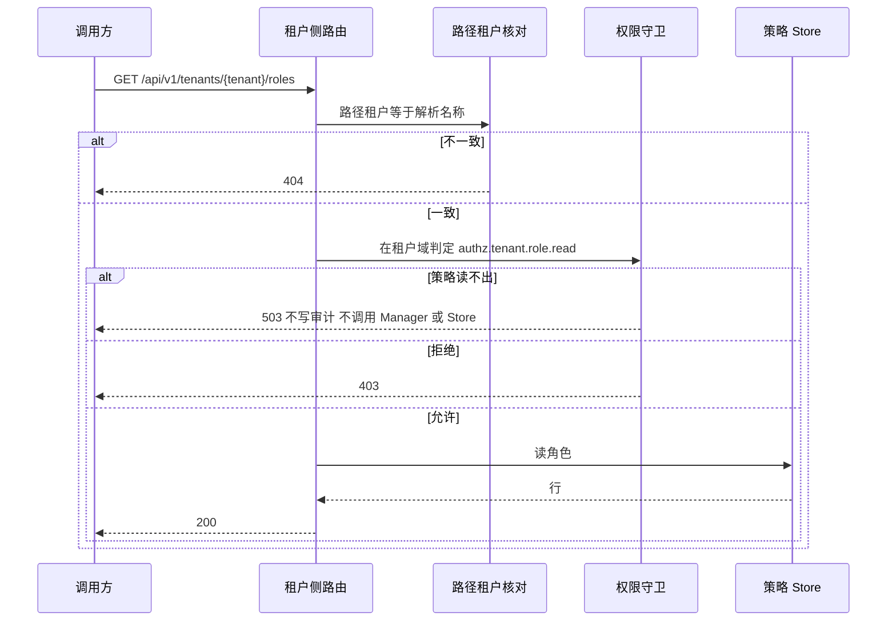
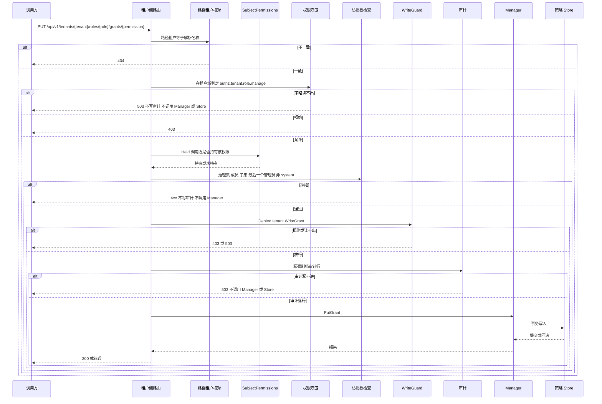

# 租户域的管理端点：治理权限元数据、租户管理员允许集与防提权

## 背景

授权目前只有一个平台域的管理端点：`authz.admin` 挂在 `/api/v1/system` 下，按平台域判定，把权限目录、角色、授予与绑定的读写暴露给持有 `authz.role.read` / `authz.role.manage` 的平台员工。设置的管理面 `settings.admin` 同样按层判定，租户层的写落在该租户的域（[ADR-admin-settings](adr-admin-settings.md)）。

租户管理员需要在自己的租户内管理角色、权限与设置。这些动作是租户域的，不是平台域的：路径按租户寻址，判定在该租户的策略域（[ADR-http-api-path-scopes](adr-http-api-path-scopes.md)、[ADR-tenant-administration](adr-tenant-administration.md)）。

权限目录是全部已登记模块声明的权限的并集（`Catalog.Declared()`）。`platform-admin` 只存在于平台域；它在租户域内不凭自身放行任何请求，调用方要在该租户另行持有绑定。租户管理员不能持有全部声明权限：其中的平台运营权限（例如冒充、账户管理、审计与租户名册）一旦被租户管理员授给自己或租户成员，就越过了租户边界。这些是例子，不是平台专属权限的全集。

租户管理员的允许集按租户种类分两档。业务租户与 `system` 租户的 `tenant-admin` 取完整治理集 `Catalog.TenantGoverned()`。个人租户取其子集：宿主的业务资源集与治理集相交，再减去宿主的排除集（成员管理与 SSO 管理）；个人租户的 `tenant-admin` 不作为内建角色种入，也不由 `Reconciler` 收敛。

内建角色的授权集不能经管理面改写（[ADR-authz-seeding](adr-authz-seeding.md)）；但平台新增一个治理权限时，内建的 `tenant-admin` 角色要能收敛到新的声明集，否则新权限永远到不了任何租户管理员。

租户侧的每条写都可能提权：授予一条本不允许的权限、绑定一个不在租户里的账户、改写内建角色、删除最后一个管理员、在 `system` 域上操作。这些约束要由写入侧执行，不能留给每个 handler 自己判断。

## 考虑过的选项

### 把租户端点加进 authz.admin，同一模块挂两个作用域

**否决**：`authz.admin` 按平台域判定、取用 `Manager` 与 `Catalog`，配置命名空间是 `authz.admin`。把租户端点加进去，两套判定域、两套允许集与两个配置开关落在同一个模块里；宿主不能只装平台端点或只装租户端点，模块的必填配置也会互相牵连。

### 租户管理员复用平台管理面的路径

保留 `/api/v1/system/...`，用路径或查询串里的租户切换判定域。

**否决**：路径前缀决定作用域与网关的端归属（[ADR-http-api-path-scopes](adr-http-api-path-scopes.md)）。放在 `/system` 下的路径在平台域判定，租户管理员即使持有租户权限也过不了；把它改成按查询串切换域，又会让同一个前缀下的路径有两种判定域，地址不再能说明级别。

### 不区分治理权限，租户管理员看到完整目录

租户管理员与平台管理员都取 `Catalog.Declared()`。

**否决**：租户管理员会把 `authn.impersonation.*`、`authn.account.*`、`audit.*` 这类平台运营权限授予自己或租户成员，越过租户边界；平台管理员与租户管理员的允许集必须有差别，而平台管理员不能被收窄。

### 由每个 handler 自己核对路径段与解析出的租户名称

**否决**：漏写一个 handler 即放行一条跨租户请求，没有统一信号；租户侧的每条路由都要各自核对，新增路由容易漏。中间件在路由组一级覆盖，覆盖关系由路由组的登记给出。

### 以平台专用命名空间集合决定租户可见性

租户面按命名空间前缀排除平台专用集合（`ratelimit.*`、`tenant.admission.*`、`authn.*`），集合之外的命名空间默认可由租户读写。

**否决**：可见性以命名空间为单位，无法表达同一命名空间内既有平台级项又有租户级项的情况；新增模块不写集合即默认可由租户写，是一次 fail-open。可见性改由声明逐项回答：`Schema.TenantFacing` 与 `Item.TenantAccess` 的零值都是不可见，只有模块显式声明才进入租户面。`tenant.admission` 的两项准入策略正是声明为租户可读写、同一命名空间下的 `check-ttl` 保持平台级的例子。

### 治理元数据加独立模块 authz.tenantadmin 与 settings.tenantadmin

**采纳**，见决策。

## 决策

采纳：**租户域的角色、权限与设置管理由独立模块 `authz.tenantadmin` 与 `settings.tenantadmin` 承担，端点落在 `/api/v1/tenants/{tenant}/...`；权限带治理（governed）元数据，租户管理员按租户种类取治理集或其个人租户子集，平台管理员取完整声明集；租户侧的全部路由组经路径租户与解析租户的名称一致的中间件；防提权规则由写入侧执行。**

- **模块与命名。** 模块名 `authz.tenantadmin` 与 `settings.tenantadmin`；配置命名空间、特性名与 OpenAPI 标签都取同一个名字。两者各自登记、各自开关：`authz.tenantadmin` 交付租户域的角色、授予与绑定端点，`settings.tenantadmin` 交付租户层设置的读写端点并复用设置能力的 `Store`。打包沿用 [ADR-authz-packaging](adr-authz-packaging.md) 的叶子模块粒度：每个管理面自成一个叶子模块，不与 `authz.admin` 或 `settings.admin` 合并。
- **端点前缀。** 这两个模块的全部路由以 `/api/v1/tenants/{tenant}/` 开头，作用域为 `tenants`；这两个模块不挂 `/system` 下的路径。判定域取该租户，不取平台域。
- **治理元数据。** 权限声明带一项治理标记，表示该权限可以由租户管理员在自己的租户内授予。业务租户与 `system` 租户的 `tenant-admin` 允许集是治理集；个人租户取（宿主的业务资源集 ∩ 治理集）− 宿主的排除集，且该角色不作为内建角色种入、不由 `Reconciler` 收敛。平台管理员取完整 `Catalog.Declared()`，不因本决策收窄；`platform-admin` 只在平台域存在，在租户域内不凭自身放行。新增权限的模块在声明时同时声明它是否治理；未声明的权限按非治理处理。
- **权限码拆分。** 平台侧的角色接口继续用 `authz.role.read` / `authz.role.manage`；设置的 `settings.read` / `settings.write` 只服务全局层。租户层用 `settings.tenant.read` / `settings.tenant.write`，租户角色接口用 `authz.tenant.role.read` / `authz.tenant.role.manage`。平台侧的 `layer=tenant` 与租户侧共用租户码：平台员工要在某个租户读写租户层，须在该租户持有对应的租户码，通常经该租户的 `tenant-admin`（治理集）。两组码各自翻译、各自授予：一个持有平台码的调用方不因平台码通过而通过租户层的判定，反之亦然。`settings.admin` 在 `layer=tenant` 上询问租户码，租户侧的路由由 `settings.tenantadmin` 挂出。
- **设置的治理范围。** 全局层只经 `settings.admin` 用 `settings.read`／`settings.write` 读写；租户层由 `settings.tenantadmin` 与平台侧的 `layer=tenant` 两条通道读写，都用 `settings.tenant.read`／`settings.tenant.write`。租户可见性由声明逐项回答：`Schema.TenantFacing` 为零时整份声明不对租户开放，`Item.TenantAccess` 为零（`TenantNone`）时该项不可见，只有 `TenantRead` 与 `TenantReadWrite` 进入租户面。声明归属在建键表时校验，缺元数据即启动失败；没有“命名空间默认可由租户写”的缺省。
- **路径租户与解析租户的名称一致。** 每一个 `ScopeTenants` 的路由组挂一层中间件，核对路径里的 `{tenant}` 段与请求解析出的租户的名称相等：请求以名称寻址，解析层把名称换成标识写进上下文，中间件据该标识从名册取回名称再比对。路径段解析不到唯一租户，或解析到另一个租户，都以不区分原因的 404 拒绝，与租户解析层的拒绝相同。所有租户侧路由组都挂这一层，新增路由组不挂即覆盖不到。模块的路由在声明表上登记为开放（`declareOpen`），由中间件与 handler 内的判定承担权限，与 `authz.admin` 的写法相同。
- **防提权规则。** 下列规则由写入侧执行，不交给每个 handler 自己判断：
  - **允许集。** 写入的权限必须在治理集内；一条非治理权限在 `Manager` 之前以 400 拒绝。
  - **绑定 tenant-admin 受限。** 给一个账户绑定 `tenant-admin` 是允许的，但要同时满足：目标账户是该租户的有效成员；分配者自己持有的权限覆盖被绑定角色将要获得的权限（子集约束）；不删除最后一个 `tenant-admin` 绑定；不删除自己的绑定。
  - **保留角色。** `platform-admin`、`tenant-admin` 等内建角色名保留；租户侧不能创建、删除、改名或改写内建角色的授予。内建角色的授予只经独立于管理面的收敛能力改动（见下）。
  - **只绑定成员。** 绑定只能写给该租户的有效成员；非成员以 400 拒绝。
  - **不作用于 system。** 租户侧拒绝 `tenant == system`；平台域的管理经平台管理面或宿主种入，不经租户侧。
  - **注册验证门控。** 发起者的注册状态视为未验证（`SignupPending`）时，写路由答 403 `contact-required`，动作不执行；服务账户与没有任何邮箱的账户豁免。读路由不受这条门控影响。
  - **设置写守卫 `authz.WriteSettings`。** 新增一个独立的宿主能力，`settings.tenantadmin` 以它为必需依赖，缺席即启动失败。它在租户层写之前被询问：答复拒绝答 403 `urn:speed:settings:protected`，读不出来答 503，不按放行处理。它只接收租户标识，宿主在它里面拒绝个人租户的写；声明归属的判定不在这里，而在 `settings.tenantadmin` 对设置声明的读取里。`WriteOp` 的封闭三元组（角色、授予、绑定）不变：设置写不属于策略数据，不并入它。
  - **审计先于动作。** 两类模块的每条写都先落一行强制档审计，写不进即 503 且动作不执行；策略数据的写另经既有的 `authz.WriteGuard`，拒绝 403、读不出 503。
  - **服务端逐条执行。** 前端不渲染被排除的租户，不构成后端放行的理由；上列规则在服务端逐条执行。
- **内建角色的收敛。** 新增独立于 `Seeder` 与 `Manager` 的 `authz.Reconciler` 能力，由 `authz.policy` 排他交付，宿主取用，`authz.tenantadmin` 永远拿不到。它与 `Seeder` 共用输入类型 `Grant`：目标集与废弃集都是 `[]Grant`。它只收敛一个域的 builtin `tenant-admin`，从不作用于 `platform-admin`，也不收敛个人租户的 `tenant-admin`（该角色不是内建角色）：把授予集收敛到本次声明的治理集，先添加缺失的授予，再删除本次版本声明为废弃的授予，全过程在一个数据库事务里；目标集与废弃集重叠时目标集胜出，两者都列出的授予保留；事务失败整体回滚，重试重新收敛；提交之后重载快照并发布 `authz.policy.changed`；可重试、幂等。错误顺序固定：角色不是 `tenant-admin` 时在任何读取之前返回 `ErrReservedRole`；`tenant-admin` 不存在时返回 `ErrUnknownRole`；`tenant-admin` 存在但不是内建时返回 `ErrReservedRole`；这些都在任何收敛写入之前发生。调用方在调用前落一行强制档审计，审计写不进即不收敛；多副本下只删除本次版本明确废弃的权限，不按“不在本次集合里就删”推断。机制见 [ADR-authz-seeding](adr-authz-seeding.md)。
- **请求顺序。** 租户侧的读与写按下列顺序执行。守卫读不出策略时答 503，不写审计，也不调用 `Manager` 或 `Store`；调用方自己的持有集（`SubjectPermissions.Held`）在防提权检查之前读取，防提权检查据此判断子集约束。

- **实现细节归设计文档。** 路由的完整清单、请求与应答结构、错误码与配置项在 `authz.tenantadmin` 与 `settings.tenantadmin` 的设计文档里，本记录不重述。

## 后果

租户管理员有了自己的管理端点，平台管理面不再替他们代劳；治理元数据把“租户能授什么”写进权限声明，平台管理员与租户管理员的允许集有了可执行的差别。防提权规则由写入侧统一执行，新增租户路由不会因为漏写一条检查而放开一条提权路径。

**接受的代价：**

- **权限声明多一项元数据。** 每个声明权限的模块要回答它是否治理；漏声明按非治理处理，一个本该治理的权限因此不会出现在租户侧，直到有人补声明。这条没有类型强制。
- **两组权限码并存。** 平台侧与租户侧的码各翻译、各授予；同一类动作在两面各有一份权限，部署要为两面分别准备绑定。
- **新增两个模块名与两套配置。** `authz.tenantadmin` 与 `settings.tenantadmin` 的配置命名空间、特性名与 OpenAPI 标签都是宿主可见的接口。
- **`authz.WriteSettings` 是宿主实现的必需接口。** 装配 `settings.tenantadmin` 的宿主必须实现它，缺席即启动失败；它只接收租户标识，个人租户的写拒绝落在宿主一侧，平台只负责在启动时要求它存在。声明归属的判定不在这里，而在 `settings.tenantadmin` 对设置声明的读取里；一项设置是否对租户可见由声明回答，不由宿主配置回答。
- **收敛能力要维护一份废弃集。** `Reconciler` 只删除本次版本明确废弃的权限；版本要回答哪些权限已经废弃，漏列会让旧授予留在一个内建角色上。
- **核对路径段与解析出的租户名称的中间件是路由组级约定。** 新增一个 `ScopeTenants` 路由组而忘记挂它，跨租户请求不会被拦下；这条靠路由组的登记与测试守住。
- **租户侧的写与平台侧的写各走一条通道。** 同一个角色在两面的判定域、权限码与防提权规则不同，宿主不能把一面的操作束直接接到另一面。

## 失效条件

- 租户侧开始需要跨租户的视图或平台资产：`/api/v1/tenants/{tenant}` 前缀与租户域判定不再成立，要另立一套接口。
- 治理权限的集合细分到按角色或按租户套餐：单一治理标记不再够用，元数据要重新裁定。
- 内建角色的收敛不再需要删除旧授予，或废弃集可以由代码自动推出：`Reconciler` 的“只删本次废弃”这一条要重新比较。
- 租户管理员被允许管理 `system` 或平台域：本记录的排除与平台侧/租户侧的分工同时失效。
