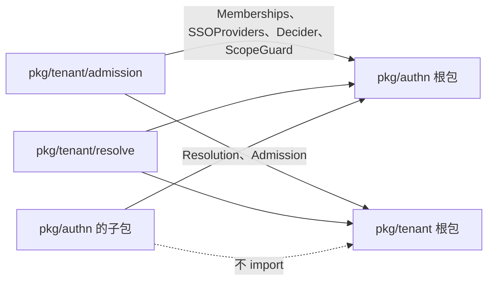

# 租户准入层放在 tenant 目录：成员关系、租户级强度策略与冒充范围

## 背景

账户全局，可属多个租户。成员关系的事实与存放归认证模块：一张表，只经 `Memberships` 的实现访问（[ADR-authn-accounts](adr-authn-accounts.md)）。请求期由谁据此判定「这个身份属不属于这个租户」，没有任何模块承担。租户解析层按设计不读身份，认证网关不读租户，一个持合法凭据的调用方因此可以在请求里指名另一个租户，两层都拦不下它（[ADR-tenant-resolution](adr-tenant-resolution.md)）。宿主自写的成员核对层漏写即放行；授权模块按（账户，租户）绑定角色，成员事实是它的输入而不是它的职责，所以没有准入层的装配里，这是一条开放的越权路径。

下列事实同时成立，准入层的位置要同时满足它们。

**判定的输入分属认证与租户两个目录。** 身份由 `pkg/authn` 根包定义，租户上下文由 `pkg/tenant` 根包定义；成员判定、租户级认证强度、冒充身份的租户范围都要把身份与租户上下文一并读入。

**依赖方向已经固定。** `pkg/tenant` 位于 `pkg/authn` 之上：解析子包 import `pkg/authn` 根包，因为指向网关功能标识的硬约束要写出 `(*authn.Gate)(nil)`（[ADR-tenant-ordering](adr-tenant-ordering.md)）。`pkg/authn` 的子包不 import `pkg/tenant`，账户模型与登录引擎因此不认识租户（[ADR-authn-packaging](adr-authn-packaging.md)、[ADR-authn-scope](adr-authn-scope.md)）。

**租户级的认证强度只能在请求期判。** 登录时账户全局、租户未知；登录时的任何范围线索都能被绕开：先在无租户的范围登录，再去访问要求多因素的租户（[ADR-authn-mfa](adr-authn-mfa.md)、[ADR-authn-sso](adr-authn-sso.md)）。

**冒充的租户范围需要一个知道租户的执行点。** 网关只知道请求命中的端与路由，不读租户；请求期知道租户的只有租户目录里的层（[ADR-authn-impersonation](adr-authn-impersonation.md)）。

**拒绝要留痕、要计入限流。** 非成员的请求是需要留审计行的一类拒绝，也不应绕开限流计数；「留审计行」与「计入限流」要求准入层的链上位置落在记录与限流两个阶段之内，由阶段顺序给出（[ADR-ratelimit-dimension](adr-ratelimit-dimension.md)）。

**准入层的拒绝应答不得成为租户枚举的预言机。** 解析层对「租户不存在」「已停用」一律 404，两者一致；准入层的拒绝若区分原因，会把这条防线拆掉。

## 考虑过的选项

### 放进 authn，由 `authn/membership` import `pkg/tenant` 根包

准入层作为认证目录的子包，读 `tenant.FromContext`。身份与成员关系同在一处，不另设模块。

**否决**：要求 `pkg/authn` 依赖 `pkg/tenant`，与 `pkg/tenant` 位于 `pkg/authn` 之上的方向相悖，两个目录互相依赖。包与包之间无环，目录与目录之间有环；认证目录要为一个只有租户上下文才有意义的判定去依赖租户目录。被它改写的是 tenant 文档里一条明文声明的方向，不是一处措辞。

### 不做准入层，留给授权模块与宿主

成员核对由授权模块承担，或由宿主自写。

**否决**：没有准入层的装配里，默认部署对跨租户访问是放行的，与默认拒绝冲突；宿主自写的核对层漏写即放行，而漏写不报错。租户级的强度策略与冒充范围同样落空：要求多因素的租户拦不住一个以较弱方式登录的成员，冒充的「限定一个租户」缺一个执行点。授权按（账户，租户）绑定角色，成员事实是它的输入而不是它的职责。

### 并入租户解析层

解析层换出租户标识之后顺带判成员。

**否决**：解析层按设计不读身份、不依赖认证，这条是[租户标识由请求解析得到的决策](adr-tenant-resolution.md)的判据本身；读身份即推翻它。解析层排在审计与限流之外，它的拒绝既不留审计行也不计数。

### 在校验后端里判成员，或令牌与会话里带租户列表

校验后端盖章时一并核对租户；或访问令牌与会话记录携带账户所属的租户集合，请求期只比对。

**否决**：校验后端在租户解析之前，看不到租户，无从比对。租户列表放进令牌或会话，成员关系的变更要等令牌或会话换新才生效，撤销变慢，令牌变大；令牌不带角色已是既定做法，租户列表与角色是同一类东西（[ADR-authn-identity](adr-authn-identity.md)）。

### 准入层的端清单缺省 `*`

与网关一致：`endpoints` 缺省守入口模块的全部端，显式清单作收窄。

**否决**：准入层对「有冒充身份而无租户上下文」的请求答 404。认证自己的挂载端上没有租户上下文，缺省 `*` 使准入层覆盖这个端，冒充身份连结束冒充都做不到。网关缺省守全部是失败时拒绝的一侧，准入层缺省守全部则把认证自己的路由拒在门外，两者的失败方向不同，不能共用写法。

### 非成员一律 404，不留放行接口

准入层只认成员，非成员无条件拒绝。

**否决**：跨租户的平台角色（客服、平台管理员）落不了地：这类请求在授权之前就被准入层拒绝，授权模块要落地它们只能改准入层。放行的事实依据是授权的事，准入层只需要一个询问的口子，缺省仍是拒绝。

### 租户级的强度策略对所有身份无差别适用

多因素要求与 SSO 要求对冒充身份与服务账户一视同仁。

**否决**：服务账户不能完成加强认证，也没有 SSO 登录，租户一开启策略，它的全部 API 集成永久 401；冒充身份证明的不是目标本人，发起者的强认证已在冒充开始时核验，再要求目标的多因素与 SSO 没有对象。

### 租户行覆盖全局行

两个强度开关按「租户行 > 全局行 > 声明默认值」回退；租户写下的假行关闭平台要求。

**否决**：平台要求是安全下限。租户行覆盖全局行让一次平台翻转被既有的租户假行抵消：页面按 OR 显示「平台强制启用」，下一次请求却按租户行放行，视图与判定分叉。写入前的 409 只挡新的关闭写，挡不住平台翻转之前已经存在的假行。

### 准入层放在 tenant 目录，经 `Memberships` 读成员关系

采纳项，见决策。

**采纳**。

## 决策

采纳：租户准入层放在 tenant 目录，模块名 `tenant.admission`，包 `pkg/tenant/admission`；经认证根包的 `Memberships` 读成员关系，依赖方向仍是 tenant 指向 authn。设计见 design-tenant-admission。

图中的边标签是例举，不是准入层所取符号的全集。

**判据。** 准入层的判据是判定所需的输入：需要同时读身份与租户上下文的判定归 `tenant.admission`；只读凭据与主体来源的归认证；角色与授权归授权模块。

**哪些路由落在所守的端上，同样由判定域决定。** 一条路由只有既按租户寻址（租户是路径段，不是查询值）、又由该租户治理（判定在该租户的策略域）时，才落在准入层所守的端上（[ADR-http-api-path-scopes](adr-http-api-path-scopes.md)）。认证的租户管理路由因此要求所挂的端在本层与解析层的清单里；平台管理作用域的单行名册路由、授权与冒充记录按租户寻址而判定在平台域，审计在整张表上读，设置的租户层由查询串点名，它们的端都不在清单里。

**位置由阶段顺序保证。** 准入层声明授权阶段、不带 `After`；授权阶段在鉴别、限流与记录三个阶段之内，非成员的拒绝因此必然进审计、必然计入限流。定序锚点 `(*tenant.Admission)(nil)` 在 `pkg/tenant` 根包，授权阶段之内别的层（授权模块）只 import 根包取它，用 `After` 把自己排在准入层之内。交付接口、阶段与锚点的承载处见设计文档。

**端清单必填、无缺省。** 缺省 `*` 会使准入层覆盖认证自己的挂载端，冒充身份在那里没有租户上下文，连结束冒充都做不到；这条的理由是失败方向，见「准入层的端清单缺省 `*`」一节的否决。取值规则与错误见设计文档。

**不判定角色，不写 403。** 准入层回答「这个身份能不能进入这个租户」，「进入之后能做什么」归授权模块。非成员与冒充范围不符一律 404，与解析层一致，不区分原因；放行非成员只经 `Decider` 的询问口，缺省拒绝。判定的完整顺序、应答字段与指标属性由设计文档给出。

**两个强度开关对租户可见，有效值是平台层与租户层的 OR。** `tenant.admission.require-mfa` 与 `tenant.admission.require-sso` 的声明标记为租户可读写，租户管理面因此能为其写租户行；判定读同一对层并取 OR，全局层是平台下限，租户行不能把平台要求降下来。平台强制时租户面另拒绝关闭写（409），那是写入前的体验保护，下限本身仍由 OR 表达。`check-ttl` 不属于这条，仍是平台级设置。

**放宽有界。** 放宽来自成员结果与放行结果的进程内缓存、设置快照的刷新周期，以及强度要求自身的定义——认证时刻早于起算时刻的会话在其存续期内不受该要求约束。缓存与刷新周期的上界分别由缓存时长设置与设置的刷新周期给出，成员关系变更的事件使各副本主动清缓存；要求定义带来的放行不是等待某个窗口关闭，而是要求的内容，由会话自身到期或被撤销收束。

## 后果

「这个身份属不属于这个租户」有了请求期的承担者，没有任何模块承担成员判定的那条开放越权路径，在装入准入层的装配里关闭；授权模块只需 import 根包取锚点，不改准入层与认证。认证目录的子包保持不 import `pkg/tenant`，账户、登录、令牌的依赖闭包不含租户。租户级强度策略与冒充范围各有唯一的执行点，且都在请求期。

**接受的代价：**

- **每个请求多一次成员核对，缓存未命中时是一次库点查。** 成员被移除后，其他副本最多在缓存时长内仍放行；租户刚开启强度要求后，设置的刷新周期内个别副本仍放行，而开启之前建立的会话按定义一直不受该要求约束。
- **平台下限不由租户行撤销。** 平台翻转后，租户既有的假行保留在表里但不再改变判定；清理旧行不是下限生效的前提，平台也不能靠删除租户行来保证下限。
- **静态口令表主体默认进不了任何租户域。** 它们没有成员关系行；需要运营账号读租户数据的宿主经 `authn.tenant.access` 放行，或自写 handler。
- **准入层所守的端上，被租户解析豁免的路由没有租户上下文。** 非冒充身份在这些路由上照常放行，冒充身份答 404；`ScopeGuard.Covers` 只说准入层守哪些端，不核对宿主有没有在那些端上开解析豁免。
- **强制的对象是该租户内的请求，不是账户登录。** 账户仍可登录，仍可访问它所属的其他租户。
- **不装准入层的装配仍是开放的越权路径。** 约束指向的功能在该端无人代表时被入口模块丢弃，所以授权模块的 `After` 指向准入层，在没装准入层的装配里不产生任何影响；成员核对要靠宿主自己的层关闭。
- **`Decider` 的询问发生在请求已过网关之后。** 它的拒绝不进网关的拒绝计数，只进准入层自己的指标与日志。

## 失效条件

- **授权模块承担成员判定。** 授权模块若自己核对（账户，租户）的成员关系并在准入之前拒绝，准入层的成员核对与 `authn.tenant.access` 放行接口与之重复，本记录要与它重新比较；若授权只经准入层放行的非成员取得平台角色，本记录不变。
- **`pkg/authn` 获得对租户上下文的合法依赖。** 判定所需的身份与租户上下文落在同一个目录时，「放进 authn 会使两个目录互相依赖」不再成立，放置位置要重新比较。
- **阶段集合或其次序改动到授权不再落在记录与限流之内。** 本记录的立场是把准入层放在授权阶段，靠阶段顺序让它的拒绝进审计、计入限流；阶段顺序不再保证这一条时，「非成员的拒绝必然留痕并计数」失效，本记录要重新比较。守住它的测试：在同时纳入网关、解析、审计、限流与准入层的装配里读链清单，断言准入层位于解析、审计与限流之内。
