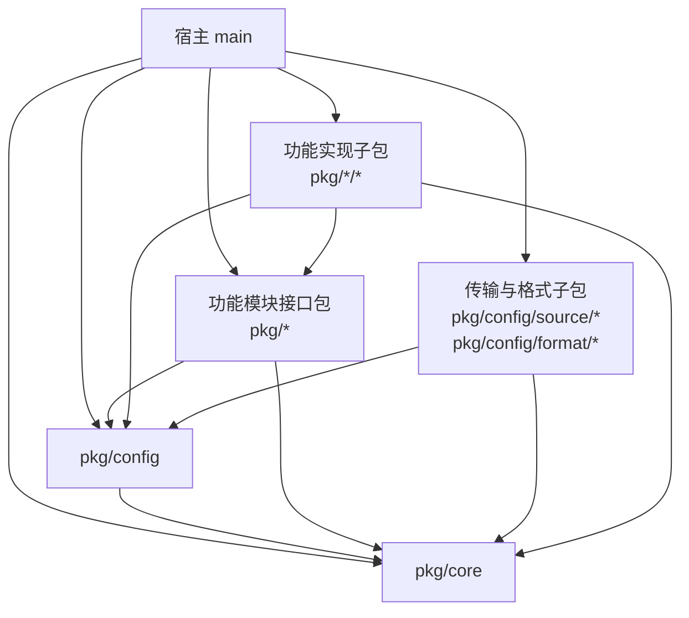
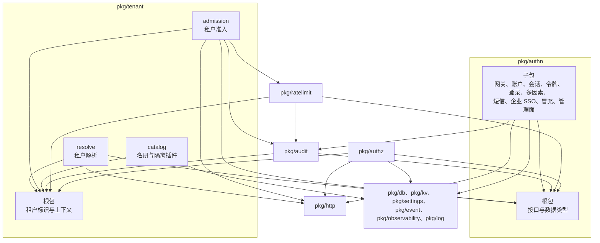
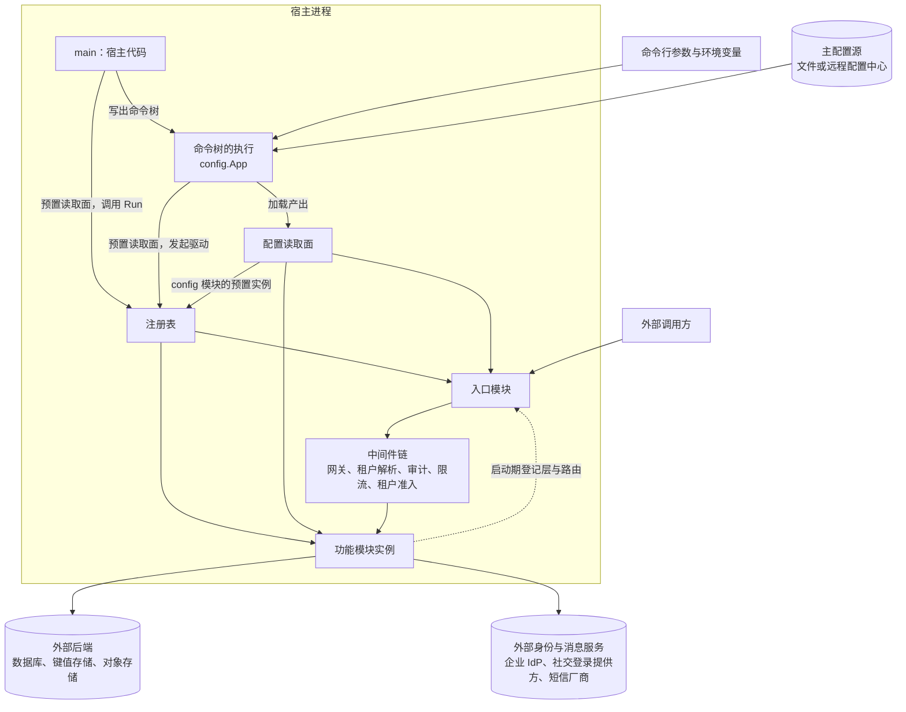

# 架构

## 概览

speed 以库的形式交付。`pkg` 是一个 Go module，其下每个目录是一个包；功能目录的根包承载该功能的接口与公共逻辑，该功能的多种实现拆为它的子包，每个实现子包各自绑定自己的第三方库并登记为一个模块（[ADR-module-packaging-2026-09-22](../adr/adr-module-packaging-2026-09-22.md)）。一个功能目录也可以容纳依附于该功能的另一项功能，它的接口包是这个目录下的子包，实现是那个子包的子包，事件目录里的事务发件箱即是（[ADR-outbox-packaging-2026-09-29](../adr/adr-outbox-packaging-2026-09-29.md)）。**并非每个顶层目录都承载功能**：`pkg/internal/` 不承载功能，住在它之下的是共享单元。一个共享单元或封装第三方客户端，供多个实现子包共用；或提供测试夹具，供多个模块的测试共用，功能目录根包的测试也在其内。共享单元不登记模块（[ADR-shared-backend-unit-2026-09-21](../adr/adr-shared-backend-unit-2026-09-21.md)）。

宿主编写自己的 `main`，import 所需的模块，驱动启动与停止。speed 不接管程序入口，也不规定应用的形态：HTTP 服务、gRPC 服务、不对外暴露入口的后台进程，都由模块与宿主自己组成（[ADR-core-scope-2026-09-13](../adr/adr-core-scope-2026-09-13.md)）。

`pkg/core` 承载模块化的基础设施（描述符、注册、预置、查询、生命周期驱动），以及零第三方依赖的公共基础设施。`pkg/config` 承载启动必须项的加载，以及宿主用来写出子命令的命令树，并登记交付配置读取面的 `config` 模块。其余功能目录各提供一种功能，对外入口也是模块；不承载功能的共享单元不在此列。

模块的选择分层进行，每层回答一个问题：

| 层次 | 输入 | 回答 |
|---|---|---|
| 编译期 | 被 import 进来的模块 | 这个二进制里存在哪些模块（可用集） |
| 驱动选定 | 运行级纳入的模块及其依赖闭包，加上预置了实例的模块；`Run` 入口下是全部已登记模块 | 本次运行哪些模块有资格表态（参与集） |
| 驱动选定 | 参与集，加上静态级纳入的模块 | 本次运行哪些模块的声明进入收集范围（声明集） |
| 运行期 | 参与集与排他消解 | 本次运行驱动哪些模块（启用集） |

可用集由 import 决定，但不限于宿主 `main` 里那几行：模块的注册发生在 `init`，凡被 import 进来的模块包都会执行，所以宿主的某个依赖 import 了一个模块，它同样进入可用集，宿主未必知情。可用集是编译的结果，不是宿主的一份声明。

**纳入分两级**（[ADR-command-tree-2026-09-21](../adr/adr-command-tree-2026-09-21.md)）。运行级纳入的模块被构造与驱动，有资格表态，其输入项出现在这条命令的参数面上；静态级纳入的模块只让它声明的资源进入收集范围，不构造、不表态、不展开依赖闭包，其输入项默认不出现在参数面上且永不判必填。分两级是因为一条命令对"运行什么""显示什么""收谁的声明"三者的需求可以不一致：施加迁移的那条命令只运行数据库引擎，而它要收齐的迁移集来自那些不运行的带表模块。不写命令树的调用方经 `Run` 进入，那里的纳入不分级：参与集就是全部已登记模块，静态级纳入为空，声明集因而等于参与集（[ADR-drive-entry-2026-09-21](../adr/adr-drive-entry-2026-09-21.md)）。

**声明集是参与集加上静态级纳入的模块**，因而含依赖闭包拉进来的与预置了实例的那些。定义成"宿主写下的两级名字之并"会让包含链断掉：一个经闭包拉进参与集、或因预置了实例而进入参与集的模块同样会运行，却将落在声明集之外，于是它的插件照装而它的表不建——插件对着不存在的表发语句。

参与集必为声明集的子集。写出命令树的宿主，参与集出自它写在命令树上的运行级纳入，注册表据此展开依赖闭包——运行级纳入一个模块即一并纳入它构造期依赖的提供者，但**交付声明了排他的提供者不在此列**：一个必需功能的提供者声明排他时，展开不替宿主挑，只取命令树上已经写下的那些，命令树上一个都没有、也没有为其中哪个预置实例时，该功能缺提供者、启动失败，宿主在命令树上点名哪个实现，参与的就是哪个，预置了实例的排他提供者不经点名也在参与集里，与点名的实现之间按消解的普通规则处置；非排他的功能照旧展开，多个校验后端并存正是这种形态。展开规则是确定的，不引入新的决定——不替宿主挑，恰是不做决定；代价是参与集里会出现宿主没有写下的名字，而这条代价在排他功能上不成立，那里宿主不写就没有。`Run` 入口不经命令树，它把全部已登记模块作为参与集，服务于不写命令树的调用方——包外测试与嵌入式宿主，那里没有"哪条命令用得上哪些功能"这回事，参与集因而取到注册表里已登记的每一个模块（[ADR-drive-entry-2026-09-21](../adr/adr-drive-entry-2026-09-21.md)）。**预置了实例的模块另有一条不经纳入的路**：宿主在驱动之前为某个已登记模块预置了实例，该模块不看命令树是否纳入它，一律进入参与集，表态固定为启用，消解淘汰不了它（[ADR-supplied-instance-2026-10-08](../adr/adr-supplied-instance-2026-10-08.md)）。启用集必为参与集的子集，由参与集经排他冲突消解得出：参与集里的模块一律启动，消解只让排他的默认实现在一个显式启用的竞争者面前退让。**参与集里的一个模块不能启动时，启动失败而不是静默缺席**：缺配置、缺依赖与部署前提不满足都是启动故障，没有一档表态可以让启动带着缺席的功能继续走（[ADR-module-enablement-2026-09-21](../adr/adr-module-enablement-2026-09-21.md)）。

参与集决定的是那些答案取决于"这次运行问没问过它"的事：谁表态并参与消解、谁被构造与驱动、依赖解析在哪个域上判、这一层命令行上有哪些参数。命令行参数只在使用命令树的那条入口下由它决定，按的是命令树决定的那一部分：只因预置而参与的模块，命令行上没有它的参数，读取面也不判它的必填项（[ADR-supplied-instance-2026-10-08](../adr/adr-supplied-instance-2026-10-08.md)）。**它不自动决定资源声明是否生效**——那由消费该资源的一方按不变量 15 裁定。

**一个被运行级纳入的模块必须启动。** 它不能在 `Prepare` 中因为缺配置、缺依赖或部署前提不满足而退让——那是一次启动故障，不是一次合法的表态禁用。宿主写下一个名字就是承诺这个进程装配它，经依赖闭包拉进参与集的模块同样如此，因此一个未被配置的依赖不因提供者自己会让开而被消化（[ADR-module-enablement-2026-09-21](../adr/adr-module-enablement-2026-09-21.md)）。`Run` 入口下的参与集是全部已登记模块，这条规则同样覆盖它们：不写命令树不等于可以少装配一个模块。

## 模块依赖图

箭头表示 import。依赖方向自上而下收敛于 `pkg/core`，`core` 不 import 任何模块。

图中编码了以下约束。

实现子包 import `pkg/core`（`init` 中注册所需）与自己的接口包，跨功能目录的依赖一律指向对方的接口包，不 import 任何其他功能目录的实现子包。实现所绑定的第三方库因此不进入不 import 它的依赖方的 `go.mod`；宿主的 `go.sum` 与实际下载则会经被 import 包的测试闭包带上同一 module 内兄弟实现所绑的库，只有读整图的操作会看到全部实现所绑的库（[ADR-module-packaging-2026-09-22](../adr/adr-module-packaging-2026-09-22.md)）；接口包自己封装的那个库则会传染，取用该功能即承受它（不变量 11）。

声明配置的模块还要 import `pkg/config`，因为配置声明与取用都用到它的类型。`config` 与 `core` 因而同属被广泛依赖的底层，区别是 `core` 被每一个模块 import，而 `config` 只被声明了配置的那些 import。

宿主同时 import 接口包与实现子包：接口包供业务代码取用，实现子包供其 `init` 完成注册（[ADR-module-registration-2026-09-13](../adr/adr-module-registration-2026-09-13.md)）。图中画的是宿主自己 import 的典型情形；实现子包也可能由宿主的某个依赖引入，注册的效果相同。

配置源与功能实现在结构上同形，都是接口包加实现子包，配置源因而不需要独立于模块机制的引入方式。配置的加载在装配开始之前完成，产出的读取面是 `config` 模块的预置实例：`pkg/config` 的根包登记这个模块，它只声明交付读取面，没有 `New`，实例由宿主在驱动之前预置（[ADR-assembly-bootstrap-2026-09-20](../adr/adr-assembly-bootstrap-2026-09-20.md)、[ADR-supplied-instance-2026-10-08](../adr/adr-supplied-instance-2026-10-08.md)）。

**认证与租户之间的依赖方向。** 上图按层次画出全部模块共有的收敛方向；认证与租户两个功能目录之间的方向另画一张，节点是包的归类，不逐包罗列。

箭头表示 import。

图中没有从 `aleaf` 或 `aroot` 指向租户任何包的边，方向是租户指向认证（不变量 17）。租户的解析与准入子包、审计与限流读身份，只经 `pkg/authn` 根包，不 import 认证的任何子包；根包只放接口与数据类型，非测试代码只依赖标准库与自己的内部包，因而被它们 import 不把认证的任何第三方库带进它们的闭包（[ADR-authn-packaging-2026-10-10](../adr/adr-authn-packaging-2026-10-10.md)）。

认证的叶子包各自 import 它取用的功能所在的接口包（图中归为 `pkg/http`、`pkg/audit` 与下层各包）；每个叶子包取用哪些功能、哪些必需哪些可选，由 [authn](modules/design-authn.md) 的模块清单承载。

授权由 [authz](modules/design-authz.md) 承载，它 import 认证与租户的根包、`pkg/http` 与下层各包，方向是授权指向它们，认证与租户都不 import 它。授权坐在准入层之上（不变量 17）：`authz.guard` 声明授权阶段，以 `After` 指向 `(*tenant.Admission)(nil)`，在同一阶段内排在准入层之后、handler 之外。

## 逻辑部署架构

speed 不引入进程边界。宿主是单一进程，注册表与全部模块实例都在该进程内，模块之间的调用是进程内的直接调用，不经过序列化、网络或服务发现。

图中的箭头不表示 import：`cli` 与 `primary` 指向命令树的执行表示数据在装配开始之前流入，`main` 指向它表示宿主写出命令树并交其执行，`main` 直接指向注册表表示不写命令树的宿主自己预置读取面、再调用 `Run`——两条边是同一个宿主二选一的入口，走 `Run` 那条边时不经过命令树的执行，读取面由宿主自己生成；命令树的执行指向 `cfg` 表示加载产出读取面、指向注册表表示预置读取面并发起驱动，`cfg` 指向注册表表示读取面是预置给 `config` 模块的实例，`registry` 指向各模块表示驱动其生命周期，`cfg` 指向其余模块表示提供配置，`entry` 指向 `chain` 表示请求期入口模块按次序把请求交给链上各层，`chain` 指向 `instances` 表示链内放行后进入 handler 与各模块挂出的路由，虚线表示启动期的方向相反的登记：模块实例把自己的层与路由登记到入口模块，登记不是请求期调用，也不经过 `registry`。链上各层的次序由各层的 `After` 与 `Order` 声明推得，认证相关层的次序与锚点见 [authn](modules/design-authn.md)。

命令行、环境变量与主配置源在装配开始之前由命令树的执行读入（[ADR-assembly-bootstrap-2026-09-20](../adr/adr-assembly-bootstrap-2026-09-20.md)）。写出命令树那条入口里，产出的读取面随即指名预置给 `config` 模块，装配开始时它已经在注册表里，`Prepare` 阶段即可取用（[ADR-supplied-instance-2026-10-08](../adr/adr-supplied-instance-2026-10-08.md)）。**发起驱动有两个入口。** 写出命令树的宿主由选中的那条命令发起：宿主把深度与动作写在命令树上，由命令带进驱动，读取面也由它预置。不写命令树的宿主——嵌入式宿主、包外测试——直接调用 `Run`：注册表把全部已登记模块作为参与集，深度钉在 `StageServe`，没有动作。这一类宿主不经命令树，也没有配置加载这一步，读取面因此要由它自己预置：`config` 模块一经登记便在 `Run` 的参与集里，而它没有 `New`，漏掉预置即启动失败——有模块在轮到 `config` 模块构造之前取用读取面时报 `ErrMissingProvider`，否则轮到它构造时报 `ErrUndeliveredCapability`（[ADR-drive-entry-2026-09-21](../adr/adr-drive-entry-2026-09-21.md)）。注册表不认识配置，也不认识命令：它只知道某个已登记模块的实例由宿主预置，以及这一次驱动的参数——运行级纳入连同依赖闭包展开出的名字清单、深度与动作。

外部调用方只经由入口模块进入。入口是否存在、是 HTTP 还是 gRPC，都由宿主 import 了哪些模块决定：不含任何入口模块的进程就是一个纯后台应用（[ADR-core-scope-2026-09-13](../adr/adr-core-scope-2026-09-13.md)）。

进程的外部依赖是启动期读取的主配置源，模块实例在运行期访问的外部后端，以及认证模块在登录与校验时访问的外部身份与消息服务（企业 IdP、社交登录提供方、短信厂商）；后一类只在装配了对应模块时才会被访问。主配置源在启动期读取一次后不再访问（[ADR-config-lifecycle-2026-09-13](../adr/adr-config-lifecycle-2026-09-13.md)）。

主配置源可以没有。配置是默认值、主配置源、环境变量与命令行逐层叠加的结果，缺了这一层，其余各层照常给出配置，只用内存实现的进程因此可以不依赖任何外部配置来源。装配由配置驱动，不由配置源驱动。

进程内有一个进程级注册表，`init` 期的注册写入它。另建的注册表不继承这些登记，其中的模块需手工登记，因而适用于测试中只装配一小组模块的场合。这类注册表由调用方自己登记，预置须晚于登记：先登记实例所属的模块，再预置，要预置读取面就先登记 `config` 模块（[ADR-supplied-instance-2026-10-08](../adr/adr-supplied-instance-2026-10-08.md)）。登记之后，或用一份手工构造的 `Drive` 给出名字清单与深度——清单要连同依赖闭包一并列出，可先用注册表的 `Closure` 展开，驱动本身不再展开——或用 `Run` 纳入全部已登记模块（[ADR-drive-entry-2026-09-21](../adr/adr-drive-entry-2026-09-21.md)）。

## 跨切面设计

### 错误模型

错误按启动期与运行期划分，边界是入口开始接受流量的时刻。

启动期错误一律终止启动，不降级、不跳过。请求帮助输出不走这条路径：它由命令行库在装配开始之前应答，从未进入启动流程。模块的组成是配置驱动的，其最危险的失败不是启动不起来，而是启动起来了却缺失一部分功能且无人察觉，因此依赖缺失、配置缺失与排他冲突一律表现为启动失败：一个被纳入的模块装不起来，进程就不启动（[ADR-module-enablement-2026-09-21](../adr/adr-module-enablement-2026-09-21.md)）。预置了实例的模块不经纳入进入参与集，它的 `Prepare` 不执行，配置缺失因而不经 `Prepare` 判定；依赖缺失与排他冲突对它照常判定，同样终止启动（[ADR-supplied-instance-2026-10-08](../adr/adr-supplied-instance-2026-10-08.md)）。

启动期错误使用哨兵错误，调用方以 `errors.Is` 判别类别，错误文本承载定位所需的具体信息。**每一层为自己产生的失败提供哨兵，并保持穿过它的错误链完好。** 一层的哨兵表是封闭的：该层新判定出一类确定失败，要么并入某条既有哨兵（当宿主的补救动作与它相同），要么补一条，不允许留下它自己造出却说不出名字的失败。

**约束到此为止，不延伸到经由这一层返回的一切失败。** 模块回调失败时，类别由模块自己的错误定义给出，`core` 原样外传，不为它发明一个自己的名字——真去发明，`core` 就得认识每个模块的每种失败，与「不认识任何功能」直接相悖。宿主仍然 `errors.Is` 得到有意义的类别，只是那个类别出自模块而不是 `core`，这正是包裹一律用 `%w` 所保证的。

同理，**单条哨兵之下的具体情形不必穷举**。封闭的是哨兵的集合，不是每条哨兵的触发清单；文档给出判据，符合判据的新情形归入该哨兵，不必为此修订一份列举。

**包裹错误一律用 `%w`，不用 `%v`。** 哨兵的判别力依赖整条错误链完好，链上任何一层改用 `%v`，其下的哨兵就再也 `errors.Is` 不到，而调用方看到的错误文本与包裹正确时几乎一样——这类缺陷不会在文本上显形，只会在判别时静默失效。配置源把底层错误归类为哨兵（见 [config](modules/design-config.md)）正依赖这一点。`core` 自身定义的哨兵错误清单见 [core](modules/design-core.md)。

**每一层为自己产生的启动期错误给出修复动作。** 原样外传的失败不在此列：`core` 不加工它，也无从知道它的修法。模块被消解禁用而退让时，错误或诊断要给出它退让的原因，而非仅报告某个功能没有提供者。

### 并发模型

注册表的描述符部分在驱动之前写入，此后只读。生命周期驱动自身是单协程的：阶段之间严格有序，阶段内逐个调用回调，需要顺序的阶段按依赖序。停机是一处例外：声明了 `Serve` 的入口先于其余模块收到 `Stop`，入口的 `Stop` 等它放进来的请求排空之后才返回，其余模块都在那之后才停止接收工作（[ADR-lifecycle-stages-2026-09-28](../adr/adr-lifecycle-stages-2026-09-28.md)）。宿主为入口模块预置的实例不是它的产物时，排空不随之而来，那个实例放进来的请求不在这条先后之内（见 [core](modules/design-core.md) 的入口单独成一个阶段）。

模块实例自身的并发安全由模块各自负责；`core` 不为模块调用加锁，也不保证模块方法的调用来自单一协程。

### 失败与降级

启动期不降级。运行期的降级行为由各模块自行定义，`core` 不提供统一的降级机制。

可选依赖是唯一的例外：模块显式声明某依赖可选时，该依赖缺失是一种合法配置，模块据其文档所载的默认行为继续运行（[ADR-dependency-resolution-2026-09-13](../adr/adr-dependency-resolution-2026-09-13.md)）。

可选依赖因此不参与闭包展开：替模块把提供者纳入进来，它就再也不会缺席，而宿主并没有在命令树上列举过它。**接受的代价**：宿主列举了某模块、却没列举它可选依赖的提供者，也没有为那个提供者预置实例时，那个提供者不进参与集，模块按依赖缺席的默认行为运行，而这不进启动诊断——未被纳入的模块本就不在诊断覆盖之内。察觉它与察觉任何一个未纳入的模块同途，见下节。

### 可观测性

启动诊断是装配期由 `core` 与 `config` 产出的可观测面，固定写 `os.Stderr`。它不是装配期唯一的输出：日志模块的引导链在其构造之前即可用，写标准输出，与诊断分处不同的文件描述符且没有次序关系（见 [log](modules/design-log.md)）。**启动成功时**，未进入启用集的模块必须在诊断中列出，并给出它被消解禁用的原因；注册表另提供按名查询最终启用结果的方法，宿主据此把同一批信息接进自己的日志，因为传入一个接收端只能经由驱动的参数或包级设值，而驱动的参数承载的是这一次驱动要做什么、不是一份长存的声明，包级设值则被不变量排除。这是"启动起来了却缺一部分功能且无人察觉"这一失败的防线，覆盖排他消解裁决出的退让。**它不覆盖已登记而未被本次命令纳入、也没有预置实例的模块，也不覆盖只被静态级纳入的模块。** 这些模块不进启用集都不是意外：纳入哪些模块、纳到哪一级，起于宿主写在命令树上的决定，因而不进诊断。`Run` 入口下未被纳入的已登记模块与只被静态级纳入的模块都不存在——诊断因此覆盖启用集之外的全部模块。代价是由此而来的功能缺失不会主动告知，但并非无从察觉：按名查询启用结果对它们给出禁用，原因说明它不在这条命令的参与集里。察觉它因而要么主动查询，要么回头读命令树（[ADR-module-enablement-2026-09-21](../adr/adr-module-enablement-2026-09-21.md)）。

这一条同时是资源消费点裁定取材域时的一项输入：把"没被纳入"读作"模块说了不"的消费点，其功能缺失没有任何一层会说出来，而按名查询回答的是**模块**的状态、不是某一份**声明**的去向——它说得出某个模块不在这条命令里，说不出这条命令少建了三张表。误判代价的这份不对称是不变量 15 那条判据的依据（[ADR-module-resources-2026-09-21](../adr/adr-module-resources-2026-09-21.md)）。

启用集算不出来时没有这一轮诊断，也没有可查的启用结果：消解失败即终止启动，进程不会带着残缺的功能跑起来，该由错误文本承担的是点名冲突双方与其中的排他主张方。**接受的代价**：消解在传播阶段已经让某些模块退让，而随后的裁决失败会让这些退让的原因一并不输出；操作者拿到的是冲突本身，不是那一轮消解的全过程（[ADR-module-enablement-2026-09-21](../adr/adr-module-enablement-2026-09-21.md)）。

运行期的日志、指标与追踪不由 `core` 提供，它们是各自模块的事。日志由 [log](modules/design-log.md) 承担，它在 `New` 阶段才构造，因而接不到装配期的诊断；分界见该文档。指标与追踪由 [observability](modules/design-observability.md) 承担。

### 安全边界

标注为敏感的输入项，`config` 不把它写进自己的诊断，帮助输出中也不回显其默认值。**`config` 的保证到此为止**：模块 `Decode` 之后拿到的是普通结构体，那个值此后去了哪里，由拿到它的模块负责。跨模块的脱敏由日志模块承担，它保证经它的处理链写出的记录经过脱敏层，而遮蔽什么取决于各模块登记了哪些规则——覆盖面是装配的结果，不是日志模块的承诺；宿主为日志模块预置的实例不是它的产物时，各模块经那个实例写出的记录不在这条保证之内，是否经过脱敏层由预置的一方决定（[log](modules/design-log.md)）。

配置定位符会出现在命令行、进程列表与诊断输出中，因而不得承载凭据。

**隔离的覆盖面同样是装配的结果，不是框架的承诺。** 按租户过滤由租户模块声明的一条插件承担，它只装在数据库模块自己构造的句柄上；承担它的模块不被装配时，遗漏过滤不会被任何一层拦下（[ADR-db-scope-2026-09-14](../adr/adr-db-scope-2026-09-14.md)），判据与失效形态见 [tenant](modules/design-tenant.md)。宿主为数据库实现预置的实例不是数据库模块的产物时，数据库模块在 `Migrate` 拒收它，启动失败；拒收之前的取用不经过这道检查，推进不到 `Migrate` 的驱动全程如此，更深的驱动里先于它执行的回调同样如此；拒收只核对来历，出自数据库模块 `New` 的实例，句柄带着那次 `New` 收取的插件，与本次运行的启用集不一定相同（[ADR-db-scope-2026-10-08](../adr/adr-db-scope-2026-10-08.md)、[ADR-supplied-instance-2026-10-08](../adr/adr-supplied-instance-2026-10-08.md)，见 [db](modules/design-db.md)）。

**审计的覆盖面同样是装配与配置的结果，不是框架的承诺。** 审计的各条捕获通路分别依赖在场的模块，以及配置里点名的类型与请求模式。一个类型名与一个端名都不点名时，任一条通路缺席都不会被任何一层拦下，也不进启动诊断；点了名而对应的模块取不到，则是启动失败（[audit](modules/design-audit.md)）。

**请求路径的 panic 兜底是这条取向的一处例外：它是入口模块的承诺。** 兜底层由 [http](modules/design-http.md) 内建、每端唯一，不装任何别的模块的进程同样有它。判据是这条能力不需要任何产生于依赖图上层的概念——不要身份、不要租户、不要执行变更的一方，只要接住一次调用并写出一次错误响应（形状由默认的 `application/problem+json` 或已交付的 `ErrorResponder` 决定），这里的“执行变更的一方”泛指发出调用的一方，与[认证](modules/design-authn.md)身份上的实际操作者不是同一个词义，该文术语表有界定。因而按横切归属的判据落在持有拦截点的模块（[ADR-http-recovery-2026-09-22](../adr/adr-http-recovery-2026-09-22.md)、[ADR-http-errors-2026-10-10](../adr/adr-http-errors-2026-10-10.md)）。宿主为入口模块预置的实例不是它的产物时，这份承诺不随之而来，那个实例怎样对外提供服务由预置的一方负责（见 [http](modules/design-http.md)）。

### 认证与授权边界

认证交付身份系统：登录、会话、令牌、多因素、企业 SSO、冒充与账户存储；授权由 [authz](modules/design-authz.md) 承载，接缝只有 `Decider` 一处（[ADR-authn-scope-2026-10-10](../adr/adr-authn-scope-2026-10-10.md)、[ADR-authn-decision-seam-2026-10-10](../adr/adr-authn-decision-seam-2026-10-10.md)、[ADR-authz-decision-seam-2026-10-12](../adr/adr-authz-decision-seam-2026-10-12.md)）。归属认证的判据是判定所需的输入：只需要凭据、账户、标识、会话、令牌、因素、IdP 配置与冒充记录这类认证事实的归认证，还需要资源、动作与策略的归授权。判定接缝 `Decider` 缺席即全拒：认证自己的管理面与冒充的开始都不在它缺席时放行。网关与 `tenant.admission` 不写 403，认证强度不足答 401，非成员与冒充范围不符答 404，403 出现在认证自己的处理器里与 `authz.guard`（[authn](modules/design-authn.md)、[authn-failure](modules/design-authn-failure.md)、[authz](modules/design-authz.md)）。

**身份由网关盖章。** 校验后端只交出判决，不写请求上下文；网关在出口检查全部成立之后才把身份写进上下文，注入口不导出（[ADR-authn-verdict-2026-10-10](../adr/adr-authn-verdict-2026-10-10.md)）。身份的实际操作者 `Actor()` 是真正动手的账户，冒充时与生效账户 `Account()` 不同；限流、审计与设置的归责一律取责任键 `Key()`，即实际操作者（[ADR-authn-identity-2026-10-10](../adr/adr-authn-identity-2026-10-10.md)）。

**会话与令牌的撤销面只有登录会话。** 登录会话权威存放在 db，撤销以会话行的撤销标记为准；刷新令牌与冒充记录挂在会话上，撤销会话即撤销它们；访问令牌不另设撤销清单，校验时核对它所属的会话与账户的 `valid_after`。账户停用与删除经认证模块自己的事务、`AccountLifecycle` 钩子与事件补偿清理，清理没做完时，`valid_after` 与账户状态兜底，残留的行不能用于认证（[ADR-authn-session-2026-10-10](../adr/adr-authn-session-2026-10-10.md)、[ADR-authn-account-lifecycle-2026-10-10](../adr/adr-authn-account-lifecycle-2026-10-10.md)）。撤销在各副本上的生效有上界，上界取自校验缓存的有效期，属于下文有界放宽的一部分。

**认证在依赖不可用时拒绝，放宽只有一份有界的封闭集。** db、kv、签名密钥、短信发送方与 IdP 不可用时，对应路径答 503，不答 200，也不答 401。放宽限于校验缓存的有效期、`check-session` 的显式放宽、设置变更的传播延迟与 IdP 元数据的证书陈旧窗口，各自带设置与上界，清单与取值见 [authn-failure](modules/design-authn-failure.md)（[ADR-authn-failure-2026-10-10](../adr/adr-authn-failure-2026-10-10.md)）。放宽开关只取主配置源，不放进设置：设置的写入面没有访问控制，持有设置写权限的主体能在运行期放宽它们。设置被改到放宽的方向时，认证不阻止，只写警告并经审计接缝留痕，记录只含键名与方向（[authn-config](modules/design-authn-config.md)、[ADR-authn-settings-and-secrets-2026-10-10](../adr/adr-authn-settings-and-secrets-2026-10-10.md)）。

**秘密只以封闭的几种形态存放。** 认证自己持有的机密只以哈希、数据库加密列与文件这几种形态存放，这是封闭集：口令、令牌、验证码与服务密钥存哈希，因素种子与 IdP 客户端密钥存加密列，JWT 签名私钥与 SAML 私钥存文件。提供方发给宿主的客户端密钥与厂商密钥是启动必须项，存在配置的敏感项里。秘密不进命令行、不进设置，也不进日志、事件、审计与指标；配置的 `Sensitive` 不向日志登记脱敏，持有秘密配置值的模块各自把该值登记为日志的字面量匹配器。签名私钥不放 db，使 db 根密钥这个单点不连带令牌的签名（[authn-config](modules/design-authn-config.md)）。

**冒充与审计绑定在一起。** 冒充开始之前先写强制档审计，写不成功冒充不开始；`authn.impersonation` 与 `authn.admin` 把审计功能当必需依赖，装配里没有审计即启动失败。冒充期间的请求级与语句级审计行，`actor` 列取发起冒充的管理员，明细带被冒充者、冒充范围与会话。冒充限定在一个租户内，由下列执行点合起来保证：冒充模块在装配期必需租户准入层交付的 `ScopeGuard`，网关只放冒充身份进准入层所守的端与登记为可冒充的路由，准入层核对冒充身份的范围等于请求的租户。缺任何一个执行点，换一个不带租户解析的端就越过了（[ADR-authn-impersonation-2026-10-10](../adr/adr-authn-impersonation-2026-10-10.md)、[authn-impersonation](modules/design-authn-impersonation.md)）。

**成员准入的覆盖面同样是装配的结果，不是认证的承诺。** 账户是全局的、可属多个租户，租户仍取自请求面、不从身份派生；账户是不是租户成员由租户目录里的准入层判定，认证只存成员关系。不装准入层的装配没有任何一层核对成员关系与冒充范围，是开放的越权路径，没有一层会报错（[ADR-tenant-admission-2026-10-10](../adr/adr-tenant-admission-2026-10-10.md)、[tenant-admission](modules/design-tenant-admission.md)）。认证网关的覆盖面也是装配与配置的结果：它默认守入口模块声明的全部端，显式收窄的清单之外的端没有认证层，成因与察觉手段见 [authn](modules/design-authn.md) 的非保证。

### 性能与容量目标

生命周期驱动是启动时的一次性开销，与请求处理无关。依赖解析在构造之前完成，规模是启用集及其依赖边数。

## 架构不变量

以下规则的违反都是可识别的，评审据其裁定。

1. **`pkg/core` 不含第三方依赖。** 它被每一个模块 import，其依赖会落到每一个宿主头上。这条同时是 `core` 作为公共基础设施容器的边界：零依赖的公共基础可以放进来，带依赖的不行。
2. **`pkg/core` 不解释任何资源，也不认识任何功能。** 模块声明的资源由它原样保存供查询，含义归定义该资源类型的模块；任何功能接口都不出现在其中，新增一种功能或一种横切机制都不修改 `core`。
3. **描述符不可变。** 登记之后不再变化，实例由注册表在生命周期驱动中建立，预置实例则由宿主在驱动之前经 `Supply` 预置。
4. **描述符上保留具名字段的判据是注册表自身是否要解释它。** 其余对外元数据一律作为资源声明（[ADR-module-resources-2026-09-13](../adr/adr-module-resources-2026-09-13.md)）。
5. **宿主向装配提供的声明一律经由模块机制。** 宿主注册自己的模块，把要交给框架的声明放进它的 `Resources`，不经由包级设值函数或其他旁路。宿主身份（环境变量前缀与默认配置定位符）走的正是这条路。宿主声明因此随注册表而非随进程，同一进程内的多个注册表互不干扰。**这一次运行要做什么则是驱动的参数**：纳入哪些模块、驱动深度、到达深度后要做的动作与 `ctx` 描述的是这一次驱动，不是一份随注册表长存的声明。把它们放进资源表达不出来——资源在 `init` 期随登记冻结，而哪条命令被选中要到解析命令行之后才知道。宿主在模块机制之外的因此只有两样：发起驱动——或写出命令树并由选中的那条命令发起，纳入哪些模块、驱动到哪个深度、到达后做什么都写在它上面，或不写命令树而直接调用 `Run`，把这几个参数钉为全部已登记模块、`StageServe` 与没有动作（[ADR-drive-entry-2026-09-21](../adr/adr-drive-entry-2026-09-21.md)）——以及决定 `ctx` 何时取消。
6. **`core` 的注册、预置、查询与生命周期一律是注册表的方法。** **导出的**包级函数与变量限于：注册表的构造函数、进程级注册表变量、哨兵错误，以及需要类型参数的泛型封装（Go 不允许方法带类型参数）。类型与常量不受此限，未导出的实现辅助函数同样不受此限——本条约束的是对外契约面。
7. **描述符与 `Prepare` 都不得依赖执行顺序。** Go 的 `init` 顺序只保证包依赖偏序；`Prepare` 阶段内不保证顺序。**判据落在读的一侧**：一个模块在 `Prepare` 中的表态、以及它据以表态的值，不得以别的模块的回调是否先执行过为条件。写进程级状态不在此列——一个模块可以在 `Prepare` 中写它自己持有的进程级状态，每个写者写的是自己的值，多个写者并存时最终落到哪个值取决于顺序；这份顺序敏感性由写它的模块在自己的设计文档中交代。
8. **声明集是可用集的子集，参与集是声明集的子集，启用集是参与集的子集。** 参与集由命令树上运行级纳入的模块经依赖闭包展开得出——**声明了排他交付的提供者不自动展开，由宿主在命令树上点名，不声明排他的照旧展开**——或由 `Run` 入口下的全部已登记模块得出；预置了实例的模块不看命令树是否纳入，一律加入参与集；声明集是参与集与静态级纳入的模块之并——**含闭包拉进来的与预置了实例的那些**，启用集由参与集经排他消解得出：参与集里的模块一律启动，退让只来自消解，预置了实例的模块表态固定为启用，消解淘汰不了它（[ADR-module-enablement-2026-09-21](../adr/adr-module-enablement-2026-09-21.md)、[ADR-command-tree-2026-09-21](../adr/adr-command-tree-2026-09-21.md)、[ADR-drive-entry-2026-09-21](../adr/adr-drive-entry-2026-09-21.md)、[ADR-supplied-instance-2026-10-08](../adr/adr-supplied-instance-2026-10-08.md)）。排他交付的冲突在消解阶段暴露，不留到构造期。
9. **模块之间只按功能取用彼此，构造期依赖显式声明且无环。** 不按名称取用，不使用全局变量传递实例；相互引用推迟到接线阶段。**本条约束的是取得另一个模块实例的途径**：凡是由注册表持有的模块实例，无论由模块在 `New` 中构造还是由宿主预置，一律经注册表取得。模块自己内部的状态不在此列；根包自行构造、不来自任何模块的对象也不在此列。
10. **消解之后，仍然启用的提供者中若还有排他者，该功能不得有多于一个提供者。** 违反即启动失败。未声明排他的提供者之间可以并存，只能整体取出；被消解禁用的排他者不再主张独占。
11. **接口包可以暴露它所封装的第三方库；实现子包绑定具体的后端与驱动。** 一个模块常常就是某个第三方库的封装，数据库模块之于 GORM、遥测模块之于追踪的 API 包都是如此，此时用那个库的类型表达接口是它的正常形态，另造一层等价抽象只会让依赖方在两套类型之间来回转换。传染由 import 边界挡住：模块是可选的，未被 import 的实现子包所绑的第三方库不进宿主的 `go.mod`；宿主的 `go.sum` 与实际下载则会经被 import 包的测试闭包带上它们，只有读整图的操作会看到全部实现所绑的库（[ADR-module-packaging-2026-09-22](../adr/adr-module-packaging-2026-09-22.md)）。没有这条退路的只有 `pkg/core`，它被每一个模块 import，因而零第三方依赖（不变量 1）。接口包暴露了哪些第三方类型，由它自己的设计文档交代。
12. **生命周期的阶段集合是固定契约。** `Prepare`、`New`、`Migrate`、`Init`、`Start`、`Serve`、`Stop`、`Close`，新增阶段会改变全部既有模块的假设（[ADR-lifecycle-stages-2026-09-13](../adr/adr-lifecycle-stages-2026-09-13.md)）。一次驱动推进到 `Prepare` 到 `Serve` 中的哪一个为止，是该次驱动的参数；`Stop` 与 `Close` 不可选，任何一次驱动结束时都要执行。阶段集合与它们的顺序不因此改变（[ADR-lifecycle-drive-2026-09-20](../adr/adr-lifecycle-drive-2026-09-20.md)）。
13. **`core` 不认识配置，也不按名称识别任何模块。** 注册表里没有针对哪个具体模块名的分支，也没有模块享有隐含的被依赖关系。配置在装配开始之前由宿主加载，产出的读取面是 `config` 模块的预置实例：命令树的执行预置它时指名 `config` 模块，名字由 `pkg/config` 给出，注册表按名字找到登记项的做法对任何模块都相同；注册表只知道某个已登记模块的实例由宿主预置，不知道那是配置。任何已登记模块都可被预置：宿主给出模块名时以名字为准，否则按实例认领；`config` 模块不享有特殊处理，注册表中也没有独立于模块机制的预置通道（[ADR-assembly-bootstrap-2026-09-20](../adr/adr-assembly-bootstrap-2026-09-20.md)、[ADR-supplied-instance-2026-10-08](../adr/adr-supplied-instance-2026-10-08.md)）。
14. **配置只承载启动必须项。** 判据为该值是否在数据库可用之前就被需要（[ADR-config-scope-2026-09-13](../adr/adr-config-scope-2026-09-13.md)）。
15. **每一处按类型收集资源的消费点自行裁定取材域，并把它写在该消费点所属模块的设计文档里。** 取材域在可用集、声明集、参与集与启用集之间选定：只校验声明而不让它生效的消费点取可用集；让声明生效的，判据是这份声明所描述之物的生命周期跟着这个二进制、跟着这次命令还是跟着这次运行，其中跟着这次命令的，按只被静态级纳入的模块是否同样携带该声明分取声明集与参与集。**减法只属于这样的消费点：这份声明所描述之物由这次运行产生或改写**：取材域之内，消解落选的模块其声明退出——那是本次装配给出的否定；只被静态级纳入的模块没有表态，不因此退出。**取可用集的消费点不做减法**：它读的是这个二进制的一份静态事实（形状，或一份与命令树无关的清单），减法会让同一个声明在一条命令下合法、在另一条下非法，而声明本身没变。未被本次命令纳入、也没有预置实例的模块由取材域决定去留，不在减法这一步表达：取声明集的消费点它不进来，取可用集的消费点它照常进来。同一种资源在不同消费点上可以有不同的取材域。`core` 不代任何消费点过滤：`Resources` 遍历全部已登记模块，它不解释资源，也就无从知道某一种该按哪个集合裁断（不变量 2）。未写明取材域的消费点，以及与所写不符的实现，都是缺陷（[ADR-module-resources-2026-09-21](../adr/adr-module-resources-2026-09-21.md)）。**宿主可以越过这一裁定**：命令树上带 `AllResources` 的静态级纳入，令所列模块的全部声明当作在册处理，消费点读到它时越过自己那个取材域。这一覆盖只对不在参与集里的静态级纳入模块生效：同时被运行级纳入的与预置了实例的都在参与集里，一律不生效；它不改写取材域，与消费点自己那份裁定并存。
16. **凡丢失之后会使身份认定或准入校验比没有它时更宽的状态，一律放在 `pkg/db`。** 丢失只会让一次流程失败的状态才可放 `pkg/kv`，并带有界有效期；丢失只让一次计算或一次读取重做的状态只放进程内存，只作缓存、不作依据；方向无法判定的按会放宽处理，放进 `pkg/db`。本条约束的是身份认定与准入所依赖的状态——撤销标记、失败退避计数、验证码尝试计数与断言标识去重集属于它；不属于身份认定与准入的防滥用计数不在此列，放置与失败方向由各自模块的设计文档承载（[ratelimit](modules/design-ratelimit.md)）。判据落在丢失的方向，不落在存活期的长短，原因是 `pkg/kv` 的接口按最弱后端设计，内存与 Memcached 实现会无声丢键，持久性没有统一的声明（[ADR-authn-state-placement-2026-10-10](../adr/adr-authn-state-placement-2026-10-10.md)）。
17. **`pkg/authn` 的任何子包都不 import `pkg/tenant`，方向是租户指向认证。** 认证根包只依赖标准库与自己的内部包；租户的解析与准入子包 import 认证根包，不 import 认证的任何子包；授权位于准入层之上，认证不 import 授权。需要同时读身份与租户上下文的层放在租户目录，不放进认证目录（[ADR-authn-scope-2026-10-10](../adr/adr-authn-scope-2026-10-10.md)、[ADR-tenant-admission-2026-10-10](../adr/adr-tenant-admission-2026-10-10.md)）。

## 实现状态

| 模块 | 状态 |
|---|---|
| [core](modules/design-core.md) | 已实现 |
| [config](modules/design-config.md) | 已实现 |
| [log](modules/design-log.md) | 已实现 |
| [db](modules/design-db.md) | 已实现 |
| [http](modules/design-http.md) | 已实现 |
| [http-cors](modules/design-http-cors.md) | 已实现 |
| [authn](modules/design-authn.md) | 部分实现 — 全部模块俱在（网关与校验后端、挂载口、口令表后端、类型化的身份与判决、值类型、账户存储、登录会话、令牌、多因素编排与三种因素、登录引擎与全部登录方式含 Google、GitHub、微信两方式与企业 SSO 的 SAML/OIDC、短信验证码与两家厂商、企业 SSO 与两协议、冒充、管理面、`guard`、判定接缝、`authntest` 与依赖守卫）；网关的脱敏登记、配置的放宽监视、事件与失败的跨模块汇总用例、威胁模型的部分对策仍待补，分项状态见各自的文档 |
| [authn-gate](modules/design-authn-gate.md) | 部分实现 — 缺各模块为自身秘密键名登记的脱敏规则（短信两家适配与社交登录四方式已登记）；其余已在，含挂载口 `authn.mount` 与 `mount.Mounter`，其中冒充范围核对在装配里没有准入层时只放 `Impersonable` 路由 |
| [authn-account](modules/design-authn-account.md) | 已实现 |
| [authn-login](modules/design-authn-login.md) | 已实现 — 引擎、口令、短信、Google、GitHub、微信两方式（wechat-web、wechat-mp）与企业 SSO 的 SAML/OIDC 方法俱在；账户解析与自助路由已在 |
| [authn-sms](modules/design-authn-sms.md) | 已实现 |
| [authn-mfa](modules/design-authn-mfa.md) | 已实现 |
| [authn-session](modules/design-authn-session.md) | 已实现 |
| [authn-token](modules/design-authn-token.md) | 已实现 |
| [authn-sso](modules/design-authn-sso.md) | 已实现 — `authn.sso` 的提供方登记、域所有权与校验、发现与清扫，`authn.sso.saml` 与 `authn.sso.oidc` 两个协议模块与受限出站客户端俱在 |
| [authn-impersonation](modules/design-authn-impersonation.md) | 已实现 — 记录、结构性限制、开始与结束/撤销/列出、Bearer 与 cookie 两种载体的挂接、审计先于动作俱在 |
| [authn-admin](modules/design-authn-admin.md) | 已实现 — 注册、判定顺序、`Decision` 归属解析与各能力组路由俱在 |
| [authn-config](modules/design-authn-config.md) | 部分实现 — 缺持有放宽方向设置项的其余模块的放宽变更监视、各模块自己新增键名的脱敏登记与启动诊断的其余常规行；网关、口令表、账户、会话、令牌、多因素（含 TOTP 与 WebAuthn 的配置项）、登录（含社交三方式）、短信、SSO 与准入的配置项与设置已在，账户与短信的放宽变更监视、TOTP、短信与 SSO 的加密列往返自检亦已在 |
| [authn-events](modules/design-authn-events.md) | 部分实现 — 缺逐模块在 `New` 里登记的字面量与「敏感值不进日志」的测试，以及跨模块的汇总用例；事件类型、发布与订阅、接缝级审计、放宽变更的审计以及登录、因素、会话、令牌、退避、短信、准入、SSO 与冒充的仪器已在 |
| [authn-failure](modules/design-authn-failure.md) | 部分实现 — 缺出口检查与库结论的优先级、503 的 `Problem.Type` 与跨模块汇总用例；网关的启动期哨兵、收口、可选认证路由上的失败方向、口令表的退避与并发上限、表模块（含令牌、短信、SSO 与因素表）的自检与清扫、全部启动期哨兵的触发方（含 `ErrNoEncryptionKey`）与令牌及 SAML 的时间容差已在 |
| [authn-threats](modules/design-authn-threats.md) | 部分实现 — 缺日志字面量的脱敏与持有放宽方向设置项的模块的设置变更订阅；网关默认守全部端、出口检查、跨源检查、冒充范围核对、失败即拒绝、判决不可字面构造、受限出站客户端、口令保护、失败退避与 `valid_after`、会话、令牌、短信、企业 SSO、冒充、管理面与准入的对策，以及 go-jose 与 goxmldsig 的版本下限，均已在 |
| [tenant](modules/design-tenant.md) | 已实现 |
| [tenant-admission](modules/design-tenant-admission.md) | 已实现 |
| [authz](modules/design-authz.md) | 部分实现 — 判定核心与请求期强制面俱在（根包的类型与判定接口、权限常量与 `authn.Action` 的对齐及平台域保留值、`ModelText`、哨兵、`authz.policy` 的模块登记与三张表及按方言迁移、权限目录、`Manager`、账户生命周期清理、平台域启动核对、配置与设置键、薄 `persist.Adapter`、Casbin 快照装载与原子换指针、启动期模型自检与夹具、`authz.guard` 的模块登记与对 `authn.Decider` 的排他交付、动作翻译表与未知动作 fail-closed、请求期中间件与授权阶段登记、路由声明登记表 `Gate`、handler 内判定 API `Guard`、403 与 503 的写出及指标 `authz.guard.decisions`、词表对齐守卫与根包依赖守卫、`authztest`）；`authz.admin` 管理面仍缺，分项状态见文档 |
| [kv](modules/design-kv.md) | 已实现 |
| [event](modules/design-event.md) | 已实现 |
| [outbox](modules/design-outbox.md) | 已实现 |
| [audit](modules/design-audit.md) | 已实现 |
| [settings](modules/design-settings.md) | 已实现 |
| [ratelimit](modules/design-ratelimit.md) | 已实现 |
| [observability](modules/design-observability.md) | 已实现 |
