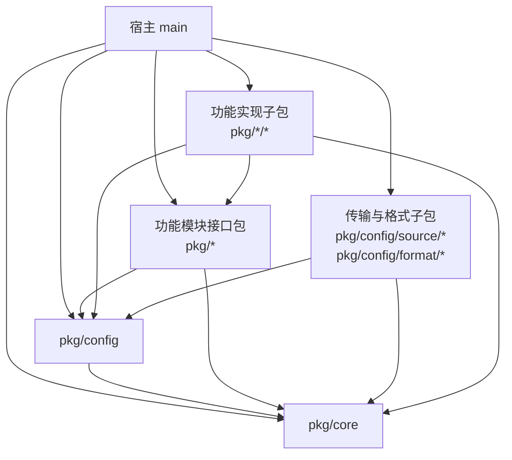
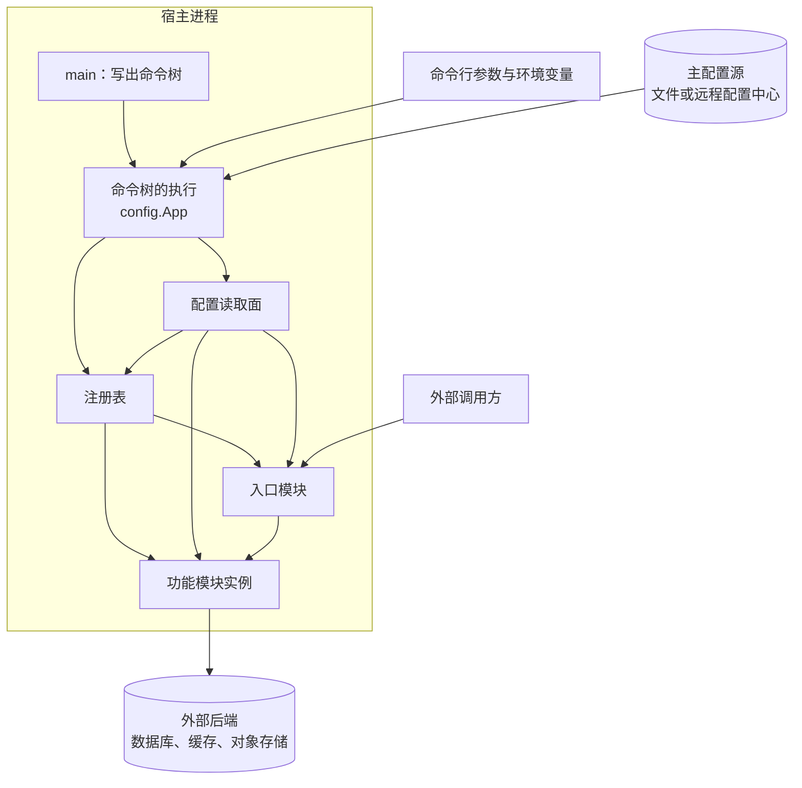

# 架构

## 概览

speed 以库的形式交付。`pkg/` 下每个目录是一个发布单元，提供一种功能；功能的多种实现拆为它的子包，每个实现子包各自登记为一个模块（[ADR-module-packaging-2026-09-13](../adr/adr-module-packaging-2026-09-13.md)）。

宿主编写自己的 `main`，import 所需的模块，驱动启动与停止。speed 不接管程序入口，也不规定应用的形态：HTTP 服务、gRPC 服务、不对外暴露入口的后台进程，都由模块与宿主自己组成（[ADR-core-scope-2026-09-13](../adr/adr-core-scope-2026-09-13.md)）。

`pkg/core` 承载模块化的基础设施（描述符、注册、查询、生命周期驱动），以及零第三方依赖的公共基础设施。`pkg/config` 承载启动必须项的加载，以及宿主用来写出子命令的命令树。其余每个发布单元提供一种功能，对外入口也是模块。

模块的选择分层进行，每层回答一个问题：

| 层次 | 输入 | 回答 |
|---|---|---|
| 编译期 | 被 import 进来的模块 | 这个二进制里存在哪些模块（可用集） |
| 命令选定 | 运行级纳入的模块，及其依赖闭包 | 本次运行哪些模块有资格表态（参与集） |
| 命令选定 | 参与集，加上静态级纳入的模块 | 本次运行哪些模块的声明进入收集范围（声明集） |
| 运行期 | 参与集中各模块依据配置的表态 | 本次运行构造哪些模块（启用集） |

可用集由 import 决定，但不限于宿主 `main` 里那几行：模块的注册发生在 `init`，凡被 import 进来的模块包都会执行，所以宿主的某个依赖 import 了一个模块，它同样进入可用集，宿主未必知情。可用集是编译的结果，不是宿主的一份声明。

**纳入分两级**（[ADR-command-tree-2026-09-21](../adr/adr-command-tree-2026-09-21.md)）。运行级纳入的模块被构造与驱动，有资格表态，其输入项出现在这条命令的参数面上；静态级纳入的模块只让它声明的资源进入收集范围，不构造、不表态、不展开依赖闭包，其输入项默认不出现在参数面上且永不判必填。分两级是因为一条命令对"运行什么""显示什么""收谁的声明"三者的需求可以不一致：施加迁移的那条命令只运行数据库引擎，而它要收齐的迁移集来自那些不运行的带表模块。

**声明集是参与集加上静态级纳入的模块**，因而含依赖闭包拉进来的那些。定义成"宿主写下的两级名字之并"会让包含链断掉：一个经闭包拉进参与集、会真的构造运行的模块将落在声明集之外，于是它的插件照装而它的表不建——插件对着不存在的表发语句。

参与集必为声明集的子集，由宿主写在命令树上：哪条命令用得上哪些功能，只有宿主知道（[ADR-command-tree-2026-09-20](../adr/adr-command-tree-2026-09-20.md)）。宿主写下的是起点，注册表据此展开依赖闭包——运行级纳入一个模块即一并纳入它构造期依赖的提供者。展开规则是确定的，不引入新的决定。代价是参与集里会出现宿主没有写下的名字。启用集必为参与集的子集，由参与集中的各模块在 `Prepare` 阶段依据自己的配置表态、再经排他冲突消解得出。**命令树上那份清单决定纳入，不决定启用**：是否启用没有集中清单，模块自己最清楚它需要的配置是否齐备。

参与集决定的是那些答案取决于"这次命令问没问过它"的事：谁在 `Prepare` 中表态并参与消解、谁被构造与驱动、依赖解析在哪个域上判、这一层命令行上有哪些参数。**它不自动决定资源声明是否生效**——那由消费该资源的一方按不变量 15 裁定。

启用的判断分散在各模块，宿主因而没有一处能统一否决：一个由依赖间接引入的模块，只要自己表态启用且不与他人冲突，就会真的运行起来。是否提供关闭开关由各模块自行决定（[ADR-module-enablement-2026-09-13](../adr/adr-module-enablement-2026-09-13.md)）。

## 模块依赖图

箭头表示 import。依赖方向自上而下收敛于 `pkg/core`，`core` 不 import 任何模块。

图中编码了以下约束。

实现子包 import `pkg/core`（`init` 中注册所需）与自己的接口包，跨发布单元的依赖一律指向对方的接口包，不 import 任何其他发布单元的实现子包。实现所绑定的第三方库因此不会传染给依赖方；接口包自己封装的那个库则会传染，取用该功能即承受它（不变量 11）。

声明配置的模块还要 import `pkg/config`，因为配置声明与取用都用到它的类型。`config` 与 `core` 因而同属被广泛依赖的底层，区别是 `core` 被每一个模块 import，而 `config` 只被声明了配置的那些 import。

宿主同时 import 接口包与实现子包：接口包供业务代码取用，实现子包供其 `init` 完成注册（[ADR-module-registration-2026-09-13](../adr/adr-module-registration-2026-09-13.md)）。图中画的是宿主自己 import 的典型情形；实现子包也可能由宿主的某个依赖引入，注册的效果相同。

配置源与功能实现在结构上同形，都是接口包加实现子包，配置源因而不需要独立于模块机制的引入方式。配置的加载在装配开始之前完成，`pkg/config` 的根包自身不注册模块，产出的读取面作为预置产物交进注册表（[ADR-assembly-bootstrap-2026-09-20](../adr/adr-assembly-bootstrap-2026-09-20.md)）。

## 逻辑部署架构

speed 不引入进程边界。宿主是单一进程，注册表与全部模块实例都在该进程内，模块之间的调用是进程内的直接调用，不经过序列化、网络或服务发现。

图中的箭头不表示 import：`cli` 与 `primary` 指向命令树的执行表示数据在装配开始之前流入，`main` 指向它表示宿主写出命令树并交其执行，它指向 `cfg` 表示加载产出读取面、指向注册表表示交进预置产物并发起驱动，`cfg` 指向注册表表示读取面就是那个被交进去的产物，`registry` 指向各模块表示驱动其生命周期，`cfg` 指向其余模块表示提供配置，`entry` 与 `instances` 之间是运行期调用。

命令行、环境变量与主配置源在装配开始之前由命令树的执行读入（[ADR-assembly-bootstrap-2026-09-20](../adr/adr-assembly-bootstrap-2026-09-20.md)）。产出的读取面随即作为预置产物交进注册表，装配开始时它已经在那里，取用它无须声明依赖。发起驱动的也是它，不是宿主：宿主把深度与动作写在命令树上，由选中的那条命令带进驱动。注册表不认识配置，也不认识命令：它收到的是一个功能标识加一个实例，以及这一次驱动的参数——参与集的名字清单、深度与动作。

外部调用方只经由入口模块进入。入口是否存在、是 HTTP 还是 gRPC，都由宿主 import 了哪些模块决定：不含任何入口模块的进程就是一个纯后台应用（[ADR-core-scope-2026-09-13](../adr/adr-core-scope-2026-09-13.md)）。

进程的外部依赖是启动期读取的主配置源，以及模块实例在运行期访问的外部后端。主配置源在启动期读取一次后不再访问（[ADR-config-lifecycle-2026-09-13](../adr/adr-config-lifecycle-2026-09-13.md)）。

主配置源可以没有。配置是默认值、主配置源、环境变量与命令行逐层叠加的结果，缺了这一层，其余各层照常给出配置，只用内存实现的进程因此可以不依赖任何外部配置来源。装配由配置驱动，不由配置源驱动。

进程内有一个进程级注册表，`init` 期的注册写入它。另建的注册表不继承这些登记，其中的模块需手工登记，因而适用于测试中只装配一小组模块的场合。

## 跨切面设计

### 错误模型

错误按启动期与运行期划分，边界是入口开始接受流量的时刻。

启动期错误一律终止启动，不降级、不跳过。请求帮助输出不走这条路径：它由命令行库在装配开始之前应答，从未进入启动流程。模块的组成是配置驱动的，其最危险的失败不是启动不起来，而是启动起来了却缺失一部分功能且无人察觉，因此依赖缺失与排他冲突表现为启动失败。配置缺失的后果由模块自己决定：它可以表态禁用而让启动继续，此时启动诊断是察觉的唯一途径。

启动期错误使用哨兵错误，调用方以 `errors.Is` 判别类别，错误文本承载定位所需的具体信息。**每一层为自己产生的失败提供哨兵，并保持穿过它的错误链完好。** 一层的哨兵表是封闭的：该层新判定出一类确定失败，要么并入某条既有哨兵（当宿主的补救动作与它相同），要么补一条，不允许留下它自己造出却说不出名字的失败。

**约束到此为止，不延伸到经由这一层返回的一切失败。** 模块回调失败时，类别由模块自己的错误定义给出，`core` 原样外传，不为它发明一个自己的名字——真去发明，`core` 就得认识每个模块的每种失败，与「不认识任何功能」直接相悖。宿主仍然 `errors.Is` 得到有意义的类别，只是那个类别出自模块而不是 `core`，这正是包裹一律用 `%w` 所保证的。

同理，**单条哨兵之下的具体情形不必穷举**。封闭的是哨兵的集合，不是每条哨兵的触发清单；文档给出判据，符合判据的新情形归入该哨兵，不必为此修订一份列举。

**包裹错误一律用 `%w`，不用 `%v`。** 哨兵的判别力依赖整条错误链完好，链上任何一层改用 `%v`，其下的哨兵就再也 `errors.Is` 不到，而调用方看到的错误文本与包裹正确时几乎一样——这类缺陷不会在文本上显形，只会在判别时静默失效。配置源把底层错误归类为哨兵（见 [config](modules/design-config.md)）正依赖这一点。`core` 自身定义的哨兵错误清单见 [core](modules/design-core.md)。

**每一层为自己产生的启动期错误给出修复动作。** 原样外传的失败不在此列：`core` 不加工它，也无从知道它的修法。模块未启用时，错误或诊断要给出它表态禁用的原因，而非仅报告某个功能没有提供者。

### 并发模型

注册表的描述符部分在驱动之前写入，此后只读。生命周期驱动自身是单协程的：阶段之间严格有序，阶段内逐个调用回调，需要顺序的阶段按依赖序。

模块实例自身的并发安全由模块各自负责；`core` 不为模块调用加锁，也不保证模块方法的调用来自单一协程。

### 失败与降级

启动期不降级。运行期的降级行为由各模块自行定义，`core` 不提供统一的降级机制。

可选依赖是唯一的例外：模块显式声明某依赖可选时，该依赖缺失是一种合法配置，模块据其文档所载的默认行为继续运行（[ADR-dependency-resolution-2026-09-13](../adr/adr-dependency-resolution-2026-09-13.md)）。

可选依赖因此不参与闭包展开：替模块把提供者纳入进来，它就再也不会缺席，而宿主并没有在命令树上列举过它。**接受的代价**：宿主列举了某模块、却没列举它可选依赖的提供者时，那个提供者不进参与集，模块按依赖缺席的默认行为运行，而这不进启动诊断——未被纳入的模块本就不在诊断覆盖之内。察觉它与察觉任何一个未纳入的模块同途，见下节。

### 可观测性

启动诊断是装配期由 `core` 与 `config` 产出的可观测面，固定写 `os.Stderr`。它不是装配期唯一的输出：日志模块的引导链在其构造之前即可用，写标准输出，与诊断分处不同的文件描述符且没有次序关系（见 [log](modules/design-log.md)）。**启动成功时**，未进入启用集的模块必须在诊断中列出，并给出它表态禁用或消解落选的原因；注册表另提供按名查询最终启用结果的方法，宿主据此把同一批信息接进自己的日志，因为传入一个接收端只能经由驱动的参数或包级设值，而驱动的参数承载的是这一次驱动要做什么、不是一份长存的声明，包级设值则被不变量排除。这是"启动起来了却缺一部分功能且无人察觉"这一失败的防线，覆盖表态禁用与消解落选两种情形。**它不覆盖另外两种：已登记而未被本次命令纳入，以及只被静态级纳入。** 那两种都不是意外，纳入哪些模块、纳到哪一级，起于宿主写在命令树上的决定，因而不进诊断。代价是由此而来的功能缺失不会主动告知，但并非无从察觉：按名查询启用结果对它们给出禁用，原因说明它不在这条命令的参与集里。察觉它因而要么主动查询，要么回头读命令树（[ADR-module-enablement-2026-09-13](../adr/adr-module-enablement-2026-09-13.md)）。

这一条同时是资源消费点裁定取材域时的一项输入：把"没被纳入"读作"模块说了不"的消费点，其功能缺失没有任何一层会说出来，而按名查询回答的是**模块**的状态、不是某一份**声明**的去向——它说得出某个模块不在这条命令里，说不出这条命令少建了三张表。误判代价的这份不对称是不变量 15 那条判据的依据（[ADR-module-resources-2026-09-21](../adr/adr-module-resources-2026-09-21.md)）。

启用集算不出来时没有这一轮诊断，也没有可查的启用结果：消解失败即终止启动，进程不会带着残缺的功能跑起来，该由错误文本承担的是点名冲突双方与其中的排他主张方。**接受的代价**：消解在传播阶段已经让某些模块退让，而随后的裁决失败会让这些退让的原因一并不输出；操作者拿到的是冲突本身，不是那一轮消解的全过程（[ADR-module-enablement-2026-09-13](../adr/adr-module-enablement-2026-09-13.md)）。

运行期的日志、指标与追踪不由 `core` 提供，它们是各自模块的事。日志由 [log](modules/design-log.md) 承担，它在 `New` 阶段才构造，因而接不到装配期的诊断；分界见该文档。

### 安全边界

标注为敏感的输入项，`config` 不把它写进自己的诊断，帮助输出中也不回显其默认值。**`config` 的保证到此为止**：模块 `Decode` 之后拿到的是普通结构体，那个值此后去了哪里，由拿到它的模块负责。跨模块的脱敏由日志模块承担，它保证记录经过脱敏层，而遮蔽什么取决于各模块登记了哪些规则——覆盖面是装配的结果，不是日志模块的承诺（[log](modules/design-log.md)）。

配置定位符会出现在命令行、进程列表与诊断输出中，因而不得承载凭据。

**隔离的覆盖面同样是装配的结果，不是框架的承诺。** 按租户过滤由租户模块声明的一条插件承担，它只作用于本次运行启用的句柄；承担它的模块不被装配时，遗漏过滤不会被任何一层拦下（[ADR-db-scope-2026-09-14](../adr/adr-db-scope-2026-09-14.md)），判据与失效形态见 [tenant](modules/design-tenant.md)。

### 性能与容量目标

生命周期驱动是启动时的一次性开销，与请求处理无关。依赖解析在构造之前完成，规模是启用集及其依赖边数。

## 架构不变量

以下规则的违反都是可识别的，评审据其裁定。

1. **`pkg/core` 不含第三方依赖。** 它被每一个模块 import，其依赖会落到每一个宿主头上。这条同时是 `core` 作为公共基础设施容器的边界：零依赖的公共基础可以放进来，带依赖的不行。
2. **`pkg/core` 不解释任何资源，也不认识任何功能。** 模块声明的资源由它原样保存供查询，含义归定义该资源类型的模块；任何功能接口都不出现在其中，新增一种功能或一种横切机制都不修改 `core`。
3. **描述符不可变。** 登记之后不再变化，实例由注册表在生命周期驱动中建立。
4. **描述符上保留具名字段的判据是注册表自身是否要解释它。** 其余对外元数据一律作为资源声明（[ADR-module-resources-2026-09-13](../adr/adr-module-resources-2026-09-13.md)）。
5. **宿主向装配提供的声明一律经由模块机制。** 宿主注册自己的模块，把要交给框架的声明放进它的 `Resources`，不经由包级设值函数或其他旁路。宿主身份（环境变量前缀与默认配置定位符）走的正是这条路。宿主声明因此随注册表而非随进程，同一进程内的多个注册表互不干扰。**这一次运行要做什么则是驱动的参数**：参与集、驱动深度、到达深度后要做的动作与 `ctx` 描述的是这一次驱动，不是一份随注册表长存的声明。把它们放进资源表达不出来——资源在 `init` 期随登记冻结，而哪条命令被选中要到解析命令行之后才知道。宿主在模块机制之外的因此只有两样：写出命令树——纳入哪些模块、驱动到哪个深度、到达后做什么，都写在它上面——以及执行它并决定 `ctx` 何时取消。
6. **`core` 的注册、查询与生命周期一律是注册表的方法。** **导出的**包级函数与变量限于：注册表的构造函数、进程级注册表变量、哨兵错误，以及需要类型参数的泛型封装（Go 不允许方法带类型参数）。类型与常量不受此限，未导出的实现辅助函数同样不受此限——本条约束的是对外契约面。
7. **描述符与 `Prepare` 都不得依赖执行顺序。** Go 的 `init` 顺序只保证包依赖偏序；`Prepare` 阶段内不保证顺序。
8. **声明集是可用集的子集，参与集是声明集的子集，启用集是参与集的子集。** 参与集由命令树上运行级纳入的模块经依赖闭包展开得出，声明集是参与集与静态级纳入的模块之并——**含闭包拉进来的那些**，启用集由参与集中各模块的表态加消解得出（[ADR-command-tree-2026-09-21](../adr/adr-command-tree-2026-09-21.md)）。排他交付的冲突在消解阶段暴露，不留到构造期。
9. **模块之间只按功能取用彼此，构造期依赖显式声明且无环。** 不按名称取用，不使用全局变量传递实例；相互引用推迟到接线阶段。**本条约束的是取得另一个模块产物的途径**：凡是模块在 `New` 中构造、由注册表持有的那些产物，一律经注册表取得。模块自己内部的状态不在此列；根包自行构造、不来自任何模块的对象也不在此列。
10. **消解之后，仍然启用的提供者中若还有排他者，该功能不得有多于一个提供者。** 违反即启动失败。未声明排他的提供者之间可以并存，只能整体取出；被消解禁用的排他者不再主张独占。
11. **接口包可以暴露它所封装的第三方库；实现子包绑定具体的后端与驱动。** 一个模块常常就是某个第三方库的封装，数据库模块之于 GORM、遥测模块之于追踪的 API 包都是如此，此时用那个库的类型表达接口是它的正常形态，另造一层等价抽象只会让依赖方在两套类型之间来回转换。传染由 import 边界挡住：模块是可选的，不引入这个模块的宿主就不承受它的依赖。没有这条退路的只有 `pkg/core`，它被每一个模块 import，因而零第三方依赖（不变量 1）。接口包暴露了哪些第三方类型，由它自己的设计文档交代。
12. **生命周期的阶段集合是固定契约。** `Prepare`、`New`、`Migrate`、`Init`、`Start`、`Serve`、`Stop`、`Close`，新增阶段会改变全部既有模块的假设（[ADR-lifecycle-stages-2026-09-13](../adr/adr-lifecycle-stages-2026-09-13.md)）。一次驱动推进到 `Prepare` 到 `Serve` 中的哪一个为止，是该次驱动的参数；`Stop` 与 `Close` 不可选，任何一次驱动结束时都要执行。阶段集合与它们的顺序不因此改变（[ADR-lifecycle-drive-2026-09-20](../adr/adr-lifecycle-drive-2026-09-20.md)）。
13. **`core` 不按名称识别任何模块。** 没有模块享有特殊的构造时机，也没有模块享有隐含的被依赖关系。配置在装配开始之前由宿主加载，产出的读取面作为预置产物交进注册表，注册表不知道那是配置（[ADR-assembly-bootstrap-2026-09-20](../adr/adr-assembly-bootstrap-2026-09-20.md)）。
14. **配置只承载启动必须项。** 判据为该值是否在数据库可用之前就被需要（[ADR-config-scope-2026-09-13](../adr/adr-config-scope-2026-09-13.md)）。
15. **每一处按类型收集资源的消费点自行裁定取材域，并把它写在该消费点所属模块的设计文档里。** 取材域在可用集、声明集、参与集与启用集之间选定：只校验声明而不让它生效的消费点取可用集；让声明生效的，判据是这份声明所描述之物的生命周期跟着这个二进制、跟着这次命令还是跟着这次运行。取材域之内，表态禁用与消解落选的模块其声明退出——那是本次装配给出的否定；只被静态级纳入的模块没有表态，不因此退出。未被本次命令纳入的模块由取材域决定去留，不在减法这一步表达：取声明集的消费点它不进来，取可用集的消费点它照常进来。同一种资源在不同消费点上可以有不同的取材域。`core` 不代任何消费点过滤：`Resources` 遍历全部已登记模块，它不解释资源，也就无从知道某一种该按哪个集合裁断（不变量 2）。未写明取材域的消费点，以及与所写不符的实现，都是缺陷（[ADR-module-resources-2026-09-21](../adr/adr-module-resources-2026-09-21.md)）。

## 实现状态

| 模块 | 状态 |
|---|---|
| [core](modules/design-core.md) | 部分实现，缺纳入分级与参与结果查询 |
| [config](modules/design-config.md) | 部分实现，缺纳入分级与两个修饰 |
| [log](modules/design-log.md) | 已实现 |
| [db](modules/design-db.md) | 部分实现，迁移集的取材域仍按启用结果一刀切 |
| [http](modules/design-http.md) | 已实现 |
| [authn](modules/design-authn.md) | 已实现 |
| [tenant](modules/design-tenant.md) | 未实现 |
