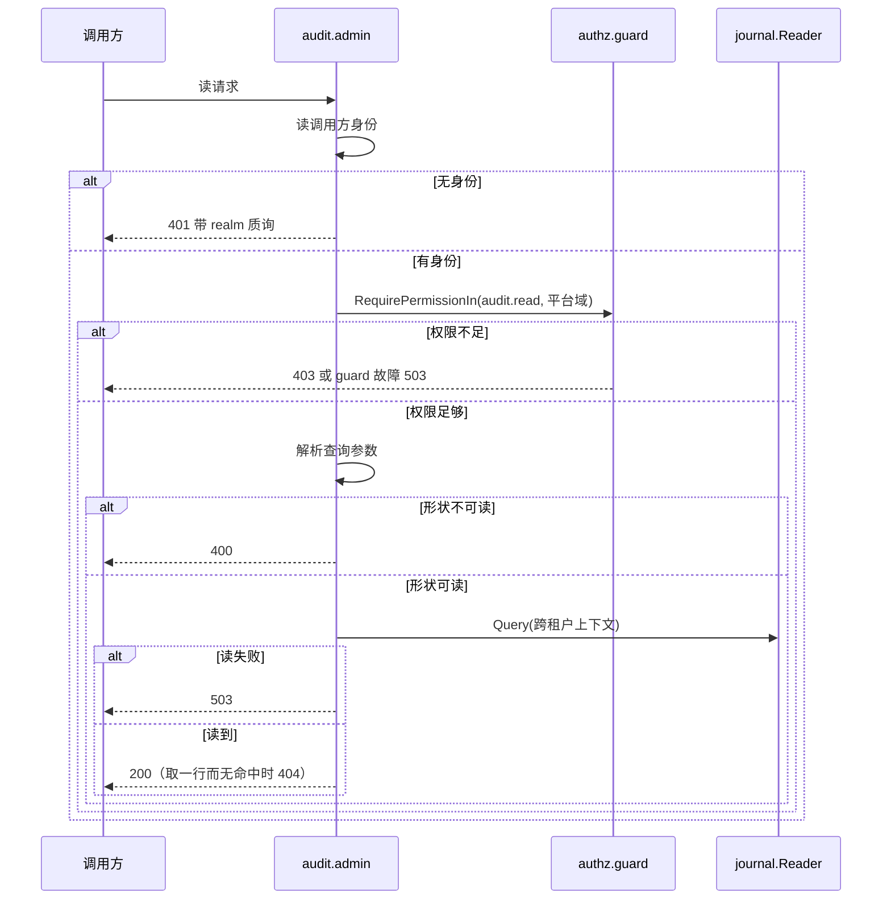
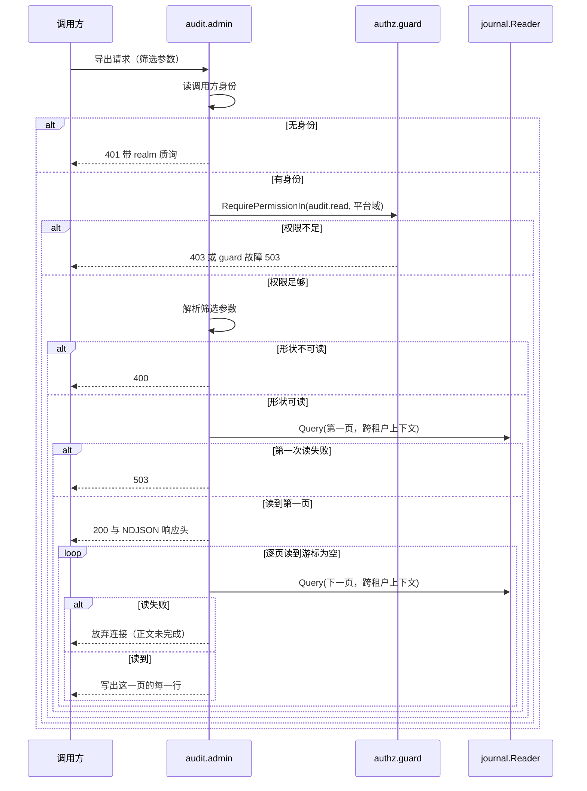

# audit.admin

## 职责

`audit.admin` 是审计记录的 HTTP 查询面，挂在固定基路径 `/api/v1/system/audit` 下，不交付任何功能接口，只把审计记录的检索与导出暴露成路由。列表与取一行的动作是经审计实现子包的读面读审计表一次，导出是逐页读到游标为空；模块自己不持数据、不持规则——审计表、它的模型与它的写入归审计模块，本模块只决定谁可以问、答案长什么样。

**本模块是框架为审计查询面提供的那个提供者。** 审计能力本身不提供查询面，[design-audit](design-audit.md) 的两处原文是：

> **不提供查询面。** 按条件的检索与导出要先回答「谁可以查谁」，那是授权判定，归 [authz](../design-authz.md) 的承接的权限点（[ADR-audit-scope](../../../adr/adr-audit-scope.md)）。框架另有一个可直接纳入的模块 [audit.admin](design-audit-admin.md) 承担检索与导出，判定在它自己的 handler 内经 `authz.guard` 做出；本模块自身仍不提供查询面。

> 本模块不交付查询面，宿主要读某个租户的那份轨迹，只能自己读这张表；这份读取的租户隔离全靠这几项承诺。

[ADR-audit-scope](../../../adr/adr-audit-scope.md) 把承载者留白——「承载它们的模块不由本记录裁定，本记录只定它不在这里」——并把一个需要检索审计记录的宿主指向本模块之外，自带授权面。本模块正是它明文留出的位置：一个挂在固定基路径下的叶子，判定经授权能力的 handler 内 API，读经审计实现子包新加的读面。它不改变审计能力的立场——`pkg/audit/journal` 仍不带管理面——只把这一面从「宿主自建」补成「框架提供一个可选用的提供者」（[ADR-audit-admin](../../../adr/adr-audit-admin.md)）。

承载这一面的授权经授权能力的 `Gate` 或 handler 内 API 落到 `audit.read` 上（[design-authz](../design-authz.md) 的承接的权限点）；本模块按 `sms.admin` 的形态取后者，判定在 handler 内做出（见「访问控制」）。

路由挂在配置 `audit.admin.endpoints` 列出的端上，基路径不做可配置。取一行的路由按审计行的标识寻址，路径里出现的只有行标识这个自然键；列表与导出按查询参数窄化，不进路径。

### 非职责

- **不持有审计表。** 表、它的迁移、它的模型与它的写入归审计模块；本模块不建表、不缓存、不迁移、不写该表，列表与取一行各是一次读面调用，导出是逐页的读面调用。**审计表仍只由审计模块写入。**
- **不捕获。** 事实经语句级、事件级、请求级与接缝级通路进入审计模块（[design-audit](design-audit.md)）；本模块是读面，不新增通路、不改覆盖面。**一条捕获通路不兼作查询**，查询也不经任何捕获通路。
- **不给自己授予任何权限。** 本模块不声明自己的权限清单——它问的 `audit.read` 由授权能力自己携带（[design-authz](../design-authz.md)）——并把每条路由登记为开放，让中间件把请求放行到 handler，由 handler 在内部判定。
- **不为租户提供自查自己轨迹的面。** 本模块是平台运营面，判定落在平台域（见「访问控制」）；一个租户读自己的轨迹是另一条路由、另一个域，不在这里。
- **不判定租户，也不做归责判定。** 一行属于哪个租户在写入时就记在行上（[design-audit](design-audit.md)）；本模块照读，不认定租户，也不回答「谁该为一次拒答负责」。

## 外部接口契约

### 登记

`audit.admin` 不交付任何功能接口（`Provides` 为空）。它 `Requires` 审计实现子包的读面 `(*journal.Reader)(nil)`、handler 内判定 `(*guard.Guard)(nil)`，并可选取 `log.Logger`。读面与 guard 各由唯一模块排他交付——读面与审计捕获同属 `audit.journal` 模块——命令的闭合不把它们拉进来，宿主在命令树上写下它们。表态是 `StateEnabled`、永不 `StateAuto`：挂不挂这面查询面是一个命令树上的决定，不是一个配置能推出的结论。HTTP 入口点与路由声明面在 `Init` 里取用而非声明——一个挂路由而没有入口点的命令是要在接线期报出的故障，而声明面的缺席是合法的：没有 gate 时路由不带声明，受守护的端把它们当未声明处理，所以挂这面路由的命令应同时点名授权模块。

**本模块声明静态[特性](../../../glossary.md) `audit.admin`。** 描述符的 `Resources` 带 `feature.Spec{Name: "audit.admin"}`；这个特性在场，表示本进程挂出审计查询面的路由（[feature](../design-feature.md)）。`audit.admin.endpoints` 必填、不接受空清单，挂路由而没有入口点是接线期故障，所以模块进入启用集、进程有路由器时这组路由无条件挂出，声明为静态特性符合架构不变量 18（[architecture](../../architecture.md#架构不变量)）。`audit.journal` 的捕获配置决定审计表里记下什么，不决定这面查询面在不在，不进入特性的判定。

### 读面（`pkg/audit/journal`）

**读面加在审计实现子包里，不在接口包里。** `pkg/audit` 是接口包、只依赖标准库；检索要经审计模块自己的表与模型读，落在一个新增的读面上，由 `audit.journal` 与审计捕获一起交付。捕获通路只写，读面只读，两者不共用一条通路。

读面的形状是一个游标分页的读，照账户列表的形态：

```go
// Reader 是审计实现子包交付的读面，与审计捕获同属 audit.journal 模块。
type Reader interface {
    // Query 读一页审计行，返回这一页与下一页的游标，末页的游标为空串。
    Query(ctx context.Context, q Query) ([]Row, string, error)
}

// Query 是一次读的窄化条件。
type Query struct {
    ID       uint64    // 非零时只读这一行
    Since    time.Time // 零值表示无下界
    Until    time.Time // 零值表示无上界
    Actions  []string  // 空表示不过滤动作
    Outcomes []string  // 空表示不过滤结果
    Actors   []string  // 空表示不过滤操作者
    After    string    // 上一页的游标；空表示从最新一行起
    Limit    int       // 页大小；非正取缺省，超过上限取上限
}

// Row 是审计表上的一行，按列读出：行标识、时间、主体、租户、来源通路、
// 动作、对象、结果、用途与明细。
type Row struct {
    ...
}
```

**读用的是租户模块认可的只读模型。** 读面经一个内嵌租户约定、表名取 `audit_entries` 的模型读，只发读语句：审计表由审计模块写，经读模型的写会是一行没有捕获通路产生、在读面的视角里与审计模块写下的行分不出的数据（[design-tenant](../tenant/design-tenant.md) 的只读模型）。这个模型另声明一个可空的租户字段，好让跨租户的读把没有租户的行与租户标识为空串分出来。

**租户条件由上下文给出。** 读在一个上下文里发起：上下文带租户时，模型给每一条读加上那个租户的条件；上下文是跨租户标记（`tenant.CrossTenant`）时，什么都不加，读到全部租户的行与没有租户的行；两者都不是时，租户模块拒绝这次读。`Query` 自己不携带租户——把租户当上下文、而不是当查询里的数据，是这一面借租户模块的过滤读表的方式。

**读面排他交付、与捕获同一个登记单元。** 同一进程里恰好一个读面生效，判据同审计捕获的排他交付：多一个读面就多一张一次读落在哪张上无从分辨的表。

### 路由

基路径 `/api/v1/system/audit`，下表是路由的全集（封闭集）：方法、路径与每条需要的权限。

| 方法 路径 | 权限 |
|---|---|
| `GET /api/v1/system/audit/records` | `audit.read` |
| `GET /api/v1/system/audit/records/:id` | `audit.read` |
| `GET /api/v1/system/audit/export` | `audit.read` |

**导出与取一行的路由在路径上不同层。** 导出挂在 `/api/v1/system/audit/export`，是 `/records` 的兄弟段，不经过 `/records/:id` 的路径参数段；导出的请求因而不会被读成一次「标识为 `export` 的取一行」，取一行的匹配也不会把导出请求吃掉。

每条路由的动作是一次 `journal.Reader` 调用：

| 路由 | 读面动作 |
|---|---|
| `GET /api/v1/system/audit/records` | `Query`，读一页审计记录 |
| `GET /api/v1/system/audit/records/:id` | `Query`，以行标识为条件取一行（页大小为 1） |
| `GET /api/v1/system/audit/export` | `Query`，循环读页直到游标为空（页大小取读面的最大页大小） |

**检索读的是审计表，跨租户。** 审计表持有每个租户的行与没有租户的行。本模块的读是平台运营的读，handler 在一个跨租户标记下调用读面，读面因此把租户条件留空，读到的是全部租户的行与没有租户的行。行标识在整张表里唯一，`GET /api/v1/system/audit/records/:id` 因而不需要租户，取到的是那一行，或者什么也没有。

### 访问控制

**判定由本模块在 handler 内做出，不经请求中间件的声明判定。** 查询面路由在中间件的声明表里全部登记为开放，好让中间件把请求放行到 handler；handler 先读调用方的身份，再经 `authz.guard` 的 handler 内判定 API 就本路由的权限 `audit.read` 问一句，不足即回绝。模块不给自己授予任何权限——`audit.read` 是授权能力自己携带的权限，本模块只问它。

**导出与检索问同一份权限。** 导出路由问的也是 `audit.read`，不询问 `audit.export`；导出的权限范围与检索相同（REQ-platform-admin-112、REQ-platform-admin-113；[ADR-audit-export](../../../adr/adr-audit-export.md)）。`audit.export` 仍由授权能力携带，本模块不询问它。

**判定顺序固定。** handler 先读调用方：请求没有身份是 401，只有状态、没有 `Type`，并带与准入层、授权层同形的 realm 质询，不询问 guard 即返回。再向 guard 要 `audit.read`：不足即由 guard 写出它自己的拒绝——拒绝 403、故障 503——并返回。判定之后才解析查询、调读面、渲染应答。

**判定在平台域做出。** 审计表是平台资产、不是某个租户的：它持有每个租户的行与没有租户的行。一次检索或导出因而是一次平台操作；handler 经 `RequirePermissionIn(c, authz.PermissionAuditRead, authz.PlatformDomain)` 显式指定平台域判定。若按请求解析出的租户判定，一个在某租户获授权的调用方就能靠一个请求头读到别的租户的行。

**留审计自己的痕。** 本模块的路由都是读，它们**不写审计行**：审计表记的是动作，读审计表不是一个动作，而每读一次写一行会让表随着被读而增长。本模块的操作痕迹落在日志——每次读记一行诊断，带路由、调用方与命中的行数；导出记的一行另带筛选条件与写出的行数。宿主若要连这些读也留审计行，走审计模块**自己的请求级捕获**：把审计管理面所在的端与本模块的路由写进 `audit.journal` 的 `endpoints` 与 `requests` 配置，这些读就进审计表；本模块不为自己补一条通路（[design-audit](design-audit.md)）。

### 视图

**读的应答是 200 加一份视图。** 视图逐字段从读面的行构造，从不把行原样交给客户端，行日后新增一个字段不会因为它在就等于出现在应答里。记录视图的字段：`id`、`tenant`、`occurred_at`、`actor`、`source`、`action`、`object`、`outcome`、`purpose`、`detail`（键值表），时间按 UTC 写出。`tenant` 为空表示一行没有租户——一行平台操作或系统级操作。

列表的应答是 200 加一页记录视图与下一页的游标：`entries` 是记录视图的列表，`next` 是下一页游标，末页为空串。取一行的应答是 200 加一份记录视图。

**导出的应答是 200 加一份 NDJSON 正文。** 正文一行一条记录视图：每行是一个 JSON 对象，字段与记录视图相同，行尾是一个换行符；没有信封、没有表头行、没有总计行。`detail` 因而是每行里的一个 JSON 对象，键值表的结构在文件里保留下来。媒体类型是 `application/x-ndjson`。应答带 `Content-Disposition: attachment`，文件名由 `mime.FormatMediaType` 从 `audit-records-<导出发起时刻>.ndjson` 生成，时刻按 UTC 写成紧凑形式（如 `20261024T101500Z`）；另带 `Cache-Control: no-store`，一份审计数据不留在任何缓存里。没有匹配行时是 200 与空正文——一个零行的文件仍是一次成功的导出。

### 查询参数

列表路由接受下列查询参数；不在这张表里的参数是拒绝的形状，好让一个拼错的边界报错，而不是被一条忽略它的读吞掉。

| 参数 | 含义 |
|---|---|
| `since` | 时间下界（RFC 3339），含该时刻；缺省为无下界 |
| `until` | 时间上界（RFC 3339），不含该时刻；缺省为无上界 |
| `action` | 动作，可重复；给出时只读这些动作的行 |
| `outcome` | 结果，可重复；给出时只读这些结果的行 |
| `actor` | 操作者，可重复；给出时只读这些操作者的行 |
| `cursor` | 上一页返回的游标；缺省从最新一行起 |
| `limit` | 页大小；缺省为读面的缺省页大小，至多为读面的最大页大小 |

**`action`、`outcome` 与 `actor` 都是可重复的相等集。** 每个给出一组时只读值与其中一项相等的行；一个空值是这个形状之外的值，与越出形状的参数一样是 400。三个集互相之间、与时间窗之间都按「与」合成。`actor` 取的是行上的操作者键；一行没有操作者时该列为空串，匿名或系统来源的行因而只有不给出 `actor` 时读到。

**时间边界按 UTC 比对。** 审计模块把每一行的时间按 UTC 写；边界在解析时折到 UTC 再交给读面。

**导出接受同一组筛选参数，不接受 `cursor` 与 `limit`。** 导出读的是筛选匹配的全部记录，一次导出没有「当前页」：`cursor` 与 `limit` 描述的是页，给出即与越出形状的参数一样是 400。`since`、`until`、`action`、`outcome` 与 `actor` 的含义与取值的形状与列表路由相同。

### 宿主可见面

以下是宿主写进配置文件、或在命令树与网关上点名的面。

- **模块名**：`audit.admin`。宿主的命令树点模块名纳入，配置命名空间取同一取值。
- **配置命名空间与输入项**：`audit.admin` 下的 `endpoints`（字符串列表，必填，无缺省，只收具体端名、不收 `*`，取主配置源）。
- **管理端点**：`audit.admin.endpoints` 列出的端，`/api/v1/system/audit/records`、`/api/v1/system/audit/records/:id` 与 `/api/v1/system/audit/export`（路由见「路由」）。
- **权限**：路由询 `audit.read`；本模块不声明自己的权限，`audit.read` 由授权能力携带。
- **问题应答**：`Problem.Type` 前缀 `urn:speed:audit:`，其下的码 `bad-request`。

### 对外接口面

- 模块名 `audit.admin`、配置键 `audit.admin.endpoints`、管理面路由的路径与它们询问的权限（`audit.read`），以及 `Problem.Type` 前缀 `urn:speed:audit:` 及其下的码（`bad-request`），是本模块对宿主的接口面。改动它们是宿主可见的破坏性变更。
- 记录视图的字段名（`id`、`tenant`、`occurred_at`、`actor`、`source`、`action`、`object`、`outcome`、`purpose`、`detail`）与列表应答的容器成形态（`entries`、`next`）是应答形状：宿主与前端据此读应答。
- 导出路由的媒体类型 `application/x-ndjson`、一行一条记录视图的正文形状、`Content-Disposition` 的文件名与 `Cache-Control: no-store` 是应答形状：一个直接取这个路由的调用方据此读文件。
- 特性名 `audit.admin`。前端经生成的特性名类型引用它，改名或撤去是宿主可见的破坏性变更。
- 本模块可替换、可撤掉，不改变调用方或审计模块的代码。

## 依赖

| 依赖 | 用途 |
|---|---|
| `pkg/audit/journal` | 读面 `Reader`、`Query`、`Row`；审计表名与它认可的只读模型 |
| `pkg/authz`、`pkg/authz/guard` | 权限 `audit.read`、平台域 `authz.PlatformDomain`、handler 内判定 `guard.Guard.RequirePermissionIn`、路由声明面 `authz.Gate` |
| `pkg/authn` | 读请求上的身份（`authn.FromContext`） |
| `pkg/tenant` | 跨租户标记 `tenant.CrossTenant`（读在它之下发起） |
| `pkg/http` | 路由挂载与问题应答（`speedhttp.Router`、`speedhttp.Fail`、`speedhttp.Problem`） |
| `pkg/config` | 声明本模块的输入项 |
| `pkg/core` | 模块描述符与功能取用 |
| `pkg/feature` 根包 | 声明静态特性（`feature.Spec`）；根包只依赖标准库 |
| `pkg/log` | 可选：记诊断 |

**本模块可撤掉，不改变调用方或审计模块的代码。** 它 import `pkg/authz`、`pkg/authn`、`pkg/http` 来挂一条受保护的管理面，是审计能力目录里唯一这样做的一层；审计的捕获与写入本身不 import 授权层，不因它背上这些依赖。这一形态与 `sms.admin`、`tenant.admin` 相同（[design-sms](../design-sms.md)、[tenant/design-tenant-admin](../tenant/design-tenant-admin.md)）。

**读面在审计实现子包里，不在接口包里。** `pkg/audit` 是接口包、只依赖标准库；读面要经审计模块自己的表与模型读，落在 `pkg/audit/journal`（见 [design-audit](design-audit.md) 的依赖与 [ADR-audit-admin](../../../adr/adr-audit-admin.md)）。本模块 import 审计实现子包以取得读面的功能标识，这是管理面 import 实现子包以取接缝的既有形态——`authz.admin` 以同形 import `pkg/authz/guard` 取 `guard.Guard`——而两者同属 `pkg` 这一个 Go 模块，实现子包绑定的库不给宿主另增一份依赖清单条目。

**本模块落在依赖图的上层，是一个叶子。** 它 import 审计实现子包与授权层来挂一面受保护的读；审计的捕获与写入不 import 本模块，也不 import 授权层。

## UML 图

本模块不持状态、不做判定之外的分支，它的结构是一串跨模块的调用。图固定一次读请求的操作序：读调用方 → 向 guard 要 `audit.read`（平台域）→ 解析查询参数 → 在一个跨租户上下文里读审计表 → 渲染视图。图上看不出的是这些约束：判定在**平台域**做出，不是请求解析出的租户；读在**跨租户标记**下发起，读面因此把租户条件留空；本模块**不写审计行**，读的痕迹只进日志；guard 的拒绝（403）与故障（503）由 guard 自己写出，本模块不重写；读面的失败落 503，取一行而无命中落 404。



导出另有一条操作序。判定与形状检查完成后，第一页先读出来：第一次读失败时正文还没有开始写出，因而仍答 503。第一页读到之后，状态码与响应头固定下来，正文随后的每一页写出时状态已经不能再改。图上画不出的约束：导出读的是筛选匹配的全部记录，游标由处理器接着用，不接受调用方的游标与页大小；写出的每一行是同一份记录视图；行数不受一页的大小限制；正文开始写出之后的读失败只放弃连接，不再写成任何状态码。



## 核心数据结构

模块不持数据，只有路由与它的查询参数、以及交出的视图。

| 概念 | 形状 | 说明 |
|---|---|---|
| 记录视图 | `{id, tenant, occurred_at, actor, source, action, object, outcome, purpose, detail}` | 从读面的行逐字段构造；`tenant` 为空表示一行没有租户；`detail` 是键值表 |
| 页 | `{entries, next}` | `entries` 是记录视图的列表，`next` 是下一页游标，末页为空串 |
| 导出行 | 记录视图的 JSON 对象，一行一条，行尾换行 | 与记录视图同形；`detail` 是键值表 |
| 读面查询 | `journal.Query` | 时间窗、动作集、结果集、操作者集、行标识、游标与页大小（见「外部接口契约」的读面） |

视图与查询都是本模块自己的类型，不是读面的 `Row`：`Row` 是审计表上的一行（含行标识、主体、租户、来源通路、动作、对象、结果、用途与明细），而交出去的是它的字段化视图、收进来的是解析过的查询。导出的正文也是记录视图，只是每条一行，没有页容器。

## 核心算法与流程

### 一次查询请求

一次查询请求的操作序固定（细节见「访问控制」）：读调用方（无身份 401）→ 向 guard 要 `audit.read`（不足由 guard 写出 403／503）→ 解析查询参数并做形状检查（越出形状即 400）→ 在一个跨租户上下文里调读面（读失败即 503）→ 渲染并应答（取一行而无命中即 404）。

### 判定在平台域做出

一次检索是平台操作，handler 经 `RequirePermissionIn` 显式指定 `authz.PlatformDomain`。判定的主体是调用方的生效账户 `Identity.Account()`、域是平台域、资源与动作由权限经进程翻译给出（`audit.read` → `(audit, read)`）。不按请求解析出的租户判定：否则一个在某租户获授权的调用方靠一个请求头就能读到别的租户的行。

### 读面在一个跨租户标记下被调用

审计表持有每个租户的行与没有租户的行。本模块的读是平台运营的读，handler 经 `tenant.CrossTenant` 造一个跨租户上下文交给读面；读面把租户条件留空，读到的因而是全部租户的行与没有租户的行。取一行按行标识——它在整张表里唯一——因而不需要租户，取到那一行或什么也没有。

### 分页

列表一条一页。读面按最新在前给出行，返回一页与下一页的游标；`next` 为空表示没有下一页。游标对调用方不透明：下一次请求把它原样交回 `cursor`；宿主不拼游标、也不解析它。

### 一次导出请求

导出的操作序（细节见「访问控制」与「错误与失败语义」）：读调用方（无身份 401）→ 向 guard 要 `audit.read`（不足由 guard 写出 403／503）→ 解析筛选参数并做形状检查（越出形状即 400）→ 在一个跨租户上下文里读第一页（读失败即 503）→ 交出流式应答，逐页读到游标为空为止。

**页大小取读面的最大页大小，不取调用方的页大小。** 导出不是交互式的翻页：它固定以读面的最大页大小读，不接受调用方给出页大小。

**第一页在正文开始之前读出来。** 处理器先读第一页，读到才交出应答；这一页随后作为正文的第一批行写出。第一次读失败因而仍是一个 503，而不是一次已经开始的下载。

**每页写出后接着用它的游标读下一页。** 处理器把一页的每一行写成一条记录视图，再用返回的游标读下一页，直到 `next` 为空。行数不设上限：导出写的是筛选匹配的全部记录，不只任何一页。

**写出所用的上下文随请求取消。** 调用方在导出途中断开时，上下文取消，下一次读与随后的写出都以这次取消结束；已经写出的行留在调用方那一侧，文件是不完整的。

## 错误与失败语义

**回绝映射是封闭的、fail-closed 的。** handler 不把任何读面失败原样透给调用方，也不让一个映射不到的失败落成成功。

| 情形 | 表现 |
|---|---|
| 请求在形状上不可读（路径的 `id` 不是数字、时间边界不是 RFC 3339、`limit` 越界、动作、结果或操作者取空值、出现本路由不接受的查询参数——导出路由上的 `cursor` 与 `limit` 在此列） | 400（`Problem.Type` 为 `urn:speed:audit:bad-request`），在读面之前 |
| `GET /api/v1/system/audit/records/:id` 点名一行审计表不持有 | 404，不带 `Problem.Type` |
| 列表或取一行的读面读表失败 | 503，不带 `Problem.Type`，成因只进日志 |
| 导出在正文开始之前读第一页失败 | 503，不带 `Problem.Type`，成因只进日志；请求已被调用方取消时不算故障，同样答 503 但不写故障日志 |
| 导出在正文开始之后某一页读失败 | 状态码不再改变；连接被放弃，调用方拿到一次未完成的下载，成因只进日志 |
| guard 的拒答与故障 | 403 / 503，由 guard 写出 |
| 请求没有身份 | 401，只有状态、无 `Problem.Type`，带 realm 质询 |

**403 与 401 由别处写。** 权限不足的 403 与 guard 故障的 503 由 guard 写出（[design-authz](../design-authz.md)）；无身份的 401 由本模块写出，与准入层、授权层同形（只有状态、无 `Problem.Type`、带 realm 质询）。本模块不重写它们。

**空结果不是失败。** 一次没有命中的列表读答 200 与一个空的 `entries`；一次没有命中的导出答 200 与空正文；只有取一行路由把无命中答成 404。

## 并发与事务边界

- 模块不持状态，可被多个协程并发使用。
- 模块不开事务：一次动作用一次或多次读面调用，读面在自己的句柄上每次发一条读语句，与任何调用方的事务无关。导出逐页读，页与页之间没有事务，也不构成快照：导出期间新写入的行标识更大、落在游标之前，不进文件；导出期间被删除的行缺席。文件是「导出期间读到的那批行」。
- 本模块不写任何东西——不写审计表、不写审计行；它的路由都是读。

## 实现状态

| 能力 | 状态 | 代码 |
|---|---|---|
| 管理面 `audit.admin` 的列表与取一行路由（判定、日志、回绝映射） | 已实现 | `pkg/audit/admin/admin.go` `Module`；`pkg/audit/admin/routes.go` `routes`、`mount`；`pkg/audit/admin/handlers.go` `handleRecordList`、`handleRecordGet`、`listQuery`、`logRead`；`pkg/audit/admin/pipeline.go` `require`、`answer`、`bad`、`notFound`、`unavailable` |
| 列表与取一行的 operation 声明、`speedhttp.Spec` 资源与片段生成 | 已实现 | `pkg/audit/admin/operations.go`；`pkg/audit/admin/openapi_generated_test.go`；片段 `pkg/audit/admin/openapi/audit.admin.json` |
| 导出路由 `GET /api/v1/system/audit/export`（筛选、逐页流式 NDJSON、`Content-Disposition` 与 `Cache-Control`） | 已实现 | `pkg/audit/admin/export.go` `handleRecordExport`、`writeExport`、`exportFileName`、`exportDisposition`；`pkg/audit/admin/routes.go` `routes`、`exportPath` |
| 导出的 operation 声明与片段 | 已实现 | `pkg/audit/admin/operations.go` `RecordExportInput`、`exportOperation`；片段 `pkg/audit/admin/openapi/audit.admin.json` |
| 静态特性 `audit.admin` 的 `feature.Spec` 声明 | 已实现 | `pkg/audit/admin/admin.go` `Module`；`pkg/audit/admin/feature_test.go` `TestTheModuleDeclaresTheAuditAdminFeature` |
| 审计实现子包的读面 `journal.Reader`、`journal.Query`、`journal.Row` | 已实现 | `pkg/audit/journal/read.go` `Reader`、`Query`、`Row`；`pkg/audit/journal/journal.go` `Module` |
