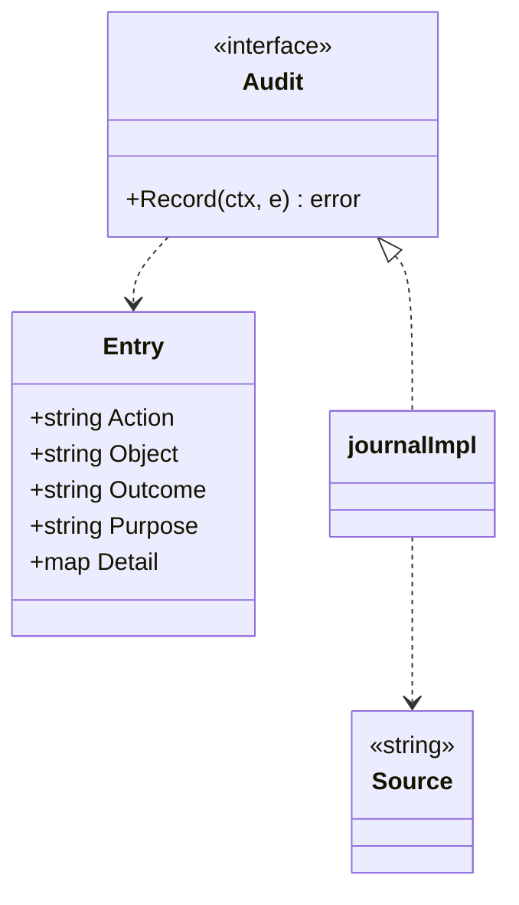
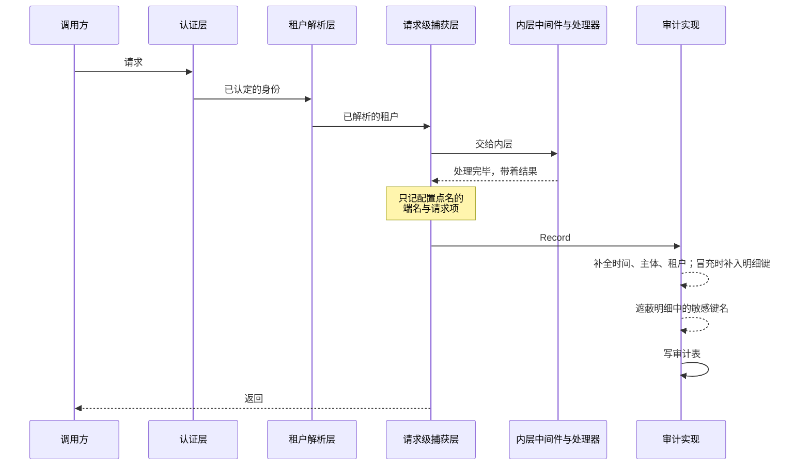

# audit

审计是横切能力，处在依赖图中业务模块之外的一侧：它只取用基础设施、认证与租户的根包，事件总线与入口模块在 `Init` 时取用，不依赖任何业务[模块](../../../glossary.md)；业务模块经[事件总线](../event/design-event.md)或记录接口把事实交给它，经事件总线与经记录接口的交付都不要求对方认识本模块。它拥有各条捕获通路、审计行与审计表，负责补全、脱敏与写入；查询接口、归责判定、轮转归档与覆盖面的保证都不在它之内，检索由可选的 [audit.admin](design-audit-admin.md) 经实现子包的读接口承担。读职责清单前应持有的一句话心智模型是：本模块把交给它的事实按同一张表记下来，覆盖面由装配与配置决定。

正文的次序是：职责、术语表与外部接口契约是第一遍，职责给出边界与各条通路的入口，术语表界定本文用词，外部接口契约给出别的模块能调用的部分；依赖、UML 图与核心数据结构供查阅，分别说明方向、类型关系与审计表结构；核心算法与流程也是第一遍，以[走查](#走查)开头，给出一次模型写语句留下的痕迹；错误与失败语义、并发与事务边界与扩展点是最后的自检项，先读非保证一节，再按通路核对失败去向；实现状态供核对上文承诺。

## 职责

本模块交付**审计**：把「谁在何时对什么做了什么」记下来，写进它自己的一张表。它是横切能力，不要求任何业务模块认识它，它也不认识任何业务模块。

事实经**捕获通路**进入本模块：语句级（经数据库模块的插件扩展点）、事件级（订阅事件总线）、请求级（入口模块的一层中间件）、接口级（别的模块调用记录接口）。划分的依据见 [ADR-audit-capture](../../../adr/adr-audit-capture.md)。

**排他交付**：同一个进程里恰好一个实现生效。

### 非职责

- **不提供查询接口。** 按条件的检索与导出要先回答「谁可以查谁」，那是授权判定，归 [authz](../design-authz.md) 承接的权限点（[ADR-audit-scope](../../../adr/adr-audit-scope.md)）。框架另有一个可直接纳入的模块 [audit.admin](design-audit-admin.md) 承担检索与导出，判定在它自己的 handler 内经 `authz.guard` 做出；本模块自身仍不提供查询接口。
- **不自证。** 记录的不丢失与不可篡改是一个部署形态与一份存储的性质，本模块不对自己作这个断言。
- **不做归责判定。** 请求级记录写的是请求事实；「谁该为这次拒答负责」由认证模块写在日志里，本模块不复制那份归责（见 [authn-gate](../authn/design-authn-gate.md) 的归因与收口）。
- **不判定租户，也不读名册。** 租户标识在本模块是字符串，读取发生在实现子包里。语句级捕获不判定一个租户是否存在或停用，它只按上下文里的标识记录——与租户隔离插件一致（见 [tenant](../tenant/design-tenant.md)）。
- **不做轮转与归档。** 审计表的容量与留存是宿主的运维职责。
- **不捕获原生 SQL 的写语句。** 语句级捕获只作用于经模型发出的写操作，判据见语句级捕获。宿主与迁移发出的原生写语句不产生审计行；这一条写在非保证里，没有别的补救。
- **不保证覆盖面。** 覆盖面随装配与配置变化，见错误与失败语义里的非保证。
- **不定义动作与对象的词表。** 写进审计行的是什么动词、对象如何拼写，由调用点与检索方约定；本模块只要求它是可比的字符串。语句级通路没有调用点可约定，它按自己的判据填（见语句级捕获）。

## 术语表

以下术语的含义限于本模块与审计主题的决策记录；别的模块的文档描述本模块的产物时，也用这里的含义。

| 术语 | 英文 | 适用范围 | 定义 |
|---|---|---|---|
| 审计行 | entry | 本模块与审计主题的决策记录 | 本模块记录的最小单位：时间、主体、租户、来源通路、动作、对象、结果、用途与明细。 |
| 主体 | subject | 本模块与审计主题的决策记录 | 审计行里记的行动者，落在审计表的 `actor` 列：上下文里认证身份的责任键，即实际操作者；冒充时是真正动手的账户，不是被冒充的账户。取法见审计行的补全。 |
| 捕获通路 | capture path | 本模块与审计主题的决策记录 | 事实进入本模块的一条途径。划分见 [ADR-audit-capture](../../../adr/adr-audit-capture.md)。 |
| 记录接口 | record seam | 本模块与审计主题的决策记录 | 别的模块主动交出审计行的入口，即 `Audit.Record`。 |
| 来源通路 | source | 本模块与审计主题的决策记录 | 一条审计行由哪条捕获通路产生。 |

## 外部接口契约

### 登记单元与名字

| 登记单元 | 模块名 | 交付 | 构造期依赖 |
|---|---|---|---|
| 接口包 | 不登记 | 只有接口与数据类型 | — |
| 实现子包 `pkg/audit/journal` | `audit.journal` | 排他地交付审计功能 | `(*db.Database)(nil)`、`(*log.Logger)(nil)` |

配置命名空间取 `audit.journal`。名字的每一段只用小写字母、数字与短横线：配置键的字符集规则按 `.` 切段适用（见 [config](../design-config.md)）。

**`(*db.Database)(nil)` 与 `(*log.Logger)(nil)` 都是必需的构造期依赖。** 表要建在数据库模块交付的句柄上，明细的脱敏键名要登记进日志模块的规则集；任一缺席时本模块无法成立，走 `core` 的缺提供者失败，不是静默缺一条通路。事件总线与入口模块**不写进构造期依赖**：它们在 `Init` 取用，在场时早已构造，没有要排的序（判据同认证网关的路由登记接口，见 [authn-gate](../authn/design-authn-gate.md) 的网关交付的功能）。**认证与租户连取用都不发生**：主体与租户经各自的 `FromContext` 从上下文读出，读不到即为空——缺席是一种合法配置，不是一个要在这里判定的错误。

**本模块的表态只能是 `StateEnabled`，永不 `StateAuto`。** 排他加 `StateAuto` 正是消解要禁用的那一格，而本模块的启用是宿主在命令树上的决定，不是一个可以由配置推断的结论。表态不表达跑不跑：本模块没有「未被指向任何东西」这一档，各输入项全空时它照常工作，语句级与接口级不因此缺席，被纳入即能启动。`StateDisabled` 不是模块可作的表态，它只由消解给出。

### 交付的功能

功能标识的元素类型必须是接口，取用写作 `core.Resolve[audit.Audit](reg)`：

```go
// Audit 是审计交付的功能，同时是中间件在链上代表的功能标识。
type Audit interface {
	// Record 记下 e，补全时间、主体、租户与来源通路之后写入审计表。
	// 返回 nil 表示已受理。
	// 本模块自己登记的捕获通路不据返回值阻塞业务；调用方可以据它终止自己的操作。
	Record(ctx context.Context, e Entry) error
}

// Entry 是一条审计行里由调用方给出的部分。
type Entry struct {
	// Action 是动作，一个动词。
	Action string
	// Object 是对象的类型与标识，写成 `<类型>:<标识>`。
	// 账户对象因而写成 `account:<账户标识>`；这是界面据以把账户标识
	// 解析成可读身份的唯一判别，不靠标识的形状猜测。
	Object string
	// Outcome 是结果。
	Outcome string
	// Purpose 是用途或理由；跨租户这类需要说明的操作在此给出。
	Purpose string
	// Detail 是明细的键值。键名决定它是否被遮蔽，见「脱敏」。
	// on_behalf_of、impersonation_scope 与 session 由本模块写入，见审计行的补全。
	Detail map[string]string
}

// Source 是一条审计行的来源通路。
type Source string

const (
	// SourceStatement 是语句级通路。
	SourceStatement Source = "statement"
	// SourceEvent 是事件级通路。
	SourceEvent Source = "event"
	// SourceRequest 是请求级通路。
	SourceRequest Source = "request"
	// SourceSeam 是记录接口。
	SourceSeam Source = "seam"
)

// ErrWriteFailed 表示一条审计行没有写进表，原因在本模块自己的连接、表或约束上。
// Record 返回它；一条模型写语句在记录它的那一行写不进去时也返回它。
var ErrWriteFailed = errors.New("audit: the entry was not written")

// ErrNotAccepting 表示本模块不在受理期：Start 之前或 Stop 之后。只有 Record 返回它。
var ErrNotAccepting = errors.New("audit: the module is not accepting records")
```

各哨兵出现的场合见错误与失败语义。

交付声明写作 `Provides: []core.Provision{{Token: (*Audit)(nil), Exclusive: true}}`。

### 审计行的补全

`Entry` 只承载调用方给出的那一半。其余字段由本模块在受理时补全：

| 字段 | 来源 |
|---|---|
| 时间 | 受理时取 |
| 主体 | 写进审计表的 `actor` 列：上下文里的认证身份的责任键 `Key()`，即实际操作者；上下文里没有身份时为空。身份是冒充身份时，被冒充的账户不在这一列，在明细里（见下） |
| 租户 | 上下文里的租户标识，取字符串形式；上下文里没有租户时为空。落在跨租户标记下的语句没有租户，其审计行同样为空，不记成发起它的那个请求的租户（见 [tenant](../tenant/design-tenant.md) 的跨租户）。事件级通路另有一处上文，见事件级捕获 |
| 来源通路 | 产出这条审计行的通路，取 `Source` 的一个取值 |

**主体与租户都取字符串，不引用交付它们的模块的类型。** 判据与事件总线相同：让一个模块的标识类型进入接口，接口所在的包就要 import 定义它的那个包。代价不是一份第三方依赖，而是本模块的接口对认证与租户的具体功能接口的依赖（见 [event](../event/design-event.md)）。读取它们因此发生在实现子包里。主体那一列的字符串是认证模块定义的责任键，本模块不重复这条定义，也不解析它的内部结构（见 [authn](../authn/design-authn.md) 的身份）。

**`on_behalf_of`、`impersonation_scope` 与 `session` 只由本模块在冒充行上写入。** 上下文里的身份是冒充身份（身份的 `Impersonating()` 为真）时，补全步骤往明细写入这些键，覆盖调用方放在同名下的值；其余的行，包括上下文里没有身份的行，调用方放进明细的同名键一律剥掉，调用方交来的映射不被改动。判据与代价见 [ADR-audit-impersonation](../../../adr/adr-audit-impersonation.md)。键名与取值如下，这一组是封闭集：

| 键 | 取值 |
|---|---|
| `on_behalf_of` | 身份的 `Account()`，即被冒充的账户 |
| `impersonation_scope` | 身份的 `Scope()` 给出的租户，即冒充限定的那个租户 |
| `session` | 身份的 `Session()` |

冒充身份经网关的出口检查保证带会话与冒充范围（见 [authn](../authn/design-authn.md) 的身份），所以冒充行上 `on_behalf_of`、`impersonation_scope` 与 `session` 都在。身份没有会话时不写 `session`，并删除调用方放在这个名下的值，行不带身份没有的会话；这是本模块对一个没有经过出口检查的身份的防御，不是网关盖出的身份会走到的分支。

主体列在这时仍是实际操作者：审计行回答「谁动的手」，「替谁」由明细回答。这些键由本模块从上下文里的身份写入，不分来源通路，凡是补全那一刻上下文里带着冒充身份的行都带它们；各通路补全时手上的上下文不同，事件级通路里订阅回调收到的上下文不带发布方的上下文时，那条通路的行不带这些键（见非保证）。审计表的结构不变：表上没有按被冒充者索引的列，按被冒充者聚合要读明细（见非保证）。

**一条审计行不因为主体或租户为空而被拒绝。** 系统级操作、豁免路由与没有凭据的可选认证路由上没有主体或租户，而它们同样是要留痕的那一类。登录发生在没有身份的豁免路由上，请求级通路为它写不出主体，由认证经接口级自己记（见 [authn-events](../authn/design-authn-events.md) 的审计）。

### 脱敏

**本模块遮蔽明细中键名落在下面这一组里的值。这一组是闭集**：`password`、`secret`、`token`、`credential`、`authorization`。键名逐字比较，不含分组路径，因此一个含点的键名不命中。

这一组由本模块固定，在下列场合生效，这份清单是封闭集：

- 实现子包在构造时把它们登记进日志模块的脱敏规则集，使本模块自己写出的日志受同一份规则约束；
- 写审计表之前，本模块按同一组键名遮蔽明细中对应的值。

**日志模块规则集里由别的模块登记的格式匹配与键名，不作用于审计表。** 判据与代价见 [ADR-audit-redaction](../../../adr/adr-audit-redaction.md)。

**明细里其余键名不被遮蔽。** 写入审计表的键名由调用点自选，本模块只覆盖闭集里的键名；这一条写在非保证里。

**认证模块不依赖这一组键名去遮蔽秘密。** 它写进明细的只有标识、枚举、计数与密钥摘要的前缀，键名取自它自己的封闭集；令牌、验证码、断言与 `state` 的值从不进明细（见 [authn-events](../authn/design-authn-events.md) 的审计）。这一组因此不因认证而增键。键名逐字比较，`access_token` 这样含 `token` 字样的键名不命中闭集里的 `token`，不命中的键名原样落库。

**事件级明细的键名是载荷序列化之后的字段名。** 未加序列化标签的导出字段以 Go 字段名出现，首字母大写，`Password` 因而不命中闭集；发布方要让一个字段被遮蔽，就让它以闭集里的拼写序列化。日志一侧同样逐字比较键名，这一点与审计表一致。

### 中间件在链上代表的功能

请求级通路登记的那一层以 `(*Audit)(nil)` 作为自己的 `Provides`，与描述符里那条交付声明取同一个标识。**这是别的层在记录阶段内指向审计层的唯一锚点**，因而是本模块的对外接口，改动它是破坏性变更；跨类别的先后由阶段给出，不由这条锚点给出。锚定它的写法与代价见 [ADR-audit-anchor](../../../adr/adr-audit-anchor.md)。

该层声明 `StageRecord`，不写任何 `After`，也不声明 `Order`：它的位置由阶段给出——鉴别与限流两个阶段先于它，授权阶段后于它。它记录的主体与租户正是鉴别阶段定下来的；一次被限流阶段拒绝的请求因而到不了这里，超额的请求不写审计行——这是阶段次序刻意的结果，不是覆盖面上的一处缺口。**认证层或租户解析层缺席时本层照常登记、照常运行**：它的位置由阶段给出，与这两者在不在场无关，写出的审计行主体或租户为空。

### 配置

实现子包的输入项挂在 `audit.journal` 下：

| 输入项 | 含义 |
|---|---|
| `endpoints` | 本模块在哪些端点上登记请求级捕获层 |
| `requests` | 要记录的请求，每一项（下称请求项）是一对（方法，路径），写成一个字符串，方法与路径以一个空格隔开；路径写成路由登记时的 gin（[REF-gin](../../../references.md)）写法，例如 `GET /contacts/:id`；空即不记 |
| `events` | 要订阅的事件类型名；空即不订阅 |

**请求项在每个受审计端点上都生效**，它与端名之间没有配对关系；要区分端，看明细里的端名。

**请求项与请求的比对是逐字的。** 请求项里的路径是登记方传给 `Endpoint.Route` 的那一个路径，写法相同：参数 `:name`、通配 `*name`。请求级的那一层在入口模块的 gin 引擎之内、路由匹配之后运行，取（请求方法，`c.FullPath()`）与请求项的（方法，路径）逐字比对，相等即命中（见请求级捕获）。本模块不自建匹配器，也不为请求项另造一套语法。方法同样逐字比：写着 `GET` 的请求项只命中请求方法是 `GET` 的请求，gin 不把 `HEAD` 请求派给只登记了 `GET` 的路由，这样的请求没有匹配路由，不命中任何请求项。

**本模块不在启动期校验一个请求项是否对应某条已登记的路由。** 入口模块的登记接口不提供路由的枚举，没有一处能把 `requests` 与已登记的路由互相比对。写错的请求项——路径与登记时的写法有一字之差，参数名不同即是一例——永不命中，启动期不失败，也不产生诊断。

**写法不成一对（方法，路径）的请求项在读配置时即启动失败。** 请求项是一个非空的方法、一个空格，与一条以 `/` 起头的路径；没有空格、方法为空、路径不以 `/` 起头的项，错误点名那一项并给出正确的写法，例如 `GET /contacts/:id`。这与不校验请求项是否对应已登记路由的那一条并不矛盾：失败的是不成形的写法，不是一对写得合乎形态却对不上路由的请求项。

**端名清单是本模块自己的输入项，缺省为空**：入口模块的登记接口能列出已声明的全部端名，本模块不取这份名单替配置选端，只在清单点名的端上登记，与租户解析一致（见 [tenant](../tenant/design-tenant.md)）。认证网关缺省守全部端（见 [authn-gate](../authn/design-authn-gate.md) 的配置），因为它漏掉一个端，那个端上的路由就无认证放行；本模块漏掉一个端，后果是那里不采集，缺省仍取空，由宿主点名（见对宿主的要求）。

**配置列出了一个类型名或一个端名，而对应的模块在本次运行中取不到时，启动失败。** 取不到的情形包括它没被装配、被禁用，以及在场却没被启用——判据是 `Resolve` 取不到已有的实例，取「登记」的一侧会让一个被禁用的提供者通过检查，而那正是本条要拦下的「以为有保护而实际没有」（[ADR-audit-reach](../../../adr/adr-audit-reach.md)）。什么都不列时本模块照常运行。

本模块不声明敏感输入项：端名、请求项与事件类型名都不是要保密的值。

### 对宿主的要求

- **请求级与事件级要生效，配置里要写出端名、请求项与事件类型名。** 三者默认空，空即不捕获，而空与「配了但没生效」在审计记录上看不出区别。
- **每个受审计的端点要写在 `endpoints` 里。** 漏写的端点上没有任何请求级捕获，不报错。
- **请求项的路径要与路由登记时的写法一字不差。** 写错的请求项永不命中，不报错（见配置）。
- **`endpoints` 与 `requests` 要一起写。** 只写端名时本层照样登记在那些端上、出现在链清单里，却一个请求也不记；只写请求项时没有一个端登记了本层，也一个请求都不记。两种半截配置都不报错，看得出它们的地方是本模块在 `Init` 写进日志链的 `capture in force` 那一行：它列出端名，并给出请求项与事件类型的条数。
- **宿主自己的授权层要让它的拒绝进审计，把它登记在授权阶段。** 层声明 `StageAuthorize`，阶段次序把它放在记录阶段之后，它的拒绝进审计；指向 `(*audit.Audit)(nil)` 的 `After` 不必再写——它跨到记录阶段，与阶段次序同向、已被满足，不建边（见 [http](../http/design-http.md) 的中间件的排序）。
- **跨租户操作要留痕时，用途由调用点给出。** 记录接口的 `Purpose` 是它唯一的承载处；不调用记录接口的跨租户操作不留痕，本模块不从上下文推断理由（[ADR-tenant-scoping](../../../adr/adr-tenant-scoping.md)）。
- **读审计表的宿主不写它。** 本模块是这张表唯一的写入方：宿主写进去的行在表里与本模块记下的事实分不出来，而经模型写这张表的语句按自指判据不产生审计行（见语句级捕获），这样的写入不留任何痕迹。
- **单写者引擎与只开一条连接的库上，不要在交付句柄上开着的事务里经额外连接写，也不要在那样的事务里调用记录接口、发布事件。** 先提交交付句柄上的事务再写。那一行要的写锁或连接正由这个事务占着，本模块等它有界、等不到即失败（见写入的等待，引擎等锁的规则见 [db](../design-db.md) 的并发与事务边界）。
- **要以审计写成功为动作前提的调用方，在动作的事务之外调用记录接口。** 理由与动作失败时的补记见接口级捕获。
- **不要用宿主的 `AllResources` 覆盖让本模块只以声明进入一次运行。** 那种装配下插件照装而本模块从未构造：语句级捕获会按下面所述的判据自行写入，而脱敏规则没有被登记，失败的信号也没有接出来（覆盖的语义见 [db](../design-db.md)）。

### 对外接口

`Audit`、`Entry`、`Source` 与各哨兵是本模块与其他模块之间的接口，调用方以 `errors.Is` 判别哨兵，不比对错误文本。中间件在链上代表的那个功能标识与描述符里的交付标识同为 `(*Audit)(nil)`，别的模块据它排序，取值属于对外接口，改动它是破坏性变更。**审计表的表名与脱敏键名同属对外接口**：表名与语句级捕获的自指判据共用一个常量，改名要一起改；脱敏键名的增删改变每一条审计行的内容。

**读审计表的宿主还可以依赖下面各条，它们同属对外接口**（[ADR-audit-table-contract](../../../adr/adr-audit-table-contract.md)）：

- **租户列是 `tenant_id`，存受理那一刻上下文里的租户标识**，取它的字符串形式，与租户模块的约定在那一列里存的是同一种文本；上下文里没有租户、或落在跨租户标记下时，存事件携带的那个标识（只有事件级的行有），没有就存 NULL，不存空串（见审计行的补全）。
- **行的键是 `id`，在整张表里唯一**，由表生成，不按租户分段。
- **这张表只由本模块写入。**

本模块不交付查询接口，宿主要读某个租户的那份轨迹，只能自己读这张表；这份读取的租户隔离由这几项事实给出。以租户列等于某个标识为条件的读，读到的恰是那个租户的行，读不到任何一行没有租户的行；在这个条件下按 `id` 取一行，取到的是那个租户的那一行，或者什么也没有。表上其余列的结构不在此列，见非保证。读的一方借租户模块的过滤来读时，内嵌约定的那个模型要守的义务由租户模块给出（见 [tenant](../tenant/design-tenant.md) 的受租户约束的模型）。

**宿主按租户读这张表，用的是租户模块认可的只读模型**：一个内嵌约定、表名取 `audit_entries` 的模型，只发读语句。租户过滤给经它的每一条读加上租户条件，读到的就是以租户列等于某个标识为条件读到的行。其余几件事读的一方要知道：

- **停用租户的轨迹经 `EnterRegistered` 进入那个租户再读。** `Enter` 拒绝一个停用的租户，而停用之后查看它的轨迹正是仍属于它的工作（见 [tenant](../tenant/design-tenant.md) 的不经请求侧的路径）。
- **跨租户读这张表，用一个租户字段可空的类型。** 经内嵌约定的类型跨租户读，没有租户的行读成空标识、不报错，与一个标识为空串的行分不出来；而这一列从不存空串，NULL 才是「没有租户」。
- **按 `id` 取首末行要写明排序。** 约定把租户列标成主键，`First` 与 `Last` 按它排，一个租户之内等于不排（见 [tenant](../tenant/design-tenant.md) 的受租户约束的模型）。
- **模型读对外接口之外的列时，依赖的是尚未列入接口的结构。** 本模块改那些列，模型要跟着改，没有一处会报错（见非保证）。

## 依赖

| 依赖 | 用途 | 声明方式 |
|---|---|---|
| `pkg/core` | 注册描述符、交付功能、取用别的模块 | 接口引用 |
| `pkg/config` | 声明本模块的输入项 | 接口引用 |
| `pkg/db` | 建审计表、安装语句级捕获插件 | 构造期依赖，必需 |
| `pkg/log` | 登记明细的脱敏键名 | 构造期依赖，必需 |
| `pkg/event` | 订阅配置点名的类型 | `Init` 取用，不声明 |
| `pkg/http` | 在受审计端点登记请求级捕获层；层是一个 `gin.HandlerFunc`，读 `c.FullPath()` 与 `c.Writer` | `Init` 取用，不声明 |
| gin | 层的类型与读取请求的方法；已在 `pkg/http` 的依赖闭包里，不为宿主另增依赖 | 编译期 |
| `pkg/authn` | 经 `FromContext` 读出身份：主体取责任键 `Key()`，冒充身份另取 `Account()`、`Scope()` 与 `Session()` 写进明细 | 无构造期依赖 |
| `pkg/tenant` | 经 `FromContext` 读出租户标识 | 无构造期依赖 |

**这些依赖都在实现子包里，接口包只依赖标准库。** 锚定 `(*Audit)(nil)` 的模块 import 接口包，实现子包绑定的那些库不进宿主的 `go.mod`，宿主的 `go.sum` 与实际下载则会经被引入包的测试闭包带上它们，只有读整图的操作会看到全部实现所绑的库（[ADR-audit-anchor](../../../adr/adr-audit-anchor.md)）。

**本模块不依赖任何业务模块。** 业务模块经事件总线或记录接口交出事实，事件总线与记录接口都不要求它认识本模块。取用记录接口的模块在构造期声明对本模块的依赖，是否声明为可选由它自己决定；本模块要求不了它终止启动，而「取不到就跳过记录」这个默认写法让业务照常进行、不留审计行，这一条列在非保证里（与认证网关的路由登记接口一致，见 [authn-gate](../authn/design-authn-gate.md) 的网关交付的功能）。

## UML 图

图里是接口、数据类型与它们的实现关系。图看不出的约束：各条捕获通路都经同一个实现写入同一张表；记录接口是唯一由别的模块主动调用的通路；接口包不登记模块。



一次请求在请求级通路上的记录路径，其分支由配置决定：



## 核心数据结构

| 概念 | 类型 | 说明 |
|---|---|---|
| 审计行 | `Entry` | 调用方给出的那一半；时间、主体、租户、来源由本模块补全 |
| 来源通路 | `Source` | 这条审计行由哪条捕获通路产生 |
| 审计表的一行 | 表结构 | 审计行的补全结果：补全后的各字段，加一个可空的租户列，明细以键值形式存放；事件级的行另带事件标识，这一列唯一，其余通路的行上为空 |
| 表名 | 常量 | 语句级捕获的自指判据与它共用同一个取值 |
| 脱敏键名 | 常量组 | 闭集，登记进日志模块的规则集，同时用于写表前的遮蔽 |

**审计表不内嵌租户模块的受约束模型约定。** 它自己带一个可空的租户列：跨租户操作与系统级操作没有当前租户，内嵌约定会让隔离插件加条件、在插入时填列，而那时值不存在，非空约束会让审计行写不进去。免过滤的判据是模型没有声明（见 [tenant](../tenant/design-tenant.md)），代价见 [ADR-audit-sink](../../../adr/adr-audit-sink.md)。

**`Entry` 是值类型，但 `Detail` 是映射。** 本模块在受理时复制它，此后调用方改动自己那份不影响已受理的审计行。

## 核心算法与流程

### 走查

以一条经交付句柄发出的模型写语句为例。初始状态：审计表为空；上下文带责任键 `acct-7` 与租户 `t1`；一条 `UPDATE contacts SET name = ... WHERE id = 'c1'` 在一个事务里发出，事务尚未提交。

1. GORM 在提交步之前调用本模块注册的回调，取到最终语句与结果。此时业务行已改，事务尚未提交，审计表仍为空。
2. 回调比较语句的目标表与表名常量，不相等，继续；按语句的操作类型填动作 `update`、目标表 `contacts`，受影响行数 1 进明细。
3. 补全时间取受理时刻，主体取上下文里的责任键 `acct-7`，租户取 `t1`，来源通路取 `statement`。审计表仍未写入。
4. 明细的键名不在 `password`、`secret`、`token`、`credential`、`authorization` 这一组里，值原样保留；本模块在语句自己的会话上向审计表写入一行，与业务语句同一件工作。
5. 事务提交：`contacts` 的改动与审计行一起可见。业务语句失败或事务回滚时，两处都不留。

同一条语句经额外连接发出时，写到审计表的那一步改经交付连接，写在语句提交之前。两个库之间没有共同的事务，业务语句随后回滚时这一行仍留在交付库里。

### 本模块的阶段行为

| 阶段 | 行为 |
|---|---|
| `Prepare` | 解出自己那份配置，读出端名、请求项与事件类型名 |
| `New` | 取日志模块的脱敏登记接口并登记键名；建立写入接口 |
| `Migrate` | 无动作：迁移由数据库模块在这一阶段应用，本模块只声明 |
| `Init` | 在每个受审计端点登记请求级捕获层；订阅配置点名的类型。事件实现的订阅表在它自己的 `Start` 里冻结，晚于本模块的 `Init` |
| `Start` | 开始受理请求级、事件级与接口级的记录。**语句级不受这个闸门约束**：它的开关是插件装没装，见语句级捕获 |
| `Serve` | 无动作：受理在 `Start` 之后持续进行 |
| `Stop` | 停止受理请求级、事件级与接口级的新记录 |
| `Close` | 无动作：写入接口属于数据库模块，本模块不持有连接 |

宿主为本模块预置的实例不是本模块的产物时，`Init`、`Start` 与 `Stop` 都不对它做任何事：不登记请求级捕获层，不订阅配置点名的类型，也不开启或停止受理；它持有的资源由预置的一方释放（[ADR-supplied-instance](../../../adr/adr-supplied-instance.md)）。语句级捕获不受影响：插件由数据库模块按启用集安装，与本模块的实例从哪来无关。

**`Stop` 里停止受理不会丢掉入口在途请求的行。** 本模块不声明 `Serve`，每个入口排空结束之后才收到 `Stop`（见 [core](../design-core.md) 的入口单独成一个阶段）：请求级那一行在内层返回之后写出，入口在排空时限之内走完的请求都在本模块停止受理之前写完；请求处理途中调用的记录接口同理。宿主为入口模块预置的实例不是它的产物时，排空不随之而来，那个实例放进来的请求不在这条先后之内：它们在本模块停止受理之后才写的请求级行不记也不报，之后才调用的记录接口返回 `ErrNotAccepting`。**事件级不在这条先后之内。** 本模块与事件总线之间没有构造期依赖，总线在它自己的 `Stop` 里还会把已取到的条目交给订阅者；本模块若先于总线停止受理，这些事件不记也不报，订阅回调照常返回，总线随之确认它们。两者谁先停由注册表排开依赖序没有定下的部分的方式决定，那不是契约。

入口模块缺席、入口模块在场但端名不存在、事件总线取不到，都在 `Init` 判定：入口模块的登记接口与事件总线都到那时才保证取得到（`Resolve` 只返回已有的实例，本模块又不声明对它们的构造期依赖）。**没有入口模块的运行不服务任何请求**：端名清单来自编译进来的文档，一条不服务任何请求的命令（`worker`、seed、一次性迁移）也会带着它，而这样的运行没有请求可采，本模块跳过请求级捕获，语句级、事件级与接口级照常工作，并记一行说明。**入口模块在场时，配置点名的端名若入口不声明，仍是启动失败**：那里的运行确实服务请求，端名写错就是本层挂不上去，不能按跳过处理。**本模块不为其余几档自造类别**：事件总线缺席原样外传 `core` 的缺提供者哨兵，端名那一档原样外传入口模块的哨兵；每一档都在错误文本里点出是哪个配置项要求的。

### 迁移的方言划分

审计表经 `db.Migrations` 声明。迁移由数据库模块在 `Migrate` 阶段施加，整体早于 `Init`。**迁移集按方言分子目录，一个方言一个子目录**，目录名取该方言的取值（见 [db](../design-db.md)）。

**漏掉一个方言的子目录不是错误，而是那个方言下零迁移。** 表现是表不建，此后**每一条被捕获的写语句都失败**——语句级那条通路的失败不静默。这一格写进非保证。

**表的改动以新的迁移文件追加，不改写已有的文件。** 数据库模块按文件名记下已施加的迁移，改写过的文件在已经建过表的库上不会再执行；事件标识那一列即由 `0002_audit_entries_event_id.sql` 加在 `0001_audit_entries.sql` 建出的表上，每个方言各一份。

### 语句级捕获

本模块声明一条 `db.Plugin` 资源。**插件实例不持有任何状态**：它随描述符在 `init` 期冻结，并被同一个进程里的多个注册表共用（判据见 [tenant](../tenant/design-tenant.md) 的插件在语句上的作用点）。回调不需要它持有任何东西——GORM（[REF-gorm](../../../references.md)）把每条语句自己的会话交给回调——所以这里没有随句柄而变的东西可放错。第二个句柄要当心的只有一件：它上面的语句留下的行归哪张表，见下文额外连接那一段。

回调以**具名锚点**注册在**提交那一步之前**（`Create`、`Update`、`Delete` 各一处），取的是最终语句与其结果。锚点落在语句自己的那一步上是不够的：GORM 注册提交步时不带锚点，而它的排序把挂在已排序步骤**之后**的回调一律追加到链尾——挂在 `gorm:create` 之后的回调因而落在提交**之后**，那时连接已经交还连接池，「写在与语句同一个会话上」这条只对调用方自开的事务成立。挂在提交之前，回调跑在事务仍开着的时候。

租户过滤插件注册在同一批处理器上、位置在它们自己的步骤**之前**；两侧的位置都由锚点定下，与插件的安装次序无关：注册到同一处理器的多个插件在没有依赖声明时本无次序保证（见 [db](../design-db.md)），本模块因此不声明对名册功能的构造期依赖。

**交付连接上的语句，写入走这条语句自己的会话**，不另开一条连接（[ADR-audit-capture](../../../adr/adr-audit-capture.md)）。

**额外连接上的语句，审计行归交付连接那个库里的审计表。** 数据库模块经 `Open` 建出的连接装着同一批插件，却不施加迁移（见 [db](../design-db.md) 的额外的连接）；它连着的库通常没有审计表，而一个进程只有一张审计表。那条连接上的一条模型写语句，审计行经交付连接写出，写在它提交之前，写不进去令它失败，与交付连接上的语句同一个方向；只是它与那条语句不在一件工作里，两个库之间没有共同的事务（[ADR-audit-failure](../../../adr/adr-audit-failure.md)）。**插件自己分不出这两种连接**：实例被多个注册表共用、不持有状态，从句柄上读不出它的来历，这个回答由建出额外连接的数据库模块给出——回调对语句所在的会话调用 `db.OpenedFrom`，它答出一个交付句柄时，这一行经那个句柄写出，答不出时写在语句自己的会话上（见 [db](../design-db.md) 的额外的连接）。经交付句柄写出的这一行沿用语句的上下文，主体与租户照常从那里读出。它等交付库有界，过界即令那条语句失败，见写入的等待。

**额外连接连着的就是交付库那张审计表时，它在这里与交付连接无异**：行写在那条语句自己的会话上，随它的事务成败。认出它要在界内从交付连接池取一条连接问一次引擎，这一问不等任何一方占着的锁，语句自己的事务占着整个库时也一样；认出之后不再等什么（见写入的等待）。经交付句柄写出反倒不行：单写者引擎上那一行要等语句自己占着的写锁，另一个引擎上它不在语句的事务里、语句回滚时留下来。认出这种连接问的是两条连接背后的引擎，不看定位符（[ADR-audit-failure](../../../adr/adr-audit-failure.md)）：

| 引擎 | 同一张审计表的判据 |
|---|---|
| SQLite | 两条连接的主库在同一个文件里：引擎解析出的路径相同（链接由引擎解析），或文件系统认作同一个文件（硬链接即是）。没有文件的库——内存库、临时库——不被认作交付库 |
| PostgreSQL | 服务器这一次启动的时刻相同、当前的库相同，且审计表的表名在两条连接上解析到同一个关系。比关系而不只比库，是因为搜索路径决定同一个表名落在哪张表上 |

问语句那一侧用的是语句自己的连接；它答出一个文件或那张表时，再在交付连接池取来的连接上问另一侧，那条连接的取得与其余额外连接上的行共用一个界。别的引擎上一律照其余额外连接处理。

**代价是这条通路的失败是抛上去的，不是报出去的**：写入失败会让那条业务语句失败，因为在同一条连接上记录与写入是一件工作。语句级以外的各通路的失败处置与此相反，见错误与失败语义。插件因此不持有任何句柄，连「哪一次 `Initialize` 的句柄」都不必记。

**自指由目标表判定。** 回调比较语句的目标表与表名常量，相等即跳过。**原生 SQL 那条路上不会有递归，因为 `Exec` 与 `Raw` 根本不进钩子；模型路径上的递归靠的就是这条比较。** 判据的前提是写入语句解析出来的表名等于那个常量——`Table(...)` 传一个带前缀或别名的名字会让两者分家，跳过随之失效，那条写入自己又产生一条审计行，递归在这里发生，而它一次就栈溢出。

**只捕获经模型发出的写操作。** 回调注册在 `Create`、`Update`、`Delete` 处理器上，因而 `Exec` 与 `Raw` 发出的写语句不产生审计行——迁移语句、宿主自己的清理与脚本都在此列。这条写在非保证里。

**语句级的开关是插件装没装，不是本模块的 `Start`。** 数据库模块在自己的构造期把它装到自己构造的句柄上，此后经这个句柄每一条被捕获的写语句都进审计表，包括其余模块在 `Init` 里发出的模型写操作。宿主为数据库实现预置的实例不经这次驱动里数据库模块的构造：不是数据库模块的 `New` 构造的，在数据库模块的 `Migrate` 被拒收；出自它的 `New` 的，插件在不在上面取决于造出它的那次 `New`（见非保证）。请求级、事件级与接口级则要等 `Start`。

**动作与对象由本模块按判据填**：动作取语句的操作类型，对象取目标表；受影响行数进明细。主键在一对多的写语句里不可得，本模块不逐行记录（[ADR-audit-capture](../../../adr/adr-audit-capture.md)）。

**审计行按语句计，不按业务动作计**（[ADR-audit-capture](../../../adr/adr-audit-capture.md)）：一次业务动作发出几条写语句就留几行。匹配不到行的更新与删除同样留一行，受影响行数为 0；GORM 的 `Save` 在主键非零而那一行不存在时，先发一条更新、受影响 0 行，再发一条插入，留下两行。

**失败的语句不留行。** GORM 逐个执行一个处理器上的回调，不因前面的步骤失败而停下，所以被别的插件拒绝的语句（租户过滤拒绝一条上下文里没有租户的受约束语句即是一例）、被 GORM 自己拒绝的语句（缺少条件的整表更新与删除）与被引擎拒绝的语句（主键冲突）都会走到本模块的回调。它们什么也没改，没有写入可记；它们所在的那件工作正要回滚，行写进去也会跟着消失，而 PostgreSQL 在一条语句失败之后拒绝同一事务里的一切语句，行连写都写不进去。本模块因而跳过已经失败的语句：调用方拿到的是那条语句自己的错误，不带 `ErrWriteFailed`。语句级审计行的结果一列因此恒为成功值，改了多少由明细里的受影响行数给出。

### 请求级捕获

在每个受审计端点登记一层中间件。层在入口模块的 gin 引擎之内、路由匹配之后运行，已匹配的路由可读：层取（请求方法，`c.FullPath()`）与 `requests` 里请求项的（方法，路径）逐字比对，命中则**先把请求交给内层，内层返回之后再写出一条审计行**。

**没有匹配路由的请求不审计。** `c.FullPath()` 在没有匹配路由时是空串——无匹配路由的 404 与方法不允许的 405 都在其列——不与任何一个请求项相等，层照常把请求交给内层而不写行。

**记录点在内层返回之后，因为结果只有到那时才存在。** 该层写出的是请求事实：端名、方法、路由路径、主体、租户、内层给出的结果。写在放行之前就只能填一个恒定占位值，那种审计行的结果一列没有任何信息。

**这一行不随请求的上下文一起取消。** 客户端在处理器返回之前断开时，`net/http` 取消请求的上下文，而处理器做的事那时已经做了——删除已经提交，导出已经读完。写入沿用上下文里的值（主体与租户从那里读出），不沿用它的取消；沿用取消会让这一行因为一件与审计表无关的事丢失，还会让失败信号把一张正常的表报成失败。代价是这次写入的时限只剩数据库自己的超时，见非保证。

**内层 panic 时同样写一行，结果一列填常量 `panic`，随后把 panic 原样抛出。** 状态码从未到达，填任何状态码都是猜测；这一行与正常返回那一行共用同一个记录点，只在结果一列的取值上不同。捕获 panic 不是本层的职责——本层与兜底层同在一个 gin 引擎之内，兜底层落在观测阶段之内、排在记录阶段之外，panic 穿过本层后由它接住（见 [http](../http/design-http.md) 的兜底层；gin 自带的恢复中间件不装），本层只是把这次请求记下来。

**处理器既没有返回、也没有抛出值时同样写一行，结果一列同样填 `panic`。** 这是处理器调用了 `runtime.Goexit`，或在 `GODEBUG=panicnil=1` 下 `panic(nil)`，两者在本层分不开；协程随后照常结束，本层不吞它。这与入口模块的兜底层对同一情形的处置同类（见 [http](../http/design-http.md) 的兜底层）。

**这一档包含被有意放弃的连接。** 处理器用 `net/http` 的 `ErrAbortHandler` 放弃连接时，本层读不出它与缺陷的区别，同样填 `panic`；而入口模块的兜底层认得那个值、原样抛出、不写响应（见 [http](../http/design-http.md) 的兜底层），调用方因而什么也没收到，却留下一条结果列为 `panic` 的审计行。本层要记的是「发生过什么」，连接是不是被有意丢掉不在它能读到的信息里。

**匹配是与登记写法的逐字比对。** 路由匹配在这一层运行之前已经由 gin 完成，层读的是它的结果，比的是它登记时的写法。启动期不能与已登记的路由对照：登记接口不提供路由的枚举，写错的请求项永不命中，不报错（见配置）。

**动作与对象由端名、方法与路由路径填**：动作取请求方法，对象取路由路径，即 `c.FullPath()` 给出的路径写法，与路由登记时的相同。端名与请求路径进明细，请求路径取 `c.Request.URL.Path`——它们不在 `Entry` 的字段里，而中间件确实知道自己落在哪个端上、这次请求的是哪条路径。路由路径说的是哪一类请求，请求路径说的是哪一个对象，例如路由路径 `/contacts/:id` 之下的请求路径 `/contacts/c1`。

**结果取内层写出的最终状态码**：层在 `c.Next()` 返回之后读 `c.Writer.Status()`；内层从未写状态时为 200。层不替换 `c.Writer`，写出者携带的可选接口不受它影响。gin 的写出者记下的是响应开始写出时的状态码：处理器先设 103 再设 200，客户端收不到那个 103，读到的是 200；响应开始写出之后再设置的状态码不改变它。处理器只设了 103 就写出响应体时，写出者记下的仍是 103，而调用方收到的最终状态是 200，103 只是先到的信息性响应；层把非 101 的 1xx 视为 200，与 `net/http` 对信息性状态码的划分一致。

**该层不做归责判定。** 一次拒答出自哪一层不由它回答。

**该层不改变请求的处理结果。** 请求已经处理完毕，记录失败不回改它，也不进业务路径的返回值。

### 事件级捕获

在 `Init` 里对配置列出的每个类型名登记一次订阅。载荷以结构化方式读取（见 [event](../event/design-event.md)），读不出时丢弃这条事件并记录——订阅方没有可上报的对象。

**动作与对象取自事件本身**：动作取类型名，对象与其余字段从载荷里按字段名读出，读不出即留空。

**明细取载荷的顶层标量字段。** 字符串取它的值，布尔与数值取载荷序列化时写出的字面文本：那是载荷自己的写法，不是本模块另定的一种，数值也因此不经浮点换算，超出浮点精确范围的整数原样保留。发布方区分事件种类的事实常落在这类字段上——设置的删除标记、值被隐去的标记与写入后的版本号即是（见 [ADR-settings-audit](../../../adr/adr-settings-audit.md)），丢掉它们，一次删除读起来就是写入了空值。嵌套的对象、数组与空值不进明细：遮蔽按顶层键名整键比对，嵌套值里的键根本不被比对，把它渲染成文本等于把其中的东西原样落库。

**租户取自事件携带的那个标识。** 总线在事件上带它，正是为了让横切能力不必自己重建，而订阅回调通常没有请求上下文可读；上下文里有租户时以它为准，那是做这件事时所处的租户。

**写入同样不随回调的上下文一起取消。** 进程内总线在发布方自己的上下文上调用订阅方，而事件在发布那一刻已经发生；判据与请求级相同。

**一个事件在表里只留一行，按事件标识去重**（[ADR-audit-replicas](../../../adr/adr-audit-replicas.md)）。经传输投递的总线把每个事件交给每个副本的订阅，后端还可能重投，而每个副本写的是同一张表；事件标识在每一次投递上都相同（见 [event](../event/design-event.md) 的事件标识）。事件级审计行带着这个标识，表对这一列有唯一约束，插入遇到已有的标识什么也不做：先到的那次投递写下这一行，其余投递照常成功、不写行，也不进失败信号。标识留在行上，读表的一方据它把一行对回它记的那条事件。**不带标识的事件不去重**，每次投递各留一行，行上的标识为空。

### 接口级捕获

调用方构造 `Entry` 并调用 `Record`。时间、主体、租户与来源通路由本模块补全，明细按键名遮蔽后写入。

**记录接口沿用调用方上下文的取消。** 要这一行的是调用方，它放弃了自己的操作，`Record` 就返回写入失败，由它决定怎么处置；这与请求级、事件级不同，它们没有可以告知的调用方。

**记录接口写出的行不属于调用方的事务。** 它另占一条连接，提交与回滚各自独立：调用方的事务随后回滚，这一行仍在。要以「没有这一行就不执行动作」为条件的调用方，因此在动作的事务之外、动作之前调用 `Record`，返回错误即不执行；动作随后失败时，它自己再记一条失败的行，用动作标识与先写的一行对应。认证的管理面与冒充即这样做（见 [authn-events](../authn/design-authn-events.md) 的强制档的写入顺序）。在动作的事务里调用它，单写者引擎与只开一条连接的库上写不成功，见写入的等待。

### 写入的等待

**一行审计不等调用方自己占着的连接。** 只开一条连接的库——内存库——上，调用方在交付句柄上开着一个事务时，那条连接由它占着，要到它自己的调用返回之后才放开。本模块另占一条连接写出的每一行这时等的都是调用方自己，等多久都等不到；而一行审计从它所在的会话上分不出这种占用与别的调用方的短暂占用。本模块因而给取连接设界，而不是去识别它（[ADR-audit-failure](../../../adr/adr-audit-failure.md)）。另占的那条连接一律经数据库模块的 `Connection` 取得（见 [db](../design-db.md) 的有界的连接、[ADR-db-waits](../../../adr/adr-db-waits.md)）：

| 写出的行 | 等的连接 | 界 | 过界的表现 |
|---|---|---|---|
| 交付连接上的语句（语句级） | 什么也不等：写在语句自己的会话上，要的东西语句已经占着 | — | — |
| 额外连接上的语句（语句级） | 交付连接池的一条连接，先用它认出额外连接是不是连着交付库那张审计表，这一问不等锁；是时写在语句自己的会话上，不再等什么 | 一秒 | 那条语句失败，错误包着 `ErrWriteFailed` 并点明是在等连接；那条语句的写入不生效 |
| 本模块自己写的行（接口级、请求级、事件级） | 交付连接池的一条连接 | 五秒 | 记录接口返回 `ErrWriteFailed`；请求级与事件级进失败信号 |

**额外连接上那一行的界短，是因为它等的时候那条语句自己的事务还开着**，另一个库上它占着的东西也跟着等。交付池给得出连接时，是在毫秒里给出的；一秒之内放开的占用照常等过去，不算失败。

**插入等锁照引擎自己的设置，不在这些界内。** 本模块不写方言代码，也不改动交付连接上的等锁设置；引擎在哪些情形下让这一行等锁、等多久，见 [db](../design-db.md) 的并发与事务边界。调用方在交付句柄上开着的事务挡住这一行时，它等满引擎的时限，以 `ErrWriteFailed` 失败，错误里带着引擎自己的错误（SQLite 上是 `SQLITE_BUSY`）；额外连接上的那条语句随之失败、写入不生效。别的写者短暂占着锁时，这一行照常等过去。SQLite 上这段等待不随上下文结束；请求级与事件级本来就不随上下文取消，PostgreSQL 上会话的 `lock_timeout` 与 `statement_timeout` 都不设时，被锁住的审计表让它一直等到锁放开。插入沿用它所在路径的上下文：记录接口是调用方的，语句级是那条语句的，请求级与事件级去掉了取消。经 `Connection` 写出的一行与直接经交付句柄写出的一行发出的语句相同，没有多出的往返。

**认出额外连接连着哪张表的那一问不等锁。** SQLite 上读主库文件用 `PRAGMA database_list`：它不取锁；同一份清单的表值函数写法是一条查询，要等共享锁，一个正在提交的写者、一个占着整个库的事务——语句自己的也算——都让它等下去。PostgreSQL 上那一问只按名字解析关系，不对表加锁。

**本模块自己写的行等连接至多五秒。** 事件级与请求级不随上下文取消，没有这个界，事件级在进程内总线上、发布方的事务里等那条连接时会一直等下去。

**数据库模块交付的每一种库上取连接的界都成立。** 它不打开 SQLite 共享缓存模式的定位符——那种库上驱动等表锁不看忙等时限、不随上下文结束（见 [db](../design-db.md) 的配置）。

## 错误与失败语义

### 启动期

以下各条终止启动：

| 情形 | 表现 |
|---|---|
| 数据库模块或日志模块缺席、被禁用 | 缺提供者失败，点名本模块与那条构造期依赖 |
| 配置点名了端名，而入口模块本身缺席、被禁用 | 不失败：这次运行没有请求经过，跳过请求级捕获层，语句级与接口级照常 |
| `endpoints` 里的端名在入口模块上不存在 | 原样外传入口模块的错误 |
| 配置列出了事件类型，而本次运行取不到事件总线 | 缺提供者失败，点名那个配置项 |
| 本模块与另一个审计实现同时表态启用 | 排他冲突，消解阶段报出双方 |

**表不存在不在此列**：表由数据库模块在 `Migrate` 阶段应用迁移时建立，整体早于 `Init`，而本模块从 `Init` 起才读写。迁移集漏了某个方言的子目录是这条成立的例外，见迁移的方言划分。

### 运行期

请求级与事件级的写失败不进业务路径的返回值，业务照常完成。语句级不在此列——它的记录与那条语句是一件工作，见语句级捕获。判据与代价见 [ADR-audit-failure](../../../adr/adr-audit-failure.md)。

**失败的信号不进日志链。** 第一次写失败与随后的恢复各写一行到标准错误，不经日志模块——理由与日志模块报告自身失败时相同：报告链自身缺席或出问题时仍然可用（见 [log](../design-log.md) 的写入失败的上报）。此后的失败只计数不写行，避免一次故障刷满输出；计数在进程内，不对外暴露。

| 情形 | 表现 |
|---|---|
| 写审计表失败（语句级） | 抛在那条语句上，**那条语句失败**，错误包着 `ErrWriteFailed`——记录与写入是一件工作 |
| 语句自身失败（语句级） | 不写审计行；那条语句返回它自己的错误，不带 `ErrWriteFailed` |
| 额外连接上的语句，交付连接池一秒之内给不出连接（语句级） | **那条语句失败**，错误包着 `ErrWriteFailed` 并点明是在等；那条语句的写入不生效 |
| 额外连接上的语句，它那一行等交付库的锁直到引擎放弃（语句级） | **那条语句失败**，错误包着 `ErrWriteFailed` 与引擎自己的错误；那条语句的写入不生效 |
| 本模块自己写的行五秒之内取不到交付连接、或等交付库的锁直到引擎放弃（接口级、请求级、事件级） | 记录接口返回 `ErrWriteFailed`；请求级与事件级首次与恢复各写一行标准错误 |
| 写审计表失败（请求级、事件级） | 首次与恢复各写一行标准错误，业务照常完成 |
| 同一个事件再次到达（事件级） | 不写行，不报失败；表里已有先到的那次投递写下的一行 |
| 写审计表失败（接口级） | `Record` 返回错误；调用方决定是否终止自己的操作 |
| 明细里的敏感键名命中 | 值被替换为遮蔽文本，其余明细照常写入 |
| 事件载荷读不出 | 丢弃这条事件并记录（这条记录写进日志链，链可被整条关掉） |
| 上下文里没有主体或租户 | 该字段留空，审计行照常写入 |
| 记录接口返回值被调用方忽略 | 该次记录失败只进那一行标准错误，调用方自己的操作照常 |
| 记录接口在 `Start` 之前或 `Stop` 之后被调用 | `Record` 返回 `ErrNotAccepting`，不写行；请求级与事件级落在这段时间里的不记，也不报。请求级落进来的只有入口排空超时之后仍在运行的请求，以及宿主为入口模块预置的、不是它的产物的实例放进来的请求，事件级见本模块的阶段行为 |

各哨兵出现的场合：

| 哨兵 | 所在包 | 何时出现 |
|---|---|---|
| `ErrWriteFailed` | 接口包 | `Record` 写表失败；一条模型写语句记录它的那一行写不进去，那条语句失败。语句自身失败时不出现 |
| `ErrNotAccepting` | 接口包 | `Record` 在受理期之外被调用 |

### 非保证

- **存在与否是装配的结果。** 本模块未被纳入、也没有预置实例时，对应的通路不存在，没有任何一层会拦下（[ADR-audit-guarantees](../../../adr/adr-audit-guarantees.md)）。语句级那一条另看数据库实例：宿主预置的实例出自一次收取了捕获插件的 `New` 时，本模块即使不在这次运行里，经它的句柄发出的写语句也照样被捕获（见 [db](../design-db.md) 的本模块自身的阶段行为）；库上没有审计表时——本模块不在本次声明集里、此前也没有施加过本模块的迁移即是——被捕获的写语句随写审计表失败而失败，错误包着 `ErrWriteFailed`（见运行期）。
- **覆盖面由配置决定。** 语句级与接口级随装配生效，不受配置控制；事件级与请求级只覆盖配置点名的类型与请求项。
- **宿主为本模块预置的实例不是本模块的产物时，请求级与事件级通路不存在，而注册表答本模块在场。** 回调对这样的实例不做任何事（见本模块的阶段行为）：配置点名的类型与请求项不起作用，`capture in force` 那一行不写出，请求级与事件级的失败信号也无从产生；启用结果与参与结果却都答本模块在场。语句级捕获照常；接口级的记录交给那个外来实例，由它自己处置。需要请求级与事件级审计的装配里不为本模块预置外来的实例（[ADR-audit-guarantees](../../../adr/adr-audit-guarantees.md)）。
- **预置的数据库实例上不保证有语句级捕获。** 捕获插件由数据库模块在 `New` 里装到它构造的句柄上，宿主为数据库实现预置了实例时，这次驱动里这一步不发生。数据库模块在 `Migrate` 拒收不是它的 `New` 构造的预置实例，启动失败（见 [db](../design-db.md) 的本模块自身的阶段行为）。拒收管不到的情形里，句柄上没有捕获插件时，经它发出的写语句不产生审计行：外来的实例在拒收之前就被取用——推进不到 `Migrate` 的驱动全程都在拒收之前，更深的驱动里先于数据库模块 `Migrate` 执行的回调也取得到它；实例出自数据库模块的 `New`，而那次 `New` 没有装捕获插件——数据库模块只核对来历，在一个不装配本模块的注册表上造出、再预置进来的实例照样通过，启动成功，本模块照常构造、照常启用，接口级、请求级与事件级照常写入，没有任何一层报出语句级的缺席。需要语句级审计的装配里不预置数据库实例。
- **原生 SQL 的写语句不被捕获。** 迁移语句、宿主自己的清理与脚本、`Exec` 与 `Raw` 发出的写操作都不产生审计行。
- **失败的写语句不留痕。** 被租户过滤拒绝的语句、主键冲突与缺少条件的整表写都只出现在调用方拿到的错误里；要把一次被拒绝的尝试记下来，调用点经记录接口交出它。
- **迁移集漏掉一个方言的子目录时，那个方言下零迁移且不报错。** 表现是表不建、写入失败、审计全丢。
- **请求级与事件级的记录不保证完整。** 请求级与事件级的写失败不进业务路径的返回值，与「那件事没有被采集到」在审计记录上不可区分；察觉途径是那行标准错误。语句级不在此列——它的失败令那条语句失败，而那条语句的调用方看得见。
- **被有意放弃的连接留下一条结果列为 `panic` 的审计行。** 处理器抛 `net/http` 的 `ErrAbortHandler` 时本层读不出它与缺陷的区别，而入口模块的兜底层认得那个值、原样抛出，调用方什么也没收到；这一行因而与真正的缺陷在审计记录上不可区分。
- **明细里只有闭集内的键名被遮蔽。** 其余键名、由格式识别的秘密，以及别的模块登记进日志规则集的键名，在审计表里一律原样落库；未加序列化标签的事件载荷字段以首字母大写的键名出现，同样不命中。
- **日志里这一组键名的遮蔽只在本模块的 `New` 在本进程里执行过时生效。** 登记发生在本模块的 `New`，经日志模块自己的产物登记的规则进入进程级规则集：登记之后在本进程里一直生效，此后的驱动是否纳入本模块、是否为它预置了实例都不改变这一点；宿主为日志模块预置的实例不是它的产物时，登记去向由那个实例决定（见 [log](../design-log.md)）。不纳入本模块的驱动与为本模块预置了实例的驱动都不执行它的 `New`：本进程里的驱动只有这样的、预置的实例也不出自本进程里一次本模块的 `New` 时，这组键名始终不在规则集里，别的模块以同名键写出的日志属性原样输出。别的模块要遮蔽自己的键名，由它自己登记，不能靠本模块在场。
- **单写者引擎上，在调用方的事务里调用记录接口会等锁并失败。** 记录接口与事件级经交付的句柄写出、另占一条连接；调用方的事务占着这一行要的写锁时，`Record` 等满引擎的等锁时限后返回 `ErrWriteFailed`，哪些事务会占着写锁见 [db](../design-db.md) 的并发与事务边界。只开一条连接的库上等的是调用方占着的那条连接，五秒后同样失败（见写入的等待）。进程内总线在同一个事务里发布、订阅方同步执行时，事件级那一行按同样的方式丢失，只留那行标准错误，发布方要等满这段时间。在提交之后调用记录接口、发布事件即可避开；PostgreSQL 在连接池没被调用方占满时没有这一格，但那一行不随调用方的事务回滚。
- **单写者引擎与只开一条连接的库上，在交付句柄上开着的事务里经额外连接写，那条写入失败。** 只开一条连接的库上它那一行要的交付连接由这个事务占着，一秒之后那条语句以 `ErrWriteFailed` 失败，错误点明是在等；文件库上这个事务占着它要的锁时，那一行等满交付连接的忙等时限后，那条语句同样以 `ErrWriteFailed` 失败，哪些事务会占着锁见 [db](../design-db.md) 的并发与事务边界。写入都不生效。先提交交付句柄上的事务再经额外连接写，即可避开。
- **额外连接连着交付库本身时，交付连接池一秒之内给不出连接，那条写入失败。** 认出它连着交付库那张审计表，要从交付连接池取一条连接问一次引擎；交付池只开一条连接——宿主把文件库的 `max-open-conns` 设为 1——而那条连接正被调用方的事务或结果集占着时，一秒之后那条语句以 `ErrWriteFailed` 失败，即便行本可以写在它自己的会话上。给交付池留出不止一条连接，或先放开占着的那一条，即可避开。
- **交付连接池被别的调用方占满超过一秒时，额外连接上的写入同样失败。** 这个界分不出等的是调用方自己还是别的调用方；一秒之内放开的占用照常等过去。本模块自己写的行对应的界是五秒。交付库被别的写者占着时，那一行等锁照交付连接的忙等时限，占得比它久就失败。
- **认证或租户不在场时，请求级审计行的主体与租户为空。** 本层的位置由阶段给出，与这两者在不在场无关：它照常登记、照常运行，写出的审计行主体或租户为空，链清单里本层照常出现，没有一处提示它缺的是哪一项。
- **写错的请求项不报错。** 请求项与已登记的路由之间没有启动期的对照：路径与登记时的写法有一字之差，该项永不命中，启动期不失败，也不产生诊断。
- **没有匹配路由的请求不留请求级审计行。** 层只对已匹配的路由比对请求项，探测不存在的路径留不下痕。
- **漏写的端点不报错。** `endpoints` 里没写的端点上没有任何请求级捕获，启动期不失败，也不产生诊断；察觉它靠入口模块组装时逐端的链清单里没有代表审计功能的那一层（见 [http](../http/design-http.md)）。反过来不成立：`requests` 为空时本层照样登记，链清单里有它而它一个请求也不记，这一档要看 `capture in force` 那一行里的请求项条数。
- **被认证层、租户解析层或限流层拒绝的请求不留请求级审计行。** 本层排在鉴别与限流两个阶段之后，未通过这两级准入的请求到不了这里；认证与租户的拒绝在各自模块写的日志里（见 [authn](../authn/design-authn.md) 与 [tenant](../tenant/design-tenant.md)），限流的拒绝在限流模块写的日志里。排在本层之内的授权阶段给出的拒绝照常记下。
- **事件级的行只带订阅回调收到的上下文里的身份。** 订阅回调收到的上下文不带发布方的上下文时，该上下文没有身份：这条通路的行主体为空，明细里没有 `on_behalf_of`、`impersonation_scope`、`session`，冒充期间经事件发布的变更因此在审计行上看不出是谁在冒充谁。传输型总线用自己的上下文调用订阅方（见 [event](../event/design-event.md)），经发件箱中继发布的事件在任何一种总线上交给订阅方的都是中继的上下文，不是发布方的（见 [outbox](../event/design-event-outbox.md) 的发布的承诺）；只有不经发件箱、在进程内总线上直接发布的事件，订阅方收到发布方的上下文，行才带这些键。载荷自带操作者的事件（设置变更的 `Actor` 字段即是）不受影响，操作者取自载荷。
- **非冒充行上调用方的同名明细键被静默剥掉。** 记录接口的明细或事件载荷的字段叫 `on_behalf_of`、`impersonation_scope` 或 `session` 时，值不进表，调用方与发布方都得不到错误或日志；要记会话标识的调用方改用别的键名（认证模块自己用 `sid`）。
- **冒充明细只在明细里，不在列上。** `on_behalf_of`、`impersonation_scope` 与 `session` 存在明细的序列化文本里，审计表没有按被冒充者索引的列；「某账户名下被冒充操作过的全部动作」要扫明细。冒充的开始与结束另有认证模块自己的记录，可按目标账户查询（见 [authn-impersonation](../authn/design-authn-impersonation.md) 的表 authn_impersonations）。
- **请求路径原样进明细。** 路径里的标识与个人数据（写进路径的邮箱即是）不经遮蔽落库：遮蔽只比对明细的键名，不看值。
- **通用捕获路径不带对象类型。** 宿主开启 `audit.journal.events` 或 `audit.journal.requests` 时，事件载荷与请求路径原样落进 `object` 与 `detail`，可能带入账户标识而不带 `account:` 前缀；界面按显式键与前缀解析，其余原值渲染，因此这类行可能显示原始标识。演示装配两项都为空，这条路径不可达；开启它的宿主接受这一结果。
- **不调用记录接口的跨租户操作不留痕。** 用途与操作一起由调用点交给记录接口；没有调用点就没有痕，本模块无从知道哪个调用点该调用。
- **记录接口取不到时，取用方跳过记录。** 业务模块在构造期声明对本模块的依赖、并把它标为可选时，取不到就按它自己的默认行为跳过，业务照常进行、不留审计行；本模块要求不了它终止启动。
- **事件载荷读不出的那条记录写进日志链。** 输出列表为空是合法配置，链被整条关掉时，一次采集缺口没有任何痕迹。
- **配置里的类型名与发布方的字符串之间没有编译期联系。** 发布方改名，订阅静默断开，配置与发布方都不报错。
- **明细的值被包了一层时，日志与审计表都漏。** 遮蔽按键名比对，一个塞进包装值或不具名映射里的敏感值，在日志与审计表里都留原值。
- **宿主用 `AllResources` 覆盖让本模块只以声明进入一次运行时，插件照装而本模块从未构造。** 语句级捕获照常写入——它不依赖本模块被构造——而脱敏规则没有被登记。
- **事件级那一行只记先到的那次投递。** 行上的时间是那次投递的受理时间，其余投递不留痕。
- **额外连接上的语句随后回滚时，它的审计行留在交付库里。** 两个库之间没有共同的事务，记下的可能是一件没有发生的事。连着交付库那张审计表的额外连接不在此列，它的行随语句的事务回滚。
- **请求级与事件级的写入只在取连接上有时限。** 请求级与事件级都不随上下文取消，取连接至多五秒；插入的等锁与插入本身的时限只有数据库自己的设置——SQLite 的忙等时限，PostgreSQL 的 `lock_timeout` 与 `statement_timeout`，来自定位符或服务端——PostgreSQL 上 `lock_timeout` 与 `statement_timeout` 都不设时，被锁住的审计表让它一直等。请求级那一行在请求协程上、内层返回之后写出，响应里还没冲刷出去的部分要等它；进程内总线上发布方要等订阅方写完。审计表慢或被锁住时，每个命中的请求与每次被订阅的发布都跟着慢，写失败不令业务失败，这只覆盖失败，不覆盖等待。
- **接管了连接的请求，结果一列不是它真正的答复。** 接管之后状态行由处理器自己写在原始连接上（协议升级的常见写法即是），本层读不到它，结果一列取的是 `c.Writer.Status()` 给出的值——接管之前没有设置状态码时是 200——不是处理器写在原始连接上的那个状态码，切换协议的 101 因而视为 200。
- **事件通路认的字段拼写是本模块自己定的一份。** 载荷按几个候选名读出对象与结果，读不出即留空；发布方用别的拼写时没有任何信号。
- **停机时事件级可能漏记。** 本模块先于事件总线停止受理时，总线在自己 `Stop` 的宽限期里交出的事件不留行，也没有信号；两者谁先停不由任何声明定下（见本模块的阶段行为）。
- **通路之间没有全局次序。** 同一件事经不同通路留下的各行之间没有关联标识，先后也不代表因果。
- **表结构只有一部分在对外接口内。** 表名、脱敏键名，以及对外接口里给读表一方的租户列、行的键与写入方，同属对外接口，其余列的结构不是；检索方直接读那些列，本模块不把它列入对外接口，改它们因此是跨模块的改动（[ADR-audit-scope](../../../adr/adr-audit-scope.md)）。

## 并发与事务边界

- 订阅表由事件实现在它自己的 `Start` 里冻结，而驱动到达那一阶段时每个模块的 `Init` 都已执行完毕；本模块订阅发生在 `Init`，因而落在冻结之前。冻结之后到达的订阅的去路是实现自己的承诺（见 [event](../event/design-event.md)）：在调用点被拒绝，或者登记成功而漏掉冻结之前发布的全部事件。
- 请求级与接口级在请求协程上写审计表，同一时刻有多条写入在途。
- **语句级捕获在发出该语句的协程上执行，写入走那条语句自己的会话**：审计行与该语句在同一件工作里——写入失败令该语句失败，该语句回滚也把那行一起带走。额外连接上的语句是例外：它的行经交付连接写出，写入失败仍令它失败，回滚却带不走那行，等交付库也有界（见语句级捕获与写入的等待）；连着交付库那张审计表的额外连接不是例外。请求级、事件级与接口级通路与任何业务事务无关。
- **请求级、事件级与接口级通路不开事务，也不与调用方的事务绑定**；语句级捕获不在此列，它就在那条语句自己的工作里（见上）。
- **各副本同时写同一个事件时，由表上的唯一约束裁定谁写下那一行**（[ADR-audit-replicas](../../../adr/adr-audit-replicas.md)）。落败的一方照常返回，不进失败信号（见事件级捕获）。

## 扩展点

**新增一条捕获通路是改本模块，不是新增模块。** 各条通路同属一个登记单元（[ADR-audit-packaging](../../../adr/adr-audit-packaging.md)）。新增一条通路要满足以下判据，其余细节随实现而定：

- 它取到的事实在现有通路上取不到，否则它带来的是重复而不是覆盖。
- 它有一条明确的失败去向：要么跟着它挂上去的那件工作成败，要么接进运行期一节写的失败信号，二者之一要写清楚。
- 它的覆盖面由配置或调用点显式给出，不靠推断。
- 它与现有通路共用同一份记录结构与同一张表，不另造写入接口。
- 它有自己的 `Source` 取值。

## 实现状态

| 能力 | 状态 | 代码 |
|---|---|---|
| 接口与数据类型 | 已实现 | `pkg/audit/audit.go` `Audit`、`Entry`、`Source` |
| 哨兵 | 已实现 | `pkg/audit/audit.go` `ErrWriteFailed`、`ErrNotAccepting` |
| 审计表与迁移 | 已实现 | `pkg/audit/journal/entry.go` `row`；`pkg/audit/journal/migrations/<方言>/0001_audit_entries.sql`、`0002_audit_entries_event_id.sql` |
| 语句级捕获 | 已实现 | `pkg/audit/journal/capture.go` `capture`、`captureOne`、`record` |
| 额外连接上的行经交付连接写出 | 已实现 | `pkg/audit/journal/capture.go` `recordOpened`；`pkg/db/plugins.go` `OpenedFrom` |
| 连着交付库那张审计表的额外连接写在语句自己的会话上 | 已实现 | `pkg/audit/journal/capture.go` `reachesDeliveredTable`、`sameSQLiteFile`、`sqliteMainFile`、`samePostgresTable`、`onOwnSession` |
| 写入的等待 | 已实现 | `pkg/audit/journal/capture.go` `recordOpened`、`openedRowWait`；`pkg/audit/journal/entry.go` `connectionWait`、`write`；`pkg/db/connection.go` `Connection` |
| 请求级捕获 | 已实现 | `pkg/audit/journal/request.go` `middlewareFor`、`requested`、`recordRequest`；`pkg/audit/journal/config.go` `requestItem`、`parseRequestItem`；`pkg/audit/journal/journal.go` `(*journal).wire` |
| 事件级捕获 | 已实现 | `pkg/audit/journal/event.go` `subscribe`、`handlerFor` |
| 事件级按事件标识去重 | 已实现 | `pkg/audit/journal/event.go` `eventIDOf`；`pkg/audit/journal/entry.go` `insert` |
| 记录接口 | 已实现 | `pkg/audit/journal/entry.go` `Record` |
| 主体列取责任键 `Key()`，冒充时是实际操作者 | 已实现 | `pkg/audit/journal/entry.go` `actorOf`；`pkg/authn/internal/identity/identity.go` `Key` |
| 审计组装在冒充时补入 `on_behalf_of`、`impersonation_scope`、`session`，非冒充行剥掉调用方的同名键 | 已实现 | `pkg/audit/journal/entry.go` `assemble`、`withImpersonation`、`withoutImpersonationKeys` |
| 明细脱敏 | 已实现 | `pkg/audit/journal/redact.go` `maskedKeySet`、`maskDetail` |
| 失败信号 | 已实现 | `pkg/audit/journal/signal.go` `signal`、`report` |
| 配置 | 已实现 | `pkg/audit/journal/config.go` `schema`、`readSettings` |
| 模块登记 | 已实现 | `pkg/audit/journal/journal.go` `Module`、`ModuleName` |
