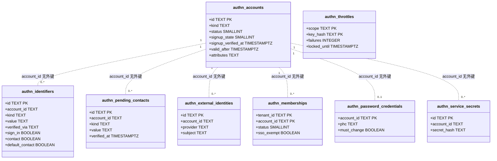
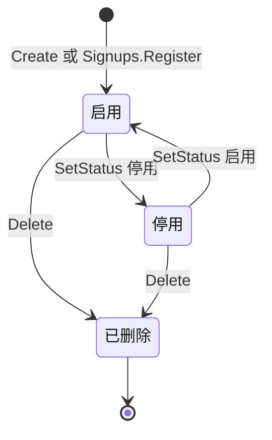
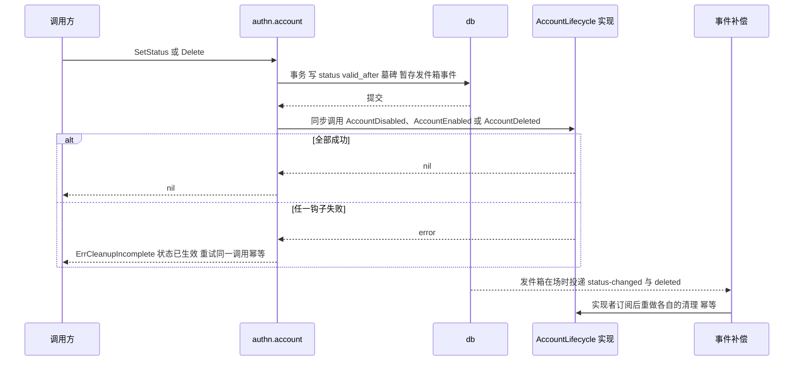
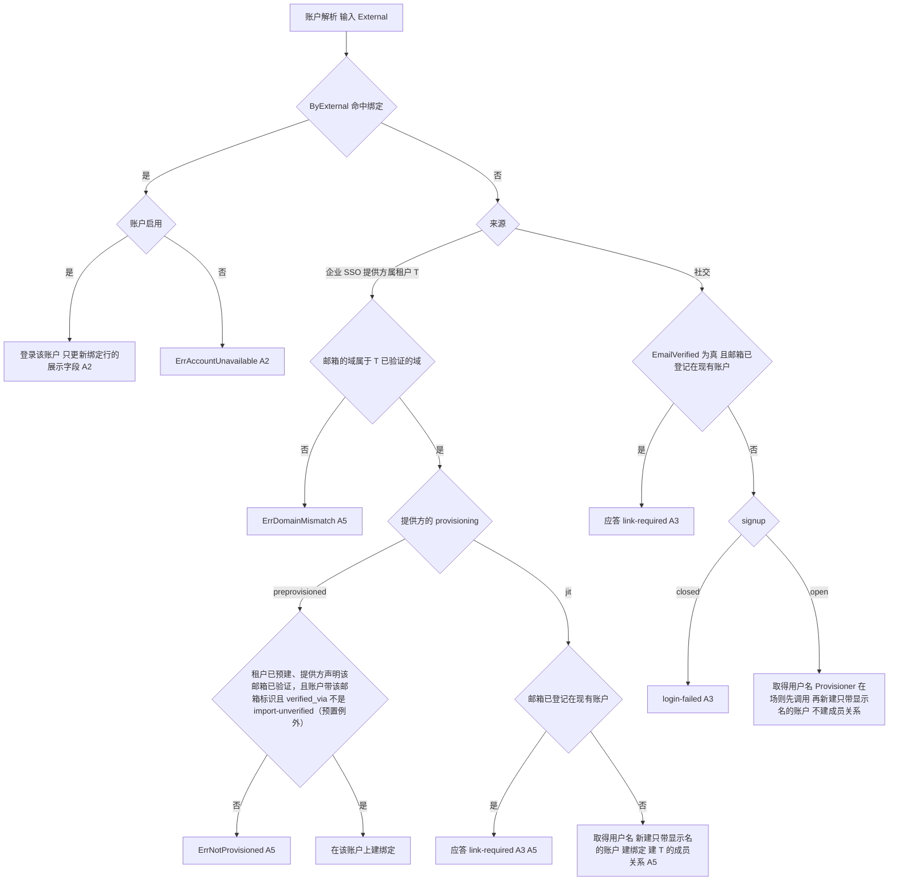

# authn-account

## 职责

`authn.account` 是 authn 的账户存储模块，包 `pkg/authn/account`，登记名 `authn.account`。

- 声明账户、标识、联系方式预留、外部身份绑定、成员关系、口令凭据、服务密钥与失败退避的表及其迁移集，启动时探测这些表是否存在；读写只经 `pkg/db`，其他 authn 子包经本模块的接口读写，授权功能目录经接口只读，都不直接读写这些表；表结构见[核心数据结构](#核心数据结构)。
- 排他交付 `Accounts`、`AccountAdmin`、`Signups`、`SignupVerification`、`Passwords`、`Memberships`、`MembershipCleanup`、`Throttle` 这些根包能力接口，每个接口各自是一个排他功能。
- 生成账户标识 `AccountID`（库里是 UUIDv7（[REF-rfc9562](../../../references.md)）文本），保证它不可变、不复用。
- 规范化标识：用户名、邮箱、手机在写入与查询两侧经同一个函数规范化；用户名还过保留字校验，校验只在写入口做。用户名一经写入，在账户存续期内不可删除、不可更换，删除用户名返回 `authn.ErrUsernameImmutable`；账户整体删除不受此限。
- 持有邮箱与手机的联系方式与登录方式：每条邮箱或手机记录恒为联系方式，另带持有人选择的登录方式标记，短信首登开户写下的手机在建号时即由系统置为登录方式，以及账户在已证明邮箱中的默认联系地址：账户有已证明邮箱时恰有一封，持有人未指定时取最早证明的那一封并可以改选，没有已证明邮箱时没有（REQ-account-061、REQ-account-063、REQ-account-064）。账户只有一条邮箱地址时，它在被证明后由系统选作登录方式，之后持有人可以取消，取消的门槛是账户仍留有别的登录方式（REQ-account-068、REQ-account-069）。社交与企业外部身份是一类独立的登录方式，列在登录方式中，不在联系方式中（REQ-account-067）。
- 校验口令类凭据：按标识查找并校验出示的口令，PHC（[REF-phc-string-format](../../../references.md)）解码与参数界限在校验内核对，未知标识、停用账户与无口令账户做等成本诱饵派生后统一返回 `ErrInvalidCredentials`，校验成功而库中条目弱于当前设置时就地再哈希；服务密钥按摘要比对。
- 执行账户的创建与状态迁移：创建、停用、启用、删除在本模块的事务里写自己的表，提交之后同步调用全部 `AccountLifecycle`。
- 执行成员关系的显式删除：删除之前询问全部可选的 `MembershipGuard`，提交之后同步调用全部 `MembershipLifecycle`。
- 维护失败退避：按 `ThrottleScope` 与键在 `authn_throttles` 里记录失败次数与解锁时刻，前 `throttle-free-attempts` 次失败不退避，之后每多一次失败退避 `min(throttle-max-delay, 2^(n-free) 秒)`，标识级与注册的 `signup-username` 退避经 `RetryAfter` 报告剩余等待，账户级退避静默计数，成功清零；`Start` 起的清扫协程删除 `last_failure_at` 早于 `now - throttle-decay` 且 `locked_until` 为空或已过的退避行，以及 `expires_at` 或 `revoked_at` 早于 `now - secret-retention` 的 `authn_service_secrets` 行。
- 承载外部身份绑定、首登开户、自助注册开户与账户解析的规则。规则约束的是本模块的数据（绑定、标识、联系方式记录、成员关系）与账户的会话和口令；首登开户的执行者是 `authn.login` 的账户解析步（[design-authn-login](design-authn-login.md)），自助注册开户经本模块的 `Signups.Register`。

选型与取舍见 [ADR-authn-accounts](../../../adr/adr-authn-accounts.md)、[ADR-authn-account-lifecycle](../../../adr/adr-authn-account-lifecycle.md)、[ADR-authn-external-binding](../../../adr/adr-authn-external-binding.md)、[ADR-authn-password-hash](../../../adr/adr-authn-password-hash.md)、[ADR-authn-throttling](../../../adr/adr-authn-throttling.md)、[ADR-authn-signup](../../../adr/adr-authn-signup.md)、[ADR-authn-contact-claim](../../../adr/adr-authn-contact-claim.md)、[ADR-authn-contact-and-login-ways](../../../adr/adr-authn-contact-and-login-ways.md)；模块在 authn 里的位置与依赖图见 [design-authn](design-authn.md)。

### 非职责

- **不建立登录会话，不签发令牌。** 会话归 `authn.session`，令牌归 `authn.token`；本模块只在账户创建与状态迁移之后调用它们实现的 `AccountLifecycle`（[design-authn-session](design-authn-session.md)、[design-authn-token](design-authn-token.md)）。
- **不做授权。** 本模块的成员关系只回答「账户是否属于某租户」；角色按（账户，租户）绑定，归 `authz.policy`（[design-authz](../design-authz.md)），它经 `Memberships` 读成员关系，不读 `authn_memberships` 表。
- **不 import `pkg/tenant`。** 租户标识在本模块里是字符串；成员关系的请求期判定归 `tenant.admission`，它在 tenant 目录里经 `Memberships` 读取（[design-tenant-admission](../tenant/design-tenant-admission.md)）。
- **不写别的模块的表。** 会话、因素、短信挑战各归 `authn.session`、`authn.mfa`、`authn.sms`；跨模块的清理走 `AccountLifecycle`、`MembershipLifecycle` 与事件，不进账户事务。
- **不挂路由，不实现登录方式。** 登录路由与账户解析归 `authn.login`，自助与管理路由归 `authn.login`、`authn.session`、`authn.mfa`、`authn.admin` 各自的处理器；本模块只交付它们调用的接口。
- **注册是用户名＋口令＋邮箱的匿名请求，开户后验证邮箱（REQ-signup-004、REQ-signup-028）。** 本模块不为短信首登、社交登录与企业 JIT 新增开户路径，但新增自助注册的开户入口 `Signups.Register`：一次事务写入启用的账户、`via = self` 的用户名标识、口令凭据与一条邮箱未证明预留。这条预留不是标识，既不作登录方式，也不作默认联系地址，也不是联系方式；证明之后登录方式仍由持有人选择，账户此前没有默认联系地址时证明的那一封自动成为默认联系地址（REQ-signup-007、REQ-account-062、REQ-account-063）。注册路由归 `authn.login`，邮箱验证复用已认证账户的自助回路，只有邮箱被证明才解除限制（REQ-signup-026；[ADR-authn-signup](../../../adr/adr-authn-signup.md)）。口令账户也可由管理面或宿主代码创建。**验证状态的判定不区分账户来源**（REQ-signup-023、REQ-account-015）：本模块按同一条判据读同一个状态，不为来源开例外。
- **不解析手机号，不做口令泄露库比对，不折叠邮箱别名。** 手机号只接受 E.164（[REF-itu-t-e164](../../../references.md)），转换由客户端做。
- **不替宿主保存资料字段。** 账户表不留自由字段，宿主扩展字段的途径见[扩展点](#扩展点)。
- **不拥有口令表（`authn.static.subjects`）的退避与缓存。** 口令表与本模块共用 `pkg/authn/internal/password` 里的 PHC 编解码与派生，但不依赖本模块、不读 db（[design-authn-gate](design-authn-gate.md)）。

## 术语表

| 术语 | 英文 | 适用范围 | 定义 |
|---|---|---|---|
| 标识 | identifier | 本文 | `Identifier`：账户对一条用户名、邮箱或手机的所有权记录，带验证时刻与验证渠道，以及「联系方式」与「登录方式」两个标记；邮箱与手机标识恒为联系方式，用户名标识恒为登录方式。与账户标识不是一回事。 |
| 联系方式 | contact | 本文 | 账户的一条邮箱或手机记录上的标记，表示该值是账户的联系信息；邮箱与手机从登记起恒为该值，无论所有权是否已证明，也无论它是否作登录方式（REQ-account-061）。 |
| 登录方式 | login method | 本文 | 账户的一条邮箱或手机记录上的标记，表示该值可用于登录；用户名恒是登录方式，外部身份与通行密钥也是登录方式，但不在这条标记里（REQ-account-064、REQ-account-067）。 |
| 默认联系地址 | default contact address | 本文 | 账户在已证明邮箱中的、用于接收通知的那一封：账户有已证明邮箱时恰有一封，没有时没有；持有人未指定时取最早证明的那一封，并可以改选（REQ-account-063）。 |
| 登录名 | login name | 本文 | 口令登录接受的标识：用户名，或被选作登录方式的邮箱；手机号不作口令登录名（REQ-signin-006）。 |
| 真实证明 | proof | 本文 | 验证渠道 `sms-code`、`email-code`、`invite` 与 `idp:<提供方标识>`：短信验证码证明了手机，发到地址的验证码被兑现，证明了这个地址，送达被邀请地址的链接被兑现，提供方声明了已验证邮箱。 |
| 未证明渠道 | unproved channel | 本文 | 验证渠道 `admin`、`import-unverified` 与 `self`：只记录事实，不是邮箱所有权的证明。 |
| 未验证账户 | unverified account | 本文 | 持有邮箱而没有一条真实证明邮箱的用户账户，即 `SignupStateOf` 读 `SignupPending` 的账户。没有邮箱的账户不是未验证账户，本规则不拦截它。 |
| 墓碑 | tombstone | 本文 | 账户被删除后保留的一行：只含 `id`、`kind`、`status`、`created_at`、`deleted_at`，个人数据已抹除。 |
| 保留用户名 | reserved username | 本文 | 取值落在内置清单与设置 `authn.account.reserved-usernames` 的并集里的用户名。命中保留用户名的拒绝是取值禁用，被占用的拒绝是唯一约束冲突。 |

## 外部接口契约

### 交付的功能

`authn.account` 在 `Provides` 里声明下列根包接口，每个都是排他功能：宿主漏点名账户模块，依赖它的模块在任何实例构造之前报 `core.ErrMissingProvider`。模块的 `Prepare` 只表态 `StateEnabled`，不表态 `StateAuto`：是否运行是命令树上的决定。

| 功能 | 说明 | 主要调用方 |
|---|---|---|
| `Accounts` | 只读 | `authz.policy`、宿主、`authn.session`、`authn.token`、`authn.login`、`authn.admin` |
| `AccountAdmin` | 写 | `authn.login`、`authn.admin`、宿主的命令行 |
| `Signups` | 自助注册开户 | `authn.login` |
| `SignupVerification` | 只读 | `authn.profile`、`authn.admin`、`authn.impersonation`、`authn.login`、`authn.invite`、`authz.admin`、`settings.admin`、`tenant.admin`、宿主 |
| `Passwords` | 口令与服务密钥的校验与写入 | `authn.login.password`、`authn.token`、`authn.login` |
| `Memberships` | 成员关系的读写 | `tenant.admission`、`authn.login`、`authn.impersonation`、`authn.admin`、`authz.policy` |
| `MembershipCleanup` | 账户删除收尾的成员关系清理 | 宿主 |
| `Throttle` | 失败退避的存取 | `authn.login`、`authn.login.password`、`authn.mfa`、`authn.token` |

调用方列表是例举，不是封闭集；判据是调用方在 `Requires` 或 `Init` 里取用了对应接口。

本模块交付的接口受同一模块各能力接口方法名两两不相交的规则约束，规则与理由见 [design-authn](design-authn.md#扩展点)。本模块的具体核对结果：`Memberships` 的读单条叫 `Membership`、写叫 `Put`，不叫 `Get`、`Set`，避免与 `Accounts.Get`、`Passwords.Set` 相撞。

### Accounts

```go
type Accounts interface {
	Get(ctx context.Context, id AccountID) (Account, error)
	Lookup(ctx context.Context, kind IdentifierKind, value string) (AccountID, error)
	ByExternal(ctx context.Context, provider, subject string) (AccountID, error)
	Identifiers(ctx context.Context, id AccountID) ([]Identifier, error)
	IdentifiersMany(ctx context.Context, ids []AccountID) (map[AccountID][]Identifier, error)
	Externals(ctx context.Context, id AccountID) ([]ExternalBinding, error)
	List(ctx context.Context, q AccountQuery) ([]Account, string, error)
	ListServiceSecrets(ctx context.Context, id AccountID) ([]ServiceSecretInfo, error)
}
```

| 方法 | 承诺 |
|---|---|
| 全部 | 账户不存在（含墓碑）返回 `ErrAccountNotFound`。 |
| `Lookup` | `value` 先规范化；规范化失败返回 `ErrInvalidIdentifier`；按 `authn_identifiers` 的 `(kind, value)` 唯一索引查找。它回答一条已登记值属于哪个账户，不按 `sign_in` 过滤；登录方式的选择由解析方按标记判定（见 `Passwords.Verify` 与「外部身份绑定与账户解析的规则」）。 |
| `ByExternal` | 以（提供方，主体）为键，不以邮箱为键。 |
| `Identifiers`、`IdentifiersMany` | 单条读按 `created_at`、`id` 排序返回一个账户的标识。批量读一次取回一组账户的标识，只为存活账户给条目，条目内容与单条读对该账户的返回相同：同一排序、同一字段，`Contact`、`SignIn` 与 `DefaultContact` 因此由同一事实派生，`proven` 仍由 `VerifiedVia` 派生。未知账户与墓碑不给条目，也不返回 `ErrAccountNotFound`——一页里有一行被删不使整页失败；调用方把缺席视为「没有标识」。空输入返回空映射，不执行语句。 |
| `List` | 返回下一页游标，空串表示没有下一页。墓碑默认不返回，要看须显式给 `StatusDeleted`。无标识过滤时 `WHERE id > ? ORDER BY id LIMIT n`，走 `authn_accounts` 主键，次序近似创建次序；有标识过滤时先在 `authn_identifiers` 的 `(kind, value)` 唯一索引上取 `value >= 前缀 AND value < 前缀的上界`（范围比较，PostgreSQL 与 SQLite 通用，不用 `LIKE`），再回表按 `id` 排序分页。标识前缀已规范化、至少 3 个字符，防止全表扫描；有显示名前缀过滤时按 `display_name >= 前缀 AND display_name < 前缀的上界` 的范围比较取（同样不用 `LIKE`），前缀是存储值的字节前缀、大小写敏感、不设最短长度，范围两端按字节比较（PostgreSQL 上比较钉在 `C` 排序规则，不随库的默认排序规则折叠大小写与重音；SQLite 本就按字节比较）；上界是前缀的最后一个字符进一位（最后一个字符是 U+D7FF 时跳过代理码点取 U+E000，使上界仍是紧确的最小合法后继），对任何输入都是合法 UTF-8；前缀的每个字符都是最高码点（如 U+10FFFF）时不存在上界，此时只保留下界比较 `display_name >= 前缀`；前缀不是合法 UTF-8 时上界为空串，范围收空、读取接口不选中任何名字（管理路由以 400 拒绝）。而 `authn_accounts` 上没有覆盖 `display_name` 的索引，这条过滤因此扫全表（见[非保证](#非保证)）；`Limit` 缺省 100、上限 1000。 |
| `ListServiceSecrets` | 只交回标识、标签、期限与撤销状态，从不含密钥。 |

`Accounts` 没有账户的批量读：按一组账户标识取多个账户要逐个 `Get`。需要一次取多个账户的展示信息（成员页、联系人属主）的调用方自己组织这些读取，本接口不提供 `GetMany` 一类方法。`IdentifiersMany` 取的是标识、不是账户，不改变这一条。

### AccountAdmin

```go
type AccountAdmin interface {
	Create(ctx context.Context, in CreateAccount) (Account, error)
	SetStatus(ctx context.Context, id AccountID, s AccountStatus, reason string) error
	Delete(ctx context.Context, id AccountID, reason string) error
	SetDisplayName(ctx context.Context, id AccountID, name string) error
	SetAttributes(ctx context.Context, id AccountID, attrs map[string]string) error
	SetProtected(ctx context.Context, id AccountID, protected bool) error
	SetMFARequired(ctx context.Context, id AccountID, required bool) error
	AddIdentifier(ctx context.Context, id AccountID, kind IdentifierKind, value string, via Verification) error
	RemoveIdentifier(ctx context.Context, id AccountID, identifierID string) error
	SetIdentifierFlags(ctx context.Context, id AccountID, identifierID string, flags IdentifierFlags) error
	SetDefaultContact(ctx context.Context, id AccountID, identifierID string) error
	LinkExternal(ctx context.Context, id AccountID, l ExternalLink) error
	UnlinkExternal(ctx context.Context, id AccountID, externalID string) error
	HasLoginWayOtherThanPasskey(ctx context.Context, id AccountID) (bool, error)
	CreateServiceSecret(ctx context.Context, id AccountID, label string, expires *time.Time) (secretID, secret string, err error)
	RevokeServiceSecret(ctx context.Context, id AccountID, secretID string) error
	Touch(ctx context.Context, id AccountID, at time.Time) error
}
```

`AccountAdmin` 是写入接口，调用方是 authn 自己的模块与宿主的命令行；管理路由在它之上，先过 `Decider`（[design-authn-admin](design-authn-admin.md)）。

| 方法 | 承诺 |
|---|---|
| `Create` | 写入启用状态的账户，`signup_state = 0`。邮箱与手机须带一个合法的验证渠道，分别由 `EmailVerifiedVia` 与 `PhoneVerifiedVia` 给出（短信首登开户取 `sms-code`），没有「待验证」的行；渠道是否构成归属证明不影响写入，只决定该标识的 `proven`。新写入的邮箱与手机标识都是联系方式，`contact` 恒为真；`sign_in` 为假，由持有人另经 `SetIdentifierFlags` 选择（REQ-account-061、REQ-account-062、REQ-account-064）；用户名标识恒为登录方式、不作联系方式。例外情形：以 `sms-code` 写下的手机来自短信首登开户，它是那次登录签入所用的方式，建号时 `sign_in` 为真，持有人之后可以取消登录方式（REQ-account-014、REQ-account-064）；建号时账户只有这一条邮箱地址、且它以 `Proves` 为真的渠道写下时，该邮箱建号即 `sign_in` 为真——社交首登开户的 `idp:<提供方标识>` 地址即属这一种（REQ-account-068、REQ-signup-048）；以 `Proves` 为真的渠道（`email-code`、`idp:<提供方标识>` 或 `invite`）写下的邮箱，在同一事务里成为默认联系地址，未证明的邮箱不能作默认联系地址（REQ-account-063、REQ-account-066）。导入路径写入的账户经 `EmailFlags`、`PhoneFlags` 与 `DefaultContact` 按源记录设置登录方式与默认联系地址：写下的邮箱与手机恒为联系方式，按源记录可登录，不回溯改写源记录之外的事实（REQ-signup-050）；源记录没有点名默认联系地址而写下的邮箱已证明时，该邮箱成为默认联系地址。经 `admin` 或 `import-unverified` 写下的邮箱标识与未证明预留一样视为「有邮箱而未验证」，账户因此受限，直到 `AddIdentifier` 以证明渠道就地提升该行。`Username` 为空只在 `Kind = service` 的服务账户上成立（以服务密钥登录，用户名不作它的登录方式）；`Create` 写入用户账户的每一条路径——管理面预置、初始装配、首登开户、邀请受理与导入——缺用户名拒绝建户（`ErrInvalidIdentifier`）。非空时先经 `NormalizeIdentifier` 规范化并过保留字校验，任一失败拒绝建户（`ErrInvalidIdentifier`、`ErrUsernameReserved`）。用户名标识的验证渠道取 `UsernameVerifiedVia`，零值按 `admin`，该字段供宿主或导入创建账户时标注用户名的来源；首登开户与邀请受理经本方法写入用户名时取 `self`。自助注册不调用 `Create`：`Signups.Register` 在自己的事务里写 `via = self` 的用户名标识与 `signup_state = 1`；自助添加用户名经 `AddIdentifier`（`via = self`）。`Password` 与 `PasswordHash` 二选一，`Password` 经口令策略校验，`PasswordHash` 是 PHC 或遗留格式、供导入用；`ID` 留空则生成，仅导入用，管理面路由不暴露它；`Via` 取 `admin`、`jit`、`signup`、`import`，写进事件载荷。标识、登录名或绑定违反唯一约束返回 `ErrAccountExists`；邮箱地址已在 `authn_pending_contacts` 中被别的账户预留或持有返回 `ErrContactTaken`，邮箱标识与已经证明的预留在同一事务里成对写入。`signup_state = 0` 使该账户永不被未验证账户的清理选中。提交之后调用全部 `AccountLifecycle.AccountCreated`，失败返回 `ErrCleanupIncomplete`。 |
| `SetStatus`、`Delete` | 在本模块事务里写 `status`、`valid_after`、墓碑与暂存的发件箱事件；事务提交之后同步调用全部 `AccountLifecycle`，清理失败返回 `ErrCleanupIncomplete`：状态已生效，重试同一调用幂等地补完清理。迁移表见[账户状态与生命周期](#账户状态与生命周期)。两者的 `reason` 形参取自 [authn-events](design-authn-events.md) 的 `ReasonClass` 闭集；签名是 `string`，没有类型约束，靠调用方与 `ValidReasonClass` 保证，它随 `authn.account.status-changed` 以 `reason_class` 写入载荷。`Sessions.Revoke` 的 `reason` 同此。 |
| `SetDisplayName` | 至多 100 个字符。 |
| `SetAttributes` | 受[属性集的限制](#扩展点)约束；经 `Identity.Attribute` 只读到达所有层。 |
| `SetProtected` | 为真的账户不得被冒充，不依赖 `Decider`（[design-authn-impersonation](design-authn-impersonation.md)）。 |
| `AddIdentifier`、`RemoveIdentifier` | 标识先规范化；`kind = username` 时规范化之后再过一遍保留字校验，命中返回 `ErrUsernameReserved`，与 `ErrInvalidIdentifier` 同答 400 `bad-request`；`via` 取值限于 `sms-code`、`email-code`、`invite`、`idp:<提供方标识>`、`admin`、`import-unverified`、`self` 这一封闭集合，其余拒绝。`idp:` 后的提供方标识是 1 到 64 字节、字符集 `[A-Za-z0-9._-]`（与 `AccountID` 同一字符集），越出即 `ErrInvalidArgument`。`email-code` 与 `self` 由自助添加标识的路由写下（[design-authn-login](design-authn-login.md)），`invite` 由邀请接受的兑现写下（[design-authn-invite](design-authn-invite.md)）。`AddIdentifier` 写入邮箱标识时——无论 `via` 是哪一个——都在同一事务里写入或提升该地址的联系方式预留：本账户已有的同值预留置为已持有，没有则插入一条已持有的预留；预留属于别的账户返回 `ErrContactTaken` 并回滚。账户已经持有同值邮箱标识时就地改写该行，不插入第二行、不发布标识变更事件、返回 nil：以 `Proves` 为真的渠道写入是**幂等证明**，重写该行的 `verified_at` 与 `verified_via`；以 `admin`、`import-unverified` 或 `self` 写入时，该行已有证明则保持原 `verified_at` 与 `verified_via` 不变，尚未证明则改写成这次写入的渠道。同值手机标识遵循同一条规则：`Proves` 为真的渠道重写该行，未证明渠道只在原行尚未证明时改写它，已有证明的手机行不被降级。其中 `Proves` 为真的邮箱标识——`email-code`、`idp:<提供方标识>`，或命中同一未证明预留的 `invite`——在首次证明该行时写 `signup_verified_at`（任何账户都写，`0` 与 `2` 一视同仁），`signup_state` 为 `1` 时同时置 `2`；`admin`、`import-unverified` 与 `self` 不改变 `signup_state`，也不写 `signup_verified_at`。写入手机标识（`sms-code`）时删除同值的待验证目标，但不改变 `signup_state`，也不写预留。`RemoveIdentifier` 删除 `kind = username` 的标识一律拒绝，在事务内返回 `authn.ErrUsernameImmutable`，删除不生效，对外答 409 `username-immutable`；用户名在账户存续期内不可删除、不可更换，没有改名操作，账户整体删除不受此限（REQ-account-070、[ADR-authn-username-permanent](../../../adr/adr-authn-username-permanent.md)）。标识不存在时返回 nil。删除邮箱标识时在同一事务里删除该地址的预留，地址随即释放；删的是默认联系地址时，同一事务把它转给剩余已证明邮箱中最早证明的一封（同一时刻按标识 ID 取第一个），没有剩余时清空该选择；删除最后一个 `Proves` 为真的邮箱时，若 `signup_state` 为 2 则回到 1，但保留 `signup_verified_at`，也不重建预留；写入手机从不把它拉回 2。带口令凭据的账户删除最后一个被选作登录方式的 email 标识时，`RemoveIdentifier` 在事务内返回 `ErrIdentifierRequired` 并回滚，这条规则先于下一条；最后登录名保护只约束被选作登录方式的邮箱，正常写入下账户总有用户名，这条规则只在绕过写入接口、库中没有用户名的行上可达（REQ-account-044）。删除任何标识后，账户若不再持有口令凭据、被选作登录方式的已验证手机号与外部身份中的任何一种，返回 `ErrLastLoginMethod` 并回滚，通行密钥不算，未证明或未被选作登录方式的手机号不算。证明本身不改变 `contact` 与 `sign_in`：登记即联系方式，`contact` 恒为真；新写入的行 `sign_in` 为假，由持有人另经 `SetIdentifierFlags` 选择（REQ-account-062、REQ-account-064）。例外是账户唯一的邮箱地址：一条邮箱标识首次被证明后，若账户此刻只有这一条邮箱地址，同一事务把它置为 `sign_in = TRUE`——持有人没有可比较的对象，选择无从发生，而这条地址正是「社交地址已属于某个账户、请用原来的方式登录后再绑定」这条恢复路径要用的登录名（REQ-account-068）。账户此后登记第二条邮箱地址不改变这条已经作出的选择；手机不适用本例外。默认联系地址由账户维护：以 `Proves` 为真的渠道写入邮箱且账户此前没有已证明邮箱时，同一事务把它置为默认联系地址；账户已有默认时不改动，持有人可另经 `SetDefaultContact` 改选（REQ-account-063）。 |
| `SetIdentifierFlags` | 只对这一账户的一条邮箱或手机标识生效；登记即联系方式，`Contact` 为假返回 `ErrInvalidArgument`，为真不改变任何事实；`SignIn` 为真要求该行 `Proves` 为真，未证明行只能取假。用户名恒是登录方式，不接受本方法。`SignIn` 置假导致账户不再持有口令凭据、被选作登录方式的已验证手机号与外部身份中的任何一种时，按 `RemoveIdentifier` 的规则返回 `ErrLastLoginMethod` 并回滚；带口令凭据的账户因此失去最后一个被选作登录方式的邮箱时返回 `ErrIdentifierRequired`，正常写入下账户总有用户名，这条规则只在绕过写入接口、库中没有用户名的行上可达。标识不属于该账户或不是邮箱、手机时返回 `ErrInvalidArgument`。 |
| `SetDefaultContact` | 只对这一账户的一条已证明邮箱标识生效：把它记为默认联系地址，同一事务清除同一账户此前的选择；不改变 `contact` 与 `sign_in`。不是该账户的已证明邮箱时返回 `ErrInvalidArgument`。账户没有已证明邮箱时没有默认联系地址；账户首条已证明邮箱出现时由 `Create`、`AddIdentifier` 或导入建立默认联系地址，不需要本方法。 |
| `LinkExternal` | 该（提供方，主体）已被别的账户占用返回 `ErrBindingConflict`。 |
| `UnlinkExternal` | 解绑之后账户至少还剩一种非因素的登录方式（口令、被选作登录方式的已验证手机号、另一条绑定），否则返回 `ErrLastLoginMethod`。 |
| `CreateServiceSecret` | 密钥是 256 位随机数，前缀 `spd_cs_`，库里只存 SHA-256；明文只在返回值里出现一次。 |
| `RevokeServiceSecret` | 写 `revoked_at`；提交之后调 `AccountLifecycle.ServiceSecretRevoked`，失败同样返回 `ErrCleanupIncomplete`。 |
| `Touch` | 写 `last_login_at`，走原生 SQL，不产生审计行。 |

### Signups

```go
type Signups interface {
	Register(ctx context.Context, in RegisterAccount) (Account, error)
}
```

| 方法 | 承诺 |
|---|---|
| `Register` | 读设置 `authn.account.password-signup`，取值不是 `open` 时返回 `ErrSignupClosed`；设置存储缺席按声明的缺省 `closed` 处理。**这里的判定是注册开关的权威检查**：注册路由与发现端点读同一个键只作预检查，便于在参数校验之前早拒，不替代本方法的判定，也不构成第二处权威。用户名与邮箱先规范化，规范化失败返回 `ErrInvalidIdentifier`；用户名随后过保留字校验，命中返回 `ErrUsernameReserved`，不计一次 `signup-username` 失败；口令经口令策略校验。查用户名之前先按 `ThrottleScope` 的 `signup-username` 读一次退避（键是规范化用户名的摘要），退避中返回 `ErrThrottled`（429）；再按 `authn_identifiers` 的 `(kind, value)` 唯一索引查用户名是否已被占用，占用时计一次失败并返回 `ErrAccountExists`；两者都在口令派生之前，避免对必然失败的请求做 Argon2（[REF-rfc9106](../../../references.md)）。一次事务写入启用的账户（`signup_state = 1`）、`via = self` 的用户名标识、口令凭据与一条 `email` 未证明预留；这条预留不是标识，既不作登录方式，也不作联系方式或默认联系地址（REQ-signup-007）；预留的插入是地址的唯一仲裁点，唯一索引冲突返回 `ErrContactTaken` 并回滚整个事务，注册不在插入之前读邮箱占用。不写任何待验证的标识行，不发送邮件，不建立会话；成功后把 `signup-username` 的失败计数清零，提交之后调用全部 `AccountLifecycle.AccountCreated`，失败返回 `ErrCleanupIncomplete`。开户事件 `authn.account.created` 的 `via` 取 `signup`。派生受独立的并发名额约束（`authn.account.signup-concurrency`，见 [design-authn-config](design-authn-config.md)），不另设内存预算，单次派生的内存由该名额的上界约束；名额耗尽返回 `ErrBusy`（503），不占口令登录的并发名额。 |

### SignupVerification

```go
type SignupVerification interface {
	SignupStateOf(ctx context.Context, id AccountID) (SignupStatus, error)
	PendingAccountByContact(ctx context.Context, kind string, value string) (accountID string, ok bool, err error)
}
```

| 方法 | 承诺 |
|---|---|
| `SignupStateOf` | 请求期活读，不读账户快照缓存，也不读 `signup_state` 列：判定从标识与联系方式预留现算，因此对每一个 `KindUser` 账户成立，与它的创建路径无关。`SignupStatus.State` 的判据是二值的：账户持有至少一条 `Proves` 为真的邮箱标识即 `SignupVerified`；否则持有任何邮箱——一条 `Proves` 为假（`admin`、`import-unverified`、`self`）的邮箱标识，或一条 `verified_at` 为空的邮箱预留——即 `SignupPending`；两者都没有（没有任何邮箱）即 `SignupNone`。`KindService` 账户读 `SignupNone`。`Email` 是当前状态下的邮箱：`SignupVerified` 取 `Proves` 为真且 `VerifiedAt` 最早的邮箱、同一时刻按标识 ID 排序取第一个；`SignupPending` 取未证明的邮箱标识与未证明预留中创建时刻最早的一条，同一时刻按行标识排序取第一个；`SignupNone` 为空。`Since` 是 `signup_verified_at`，从未证明过邮箱时为零值，`1` → `2` → `1` 之后仍是首次进入 `2` 时的时刻；`SignupVerified` 而该列为空时（经证明渠道直接写下邮箱、`signup_state` 从未置 `2` 的账户）取最早那条证明标识的 `VerifiedAt`。判定只读所有权证明，不读 `contact`、`sign_in` 或默认联系地址；登录方式的选择不改写验证状态（REQ-account-062）。账户不存在返回 `ErrAccountNotFound`，db 不可用返回 `ErrUnavailable`。读取失败不得按 `SignupNone` 放行：调用方答 503。 |
| `PendingAccountByContact` | 只读反查 `authn_pending_contacts`：`kind` 取 `email` 或 `phone`，`value` 先规范化（失败返回 `ErrInvalidIdentifier`），按（`kind`, `value`）找未证明预留，只在所有者是 `signup_state = 1` 的账户时返回该账户标识且 `ok` 为真。`(kind, value)` 的全局唯一索引使同一地址至多一条预留，因此命中至多一个所有者；未命中、或唯一索引之外的写入造出多个所有者时 `ok` 为假，不猜归属。db 不可用返回 `ErrUnavailable`。**唯一调用方是 `authn.invite` 的接受路径**，参数是邀请令牌已经证明控制权的邮箱。安全前提是这条控制权：令牌被送达该地址并由持有者出示，与本模块的 `sms-code` 同类；返回的账户标识让调用方能在该账户上写已验证标识与成员行，所以调用方不得用未经证明控制的地址调用它。调用方把读取失败答 503，不按未命中处理：把读失败读成未命中会让接受路径新建第二个账户。 |

`PendingAccountByContact` 只回答「这条未证明预留属于谁」，不读 `authn_identifiers`——地址已经是某账户标识的情况由 `Accounts.Lookup` 覆盖，邀请接受先查 `Lookup`、未命中才用本方法反查。两个方法都是请求期活读，不读账户快照缓存。

### Passwords

```go
type Passwords interface {
	Verify(ctx context.Context, identifier, password string) (AccountID, VerifyResult, error)
	Set(ctx context.Context, id AccountID, password string, opt SetPasswordOptions) error
	Clear(ctx context.Context, id AccountID) error
	ImportHash(ctx context.Context, id AccountID, encoded string, mustChange bool) error
	VerifyServiceSecret(ctx context.Context, clientID, secret string) (account AccountID, secretID string, expires time.Time, err error)
}

type VerifyResult struct{ MustChange bool }

type SetPasswordOptions struct {
	Current           string // 自助改口令时的当前口令
	MustChange        bool   // 置 must_change；管理员重置缺省真
	By                string // 事件归因：self、admin 或 reset；空按 Current 有无推断
	Channel           string // 事件载荷的 channel：email 或 sms；非重置路径为空
	RequireActive     bool   // 写事务内要求账户仍为启用
	RequireExisting   bool   // 写事务内要求账户已有口令凭据，不新建
	RequireIdentifier string // 写事务内要求这条标识行仍属于该账户
	AdvanceValidAfter bool   // 写事务内把 valid_after 推进到本秒之后
}
```

`By` 的取值是封闭集 `self`、`admin`、`reset`；空表示按 `Current` 有无推断——非空记 `self`，空记 `admin`。`import` 不在 `Set` 的取值内，由 `ImportHash` 发出。`Channel` 只取 `email` 或 `sms`，作为 `authn.password.changed` 载荷的 `channel`；它与 `By=reset` 互为充要——重置必须点名渠道，非重置路径不得携带渠道，两条都不满足时返回 `ErrInvalidArgument`。`RequireActive`、`RequireExisting` 与 `RequireIdentifier` 在写事务内复核账户状态、凭据行与标识行，任一不满足返回 `ErrAccountUnavailable`；`AdvanceValidAfter` 用 `laterOf(valid_after, ceilSecond(now))` 推进账户的 `valid_after`，使既有会话在会话状态缓存过期后失效。重置后的新登录落在同一秒内时，会话时间戳可能早于 `valid_after` 而被判无效，最长约一秒；客户端重试即可，这一秒窗口是 `ceilSecond` 的代价。

| 方法 | 承诺 |
|---|---|
| `Verify` | `identifier` 先规范化：含 `@` 按邮箱，否则按用户名；手机号不作口令登录名。邮箱只有在其标识行的 `sign_in` 为真时才可作口令登录名：已登记并已证明但未被选作登录方式的邮箱按凭据不成立处理，与未知标识一致（REQ-signin-006、REQ-account-064）；提供方声明的地址只有在该标记为真时才是口令登录名，账户唯一的邮箱地址在被证明后由系统置真（REQ-account-068、REQ-signin-038）。对未知标识、停用账户、无口令账户，先做一次与当前参数等成本的诱饵派生，再统一返回 `ErrInvalidCredentials`。已知账户上的账户级失败退避在此静默计数，到阈值后照常派生并返回 `ErrInvalidCredentials`，不返回 429（[失败退避](#失败退避)）。成功时 `VerifyResult.MustChange` 为真表示凭据带 `must_change`，口令方法据此要求先设新口令。 |
| `Set` | 经口令策略校验，违反返回 `ErrPasswordPolicy`；新口令不得与当前口令相同。`By` 非空时作为 `authn.password.changed` 的 `by`，为空按 `Current` 有无推断；`Channel` 作为同一事件的 `channel`。`RequireActive`、`RequireExisting` 与 `RequireIdentifier` 在写事务内复核账户状态、凭据行与标识行，不满足返回 `ErrAccountUnavailable`；`AdvanceValidAfter` 在同一事务里推进 `valid_after`。`Set` 不撤销任何会话：撤销会话是调用方在 `Set` 成功之后调 `Sessions.RevokeAccount` 的事，改口令的处理器传 `except = 当前会话`，匿名口令重置的处理器不传、撤销该账户全部 browser 与 token 会话。 |
| `Clear` | 删除该账户的口令凭据，使账户没有口令、须重设。幂等：没有凭据返回 nil。自动并入不再发生，登录引擎不再在登录路径上调用它。 |
| `ImportHash` | 把 PHC 或遗留条目写成账户的口令凭据；遗留条目无损转成 PHC（盐与密钥的字节相同，只改外壳）。 |
| `VerifyServiceSecret` | 按 `SHA-256(secret)` 取未撤销、未过期的行；行里的账户标识与出示的 `clientID` 常量时间相等，且账户是启用的 `service`。返回账户标识、密钥标识与到期时刻（零值表示不过期）。 |

### Memberships

```go
type Memberships interface {
	IsMember(ctx context.Context, id AccountID, tenant string) (bool, error)
	Membership(ctx context.Context, tenant string, id AccountID) (Membership, bool, error)
	Tenants(ctx context.Context, id AccountID) ([]Membership, error)
	Members(ctx context.Context, tenant string, query MemberQuery) ([]Membership, error)
	Put(ctx context.Context, m Membership) error
	Remove(ctx context.Context, id AccountID, tenant string) error
}
```

| 方法 | 承诺 |
|---|---|
| 读法 | 查不到与已暂停都视为非成员（`Active` 的零值是暂停）。口令表主体没有成员关系行，`IsMember` 对它恒为假。 |
| `Tenants` | 跨租户列出账户的全部成员关系，按租户标识升序；按 `authn_memberships_account` 索引走。 |
| `Members` | 按租户分页，`Limit` 缺省 100、上限 1000。`MemberQuery.Query` 非空时收窄到账户显示名的字节前缀，或登录标识值在查询串小写后的前缀；两类匹配都不改变按账户标识升序的分页与游标。 |
| `Put` | 幂等：新增、暂停、恢复。账户不存在（含墓碑）返回 `ErrAccountNotFound`：表间没有外键，由本方法核对。 |
| `Remove` | 删除一条成员关系。删除之前先取每个可选 `MembershipGuard` 的租户删除锁（多个守卫接同一个 `authz.TenantLock` 对象时只取一次），再问每一个守卫，任何一个拒绝即拒绝：会让租户不再有任何租户管理员绑定时以 `ErrLastTenantAdmin` 拒绝，宿主守卫按它自己的政策拒绝，都不删行；没有行可删时不问，锁仍先取再放。锁取不到以 `ErrUnavailable` 返回，守卫不问、行不删。事务提交之后同步调用全部 `MembershipLifecycle.MembershipRemoved`，失败返回 `ErrCleanupIncomplete`（删除已生效，重试同一调用幂等地补完）。账户删除不走本方法，因而不问守卫，也不调成员关系生命周期钩子（见下）。 |
| 实现 | 每条语句显式写 `tenant_id`；`authn_memberships` 由 `Memberships` 的实现独占，`authz.policy` 与准入层经接口读，不直接读表。 |

### Throttle

```go
type ThrottleScope string

const (
	ScopeIdentifier     ThrottleScope = "identifier"
	ScopeAccount        ThrottleScope = "account"
	ScopeFactor         ThrottleScope = "factor"
	ScopePhone          ThrottleScope = "phone"
	ScopeClient         ThrottleScope = "client"
	ScopeSignupUsername ThrottleScope = "signup-username" // 匿名注册按规范化用户名的摘要
)

type Throttle interface {
	Check(ctx context.Context, scope ThrottleScope, key string) (retryAfter time.Duration, err error)
	Fail(ctx context.Context, scope ThrottleScope, key string) (engaged bool, err error)
	Succeed(ctx context.Context, scope ThrottleScope, key string) error
}

type ThrottledError struct{ RetryAfter time.Duration }
```

`ThrottledError` 的 `Error()` 返回 `authn: throttled`，`Is(target)` 在 `target == ErrThrottled` 时为真；调用方用 `errors.As` 取 `RetryAfter`。范围集合是封闭的。db 实现由本模块交付；进程内实现在 `pkg/authn/internal/password`，供没有 db 的 `authn.static` 使用，db 实现与进程内实现的键空间互不相交。算法见[失败退避](#失败退避)。`Fail` 返回的 `engaged` 为真表示这一次失败使退避开始。

### AccountLifecycle（本模块取用的钩子）

```go
type AccountLifecycle interface {
	AccountCreated(ctx context.Context, id AccountID) error
	AccountDisabled(ctx context.Context, id AccountID) error
	AccountEnabled(ctx context.Context, id AccountID) error
	AccountDeleted(ctx context.Context, id AccountID) error
	ServiceSecretRevoked(ctx context.Context, id AccountID, credentialID string) error
}
```

根包定义，持有以账户为键的数据的模块实现（`authn.session`、`authn.mfa`、`authn.sms`、`authz.policy` 是实现者；判据是持有以账户为键的数据，这份名单是例举而非封闭集）。实现并立、不排他，本模块在 `Init` 里经 `core.ResolveAll` 取用，不写进 `Requires`。每个方法幂等：账户已停用、已启用、已删除、数据已清时返回 nil。调用发生在账户事务提交之后，状态迁移与删除的实现不得读账户行（墓碑之外的内容已抹除）；`AccountCreated` 不受这条约束，它读得到刚提交的账户。

**`AccountCreated` 在账户创建之后调用。** `Create` 与 `Signups.Register` 在事务提交之后同步调用它，失败返回 `ErrCleanupIncomplete`：账户已存在，重试同一次调用幂等地补完。创建是账户生命周期的一个事件，而个人租户在账户存在的那一刻就要存在（[ADR-starters-personal-tenant](../../../adr/adr-starters-personal-tenant.md)）。实现可以读账户行：账户已经提交，读得到。实现要容忍账户已被删除：重试可能晚于一次删除，此时它什么也不做；只持有状态数据的实现（会话、因素、短信挑战、策略）返回 nil。

**`SetStatus` 按目标状态调用对应的钩子，不论那一行是否真的改了。** 转停用调 `AccountDisabled`，转启用调 `AccountEnabled`；账户已经是目标状态时同样调用一次，失败之后重复同一次调用补齐清理，停用与启用因而都成立（[ADR-authn-account-restoration](../../../adr/adr-authn-account-restoration.md)）。

| 方法 | 实现者的义务 |
|---|---|
| `AccountCreated` | 建立与账户同一生命周期持有的东西：个人租户、成员关系与租户管理员绑定。账户已被删除时什么也不做。 |
| `AccountDisabled` | 撤销该账户的 browser 与 token 种登录会话并清缓存；service 种会话靠 `valid_after` 与账户状态失效，重新启用后经 `Sessions.ForCredential` 恢复；因素与短信挑战不动，重新启用后仍属于账户。 |
| `AccountEnabled` | 恢复与账户同一生命周期持有的东西。会话、因素与短信挑战没有要恢复的——旧会话因 `valid_after` 不回退而不复活，因素与挑战留在原处——这些实现返回 nil。 |
| `AccountDeleted` | 抹除本模块持有的该账户数据：会话行、因素与其子表数据、短信挑战行。 |
| `ServiceSecretRevoked` | 撤销该密钥对应的 service 种会话。 |

### MembershipLifecycle 与 MembershipGuard（本模块取用的钩子）

```go
type MembershipLifecycle interface {
	MembershipRemoved(ctx context.Context, id AccountID, tenant string) error
}

type MembershipGuard interface {
	Lock(ctx context.Context, tenant string) (release func(), err error)
	CheckMembershipRemoval(ctx context.Context, id AccountID, tenant string) error
}

// SharedMembershipLock is implemented by a guard whose Lock takes a lock
// object another guard takes too. MembershipLock answers that object.
type SharedMembershipLock interface {
	MembershipLock() any
}

type MembershipCleanup interface {
	RemoveMembershipForDeletion(ctx context.Context, id AccountID, tenant string) error
}
```

根包定义。`authz.policy` 实现 `MembershipLifecycle`，并实现最后租户管理员这一档的 `MembershipGuard`；宿主可以再并立一个自己的守卫，拒绝它的租户政策要拒绝的删除——示范宿主拒绝个人租户里的每一次删除。`MembershipLifecycle` 与 `MembershipGuard` 的实现都并立、不排他，本模块在 `Init` 里分别经 `core.ResolveAll` 取用；缺席合法，空列表就是没有守卫。两者都不写进 `Requires`。`MembershipCleanup` 由本模块排他交付，取用方是宿主，在账户删除收尾里收集管理员加进来的成员关系行：它不问守卫，也不调用成员关系生命周期钩子，删除自己的收尾就是这一路的清理；它删除的每一行仍像显式删除一样发布 `authn.membership.changed`，订阅者据事件做的清理因而不会因为走的是收尾这条路而缺席。同步接口、失败方向、事件补偿、账户删除例外与按租户锁的取舍见 [ADR-authn-membership-cleanup](../../../adr/adr-authn-membership-cleanup.md)。

- **`MembershipRemoved` 在一次显式的成员关系删除提交之后同步调用。** 删除已生效，实现不得读成员关系行；它幂等，账户在租户里已无数据时返回 nil。钩子失败使本次调用返回 `ErrCleanupIncomplete`，重试同一调用幂等地补完。`authn.membership.changed` 事件仍在，作为提交与钩子之间进程崩掉的补偿。账户删除不调用它：删除由 `AccountDeleted` 与逐租户的成员关系事件处理。
- **`Lock` 与 `CheckMembershipRemoval` 是显式删除的两段。** 本模块先取每个守卫的租户删除锁（`Lock(ctx, tenant)`），再读成员关系行、问每个守卫的 `CheckMembershipRemoval`，并把这些检查与删除的提交一起放在同一把锁内，提交之后释放；所以同一租户上两次并发删除不会都通过检查后各自提交。锁按租户来自授权功能目录的 `authz.TenantLock`：宿主装配一个对象，`authz.Manager.DeleteBinding` 与每个 `MembershipGuard.Lock` 都取它；没装配时用授权模块的进程内默认实现，单实例即正确。多个守卫接同一个对象时经可选的 `SharedMembershipLock` 报告这个对象，本模块对每个不同对象只取一次——非重入的锁被同一次删除取第二次会等自己直到上下文结束。SQLite 上锁是进程内按租户的互斥量，PostgreSQL 上是数据库级会话锁，不共享数据库的副本之间不保证串行；数据库锁每个持有中的删除多占一条池化连接（见 [authn-admin](design-authn-admin.md) 与 [tenant](../tenant/design-tenant.md) 的非保证）。锁取不到是 503，既不问守卫也不删除，绝不按放行处理。
- **`CheckMembershipRemoval` 在显式删除之前询问。** 删除会让租户不再有任何 `tenant-admin` 绑定时返回 `ErrLastTenantAdmin`，删除不执行；宿主自己的守卫返回它要拒绝的那一类。每个守卫都问一次，任何一个拒绝即拒绝，任何一个读不出即按检查不可用、按拒绝处理，不按放行。账户删除是明示的例外，不问这些守卫，因此一个租户的最后一名租户管理员被删除后可能没有管理员，直到有人写入一条新绑定。删除的收尾经 `RemoveMembershipForDeletion` 删除成员关系行：它不问守卫，也不调用 `MembershipRemoved`，与账户删除本身一样不经过显式删除的两段；这些行仍然发布 `authn.membership.changed`，事件订阅者照常收到。守卫在删除事务之前询问，因此它们的读不与成员关系存储共用事务。

### 对外接口

上述接口的方法集、哨兵与表名是宿主可见的接口：增删方法、改签名与改表名都是破坏性变更。根包只放这些接口与数据类型，实现与 `*gorm.DB`（[REF-gorm](../../../references.md)）留在本模块内；其他 authn 子包与授权功能目录拿不到数据库句柄。

## 依赖

| 依赖 | 性质 | 用途 |
|---|---|---|
| `pkg/authn` 根包 | 必需 | 能力接口、数据类型、哨兵、事件载荷；根包只依赖标准库与 authn 自己的内部包。 |
| `db.Database` | `Requires`，排他功能 | 全部表与迁移；没有 db 的装配里本模块不可用。 |
| `settings.Store` | 可选 | 口令策略、退避参数与自助注册开关的运行期取值；缺席时取声明的默认值，自助注册开关因此为 `closed`。 |
| `event.Bus`、`outbox.Outbox` | 可选 | 发布账户与成员关系事件；发件箱在场时在写入的同一事务里暂存。 |
| `audit.Audit` | 可选 | 在场时经模型路径的写留下语句级审计行。 |
| 全部 `AccountLifecycle` | 非排他，`ResolveAll` | 账户创建之后建立、状态迁移之后清理。 |
| 全部 `MembershipLifecycle` | 非排他，`ResolveAll` | 成员关系删除提交之后清理。 |
| 全部 `MembershipGuard` | 非排他，`ResolveAll` | 显式删除成员关系之前的检查：最后租户管理员，以及宿主自己的拒绝（示范宿主拒绝个人租户里的删除）。 |
| `pkg/authn/internal/password` | 内部 | PHC 编解码、派生、校验、进程内退避、并发与内存预算。 |
| `pkg/authn/internal/acctcache` | 内部 | 账户快照的进程内缓存，校验后端读它；它按有效期过期，并在订阅到 `authn.account.status-changed` 与 `authn.account.deleted` 时清除。 |
| `pkg/authn/internal/clock` | 内部 | 写入数据库与绑定为查询参数的时间的来源，一律 UTC。 |
| `github.com/google/uuid`（[REF-google-uuid](../../../references.md)）、`golang.org/x/text/unicode/norm`（[REF-golang-x-text](../../../references.md)）、`github.com/alexedwards/argon2id`（[REF-alexedwards-argon2id](../../../references.md)）、`golang.org/x/crypto/argon2`（[REF-golang-x-crypto](../../../references.md)）、标准库 `crypto/pbkdf2` | 库 | 账户标识生成（`NewV7`）、用户名与口令的 NFKC（[REF-unicode-uax15](../../../references.md)）、Argon2id 的 PHC 编码与派生、PBKDF2（[REF-rfc8018](../../../references.md)）派生。 |

方向满足架构不变量：`authn.account` 只依赖根包、`pkg/db` 与可选的设置、事件、审计，不 import `pkg/tenant`，也不 import `authn.session`、`authn.mfa`、`authn.sms`；这些模块与 `authn.token`、`authn.login`、`authn.impersonation`、`authn.admin` 依赖本模块，反向依赖会成环。`authn.account` 取用 `AccountLifecycle` 经的是根包接口，不经具体模块。装配里不纳入 `authn.session`、`authn.mfa`、`authn.sms` 时，对应钩子不存在，本模块照常运行。选择与取舍见 [ADR-authn-packaging](../../../adr/adr-authn-packaging.md)、[ADR-authn-wiring](../../../adr/adr-authn-wiring.md)。

带表模块的迁移由施加迁移的命令静态级纳入（`IncludeAllDeclarations`）；本模块的 `Start` 探测自己的表是否存在（含 `authn_pending_contacts`），缺失即以 `ErrNotMigrated` 终止启动。`New` 里不读写自己的表（首次启动时表尚未建立）。

## UML 图

### 表之间的关系

下图固定的是：所有指向账户的列都只是列，表之间没有外键；完整性由写入方在自己的事务里显式清理保证，跨模块靠钩子与事件补偿。`authn_memberships` 以字符串租户标识为主键的一半，不引用租户模块的表。口令表主体不进库，不在图里。`authn_identifiers` 带 `sign_in`、`contact` 与 `default_contact`：`contact` 对邮箱与手机恒为真，`sign_in` 由持有人选择，`default_contact` 是唯一的默认联系地址。`authn_pending_contacts` 是地址的预留与占用仲裁表：`verified_at` 为空是注册写下的未证明预留，非空是账户已持有该地址；`(kind, value)` 全局唯一，同一地址自始至终只属于一个账户，删除标识时同一事务删除预留、地址释放。



`authn_throttles` 的键是提交内容的摘要，不指向账户行，所以图中没有它的关系线。

### 账户状态

状态零值是停用：没有被显式启用的账户不能认证。已删除是终态，标识保留、不复用。启用与停用之间可往返，停用与删除都把 `valid_after` 前移，启用时 `valid_after` 不回退，旧会话不恢复。自助注册经 `Signups.Register` 直接建启用的账户，不经过停用态。



### 停用与删除的两段式清理

事务只写本模块的表；会话、因素、短信挑战归别的模块，那些模块可能没被纳入。提交之后同步调用与目标状态对应的钩子——停用调 `AccountDisabled`，启用调 `AccountEnabled`，删除调 `AccountDeleted`；钩子失败或进程崩在提交与钩子之间时，由事件补偿，恢复那一个方向没有事件，靠重复同一次调用补齐。迁移的完整内容见[账户状态与生命周期](#账户状态与生命周期)，判据见 [ADR-authn-account-lifecycle](../../../adr/adr-authn-account-lifecycle.md)。



## 核心数据结构

### 值类型

类型的真身在 `pkg/authn/internal/model`，根包以类型别名转出；下面按结构列出，别名类型的方法在真身包里定义。

```go
type AccountKind string

const (
	KindUser    AccountKind = "user"
	KindService AccountKind = "service" // 非交互的 API 客户端
)

type AccountStatus uint8

const (
	StatusDisabled AccountStatus = iota // 零值：停用
	StatusActive
	StatusDeleted // 终态：已抹除，标识保留
)

// SignupState 是账户的注册验证状态，即它的邮箱验证状态；与 AccountStatus 相互独立。
type SignupState uint8

const (
	SignupNone     SignupState = iota // 零值：没有可验证的邮箱，本规则不适用
	SignupPending                     // 持有邮箱，但没有一条已证明归属的邮箱标识
	SignupVerified                    // 至少有一条已证明归属的邮箱标识
)

// SignupStatus 是注册验证状态的请求期读取结构。
type SignupStatus struct {
	State SignupState
	Email string    // 已验证取 Proves 为真且 verified_at 最早的邮箱（同刻按标识 ID）；未验证取未证明标识与未证明预留中最早的一条（同刻按行标识）；没有邮箱为空
	Since time.Time // signup_verified_at；只在首次证明邮箱时写入，从未证明时为零值，回到 SignupPending 后保留；为空时已验证账户取最早证明标识的 VerifiedAt
}

type IdentifierKind string

const (
	IdentifierUsername IdentifierKind = "username"
	IdentifierEmail    IdentifierKind = "email"
	IdentifierPhone    IdentifierKind = "phone"
)

type Account struct {
	ID          AccountID
	Kind        AccountKind
	Status      AccountStatus
	DisplayName string
	MFARequired bool              // 账户级强制登记因素
	Protected   bool              // 为真则不得被冒充，不依赖 Decider
	PasswordSet bool
	Attributes  map[string]string
	ValidAfter  time.Time         // 此刻之前签发的会话与令牌一律失效
	CreatedAt   time.Time
}

type Identifier struct {
	ID             string
	Kind           IdentifierKind
	Value          string    // 已规范化
	VerifiedAt     time.Time // 非零
	VerifiedVia    string    // sms-code、email-code、invite、idp:<提供方标识>、admin、import-unverified、self
	Contact        bool      // 联系方式；用户名恒为假，邮箱与手机恒为真
	SignIn         bool      // 登录方式；用户名恒为真，邮箱与手机由持有人选择
	DefaultContact bool      // 默认联系地址；仅已证明邮箱，账户有已证明邮箱时恰一条（未指定时为最早证明的一封）
}

// IdentifierFlags 是一条邮箱或手机上的联系方式与登录方式；登记的地址恒为联系方式，Contact 写入假被拒绝，SignIn 由持有人选择，两者互不改写。
type IdentifierFlags struct {
	Contact bool // 联系方式；登记的地址恒为真
	SignIn  bool // 登录方式
}

// External 是登录方式向引擎交出的外部身份输入。
type External struct {
	Provider      string // google、github、wechat、wechat-openid:<appid>、oidc:<IdP 标识>、saml:<IdP 标识>
	Subject       string // 该命名空间内的稳定标识
	Email         string // 已规范化；可空；仅作线索
	EmailVerified bool   // 提供方声称已验证；是否采信由账户解析按来源判
	DisplayName   string
	Tenant        string // 企业 IdP 所属租户；社交登录为空
	Attributes    map[string]string // 按 IdP 属性映射得到，键带 idp. 前缀
}

type ExternalLink struct{ Provider, Subject, Email string; EmailVerified bool }

// ExternalBinding 是库里一条外部身份绑定；自助与管理面用它的 ID 列出与解绑。与 External 不混用。
type ExternalBinding struct {
	ID            string
	Provider      string
	Subject       string
	Email         string // 最近一次声明的邮箱，仅作展示，不参与任何判定
	EmailVerified bool
	CreatedAt     time.Time
	LastLoginAt   time.Time // 零值表示从未
}

type CreateAccount struct {
	ID                 AccountID // 仅导入用，留空则生成
	Kind               AccountKind
	DisplayName        string
	Username           string       // 用户账户必填；服务账户可空
	UsernameVerifiedVia Verification // 零值按 admin；供宿主或导入标注用户名来源，自助注册与自助添加用户名不经 Create；首登开户与邀请受理经 Create 时取 self
	Email              string       // 须带一个合法的验证渠道；渠道不构成归属证明时账户视为未验证
	EmailVerifiedVia   Verification
	Phone              string       // 须带一个合法的验证渠道；sms-code 表示短信首登开户，该手机建号即为登录方式
	PhoneVerifiedVia   Verification
	EmailFlags         IdentifierFlags // 仅导入读取：按源记录设置邮箱的登录方式；地址恒为联系方式
	PhoneFlags         IdentifierFlags // 仅导入读取：按源记录设置手机的登录方式；号码恒为联系方式
	DefaultContact     bool            // 仅导入读取：源记录里该邮箱是默认联系地址；只对已证明邮箱为真
	Password           string       // 与 PasswordHash 二选一
	PasswordHash       string       // PHC 或遗留格式；导入用
	MustChangePassword bool
	MFARequired        bool
	Attributes         map[string]string
	Via                string       // admin、jit、signup、import；首登开户取 signup（社交、短信）或 jit（企业 JIT），自助注册开户事件也取 signup
}

// RegisterAccount 是匿名自助注册的输入；邮箱先作为未证明预留，不是登录名。
type RegisterAccount struct {
	Username    string
	Email       string // 必填；规范化后以未证明预留写入 authn_pending_contacts
	Password    string
	DisplayName string
	Locale      string // 写到属性集的 i18n.locale
	TimeZone    string // 写到属性集的 i18n.tz
}

// Verification 的 Via 写进 verified_via；Proves 报这条渠道是否构成所有权证明：
// sms-code、email-code、invite 与 idp:<提供方标识> 为真，admin、import-unverified 与 self 为假。
type Verification struct{ Via string }

type AccountQuery struct {
	Status            *AccountStatus // 空表示不过滤
	Kind              AccountKind    // 空表示不过滤
	IdentifierKind    IdentifierKind // 与 IdentifierPrefix 同时给出时按标识前缀过滤
	IdentifierPrefix  string
	DisplayNamePrefix string // 显示名的字节前缀，按存储值原样比对，不规范化
	After             string // 上一页返回的 next
	Limit             int    // 缺省 100，上限 1000
}

type ServiceSecretInfo struct {
	ID         string
	Label      string
	CreatedAt  time.Time
	ExpiresAt  time.Time // 零值表示不过期
	RevokedAt  time.Time // 零值表示未撤销
	LastUsedAt time.Time // 零值表示从未
}

type Membership struct {
	Account   AccountID
	Tenant    string // tenant.ID 的字符串形式
	Active    bool   // 零值（暂停）视为非成员
	Source    string // admin、jit:<提供方标识>、invite、import
	SSOExempt bool   // 租户强制 SSO 时的应急放行
	CreatedAt time.Time
}

type Page struct {
	After string
	Limit int // 缺省 100，上限 1000
}
```

`AccountID` 不透明、不可变、不复用，1 到 64 字节，字符集 `[A-Za-z0-9._-]`，大小写敏感，`ParseAccountID` 判定形态，违反返回 `ErrInvalidAccountID`。库里的账户用 UUIDv7 文本；口令表主体取 `static.` 加主体名，`AccountID.IsStatic()` 对它为真；宿主导入既有用户时可带入自己的标识，须满足这一形态且不以 `static.` 起头。库里生成的标识不含 `static.` 前缀，库里的标识与口令表主体的标识不会相撞。

`AccountQuery` 与 `Page` 的 `Limit` 经 `EffectiveLimit` 取有效值：非正取缺省 100，超过上限截断到 1000，不因超限拒绝。`EffectiveLimit` 是值类型上的方法，列表接口据此取实际条数。

### 表

全部在 `authn.account` 的一份迁移集里，`migrations/postgres/` 与 `migrations/sqlite/` 各一份同名文件，序号自 `0001_` 起；自助注册新增 `0002_authn_signup.sql`（账户的注册验证列、联系方式预留表与其索引），联系方式预留的全局唯一与 `verified_at` 列新增 `0003_contact_claim.sql`，联系方式与登录方式的标记、默认联系地址的标记与部分唯一索引新增 `0004_identifier_axes.sql`。`0004` 在同一次回填里给旧行为写下的每条标识置 `sign_in = TRUE`（用户名行本就恒为登录方式），邮箱行另置 `contact = TRUE`；每个已有已证明邮箱的账户把最早证明的那一封（同一时刻按标识 ID 取第一个）置 `default_contact = TRUE`。`0005_registered_address_contact.sql` 把 `0004` 之后仍为假的 `contact` 按登记即联系方式补齐：邮箱与手机标识一律置真。两次回填都只写这些标记列，`verified_at`、`verified_via` 与其余既有事实列保持原值，旧行为写下的邮箱行因此仍按写入时的方式登录、作联系方式并取得默认联系地址，手机行仍按写入时的方式登录并作联系方式（REQ-signup-050、REQ-signin-037）。导入路径按源记录的 `EmailFlags`、`PhoneFlags` 与 `DefaultContact` 写入登录方式与默认联系地址，登记的地址恒为联系方式。`0003` 不做数据迁移：已有行违反新的唯一索引时数据库重建，不对账。下面写 PostgreSQL 的形态；SQLite 的差别只有类型（`TIMESTAMPTZ` 写 `TIMESTAMP`、`BOOLEAN` 写 `INTEGER`）与部分索引的写法，以及 `0003` 以重建表代替删除表约束。

**所有 authn 表之间、与其他模块的表之间，都不建外键**；各表只留索引。**所有表都不嵌入 `tenant.Model`**，成员关系与 IdP 的租户列由 authn 的代码显式过滤。

```sql
CREATE TABLE authn_accounts (
    id            TEXT        NOT NULL PRIMARY KEY,           -- AccountID，永不复用
    kind          TEXT        NOT NULL CHECK (kind IN ('user', 'service')),
    status        SMALLINT    NOT NULL DEFAULT 0 CHECK (status IN (0, 1, 2)),  -- 0 停用（零值）、1 启用、2 已删除
    signup_state  SMALLINT    NOT NULL DEFAULT 0 CHECK (signup_state IN (0, 1, 2)),  -- 0 非自助注册（零值：管理员预置、导入与首登开户）、1 自助注册且尚无已证明邮箱、2 已有已证明邮箱；验证读不从本列判定，本列只服务清理
    signup_verified_at TIMESTAMPTZ NULL,                      -- 任一账户第一次证明邮箱的时刻；回到 1 时保留
    display_name  TEXT        NOT NULL DEFAULT '' CHECK (length(display_name) <= 100),
    attributes    TEXT        NOT NULL DEFAULT '{}',          -- JSON，至多 4 KiB
    mfa_required  BOOLEAN     NOT NULL DEFAULT FALSE,
    protected     BOOLEAN     NOT NULL DEFAULT FALSE,
    valid_after   TIMESTAMPTZ NOT NULL,
    created_at    TIMESTAMPTZ NOT NULL,
    updated_at    TIMESTAMPTZ NOT NULL,
    last_login_at TIMESTAMPTZ NULL,
    disabled_at   TIMESTAMPTZ NULL,
    deleted_at    TIMESTAMPTZ NULL
);
CREATE INDEX authn_accounts_signup ON authn_accounts (signup_state, created_at);  -- 未验证账户的清理扫描

CREATE TABLE authn_identifiers (
    id           TEXT        NOT NULL PRIMARY KEY,
    account_id   TEXT        NOT NULL,
    kind         TEXT        NOT NULL CHECK (kind IN ('username', 'email', 'phone')),
    value        TEXT        NOT NULL,                        -- 已规范化
    verified_at  TIMESTAMPTZ NOT NULL,                        -- 没有未验证行
    verified_via TEXT        NOT NULL,                        -- sms-code、email-code、invite、idp:<提供方标识>（真实证明）；admin、import-unverified、self（未证明渠道）
    sign_in      BOOLEAN     NOT NULL DEFAULT FALSE,          -- 登录方式轴；用户名恒真，邮箱与手机只有已证明行可被持有人置真；旧行为写下的行由迁移回填置真，导入按源记录写入
    contact      BOOLEAN     NOT NULL DEFAULT FALSE,          -- 联系方式；用户名恒假，邮箱与手机恒真；未证明行也为真，旧行为的行由迁移回填置真
    default_contact BOOLEAN  NOT NULL DEFAULT FALSE,          -- 默认联系地址；仅已证明邮箱，部分唯一索引保证每账户至多一条，有已证明邮箱时由写入方保证恰有一条
    created_at   TIMESTAMPTZ NOT NULL,
    UNIQUE (kind, value)
);
CREATE INDEX authn_identifiers_account ON authn_identifiers (account_id);
CREATE UNIQUE INDEX authn_identifiers_one_phone    ON authn_identifiers (account_id) WHERE kind = 'phone';
CREATE UNIQUE INDEX authn_identifiers_one_username ON authn_identifiers (account_id) WHERE kind = 'username';
CREATE UNIQUE INDEX authn_identifiers_default_contact ON authn_identifiers (account_id) WHERE default_contact AND kind = 'email';  -- 部分唯一索引：默认联系地址每账户至多一条；恰有一条由写入方维持

CREATE TABLE authn_pending_contacts (
    id          TEXT        NOT NULL PRIMARY KEY,
    account_id  TEXT        NOT NULL,
    kind        TEXT        NOT NULL CHECK (kind IN ('email', 'phone')),
    value       TEXT        NOT NULL,                        -- 已规范化
    verified_at TIMESTAMPTZ NULL,                            -- 空：注册写下的未证明预留；非空：账户已持有该地址（预留与占用仲裁，不是联系方式轴）
    created_at  TIMESTAMPTZ NOT NULL,
    updated_at  TIMESTAMPTZ NOT NULL
);
CREATE UNIQUE INDEX authn_pending_contacts_value ON authn_pending_contacts (kind, value);  -- 全局唯一：一个地址只属于一个账户，注册插入即仲裁

CREATE TABLE authn_external_identities (
    id             TEXT        NOT NULL PRIMARY KEY,
    account_id     TEXT        NOT NULL,
    provider       TEXT        NOT NULL,
    subject        TEXT        NOT NULL,
    email          TEXT        NOT NULL DEFAULT '',           -- 最近一次声明的邮箱，仅作展示，不参与任何判定
    email_verified BOOLEAN     NOT NULL DEFAULT FALSE,
    created_at     TIMESTAMPTZ NOT NULL,
    last_login_at  TIMESTAMPTZ NULL,
    UNIQUE (provider, subject)                                -- 全局唯一：一个外部身份只属于一个账户
);
CREATE INDEX authn_external_identities_account ON authn_external_identities (account_id);

CREATE TABLE authn_memberships (
    tenant_id  TEXT        NOT NULL CHECK (tenant_id <> ''),
    account_id TEXT        NOT NULL,
    status     SMALLINT    NOT NULL DEFAULT 0 CHECK (status IN (0, 1)),   -- 0 暂停（零值，视为非成员）
    source     TEXT        NOT NULL DEFAULT '',
    sso_exempt BOOLEAN     NOT NULL DEFAULT FALSE,
    created_at TIMESTAMPTZ NOT NULL,
    updated_at TIMESTAMPTZ NOT NULL,
    PRIMARY KEY (tenant_id, account_id)
);
CREATE INDEX authn_memberships_account ON authn_memberships (account_id, tenant_id); -- 服务「某账户属于哪些租户」

CREATE TABLE authn_password_credentials (
    account_id  TEXT        NOT NULL PRIMARY KEY,
    phc         TEXT        NOT NULL,
    changed_at  TIMESTAMPTZ NOT NULL,
    must_change BOOLEAN     NOT NULL DEFAULT FALSE
);

CREATE TABLE authn_service_secrets (
    id           TEXT        NOT NULL PRIMARY KEY,
    account_id   TEXT        NOT NULL,
    secret_hash  TEXT        NOT NULL UNIQUE,                 -- SHA-256 十六进制；密钥本身是 256 位随机数（前缀 spd_cs_）
    label        TEXT        NOT NULL DEFAULT '',
    created_at   TIMESTAMPTZ NOT NULL,
    expires_at   TIMESTAMPTZ NULL,
    revoked_at   TIMESTAMPTZ NULL,
    last_used_at TIMESTAMPTZ NULL
);
CREATE INDEX authn_service_secrets_account ON authn_service_secrets (account_id);

CREATE TABLE authn_throttles (
    scope            TEXT        NOT NULL,                    -- identifier、account、factor、phone、client、signup-username
    key_hash         TEXT        NOT NULL,                    -- 键的规范化形式的 SHA-256 十六进制
    failures         INTEGER     NOT NULL,
    first_failure_at TIMESTAMPTZ NOT NULL,
    last_failure_at  TIMESTAMPTZ NOT NULL,
    locked_until     TIMESTAMPTZ NULL,
    PRIMARY KEY (scope, key_hash)
);
CREATE INDEX authn_throttles_decay ON authn_throttles (last_failure_at);   -- 清扫按它删
```

几处约束承担的不变式：

- `UNIQUE (kind, value)` 使一个邮箱或手机只属于一个账户；部分唯一索引使一个账户至多一个手机标识、至多一个用户名，邮箱不限数量。
- `authn_identifiers` 没有「待验证」的行：`verified_at` 非空，`verified_via` 非空；证明强度由 `verified_via` 决定，读取标识的路径据此区分真实证明与未证明渠道。`sign_in` 与 `contact` 相互独立：用户名行恒为 `sign_in = TRUE`、`contact = FALSE`；邮箱与手机行恒为 `contact = TRUE`，`sign_in` 由持有人选择，经 `SetIdentifierFlags` 置为真要求该行已证明（`Proves`）。`default_contact` 是默认联系地址，只落在已证明的邮箱行上；部分唯一索引使每账户至多一条，账户有已证明邮箱时恰有一条：账户没有默认联系地址而出现已证明邮箱时，最早证明的那一封成为默认（同一时刻按标识 ID 取第一个），持有人可改选，删除默认地址时转给剩余已证明邮箱中最早的一封，没有剩余时清空。新写入的邮箱与手机行 `contact` 为真、`sign_in` 为假，例外有两处：短信首登开户以 `sms-code` 写下的手机是那次登录签入所用的方式，建号时 `sign_in` 为真，持有人之后可以取消登录方式（REQ-account-014、REQ-account-064）；账户唯一的邮箱地址在被证明时（含建号即以证明渠道写下）置 `sign_in = TRUE`，持有人之后可以按 REQ-account-069 的门槛取消（REQ-account-068）；旧行为写下的行由 `0004` 的一次性回填置 `sign_in = TRUE`，邮箱行另置 `contact = TRUE`，已有已证明邮箱的账户另按最早证明的一封置 `default_contact = TRUE`；`0005` 再把邮箱与手机行的 `contact` 一律置真。此后按回填后的标记读出，不再随写入时的事实变化（REQ-signup-050、REQ-signin-037）：旧行为写下的邮箱标识继续是登录方式并视为联系方式，旧行为写下的手机标识继续是登录方式并视为联系方式。回填不改写 `verified_at`、`verified_via` 等既有事实列；导入路径按源记录写入登录方式与默认联系地址，登记的地址恒为联系方式。迁移回填与导入写下的 `sign_in` 不受「为真要求该行已证明」这条约束，它们复原的是旧行为。
- `authn_pending_contacts` 的 `UNIQUE (kind, value)` 使一个邮箱地址只属于一个账户：注册在同一事务里插入未证明预留，唯一索引是占用判定的唯一仲裁点；`AddIdentifier` 与 `Create` 写邮箱时插入或提升本账户的预留，别的账户持有即 `ErrContactTaken`。表上没有「每账户每类至多一条」的约束，一个账户可以持有多个邮箱。这张表只承载地址的预留与占用仲裁，联系方式、登录方式与默认联系地址不在这里。**未证明预留不是标识**：它不在 `authn_identifiers` 里，`Lookup`、口令登录名与提供方登录都看不到它，因此它不能用于登录，也不能作默认联系地址，也不是联系方式（REQ-account-065、REQ-account-066）；证明之后它在 `authn_identifiers` 里有自己的行，登记即成为联系方式，登录方式由持有人另选；账户此前没有默认联系地址时，证明时它按不变式成为默认联系地址。
- `signup_state` 只有 `0`、`1`、`2` 三个取值，`signup_verified_at` 在任一账户第一次写入 `Proves` 为真的邮箱时赋值；账户状态与它互不影响，会话、身份与访问令牌都不携带它。**验证读不从这两列判定**：`SignupStateOf` 从标识与预留现算，因此管理员预置与导入的账户（`signup_state = 0`）同样读得出未验证。两列保留的理由是清理（只挑 `1`）与首次证明时刻（`Since`）。
- `UNIQUE (provider, subject)` 使一个外部身份只属于一个账户，并发首登靠它仲裁（A9）。
- `authn_memberships` 的主键是（租户，账户），次级索引以账户打头，服务按账户跨租户列出；租户列由 `Memberships` 的实现在每条语句里显式带上。
- `authn_service_secrets.secret_hash` 唯一，按摘要取行。

属性集 `authn_accounts.attributes` 的键与值受[扩展点](#扩展点)里的限制约束；显示名至多 100 个字符，不当作任何判定依据。

## 核心算法与流程

### 标识的规范化

规范化发生在写入与查询两侧、同一个函数里（`NormalizeIdentifier`，在 `pkg/authn/account` 内部）：`pkg/db` 的盲索引不替调用方规范化，一侧没规范化就查不到，且不报错。规范化失败一律返回 `ErrInvalidIdentifier`。

| 标识 | 规则 |
|---|---|
| 用户名 | 先 NFKC，再转小写；匹配 `^[a-z0-9][a-z0-9._-]{2,63}$`（3 到 64 个字符，首字符是字母或数字），不含 `@`，因此与邮箱不相交；不得以 `static.` 起头；不得是合法 UUID 格式；不得是保留用户名（见下段）。字符集 `[a-z0-9._-]` 是 RFC 3986（[REF-rfc3986](../../../references.md)）的非保留字符，一个合法用户名作 URL 路径段无需百分号转义。用户名今天不出现在任何 URL 里，这条是格式对将来的保证，不是寻址规则。 |
| 邮箱 | 去首尾空白，整体转小写；只接受 ASCII，含非 ASCII 字符一律拒绝：不做 IDN 转换，也就没有同形字钓鱼；恰有一个 `@`，至多 254 字节；不做别名折叠，`+` 子地址与点号原样保留。 |
| 手机 | 严格 E.164：`^\+[1-9][0-9]{6,14}$`；不接受国内写法、空格、横线；转换由客户端做，服务端不解析号码。 |

**保留用户名。** 判别在规范化之后、按规范化后的值做，生效集合是内置清单与设置 `authn.account.reserved-usernames` 的并集：内置清单一律生效，部署只能追加，不能移除内置项（清单的内容与缺省值见 [design-authn-config](design-authn-config.md)）。命中保留用户名返回 `ErrUsernameReserved`，对外答 400 `username-reserved`：状态码与格式不合相同（400），问题码不同，界面因此能分别说明；它不是 409 `username-taken`——保留用户名是取值禁用，被占用是唯一约束冲突。校验发生在每一条写用户名的路径上——`Signups.Register`、`AccountAdmin.AddIdentifier`（`kind = username`）、`CreateAccount.Username` 非空的建账户（含邀请受理、管理面预置、初始装配与导入）。导入同样校验格式、唯一性与保留用户名：缺名、格式不合或落在保留用户名清单里的记录不写入（[ADR-authn-username-required](../../../adr/adr-authn-username-required.md)）。`Accounts.Lookup` 不做这项校验：保留用户名是写入时的取值限制，部署在运行期追加的保留字可能命中已存储的用户名，读路径不因此拒绝既有标识。设置缺席或读取出错时取声明缺省的空追加集合，内置清单照常生效。

### 外部身份绑定与账户解析的规则

登录引擎的账户解析一步按下面的流程图执行。分支的次序只在流程图里写；规则表按编号写每条规则独有的判据与理由，不重述次序。选型与取舍见 [ADR-authn-external-binding](../../../adr/adr-authn-external-binding.md)、[ADR-authn-contact-and-login-ways](../../../adr/adr-authn-contact-and-login-ways.md)。



账户确定之后，账户非启用则解析失败；其余路径不读不写成员关系，除非是上图里新建账户并建 T 的成员关系的那一支。

| 编号 | 规则 |
|---|---|
| A1 | 外部身份的键是（提供方，主体），绝不用邮箱。各提供方的主体：Google（[REF-google-openid-connect](../../../references.md)）的 `sub`；GitHub（[REF-github-rest-users](../../../references.md)）的数字 `id`（`login` 会变，只作展示）；企业 OIDC（[REF-openid-connect-core](../../../references.md)）的 `sub`，SAML（[REF-saml2](../../../references.md)）的 `NameID` 或映射指定的属性，命名空间是 `oidc:<IdP 标识>`、`saml:<IdP 标识>`；微信（[REF-wechat-website-login](../../../references.md)、[REF-wechat-oa-web-auth](../../../references.md)）取 `unionid`，没有则 `wechat-openid:<appid>` 加 `openid`。 |
| A2 | 已有绑定：直接登录那个账户。账户非启用则失败：口令与短信路径与密码错误一致，外部登录路径因调用方已在 IdP 处认证过而报 403 `account-unavailable`。提供方声明的邮箱变化不更新账户的邮箱标识，只更新绑定行里仅作展示的字段。 |
| A3 | 无绑定、来源是社交：不关联。仅当 `External.EmailVerified` 为真且该邮箱已登记在现有账户的邮箱标识上时应答 `link-required`（请先用原有方式登录，再在账户页显式绑定该提供方）；不进入该账户、不建绑定、不另开账户（REQ-signin-017）。提供方自称未验证的邮箱（Google 在某些账号上给 `email_verified=false`）不作线索，按「无邮箱线索」处理，走首登开户或统一的 `login-failed`。所以 `link-required` 只在调用者已被提供方证明拥有该邮箱时才给，不构成对陌生人的枚举预言机。地址未被命中且开户开放时，取得用户名与口令后新建账户：账户带提供方给的显示名，提供方声明为已验证的那个地址写成该账户的邮箱标识（`verified_via = idp:<提供方标识>`），按 `Create` 的规则成为联系方式与默认通讯邮箱；账户此刻只有这一条邮箱地址，它同时被选作登录方式，因此可以作口令登录名（REQ-account-068、REQ-signup-048、REQ-signin-038、REQ-account-063）。**`via = signup` 的建户必须带口令**：短信首登开户与社交首登开户都要在建号之前取得一个合法口令，`Create` 拒绝 `via = signup` 而没有口令的建户（`ErrPasswordPolicy` 一类的拒绝在策略校验处给出），这条判据按路径事实判定，将来新增同类建户路径要按它同步；企业即时开通走 `via = jit`，不设口令。建户事务里该地址若已被另一个账户取得（判定与写入之间输了竞态），`Create` 返回 `ErrContactTaken`，登录按 `link-required` 作答，与该地址早已登记时同一结果（[design-authn-login](design-authn-login.md) 的回跳结局表）。 |
| A4 | 自动关联退役：设置 `authn.account.auto-link` 不再存在，除 A5 的企业预置外，任何一次登录都不按提供方声明的地址把外部身份关联或登录到一个既有账户（REQ-signup-049）；A5 的预置开户匹配是租户预先开户的合同，不是关联，也是这条退役规则唯一的例外。地址未命中时的开户写提供方的显示名，并把提供方声明为已验证的地址写成联系方式（默认通讯邮箱）与登录方式（REQ-account-068）；企业即时开通不写该地址。旧行为下由自动关联写下的绑定保留在账户上，继续按写入时的方式工作，不回溯改写或删除（REQ-signup-050）。显式绑定是账户页的 `purpose=link` 流程（A6），入口见 [design-authn-login](design-authn-login.md)。 |
| A5 | 企业 SSO（提供方属租户 T）无绑定时：提供方声明的邮箱，其域必须属于 T 已验证的域，否则 `ErrDomainMismatch`，防止恶意租户管理员用自己配置的 IdP 声明别家用户的邮箱。**企业预置是自动关联退役后的唯一例外**：`provisioning` 为 `preprovisioned` 且提供方声明该邮箱已验证时，只匹配管理员为租户 T 预先建好、且带该邮箱标识的账户（标识的验证渠道合法且不是 `import-unverified`，即 `admin`、`invite` 或 `idp:*`；`admin` 的断言在这里算数，预置账户就是管理员为这个人建的；`invite` 同样算数，它是管理员对某个具体地址发起的邀请，且接受方以持有该地址的令牌接受了它，比管理员手写的地址更强），匹配不上即 `ErrNotProvisioned`；这是租户预先开户的合同，不是按声明地址关联一个既有账户，也不把提供方声明写入该账户（REQ-signin-021、REQ-signup-049）。其余路径不受这个例外影响：`jit` 才可新建账户并建 T 的成员关系（`source = jit:<提供方标识>`），建户之前先取得一个合法用户名，没有合法用户名不建户；新建的账户只带提供方给的显示名，不写声明邮箱，也不设口令（REQ-signup-048、REQ-signup-044）。除预置匹配外，邮箱已登记在现有账户时一律应答 `link-required`，不并入、不建绑定、不另开账户（REQ-signin-017、REQ-signup-049）；域匹配已由 IdP 的域证明替代 A3 的 `EmailVerified` 前提。提供方行的 `merge_existing` 不再打开并入；旧行为下已并入的账户按写入时的方式继续工作（REQ-signin-034）。成员关系只在建绑定的开户这一次里新建：已有绑定的后续登录不读不写成员关系（A2），所以管理员暂停或移除的成员不会被 JIT 复活或重建；下线人员要么暂停成员关系，要么在 IdP 侧停用。 |
| A6 | 解绑与关联要新鲜的本地多因素认证（账户有因素时，`Requirement.Local`，IdP 声明的多因素不算）；解绑后账户至少还剩一种非因素的登录方式（口令、被选作登录方式的已验证手机号、另一条绑定；未证明或未被选中的手机号不算），否则 `ErrLastLoginMethod`；因素不算登录方式，只有因素可退的账户同样被拒；关联是账户页的显式动作（`purpose=link`），不因任何登录按提供方声明的地址自动发生（REQ-account-067、REQ-signin-017）；解绑与关联成功后处理器调 `Sessions.RevokeAccount(except = 当前会话)` 撤销其余登录会话，并发 `authn.binding.changed`。 |
| A7 | 手机的变更与添加经短信验证（新号码的验证码，`verified_via = sms-code`）；通过后是已证明的手机记录，不自动选作登录方式（REQ-account-014）。邮箱除经管理员登记成为标识外，还可由本人自助添加：发码到地址、兑现码后写标识（`verified_via = email-code`）；通过后是已证明的邮箱记录，它从登记起就是联系方式，`sign_in` 为假，由持有人按 REQ-account-064 选择。用户名由管理员添加或由本人自助写入时是一条未证明的登录名（`verified_via = self`），这条添加只对绕过写入接口而没有用户名的账户可达；首登开户建号前收集的用户名与邀请受理写入的用户名同取 `self`。自助添加的路由、验证回路与 `verified_via` 归属见 [design-authn-login](design-authn-login.md)。添加用户名要求新鲜的本地多因素，成功后处理器调 `Sessions.RevokeAccount(except = 当前会话)`；登记并证明一条邮箱或手机本身不要求新鲜认证、也不撤销会话，但一条将取代默认联系地址或成为唯一邮箱地址（因而自动登录方式）的邮箱、一个将取代已启用短信因素发码目标的新手机号，其证明要求新鲜认证。 |
| A8 | 微信后来收到 `unionid` 时，若没有账户占用该 `unionid`，给同一账户补一条以 `unionid` 为键的绑定；若已被别的账户占用，报 `ErrBindingConflict`，不自动合并。 |
| A9 | 同一个（提供方，主体）并发首登：唯一约束让败者回读绑定后继续，幂等。 |
| A10 | 自动并入不再发生：A4 与 A5 的并入路径退役，任何登录都不撤销既有会话、不删除口令凭据。旧行为下已并入的账户按写入时的方式继续工作，不回溯改写（REQ-signin-034）。显式关联（A6）同样不触发它。 |

### 首登开户

社交与短信登录是否开户，由 `authn.account.signup` 决定（设置项，缺省 `closed`，默认不开户；改到 `open` 是放宽方向，运行期写一行 `Warn` 与 `authn.settings.relaxed`），取值是封闭集 `closed` 与 `open`。该开关与 `authn.account.password-signup` 共同决定登录发现端点 `GET B/methods` 的 `signup.enabled`；后者只管自助注册的开户入口（[design-authn-login](design-authn-login.md)）。

- `closed`：无绑定、且提供方声明的地址没有命中现有账户时，统一应答 `login-failed`；命中的仍按 A3 或 A5 应答 `link-required`。
- `open`：建 `kind = user`、启用的账户，写绑定或手机标识，**不建任何成员关系**：账户能登录，访问任何租户资源得 404，成员关系要管理员或邀请授予。短信首登开户写下的手机标识在建号时即为登录方式：那次登录就是它把人签入的，账户在会话结束后仍能凭它登录；它同时是联系方式，持有人之后可以取消它的登录方式（REQ-account-014、REQ-account-064）。
- 建户之前先取得用户名。社交、短信与企业 JIT 路径一致：账户解析判定「要开户」之后，流程停在待建号这一步向用户索取用户名（流程与状态见 [design-authn-login](design-authn-login.md) 的「待建号」），用户名经规范化与保留字校验通过后才建户，账户与用户名标识在同一事务里写入；没有合法用户名不建账户，账户行、绑定、手机标识与成员关系都不写入。**短信首登与社交首登在同一事务里还写入口令凭据**：两者都要在建号之前取得一个合法口令，口令不合策略不建户；企业即时开通不取口令，建出的账户没有口令凭据。用户名的规则与校验位置见[标识的规范化](#标识的规范化)。
- **邮箱与联系方式：** 新开立的账户不写提供方声明的地址——既不作邮箱标识，也不作联系方式、默认联系地址或账户资料；账户取自提供方的资料只有显示名（REQ-signup-048、REQ-signup-044）。微信与短信开户同样没有邮箱。
- 显示名按来源取得：短信首登取当事人在开户一步选填的值，社交首登与企业即时开通取提供方给出的名字。取到的值去掉无效文本与控制字符、去首尾空白并截断到 100 个字符，不当作任何判定依据；没有给出显示名时账户以用户名作显示名（`displayNameOrDefault`，REQ-signup-051）。
- 企业 SSO 按提供方的 `provisioning` 开户（A5）。
- `Provisioner` 在场时在用户名取得之后、账户创建之前调用，宿主可改写拟创建的账户或拒绝开户（[扩展点](#扩展点)）；钩子收到的 `CreateAccount` 已带用户名，钩子只可改显示名与属性。
- 没有可作登录名的标识的账户（没有用户名、也没有被选作登录方式的已验证邮箱）设口令得到 409 `login-identifier-required`：口令登录要有登录名，登录名是用户名或被选作登录方式的已验证邮箱（REQ-account-012、REQ-signin-006），证明渠道只决定它是否 `proven`，不决定它是否在登录方式里（REQ-account-064）；用户名由管理员经管理面添加，或由本人经自助路由添加。新开户的账户在建号时已带用户名，只有绕过写入接口、库中没有用户名的行才到达这一状态（见下段）。
- 带口令凭据的账户不能删除最后一个被选作登录方式的邮箱：`RemoveIdentifier` 在事务内返回 `ErrIdentifierRequired`，删除不生效（REQ-account-044、[ADR-authn-login-identifier](../../../adr/adr-authn-login-identifier.md)）；最后登录名保护只约束这条邮箱，用户名不参与，因为它不可删除。任何账户删除标识后若不再持有口令凭据、被选作登录方式的已验证手机号与外部身份中的任何一种（通行密钥不算，未证明或未被选中的手机号也不算），返回 `ErrLastLoginMethod`，删除不生效。用户名一经写入，在账户存续期内不可删除、不可更换，删除用户名返回 `ErrUsernameImmutable`，对外答 409 `username-immutable`（REQ-account-070、[ADR-authn-username-permanent](../../../adr/adr-authn-username-permanent.md)）；账户整体删除不受此限。

**哪些账户带用户名。** 用户账户的每一条写路径——自助注册、短信与社交首登开户、企业即时开通、邀请受理、管理面预置、初始装配与导入——在建号之前取得合法用户名（REQ-account-060、[ADR-authn-username-required](../../../adr/adr-authn-username-required.md)）；初始装配的账户由部署配置给出用户名；没有合法用户名不建户。服务账户以服务密钥登录，不受这项要求。正常写入永远造不出没有用户名的用户账户；库中没有用户名的行只来自绕过写入接口，这类账户照常以邮箱、手机或外部身份登录，并可在账户页上补写一个用户名（REQ-account-008）。

自助注册不经过首登开户：它由 `Signups.Register` 一次建号，见下一节。首登开户的 `closed` 取值不影响 `authn.account.password-signup`，反之亦然。

### 自助注册与注册验证状态

自助注册是用户名＋口令＋邮箱的匿名请求，开户后验证邮箱；只有邮箱被证明才解除未验证账户的能力限制（REQ-signup-004、REQ-signup-026；[ADR-authn-signup](../../../adr/adr-authn-signup.md)）。**判定不属于自助注册，属于账户**：注册只是把账户置为 `signup_state = 1` 的一种创建路径；管理员预置、导入、首登开户与企业 SSO 写出的用户账户用同一条判据读同一个状态，见下一节。`Signups.Register` 的处理次序：

1. 读设置 `authn.account.password-signup`，不是 `open` 即 `ErrSignupClosed`。这是注册开关的权威检查；注册路由与发现端点读同一个键只作预检查。
2. 规范化用户名与邮箱，用户名随后过保留字校验（`ErrInvalidIdentifier`、`ErrUsernameReserved`），经口令策略校验口令。
3. 按 `ThrottleScope` 的 `signup-username` 读一次退避，键是规范化用户名的摘要；退避中即 `ErrThrottled`，对外 429 带 `Retry-After`，不查唯一性、不派生。
4. 再按 `(kind, value)` 唯一索引查用户名是否已被占用；占用即计一次 `signup-username` 失败并返回 `ErrAccountExists`。这两步都在口令派生之前，避免对必然失败的请求做 Argon2。并发同名注册由用户名的唯一约束仲裁，败者计一次失败并返回 `ErrAccountExists`。
5. 在独立的并发名额（`authn.account.signup-concurrency`）内派生口令；不另设内存预算，单次派生的 Argon2 内存由该名额的上界约束。名额耗尽返回 `ErrBusy`，不占口令登录的并发名额。
6. 一次事务写入：启用的账户（`signup_state = 1`、`signup_verified_at` 为空，显示名与 `i18n.locale`、`i18n.tz` 属性取请求给的取值）、`via = self` 的用户名标识、口令凭据、一条 `email` 未证明预留。这条预留不是标识，既不作登录方式，也不作联系方式或默认联系地址（REQ-signup-007）。预留的插入是地址的唯一仲裁点：唯一索引冲突返回 `ErrContactTaken` 并回滚整个事务；注册不在插入之前读邮箱占用。注册不发送邮件、不建立会话、不写待验证的标识行。事务提交之后把 `signup-username` 的失败计数清零。
7. 邮箱占用的结果在注册应答里可见：地址已被别的账户预留或持有时返回 `ErrContactTaken`，对外 409 `email-taken`。并发同名注册由用户名的唯一约束仲裁，并发同地址注册由预留的唯一索引仲裁，败者都整体回滚。

**判定是二值的，且与 `signup_state` 列正交。** `SignupStateOf` 只回答账户现在有没有一条已证明归属的邮箱：有＝已验证；有邮箱而没有一条已证明＝未验证；没有任何邮箱＝不适用本规则。`signup_state` 列回答的是另一件事——账户怎么来（`0`、`1`）与是否曾经证明过（`2`）——因此两者在同一个账户上可以取不同组合：管理员预置的账户列是 `0`、视为 `SignupPending`；删除最后一个已证明邮箱的自助注册账户列是 `1`、视为 `SignupPending` 或 `SignupNone`。判定不区分未证明的邮箱是哪一种形态：`Proves` 为假的邮箱标识（`admin`、`import-unverified`、`self`）与 `verified_at` 为空的预留都算，写入接口不改变判定。

列本身的转换是封闭集：

| 事件 | `signup_state` 变化 | `signup_verified_at` |
|---|---|---|
| `Signups.Register` | 开户时写 `1` | 不写 |
| `AddIdentifier` 以 `Proves` 为真的渠道证明邮箱：`email-code`、`idp:<提供方标识>`，或命中同一未证明预留的 `invite`；账户已经持有该地址的未证明标识时就地提升该行 | `1` → `2`，`0` 与 `2` 不变；同一事务把本账户对该地址的预留置为已持有（无行则插入） | 首次证明邮箱时写当前时刻（`0` 的账户同样写），此后再证明其他邮箱不更新 |
| `AddIdentifier` 以 `admin`、`import-unverified` 或 `self` 写入邮箱标识 | 不变；同一事务写入或提升该地址的已持有预留；同值行已有证明时保持原证明并返回 nil，尚未证明时改写成这次写入的渠道 | 不变 |
| `AddIdentifier` 以 `admin`、`import-unverified` 或 `self` 写入同值手机标识 | 不变；同值行已有证明时保持原证明并返回 nil，尚未证明时改写成这次写入的渠道 | 不变 |
| `AddIdentifier` 写入手机标识（`sms-code`） | 不变；同一事务删除同值的待验证目标，手机不写预留 | 不变 |
| `RemoveIdentifier` 删除邮箱标识 | 若删的是最后一个 `Proves` 为真的邮箱则 `2` → `1`；同一事务删除该地址的预留 | 保留 |

手机（`sms-code`）永不把账户置为 `2`。证明一个邮箱只处置同值预留：注册写下、随后被更换掉的旧地址预留不在这条写入里删除，仍占用旧地址直到账户删除；账户删除时全部预留一并删除。未验证账户实际可达的邮箱证明渠道是 `email-code`，以及命中同一未证明预留的 `invite`；`idp:<提供方标识>` 同为邮箱证明，但未验证账户在解除限制前不能发起外部绑定（`purpose=link` 被拒），因此不可达（[design-authn-login](design-authn-login.md)）。经管理员或导入写下的未证明邮箱标识按写入时的渠道视为未证明；新写入的这类标识 `sign_in` 为假，不是登录名，验证它就是给这一行补上证明：自助回路向该地址发码、兑现后以 `AddIdentifier` 的幂等证明就地转为 `email-code`，但仍由持有人决定是否选作登录方式（REQ-account-064）。导入复原既有账户，导入路径写下的标识按源记录的登录方式与默认联系地址写入，登记的地址恒为联系方式。证明一条邮箱不改变登录方式上的选择；账户此前没有默认联系地址时，这一封成为默认联系地址（它就是最早证明的一封），已有默认时不改变，持有人可另经 `SetDefaultContact` 改选（REQ-account-062、REQ-account-063）。登录方式仍由持有人另写。

**删除最后一个已证明邮箱是合法状态。** `RemoveIdentifier` 把 `signup_state` 从 `2` 拉回 `1`，同一事务删除该地址的预留，本模块不重建预留。账户此后是否受限取决于它还剩什么：仍有未证明的邮箱标识或预留时读 `SignupPending`，界面给出目标地址与验证入口；一条邮箱也不剩时读 `SignupNone`，本规则不拦截它。`SignupStateOf` 的 `Email` 在前一种情形是剩下的最早一条，后一种为空；界面不能假设一个账户总有目标地址（[design-authn-profile](design-authn-profile.md)）。

未证明预留不是标识。它不在 `authn_identifiers` 里，所以 `Lookup`、口令登录名与提供方登录都看不到它；`AddIdentifier` 把它写成邮箱标识之后，它才是已证明的邮箱记录，证明渠道只决定它的 `proven`，不改变登录方式上的选择；账户此前没有默认联系地址时它成为默认联系地址。只有持有人把它选作登录方式，它才成为口令登录名（REQ-account-064）。手机验证不解除限制（REQ-signup-026），手机仍可被选作登录方式或作额外安全因素。

**清理。** 删除只针对 `signup_state = 1`、`signup_verified_at IS NULL`、没有任何 `Proves` 为真的邮箱且长期未登录的自助注册账户（闲置期以 `COALESCE(last_login_at, created_at)` 计，从未登录的账户从创建时刻起算）。这些条件在挑选批次时判一次，在每次删除自己的事务里锁住账户行后重判一次：窗口内账户被证明了邮箱或登录过，删除跳过该账户。删除在本模块的事务里抹除账户，连带清掉标识、口令凭据、联系方式预留与会话；被删预留的地址随即释放给其他账户。`signup_state = 0` 与 `signup_state = 2` 的账户永不因未验证被清理；管理员预置与导入的账户恒为 `0`，因此它们在未验证状态下不会被自动删除，验证状态由本人证明或管理员处置（停用、删除、改写邮箱）结束。期限与周期的设置项见 [design-authn-config](design-authn-config.md)。

### 账户状态与生命周期

迁移表里「账户事务内」只写本模块的表。完整的判据与被否决的替代见 [ADR-authn-account-lifecycle](../../../adr/adr-authn-account-lifecycle.md)。

| 迁移 | 账户事务内（本模块的表） | 提交之后 |
|---|---|---|
| 创建 | 插入账户与标识 | `authn.account.created` |
| 自助注册的创建 | 插入启用的账户（`signup_state = 1`）、`via = self` 的用户名标识、口令凭据与 `email` 未证明预留；预留的插入是地址的唯一仲裁点 | `authn.account.created` |
| 启用 → 停用 | `status = 0`；`valid_after` 前移到当前时刻向上取整到下一秒；暂存 `authn.account.status-changed`（发件箱） | 同步调用全部 `AccountLifecycle.AccountDisabled`；失败返回 `ErrCleanupIncomplete`，状态已生效，重试同一调用幂等地补完 |
| 停用 → 启用 | `status = 1`；`valid_after` 不回退，旧会话不恢复；暂存事件 | 同步调用全部 `AccountLifecycle.AccountEnabled`；失败返回 `ErrCleanupIncomplete`，状态已生效，重试同一调用幂等地补完；发事件 |
| 任一 → 已删除（终态） | 抹除：`display_name` 清空、`attributes` 置 `{}`；删除标识、联系方式预留、外部绑定、口令凭据、服务密钥、成员关系；保留墓碑行（`id`、`kind`、`status = 2`、`created_at`、`deleted_at`）；`valid_after` 前移；暂存 `authn.account.deleted` 与逐租户的 `authn.membership.changed`（`removed`）（发件箱） | 同步调用全部 `AccountLifecycle.AccountDeleted`：`authn.session` 撤销并删除会话行，`authn.mfa` 对每个因素调 `Factor.Remove`（TOTP 种子、通行密钥公钥，[REF-rfc6238](../../../references.md)）再删因素行与 `authn_webauthn_users` 的行，`authn.sms` 删挑战行；失败返回 `ErrCleanupIncomplete` |
| 删除服务密钥 | `authn_service_secrets.revoked_at` | 调 `AccountLifecycle.ServiceSecretRevoked`（`authn.session` 撤销该密钥那一行 service 种会话） |
| 改口令、删因素、解绑 | 无，不是账户的迁移 | 由调用方的处理器在操作成功之后调 `Sessions.RevokeAccount(except = 当前会话)`；`Passwords.Set` 不替它撤销，使 `Passwords` 不依赖会话模块。删因素的处理器是它面向用户的 DELETE 路由，`MFA.Remove` 自己不撤销 |

事件的载荷与是否经发件箱见 [design-authn-events](design-authn-events.md)。「发件箱」在场时事件在写入的同一事务里暂存，至少一次、同一个 `Event.ID`；缺席则提交之后 `Bus.Publish`；发件箱与 `Bus` 都没有则不发，启动诊断写一行 Warn。

**正确性的底线不靠清理做完。** 校验后端每次建立身份时，除了检查登录会话行，还检查账户状态与 `valid_after`（在账户快照缓存内）。`Sessions.Status` 本身把「账户启用、会话 `CreatedAt` 不早于账户 `valid_after`」写进有效性，cookie、访问令牌、刷新令牌各条路径共用同一判据；刷新令牌在轮换时经 `StatusFresh` 读，不走缓存（[design-authn-session](design-authn-session.md)、[design-authn-token](design-authn-token.md)）。所以钩子没做完也不放行：残留的会话行与刷新令牌不能换出一个有效身份，账户之后被重新启用也不会复活它们。

**补偿。** `authn.session`、`authn.mfa`、`authn.sms` 订阅 `authn.account.status-changed` 与 `authn.account.deleted`（发件箱在场时至少一次，按 `Event.ID` 去重），重做各自的清理，处理函数幂等。没有发件箱的装配里，崩溃窗口内的残留行不能用于认证，但抹除不保证，启动诊断写一行 Warn 说明。

**删除后保留的内容。** 软删除用墓碑行：行内的个人数据被抹除，并记录删除者（[ADR-authn-accounts](../../../adr/adr-authn-accounts.md)）。宿主表里引用账户标识的行不由 authn 清理，宿主订阅 `authn.account.deleted`。同一邮箱此后再注册得到新账户、新标识；审计行与 `authz.policy` 的角色绑定里残留的是不指向任何个人数据的旧标识。`authn_impersonations` 的记录按「谁冒充过谁」保留，只含标识与冒充理由，保留期是宿主的合规策略；冒充理由是管理员写的自由文本，可能含个人信息，是已知残留。法规要求连标识都不得留存时，本设计不满足。

### 口令凭据（PHC）

`authn_password_credentials.phc` 与口令表（`authn.static.subjects`）里的条目用同一套写法；分派靠首字符与第一段：以 `$` 起头按第一段分派，否则按遗留条目读。选型与被否决的替代见 [ADR-authn-password-hash](../../../adr/adr-authn-password-hash.md)。

| 写法 | 例子 | 编解码 |
|---|---|---|
| Argon2id（新条目缺省） | `$argon2id$v=19$m=19456,t=2,p=1$<盐>$<哈希>` | `alexedwards/argon2id` 的 `CreateHash` 写出、`DecodeHash` 取出参数与盐；PHC 规范完整定义了它的编码。校验不经 `CheckHash`：先用 `DecodeHash` 取出参数核对界限，通过之后直接调 `x/crypto/argon2` 的派生并比较，先界定参数再派生，派生才能计入并发与内存预算。 |
| PBKDF2-SHA256 | `$pbkdf2-sha256$i=600000,l=32$<盐>$<哈希>` | 自写，取 RustCrypto（[REF-rustcrypto-password-hashes](../../../references.md)）方言；盐与哈希用 B64（标准字母表、无填充，与现行条目的字母表一致），并显式写出输出长度；派生用标准库 `crypto/pbkdf2`，在 FIPS 140 模式下有效，保留「本进程能否派生」的探测。 |
| 遗留（只读，仅口令表） | `pbkdf2-sha256$600000$<盐>$<密钥>`（无前导 `$`） | 只在 `authn.static.subjects` 里读；启动时每条记一行 Warn，提示用 `static.Hash` 重写；库里的哈希从不是这种写法；`ImportHash` 把遗留条目无损转成 PHC（盐与密钥字节相同，只改外壳）。 |

分派、界限核对与 PBKDF2 条目的编解码在 authn 内实现，取舍见 [ADR-authn-password-hash](../../../adr/adr-authn-password-hash.md)。

**解析的界限。** 库里或导入的条目不得让校验去分配几个 GiB，所以每个条目在调用任何派生之前先解析并核对界限（Argon2id 用 `DecodeHash` 取出参数核对）：

| 算法 | 参数 | 界限 |
|---|---|---|
| Argon2id | `m`（KiB） | `m ≤ 262144`（256 MiB） |
| | `t` | `t ≤ 10` |
| | `p` | `p ≤ 16` |
| | 盐 | 8 到 64 字节 |
| | 哈希 | 16 到 64 字节 |
| PBKDF2-SHA256 | `i` | `i ≤ 10000000` |
| | `l` | 16 到 64 |
| | 盐 | 8 到 64 字节 |

解析一律严格：拒绝未知参数、重复参数、填充、空白。越界视为条目损坏：校验答「错误」，并记一行 Error，不带条目内容。

**强度下限只对 authn 自己写出的哈希强制。** `Passwords.Set` 拒绝低于 OWASP 最低组合（[REF-owasp-password-storage](../../../references.md)）的串；下表是封闭集，满足任一行即合格：

| 算法 | 合格组合 |
|---|---|
| Argon2id | `m≥47104,t≥1`；或 `m≥19456,t≥2`；或 `m≥12288,t≥3`；或 `m≥9216,t≥4`；或 `m≥7168,t≥5`；均要求 `p≥1` |
| PBKDF2-SHA256 | `i≥600000` |

口令表里读到的条目不设下界（读侧不设下界，测试要用小迭代次数），但低于下限的条目启动时逐条点名 `Warn`，把「静默的弱条目」变成「有记录的弱条目」。经 `ImportHash` 与 `CreateAccount.PasswordHash` 导入的 PHC 也不判强度：它们是在别处写下的，照原样收下并转成 PHC；所以更便宜的 PBKDF2 条目可经导入进入，而经 `Passwords.Set`（明文）写出则受下限。要放行更便宜的明文派生只能改用 Argon2id 并调低 `m`、`t`；`authn.account.password-pbkdf2-iterations` 的取值域同以 600000 起，部署无从把 PBKDF2 降得更便宜。

**算法是设置项，在每次写哈希时读取。** 写哈希的路径有：建账户带口令、`Passwords.Set`，以及登录成功后的再哈希。它们都按 `authn.account.password-algorithm` 的当前取值写，设置缺席时取声明默认值 `argon2id`。读取失败或取值越出取值域时不改用另一个算法：登记账户与改口令以 `authn.ErrUnavailable` 拒绝，再哈希跳过并记一行 `Error`，本次登录仍然成功。键没有任何声明覆盖（本模块自身 schema 的缺陷）时按声明默认值 `argon2id` 写出并记一行 `Error`，不令写失败。回退到另一个算法会让宿主以为选定的算法在生效，而写下的条目用了别的算法。把值改为 `pbkdf2-sha256` 是一次降级，本模块订阅 `settings.changed`，改到该值时写一行 `Warn` 并记 `authn.settings.relaxed`，方向 `downgrade`；改回 `argon2id` 不写。

**再哈希。** 校验成功后，若库里条目的算法或参数弱于当前设置，用当前设置重写：写入是对旧哈希的比较并替换，失败只记日志，不影响本次登录。口令表条目无法由 authn 重写，只记 `Warn`。

**口令的规范化与长度。** 库里账户的口令先做 NFKC 再哈希，最短长度取设置，最长 128 字节，不得与本人任一标识相同。口令表条目不做 NFKC，原样按字节哈希：已写下的条目照原样读是现行契约。不做口令泄露库比对，因为那需要出站调用与隐私权衡。口令、验证码、令牌从不进事件、日志、审计、指标。

**参数组合的回退与内存预算。** Argon2id 的各项设置各自只能在单项取值域内判，而 OWASP 下限按（m, t, p）的组合判：设置各自合法而组合低于下限时，`Passwords.Set` 与建账户改用默认组合（`m=19456, t=2, p=1`）并记一行 Error，启动诊断也逐项核对当前组合。Argon2id 一次分配 `m` KiB，所以并发信号量（`authn.account.password-concurrency`）之外另有按字节计的内存预算（`authn.account.password-memory-budget-mib`，启动时分配、不可运行期调）。预算归账户后端所有，不是进程里唯一的一份：口令表后端另持自己的一份（缺省 512 MiB，不设键），所以进程里口令派生占用内存的上界是各后端预算之和，容量规划按这个和算（[ADR-authn-password-hash](../../../adr/adr-authn-password-hash.md)）。一份预算的用法是：一次派生先占 `m` KiB 的份额，占不到的最多等 1 秒，仍无则 `ErrBusy`（503，`Retry-After: 1`）；PBKDF2 不占内存份额，只占并发名额。`m` 的取值域与解析上限都有上界，使单次派生只占预算的一小部分；预算相对该上界的下限由启动自检保证，不满足时启动以 `ErrInvalidConfig` 终止。设置被误改或导入条目的 `m` 很大时，每个登录请求吃掉的内存仍有界。**假设：** 默认预算与取值域上限下，并发口令派生的内存峰值落在预算的量级内；该峰值未实测，守住它的测试是在缺省预算与取值域上限下的并发压测。设置键、取值域、默认值与启动校验见 [design-authn-config](design-authn-config.md)。

**服务密钥。** 客户端密钥是 256 位随机数，熵足以使字典猜测不成立，库里只存 SHA-256 摘要，校验不经口令派生，因而没有派生成本与派生拒绝服务；`VerifyServiceSecret` 按摘要取行，再常量时间比对出示的 `clientID` 与行里的账户标识。

### 失败退避

`Throttle` 的 db 实现，键是提交内容规范化形式的 SHA-256，与账户是否存在无关：未知标识与已知标识走同一条计数路径。判据见 [ADR-authn-throttling](../../../adr/adr-authn-throttling.md)。标识级退避的键由调用方（口令方法）按它自己的规则算出：去首尾空白并折小写，再取 SHA-256；账户的 `NormalizeIdentifier` 由账户包导出，但口令方法不 import `pkg/authn/account`，所以它按自己的规则算键，两者对某些拼写（NFKC、邮箱域名规则）不一致。这种不一致只让标识级计数更分散，不放过攻击者：账户级退避与标识拼写无关，把同一账户的不同拼写合在一起计数。

- **算法。** 窗口自最近一次失败起 `throttle-decay` 内无新失败，且这些失败赚得的等待（`locked_until`）已经走完，计数才归零，所以 `throttle-max-delay` 大于 `throttle-decay` 时窗口也不会在锁定期结束之前清掉计数；前 `throttle-free-attempts` 次失败不退避，之后每多一次失败退避 `min(throttle-max-delay, 2^(n-free) 秒)`；成功清零。成功清零只适用于这里的 `Throttle`：口令表后端的进程内退避面对逐请求出示的口令，成功不清零，写法见 [design-authn-gate](design-authn-gate.md)。这些参数都是 `authn.account.*` 的设置，对 `Throttle` 的全部范围同用一套（缺省与取值域见 [design-authn-config](design-authn-config.md)）。
- **状态与原子性。** 状态在 `authn_throttles`，递增是一条原子语句，并发的失败不丢计数。
- **退避期内不校验。** 退避期内的尝试不派生、不比对，直接以 429 带 `Retry-After` 拒绝。
- **账户级退避静默。** 已知账户上累计失败（不论用了几种标识拼写）到同样阈值后，`Passwords.Verify` 照常诱饵派生并返回 `ErrInvalidCredentials`，不返回 429：返回 429，换标识拼写的攻击者就能分辨账户存在与否。标识级退避（键是提交的字符串）对调用方可见，返回 429。
- **自我拒绝服务。** 匿名攻击者对任一已知标识连续失败，就能使该账户的口令登录最长 `throttle-max-delay` 不可用，有界，不是永久锁定。换标识拼写不能绕开账户级那一层，所以换拼写不是缓解；受害者仍可用短信、社交、SSO、通行密钥登录。
- **注册的用户名退避。** `Signups.Register` 在查唯一性之前按 `ScopeSignupUsername` 读退避，键是规范化用户名的摘要，与来源地址无关：匿名者对同一用户名反复试探时，占用与不占用都在同一阈值上落到 429 带 `Retry-After`；换来用户名继续试探则由来源地址与全局小时预算约束（[design-authn-threats](design-authn-threats.md) 的批量注册与用户名枚举）。保留用户名与格式不合在规范化之后、读退避之前判定，不计一次 `signup-username` 失败：它们不对应任何可能被占用的用户名。首登开户的用户名不读这条退避，占用冲突由建账户事务的唯一约束仲裁。

**枚举防护。** 口令不成立，以及账户不存在、无口令、已停用，统一返回 `ErrInvalidCredentials`。标识不存在时对一条诱饵 PHC 做一次等价派生；诱饵按当前设置的参数懒生成并缓存，设置变更事件触发重建，不在进程启动时固定一次：运行期改了 Argon2 或 PBKDF2 参数之后，已知账户按新参数派生、诱饵停在旧参数，耗时差会逐渐暴露账户存在。短信与外部登录路径上相同的措施见 [design-authn-login](design-authn-login.md)、[design-authn-sms](design-authn-sms.md)。

### 访问路径与时间

**访问路径。** 低频、希望被审计的写（建账户、改状态、删除、绑定与解绑、改成员关系）走模型路径，审计在场时每条写语句留一行语句级审计行，只记表、动作、受影响行数，不记值。高频或带竞争语义的写走原生 SQL，不产生审计行、不被租户插件触及：`Touch`、`last_used_at`、`authn_throttles` 的原子递增、口令哈希的升级重写（`UPDATE … SET phc = ? WHERE account_id = ? AND phc = <旧值>`）。口令与服务密钥的哈希是不加密列，写入走原生 SQL。**假设：** 语句级审计行不带列值；守住它的测试：模型路径的写之后，审计行里不得出现任何秘密字节。

**时间一律 UTC。** 所有写入的时间与作为参数绑定的时间一律经 `pkg/authn/internal/clock` 取、一律 `.UTC()`；只在进程内比较时长、不写库也不绑定的计时（口令校验缓存、失败退避、账户快照缓存）可以直接取单调时钟，不受这条约束；模型路径的 `CreatedAt`、`UpdatedAt` 显式赋值，不靠 GORM 的 `NowFunc`，它默认取本地时间，`pkg/db` 没有覆盖它。SQLite 驱动把 `time.Time` 按其所在时区存成文本、比较是字符串比较，非 UTC 的值让 `idle_expires_at`、`locked_until`、`valid_after` 一类的比较判错；PostgreSQL 的 `TIMESTAMPTZ` 不受影响，同一规则统一适用。**假设：** 上述 SQLite 驱动行为（`glebarez/go-sqlite` v1.21.2：写入 `07:00-05:00`，即 12:00Z，之后 `WHERE at > 11:00Z` 命中 0 行，[REF-glebarez-go-sqlite](../../../references.md)）与 `pkg/db` 不覆盖 `NowFunc`，见 [ADR-authn-accounts](../../../adr/adr-authn-accounts.md) 的失效条件。守住它的测试：SQLite 夹具在 `TZ=America/New_York` 下用非 UTC 的 `time.Time` 写入，断言每个带时间比较的条件（会话有效性、退避锁定、刷新令牌空闲、断言去重清扫、挑战预算统计）结果仍然正确。

### 清扫

每张会无界增长的表有一个持有者。清扫都是持有模块在 `Start` 里起的有界协程（`DELETE … WHERE id IN (SELECT id … LIMIT 1000)`，PostgreSQL 与 SQLite 通用），每个副本都跑、条件删除互不冲突，`Stop` 里以自带的 5 秒为界等它退出（`Stop` 的 context 去掉了取消）。下表是封闭集：列出有清扫协程的表与它的持有者，持有者在自己的设计文档里承载执行细节。

| 表 | 持有模块 | 删什么 | 周期 |
|---|---|---|---|
| `authn_throttles` | `authn.account` | `last_failure_at < now - throttle-decay` 且（`locked_until` 为空或已过） | 10 分钟 |
| `authn_service_secrets` | `authn.account` | `expires_at` 或 `revoked_at` 早于 `now - secret-retention` | 1 小时 |
| `authn_accounts`（未验证的自助注册账户） | `authn.account` | `signup_state = 1`、`signup_verified_at IS NULL`、没有任何 `Proves` 为真的邮箱、`COALESCE(last_login_at, created_at)` 早于 `now - unverified-ttl`；删除自己的事务里重判同一组条件，状态已变则跳过，删除连带清掉标识、凭据与联系方式预留，被删预留的地址释放给其他账户。`signup_state = 0` 与 `2` 的账户不在此列 | `authn.account.unverified-sweep-interval` |
| `authn_idp_domains`（未验证的声明） | `authn.sso` | `verified_at` 为空且 `created_at` 早于 7 天 | 1 小时 |
| `authn_saml_assertions` | `authn.sso` | `not_on_or_after < now` | 10 分钟 |
| `authn_challenges` | `authn.sms` | `expires_at < now - 25 小时`（清扫余量；预算计数不读这张表） | 10 分钟 |
| `authn_refresh_tokens` | `authn.token` | 所属会话已不存在、已撤销、已过绝对期限，或 `idle_expires_at < now` | 1 小时 |
| `authn_sessions` | `authn.session` | 到期并过保留期 | 10 分钟 |
| `authn_factors`（待确认行） | `authn.mfa` | `status = 0` 且超过 `pending-ttl` | 1 小时 |

`authn_pending_contacts` 没有自己的清扫协程：未验证账户的清理删除它的未证明预留，其余预留随账户删除或邮箱标识删除释放。设置项 `authn.account.unverified-ttl` 取 `0` 时关闭未验证账户的清理，未被释放的预留在期限内一直占着地址。

`authn_throttles` 的键是提交内容的摘要、与账户是否存在无关（枚举防护要求未知标识与已知标识走同一条计数路径），所以匿名攻击者用随机用户名能让它每个失败请求多一行：行数上界是失败请求速率乘 `throttle-decay`，写成非保证（[错误与失败语义](#非保证)）。缓解是 `ratelimit` 的地址盾（按来源地址限制单位时间内的请求数，[design-ratelimit](../design-ratelimit.md)）与上表的清扫；地址盾由宿主装配，登录路径的前置减负按发出的验证消息计数，不给这一项上界。**测试：** 随机标识洪泛之后，清扫能把表回收到洪泛前的量级。

## 错误与失败语义

### 哨兵

下表是本模块的接口与账户解析规则返回的哨兵的封闭集；包裹一律 `%w`，调用方用 `errors.Is` 判别。全部哨兵与启动期哨兵见 [design-authn-failure](design-authn-failure.md)。「对外」一列是对调用方的呈现形式，成因不进响应体；403 只出现在 authn 自己的处理器里，网关与准入层不写 403。

| 哨兵 | 含义 | 对外 |
|---|---|---|
| `ErrInvalidAccountID` | 账户标识格式不合法 | 400 |
| `ErrAccountNotFound` | 账户不存在（含墓碑） | 并入 `login-failed`，或 404 |
| `ErrAccountExists` | 标识、登录名或绑定违反唯一约束（`gorm.ErrDuplicatedKey`，PostgreSQL 与 SQLite 同判） | 409 |
| `ErrContactTaken` | 邮箱地址已被别的账户预留或持有（`authn_pending_contacts` 的 `(kind, value)` 唯一索引冲突） | 409 `email-taken` |
| `ErrInvalidCredentials` | 未知标识、错口令、停用、无口令，一律此哨兵 | 401 `login-failed` |
| `ErrPasswordPolicy` | 口令不合策略：过短、超长、等于本人标识、低于 OWASP 下限、与当前口令相同 | 400 `bad-request` |
| `ErrInvalidIdentifier` | 标识规范化失败：用户名、邮箱、手机格式不合 | 400 `bad-request` |
| `ErrUsernameReserved` | 用户名落在保留用户名集合里（内置清单与设置 `authn.account.reserved-usernames` 的并集） | 400 `bad-request` |
| `ErrInvalidArgument` | 写入的值越过调用允许的域：属性集越界（条目数、键值格式、总字节）、显示名过长、`via` 不在接受的形式内、`reason` 不在 `ReasonClass` 闭集、标识不属于该账户或不是可选的种类 | 管理路由 400 `bad-request`；也会在会话载荷的 `idp.*` 越界处出现，那时是写载荷一方的缺陷，503 |
| `ErrIdentifierRequired` | 账户没有用户名、也没有被选作登录方式的已验证邮箱而要设口令；或带口令凭据的账户删除最后一个被选作登录方式的邮箱 | 409 `login-identifier-required` |
| `ErrUsernameImmutable` | 删除用户名标识；用户名在账户存续期内不可删除、不可更换 | 409 `username-immutable` |
| `ErrCleanupIncomplete` | 账户状态、服务密钥状态或成员关系删除已生效，而某个 `AccountLifecycle` 或 `MembershipLifecycle` 钩子失败；重试同一调用幂等地补完 | 503 |
| `ErrLastTenantAdmin` | 显式删除成员关系会让租户不再有任何 `tenant-admin` 绑定（由 `MembershipGuard` 判出） | 409 `conflict` |
| `ErrThrottled`（经 `*ThrottledError` 与 `errors.As` 取 `RetryAfter`） | 标识级退避中；注册的 `signup-username` 退避中 | 429 `throttled`，带 `Retry-After` |
| `ErrBindingConflict` | 外部身份已被别的账户占用 | 409 |
| `ErrLastLoginMethod` | 删除标识、取消登录方式或解绑会留下没有口令凭据、被选作登录方式的已验证手机号与外部身份中任何一种的账户 | 409 |
| `ErrAccountUnavailable` | 外部登录路径上账户停用，或要求状态、凭据行或标识行的写入发现它不满足 | 外部登录 403 `account-unavailable`；匿名口令重置 403 `password-reset-unavailable` |
| `ErrLinkRequired` | 社交或企业即时开通无绑定，而提供方声明的地址已登记在现有账户的邮箱标识上；登录不进入该账户，也不另开账户（REQ-signin-017） | 401 `link-required` |
| `ErrNotProvisioned`、`ErrDomainMismatch`、`ErrProvisionRefused` | 企业 SSO 未预开户；企业 SSO 邮箱的域不属于该租户已验证的域；宿主拒绝开户 | 一律 401 `login-failed`，成因进日志 |
| `ErrSignupClosed` | 首登开户关闭；自助注册开关 `authn.account.password-signup` 不是 `open` | 首登开户路径 401 `login-failed`；自助注册路由 403 `signup-closed` |
| `ErrContactRequired` | 账户持有邮箱而没有一条已证明的邮箱（`SignupStateOf` 为 `SignupPending`），而调用的能力要求已验证邮箱 | 403 `contact-required` |
| `ErrBusy` | 口令派生的并发上限或内存预算已满；自助注册派生的并发名额已满 | 503，`Retry-After: 1` |
| `ErrUnavailable` | db 不可用（外部库错误包它） | 503 |

自助注册路由把用户名冲突的 `ErrAccountExists` 答成 409 `username-taken`，把邮箱地址的冲突 `ErrContactTaken` 答成 409 `email-taken`。注册事务插入预留即完成地址仲裁，冲突时账户、用户名与口令都不留下。自助添加邮箱的发码步骤在发码之前读标识表与未证明预留，地址已被别的账户持有或预留时答 409 `email-taken`，不发码、不花重发窗口与预算；写标识的步骤是权威拒绝，地址在发码之后被占用时同样以 `ErrContactTaken` 或 `ErrAccountExists` 答 409 `email-taken`。

`ErrContactRequired` 不由本模块的任何方法返回：它由要求已验证邮箱的调用方在请求期读取 `SignupVerification.SignupStateOf` 之后返回，判据是读到的 `SignupPending`——`SignupNone`（没有邮箱）与 `SignupVerified` 都放行；列在此表是为了让注册契约的失败情形集中在一处。

启动期：`ErrNotMigrated`（`Start` 探测不到自己的表，点名施加迁移的命令，把本模块静态级纳入它）；`ErrInvalidConfig`（口令内存预算不满足启动自检的下限，或其他取值跑不起来的配置；判定见 [design-authn-config](design-authn-config.md)）。

### 依赖不可用时的方向

请求期的默认方向是依赖不可用时拒绝：答 503，不答 200，也不答 401（客户端会把令牌与会话当作无效而丢弃）；对外不区分是哪个依赖不可用，成因只进日志。

| 不可用的依赖或异常 | 路径 | 行为 | 方向 |
|---|---|---|---|
| db | `Passwords`、`AccountAdmin`、`Signups`、`SignupVerification`、`Memberships`、`Throttle` 的全部方法 | `ErrUnavailable`，503，不校验 | 拒 |
| db | 失败退避的读写 | 登录路径 503，不校验：退避状态读不到就不能放行校验 | 拒 |
| 账户生命周期钩子 | 停用、删除、撤销服务密钥之后的清理 | 账户状态已在本模块事务里生效，钩子失败返回 `ErrCleanupIncomplete`（503），重试幂等；发件箱在场时事件补偿；`valid_after` 与账户状态检查兜底 | 拒：状态已生效，清理待补 |
| `event.Bus` | 事件发布 | 记 Warn，不令业务操作失败 | 事件是提示 |
| `outbox.Outbox` | 发件箱事件的暂存 | `Stage` 失败令该动作失败 | 强 |
| `settings.Store` | 口令策略与退避参数的读取 | 读的是内存快照，不会失败；调参类读不出时取声明的默认值并记 Error；决定写出产物的算法设置读不出或越域时令写失败 | — |
| `settings.Store` | 保留用户名集合 `authn.account.reserved-usernames` 的读取 | 读内存快照；读不出或没有声明覆盖时取声明缺省的空追加集合，内置清单照常生效，记一行 Error | — |
| `audit.Audit` | 模型路径的语句级审计行 | 尽力：写失败只记 Error 与计数，不令写失败；强制档审计由调用方（管理面处理器）在事务之外、动作之前写 | 放（审计缺失），明说 |
| 并发上限或内存预算已满 | 口令派生与自助注册派生 | `ErrBusy`，503，不校验；自助注册的派生没有独立的内存预算，只受并发名额约束 | 拒 |
| `settings.Store` | 自助注册开关 `authn.account.password-signup` | 读不到或没有声明覆盖时按缺省 `closed` 处理：`Signups.Register` 答 `ErrSignupClosed` | 拒 |
| `Provisioner` | 首登开户 | 返回 `ErrProvisionRefused`：拒绝开户，401 `login-failed`；返回其他 error：503，不带着半份结果放行 | 拒 |
| 越界或损坏的 PHC 条目 | 口令校验 | 答「错误」，记一行不带条目的 Error，不分配派生所需内存 | 拒 |

库返回成功而本模块的补充校验失败（例如 `DecodeHash` 成功而参数越界），一律按失败，并记 Error。

### 幂等

- `SetStatus`、`Delete`、`RevokeServiceSecret` 在 `ErrCleanupIncomplete` 之后重试同一调用，幂等地补完清理。
- 全部 `AccountLifecycle` 方法幂等；订阅事件的补偿处理函数幂等，按 `Event.ID` 去重。
- `Memberships.Put` 幂等：新增、暂停、恢复由同一个调用按 `Membership` 的取值表达，重复调用不改变结果。
- `Signups.Register` 不幂等：重放同一请求由用户名唯一约束拒绝，返回 `ErrAccountExists`。
- 管理面写入靠唯一约束与条件更新保证幂等与互斥，不靠先读后写。
- 同一（提供方，主体）并发首登靠 `UNIQUE (provider, subject)` 仲裁，败者回读绑定后继续（A9）。

### 非保证

下列性质明说不保证，每项写出上界或前提；它们不是缺陷，也不为它们改动别的模块（[ADR-authn-guarantees](../../../adr/adr-authn-guarantees.md)）。

- **跨模块的抹除是至少一次、非原子的。** 崩溃窗口内的残留行不能用于认证，但抹除本身不保证；没有发件箱的装配里，崩溃窗口没有补偿，启动诊断写一行 Warn。
- **`authn_throttles` 的行数上界。** 键与账户是否存在无关，匿名攻击者用随机用户名可使每个失败请求多一行；上界是失败请求速率乘 `throttle-decay`。缓解是 `ratelimit` 的地址盾（按来源地址限制单位时间内的请求数）与清扫；地址盾由宿主装配。
- **已知账户的口令登录可被有界地拒绝服务。** 匿名攻击者对已知标识连续失败，使该账户的口令登录最长 `throttle-max-delay` 不可用；受害者仍可用不经口令的方式登录。
- **哈希参数变更后的计时差。** 已知账户的哈希参数弱于当前设置、尚未随登录升级时，派生比诱饵快；这一差别存在于设置变更之后到该账户下次登录之前，上界是新旧参数之差。改参数是受控变更。
- **预置账户匹配信任管理员登记的邮箱。** `preprovisioned` 的匹配里 `admin` 与 `invite` 来源的邮箱被采信，管理员写错邮箱即错配；迁移导入的邮箱不经验证，由导入方负责标成 `import-unverified`。
- **邮箱、手机号、显示名在库里是明文**（规范化后），库转储即泄露；机密不是明文：口令哈希是 PHC，服务密钥只存摘要，因素种子与 IdP 密钥走加密列。
- **按显示名前缀的列表过滤扫全表。** `authn_accounts` 上没有覆盖 `display_name` 的索引，这个条件无法走索引；过滤本身收缩的是返回集，不是读的成本，成本随表里账户数线性增长，上界是整张 `authn_accounts`。缓解是分页上限与把这一读留在平台运营侧（`authn.admin`），普通租户侧不提供它。
- **没有外键。** 孤儿行靠写入方在自己的事务里清理、跨模块靠钩子与事件补偿避免，数据库不替它兜底。
- **匿名注册不经人机验证，也不做一次性邮箱识别。** 注册不发送消息，人机验证闸的是发送，因此注册路径不问它；批量注册的上界由按来源地址的分钟预算、全局小时预算、入口层限流与按用户名的退避给出；自动化与一次性邮箱不被检测，这是残余风险。
- **未验证账户会存在。** 长期不活动且不验证的自助注册账户在被清理之前占着用户名与一条未证明的邮箱预留，地址因此对其他账户不可用；清理是删除账户的破坏性动作，期限由 `authn.account.unverified-ttl` 给出，取 `0` 时关闭。持续登录但不验证的自助注册账户不被清理，预留一直保持。管理员预置与导入的未验证账户不在清理范围内，在本人证明或管理员处置之前一直停在受限状态，并一直占着它写下的邮箱地址。
- **没有邮件通道的部署无法解除限制。** 自助注册开关关闭只挡住注册入口；管理员预置与导入的账户仍可能带着未证明的邮箱，它们要等到部署能投递验证码、本人兑现后才能使用受限能力。
- **账户模块自身不带任何邮件通道。** 口令的写入路径如下：已认证账户在账户设置里改口令，需要当前口令；匿名口令重置走登录模块的路由，凭账户已证明的邮箱或手机重置，账户模块只执行写入口令与状态复核；管理员重置仍由管理面发起。自助添加邮箱与匿名口令重置的验证码都经宿主提供的发送接口投递，账户模块不经手发送（[design-authn-login](design-authn-login.md)、[ADR-authn-mfa-recovery](../../../adr/adr-authn-mfa-recovery.md)）。
- **提供方声明的地址不能把外部身份并入既有账户。** 地址命中现有账户时登录停在需先绑定，当事人必须用自己的登录方式登录后显式绑定；只有该提供方一种入口的当事人没有完成路径（[ADR-authn-contact-and-login-ways](../../../adr/adr-authn-contact-and-login-ways.md)）。
- **没有已证明邮箱的账户没有默认联系地址。** 首登开户不写提供方声明的地址，自助注册的邮箱只是一条未证明预留，两者在本人添加并证明邮箱之前都没有默认联系地址；需要通知目标的邮件在此期间没有落点（REQ-signup-048）。邮箱一经证明即成为默认联系地址，不需要额外选择；账户此后有多个已证明邮箱时，默认仍是持有人指定或最早证明的那一封。
- **遗留写法的解析要一直维护。** 口令表里的遗留条目与 PHC 条目并存读取；自写的 PBKDF2 PHC 方言与 passlib（[REF-passlib](../../../references.md)）一派不能互读，用 Python 工具写表的运维改用 `static.Hash`。
- **口令派生的并发内存峰值未实测**，见[口令凭据](#口令凭据phc)里的假设。

### 守住性质的测试

下列测试是对应规则的失效探测，是最低集合而不是全部。

- 删除账户之后，各模块的表里没有该账户的行，含 TOTP 种子与通行密钥公钥。
- 钩子失败时，`Sessions.Status` 仍判无效；账户停用后重新启用，旧会话仍无效。
- 账户级退避阈值触发之后，另一种标识拼写加正确口令的结果仍是被拒。
- 随机标识洪泛之后，清扫把 `authn_throttles` 回收到洪泛前的量级。
- SQLite 夹具在 `TZ=America/New_York` 下用非 UTC 的 `time.Time` 写入，每个带时间比较的条件结果仍然正确。
- 模型路径的写之后，审计行里不出现任何秘密字节。
- 首登开户（社交、短信、企业即时开通）写下的账户没有提供方声明的地址作任何记录；社交首登与企业即时开通的显示名取提供方的值，短信首登取当事人选填的值，没有给出时取用户名。
- 提供方声明的地址命中现有账户的邮箱标识时，登录应答 `link-required`，不进入该账户、不建绑定、不建账户。
- 未证明的邮箱或手机不能登录，也不能成为默认联系地址；已证明但未被选作登录方式的邮箱不能用于口令登录。
- 自助注册、短信与社交首登开户、企业即时开通、邀请受理、管理面预置、初始装配与导入各自建出的用户账户都带用户名；任一路径缺用户名时不产生账户；服务账户缺用户名照常建立。
- 删除用户名标识被拒，返回 `ErrUsernameImmutable`，标识仍在，账户的其余标识不变。
- 删除不存在的标识返回 nil，账户不变。
- 带口令凭据、库中没有用户名的账户（绕过写入接口构造）删除最后一个被选作登录方式的邮箱被拒，返回 `ErrIdentifierRequired`。
- 账户有多个已证明邮箱时只有一个默认联系地址，证明第一条后它自动成为默认，改选后原地址不再是；旧行为写下的邮箱标识仍可按写入时的方式登录。
- 口令表里已写下的遗留写法字面量照原样读，读取兼容由这些字面量守住。
- 用真实注册表跑一遍构造期对 `Provides` 的逐项核对，本模块交付的每个接口都被实现。

## 并发与事务边界

- **每个模块只在自己的事务里写自己的表。** `pkg/db` 没有跨模块传递事务句柄的通道，别的模块的表可能因模块未纳入而不存在。账户事务只写本模块的表与暂存的发件箱事件；会话、因素、短信挑战的清理在提交之后经钩子与事件完成。
- **自助注册是一次事务。** `Signups.Register` 在一个事务里写账户、用户名标识、口令凭据与未证明预留；不发邮件、不建会话、不写别的模块的表。预留的插入是地址的唯一仲裁点，用户名唯一性检查与口令派生的次序、独立派生预算见「自助注册与注册验证状态」。
- **钩子在事务之外。** 钩子在账户事务提交之后同步调用，不在事务里；状态迁移与删除的实现不得读账户行，`AccountCreated` 可以读它。
- **审计接口不在账户事务里调用。** 接口级审计写入另占一条连接，在调用方事务里调用它在 SQLite 上会等锁失败；强制档审计由调用方在事务之外、动作之前写。
- **并发的仲裁靠唯一约束与条件更新。** `UNIQUE (kind, value)`（标识与联系方式预留各一个）、`UNIQUE (provider, subject)`、`secret_hash` 的唯一约束、成员关系的主键、部分唯一索引都是仲裁点；口令哈希的再哈希是对旧哈希的比较并替换。默认联系地址的部分唯一索引是改选、证明首条邮箱与删除默认地址时建立或转移的仲裁点。
- **登录方式与默认联系地址的写入是独立的事务。** `SetIdentifierFlags` 与 `SetDefaultContact` 在读到的标识行上原子更新，证明与选择是两次独立的写：证明不改写登录方式的标记，只在账户尚无默认联系地址时建立默认联系地址；选择标记的写入不回退证明。默认联系地址的写入在同一事务里清除同一账户此前的选择，证明首条邮箱时建立默认也在同一事务里完成。
- **高频与带竞争语义的写走原生 SQL。** `authn_throttles` 的递增是单语句原子更新；`Touch` 与 `last_used_at` 不进事务。
- **清扫协程。** 本模块的 `Start` 起 `authn_throttles` 与 `authn_service_secrets` 的有界清扫协程，每个副本都跑，条件删除互不冲突；`Stop` 里以自带的 5 秒为界等它退出。
- **口令派生的资源。** 派生受进程内并发信号量与按字节计的内存预算约束（[口令凭据](#口令凭据phc)）；预算启动时分配，运行期不可调。
- **启动顺序。** `New` 里不读写自己的表；表存在性探测与清扫协程放 `Start`。
- **时间。** 期限类的字段以写入副本的时钟记、读取副本比较；撤销不依赖时钟：撤销以账户状态与 `valid_after` 为准，它们的比较发生在同一库的时间戳之间，所以时钟偏差不会让撤销失效，只会让期限类判断偏移。部署要求各副本使用 NTP 或等价的时间同步。

## 扩展点

### 宿主扩展用户字段

账户表不留自由字段。下列途径由轻到重，都不改 authn 的表；名单是例举，不是封闭集，判据是不改动 authn 的表结构。

1. **账户属性集 `Account.Attributes`。** 字符串到字符串，至多 24 项；键匹配 `^[a-z0-9][a-z0-9._-]{0,63}$`，保留前缀 `idp.` 与 `authn.` 不可用；值为合法 UTF-8 且无控制字符，至多 256 字节；键与值合计至多 2 KiB。存 `authn_accounts.attributes`（JSON，列至多 4 KiB），宿主经 `AccountAdmin.SetAttributes` 写，经 `Identity.Attribute` 只读到达所有层。适合授权需要读、想随身份走的少量标志（`region`、`tier`）。用户的语言与时区偏好是它的具名用法：语言存 `i18n.locale`（BCP 47 标签，[REF-bcp47](../../../references.md)），时区存 `i18n.tz`（IANA 名称，[REF-iana-tz](../../../references.md)）；两个键都在 `authn.` 保留前缀之外，与宿主自有属性共存，读侧在账户没有这两个键或取值不在本运行支持的集合内时回退默认，写侧只经属性集的通用界面（[ADR-i18n-preferences-storage](../../../adr/adr-i18n-preferences-storage.md)）。账户属性与会话载荷里的 `idp.*`（另至多 8 项）合并之后受身份盖章处的总上限约束，各分项上限的和不超过它，见 [design-authn](design-authn.md)。属性集经账户快照读，宿主改了属性要等快照缓存过期才进身份。
2. **宿主自有表，以 `AccountID` 为键。** 不建指向 `authn_accounts` 的外键；账户删除时宿主订阅 `authn.account.deleted` 清理。适合强类型、较多的资料字段。
3. **首登开户钩子 `Provisioner`。** 根包接口，非排他、可选，联合登录或短信首登开户之前调用。
4. **生命周期事件。** `authn.account.created` 等带账户标识，宿主订阅后建画像行、做同步。

```go
// Provisioner 在首登开户之前被调用。返回 ErrProvisionRefused 拒绝开户；返回其他 error 是接口故障；返回的 CreateAccount 只可改 DisplayName 与 Attributes。
type Provisioner interface {
	Provision(ctx context.Context, p CreateAccount, via string) (CreateAccount, error)
}
```

`Provisioner` 返回 `ErrProvisionRefused` 表示宿主拒绝开户，对外 401 `login-failed`；返回其他 error 视为接口故障，对外 503。上述情形的方向都是拒绝：不带着半份结果放行。

### 持有账户相关数据的模块

持有以账户为键的数据的模块实现 `AccountLifecycle`，并立、不排他；本模块经 `ResolveAll` 取用，新增实现者不需要改本模块。

## 实现状态

| 能力 | 状态 | 代码 |
|---|---|---|
| 账户、标识、联系方式预留、外部绑定、成员关系、口令凭据、服务密钥、退避的表与迁移集 | 已实现 | `pkg/authn/account/rows.go` `tables`；`pkg/authn/account/migrations/postgres`、`pkg/authn/account/migrations/sqlite` |
| `Accounts`、`AccountAdmin`、`Signups`、`SignupVerification`、`Passwords`、`Memberships`、`MembershipCleanup`、`Throttle` 的根包接口与排他交付 | 已实现 | `pkg/authn/account/account.go` `Module`、`(*product)` 的编译期断言与八个 `Exclusive` 交付；`pkg/authn/account.go` `Accounts`、`AccountAdmin`、`Passwords`；`pkg/authn/signup.go` `Signups`、`SignupVerification`；`pkg/authn/membership.go` `Memberships`、`MembershipCleanup`；`pkg/authn/throttle.go` `Throttle`、`ThrottleScope`、`ErrThrottled`、`ThrottledError` |
| 值类型 `AccountID`、`Account`、`Identifier`、`External`、`Membership` 与哨兵 | 已实现 | `pkg/authn/internal/model/account.go` `AccountID`、`ParseAccountID`；`pkg/authn/internal/model/directory.go` `Account`、`Membership`、`Verification`、`CreateAccount`、`AccountQuery`、`Page`；`pkg/authn/internal/model/identifier.go` `Identifier`；`pkg/authn/internal/model/login.go` `External`；`pkg/authn/ids.go`；`pkg/authn/errors.go` `ErrAccountNotFound`、`ErrAccountExists`、`ErrContactTaken`、`ErrInvalidArgument` |
| 标识规范化 `NormalizeIdentifier` | 部分实现 | `pkg/authn/account/normalize.go` `NormalizeIdentifier`、`normalizeUsername`、`normalizePrefix`；`pkg/authn/account/config.go` `settingsSchema`；写入口 `pkg/authn/account/signup.go` `(*product).Register`、`pkg/authn/account/admin.go` `(*product).Create`、`(*product).AddIdentifier` |
| 账户快照的进程内缓存 `internal/acctcache`：有效期、容量上限、按键与整体清除 | 已实现 | `pkg/authn/internal/acctcache/acctcache.go` `Cache`、`New`、`Invalidate`、`Purge` |
| 写入数据库与绑定为查询参数的时间取自 `internal/clock` | 已实现 | `pkg/authn/internal/clock/clock.go` `Now`、`UTC`、`Source` |
| 账户状态迁移、墓碑抹除与 `AccountLifecycle` 钩子调用、事件暂存 | 已实现 | `pkg/authn/account/lifecycle.go` `SetStatus`、`Delete`、`RevokeServiceSecret`；`pkg/authn/account/events.go`；`pkg/authn/account/sweep.go` |
| 账户创建之后的 `AccountLifecycle.AccountCreated` 调用（`Create` 与 `Signups.Register`） | 已实现 | `pkg/authn/lifecycle.go` `AccountLifecycle.AccountCreated`；`pkg/authn/account/admin.go` `(*product).Create`；`pkg/authn/account/signup.go` `(*product).Register`；`pkg/authn/session/lifecycle.go`、`pkg/authn/mfa/manage.go`、`pkg/authn/sms/lifecycle.go`、`pkg/authz/policy/lifecycle.go` 的 `AccountCreated`；`pkg/authn/account/created_hook_test.go` `TestCreateCallsTheCreatedHook`、`TestRegisterCallsTheCreatedHook`、`TestAFailingCreatedHookLeavesTheAccountAndTheRetryCompletes`、`TestTheCreatedHookToleratesAnAccountDeletedBeforeItRuns` |
| `AccountEnabled` 钩子与启用之后的恢复调用 | 已实现 | `pkg/authn/lifecycle.go` `AccountLifecycle.AccountEnabled`；`pkg/authn/account/lifecycle.go` `SetStatus`；`pkg/authn/session/lifecycle.go`、`pkg/authn/mfa/manage.go`、`pkg/authn/sms/lifecycle.go`、`pkg/authz/policy/lifecycle.go` 的 `AccountEnabled`；`pkg/authn/account/lifecycle_test.go` `TestEnablingCallsTheEnabledHook`、`TestSetStatusToActiveOnAnActiveAccountRunsTheEnabledHook` |
| 显式成员关系删除的守卫与生命周期钩子 | 已实现 | `pkg/authn/membership.go` `MembershipLifecycle`、`MembershipGuard`、`SharedMembershipLock`；`pkg/authn/account/account.go` `(*product).membershipGuards`、`wire`；`pkg/authn/account/memberships.go` `(*product).Remove`、`lockMembershipRemoval`、`membershipExists`、`checkMembershipRemoval`；`pkg/authn/account/lifecycle.go` `callMembershipHooks`；`pkg/authz/policy/lifecycle.go` `MembershipRemoved`、`CheckMembershipRemoval`；`starters/demo/server/tenancy.go` `(*tenancyProduct).CheckMembershipRemoval`、`(*tenancyProduct).MembershipLock`；`pkg/authn/account/membership_lifecycle_test.go` `TestEveryMembershipGuardIsAsked`、`TestTwoGuardsSharingOneLockTakeItOnce` |
| 外部身份绑定、首登开户与账户解析（执行在 `authn.login` 的账户解析步） | 部分实现 | `pkg/authn/account/admin.go` `LinkExternal`、`UnlinkExternal`、`AddIdentifier`、`RemoveIdentifier`；`pkg/authn/account/accounts.go` `ByExternal`；`pkg/authn/account/admin.go` `Create`；`pkg/authn/login/internal/resolve` |
| 标识的联系方式与登录方式标记、默认联系地址与账户页的选择 | 已实现 | `pkg/authn/account/admin.go` `AccountAdmin.SetIdentifierFlags`、`AccountAdmin.SetDefaultContact`；`web/packages/account-ui/src/IdentifiersSection.tsx` `IdentifiersSection` |
| 提供方声明的地址不写入新账户，自动关联退役，命中现有账户应答 `link-required` | 已实现 | `pkg/authn/login/internal/resolve`（首登开户不写提供方地址）；`pkg/authn/account/config.go` `settingsSchema`（`auto-link` 移除）；`pkg/authn/login/engine.go`（需先绑定） |
| 口令登录只接受用户名或被选作登录方式的已验证邮箱 | 已实现 | `pkg/authn/account/password.go` `loginIdentifiers` |
| 非因素登录方式的计数与查询（口令凭据、被选作登录方式的已验证手机号、外部身份任一即真，通行密钥不算，未证明或未被选中的手机号不算） | 部分实现 | `pkg/authn/account/admin.go` `loginWayHeld`、`HasLoginWayOtherThanPasskey` |
| 口令凭据的 PHC 编解码、解析界限、强度下限、再哈希、内存预算 | 已实现 | `pkg/authn/account/password.go` `Verify`；`pkg/authn/account/credentials.go` `Set`、`Clear`、`ImportHash`；`pkg/authn/internal/password` `Parse`、`Params`、`Governor`、`Decoy` |
| 口令凭据的删除 | 已实现 | `pkg/authn/account/credentials.go` `Clear`；`pkg/authn/account.go` `Passwords.Clear` |
| `SetPasswordOptions` 的 `By`、`Channel`、`RequireActive`、`RequireExisting`、`RequireIdentifier` 与 `AdvanceValidAfter` | 已实现 | `pkg/authn/account.go` `SetPasswordOptions`；`pkg/authn/account/credentials.go` `(*product).Set`、`requireInTx`、`attribution`；`pkg/authn/errors.go` `ErrAccountUnavailable`；`pkg/authn/account/credentials_test.go` |
| 口令表遗留写法 `pbkdf2-sha256$<迭代>$<盐>$<密钥>` 的解析与比对 | 已实现 | `pkg/authn/internal/password/phc.go` `Parse`；`pkg/authn/static/hash.go` `ParseHash`；`pkg/authn/static/static.go` `wire` |
| 失败退避的 db 实现与进程内实现 | 已实现 | `pkg/authn/account/throttle.go`；`pkg/authn/internal/password/throttle.go` `Throttle` |
| `authn_throttles` 与 `authn_service_secrets` 的清扫 | 已实现 | `pkg/authn/account/sweep.go` |
| 服务密钥的创建、校验与撤销 | 已实现 | `pkg/authn/account/admin.go` `CreateServiceSecret`；`pkg/authn/account/credentials.go` `VerifyServiceSecret`；`pkg/authn/account/lifecycle.go` `RevokeServiceSecret` |
| `Provisioner` 钩子与账户属性集 | 已实现 | `pkg/authn/account/admin.go` `SetAttributes`；`pkg/authn/provision.go` `Provisioner`；`pkg/authn/internal/model/bounds.go` `CheckAccountAttributes`、`AccountAttributesMax` |
| 账户与口令的配置项、设置声明与启动自检 | 已实现 | `pkg/authn/account/config.go` `schema`、`settingsSchema`；`pkg/authn/account/params.go`；`pkg/authn/account/relax.go` |
| 自助注册开户、注册验证状态与联系方式预留：`Signups.Register`、`SignupVerification.SignupStateOf`、`SignupVerification.PendingAccountByContact`、`authn_pending_contacts` 预留表与它的全局唯一索引、`signup_state` 与 `signup_verified_at` 列、按用户名的注册退避、未验证账户的清理 | 部分实现 | `pkg/authn/account/signup.go` `(*product).Register`、`(*product).SignupStateOf`、`(*product).PendingAccountByContact`；`pkg/authn/account/admin.go` `(*product).AddIdentifier`、`(*product).RemoveIdentifier`、`writeEmailClaim`；`pkg/authn/account/migrations/postgres/0002_authn_signup.sql`、`0003_contact_claim.sql`、`pkg/authn/account/migrations/sqlite/0002_authn_signup.sql`、`0003_contact_claim.sql`；`pkg/authn/account/sweep.go` `(*product).sweepUnverified`、`(*product).deleteUnverified`、`(*product).unverified`；`pkg/authn/account/config.go` `settingsSchema`（`signup-ip-limit`、`signup-global-hourly`、`unverified-ttl`、`unverified-sweep-interval`）；`pkg/authn/account/relax.go` `relaxing`；`pkg/authn/account/throttle.go` `validScope` |
| 根包类型 `SignupState`、`SignupStatus`、`RegisterAccount`、`CreateAccount.UsernameVerifiedVia`、`ThrottleScope` 的 `signup-username` 取值与哨兵 `ErrContactRequired`、`ErrContactTaken` | 已实现 | `pkg/authn/signup.go` `SignupState`、`SignupStatus`、`RegisterAccount`、`Signups`、`SignupVerification`；`pkg/authn/internal/model/directory.go` `SignupState.Valid`、`CreateAccount.UsernameVerifiedVia`；`pkg/authn/throttle.go` `ScopeSignupUsername`；`pkg/authn/errors.go` `ErrContactRequired`、`ErrContactTaken` |
| 用户账户的创建路径（导入除外）要求合法用户名 | 已实现 | `pkg/authn/account/admin.go` `usernameRequired`、`(*product).Create`；`pkg/authn/account/signup.go` `(*product).Register` |
| 导入写入的用户账户要求合法用户名与保留用户名校验 | 已实现 | `pkg/authn/account/admin.go` `(*product).Create`、`usernameRequired`、`(*product).checkReservedUsername`；`pkg/authn/admin/account.go` `handleAccountCreate` |
| 用户名不可删除：`RemoveIdentifier` 拒绝 `kind = username`，返回 `ErrUsernameImmutable`，对外答 409 `username-immutable` | 已实现 | `pkg/authn/account/admin.go` `(*product).RemoveIdentifier`；`pkg/authn/errors.go` `ErrUsernameImmutable`；`pkg/authn/admin/pipeline.go` `(*product).answer`；`pkg/authn/login/internal/selfservice/call.go` `(*routes).fail` |
