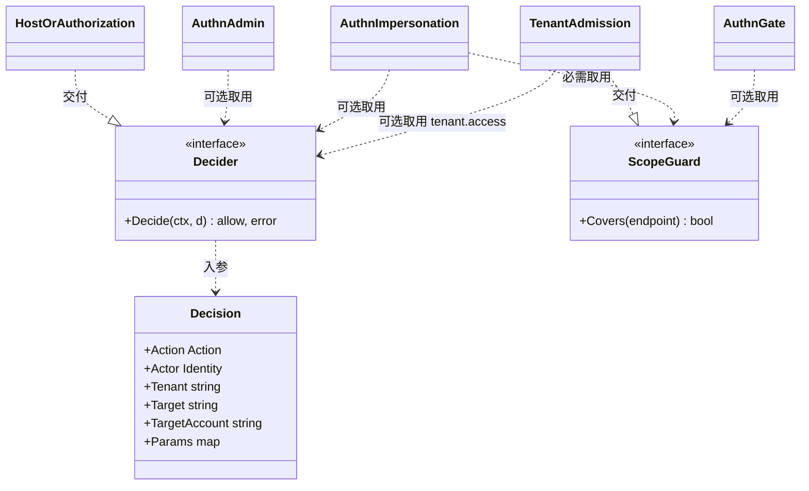
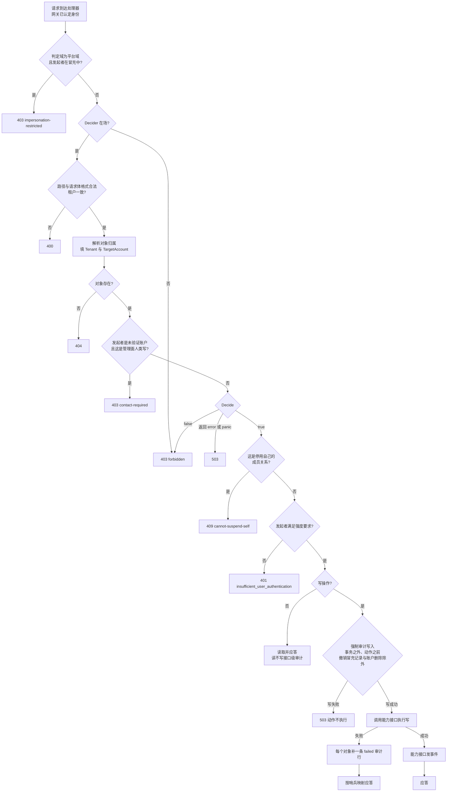

# authn-admin

本模块是认证向[授权](../../../glossary.md)承诺的那一侧：它在根包里定义 `Decider`、`Decision`、`Action` 与 `ScopeGuard`，并挂 `B/*` 与 `Bt/:tenant/*` 下的管理路由。每个管理请求按固定次序过注册验证状态门控、判定接口、发起者强度核验、强制审计与写入。它不实现 `Decider`，也不持有账户、会话、因素、IdP、冒充记录或角色绑定的数据。成员读把授权侧持有的角色名并入每一行，成员写拒绝让管理员停用自己，但角色本身仍归 `authz.policy`。读职责清单前应持有的一句话心智模型：authn 只承诺“谁”与“是不是成员”，管理面只转述判定接口的答案；角色名是读出来给管理面看的附带事实，不是 authn 的权限。

第一遍按顺序读的节是职责与非职责、外部接口契约、依赖、UML 图、核心数据结构、核心算法与流程；外部接口契约的对授权承诺、账户标识要求与 `Decider` 类型是接口所在，核心数据结构的 `Decision` 字段说明每个判定输入的来源，核心算法与流程的处理器判定顺序与 `Decision` 填法给出一次管理请求的路径，成员列表的分页与角色收窄说明一次成员读的两次探测与逐页筛选。错误与失败语义与并发与事务边界是最后自检的节；扩展点与实现状态在主体之后回看。

## 职责

- **向授权交付接口面。** `pkg/authn` 不 import 授权功能目录（[authz](../design-authz.md)）；authn 交给授权的是根包里的接口、值类型与事件，`authz.guard` 与 `authz.policy` import 根包并交付其中的接口，方向与 `tenant/resolve` import `pkg/authn` 一致（[ADR-authn-scope](../../../adr/adr-authn-scope.md)）。本文的承诺表是这些东西的清单，账户标识对授权的要求在其后单列。
- **判定接口。** 定义根包接口 `Decider`、值类型 `Decision`、动作常量 `Action`，以及冒充范围守卫 `ScopeGuard`。管理面动作、冒充的开始与读写、非成员进入租户，都经 `Decider` 判定（[ADR-authn-decision-seam](../../../adr/adr-authn-decision-seam.md)）。
- **管理面模块 `authn.admin`。** 挂 `B/*` 与 `Bt/:tenant/*` 下的全部管理路由（冒充记录在 `B/tenants/:tenant/impersonations`）；每条路由的处理顺序固定为注册验证状态的门控、`Decider`、发起者强度核验、强制审计、写、事件。门控只拦发起者为未验证账户的人类写，见“注册验证状态的门控”。按路由组声明[特性](../../../glossary.md)：恒挂的组是静态特性，随能力挂出的组是条件特性，在挂该组的同一处判定里经 `feature.Board` 的 `Post` 报告。
- **成员读携带角色、加入时刻与下一页游标。** 成员列表经可选的 `MemberRoleReader` 一次读回本租户每个账户的角色名，附在行上；`joined_at` 取成员关系的创建时刻；`next_cursor` 让调用方翻页，`role` 查询按角色名收窄。角色名只读，不参与判定；普通列表的角色读失败退化为空数组，角色筛选的读失败则整条请求失败，不返回未过滤的一页。
- **`Decision` 的填法。** 路径里不带租户的租户级动作，`authn.admin` 在调用 `Decider` 之前自己解析对象的归属并填入 `Decision`。
- **划定自助范围的判据。** 账户对自己的会话、因素、口令、标识与外部关联的读写不经过 `Decider`；判据由本文给出，自助路由由 `authn.login`、`authn.session`、`authn.mfa` 各自挂。
- **收窄 403 的位置。** 列出 authn 可以写 403 的位置，以及网关与租户准入层写什么；判据与被否决的写法在 [ADR-authn-scope](../../../adr/adr-authn-scope.md)。

### 非职责

- **不做授权判定，不含角色、权限、组。** 角色按（账户，租户）绑定，归 `authz.policy`；`authz.policy` 按生效账户实时查自己的绑定。本模块只回答“谁”与“是不是成员”；成员列表里的角色名经可选的 `MemberRoleReader` 读出附在行上，本模块不存、不改、不用它判定，读不出时也不阻断普通列表。
- **不实现 `Decider`，不内置放行名单。** 实现由宿主或 `authz.guard` 交付；口令表主体能否通过由 `Decider` 判定，`Decider` 能看到 `Identity.Account().IsStatic()`。
- **不实现租户准入层。** 成员核对、租户级认证强度与冒充的租户范围在 [tenant.admission](../tenant/design-tenant-admission.md)；本模块只定义它询问的 `Decider` 动作 `authn.tenant.access` 与它交付的 `ScopeGuard`。
- **不持有账户、会话、因素、服务密钥、IdP、冒充记录的数据与规则。** 管理路由只调用对应能力的根包接口，规则与哨兵在各能力的模块里（[authn-account](design-authn-account.md)、[authn-session](design-authn-session.md)、[authn-mfa](design-authn-mfa.md)、[authn-sso](design-authn-sso.md)、[authn-impersonation](design-authn-impersonation.md)）。
- **不挂自助路由。** 自助路由在 [authn-login](design-authn-login.md)、[authn-session](design-authn-session.md)、[authn-mfa](design-authn-mfa.md) 里。
- **不发布事件。** 事件由执行写的能力接口发出；`authn.admin` 不取用事件总线与发件箱。事件与审计的契约在 [authn-events](design-authn-events.md)。
- **只声明一个配置项。** `authn.admin.sso.enabled` 是 SSO 提供方组的配置门，键名、缺省值与来源在 [authn-config](design-authn-config.md) 给全；本模块不声明设置键。
- **不约束经 Go 接口的直接调用。** 宿主在自己的命令里调用 `AccountAdmin`、`Memberships`、`Sessions`、`SSOProviders` 不经 `Decider`，其访问控制由宿主命令自己负责。
- **不实现 `authz.policy` 自己的缓存与对账。** `authz.policy` 清理角色绑定靠订阅事件，并可用 `Accounts.Get` 对账。

## 外部接口契约

### 对授权的承诺

下表是 authn 对授权承诺的全部内容（封闭集）。“载体”列指向承载该项完整定义的文档，本表只写承诺，不复述那些文档里的表与清单。

| 项 | 承诺 | 载体 |
|---|---|---|
| 依赖方向 | `pkg/authn` 不 import 授权功能目录；所有接口都定义在根包里，`authz.guard` 与 `authz.policy` import 根包并交付它们 | 本文 |
| 身份字段 | 读取接口的字段集见载体文档；不含角色，不含租户（冒充范围 `Scope` 除外） | [authn](design-authn.md) |
| 访问级别 | `authz.guard` 经 `authn.AccessFromContext` 得知本请求命中的路由登记为 `Open`、`Optional` 还是 `Required`，以及网关有没有对它作过决定；约定用法见下节 | [authn](design-authn.md)、[authn-gate](design-authn-gate.md) |
| 账户标识的性质 | 不可变、全局唯一、形态由 `ParseAccountID` 判定；全部要求见下节 | 本文、[authn-account](design-authn-account.md) |
| 成员关系 | `Memberships` 的只读接口，零值视为非成员；成员关系与账户的变更事件供 `authz.policy` 清理角色绑定与缓存，事件清单、投递路径与去重要求见载体文档 | [authn-account](design-authn-account.md)、[authn-events](design-authn-events.md) |
| 角色绑定 | 角色按（账户，租户）绑定，由 `authz.policy` 的 `authz_bindings` 承载 | [design-authz](../design-authz.md) |
| 会话撤销 | `Sessions.Status` 是撤销的权威依据；事件 `authn.session.revoked` 是缓存失效的提示，不是权威 | [authn-session](design-authn-session.md) |
| 链上次序 | `authz.guard` 声明授权阶段，阶段内用 `After` 指向准入层的功能标识，位于租户准入层之内；跨阶段的位置由阶段顺序给出，次序与锚点的完整表在载体文档 | [authn](design-authn.md)、[tenant.admission](../tenant/design-tenant-admission.md) |
| 加强认证 | `authz.guard` 需要某条路由要求新鲜的多因素时，挂 `guard.Require(authn.Requirement{...})` | [authn-mfa](design-authn-mfa.md) |
| 令牌 | 访问令牌不带角色；`ClaimsContributor` 是宿主显式选择追加声明的口子 | [authn-token](design-authn-token.md) |
| 平台范围与准入放行 | `Decision.Tenant` 为空表示平台范围，只用于账户级动作；租户级动作的 `Decision.Tenant` 一律由 `authn.admin` 解析后填，`Decider` 永远不会收到租户为空的租户级动作；非成员的请求在准入层经 `authn.tenant.access` 询问 `Decider`，缺省拒绝，`authz.guard` 据此落地跨租户的平台级角色，不必改准入层与 authn | 本文 |
| 冒充范围 | `Identity.Scope()`、`ScopeGuard.Covers`、网关对冒充身份的范围规则 | [authn-impersonation](design-authn-impersonation.md)、[authn-gate](design-authn-gate.md) |
| 管理面与冒充接口 | `Decider`、`Decision`、`Action` | 本文 |
| 判定接口的实现 | `Decider` 由 `authz.guard` 实现 | [design-authz](../design-authz.md) |
| 状态码来源 | 网关从不写 403；准入层写 404 与 401；authn 的路由处理器只在封闭集内转述策略拒绝时写 403 | 本文“403 的收窄” |
| 测试 | `authntest.Context` 构造带指定身份与访问级别的上下文 | [authn](design-authn.md) |

### 账户标识对授权的要求

授权按（账户，租户）存角色，下表是授权对账户标识这个键的全部要求（封闭集）。

| 要求 | 内容 |
|---|---|
| 不可变 | 标识一经分配永不重新分配。账户删除留墓碑，同一邮箱再注册得到新标识，所以授权里残留的旧标识指向的是已无个人数据的墓碑，不会指到新人。 |
| 全局唯一与形态 | 形态由 `ParseAccountID` 判定：1 到 64 字节、字符集 `[A-Za-z0-9._-]`、大小写敏感。授权不得解释标识的内部结构。 |
| 口令表主体 | 标识形如 `static.<名>`，`AccountID.IsStatic()` 为真；没有成员关系。授权对它们要有自己的规则：给角色或不给。 |
| 不建外键 | 授权不建指向 authn 表的外键，因为跨模块外键依赖迁移先后。清理靠订阅事件，并可用 `Accounts.Get` 对账，墓碑视为不存在。 |
| 租户标识与成员关系 | 租户标识是 `tenant.ID` 的字符串形式；成员关系回答“这个账户是不是这个租户的成员”，角色绑定在授权，没有绑定即没有权限。 |
| 成员关系状态的零值 | 零值是暂停。授权应把“查不到”与“已暂停”都视为非成员。 |
| 按生效账户解析 | 角色绑定按生效账户 `Account()` 解析。冒充时管理员因此得到被冒充者在 `Scope()` 租户内的权限，限制冒充的范围是 `Decider` 在冒充开始时的事。授权对 `Scope()` 非空且请求不在该租户内的情形默认拒绝；准入层已答 404，授权再拒一次是纵深。 |
| `idp.` 前缀的属性 | 属性集里 `idp.` 前缀的值来自外部 IdP 的声明。授权可以读，把它们当强授权依据之前应自己判断信任程度。 |
| `Access` 的约定用法 | `AccessOpen` 放行，公开路由已由 authn 声明；`AccessOptional` 且无身份，按授权自己的匿名规则判；`AccessRequired` 而无身份，或 `AccessUnknown`，说明该端不在网关所守之列或网关缺席，授权拒绝。认证缺席时的失败方向取拒绝。 |

### `Decider`、`Decision`、`Action`

以下类型位于 `pkg/authn` 根包，逐字与根包一致。

```go
type Action string

const (
	ActionAccountRead         Action = "authn.account.read"
	ActionAccountCreate       Action = "authn.account.create"
	ActionAccountUpdate       Action = "authn.account.update"        // 显示名、属性、protected、mfa_required、管理员重置口令、添加标识
	ActionAccountDisable      Action = "authn.account.disable"       // 停用与恢复
	ActionAccountDelete       Action = "authn.account.delete"
	ActionMembershipManage    Action = "authn.membership.manage"     // 读写成员关系，含 sso_exempt
	ActionSessionRead         Action = "authn.session.read"          // 读他人的会话
	ActionSessionRevoke       Action = "authn.session.revoke"        // 撤销他人的会话
	ActionMFAReset            Action = "authn.mfa.reset"
	ActionClientManage        Action = "authn.client.manage"         // 服务账户的密钥创建与撤销
	ActionIDPManage           Action = "authn.idp.manage"            // 含域声明与元数据刷新
	ActionImpersonateStart    Action = "authn.impersonation.start"
	ActionImpersonationRead   Action = "authn.impersonation.read"
	ActionImpersonationRevoke Action = "authn.impersonation.revoke"
	ActionTenantAccess        Action = "authn.tenant.access"         // 非成员进入租户：准入层询问，缺省拒绝
)

type Decision struct {
	Action        Action
	Actor         Identity
	Tenant        string
	Target        string
	TargetAccount string
	Params        map[string]string
}

// Decider 回答「某个发起者能否做 authn 范围内的这件事」。排他功能。
type Decider interface {
	Decide(ctx context.Context, d Decision) (allow bool, err error)
}
```

| 项 | 承诺 |
|---|---|
| 动作常量 | 上列常量是动作的全集；归属判据是“作用于他人账户或租户级资源的管理面动作、冒充的开始与读写、非成员进入租户”。动作随新增的管理面能力增长，新增动作按此判据归入。 |
| 排他与取用 | `Decider` 由宿主或 `authz.guard` 实现，排他。取用方 `authn.admin`、`authn.impersonation`、`tenant.admission` 在 `Init` 里以 `Optional` 取用，缺提供者（`core.ErrMissingProvider`）是合法配置，行为是全部拒绝；`Decider` 不写进任何模块的 `Requires`（[ADR-authn-wiring](../../../adr/adr-authn-wiring.md)）。 |
| 返回值 | `allow` 为真放行，为假拒绝；`err` 非空一律按 503 收口，不当作拒绝，也不当作放行。处理器对 `Decide` 的调用自带 `recover`，panic 按 `err` 非空处理，同样是 503，管理动作不执行。 |
| 默认全拒的落点 | 在取用方，不在一个“默认拒绝”的模块里。没有任何模块交付 `Decider` 的装配，宿主什么都不做也是安全的。 |
| 不内置名单 | `pkg/authn` 不内置任何放行名单。 |
| `Params` | 有限的参数，例如 `reason`、`ttl`（例举，不是封闭集），不含任何凭据。 |
| 新增动作 | 新增动作对已有的 `Decider` 实现表现为一个它不认识的动作字符串，按未知动作拒绝还是放行由实现决定；authn 不能替它收紧。 |

宿主最小的实现是一个函数：

```go
type opsOnly struct{}

func (opsOnly) Decide(ctx context.Context, d authn.Decision) (bool, error) {
	return d.Actor.Backend() == "static" && d.Actor.Account() == "static.ops", nil
}
```

判据是完整的账户标识 `static.ops`，不是 `static.` 前缀：前缀只表示这个标识出自口令表，表里每个主体的标识都带它。有几个运营者，就各列一个名字；`d.Actor.Account().IsStatic()` 为真即放行，会把口令表里的每个主体都放进管理面。

### `ScopeGuard`

```go
// ScopeGuard 由租户准入层交付：声明自己守哪些端，并在这些端上核对冒充身份的租户范围。
type ScopeGuard interface {
	Covers(endpoint string) bool
}
```

`ScopeGuard` 是根包接口，由 `tenant.admission` 排他交付；`authn.impersonation` 把它当必需依赖，网关把它当可选依赖。它使网关与 `authn.impersonation` 在不 import `pkg/tenant` 的前提下知道冒充身份能被放进哪些端。`Covers(endpoint)` 报出准入层的 `endpoints` 里是否有该端；它只说准入层守哪些端，不核对宿主有没有在那些端上开租户解析的豁免。网关在 `Start` 里按作用域核对：平台域与普通路由的挂载端上 `Covers` 为真即 `ErrInvalidConfig`，租户管理作用域的挂载端上 `Covers` 为假即 `ErrInvalidConfig`（见 [authn-gate](design-authn-gate.md)）。

### 管理面模块 `authn.admin`

`authn.admin` 是 `pkg/authn/admin` 里注册的独立模块，不交付任何功能接口，只经 `mount.Mounter` 挂 `B/*` 与 `Bt/:tenant/*`；`B` 是 `system` 作用域的基路径，`Bt` 是 `tenants` 作用域的基路径，二者都由 [authn-gate](design-authn-gate.md) 声明。冒充记录的路由也在 `B` 下，路径是 `B/tenants/:tenant/impersonations`：路径带租户，但判定在平台域，租户是被记录限定的数据，不是请求的域。路由的访问级别全部是 `Required`。判定域为该租户的管理路由登记为可冒充，判定域为平台域的不登记：冒充身份的能力取自被冒充账户，而它从不持有平台域权限（[design-authn-impersonation](design-authn-impersonation.md)）。这些路由的判定在 handler 内经 `Decider` 做出；宿主把它们挂在受授权守卫的端上时（租户管理作用域在示范里挂在 `api`），守卫的缺省关闭会先拒，宿主须在守卫的声明接口上把这组路由登记为开放。平台管理作用域在示范里挂在 `admin` 端，该端不在授权守卫之列，冒充记录的路由因此无须登记为开放。路由的作用域按判定域划分，不由路径里有没有租户决定：`B` 下的账户、服务密钥与冒充记录在平台域判定，`Bt/:tenant/*` 下的成员、邀请与 SSO 提供方在该租户的策略域判定（[ADR-http-api-path-scopes](../../../adr/adr-http-api-path-scopes.md)）。

- **不纳入就没有管理路由。** 宿主不点名 `authn.admin` 时没有 `B/*` 或 `Bt/:tenant/*` 下的任何路由；`AccountAdmin`、`Memberships`、`Sessions`、`SSOProviders` 的 Go 接口照常可用。
- **缺审计则启动失败。** `audit.Audit` 是必需依赖，漏纳入在任何实例构造之前以 `core.ErrMissingProvider` 失败，不留到第一次写操作才发现。
- **每组路由随对应能力在场、且该组的配置门打开才挂。** 能力缺席，或该组声明的配置门为假或缺席时，该组路由不存在，路由引擎对它按未命中处理，前端按该组特性缺席隐藏入口，与任何缺席能力相同；缺接口的组不挂出，不做成挂出而全拒，理由与被否决的写法在 [ADR-authn-decision-seam](../../../adr/adr-authn-decision-seam.md)。启动诊断写出挂了哪几组。

下表是路由组的全集（封闭集），只写组名、挂出条件与该组对应的[特性](../../../glossary.md)；每条路由属于哪一组，由下节路由表的“组”列给出。新增路由归入其能力所在的组，或新增一组。

| 组 | 挂出的条件 | 特性 |
|---|---|---|
| 账户 | 恒挂（`Accounts`、`AccountAdmin` 必需） | `authn.admin`（静态） |
| 成员关系 | 恒挂（`Memberships` 必需） | `authn.admin`（静态） |
| 会话 | `Sessions` 在场 | `authn.admin.sessions`（条件） |
| 因素与口令 | `MFA` 在场（这些路由要核对 `MFA.Seasoned`）；其中管理员重置口令的路由还要 `Passwords` 在场 | `authn.admin.factors`（条件） |
| 服务密钥 | `Tokens` 在场 | `authn.admin.secrets`（条件） |
| SSO 提供方 | `SSOProviders` 在场，且交付的注册另答域读扩展接口（`Domains`／`DomainsMany`），且 `authn.admin.sso.enabled` 为真（缺省关闭） | `authn.admin.sso`（条件） |
| 元数据刷新 | 至少一个 `SSOMetadataRefresher` 在场，且 SSO 提供方组已挂 | `authn.admin.sso.metadata`（条件） |
| 冒充记录 | `Impersonation` 在场，且交付了单条读取（`Get`） | `authn.admin.impersonations`（条件） |

**各组以特性声明。** 描述符的 `Resources` 为上表每个特性名带一条 `feature.Spec`，条件特性的 `Conditional` 为真（[feature](../design-feature.md)）。

- **`authn.admin` 是[静态特性](../../../glossary.md)，指账户组与成员关系组。** 它们恒挂：所依赖的功能与 `mount.Mounter` 都是必需依赖，模块进入启用集即挂出它们，所以声明为静态特性符合架构不变量 18（[architecture](../../architecture.md#架构不变量)）。
- **其余各组是[条件特性](../../../glossary.md)，在 `Init` 挂该组路由的同一处判定里报告**（`pkg/authn/admin/routes.go` `(*product).mountRoutes`、`mountAccountRoutes`）：会话、服务密钥、SSO 提供方与冒充记录各在挂该组的分支里报告；`authn.admin.sso.metadata` 在 SSO 提供方分支之内、挂刷新路由的那一处报告；`authn.admin.factors` 在 `mountAccountRoutes` 里 `MFA` 在场的分支报告。进程纳入了 `feature.board` 时，特性文档含一个条件分组名，当且仅当该组已挂出（[ADR-feature-ownership](../../../adr/adr-feature-ownership.md)）。
- **管理员重置口令随因素组，不另立特性名。** `authn.admin.factors` 的报告不看 `Passwords`，而重置口令的路由在同一分支内还要 `Passwords` 在场。服务前端的命令必须纳入 `authn.login`（[web](../web/design-web.md)），`authn.login` 把 `Passwords` 列为必需依赖（[authn-login](design-authn-login.md)），所以服务前端的装配里重置口令的路由与因素组同时挂出，`authn.admin.factors` 在场即指因素组连同重置口令的路由。
- **SSO 提供方组多一道配置门。** `SSOProviders` 在场只说明进程能管理提供方，不说明这次部署提供这个管理面；`authn.admin.sso.enabled` 缺省关闭，为假或缺席时该组不挂、`authn.admin.sso` 与 `authn.admin.sso.metadata` 都不报告，启动诊断也不列该组。运营者把该配置项置为真即得到该组，部署按需开启；审查装配为端到端走查显式打开。该组的缺席与任何能力缺席相同：路由不存在，前端按 `authn.admin.sso` 与 `authn.admin.sso.metadata` 的特性缺席隐藏 SSO 入口。模块的启用立场仍是 `StateEnabled`：这是对一个组的显式配置门，不是 `StateAuto`（[ADR-authn-wiring](../../../adr/adr-authn-wiring.md)）。
- **`feature.Board` 经 `core.Resolve` 取用，不列入 `Requires`。** 取不到时（没有纳入 `feature.board` 的进程）不报告，各组照上表的条件挂出。

### 管理面路由表

路由相对基路径 `B`（平台管理作用域）或 `Bt`（租户管理作用域）；`动作` 列是询问 `Decider` 的 `Action`，写常量值去掉 `authn.` 前缀的部分；“强制审计”指强制档审计，写失败则动作不执行，见“处理器的判定顺序”；撤销冒充记录是其中唯一的例外。“新鲜的本地多因素”“`MFA.Seasoned`”的定义在 [authn-mfa](design-authn-mfa.md)。下表是路由的全集（封闭集）。

| 组 | 方法 路径 | 动作 | 额外要求 |
|---|---|---|---|
| 账户 | `GET\|POST B/accounts` | `account.read`、`account.create` | 列表键集分页（`Accounts.List`），可按状态、种类、标识前缀、显示名前缀过滤，标识前缀精确到一种标识类型；列表的查询参数是封闭集，出现集合外的参数即 400，已接受的过滤给空值即不过滤（显示名前缀按字节前缀、大小写敏感，不是合法 UTF-8 即 400）；创建的**用户**账户必须带一个合法用户名；没有用户名的请求在写入之前 400，不留下无法以口令登录的账户；邮箱已被别的账户预留或持有答 409 `email-taken`；服务账户以服务密钥登录，不受这条要求；创建服务账户另要 `client.manage`；强制审计 |
| 账户 | `GET\|PATCH\|DELETE B/accounts/:id` | `account.read`、`account.update`、`account.delete` | `PATCH` 改显示名、属性与 `protected`（`SetDisplayName`、`SetAttributes`、`SetProtected`）；删除要新鲜的本地多因素；删除的审计在提交之后尽力写，事务失败补一条 `failed` 行；账户拥有活跃业务组织时删除答 409 `account-organization-owner`；其余写强制审计 |
| 因素与口令 | `POST B/accounts/:id/password` | `account.update` | 管理员提交临时口令，放在请求体里，从不回显、不进日志与审计，缺省置 `must_change`；发起者新鲜的本地多因素且 `MFA.Seasoned`；强制审计；成功后撤销该账户的全部会话 |
| 账户 | `POST B/accounts/:id/identifiers`、`DELETE B/accounts/:id/identifiers/:identifier` | `account.update` | 添加用户名（登录名）与管理员断言的邮箱；邮箱是新的或尚未证明时 `verified_via` 写 `admin`，已有证明的同值行保留原证明；管理员断言的邮箱登记为联系方式，不使它成为登录方式，也不在证明之前作默认联系地址；归属视为未证明直到本人以证明渠道证明，登录方式仍由持有人另选；邮箱已被别的账户预留或持有答 409 `email-taken`；删除用户名答 409 `username-immutable`（`ErrUsernameImmutable`），删除不生效，这条规则先于下一条；删除带口令凭据账户的最后一个被选作登录方式的已验证邮箱答 409 `login-identifier-required`；删除任何标识后账户若不再持有口令凭据、被选作登录方式的已验证手机号与外部身份中的任何一种，答 409 `last-login-method`（`ErrLastLoginMethod`），通行密钥不算，未验证的手机号也不算；强制审计 |
| 账户 | `POST B/accounts/:id/status` | `account.disable` | 新鲜的本地多因素；强制审计；账户拥有活跃业务组织时停用答 409 `account-organization-owner`；停用后同步清理会话（`AccountLifecycle`），清理失败 503，重试幂等 |
| 会话 | `GET B/accounts/:id/sessions`、`POST B/accounts/:id/revoke-sessions`、`DELETE B/sessions/:id` | `session.read`、`session.revoke` | `GET B/accounts/:id/sessions` 的每一行带 `current` 标记：该行是调用方自己的会话时为真，取自调用方身份的会话标识，其余为假，与自助路由 `GET B/sessions` 的同名标记同义；`DELETE B/sessions/:id` 先 `Sessions.Get` 解析会话所属账户，`Decision.Target` 填会话标识、`TargetAccount` 填账户；强制审计 |
| 因素与口令 | `GET B/accounts/:id/factors`、`POST B/accounts/:id/mfa-required`、`POST B/accounts/:id/mfa-reset` | `account.read`、`account.update`、`mfa.reset` | 清单只交回种类、标签、状态；重置要新鲜的本地非短信多因素与 `MFA.Seasoned`；重置前核对目标账户持有口令凭据、被选作登录方式的已验证手机号与外部身份中的至少一种（`AccountAdmin.HasLoginWayOtherThanPasskey`），一种都没有（只剩因素，例如只有通行密钥，或只有未被选作登录方式的手机号）答 409 `last-login-method`（`ErrLastLoginMethod`），不调 `MFA.Reset`，补一条 `failed` 审计行；强制审计 |
| 服务密钥 | `GET\|POST B/accounts/:id/secrets`、`DELETE B/accounts/:id/secrets/:secret` | `client.manage`（`GET` 为 `account.read`） | `GET` 经 `ListServiceSecrets`，只交标识、标签、期限与撤销状态；`expires_at` 为 `null` 表示永不到期，时间按带 `Z` 的 UTC ISO 8601 写出（[ADR-api-time-format](../../../adr/adr-api-time-format.md)）；创建与撤销要新鲜的本地多因素；密钥只在创建应答里出现一次；撤销后同步撤销该密钥的 service 会话；强制审计 |
| 成员关系 | `GET Bt/:tenant/members`、`PUT\|DELETE Bt/:tenant/members/:account`、`PUT Bt/:tenant/members/:account/sso-exempt` | `membership.manage` | `Decision.Tenant` 取路径里的租户标识，不是名称，所以 `authn.admin` 不依赖租户名册；强制审计。列表每行带显示名、角色名、加入时刻，应答带下一页游标；`role` 查询把本页收窄到持有该角色名的成员。`PUT` 写 `active=false` 而目标就是调用者自己时答 409 `cannot-suspend-self`（`ErrCannotSuspendSelf`），不写审计、不调成员存储；另一位管理员停用他则不受这条限制。`DELETE` 先取该租户的成员删除锁，再问每个 `MembershipGuard`，把检查与删除的提交一起持在锁里：若会让该租户不再有任何租户管理员绑定，答 409 `conflict`（`ErrLastTenantAdmin`），成员关系不删；锁取不到答 503，删除不执行。移除成员同时清除该账户在本租户的全部角色绑定；停用保留绑定，恢复后角色原样生效 |
| SSO 提供方 | `GET\|POST Bt/:tenant/sso/providers`、`GET\|PUT\|DELETE Bt/:tenant/sso/providers/:id`、`POST\|DELETE Bt/:tenant/sso/providers/:id/domains[/:domain]`、`POST Bt/:tenant/sso/providers/:id/domains/:domain/verify`、`POST Bt/:tenant/sso/providers/:id/reverify-domains` | `idp.manage` | `Decision.Tenant` 取 `SSOProviders.Tenant(id)`；路径带租户的路由核对路径、请求体与已存记录的租户一致，不一致 400，`PUT` 时租户不可变；加密列从不回显；IdP 发起登录开启时应答带警告；强制审计 |
| 元数据刷新 | `POST Bt/:tenant/sso/providers/:id/metadata/refresh` | `idp.manage` | `Decision` 的填法同 SSO 提供方组；经 `SSOMetadataRefresher` 按 `Protocol` 分派；强制审计 |
| 冒充记录 | `GET B/tenants/:tenant/impersonations`、`DELETE B/tenants/:tenant/impersonations/:id` | `impersonation.read`、`impersonation.revoke` | 记录视图的 `ended_at` 为 `null` 表示进行中，时间按带 `Z` 的 UTC ISO 8601 写出（[ADR-api-time-format](../../../adr/adr-api-time-format.md)）；`GET` 的租户取路径段，`Decision.Tenant` 取它，并作为 `GrantQuery.Tenant` 传给 `Impersonation.List`；`DELETE` 先经单条读取 `Get`（依赖表登记的扩展接口）按标识读记录（含已结束的），记录不存在 404，`Decision.Tenant` 取记录的租户，`Target` 与 `TargetAccount` 取记录的目标；两个动作都在平台域判定，`Decision.Tenant` 是记录被限定的数据，不是策略域；已结束的记录经 `Decider` 放行后 `Revoke` 无操作，应答与首次撤销相同；这一组的审计是尽力档：撤销是向安全方向的动作，审计由 `Impersonation.Revoke` 自己写，写失败只记 Error，不阻止撤销，处理器不另写强制档审计，也不补 `failed` 行 |

**成员视图携带显示名、用户名、角色与加入时刻。** `GET Bt/:tenant/members` 的每一行带 `display_name` 与 `username`：前者是成员账户的显示名，后者是账户的用户名（`IdentifierUsername`），账户没有时各自为空串，不另造回退；账户标识只作为内部键与分页次序，不进入界面。用户名按页批量取，不逐行读。`authn.admin` 按页逐个读账户（`Accounts` 没有批量读），账户在页读与名字读之间被删除时该行给空串。每一行另带 `roles` 与 `joined_at`：`roles` 是该账户在本租户持有的角色名，升序、去重、恒为数组（没有绑定时是空数组，永不为 null）；`joined_at` 是成员关系行的创建时刻，按带 `Z` 的 UTC ISO 8601 时刻给出。角色名经可选接口 `authn.MemberRoleReader` 一次整页读回，不是逐行读策略表。**成员、SSO 提供方与冒充记录视图里的 `tenant` 字段是名称**：行上存的是租户标识，视图经宿主注入的“标识到名称”接口解析；接口缺席或解析不到时为空串，不回退成标识。

**列表的游标与收窄。** 应答带 `next_cursor`，最后一页为空串；`after` 接受上一页的 `next_cursor`，缺省即第一页。`query` 查询参数按账户显示名的字节前缀或登录标识（查询串小写后）的前缀收窄本页，供成员选择器按输入检索；缺席或空串即不过滤，不是合法 UTF-8 即 400。`role` 查询参数把本页收窄到持有该角色名的成员，按角色名逐字匹配，可与 `query` 同时使用；一个本租户没有使用的角色名选出零行并仍答 200，所以这个参数不泄露角色名是否存在。`role` 需要成员角色读：装配没有 `MemberRoleReader` 或读失败时答 503，而不是退回未过滤的一页：一页未过滤的成员会被读成“每个成员都持有这个角色”。

**分页是“多读一行”的探测。** 成员存储的读不能超过它自己的页上限，所以页大小低于上限时比展示多读一行，多出的那一行只用于判断后面还有没有；页大小正好在上限时，用最后一行的账户标识再读一行，探测下一页是否存在。两种情形都不改 `Memberships.Members` 的签名，也不要求它回答下一页游标。角色收窄时，成员存储按页从前走到后，角色读一次答出哪些账户命中，直到凑满 `limit+1` 个命中或行读完；`next_cursor` 取最后一个被保留的命中的账户标识，而不是最后一个读到的原始行，所以整页无命中的空档不会让客户端漏掉匹配项。

**角色收窄的一次读是一个快照。** 同一页的筛选与行上的 `roles` 取自同一次 `MemberRoles` 结果，所以一行的筛选命中与它显示的角色不会来自两个时刻。没有 `role` 的普通列表允许角色读失败：失败只记一行 `Warn`，行照常返回、`roles` 为空数组，成员列表这个主任务不为策略读故障丢掉整页。

**提供方视图携带邮箱域。** `GET Bt/:tenant/sso/providers` 的每一行、`GET Bt/:tenant/sso/providers/:id`，以及创建、更新与元数据刷新应答里的提供方视图都带 `domains`：一个数组，没有声明时为空数组、永不为 null；每个元素只有 `domain`（规范化后的邮箱域）与 `verified`（该域是否已验证），按 `domain` 升序。只有已验证的域参与按邮箱域的登录发现，未验证的声明也列出来，供运营者看到自己声明过什么。列表读经扩展接口的 `DomainsMany` 一次取回整页的域，不是每行一次；单条读取与写入应答经 `Domains` 读该提供方。这一组依赖交付的 `SSOProviders` 另答域读扩展接口，断不上时整组不挂，`authn.admin.sso` 也随之不报告，与冒充记录组同一条规则。

**账户行携带标识。** `GET B/accounts` 的每一行、`GET B/accounts/:id`，以及创建、改名与状态切换应答里的账户视图都带 `identifiers`：一个数组，没有标识时为空数组、永不为 null；每个元素只有三个字段，即 `kind`（`username`、`email`、`phone`）、`value`（模块存储的规范化值）与 `proven`（该标识的归属是否被证明）。视图只报标识与归属，不报登录方式的选择；一条邮箱或手机被选作登录方式与成为默认联系地址是账户自己的事实，读自账户的联系方式与登录方式（[ADR-authn-contact-and-login-ways](../../../adr/adr-authn-contact-and-login-ways.md)）。`proven` 取自标识的已验证方式：`sms-code`、`email-code` 与 `idp:<provider>` 是证明，视为真；`invite`、`admin`、`import-unverified` 与 `self` 只是断言，视为假。视图不暴露标识自身的标识、验证时刻与验证方式。顺序固定：按 `kind` 以 `username`、`email`、`phone` 排列，同一 `kind` 内按 `value` 升序，因此首元素就是用来称呼该账户的标识。列表读为一页账户一次取回全部标识（`Accounts.IdentifiersMany`），整页因此只有一次标识读，不是每行一次；单条读取仍用 `Accounts.Identifiers`。墓碑不读：删除会抹除账户的标识，`Accounts.IdentifiersMany` 对墓碑不给条目（单条读对它答 `authn.ErrAccountNotFound`），故账户状态为已删除时视图直接给出空数组。列表是一页快照：某行在页读与标识读之间被删除时，批量读不给该账户条目，该行仍以空数组呈现，整页不因此答 503；单条读取点名一个账户，同样情形答 404。

### 自助范围

自助范围的判据：账户对自己的会话、因素、口令、标识与外部关联的读写，只要求下列各项，不经 `Decider`。

- 生效账户是身份本身：`Identity.Account()` 与路径上的账户一致，路径不带账户的路由取上下文里的身份。
- 满足多因素的新鲜度要求（[ADR-authn-mfa](../../../adr/adr-authn-mfa.md)、[authn-mfa](design-authn-mfa.md)）；本人资料与偏好（显示名、语言与时区）的写入不在此列，不要求新鲜度。

自助动作的授权依据是“生效账户就是身份本身”，这是 authn 自己可以核对的事实，不需要策略。没有 `Decider` 的装配里，用户仍能改自己的口令。自助路由由 `authn.login`、`authn.session`、`authn.mfa`、`authn.profile` 挂，本模块不挂。

### 注册验证状态的门控

注册验证状态是账户上的独立事实，判定二值：账户持有至少一条已证明归属的邮箱标识即已验证；持有邮箱而没有一条已证明的即未验证；一条邮箱也没有即不适用本规则。它不是账户状态，账户状态仍只有启用、停用、删除；未验证账户是启用账户，会话照常建立，管理面的列表、读取与过滤照常看得见它。判定从标识与联系方式预留现算（`SignupVerification.SignupStateOf`），与账户怎么创建无关：管理员预置的账户、导入的账户与自助注册的账户读同一套状态。`signup_state` 列只记账户怎么来，`0` 的账户一样可能视为未验证。

- **判据与应答。** 发起者是用户账户且状态视为未验证（`SignupPending`）时，管理面的人类写答 403 `contact-required`（`ErrContactRequired`）；冒充发起按同一判据拒绝，它的路由在 `authn.impersonation`。读路由不受影响。
- **豁免。** 服务账户（`AccountKind` 为 `service`）与没有任何邮箱的账户（`SignupNone`）不受门控约束。管理员预置与导入写出的账户不豁免：它们带着邮箱而未证明时照样被拦，直到本人经账户页的验证节证明该地址。社交登录与企业即时开通新开立的账户不写入提供方声明的地址（REQ-signup-048），没有邮箱时视为 `SignupNone`，不受这条门控约束。
- **位置。** 门控在身份确定之后、`Decider` 与强度核验之前；它只收紧不放行。被拦下的请求既不询问 `Decider`，也不询问强度，也不写强制档审计。状态经 `SignupVerification.SignupStateOf` 读当前值，读失败答 503，不按放行处理。
- **与冒充的关系。** 冒充发起要求发起者是有会话的用户账户，未验证账户的发起被同一条判据拒；`authn.impersonation` 在它的结构性限制里、强度类条件与 `Decider` 之前答同一个 403 `contact-required`（[design-authn-impersonation](design-authn-impersonation.md)）。被冒充的目标账户的验证状态不参与判定。

门控的状态由 `authn.account` 持有，本文只写管理面这一侧的判定位置与应答；其余部分的门控由各能力的文档承载。

### 对外接口

- `Decider`、`Decision`、`ScopeGuard` 的签名，以及 `Decision` 各字段的填法（见“`Decision` 的填法”），属于对外接口。
- 动作常量的值：新增常量是兼容的；删除、改名或改变既有常量的值是破坏性变更。
- “`Decider` 永远不会收到租户为空的租户级动作”是接口的行为语义。
- 路由路径与其询问的动作属于对外接口；路由集随装配变化，不在其中。成员列表的视图字段（`display_name`、`roles`、`joined_at`、`next_cursor`）、`query` 与 `role` 查询参数，以及“停用自己的成员关系答 409 `cannot-suspend-self`”同属接口：前端与生成的客户端按它们渲染与分支。
- 成员列表的角色读是可选取用：普通列表在实现缺席或读失败时仍答 200、`roles` 为空数组；带 `role` 的列表在同样情形答 503。这两种回答属于接口的行为语义，前端据此把角色列的空值与一次读失败分开呈现。
- 声明的特性名与各名所指的路由组：前端经生成的特性名类型引用它们，改名、撤去或改变所指的组是宿主可见的破坏性变更；哪些名字在特性文档里随装配变化，不在接口内。
- 403 的位置集合是封闭集，新增一种要有新的决定。

## 依赖

| 依赖 | 方式 | 说明 |
|---|---|---|
| `mount.Mounter` | 必需 | 登记 `B/*` 与 `Bt/:tenant/*`；由 `authn.mount` 交付。 |
| `Accounts`、`AccountAdmin` | 必需 | 账户组路由；由 `authn.account` 交付。 |
| `Memberships` | 必需 | 成员关系组路由；由 `authn.account` 交付。 |
| `MemberRoleReader` | 可选 | 成员列表每一行的角色名与 `role` 收窄；由 `authz.policy` 交付。缺席时普通列表的 `roles` 为空数组，带 `role` 的列表答 503。 |
| `SignupVerification` | 必需 | 读取发起者的注册验证状态；由 `authn.account` 交付，读失败答 503。 |
| `audit.Audit` | 必需 | 强制档审计的落点；缺席即构造之前启动失败。 |
| `Decider` | 可选 | 缺席即全拒。 |
| `Sessions` | 可选 | 会话组路由；取会话所属账户。 |
| `MFA` | 可选 | 因素与口令组路由；核对 `Seasoned`。 |
| `Passwords` | 可选 | 因素与口令组里管理员重置口令的路由；缺席时该路由不挂，组内其余路由照挂。由 `authn.account` 交付。 |
| `settings.Store` | 可选 | 读 `authn.mfa.recent-window` 构造强认证要求的 `FreshLocalMulti` 窗口（该键由 [design-authn-mfa](design-authn-mfa.md) 声明，本模块是它的使用方之一）；缺席或读不出取声明的缺省（见 [design-authn-config](design-authn-config.md)）。 |
| `Tokens` | 可选 | 服务密钥组路由。 |
| `SSOProviders` | 可选 | SSO 提供方组路由；取提供方所属租户。 |
| 全部 `SSOMetadataRefresher` | `ResolveAll` | 元数据刷新路由；按 `Protocol` 分派。 |
| `Impersonation` 及单条读取 `Get` | 可选 | 冒充记录组路由。`List`、`Revoke` 来自公开的 `Impersonation` 接口；`Get` 是记录组为解析记录的租户与目标所需的扩展接口，不在公开接口里（见 [design-authn-impersonation](design-authn-impersonation.md)）；缺 `Get` 时整组不挂，不做成挂出而全拒。 |
| `feature.Board` | 可选，`Init` 经 `core.Resolve` 取用，不列入 `Requires` | 报告条件分组的特性名；缺席时不报告，路由照挂。 |

**方向核对。** `authn.admin` 位于认证功能目录内，不 import `pkg/tenant`、授权功能目录、宿主与 `pkg/feature/board`，也不 import 认证功能目录里别的实现子包。`pkg/feature` 根包只依赖标准库，为声明特性 import 它不扩大本模块的闭包（[feature](../design-feature.md)）。`Decider` 与 `ScopeGuard` 都是根包接口：`authz.guard` 与 `tenant.admission` import 根包交付它们，反向没有依赖。

被依赖方向：`authn.impersonation` 与 `tenant.admission` 取用同一个 `Decider`，各自在自己的处理路径上询问；`tenant.admission` 交付 `ScopeGuard`（[ADR-tenant-admission](../../../adr/adr-tenant-admission.md)）。

## UML 图

### 接口的类型关系

下图固定谁定义接口、谁取用、谁交付。`Decider` 与 `ScopeGuard` 都定义在根包；取用方只依赖根包，交付方在 authn 目录之外。



`Decision` 由取用方构造，`Decider` 的实现只读它。取用方里只有 `authn.admin` 填写租户级管理动作的 `Tenant`；`tenant.admission` 填 `Actor` 与本请求的租户，`authn.impersonation` 填目标与租户（[authn-impersonation](design-authn-impersonation.md)）。

## 核心数据结构

### `Decision` 的字段

| 字段 | 含义 | 填写者与约束 |
|---|---|---|
| `Action` | 询问的动作，取上文常量 | 取用方。 |
| `Actor` | 发起者的身份 | 取用方取请求上下文里的身份。平台域的管理动作与冒充发起要求发起者未在冒充，这两类调用里 `Actor.Impersonating()` 为假；判定域为该租户的管理动作允许冒充身份，`Actor` 的实际操作者是发起者，判定主体仍是生效账户。 |
| `Tenant` | 动作的租户范围 | 租户级动作由 `authn.admin` 解析后填，必为非空；账户级动作为空，表示平台范围。 |
| `Target` | 动作的对象：账户标识、会话标识、IdP 标识或冒充记录标识 | 取用方；没有单一对象的动作（列表、创建）为空。 |
| `TargetAccount` | 对象所属的账户 | 会话、因素、服务密钥、冒充记录的路由由 `authn.admin` 解析后填；账户级对象即 `Target` 本身。 |
| `Params` | 有限的参数 | 取用方；不含任何凭据，管理员提交的临时口令从不进入。 |

## 核心算法与流程

### 处理器的判定顺序

每条管理路由的处理器共用同一个判定顺序，任一步不满足即终止。写操作与读操作在“写操作”一步分支。



约束：

- **冒充检查在最前，只针对判定域为平台域的动作。** 网关因这些路由没有登记 `Impersonable` 而对冒充身份答 401；处理器自己仍检查 `Actor` 的冒充状态，答 403 `impersonation-restricted`，不询问 `Decider`。判定域为该租户的管理路由登记为可冒充，冒充身份按生效账户的权限判定。
- **`Decider` 缺席先于任何查询。** 缺提供者时答 403 `forbidden`，不解析对象，使默认部署不泄露对象是否存在。
- **归属解析先于 `Decide`。** `Decision` 要带归属，所以解析必须在询问之前（见“`Decision` 的填法”）。
- **注册验证状态的门控在身份确定之后、`Decide` 与强度核验之前。** 发起者视为未验证（`SignupPending`：有邮箱而没有一条已证明的）时，管理面人类写答 403 `contact-required`，不询问 `Decider`、不询问强度、不写审计；门控只收紧不放行。读路由、服务账户与没有邮箱的账户不受影响。冒充发起的路由在 `authn.impersonation`，按同一判据拒绝（见“注册验证状态的门控”）。
- **停用自己的成员关系在 `Decide` 之后、强度核验与强制审计之前拒绝。** 只有 `PUT` 写 `active=false` 且路径上的账户就是生效调用者时成立，答 409 `cannot-suspend-self`，不写审计行、不调 `Memberships`；另一位管理员停用他、或调用者恢复自己都不受这条限制。判定在 handler 里，所以成员存储的 `Put` 仍是普通的幂等写。这条拒绝与“最后一名租户管理员不能移除”一起，使一个仍在服务的租户始终有至少一名能治理它的管理员。
- **强度核验在 `Decide` 之后、审计之前。** 强度要求按路由表的“额外要求”列，核验失败答 401 加强认证挑战，不写审计，不执行动作。
- **强制审计在事务之外、动作之前。** 管理面路由里有两个例外。撤销冒充记录的审计是尽力档，由 `Impersonation.Revoke` 自己写，处理器跳过强制审计与补行（路由表）。账户删除的审计跟随提交：墓碑与抹除是那条事务的产物，提交之前写下的行会描述一次可能回滚的动作；处理器在 `Delete` 返回之后尽力写成功行，事务失败时补一条 `failed` 行并照常返回拒绝。接口级的审计写入另占一条连接、不加入调用方的事务；在调用方事务开着时调用它，SQLite 上等调用方占着的写锁，单连接库上等调用方占着的那条连接，等待超时后 `Record` 以 `ErrWriteFailed` 失败。处理器因此不在任何事务里调用 `audit.Record`，事务内只暂存发件箱事件，不调 `Bus.Publish`。
- **写失败逐对象补一条 `failed` 行。** 审计与动作不在同一事务里，动作失败时审计里留一条已写而未生效的行，随后为每个已写出的对象补一条 `outcome=failed` 的行，用动作标识关联。
- **读路由不写接口级审计。** 审计动作表是封闭集且不含任何读动作，读由请求级采集记录（[design-authn-events](design-authn-events.md)），所以 `authn.admin` 的读路由只读、不写审计，也不补 `failed` 行。
- **事件由能力接口发出。** 写成功后的事件在能力接口自己的事务与发布路径里，`authn.admin` 不重复发布。

审计的动作名、明细键与档位见 [authn-events](design-authn-events.md)。

### `Decision` 的填法

路径里不带租户的动作，`authn.admin` 在调用 `Decider` 之前解析对象的归属并填进 `Decision`。宿主若按 `Decision.Tenant` 判租户管理员，租户 T1 的管理员改写或删除 T2 的 IdP、给它声明域名、踢 T2 成员的会话时，看到的 `Tenant` 是 T2。

下表是各路由族的填法（封闭集）。

| 路由族 | `Tenant` | `Target` | `TargetAccount` |
|---|---|---|---|
| 账户列表与创建 | 空（平台范围） | 空 | 空 |
| `accounts/:id` 及其下的 `status`、`password`、`identifiers`、`factors`、`mfa-required`、`mfa-reset`、`secrets`、`sessions`、`revoke-sessions` | 空（平台范围） | 路径里的账户 | 同 `Target` |
| `sessions/:id` 的删除 | 空（平台范围） | 会话标识 | `Sessions.Get` 解析出的账户 |
| 成员列表 | 路径里的租户标识 | 空 | 空 |
| 成员的写与 `sso-exempt` | 路径里的租户标识 | 路径里的账户 | 同 `Target` |
| `tenants/:tenant/sso/providers` 的列表与创建 | 路径里的租户标识；创建时路径、请求体里的租户一致 | 空 | 空 |
| `Bt/:tenant/sso/providers/:id` 及其 `domains`、`reverify-domains`、`metadata/refresh` | 路径里的租户标识，须等于记录的租户，不一致按不存在答 404 | IdP 标识 | 空 |
| 冒充记录列表 | 路径里的租户标识 | 空 | 空 |
| `B/tenants/:tenant/impersonations/:id` 的删除 | 路径里的租户标识，须等于记录的租户，不一致按不存在答 404 | 记录的目标账户 | 同 `Target` |

- **租户的一致性核对在询问之前。** 路径带租户的创建路由，路径与请求体里的租户不一致按 400 拒绝；按 id 寻址的提供方与冒充记录，路径里的租户与已存记录不一致按不存在答 404；两种都不交给 `Decider`。`PUT` 时提供方的租户不可变，与已存的不同即拒绝。
- **租户为空的含义。** 为空只表示平台范围，即对象不属于单一租户。按租户判管理员的 `Decider` 对平台范围的动作读到空租户，应拒绝；这是失败时拒绝的方向。
- **`Decider` 永远不会收到租户为空的租户级动作。** 任何新增管理路由若其对象属于某个租户，其 `Tenant` 取对象的归属，路径里没有时由 `authn.admin` 解析。守住它的是测试，不是类型系统（见“守住性质的测试”）。

### 成员列表的分页与角色收窄

普通成员列表只发一次成员读：页大小低于上限时读 `limit+1` 行，多出的一行说明还有下一页，展示时裁掉；页大小正好在上限时先读满一页，再以最后一行的账户标识读一行，判断下一页是否存在。`next_cursor` 取展示页最后一行（或角色收窄下最后一个保留命中）的账户标识，最后一页为空串。

带 `role` 的列表先把 `MemberRoleReader` 读一次，得到本租户每个账户的角色名；随后按 `after` 与 `query` 逐页读成员，保留持有该角色的行，直到凑满 `limit+1` 个命中或成员读完。整页原始行都没有命中时继续读下一页，游标仍推进到读过的最后一行；返回给调用方的 `next_cursor` 是被保留的最后一个命中的账户标识，所以翻页不会因为空档重复或跳过。角色读失败或装配没有实现时整条请求答 503：一个未经过滤的页会被读成“这些成员都持有该角色”，调用方无法从应答分辨这是筛选结果还是一次读故障。

普通列表的角色读失败是另一条规则：行照常返回、角色列退化为空数组，只记一行 `Warn`。成员列表是管理面的主任务，策略读的一次故障不该让它整页不可用。两种处理的分界是这次读是不是筛选条件本身。

### 非成员进入租户

`tenant.admission` 对非成员且 `Identity.Scope()` 为空的身份询问 `Decide(Decision{Action: ActionTenantAccess, Actor, Tenant})`。返回 `true` 放行，只表示“可以进入这个租户”，不赋予任何角色，租户内能做什么仍由 `authz.guard` 判定；`Decider` 缺席或返回 `false` 按准入层的 404 处理，返回 error 按 503 处理。冒充身份不适用这条询问，冒充只能在其范围内。判定与缓存的细节在 [tenant.admission](../tenant/design-tenant-admission.md)。

### 引导

初始账户、初始成员关系、初始 IdP 在没有任何管理员时的来源如下（封闭集），都不是内置名单：

- 宿主在自己的命令里用 `AccountAdmin` 与 `Memberships` 的 Go 接口创建，与“账户从哪里来是宿主的事”一致。
- 宿主实现一个只含判定逻辑的 `Decider`，先放行某个口令表主体，例如上文的 `opsOnly`。

默认部署开箱即不可被远程管理，这是有意的。

**发起冒充的判定不属于这条引导。** `opsOnly` 这样的静态主体规则驱动不了冒充：本模块的结构性限制要求发起者是有会话、本地验证过新鲜多因素的非静态用户账户，而静态主体没有会话可绑（[design-authn-impersonation](design-authn-impersonation.md)）。要启用冒充，宿主须实现一个在平台域放行的 `Decider`（例如放行持有某个平台运营角色的账户），角色绑定由 `authz.policy` 持有，authn 不认识它。“谁有权冒充谁”因此是宿主的配置；authn 保证的只是发起者满足不依赖 `Decider` 的结构与强认证限制，`Decider` 只能在其上收紧。

## 错误与失败语义

### 403 的收窄

- **网关从不写 403。** 做认定的中间件层只回答“是谁”；凭据缺失、强度不够、冒充身份进了不允许的路由都是 401。
- **`tenant.admission` 写 404 与 401。** 非成员、租户不存在、已停用、冒充范围不符一律 404，不区分原因；强度不够是 401 加强认证挑战。
- **authn 的路由处理器可以写 403，位置是封闭集。** 它们是自己资源的所有者，只在转述认证之外的策略的拒绝时写 403：`Decider` 的拒绝（`forbidden`）、被全局设置关闭的登录方式（`method-disabled`）、外部登录路径上的账户不可用（`account-unavailable`）、冒充发起的限制与管理面在冒充身份上的兜底（`impersonation-restricted`）、发起者名下没有启用已满规定时长的非短信因素（`factor-not-seasoned`）、发起者是未验证账户的人类写与冒充发起（`contact-required`）。本模块的处理器只写其中的 `forbidden`、`impersonation-restricted`、`factor-not-seasoned` 与 `contact-required`。
- **其余一切“不够强”是 401。** 加强认证挑战的应答见 [authn-mfa](design-authn-mfa.md)。

判据、被否决的 401 与 404 两种写法及其理由在 [ADR-authn-scope](../../../adr/adr-authn-scope.md)。调用方读到的 403 可能来自 authn 的处理函数，也可能来自链上的授权层（`authz.guard`）或宿主的 handler，仅凭状态码区分不了来源。

### 失败方向

哨兵与 `Problem.Type` 的完整表在 [authn-failure](design-authn-failure.md)；下表是 `authn.admin` 处理器遇到各情形时的应答与方向。

| 情形 | 应答 | 方向 |
|---|---|---|
| 发起者在冒充中，且这条路由的判定域为平台域 | 403 `impersonation-restricted`（`ErrImpersonationRestricted`） | 拒 |
| `Decider` 缺席，或 `Decide` 返回 `false` | 403 `forbidden`（`ErrForbidden`） | 拒 |
| `Decide` 返回 error 或 panic | 503 `urn:speed:authn:unavailable`（`ErrUnavailable`），成因只进日志，动作不执行 | 拒 |
| 租户在路径、请求体与已存记录之间不一致 | 400，不询问 `Decider` | 拒 |
| 对象不存在（`ErrAccountNotFound`、`ErrSessionNotFound` 及对应的提供方、冒充记录） | 404 | 拒 |
| 管理员停用自己的成员关系 | 409 `cannot-suspend-self`（`ErrCannotSuspendSelf`），不写审计、不调成员存储 | 拒 |
| `role` 筛选而装配没有成员角色读，或角色读失败 | 503 `urn:speed:authn:unavailable`（`ErrUnavailable`），不返回未过滤的一页 | 拒 |
| 普通成员列表的角色读失败 | 列表照常 200，角色为空数组，记一行 `Warn` | 降级 |
| 删除标识的请求指向用户名 | 409 `username-immutable`（`ErrUsernameImmutable`），删除不生效，先于最后登录名规则（[ADR-authn-username-permanent](../../../adr/adr-authn-username-permanent.md)） | 拒 |
| 发起者视为未验证（`SignupPending`），而这是管理面人类写 | 403 `contact-required`（`ErrContactRequired`） | 拒 |
| 读取发起者的注册验证状态失败 | 503 `urn:speed:authn:unavailable`（`ErrUnavailable`），动作不执行 | 拒 |
| 发起者的强度不足 | 401 `insufficient_user_authentication`（[REF-rfc9470](../../../references.md)）（`ErrStepUpRequired`） | 拒 |
| 管理员重置因素与重置口令时，发起者名下没有启用已满 `sensitive-min-age` 的非短信因素（`Seasoned` 为假），在强度判定通过之后判定 | 403 `factor-not-seasoned`（`ErrFactorNotSeasoned`） | 拒 |
| 管理员重置因素时，目标账户没有口令凭据、被选作登录方式的已验证手机号与外部身份中的任何一种（通行密钥不算，未被选作登录方式的手机号也不算） | 409 `last-login-method`（`ErrLastLoginMethod`），不调 `MFA.Reset`，补一条 `failed` 审计行 | 拒 |
| 强制档审计写失败（含 `ErrNotAccepting`、`ErrWriteFailed`） | 503（`ErrAuditRequired`），动作不执行 | 拒 |
| 写失败 | 为每个对象补一条 `failed` 审计行，按能力接口的哨兵映射应答 | 拒 |
| 写已生效而清理失败（`ErrCleanupIncomplete`） | 503，重试同一请求幂等地补完 | 拒（状态已生效，清理待补） |
| db 或依赖的能力不可用 | 503，不带着半份结果放行 | 拒 |

### 非保证

- **成员列表的显示名逐行读取。** `GET Bt/:tenant/members` 的每一行带账户显示名，而 `Accounts` 只提供单条 `Get`，没有读取账户本身的批量接口（`IdentifiersMany` 只取标识）。`handleMemberList` 因此对返回的每名成员各读一次账户：含 N 名成员的一页最多发 N 次账户读。后续工作是为 `Accounts` 增加按账户标识集合读取的批量接口，并在该路由上整页一次取回显示名；该接口落地之前，这一页的账户读次数随页大小线性增长。
- **成员列表的角色名是读时快照。** 一次绑定写入与这次角色读并发时，行上的角色可能落后于策略表，下一次读才追上；`role` 筛选取的是同一次快照，所以筛选结果与行上角色彼此一致，但不保证与最新写入一致。普通列表的角色读取失败时退化为空数组，页面因此无法从这一列区分“没有角色”与“这次没读出来”，管理面应把该次失败作为提示而不是空角色。
- **`role` 筛选可能读遍整个租户。** 成员存储按页读、角色读一次，直到凑满 `limit+1` 个命中；一个几乎没人持有的角色会让这次请求读完成员的每一页。这是成员存储不能按角色查询、角色读不能分页的代价。
- **成员删除的串行化以共享数据库为界。** `DELETE Bt/:tenant/members/:account` 先取该租户的成员删除锁，再问 `MembershipGuard`，并把它与删除的提交一起持在锁里，所以同一租户上两次并发删除不会都通过检查后各自提交。这把锁是宿主的 `authz.TenantLock`，与 `authz.Manager.DeleteBinding` 取的是同一个对象；宿主不装配时用授权模块的进程内默认实现，只串行本进程。替换成数据库级锁（PostgreSQL 会话锁）后，共享同一个数据库的各副本一起串行。**不共享数据库的副本之间不保证串行**，两个副本可能各自通过检查：这是装配级的非保证，本模块与守卫都无从知道另一台副本连的是哪个库。数据库锁每个持有中的删除占一条池化连接，删除事务再占一条，N 个并发删除至少要 2N+1 条连接；进程内默认不额外占连接（见 [tenant](../tenant/design-tenant.md) 的串行化一节与 [ADR-authn-membership-cleanup](../../../adr/adr-authn-membership-cleanup.md)）。锁取不到时删除答 503，绝不按放行处理。
- **`Decider` 的实现质量由宿主承担。** authn 保证它收到的输入，不保证它的判定；一个对 `authn.tenant.access` 一律返回 `true` 的实现，使每个租户对所有已认证的非成员敞开。准入层缓存判定结果，策略撤销在缓存期内不生效，期限由设置承载，见 [tenant.admission](../tenant/design-tenant-admission.md)。
- **Go 接口的直接调用不经 `Decider`。** 宿主命令里的运维操作，其强度完全取决于宿主命令自己的访问控制。
- **`Decider` 的拒绝不进网关的收口计数。** 询问发生在处理函数里、请求已过网关，拒绝只进各自的日志与审计。
- **管理面的路由集随装配变化。** 同一份请求在不同装配里得到 403 或路由引擎的未命中应答。哪些组在本进程挂出，经特性文档对已认证调用者发布（见“管理面模块 `authn.admin`”）。
- **强制审计与动作不在同一事务里。** 动作失败时审计里有一条已写而未生效的行，随后补 `failed` 行，用动作标识关联。

### 实现所依赖的假设

链上次序是推导而非实测，承载它的假设与守住它的装配测试在 [authn](design-authn.md#链上次序)，本文不重复。以下行为未经运行核实，依赖它们的断言以对应的测试守住，测试失败即视为前提不成立：

- 假设 `authn.admin` 对 `Decider` 的可选取用、对 `audit.Audit` 的必需取用与每个模块的 `var _` 断言，在真实注册表下按本文所述工作：缺 `audit.Audit` 在构造之前以 `core.ErrMissingProvider` 失败，缺 `Decider` 不失败。装配测试逐项断言。

### 守住性质的测试

| 守住的性质 | 测试 |
|---|---|
| `Decision` 的填法 | 表驱动，逐族断言与“`Decision` 的填法”一致：租户级路由（IdP 与域、成员关系、冒充记录）收到 `Decision.Tenant` 为对象的租户、`TargetAccount` 为对象所属账户；账户级路由（`accounts/:id` 及其下的会话、因素、服务密钥）收到 `Decision.Tenant` 为空（平台范围），跨租户的保护落在 `TargetAccount`，是对象所属账户。 |
| 租户一致性 | 路径、请求体与已存租户不一致时 400，且 `Decider` 的调用计数为零。 |
| 缺席即全拒 | 没有任何 `Decider` 的装配里，逐条管理路由回 403，冒充被拒，非成员请求回 404。 |
| 缺审计 | 纳入 `authn.admin` 而没有 `audit.Audit` 的装配，在构造之前以 `core.ErrMissingProvider` 失败。 |
| 强制审计先于动作 | 审计接口返回 `ErrWriteFailed` 时，每条强制档路由回 503，且能力接口的写调用计数为零。 |
| 账户删除的审计跟随提交 | 审计接口返回 `ErrWriteFailed` 时，`DELETE B/accounts/:id` 仍删除成功并返回 204，只记 Error；能力接口的删除事务失败时回 503，并补一条 `outcome=failed` 的补偿行；成功行在删除返回之后写。 |
| 撤销冒充记录的审计档 | 审计接口返回 `ErrWriteFailed` 时，`DELETE B/tenants/:tenant/impersonations/:id` 仍撤销成功，只记 Error；已结束的记录再撤销得到相同应答；记录不存在回 404；`GET B/tenants/:tenant/impersonations` 缺 `tenant` 回 400，`Decider` 的调用计数为零。 |
| 强制审计不在调用方事务里 | 处理器全程不开事务，`audit.Record` 在能力接口的写之前调用；SQLite 文件库（单写者）上管理写操作成功且审计行存在：处理器若把审计与写包进一条事务，该库上会因写锁自等而失败。 |
| 平台域管理面在冒充中拒绝 | 冒充身份直达平台域管理路由的处理器时回 403 `impersonation-restricted`，`Decider` 的调用计数为零；判定域为该租户的管理路由按其权限判定。 |
| 注册验证状态的门控 | 表驱动：发起者视为 `SignupPending` 时，每条管理写路由与冒充发起回 403 `contact-required`，`Decider` 与强度询问的调用计数为零，能力接口的写调用计数为零，审计写入计数为零；同一发起者的读路由照常成功；服务账户与视为 `SignupNone`（没有任何邮箱）的发起者不受影响，视为 `SignupVerified` 的发起者也不受影响；管理员预置的账户（`signup_state=0`）带着未证明邮箱时同样被拦；状态读取返回错误时回 503 且动作不执行。 |
| 路由组随能力挂 | 逐个去掉 `Sessions`、`MFA`、`Tokens`、`SSOProviders`、`SSOMetadataRefresher`、`Impersonation`，对应组的路由是路由引擎的未命中，其余组不受影响；启动诊断列出实际挂出的组。 |
| SSO 提供方组随配置项挂 | `SSOProviders` 与 `SSOMetadataRefresher` 都在场时，`authn.admin.sso.enabled` 为假或配置缺席时不登记该组路由、不报告两个特性、启动诊断不列该组；为真时三者都成立。 |
| 特性与路由组同源 | 用真实的 `feature.board` 驱动到 `Start`，表驱动逐组断言：功能在场，当且仅当报告该组的特性名，当且仅当该组路由已登记；`authn.admin` 在每一种组合下都在特性文档里。 |
| 缺席不放行 | `Decide` 返回 error 回 503，panic 同样回 503，两种情形下能力接口的写调用计数都为零。 |

## 并发与事务边界

- **处理器不持有事务。** 一条管理请求里，`Decider` 的询问、强制审计与能力接口的写各自独立；能力接口的事务由它自己的模块管理，事务内只暂存发件箱事件。强制审计的写入不在任何调用方事务里，原因见“处理器的判定顺序”。
- **`Decider` 在请求路径上同步调用。** 它受请求上下文约束，实现必须并发安全，对同一请求不保证只被调用一次。
- **成员列表的多次读不共享事务。** 页探测、角色读与逐行显示名读各自独立；带 `role` 的列表可能发多次成员读加一次角色读。两次读之间成员或绑定发生变化时，请求看到的是一组彼此可能略早于最新写入的快照，而不是一个跨表一致的时间点；游标仍保证每个返回行只出现一次。
- **幂等。** 撤销类写操作（撤销会话、撤销服务密钥、撤销冒充记录）幂等；管理面写靠能力接口的唯一约束与条件更新判胜负，重试同一请求得到同一结果；停用后清理失败的重试幂等地补完。
- **缓存。** `authn.admin` 不缓存 `Decider` 的结果，每个请求询问一次；准入层对 `tenant.access` 的缓存归它自己。

## 扩展点

- **`Decider`。** 宿主与 `authz.guard` 的接入点，一个接口按动作字符串路由；`authz.guard` 按 `Decision.Action` 分派，“是否允许冒充”是其中一个动作。
- **新增管理路由。** 对象属于某个租户的路由要按“`Decision` 的填法”自己解析归属，并加入对应的表驱动测试；新增动作按动作常量的归属判据加入根包。
- **`SSOMetadataRefresher`。** 元数据刷新路由按 `Protocol` 分派到 `ResolveAll` 取到的实现；新增协议的刷新实现不改本模块。

## 实现状态

| 能力 | 状态 | 代码 |
|---|---|---|
| 管理面会话列表的 `current` 标记 | 已实现 | `pkg/authn/admin/session.go` `sessionViewOf`、`handleAccountSessions` |
| 重置因素与重置口令在 `Seasoned` 不满足时答 403 `factor-not-seasoned` | 已实现 | `pkg/authn/admin/factor.go` `requireAdministrator` |
| 重置因素在目标账户只剩因素一种登录方式时答 409 `conflict` | 已实现 | `pkg/authn/admin/factor.go` `handleMFAReset`；`pkg/authn/account/admin.go` `HasLoginWayOtherThanPasskey`、`loginWayHeld` |
| 根包的 `Decider`、`Decision`、`Action` 常量 | 已实现 | `pkg/authn/decide.go` `Decider`、`Decision`、`Action` |
| 根包的 `ScopeGuard` | 已实现 | `pkg/authn/scope.go` `ScopeGuard`；`pkg/authn/gate/gate.go` `wire`；`pkg/tenant/admission/admission.go` `(*layer).Covers` |
| `authn.admin` 模块：注册、必需与可选依赖、缺审计的启动失败、路由组的挂出与启动诊断 | 已实现 | `pkg/authn/admin/admin.go` `Module`、`newProduct`、`product.wire`、`diagnose`；`pkg/authn/admin/routes.go` `mountRoutes` |
| 处理器的判定顺序：冒充检查、`Decider` 取用、强度核验、强制审计、失败补行 | 已实现 | `pkg/authn/admin/pipeline.go` `caller`、`admit`、`asks`、`callDecider`、`require`、`auditRequired`、`auditBestEffort`、`answer`、`replyFailure`、`bad` |
| `Decision` 的归属解析 | 已实现 | `pkg/authn/admin/sso.go` `providerFor`（`SSOProviders.Tenant`）；`pkg/authn/admin/membership.go`（路径租户）；`pkg/authn/admin/session.go`（`Sessions.Get` 解析账户）；`pkg/authn/admin/impersonation.go`（记录租户） |
| 账户组与成员关系组路由 | 已实现 | `pkg/authn/admin/account.go` `handleAccountList`、`handleAccountCreate`、`handleAccountGet`、`handleAccountPatch`、`handleAccountDelete`、`handleAccountStatus`、`handleIdentifierAdd`、`handleIdentifierRemove`；`pkg/authn/admin/membership.go` `handleMemberList`、`handleMemberPut`、`handleMemberRemove`、`handleMemberSSOExempt`；`pkg/authn/admin/routes.go` `mountAccountRoutes`、`mountMembershipRoutes` |
| 成员视图的角色、加入时刻与下一页游标，以及多读一行的分页探测 | 已实现 | `pkg/authn/admin/views.go` `AuthnAdminMember`、`AuthnAdminMemberList`；`pkg/authn/admin/membership.go` `memberViewOf`、`roleNames`、`memberPage`、`handleMemberList` |
| 成员列表按角色收窄，角色名一次批量读出，读失败时普通列表降级、角色筛选答 503 | 已实现 | `pkg/authn/admin/membership.go` `memberPageByRole`、`rolesByAccount`、`handleMemberList`；`pkg/authn/membership.go` `MemberRoleReader`；`pkg/authz/policy/member_roles.go` `(*product).MemberRoles`；`pkg/authz/policy/policy.go` `Module` |
| 管理员停用自己的成员关系答 409 `cannot-suspend-self` | 已实现 | `pkg/authn/admin/membership.go` `handleMemberPut`；`pkg/authn/admin/pipeline.go` `codeCannotSuspendSelf`、`(*product).answer`；`pkg/authn/errors.go` `ErrCannotSuspendSelf` |
| 移除成员时清除该账户在本租户的全部角色绑定 | 已实现 | `pkg/authz/policy/lifecycle.go` `(*product).MembershipRemoved`、`onMembershipChanged`；`pkg/authz/policy/manager.go` `(*product).ClearAccountBindings` |
| 管理面删除用户名标识答 409 `username-immutable`，最后一个登录名保护只约束邮箱 | 已实现 | `pkg/authn/admin/pipeline.go` `(*product).answer`（`authn.ErrUsernameImmutable` 映射到 `mount.CodeUsernameImmutable`）；`pkg/authn/account/admin.go` `(*product).RemoveIdentifier`、`loginNameCount`；`pkg/authn/admin/account.go` `handleIdentifierRemove` |
| 会话组、因素与口令组、服务密钥组路由 | 已实现 | `pkg/authn/admin/session.go` `handleAccountSessions`、`handleRevokeAccountSessions`、`handleSessionRevoke`；`pkg/authn/admin/factor.go` `handleFactorList`、`handleMFARequired`、`handleMFAReset`、`handlePasswordReset`；`pkg/authn/admin/secret.go` `handleSecretList`、`handleSecretCreate`、`handleSecretRevoke`；`pkg/authn/admin/routes.go` `mountSessionRoutes`、`mountSecretRoutes` |
| SSO 提供方组、元数据刷新与冒充记录组路由 | 已实现 | `pkg/authn/admin/sso.go` `handleProviderList`、`handleProviderCreate`、`handleProviderGet`、`handleProviderUpdate`、`handleProviderDelete`、`handleDomainClaim`、`handleDomainRemove`、`handleDomainVerify`、`handleReverifyDomains`、`handleMetadataRefresh`、`refresherFor`；`pkg/authn/admin/impersonation.go` `handleImpersonationList`、`handleImpersonationRevoke`；`pkg/authn/admin/routes.go` `mountSSORoutes`、`mountImpersonationRoutes` |
| 守住性质的测试与装配测试 | 部分实现 | `pkg/authn/admin/admin_test.go` `TestDecisionFill`、`TestNoDeciderDeniesEveryRoute`、`TestTheMandatoryAuditLandsBeforeTheWrite`、`TestAStrengthShortfallIsAStepUp`、`TestTheImpersonationRecordGroup`；`pkg/authn/admin/assembly_test.go` `TestARealRegistryMountsTheManagementRoutes` |
| 注册验证状态的门控 | 已实现 | `pkg/authn/admin/pipeline.go` `(*product).gateSignup`；`pkg/authn/admin/account.go`、`factor.go`、`membership.go`、`session.go`、`secret.go`、`sso.go`、`impersonation.go` 的各写处理器；`pkg/authn/admin/admin.go` `Module`、`product.verification` |
| 根包的 import 白名单与网关闭包的禁止表 | 已实现 | `pkg/authn/deps_test.go` `TestTheRootPackageImportsOnlyWhatItMay`、`TestTheRootPackageClosureHoldsNoThirdPartyPackage` |
| `authn.admin` 子包的 import 方向：不 import `pkg/tenant`、授权功能目录、宿主与别的实现子包 | 已实现 | `pkg/authn/admin` 的 import 清单；`pkg/authn/deps_test.go` `tenantViolations` 规则（本目录每个包都不依赖 `pkg/tenant`） |
| operation 声明与 OpenAPI（[REF-openapi](../../../references.md)）片段生成 | 已实现 | `pkg/authn/admin/operations.go`；`pkg/authn/admin/openapi_generated_test.go`；片段 `pkg/authn/admin/openapi/admin.json` |
| 静态特性 `authn.admin` 与各条件分组特性的声明、在挂载分支里的报告 | 已实现 | `pkg/authn/admin/admin.go` `Module`、`featureAdmin`、`featureSessions`、`featureFactors`、`featureServiceKeys`、`featureSSO`、`featureSSOMetadata`、`featureImpersonations`、`postFeature`；`pkg/authn/admin/routes.go` `mountRoutes`、`mountAccountRoutes`；`pkg/authn/admin/feature_test.go` `TestAGroupIsPresentExactlyWhenItIsNamedAndMounted`、`TestEveryDeclaredNameIsSpecified` |
