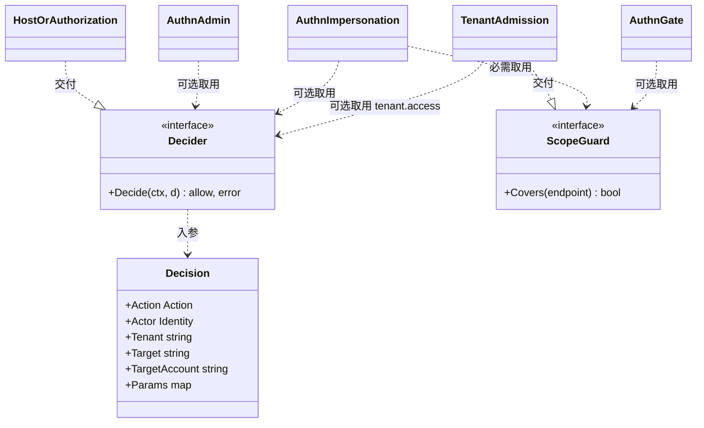
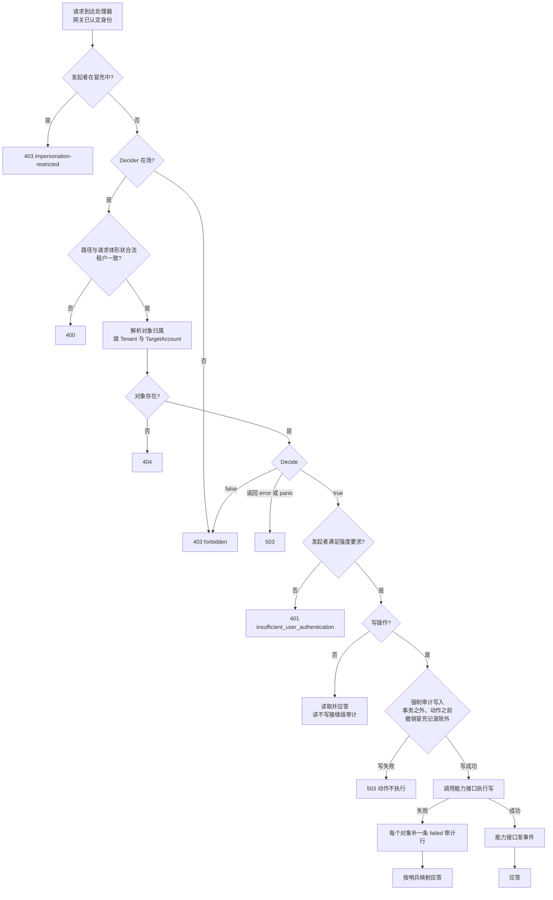

# authn-admin

## 职责

- **对授权的承诺。** `pkg/authn` 不 import 授权功能目录（[authz](../design-authz.md)）；authn 交给授权的全部东西是根包里的接口、值类型与事件，`authz.guard` 与 `authz.policy` import 根包并交付其中的接缝，方向与 `tenant/resolve` import `pkg/authn` 同形（[ADR-authn-scope-2026-10-10](../../../adr/adr-authn-scope-2026-10-10.md)）。本文的承诺表是这些东西的清单，账户标识对授权的要求在其后单列。
- **判定接缝。** 定义根包接口 `Decider`、值类型 `Decision`、动作常量 `Action`，以及冒充范围守卫 `ScopeGuard`。管理面动作、冒充的开始与读写、非成员进入租户，都经 `Decider` 判定（[ADR-authn-decision-seam-2026-10-10](../../../adr/adr-authn-decision-seam-2026-10-10.md)）。
- **管理面模块 `authn.admin`。** 挂 `B/admin/*` 下的全部管理路由；每条路由的处理顺序固定为 `Decider`、发起者强度核验、强制审计、写、事件。按路由组声明[特性](../../../glossary.md)：恒挂的组是静态特性，随能力挂出的组是条件特性，在挂该组的同一处判定里经 `feature.Board` 的 `Post` 报告。
- **`Decision` 的填法。** 路径里不带租户的租户级动作，`authn.admin` 在调用 `Decider` 之前自己解析对象的归属并填入 `Decision`。
- **自助范围的判据。** 账户对自己的会话、因素、口令、标识与外部关联的读写不过接缝；判据在本文给出，自助路由由 `authn.login`、`authn.session`、`authn.mfa` 各自挂。
- **403 的收窄。** 本文给出 authn 哪些位置可以写 403，以及网关与租户准入层写什么；判据与被否决的写法在 [ADR-authn-scope-2026-10-10](../../../adr/adr-authn-scope-2026-10-10.md)。

### 非职责

- **不做授权判定，不含角色、权限、组。** 角色按（账户，租户）绑定、归 `authz.policy`；`authz.policy` 按生效账户实时查自己的绑定。本模块只回答「谁」与「是不是成员」。
- **不实现 `Decider`，不内置放行名单。** 实现由宿主或 `authz.guard` 交付；口令表主体能否通过由接缝判定，接缝能看到 `Identity.Account().IsStatic()`。
- **不实现租户准入层。** 成员核对、租户级认证强度与冒充的租户范围在 [tenant.admission](../tenant/design-tenant-admission.md)；本模块只定义它询问的 `Decider` 动作 `authn.tenant.access` 与它交付的 `ScopeGuard`。
- **不持有账户、会话、因素、服务密钥、IdP、冒充记录的数据与规则。** 管理路由只调用对应能力的根包接口，规则与哨兵在各能力的模块里（[authn-account](design-authn-account.md)、[authn-session](design-authn-session.md)、[authn-mfa](design-authn-mfa.md)、[authn-sso](design-authn-sso.md)、[authn-impersonation](design-authn-impersonation.md)）。
- **不挂自助路由。** 自助路由在 [authn-login](design-authn-login.md)、[authn-session](design-authn-session.md)、[authn-mfa](design-authn-mfa.md) 里。
- **不发布事件。** 事件由执行写的能力接口发出；`authn.admin` 不取用事件总线与发件箱。事件与审计的契约在 [authn-events](design-authn-events.md)。
- **不声明配置键与设置键。** 键的名字、取值域与缺省值只在 [authn-config](design-authn-config.md) 给全。
- **不约束经 Go 接口的直接调用。** 宿主在自己的命令里调用 `AccountAdmin`、`Memberships`、`Sessions`、`SSOProviders` 不经 `Decider`，其访问控制由宿主命令自己负责。
- **不实现 `authz.policy` 自己的缓存与对账。** `authz.policy` 清理角色绑定靠订阅事件，并可用 `Accounts.Get` 对账。

## 外部接口契约

### 对授权的承诺

下表是 authn 对授权承诺的全部内容（封闭集）。「载体」列指向承载该项完整定义的文档，本表只写承诺，不复述那些文档里的表与清单。

| 项 | 承诺 | 载体 |
|---|---|---|
| 依赖方向 | `pkg/authn` 不 import 授权功能目录；所有接缝是根包里的接口，`authz.guard` 与 `authz.policy` import 根包并交付它们 | 本文 |
| 身份字段 | 读取面的字段集见载体文档；不含角色，不含租户（冒充范围 `Scope` 除外） | [authn](design-authn.md) |
| 访问级别 | `authz.guard` 经 `authn.AccessFromContext` 得知本请求命中的路由登记为 `Open`、`Optional` 还是 `Required`，以及网关有没有对它作过决定；约定用法见下节 | [authn](design-authn.md)、[authn-gate](design-authn-gate.md) |
| 账户标识的性质 | 不可变、全局唯一、形态由 `ParseAccountID` 判定；全部要求见下节 | 本文、[authn-account](design-authn-account.md) |
| 成员关系 | `Memberships` 的只读面，零值读作非成员；成员关系与账户的变更事件供 `authz.policy` 清理角色绑定与缓存，事件清单、投递路径与去重要求见载体文档 | [authn-account](design-authn-account.md)、[authn-events](design-authn-events.md) |
| 角色绑定 | 角色按（账户，租户）绑定，由 `authz.policy` 的 `authz_bindings` 承载 | [design-authz](../design-authz.md) |
| 会话撤销 | `Sessions.Status` 是撤销的权威面；事件 `authn.session.revoked` 是缓存失效的提示，不是权威 | [authn-session](design-authn-session.md) |
| 链上次序 | `authz.guard` 声明授权阶段，阶段内用 `After` 指向准入层的功能标识，位于租户准入层之内；跨阶段的位置由阶段顺序给出，次序与锚点的完整表在载体文档 | [authn](design-authn.md)、[tenant.admission](../tenant/design-tenant-admission.md) |
| 加强认证 | `authz.guard` 需要某条路由要求新鲜的多因素时，挂 `guard.Require(authn.Requirement{...})` | [authn-mfa](design-authn-mfa.md) |
| 令牌 | 访问令牌不带角色；`ClaimsContributor` 是宿主显式选择追加声明的口子 | [authn-token](design-authn-token.md) |
| 平台范围与准入放行 | `Decision.Tenant` 为空表示平台范围，只用于账户级动作；租户级动作的 `Decision.Tenant` 一律由 `authn.admin` 解析后填，`Decider` 永远不会收到租户为空的租户级动作；非成员的请求在准入层经 `authn.tenant.access` 询问 `Decider`，缺省拒绝，`authz.guard` 据此落地跨租户的平台级角色，不必改准入层与 authn | 本文 |
| 冒充范围 | `Identity.Scope()`、`ScopeGuard.Covers`、网关对冒充身份的范围规则 | [authn-impersonation](design-authn-impersonation.md)、[authn-gate](design-authn-gate.md) |
| 管理面与冒充接缝 | `Decider`、`Decision`、`Action` | 本文 |
| 判定接缝的实现 | `Decider` 由 `authz.guard` 实现 | [design-authz](../design-authz.md) |
| 状态码来源 | 网关从不写 403；准入层写 404 与 401；authn 的路由处理器只在封闭集内转述策略拒绝时写 403 | 本文「403 的收窄」 |
| 测试 | `authntest.Context` 构造带指定身份与访问级别的上下文 | [authn](design-authn.md) |

### 账户标识对授权的要求

授权按（账户，租户）存角色，下表是授权对账户标识这个键的全部要求（封闭集）。

| 要求 | 内容 |
|---|---|
| 不可变 | 标识一经分配永不重新分配。账户删除留墓碑，同一邮箱再注册得到新标识，所以授权里残留的旧标识指向的是已无个人数据的墓碑，不会指到新人。 |
| 全局唯一与形态 | 形态由 `ParseAccountID` 判定：1 到 64 字节、字符集 `[A-Za-z0-9._-]`、大小写敏感。授权不得解释标识的内部结构。 |
| 口令表主体 | 标识形如 `static.<名>`，`AccountID.IsStatic()` 为真；没有成员关系。授权对它们要有自己的规则：给角色或不给。 |
| 不建外键 | 授权不建指向 authn 表的外键，因为跨模块外键依赖迁移先后。清理靠订阅事件，并可用 `Accounts.Get` 对账，墓碑读作不存在。 |
| 租户标识与成员关系 | 租户标识是 `tenant.ID` 的字符串形式；成员关系回答「这个账户是不是这个租户的成员」，角色绑定在授权，没有绑定即没有权限。 |
| 成员关系状态的零值 | 零值是暂停。授权应把「查不到」与「已暂停」都读作非成员。 |
| 按生效账户解析 | 角色绑定按生效账户 `Account()` 解析。冒充时管理员因此得到被冒充者在 `Scope()` 租户内的权限，限制冒充的范围是 `Decider` 在冒充开始时的事。授权对 `Scope()` 非空而请求不在该租户内的请求默认拒绝；准入层已答 404，授权再拒一次是纵深。 |
| `idp.` 前缀的属性 | 属性集里 `idp.` 前缀的值来自外部 IdP 的声明。授权可以读，把它们当强授权依据之前应自己判断信任程度。 |
| `Access` 的约定用法 | `AccessOpen` 放行，公开路由由 authn 已声明；`AccessOptional` 且无身份，按授权自己的匿名规则判；`AccessRequired` 而无身份，或 `AccessUnknown`，说明该端不在网关所守之列或网关缺席，授权拒绝。认证缺席时的失败方向取拒绝。 |

### `Decider`、`Decision`、`Action`

以下类型位于 `pkg/authn` 根包，逐字与根包一致。

```go
type Action string

const (
	ActionAccountRead         Action = "authn.account.read"
	ActionAccountCreate       Action = "authn.account.create"
	ActionAccountUpdate       Action = "authn.account.update"        // 显示名、属性、protected、mfa_required、管理员重置口令、添加标识
	ActionAccountDisable      Action = "authn.account.disable"       // 停用与恢复
	ActionAccountDelete       Action = "authn.account.delete"
	ActionMembershipManage    Action = "authn.membership.manage"     // 读写成员关系，含 sso_exempt
	ActionSessionRead         Action = "authn.session.read"          // 读他人的会话
	ActionSessionRevoke       Action = "authn.session.revoke"        // 撤销他人的会话
	ActionMFAReset            Action = "authn.mfa.reset"
	ActionClientManage        Action = "authn.client.manage"         // 服务账户的密钥创建与撤销
	ActionIDPManage           Action = "authn.idp.manage"            // 含域声明与元数据刷新
	ActionImpersonateStart    Action = "authn.impersonation.start"
	ActionImpersonationRead   Action = "authn.impersonation.read"
	ActionImpersonationRevoke Action = "authn.impersonation.revoke"
	ActionTenantAccess        Action = "authn.tenant.access"         // 非成员进入租户：准入层询问，缺省拒绝
)

type Decision struct {
	Action        Action
	Actor         Identity
	Tenant        string
	Target        string
	TargetAccount string
	Params        map[string]string
}

// Decider 回答「某个发起者能否做 authn 范围内的这件事」。排他功能。
type Decider interface {
	Decide(ctx context.Context, d Decision) (allow bool, err error)
}
```

| 项 | 承诺 |
|---|---|
| 动作常量 | 上列常量是动作的全集；归属判据是「作用于他人账户或租户级资源的管理面动作、冒充的开始与读写、非成员进入租户」。动作随新增的管理面能力增长，新增动作按此判据归入。 |
| 排他与取用 | `Decider` 由宿主或 `authz.guard` 实现，排他。取用方 `authn.admin`、`authn.impersonation`、`tenant.admission` 在 `Init` 里以 `Optional` 取用，缺提供者（`core.ErrMissingProvider`）是合法配置，行为是全部拒绝；`Decider` 不写进任何模块的 `Requires`（[ADR-authn-wiring-2026-10-10](../../../adr/adr-authn-wiring-2026-10-10.md)）。 |
| 返回值 | `allow` 为真放行，为假拒绝；`err` 非空一律按 503 收口，不当作拒绝，也不当作放行。处理器对 `Decide` 的调用自带 `recover`，panic 按 `err` 非空处理，同样是 503，管理动作不执行。 |
| 默认全拒的落点 | 在取用方，不在一个「默认拒绝」的模块里。没有任何模块交付 `Decider` 的装配，宿主什么都不做也是安全的。 |
| 不内置名单 | `pkg/authn` 不内置任何放行名单。 |
| `Params` | 有限的参数，例如 `reason`、`ttl`（例举，不是封闭集），不含任何凭据。 |
| 新增动作 | 新增动作对已有的 `Decider` 实现表现为一个它不认识的动作字符串，按未知动作拒绝还是放行由实现决定；authn 不能替它收紧。 |

宿主最小的实现是一个函数：

```go
type opsOnly struct{}

func (opsOnly) Decide(ctx context.Context, d authn.Decision) (bool, error) {
	return d.Actor.Backend() == "static" && d.Actor.Account() == "static.ops", nil
}
```

判据是完整的账户标识 `static.ops`，不是 `static.` 前缀：前缀只表示这个标识出自口令表，表里每个主体的标识都带它。有几个运营者，就各列一个名字；`d.Actor.Account().IsStatic()` 为真即放行，会把口令表里的每个主体都放进管理面。

### `ScopeGuard`

```go
// ScopeGuard 由租户准入层交付：声明自己守哪些端，并在这些端上核对冒充身份的租户范围。
type ScopeGuard interface {
	Covers(endpoint string) bool
}
```

`ScopeGuard` 是根包接口，由 `tenant.admission` 排他交付；`authn.impersonation` 把它当必需依赖，网关把它当可选依赖。它使网关与 `authn.impersonation` 在不 import `pkg/tenant` 的前提下知道冒充身份能被放进哪些端。`Covers(endpoint)` 报出准入层的 `endpoints` 里是否有该端；它只说准入层守哪些端，不核对宿主有没有在那些端上开租户解析的豁免。网关在 `Start` 里核对 `Covers(mount.endpoint)` 为真即 `ErrInvalidConfig`（见 [authn-gate](design-authn-gate.md)）。

### 管理面模块 `authn.admin`

`authn.admin` 是 `pkg/authn/admin` 里注册的独立模块，不交付任何功能接口，只经 `mount.Mounter` 挂 `B/admin/*`；基路径 `B` 由 [authn-gate](design-authn-gate.md) 声明。路由的访问级别全部是 `Required`，且都不登记 `Impersonable`。

- **不纳入就没有管理路由。** 宿主不点名 `authn.admin` 时没有 `B/admin/*` 下的任何路由；`AccountAdmin`、`Memberships`、`Sessions`、`SSOProviders` 的 Go 接口照常可用。
- **缺审计则启动失败。** `audit.Audit` 是必需依赖，漏纳入在任何实例构造之前以 `core.ErrMissingProvider` 失败，不留到第一次写操作才发现。
- **每组路由随对应能力在场才挂。** 能力缺席时该组路由不存在，路由引擎对它按未命中处理；缺接缝的组不挂出，不做成挂出而全拒，理由与被否决的写法在 [ADR-authn-decision-seam-2026-10-10](../../../adr/adr-authn-decision-seam-2026-10-10.md)。启动诊断写出挂了哪几组。

下表是路由组的全集（封闭集），只写组名、挂出条件与该组对应的[特性](../../../glossary.md)；每条路由属于哪一组，由下节路由表的「组」列给出。新增路由归入其能力所在的组，或新增一组。

| 组 | 挂出的条件 | 特性 |
|---|---|---|
| 账户 | 恒挂（`Accounts`、`AccountAdmin` 必需） | `authn.admin`（静态） |
| 成员关系 | 恒挂（`Memberships` 必需） | `authn.admin`（静态） |
| 会话 | `Sessions` 在场 | `authn.admin.sessions`（条件） |
| 因素与口令 | `MFA` 在场（这些路由要核对 `MFA.Seasoned`）；其中管理员重置口令的路由还要 `Passwords` 在场 | `authn.admin.factors`（条件） |
| 服务密钥 | `Tokens` 在场 | `authn.admin.secrets`（条件） |
| SSO 提供方 | `SSOProviders` 在场 | `authn.admin.sso`（条件） |
| 元数据刷新 | 至少一个 `SSOMetadataRefresher` 在场，且 SSO 提供方组已挂 | `authn.admin.sso.metadata`（条件） |
| 冒充记录 | `Impersonation` 在场，且交付了单条读取（`Get`） | `authn.admin.impersonations`（条件） |

**各组以特性声明。** 描述符的 `Resources` 为上表每个特性名带一条 `feature.Spec`，条件特性的 `Conditional` 为真（[feature](../design-feature.md)）。

- **`authn.admin` 是[静态特性](../../../glossary.md)，指账户组与成员关系组。** 它们恒挂：所依赖的功能与 `mount.Mounter` 都是必需依赖，模块进入启用集即挂出它们，所以声明为静态特性符合架构不变量 18（[architecture](../../architecture.md#架构不变量)）。
- **其余各组是[条件特性](../../../glossary.md)，在 `Init` 挂该组路由的同一处判定里报告**（`pkg/authn/admin/routes.go` `(*product).mountRoutes`、`mountAccountRoutes`）：会话、服务密钥、SSO 提供方与冒充记录各在挂该组的分支里报告；`authn.admin.sso.metadata` 在 SSO 提供方分支之内、挂刷新路由的那一处报告；`authn.admin.factors` 在 `mountAccountRoutes` 里 `MFA` 在场的分支报告。进程纳入了 `feature.board` 时，特性文档含一个条件分组名，当且仅当该组已挂出（[ADR-feature-ownership-2026-10-17](../../../adr/adr-feature-ownership-2026-10-17.md)）。
- **管理员重置口令随因素组，不另立特性名。** `authn.admin.factors` 的报告不看 `Passwords`，而重置口令的路由在同一分支内还要 `Passwords` 在场。服务前端的命令必须纳入 `authn.login`（[web](../web/design-web.md)），`authn.login` 把 `Passwords` 列为必需依赖（[authn-login](design-authn-login.md)），所以服务前端的装配里重置口令的路由与因素组同时挂出，`authn.admin.factors` 在场即指因素组连同重置口令的路由。
- **`feature.Board` 经 `core.Resolve` 取用，不列入 `Requires`。** 取不到时（没有纳入 `feature.board` 的进程）不报告，各组照上表的条件挂出。

### 管理面路由表

路由相对基路径 `B`；`动作` 列是询问 `Decider` 的 `Action`，写常量值去掉 `authn.` 前缀的部分；「强制审计」指强制档审计，写失败则动作不执行，见「处理器的判定顺序」；撤销冒充记录是其中唯一的例外。「新鲜的本地多因素」「`MFA.Seasoned`」的定义在 [authn-mfa](design-authn-mfa.md)。下表是路由的全集（封闭集）。

| 组 | 方法 路径 | 动作 | 额外要求 |
|---|---|---|---|
| 账户 | `GET\|POST B/admin/accounts` | `account.read`、`account.create` | 列表键集分页（`Accounts.List`），可按状态、种类、标识前缀、显示名前缀过滤，标识前缀精确到一种标识类型；列表的查询参数是封闭集，出现集合外的参数即 400，已接受的过滤给空值即不过滤（显示名前缀按字节前缀、大小写敏感，不是合法 UTF-8 即 400）；创建的**用户**账户至少要有一个登录标识（用户名、邮箱或手机号），一个都没有的请求在写入之前 400，不留下无法登录的账户；服务账户以服务密钥登录，不受这条要求；创建服务账户另要 `client.manage`；强制审计 |
| 账户 | `GET\|PATCH\|DELETE B/admin/accounts/:id` | `account.read`、`account.update`、`account.delete` | `PATCH` 改显示名、属性与 `protected`（`SetDisplayName`、`SetAttributes`、`SetProtected`）；删除要新鲜的本地多因素；强制审计 |
| 因素与口令 | `POST B/admin/accounts/:id/password` | `account.update` | 管理员提交临时口令，是请求体，从不回显、不进日志与审计，缺省置 `must_change`；发起者新鲜的本地多因素且 `MFA.Seasoned`；强制审计；成功后撤销该账户的全部会话 |
| 账户 | `POST B/admin/accounts/:id/identifiers`、`DELETE B/admin/accounts/:id/identifiers/:identifier` | `account.update` | 添加用户名（登录名）与管理员断言的邮箱，邮箱的 `verified_via` 为 `admin`，不作自动关联与并入的依据；强制审计 |
| 账户 | `POST B/admin/accounts/:id/status` | `account.disable` | 新鲜的本地多因素；强制审计；停用后同步清理会话（`AccountLifecycle`），清理失败 503，重试幂等 |
| 会话 | `GET B/admin/accounts/:id/sessions`、`POST B/admin/accounts/:id/revoke-sessions`、`DELETE B/admin/sessions/:id` | `session.read`、`session.revoke` | `DELETE B/admin/sessions/:id` 先 `Sessions.Get` 解析会话所属账户，`Decision.Target` 填会话标识、`TargetAccount` 填账户；强制审计 |
| 因素与口令 | `GET B/admin/accounts/:id/factors`、`POST B/admin/accounts/:id/mfa-required`、`POST B/admin/accounts/:id/mfa-reset` | `account.read`、`account.update`、`mfa.reset` | 清单只交回种类、标签、状态；重置要新鲜的本地非短信多因素与 `MFA.Seasoned`；强制审计 |
| 服务密钥 | `GET\|POST B/admin/accounts/:id/secrets`、`DELETE B/admin/accounts/:id/secrets/:secret` | `client.manage`（`GET` 为 `account.read`） | `GET` 经 `ListServiceSecrets`，只交标识、标签、期限与撤销状态；创建与撤销要新鲜的本地多因素；密钥只在创建应答里出现一次；撤销后同步撤销该密钥的 service 会话；强制审计 |
| 成员关系 | `GET B/admin/tenants/:tenant/members`、`PUT\|DELETE B/admin/tenants/:tenant/members/:account`、`PUT B/admin/tenants/:tenant/members/:account/sso-exempt` | `membership.manage` | `Decision.Tenant` 取路径里的租户标识，不是别名，所以 `authn.admin` 不依赖租户名册；强制审计 |
| SSO 提供方 | `GET\|POST B/admin/tenants/:tenant/sso/providers`、`GET\|PUT\|DELETE B/admin/sso/providers/:id`、`POST\|DELETE B/admin/sso/providers/:id/domains[/:domain]`、`POST B/admin/sso/providers/:id/domains/:domain/verify`、`POST B/admin/sso/providers/:id/reverify-domains` | `idp.manage` | `Decision.Tenant` 取 `SSOProviders.Tenant(id)`；路径带租户的路由核对路径、请求体与已存记录的租户一致，不一致 400，`PUT` 时租户不可变；加密列从不回显；IdP 发起登录开启与 `merge_existing` 开启时应答带警告；强制审计 |
| 元数据刷新 | `POST B/admin/sso/providers/:id/metadata/refresh` | `idp.manage` | `Decision` 的填法同 SSO 提供方组；经 `SSOMetadataRefresher` 按 `Protocol` 分派；强制审计 |
| 冒充记录 | `GET B/admin/impersonations`、`DELETE B/admin/impersonations/:id` | `impersonation.read`、`impersonation.revoke` | `GET` 必带查询参数 `tenant`，缺省或为空 400，`Decision.Tenant` 取它，并作为 `GrantQuery.Tenant` 传给 `Impersonation.List`；`DELETE` 先经单条读取 `Get`（依赖表登记的扩展形状）按标识读记录（含已结束的），记录不存在 404，`Decision.Tenant` 取记录的租户，`Target` 与 `TargetAccount` 取记录的目标；已结束的记录经 `Decider` 放行后 `Revoke` 无操作，应答与首次撤销相同；这一组的审计是尽力档：撤销是向安全方向的动作，审计由 `Impersonation.Revoke` 自己写，写失败只记 Error，不阻止撤销，处理器不另写强制档审计，也不补 `failed` 行 |

### 自助范围

自助范围的判据：账户对自己的会话、因素、口令、标识与外部关联的读写，只要求下列各项，不经 `Decider`。

- 发起者是本人：`Actor`、`Account` 与路径上的账户一致，路径不带账户的路由取上下文里的身份。
- 发起者未在冒充。
- 满足多因素的新鲜度要求（[ADR-authn-mfa-2026-10-10](../../../adr/adr-authn-mfa-2026-10-10.md)、[authn-mfa](design-authn-mfa.md)）。

自助动作的授权依据是「发起者就是这个账户」，这是 authn 自己可以核对的事实，不需要策略。没有 `Decider` 的装配里，用户仍能改自己的口令。自助路由由 `authn.login`、`authn.session`、`authn.mfa`、`authn.profile` 挂，本模块不挂。

### 对外接口面

- `Decider`、`Decision`、`ScopeGuard` 的签名，以及 `Decision` 各字段的填法（见「`Decision` 的填法」），属于对外接口面。
- 动作常量的值：新增常量是兼容的；删除、改名或改变既有常量的值是破坏性变更。
- 「`Decider` 永远不会收到租户为空的租户级动作」是接口面的行为语义。
- 路由路径与其询问的动作属于对外接口面；路由集随装配变化，不在其中。
- 声明的特性名与各名所指的路由组：前端经生成的特性名类型引用它们，改名、撤去或改变所指的组是宿主可见的破坏性变更；哪些名字在特性文档里随装配变化，不在接口面内。
- 403 的位置集合是封闭集，新增一种要有新的决定。

## 依赖

| 依赖 | 方式 | 说明 |
|---|---|---|
| `mount.Mounter` | 必需 | 登记 `B/admin/*`；由 `authn.mount` 交付。 |
| `Accounts`、`AccountAdmin` | 必需 | 账户组路由；由 `authn.account` 交付。 |
| `Memberships` | 必需 | 成员关系组路由；由 `authn.account` 交付。 |
| `audit.Audit` | 必需 | 强制档审计的落点；缺席即构造之前启动失败。 |
| `Decider` | 可选 | 缺席即全拒。 |
| `Sessions` | 可选 | 会话组路由；取会话所属账户。 |
| `MFA` | 可选 | 因素与口令组路由；核对 `Seasoned`。 |
| `Passwords` | 可选 | 因素与口令组里管理员重置口令的路由；缺席时该路由不挂，组内其余路由照挂。由 `authn.account` 交付。 |
| `settings.Store` | 可选 | 读 `authn.mfa.recent-window` 构造强认证要求的 `FreshLocalMulti` 窗口（该键由 [design-authn-mfa](design-authn-mfa.md) 声明，本模块是它的使用方之一）；缺席或读不出取声明的缺省（见 [design-authn-config](design-authn-config.md)）。 |
| `Tokens` | 可选 | 服务密钥组路由。 |
| `SSOProviders` | 可选 | SSO 提供方组路由；取提供方所属租户。 |
| 全部 `SSOMetadataRefresher` | `ResolveAll` | 元数据刷新路由；按 `Protocol` 分派。 |
| `Impersonation` 及单条读取 `Get` | 可选 | 冒充记录组路由。`List`、`Revoke` 来自公开的 `Impersonation` 接口；`Get` 是记录组为解析记录的租户与目标所需的扩展形状，不在公开接口里（见 [design-authn-impersonation](design-authn-impersonation.md)）；缺 `Get` 时整组不挂，不做成挂出而全拒。 |
| `feature.Board` | 可选，`Init` 经 `core.Resolve` 取用，不列入 `Requires` | 报告条件分组的特性名；缺席时不报告，路由照挂。 |

**方向核对。** `authn.admin` 位于认证功能目录内，不 import `pkg/tenant`、授权功能目录、宿主与 `pkg/feature/board`，也不 import 认证功能目录里别的实现子包。`pkg/feature` 根包只依赖标准库，为声明特性 import 它不扩大本模块的闭包（[feature](../design-feature.md)）。`Decider` 与 `ScopeGuard` 都是根包接口：`authz.guard` 与 `tenant.admission` import 根包交付它们，反向没有依赖。

被依赖方向：`authn.impersonation` 与 `tenant.admission` 取用同一个 `Decider`，各自在自己的处理路径上询问；`tenant.admission` 交付 `ScopeGuard`（[ADR-tenant-admission-2026-10-10](../../../adr/adr-tenant-admission-2026-10-10.md)）。

## UML 图

### 接缝的类型关系

下图固定谁定义接缝、谁取用、谁交付。`Decider` 与 `ScopeGuard` 都定义在根包；取用方只依赖根包，交付方在 authn 目录之外。



`Decision` 由取用方构造，`Decider` 的实现只读它。取用方里只有 `authn.admin` 填写租户级管理动作的 `Tenant`；`tenant.admission` 填 `Actor` 与本请求的租户，`authn.impersonation` 填目标与租户（[authn-impersonation](design-authn-impersonation.md)）。

## 核心数据结构

### `Decision` 的字段

| 字段 | 含义 | 填写者与约束 |
|---|---|---|
| `Action` | 询问的动作，取上文常量 | 取用方。 |
| `Actor` | 发起者的身份 | 取用方取请求上下文里的身份。管理面动作与冒充发起要求发起者未在冒充，所以这些调用里 `Actor.Impersonating()` 为假。 |
| `Tenant` | 动作的租户范围 | 租户级动作由 `authn.admin` 解析后填，必为非空；账户级动作为空，表示平台范围。 |
| `Target` | 动作的对象：账户标识、会话标识、IdP 标识或冒充记录标识 | 取用方；没有单一对象的动作（列表、创建）为空。 |
| `TargetAccount` | 对象所属的账户 | 会话、因素、服务密钥、冒充记录的路由由 `authn.admin` 解析后填；账户级对象即 `Target` 本身。 |
| `Params` | 有限的参数 | 取用方；不含任何凭据，管理员提交的临时口令从不进入。 |

## 核心算法与流程

### 处理器的判定顺序

每条管理路由的处理器共用同一个判定顺序，任一步不满足即终止。写操作与读操作在「写操作」一步分叉。



约束：

- **冒充检查在最前。** 所有管理动作都不得在冒充中执行。网关因这些路由没有登记 `Impersonable` 而对冒充身份答 401；处理器自己仍检查 `Actor` 的冒充状态，答 403 `impersonation-restricted`，不询问 `Decider`。
- **`Decider` 缺席先于任何查询。** 缺提供者时答 403 `forbidden`，不解析对象，使默认部署不泄露对象是否存在。
- **归属解析先于 `Decide`。** `Decision` 要带归属，所以解析必须在询问之前（见「`Decision` 的填法」）。
- **强度核验在 `Decide` 之后、审计之前。** 强度要求按路由表的「额外要求」列，核验失败答 401 加强认证挑战，不写审计，不执行动作。
- **强制审计在事务之外、动作之前。** 管理面路由里只有撤销冒充记录不适用：它的审计是尽力档，由 `Impersonation.Revoke` 自己写，处理器跳过强制审计与补行（路由表）。接缝级的审计写入另占一条连接、不加入调用方的事务；在调用方事务开着时调用它，SQLite 上等调用方占着的写锁，单连接库上等调用方占着的那条连接，等待超时后 `Record` 以 `ErrWriteFailed` 失败，强制档因此永远写不成功。处理器因此不在任何事务里调用 `audit.Record`，事务内只暂存发件箱事件，不调 `Bus.Publish`。
- **写失败逐对象补一条 `failed` 行。** 审计与动作不在同一事务里，动作失败时审计里留一条已写而未生效的行，随后为每个已写出的对象补一条 `outcome=failed` 的行，用动作标识关联。
- **读路由不写接缝级审计。** 审计动作表是封闭集且不含任何读动作，读由请求级采集记录（[design-authn-events](design-authn-events.md)），所以 `authn.admin` 的读路由只读、不应答审计，也不补 `failed` 行。
- **事件由能力接口发出。** 写成功后的事件在能力接口自己的事务与发布路径里，`authn.admin` 不重复发布。

审计的动作名、明细键与档位见 [authn-events](design-authn-events.md)。

### `Decision` 的填法

路径里不带租户的动作，`authn.admin` 在调用 `Decider` 之前解析对象的归属并填进 `Decision`。宿主若按 `Decision.Tenant` 判租户管理员，租户 T1 的管理员改写或删除 T2 的 IdP、给它声明域名、踢 T2 成员的会话时，看到的 `Tenant` 是 T2。

下表是各路由族的填法（封闭集）。

| 路由族 | `Tenant` | `Target` | `TargetAccount` |
|---|---|---|---|
| 账户列表与创建 | 空（平台范围） | 空 | 空 |
| `accounts/:id` 及其下的 `status`、`password`、`identifiers`、`factors`、`mfa-required`、`mfa-reset`、`secrets`、`sessions`、`revoke-sessions` | 空（平台范围） | 路径里的账户 | 同 `Target` |
| `sessions/:id` 的删除 | 空（平台范围） | 会话标识 | `Sessions.Get` 解析出的账户 |
| 成员列表 | 路径里的租户标识 | 空 | 空 |
| 成员的写与 `sso-exempt` | 路径里的租户标识 | 路径里的账户 | 同 `Target` |
| `tenants/:tenant/sso/providers` 的列表与创建 | 路径里的租户标识；创建时路径、请求体里的租户一致 | 空 | 空 |
| `sso/providers/:id` 及其 `domains`、`reverify-domains`、`metadata/refresh` | `SSOProviders.Tenant(id)` | IdP 标识 | 空 |
| 冒充记录列表 | 必填的查询参数 `tenant` | 空 | 空 |
| `impersonations/:id` 的删除 | 记录的租户 | 记录的目标账户 | 同 `Target` |

- **租户的一致性核对在询问之前。** 路径带租户的路由，路径、请求体与已存记录的租户不一致，按 400 拒绝，不交给 `Decider`；`PUT` 时提供方的租户不可变，与已存的不同即拒绝。
- **租户为空的含义。** 为空只表示平台范围，即对象不属于单一租户。按租户判管理员的 `Decider` 对平台范围的动作读到空租户，应拒绝；这是失败时拒绝的方向。
- **`Decider` 永远不会收到租户为空的租户级动作。** 任何新增管理路由若其对象属于某个租户，其 `Tenant` 取对象的归属，路径里没有时由 `authn.admin` 解析。守住它的是测试，不是类型系统（见「守住性质的测试」）。

### 非成员进入租户

`tenant.admission` 对非成员且 `Identity.Scope()` 为空的身份询问 `Decide(Decision{Action: ActionTenantAccess, Actor, Tenant})`。返回 `true` 放行，只表示「可以进入这个租户」，不赋予任何角色，租户内能做什么仍由 `authz.guard` 判定；`Decider` 缺席或返回 `false` 按准入层的 404 处理，返回 error 按 503 处理。冒充身份不适用这条询问，冒充只能在其范围内。判定与缓存的细节在 [tenant.admission](../tenant/design-tenant-admission.md)。

### 引导

初始账户、初始成员关系、初始 IdP 在没有任何管理员时的来源如下（封闭集），都不是内置名单：

- 宿主在自己的命令里用 `AccountAdmin` 与 `Memberships` 的 Go 接口创建，与「账户从哪里来是宿主的事」同形。
- 宿主实现一个只含判定逻辑的 `Decider`，先放行某个口令表主体，例如上文的 `opsOnly`。

默认部署开箱即不可被远程管理，这是有意的。

**发起冒充的判定不属于这条引导。** `opsOnly` 这样的静态主体规则驱动不了冒充：本模块的结构性限制要求发起者是有会话、本地验证过新鲜多因素的非静态用户账户，而静态主体没有会话可绑（[design-authn-impersonation](design-authn-impersonation.md)）。要启用冒充，宿主须实现一个按（账户，租户）角色判定的 `Decider`——例如租户的所有者冒充该租户内角色更低的成员——角色绑定由 `authz.policy` 持有，authn 不认识它。「谁有权冒充谁」因此是宿主的配置；authn 保证的只是发起者满足不依赖 `Decider` 的结构与强认证限制，`Decider` 只能在其上收紧。

## 错误与失败语义

### 403 的收窄

- **网关从不写 403。** 做认定的中间件层只回答「是谁」；凭据缺失、强度不够、冒充身份进了不允许的路由都是 401。
- **`tenant.admission` 写 404 与 401。** 非成员、租户不存在、已停用、冒充范围不符一律 404，不区分原因；强度不够是 401 加强认证挑战。
- **authn 的路由处理器可以写 403，位置是封闭集。** 它们是自己资源的所有者，只在转述认证之外的策略的拒绝时写 403：`Decider` 的拒绝（`forbidden`）、被全局设置关闭的登录方式（`method-disabled`）、外部登录路径上的账户不可用（`account-unavailable`）、冒充期间的限制（`impersonation-restricted`）。本模块的处理器只写其中的 `forbidden` 与 `impersonation-restricted`。
- **其余一切「不够强」是 401。** 加强认证挑战的应答见 [authn-mfa](design-authn-mfa.md)。

判据、被否决的 401 与 404 两种写法及其理由在 [ADR-authn-scope-2026-10-10](../../../adr/adr-authn-scope-2026-10-10.md)。调用方读到的 403 可能来自 authn 的处理函数，也可能来自链上的授权层（`authz.guard`）或宿主的 handler，仅凭状态码区分不了来源。

### 失败方向

哨兵与 `Problem.Type` 的完整表在 [authn-failure](design-authn-failure.md)；下表是 `authn.admin` 处理器遇到各情形时的应答与方向。

| 情形 | 应答 | 方向 |
|---|---|---|
| 发起者在冒充中 | 403 `impersonation-restricted`（`ErrImpersonationRestricted`） | 拒 |
| `Decider` 缺席，或 `Decide` 返回 `false` | 403 `forbidden`（`ErrForbidden`） | 拒 |
| `Decide` 返回 error 或 panic | 503 `urn:speed:authn:unavailable`（`ErrUnavailable`），成因只进日志，动作不执行 | 拒 |
| 租户在路径、请求体与已存记录之间不一致 | 400，不询问 `Decider` | 拒 |
| 对象不存在（`ErrAccountNotFound`、`ErrSessionNotFound` 及对应的提供方、冒充记录） | 404 | 拒 |
| 发起者的强度不足 | 401 `insufficient_user_authentication`（`ErrStepUpRequired`） | 拒 |
| 管理员重置因素与重置口令时，发起者名下没有启用已满 `sensitive-min-age` 的非短信因素（`Seasoned` 为假），在强度判定通过之后判定 | 403 `factor-not-seasoned`（`ErrFactorNotSeasoned`） | 拒 |
| 强制档审计写失败（含 `ErrNotAccepting`、`ErrWriteFailed`） | 503（`ErrAuditRequired`），动作不执行 | 拒 |
| 写失败 | 为每个对象补一条 `failed` 审计行，按能力接口的哨兵映射应答 | 拒 |
| 写已生效而清理失败（`ErrCleanupIncomplete`） | 503，重试同一请求幂等地补完 | 拒（状态已生效，清理待补） |
| db 或依赖的能力不可用 | 503，不带着半份结果放行 | 拒 |

### 非保证

- **`Decider` 的实现质量由宿主承担。** authn 保证它收到的输入，不保证它的判定；一个对 `authn.tenant.access` 一律返回 `true` 的实现，使每个租户对所有已认证的非成员敞开。准入层缓存判定结果，策略撤销在缓存期内不生效，期限由设置承载，见 [tenant.admission](../tenant/design-tenant-admission.md)。
- **Go 接口的直接调用不经 `Decider`。** 宿主命令里的运维操作，其强度完全取决于宿主命令自己的访问控制。
- **`Decider` 的拒绝不进网关的收口计数。** 询问发生在处理函数里、请求已过网关，拒绝只进各自的日志与审计。
- **管理面的路由集随装配变化。** 同一份请求在不同装配里得到 403 或路由引擎的未命中应答。哪些组在本进程挂出，经特性文档对已认证调用者发布（见「管理面模块 `authn.admin`」）。
- **强制审计与动作不在同一事务里。** 动作失败时审计里有一条已写而未生效的行，随后补 `failed` 行，用动作标识关联。

### 实现所依赖的假设

链上次序是推导而非实测，承载它的假设与守住它的装配测试在 [authn](design-authn.md#链上次序)，本文不重复。以下行为未经运行核实，依赖它们的断言以对应的测试守住，测试失败即视为前提不成立：

- 假设 `authn.admin` 对 `Decider` 的可选取用、对 `audit.Audit` 的必需取用与每个模块的 `var _` 断言，在真实注册表下按本文所述工作：缺 `audit.Audit` 在构造之前以 `core.ErrMissingProvider` 失败，缺 `Decider` 不失败。装配测试逐项断言。

### 守住性质的测试

| 守住的性质 | 测试 |
|---|---|
| `Decision` 的填法 | 表驱动，逐族断言与「`Decision` 的填法」一致：租户级路由（IdP 与域、成员关系、冒充记录）收到 `Decision.Tenant` 为对象的租户、`TargetAccount` 为对象所属账户；账户级路由（`accounts/:id` 及其下的会话、因素、服务密钥）收到 `Decision.Tenant` 为空（平台范围），跨租户的保护落在 `TargetAccount`，是对象所属账户。 |
| 租户一致性 | 路径、请求体与已存租户不一致时 400，且 `Decider` 的调用计数为零。 |
| 缺席即全拒 | 没有任何 `Decider` 的装配里，逐条管理路由回 403，冒充被拒，非成员请求回 404。 |
| 缺审计 | 纳入 `authn.admin` 而没有 `audit.Audit` 的装配，在构造之前以 `core.ErrMissingProvider` 失败。 |
| 强制审计先于动作 | 审计接缝返回 `ErrWriteFailed` 时，每条强制档路由回 503，且能力接口的写调用计数为零。 |
| 撤销冒充记录的审计档 | 审计接缝返回 `ErrWriteFailed` 时，`DELETE B/admin/impersonations/:id` 仍撤销成功，只记 Error；已结束的记录再撤销得到相同应答；记录不存在回 404；`GET B/admin/impersonations` 缺 `tenant` 回 400，`Decider` 的调用计数为零。 |
| 强制审计不在调用方事务里 | 处理器全程不开事务，`audit.Record` 在能力接口的写之前调用；SQLite 文件库（单写者）上管理写操作成功且审计行存在——处理器若把审计与写包进一条事务，该库上会因写锁自等而失败。 |
| 冒充中拒绝 | 冒充身份直达处理器时，每条管理路由回 403 `impersonation-restricted`，`Decider` 的调用计数为零。 |
| 路由组随能力挂 | 逐个去掉 `Sessions`、`MFA`、`Tokens`、`SSOProviders`、`SSOMetadataRefresher`、`Impersonation`，对应组的路由是路由引擎的未命中，其余组不受影响；启动诊断列出实际挂出的组。 |
| 特性与路由组同源 | 用真实的 `feature.board` 驱动到 `Start`，表驱动逐组断言：功能在场，当且仅当报告该组的特性名，当且仅当该组路由已登记；`authn.admin` 在每一种组合下都在特性文档里。 |
| 缺席不放行 | `Decide` 返回 error 回 503，panic 同样回 503，两种情形下能力接口的写调用计数都为零。 |

## 并发与事务边界

- **处理器不持有事务。** 一条管理请求里，`Decider` 的询问、强制审计与能力接口的写各自独立；能力接口的事务由它自己的模块管理，事务内只暂存发件箱事件。强制审计的写入不在任何调用方事务里，原因见「处理器的判定顺序」。
- **`Decider` 在请求路径上同步调用。** 它受请求上下文约束，实现必须并发安全，对同一请求不保证只被调用一次。
- **幂等。** 撤销类写操作（撤销会话、撤销服务密钥、撤销冒充记录）幂等；管理面写靠能力接口的唯一约束与条件更新判胜负，重试同一请求得到同一结果；停用后清理失败的重试幂等地补完。
- **缓存。** `authn.admin` 不缓存 `Decider` 的结果，每个请求询问一次；准入层对 `tenant.access` 的缓存归它自己。

## 扩展点

- **`Decider`。** 宿主与 `authz.guard` 的接入点，一个接口按动作字符串路由；`authz.guard` 按 `Decision.Action` 分派，「是否允许冒充」是其中一个动作。
- **新增管理路由。** 对象属于某个租户的路由要按「`Decision` 的填法」自己解析归属，并加入对应的表驱动测试；新增动作按动作常量的归属判据加入根包。
- **`SSOMetadataRefresher`。** 元数据刷新路由按 `Protocol` 分派到 `ResolveAll` 取到的实现；新增协议的刷新实现不改本模块。

## 实现状态

| 能力 | 状态 | 代码 |
|---|---|---|
| 重置因素与重置口令在 `Seasoned` 不满足时答 403 `factor-not-seasoned` | 已实现 | `pkg/authn/admin/factor.go` `requireAdministrator` |
| 根包的 `Decider`、`Decision`、`Action` 常量 | 已实现 | `pkg/authn/decide.go` `Decider`、`Decision`、`Action` |
| 根包的 `ScopeGuard` | 已实现 | `pkg/authn/scope.go` `ScopeGuard`；`pkg/authn/gate/gate.go` `wire`；`pkg/tenant/admission/admission.go` `(*layer).Covers` |
| `authn.admin` 模块：注册、必需与可选依赖、缺审计的启动失败、路由组的挂出与启动诊断 | 部分实现 | `pkg/authn/admin/admin.go` `Module`、`newProduct`、`product.wire`、`diagnose`；`pkg/authn/admin/routes.go` `mountRoutes` |
| 处理器的判定顺序：冒充检查、`Decider` 取用、强度核验、强制审计、失败补行 | 已实现 | `pkg/authn/admin/pipeline.go` `caller`、`admit`、`asks`、`callDecider`、`require`、`auditRequired`、`auditBestEffort`、`answer`、`notFound`、`bad` |
| `Decision` 的归属解析 | 已实现 | `pkg/authn/admin/sso.go` `providerFor`（`SSOProviders.Tenant`）；`pkg/authn/admin/membership.go`（路径租户）；`pkg/authn/admin/session.go`（`Sessions.Get` 解析账户）；`pkg/authn/admin/impersonation.go`（记录租户） |
| 账户组与成员关系组路由 | 已实现 | `pkg/authn/admin/account.go` `handleAccountList`、`handleAccountCreate`、`handleAccountGet`、`handleAccountPatch`、`handleAccountDelete`、`handleAccountStatus`、`handleIdentifierAdd`、`handleIdentifierRemove`；`pkg/authn/admin/membership.go` `handleMemberList`、`handleMemberPut`、`handleMemberRemove`、`handleMemberSSOExempt`；`pkg/authn/admin/routes.go` `mountAccountRoutes`、`mountMembershipRoutes` |
| 会话组、因素与口令组、服务密钥组路由 | 已实现 | `pkg/authn/admin/session.go` `handleAccountSessions`、`handleRevokeAccountSessions`、`handleSessionRevoke`；`pkg/authn/admin/factor.go` `handleFactorList`、`handleMFARequired`、`handleMFAReset`、`handlePasswordReset`；`pkg/authn/admin/secret.go` `handleSecretList`、`handleSecretCreate`、`handleSecretRevoke`；`pkg/authn/admin/routes.go` `mountSessionRoutes`、`mountSecretRoutes` |
| SSO 提供方组、元数据刷新与冒充记录组路由 | 已实现 | `pkg/authn/admin/sso.go` `handleProviderList`、`handleProviderCreate`、`handleProviderGet`、`handleProviderUpdate`、`handleProviderDelete`、`handleDomainClaim`、`handleDomainRemove`、`handleDomainVerify`、`handleReverifyDomains`、`handleMetadataRefresh`、`refresherFor`；`pkg/authn/admin/impersonation.go` `handleImpersonationList`、`handleImpersonationRevoke`；`pkg/authn/admin/routes.go` `mountSSORoutes`、`mountImpersonationRoutes` |
| 守住性质的测试与装配测试 | 部分实现 | `pkg/authn/admin/admin_test.go` `TestDecisionFill`、`TestNoDeciderDeniesEveryRoute`、`TestTheMandatoryAuditLandsBeforeTheWrite`、`TestAnImpersonatingActorIsRefusedAtTheHandler`、`TestAStrengthShortfallIsAStepUp`、`TestTheImpersonationRecordGroup`；`pkg/authn/admin/assembly_test.go` `TestARealRegistryMountsTheManagementRoutes` |
| 根包的 import 白名单与网关闭包的禁止表 | 已实现 | `pkg/authn/deps_test.go` `TestTheRootPackageImportsOnlyWhatItMay`、`TestTheRootPackageClosureHoldsNoThirdPartyPackage` |
| `authn.admin` 子包的 import 方向：不 import `pkg/tenant`、授权功能目录、宿主与别的实现子包 | 已实现 | `pkg/authn/admin` 的 import 清单；`pkg/authn/deps_test.go` `tenantViolations` 规则（本目录每个包都不达 `pkg/tenant`） |
| 本模块提供的 API 的 OpenAPI 片段 | 已实现 | `pkg/authn/admin/openapi/admin.json`；`pkg/authn/admin/admin.go` `Module`、`defaultEndpoint`、`adminFragment` |
| 静态特性 `authn.admin` 与各条件分组特性的声明、在挂载分支里的报告 | 已实现 | `pkg/authn/admin/admin.go` `Module`、`featureAdmin`、`featureSessions`、`featureFactors`、`featureServiceKeys`、`featureSSO`、`featureSSOMetadata`、`featureImpersonations`、`postFeature`；`pkg/authn/admin/routes.go` `mountRoutes`、`mountAccountRoutes`；`pkg/authn/admin/feature_test.go` `TestAGroupIsPresentExactlyWhenItIsNamedAndMounted`、`TestEveryDeclaredNameIsSpecified` |
