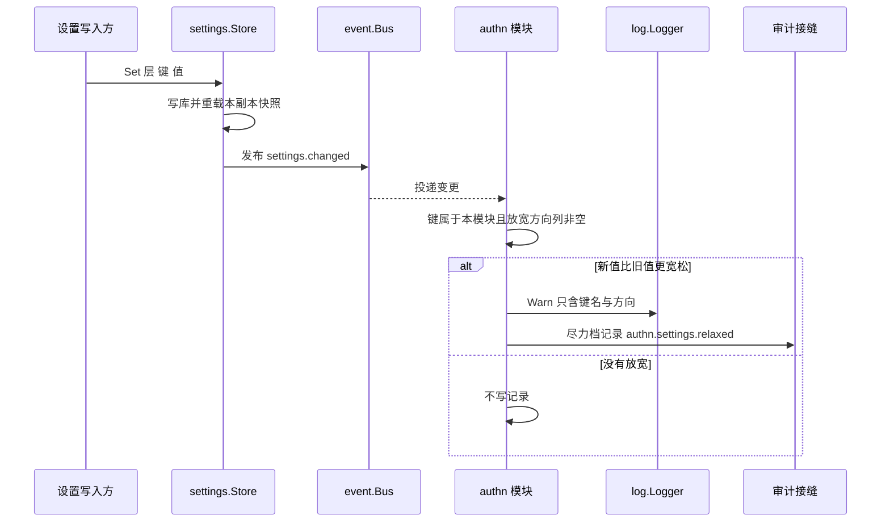
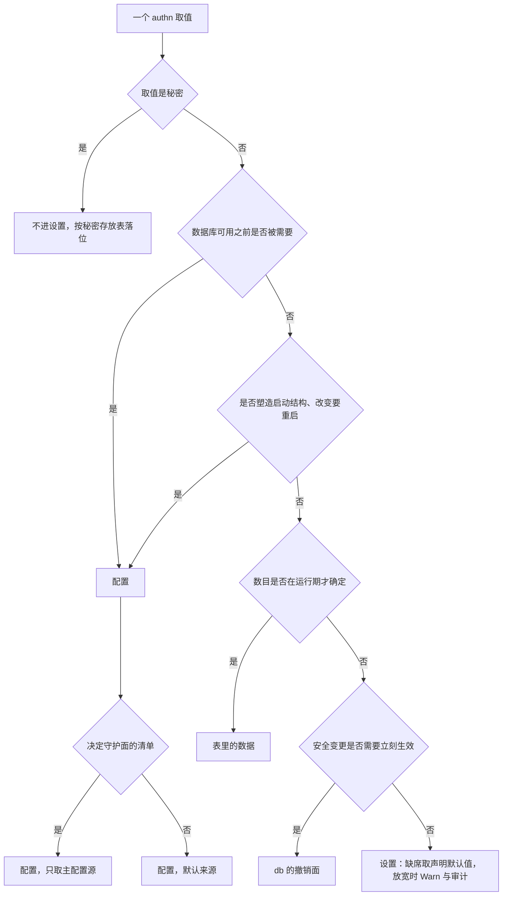
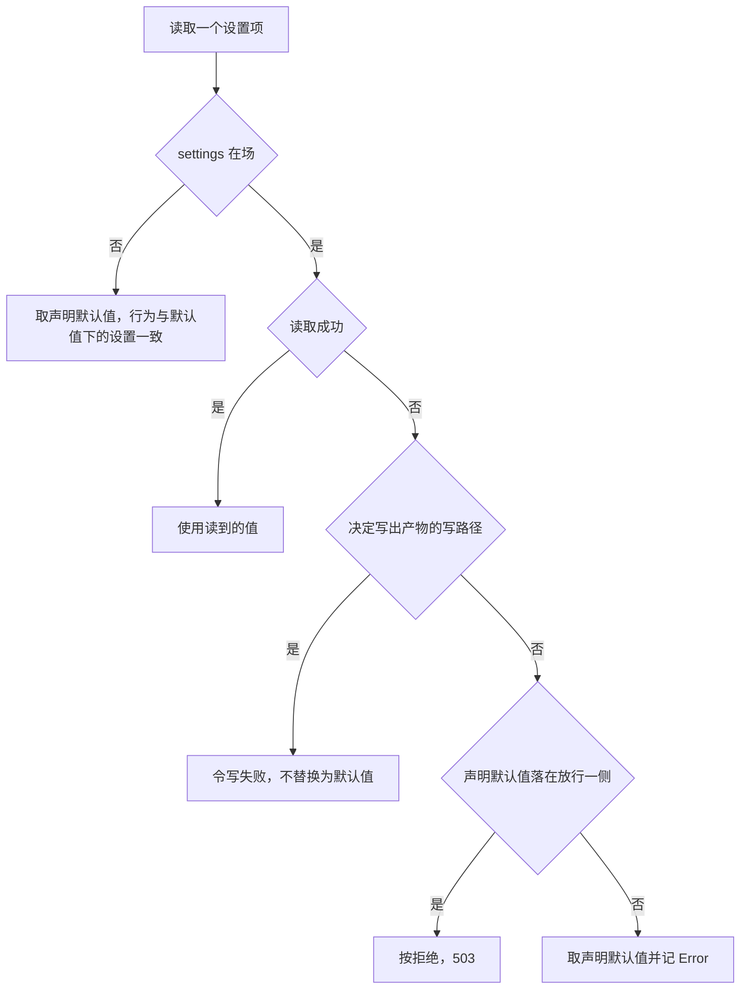

# authn 配置、设置与秘密

## 职责

本文是 `pkg/authn` 与 `tenant.admission` 全部输入项的唯一载体：配置键、设置键、秘密的存放，以及启动期自检与启动诊断。各模块的文档只写自己持有的键的语义并链接到本文，不复述键表。总览见 [design-authn](design-authn.md)，取舍见 [ADR-authn-settings-and-secrets](../../../adr/adr-authn-settings-and-secrets.md)。

本文承载下列事项（封闭集合，不在其内的事项归非职责一节点名的文档）：

- **划界**：一个取值落在配置、设置、表里的数据之中的哪一处，判据与判定顺序。
- **配置键表**：每个键的类型、缺省值、来源、敏感与必填标记。
- **设置键表**：每个键的类型、缺省值、取值域、是否按租户回落、放宽方向。
- **放宽开关**：集合、取值域、监视与启动诊断。
- **设置的读取**：对 authn 各模块的可选依赖、缺席时的降级、读取出错的方向、放宽变更的监视。
- **秘密的存放**：材料、存放形态、轮换、暴露面与处置。
- **启动期自检与启动诊断**。

本文用「放宽开关」指取值变化即放宽校验、且改动要在运行期生效的设置项：取放宽值时，一次校验比取缺省值时更容易通过，或发送面更大。这是判据，不是名单；名单见[放宽开关](#放宽开关)一节。

### 非职责

- **不承载取舍理由。** 为什么分界取这条判据、为什么放宽开关是设置、为什么签名私钥不进数据库，以及被否决的选项与接受的代价，归 [ADR-authn-settings-and-secrets](../../../adr/adr-authn-settings-and-secrets.md)。
- **不承载键的行为语义。** 键表的「说明」列只写一句话；键起什么作用、与哪些流程相关，归持有它的文档：[design-authn-gate](design-authn-gate.md)、[design-authn-account](design-authn-account.md)、[design-authn-session](design-authn-session.md)、[design-authn-token](design-authn-token.md)、[design-authn-login](design-authn-login.md)、[design-authn-mfa](design-authn-mfa.md)、[design-authn-sms](design-authn-sms.md)、[design-authn-sso](design-authn-sso.md)、[design-authn-impersonation](design-authn-impersonation.md)、[design-tenant-admission](../tenant/design-tenant-admission.md)。
- **不承载哨兵表全集与依赖不可用时每条路径的方向。** 自检表只列「这一项失败时报哪个哨兵」；哨兵的含义与修复动作、运行期的失败方向归 [design-authn-failure](design-authn-failure.md)。
- **不承载 `authn.settings.relaxed` 的审计与事件契约。** 记录的档位、字段与名字归 [design-authn-events](design-authn-events.md)；本文只写何时记、记什么不记什么。
- **不承载每租户的 IdP 清单。** 数目在运行期才确定的实体是表里的数据，IdP 在 `authn_idps` 表（[design-authn-sso](design-authn-sso.md)），不是配置，也不是设置。
- **不提供设置写入面的访问控制。** 设置的写入面不判权限，访问控制归宿主（[ADR-settings-scope](../../../adr/adr-settings-scope.md)、[design-settings](../settings/design-settings.md)）；authn 只在放宽方向上提供事后可见。
- **不配置数据库的根密钥。** `encryption-key` 与 `encryption-retired-keys` 归 `db` 模块（[design-db](../design-db.md)）；本文只写 authn 在启动时如何发现它缺失。
- **不提供命令行来源的秘密。** 秘密类配置项的来源不含命令行。
- **不提供配置式的豁免、可选认证与可冒充清单。** 这些登记只来自代码，理由见 [design-authn](design-authn.md) 的非职责。

## 外部接口契约

本节是 authn 对宿主的承诺：键的名字、类型、缺省值、来源与取值域，设置缺席与读取出错时的行为，放宽变更的可见性，秘密的存放形态。宿主写配置文件、在管理面写设置、读启动日志，依据的都是本节。

### 命名空间

`config.Schema` 的命名空间与模块名同值，设置键的路径是命名空间加键名。下表是 authn 与 `tenant.admission` 声明输入项的命名空间的全集（封闭集合）；不在表内的 authn 模块不声明输入项。`authn.mount` 需要的挂载键由 `authn.gate` 声明，`authn.mount` 与需要对外基址的模块在自己的 `Prepare` 里读取这几个键，这是已有的跨模块读法，不是重复声明。`authn.login` 按路径读取账户模块声明的 `authn.account.signup`、`authn.account.password-signup` 与两个注册预算 `authn.account.signup-ip-limit`、`authn.account.signup-global-hourly`，`authn.login.sms` 按路径读取其中的 `authn.account.signup`，都不重复声明。

| 命名空间 | 持有它的文档 | 声明的输入项 |
|---|---|---|
| `authn.gate` | [design-authn-gate](design-authn-gate.md) | 配置 |
| `authn.static` | [design-authn-gate](design-authn-gate.md) | 配置与设置 |
| `authn.account` | [design-authn-account](design-authn-account.md) | 配置与设置 |
| `authn.session` | [design-authn-session](design-authn-session.md) | 配置与设置 |
| `authn.token` | [design-authn-token](design-authn-token.md) | 配置与设置 |
| `authn.login` | [design-authn-login](design-authn-login.md) | 设置 |
| `authn.login.google`、`authn.login.github`、`authn.login.wechat-web`、`authn.login.wechat-mp` | [design-authn-login](design-authn-login.md) | 配置 |
| `authn.mfa` | [design-authn-mfa](design-authn-mfa.md) | 设置 |
| `authn.mfa.totp`、`authn.mfa.webauthn` | [design-authn-mfa](design-authn-mfa.md) | 配置 |
| `authn.sms` | [design-authn-sms](design-authn-sms.md) | 配置与设置 |
| `authn.humanverify` | [design-authn](design-authn.md) | 配置 |
| `authn.humanverify.pow` | [design-authn](design-authn.md) | 设置 |
| `authn.sso` | [design-authn-sso](design-authn-sso.md) | 配置与设置 |
| `authn.sso.saml` | [design-authn-sso](design-authn-sso.md) | 配置 |
| `authn.impersonation` | [design-authn-impersonation](design-authn-impersonation.md) | 设置 |
| `authn.invite` | [design-authn-invite](design-authn-invite.md) | 设置 |
| `tenant.admission` | [design-tenant-admission](../tenant/design-tenant-admission.md) | 配置与设置 |

命名空间之间的冲突按全部已登记模块判：两个模块不得声明同一路径，也不得一个路径是某模块的叶子、另一个模块的内部节点。因此 `authn` 本身不得是任何模块的叶子，也不能让所有 authn 模块共用一个 `authn.*` 平铺命名空间；叶子名与同前缀模块的下一段同名的限制见 [design-authn](design-authn.md) 的外部接口契约。

### 配置项

配置项是启动期的值：在数据库可用之前就被需要的值，与塑造启动结构、改变要重启才生效的值（[ADR-config-scope](../../../adr/adr-config-scope.md)）。键表的约定：

- **来源**列：「主」是仅取主配置源，环境变量与命令行都改不了；「默认」是 `Origins` 的零值，即主配置源加环境变量，不含命令行。
- **标记**列：「敏」是 `Sensitive: true`，必带 `Description`；「必填」是 `Required: true`。必填项只对这次运行级纳入的模块判定，缺项时 `Decode` 失败，错误点名缺的那一项且不带秘密（[design-config](../design-config.md)）。
- 容器叶子（映射与结构体列表）只能取主配置源，所以 `subjects` 与 `templates` 的来源是「主」，不是出于放宽的考虑。
- 表里写着缺省值取另一个键的，是该键解析后的值。

下表是网关与口令表后端的配置项（封闭集合）。

| 键 | 类型 | 缺省 | 来源 | 标记 | 说明 |
|---|---|---|---|---|---|
| `authn.gate.endpoints` | 字符串列表 | `["*"]` | 主 | | 网关所守的入口端；`*` 即入口模块声明的每一个端 |
| `authn.gate.call-budget` | `time.Duration` | `5s` | 默认 | | 一次进入校验后端的调用的期限；须为正 |
| `authn.gate.in-flight` | 整数 | `64` | 默认 | | 同时进行的后端调用数上限，满时请求收口 503；须为正 |
| `authn.gate.mount.endpoints.default`、`.tenants`、`.system` | 字符串 | 空 | 默认 | | 各作用域的路由所挂的入口端。`default` 为空取入口模块声明的唯一端，`system` 为空取 `default`；`tenants` 无缺省，为空时该作用域不可挂载（租户管理路由的判定在该租户的策略域，必须落在租户两层的端上） |
| `authn.gate.mount.bases.default`、`.tenants`、`.system` | 字符串 | `/api/v1/auth`、`/api/v1/tenants`、`/api/v1/system` | 默认 | | 各作用域的路由基路径；以 `/` 起头、不以 `/` 结尾、无通配，是 gin 规整后的写法。`system` 是整段平台管理命名空间的根，其下的 `/auth/...` 与 `/tenants/...` 都相对它书写 |
| `authn.gate.mount.public-url` | 字符串 | 空 | 默认 | | 对外基址，只含来源不含路径 |
| `authn.gate.mount.allow-insecure` | 布尔 | `false` | 主 | | 仅开发用的放宽项，配置项：放行 http 基址，cookie 去掉 `__Host-` 前缀与 `Secure`；改动要重启 |
| `authn.gate.trusted-origins` | 字符串列表 | 空 | 主 | | 跨源检查与 `return_to` 额外信任的来源，每项 `scheme://host[:port]`，先规范成浏览器发送的形式再匹配（规则见 [design-authn-gate](design-authn-gate.md#可信来源的规范形式)）；`public-url` 的来源恒可信 |
| `authn.static.subjects` | 主体名到 PHC 条目的映射 | 无 | 主 | 必填、敏 | 口令表；键是主体名，值是 PHC 条目，遗留写法只读并告警 |
| `authn.static.cache-size` | 整数 | `1024` | 默认 | | 口令校验缓存的容量，取值 1 到 1000000，0 被拒绝（要关闭缓存，把设置 `authn.static.cache-ttl` 设为 0），构造时分配 |
| `authn.static.concurrency` | 整数 | `min(GOMAXPROCS,8)` | 默认 | | 口令派生的并发上限，取值 1 到 256，构造时分配 |

口令表后端的失败退避表另有一个不是输入项的界限：固定键之外至多记 16384 个键，常量 `MaxThrottleKeys` 在 `internal/password`。它是内存上界而不是调参旋钮，所以不设键；口令表里每个主体的键是固定键，不占这些名额，也不会被挤出，机制见 [design-authn-gate](design-authn-gate.md)。

下表是账户、会话与令牌的配置项（封闭集合）。

| 键 | 类型 | 缺省 | 来源 | 标记 | 说明 |
|---|---|---|---|---|---|
| `authn.account.password-concurrency` | 整数 | `min(GOMAXPROCS,8)` | 默认 | | 口令派生的并发上限 |
| `authn.account.signup-concurrency` | 整数 | `min(GOMAXPROCS,8)` | 默认 | | 注册口令派生的并发名额，与口令登录的并发名额各自独立；耗尽时注册答 503，不挤占登录；名额在构造时分配。注册不另设内存预算，单次派生的 Argon2 内存由该名额的上界约束 |
| `authn.account.password-memory-budget-mib` | 整数 | `512` | 默认 | | 账户后端的口令派生内存预算，启动时分配（口令表后端另持自己的一份缺省预算，不设键）；至少是 `authn.account.password-argon2-memory-kib` 取值域上限的两倍，否则 `ErrInvalidConfig` |
| `authn.session.cookie-domain` | 字符串 | 空 | 默认 | | 非空则 cookie 名改为 `__Secure-sid` 并写出 `Domain` 属性 |
| `authn.session.same-site` | 字符串 | `lax` | 默认 | | `lax` 或 `strict`；`none` 被拒绝 |
| `authn.token.issuer` | 字符串 | `authn.gate.mount.public-url` | 默认 | | 访问令牌的 `iss` |
| `authn.token.audience` | 字符串列表 | `[issuer]` | 默认 | | 访问令牌的 `aud`；缺省为空时取 `[issuer]` |
| `authn.token.client-id` | 字符串 | `speed` | 默认 | | 会话换来的令牌的 `client_id` 声明 |
| `authn.token.algorithm` | 字符串 | `ES256` | 默认 | | 签名算法，`ES256` 或 `RS256` |
| `authn.token.signing-key-file` | 字符串，文件路径 | 无 | 默认 | 敏 | 当前签名私钥，PKCS#8 PEM；不填则本模块只验证、不签发 |
| `authn.token.verify-key-files` | 字符串列表，文件路径 | 空 | 默认 | | 只用来验签与发布的密钥文件 |

下表是登录方式与多因素的配置项（封闭集合）。提供方的客户端标识与密钥是启动必须项：纳入该模块即必填，缺项即启动失败。

| 键 | 类型 | 缺省 | 来源 | 标记 | 说明 |
|---|---|---|---|---|---|
| `authn.login.google.client-id` | 字符串 | 无 | 默认 | 必填 | 提供方的客户端标识 |
| `authn.login.google.client-secret` | 字符串 | 无 | 默认 | 必填、敏 | 提供方的客户端密钥 |
| `authn.login.google.hosted-domain` | 字符串 | 空 | 默认 | | 非空时要求 ID 令牌的 `hd` 声明相等 |
| `authn.login.google.issuer` | 字符串 | `https://accounts.google.com` | 默认 | | 发现用的 OIDC issuer；非空时须是绝对 https 地址，回环主机的 http 地址仅在 `allow-loopback` 为真时接受 |
| `authn.login.google.allow-loopback` | 布尔 | `false` | 默认 | | 仅开发用：放开受限出站客户端对回环地址的拒绝；不放开明文 http |
| `authn.login.google.root-ca-file` | 字符串，文件路径 | 无 | 默认 | | 追加到系统根的 PEM 文件，不替换系统根；启动时须可读且含至少一张证书，空只用系统根 |
| `authn.login.github.client-id` | 字符串 | 无 | 默认 | 必填 | 提供方的客户端标识 |
| `authn.login.github.client-secret` | 字符串 | 无 | 默认 | 必填、敏 | 提供方的客户端密钥 |
| `authn.login.github.authorize-url` | 字符串 | `https://github.com/login/oauth/authorize` | 默认 | | 授权端点；非空时须是绝对 https 地址 |
| `authn.login.github.token-url` | 字符串 | `https://github.com/login/oauth/access_token` | 默认 | | 令牌端点；非空时须是绝对 https 地址 |
| `authn.login.github.api-base` | 字符串 | `https://api.github.com` | 默认 | | `/user` 与 `/user/emails` 的基址；非空时须是绝对 https 地址 |
| `authn.login.github.allow-loopback` | 布尔 | `false` | 默认 | | 仅开发用：放开受限出站客户端对回环地址的拒绝；不放开明文 http |
| `authn.login.github.root-ca-file` | 字符串，文件路径 | 无 | 默认 | | 追加到系统根的 PEM 文件，不替换系统根；启动时须可读且含至少一张证书，空只用系统根 |
| `authn.login.wechat-web.app-id` | 字符串 | 无 | 默认 | 必填 | 网站应用扫码登录的应用标识；纳入即必填，缺则 `ErrInvalidConfig` |
| `authn.login.wechat-web.app-secret` | 字符串 | 无 | 默认 | 必填、敏 | 同上的应用密钥 |
| `authn.login.wechat-mp.app-id` | 字符串 | 无 | 默认 | 必填 | 公众号网页授权登录的应用标识；与网站应用各自一份配置，没有联合判定 |
| `authn.login.wechat-mp.app-secret` | 字符串 | 无 | 默认 | 必填、敏 | 同上的应用密钥 |
| `authn.mfa.totp.issuer` | 字符串 | `authn.gate.mount.public-url` 的主机名 | 默认 | | 写进 `otpauth://` 地址的发行者名 |
| `authn.mfa.webauthn.rp-id` | 字符串 | `authn.gate.mount.public-url` 的主机名 | 默认 | | 依赖方标识；须等于基址主机或其父域 |
| `authn.mfa.webauthn.rp-name` | 字符串 | `speed` | 默认 | | 依赖方的显示名 |
| `authn.mfa.webauthn.origins` | 字符串列表 | `authn.gate.mount.public-url` 的来源 | 默认 | | 依赖方接受的来源 |

登录方式的端点覆盖项与根证书文件由部署方给出：指向自定义端点即由部署方承担对该端点与其证书的信任，缺省仍是内置端点、拒回环与系统根（[ADR-authn-social-endpoints](../../../adr/adr-authn-social-endpoints.md)）。

`authn.mfa.webauthn` 的 `Timeouts.*.Enforce` 固定为真，不做成配置项。

下表是人机验证的配置项（封闭集合）。`mode` 有缺省值，因此不是必填；Turnstile 的几项由 `mode` 判定，不由加载器判定：闸关闭或运行工作量证明时，它们不必给值，只有 `turnstile` 模式要求站点键、密钥与主机名齐备。

| 键 | 类型 | 缺省 | 来源 | 标记 | 说明 |
|---|---|---|---|---|---|
| `authn.humanverify.mode` | 字符串 | `off` | 默认 | | 发送要满足的机制：`off`、`pow` 或 `turnstile`；不在集合内即 `ErrInvalidConfig` |
| `authn.humanverify.site-key` | 字符串 | 空 | 默认 | | Turnstile 控件的前端公开标识；`turnstile` 模式必填 |
| `authn.humanverify.secret-key` | 字符串 | 空 | 默认 | 敏 | 认证 siteverify 调用的密钥；`turnstile` 模式必填，登记为日志的字面量脱敏规则 |
| `authn.humanverify.verify-url` | 字符串 | `https://challenges.cloudflare.com/turnstile/v0/siteverify` | 默认 | | siteverify 端点；须是带主机的绝对 https URL |
| `authn.humanverify.hostname` | 字符串 | 空 | 默认 | | 控件必须运行的主机名；`turnstile` 模式必填 |
| `authn.humanverify.action` | 字符串 | 空 | 默认 | | 控件渲染时使用的 action；空接受任意 |
| `authn.humanverify.timeout` | `time.Duration` | `10s` | 默认 | | 一次校验的总时限，取值 1s 到 30s |

下表是短信、企业 SSO 与租户准入的配置项（封闭集合）。

| 键 | 类型 | 缺省 | 来源 | 标记 | 说明 |
|---|---|---|---|---|---|
| `authn.sms.workers` | 整数 | `4` | 默认 | | 异步发送的有界工作池的协程数 |
| `authn.sms.queue-size` | 整数 | `1024` | 默认 | | 异步发送队列的容量 |
| `authn.sso.allow-private-egress` | 布尔 | `false` | 主 | | 仅开发用的放宽项，配置项：放开出站调用对回环地址的拒绝；改动要重启 |
| `authn.sso.dns-resolver` | 字符串，`host:port` | 空 | 主 | | 域所有权证明查 TXT 记录所用的 DNS 解析器地址；空时用系统解析器，配置后该查询由这个解析器作答 |
| `authn.sso.oidc-ca-file` | 字符串，文件路径 | 空 | 主 | | 企业 OIDC 出站客户端在系统根证书之外额外信任的 PEM 根证书文件；空时只用系统根证书，配置后文件里的证书追加到系统根证书 |
| `authn.sso.saml.sp-key-file` | 字符串，文件路径 | 无 | 默认 | 敏 | 服务提供方私钥；只在 IdP 配了 `sign_requests` 或要加密断言时需要，缺则 `Validate` 拒绝 |
| `authn.sso.saml.sp-cert-file` | 字符串，文件路径 | 无 | 默认 | | 服务提供方证书，条件同上 |
| `authn.sso.saml.sp-next-cert-file` | 字符串，文件路径 | 无 | 默认 | | 先发布的下一张证书，轮换时用 |
| `tenant.admission.endpoints` | 字符串列表 | 无 | 主 | 必填 | 准入层所守的端；与 `tenant.resolve.endpoints` 同形，一般相同；空是 `ErrInvalidConfig`，不接受 `*`，不得含 authn 的挂载端 |

短信厂商适配的配置键（`sms.aliyun.*`、`sms.tencent.*`）不在本文：发送能力是顶层能力模块 `pkg/sms`，其配置随能力归 [design-sms](../design-sms.md)。邮件投递的配置键（`mail.smtp.*`）同样不在本文，归 [design-mail](../design-mail.md)：`authn.emailcode` 不声明输入项，它只把根包的 `EmailCodeSender` 适配到 `mail.Sender`。必填判定只对运行级纳入的模块做，没有被纳入的模块的必填项不参与判定。

### 设置项

设置项是运行期可变的值。键表的约定：

- 类型取 settings 的封闭集：字符串、布尔、整数、浮点、`time.Duration`；列表用 JSON 文本的字符串项（[design-settings](../settings/design-settings.md)）。
- **租**列：「是」表示按租户回落，取值依次取租户行、全局行、声明默认值；空白表示只读全局层。
- **取值域**由 `Item.Domain` 声明，写入时判，读取不判；每项带 `Description`。设置声明的默认值必须在自己的取值域内。
- **放宽方向**列给出该键取值朝哪个方向改动即放宽校验或扩大发送面；空白表示该键的改动不放宽校验，不被监视。判据与监视见[放宽变更的监视](#放宽变更的监视)。
- 数字缺省值是起点，不是对规范条文的引用。NIST SP 800-63B-4 与 ASVS 5.0 给的是上界与定性要求：验证码长度至少 6、有效期至多 10 分钟、单次有效、重发不清零失败计数、尝试次数上界 100；规范没有给出重发频率与发送预算的数字。这些条文的条号未逐条核对，缺省值不构成合规声明。

下表是会话与令牌的设置项（封闭集合）。

| 键 | 类型 | 缺省 | 取值域 | 租 | 放宽方向 |
|---|---|---|---|---|---|
| `authn.session.idle-timeout` | `time.Duration` | `30m` | 1m 到 24h | | 增大 |
| `authn.session.absolute-timeout` | `time.Duration` | `12h` | 10m 到 30d | | 增大 |
| `authn.session.token-absolute-timeout` | `time.Duration` | `720h` | 1h 到 8760h | | 增大 |
| `authn.session.sso-absolute-timeout` | `time.Duration` | `8h` | 10m 到 30d | | 增大 |
| `authn.session.touch-interval` | `time.Duration` | `60s` | 5s 到 10m | | |
| `authn.session.check-ttl` | `time.Duration` | `5s` | 0 到 60s | | 增大 |
| `authn.session.max-per-account` | 整数 | `20` | 1 到 1000 | | |
| `authn.session.retention` | `time.Duration` | `168h` | 1h 到 8760h | | |
| `authn.token.access-ttl` | `time.Duration` | `10m` | 1m 到 1h | | 增大 |
| `authn.token.leeway` | `time.Duration` | `30s` | 0 到 120s | | 增大 |
| `authn.token.refresh-idle-ttl` | `time.Duration` | `168h` | 1h 到 2160h | | 增大 |
| `authn.token.refresh-grace` | `time.Duration` | `0` | 0 到 60s | | 增大 |
| `authn.token.check-session` | 布尔 | `true` | 布尔 | | 改为 `false`，关闭整个会话步骤（含 service 种令牌的 `sid` 种类核对） |

下表是口令表与账户的设置项（封闭集合）。口令表的进程内退避与校验缓存的参数是设置，`settings` 缺席时取缺省值；缓存容量与并发是配置（见上）。

| 键 | 类型 | 缺省 | 取值域 | 租 | 放宽方向 |
|---|---|---|---|---|---|
| `authn.account.password-algorithm` | 字符串 | `argon2id` | `argon2id` 或 `pbkdf2-sha256` | | 改为 `pbkdf2-sha256`（降级） |
| `authn.static.free-attempts` | 整数 | `5` | 1 到 20 | | 增大 |
| `authn.static.fail-window` | `time.Duration` | `15m` | 1m 到 24h | | 减小 |
| `authn.static.max-backoff` | `time.Duration` | `15m` | 10s 到 24h | | 减小 |
| `authn.static.cache-ttl` | `time.Duration` | `60s` | 0 到 5m；0 关闭缓存 | | |
| `authn.account.password-min-length` | 整数 | `8` | 8 到 64 | | 减小 |
| `authn.account.password-argon2-memory-kib` | 整数 | `19456` | 正整数，至多 262144 | | 减小 |
| `authn.account.password-argon2-iterations` | 整数 | `2` | 正整数，至多 10 | | 减小 |
| `authn.account.password-argon2-parallelism` | 整数 | `1` | 正整数，至多 16 | | |
| `authn.account.password-pbkdf2-iterations` | 整数 | `600000` | 600000 到 10000000 | | 减小 |
| `authn.account.throttle-free-attempts` | 整数 | `5` | 1 到 10 | | 增大 |
| `authn.account.throttle-max-delay` | `time.Duration` | `15m` | 10s 到 24h | | 减小 |
| `authn.account.throttle-decay` | `time.Duration` | `1h` | 1m 到 24h | | 减小 |
| `authn.account.secret-retention` | `time.Duration` | `720h` | 1h 到 8760h | | |
| `authn.account.signup` | 字符串 | `closed` | `closed` 或 `open` | | 改为 `open` |
| `authn.account.password-signup` | 字符串 | `closed` | `closed` 或 `open` | | 改为 `open` |
| `authn.account.signup-ip-limit` | 整数 | `10` | 0 到 10000，每分钟；0 关闭 | | 改小或改为 0 |
| `authn.account.signup-global-hourly` | 整数 | `100` | 1 到 1000000 | | 增大 |
| `authn.account.unverified-ttl` | `time.Duration` | `720h` | 0 到 8760h；0 关闭 | | |
| `authn.account.unverified-sweep-interval` | `time.Duration` | `1h` | 1m 到 24h | | |
| `authn.account.reserved-usernames` | 字符串，JSON 数组 | `[]` | 用户名数组，读取时规范化 | | 删去追加项 |

`authn.account.password-signup` 与 `authn.account.signup` 相互独立：前者开的是匿名的用户名加口令注册路由，后者开的是社交与短信首次登录的开户。任一为 `open` 都使发现端点的 `signup.enabled` 为真，但两者互不蕴含：注册关闭时首登开户照旧，首登开户关闭时注册照旧。`authn.account.signup-ip-limit` 是注册路由按来源地址的分钟预算，缺省为每分钟 10 次，0 关闭；`authn.account.signup-global-hourly` 是注册的全局小时预算。`unverified-ttl` 是自助注册账户在 `signup_state=1`、`signup_verified_at IS NULL` 且没有已验证邮箱时可以保持不动的期限，0 关闭清理；清理删除账户时连带释放它的联系方式预留；`unverified-sweep-interval` 是清扫协程的间隔。后两项不放宽任何校验：期限变长只是让受限账户留得更久。

`authn.account.reserved-usernames` 是部署追加的保留用户名集合，只读全局层。取值是用户名的 JSON 数组；读取时对每个元素做 `NormalizeIdentifier` 规范化，规范化后仍不合规的元素被忽略并记一行 `Warn`，其余元素照常生效。生效集合是内置清单与设置值的并集：内置清单一律生效，设置只能追加，不能移除内置项。设置缺席、读取出错或取值越出取值域时取声明缺省的空集合，内置清单照常生效。删去追加项让集合变松，按放宽方向记录一行 `Warn` 与 `authn.settings.relaxed`。

`cache-ttl` 是绝对期限：自一次真实派生通过起算，命中不续期，0 关闭缓存。`fail-window` 与 `max-backoff` 的取值域各自独立，所以 `max-backoff` 大于 `fail-window` 的组合合法。失败计数在窗口已过、且这些失败赚得的等待也已走完之后才归零，窗口不会在锁定期结束之前把计数清掉；缺省值下两者相等，行为与按窗口归零相同。账户的 `throttle-decay` 与 `throttle-max-delay` 同判（[design-authn-account](design-authn-account.md)）。

Argon2id 的 `memory-kib`、`iterations`、`parallelism` 各自只能在单项取值域内判，而 OWASP 最低组合按（m, t, p）的组合判：各自合法而组合低于下限时，写入不被拒绝，使用处回落到默认组合并记 `Error`（回落与内存预算的口径见 [design-authn-account](design-authn-account.md)）。`secret-retention` 是服务密钥到期或撤销之后行的保留期。

`authn.account.password-algorithm` 在每次写哈希时读取：登记账户与改口令，以及登录成功后的再哈希。它是设置项，但读取没有回落：设置缺席时取声明默认值 `argon2id`；读取失败或取值越出取值域时，哈希写入失败而不是改用另一个算法——登记账户与改口令答不可用，登录后的再哈希跳过、记一行 `Error`，登录本身仍成功。键没有任何声明覆盖（本模块自身 schema 的缺陷）是唯一的例外：按声明默认值 `argon2id` 写出并记一行 `Error`，不令写失败。理由是回落到另一个算法会让宿主以为选定的算法在生效，而实际写下的条目用了别的算法。

下表是邀请的设置项（封闭集合）。

| 键 | 类型 | 缺省 | 取值域 | 租 | 放宽方向 |
|---|---|---|---|---|---|
| `authn.invite.ttl` | `time.Duration` | `168h` | 1h 到 2160h | | 增大 |

`authn.invite.ttl` 在每次不带期限的 `Issue` 读取；签发调用自带期限时以调用为准，不读它。设置缺席时取声明默认值；读取失败或取值越出取值域时取声明默认值并记一行 `Error`，签发照常进行（调参类方向）。

下表是登录、短信与多因素的设置项（封闭集合）。

| 键 | 类型 | 缺省 | 取值域 | 租 | 放宽方向 |
|---|---|---|---|---|---|
| `authn.login.flow-ttl` | `time.Duration` | `10m` | 1m 到 30m | | 增大 |
| `authn.login.call-budget` | `time.Duration` | `10s` | 1s 到 60s | | |
| `authn.login.default-return-to` | 字符串 | `/` | 按 `return_to` 的规则校验 | | |
| `authn.login.callback-error-return-to` | 字符串 | `/` | 按 `return_to` 的规则校验 | | |
| `authn.login.disabled-methods` | 字符串，JSON 数组 | `[]` | 登录方式名的数组 | | 移除成员 |
| `authn.login.delivery-modes` | 字符串，JSON 数组 | `["session","token"]` | 缺省集合的子集 | | 加入成员 |
| `authn.login.ip-limit` | 整数 | `60` | 0 到 10000，每分钟；0 关闭 | | 改小或改为 0 |
| `authn.login.password-reset` | 字符串 | `closed` | `closed` 或 `open` | | 改为 `open` |
| `authn.login.password-reset-ticket-ttl` | `time.Duration` | `10m` | 1m 到 30m | | 增大 |
| `authn.login.email-code-ttl` | `time.Duration` | `10m` | 1m 到 30m | | 增大 |
| `authn.login.email-resend-interval` | `time.Duration` | `60s` | 30s 到 10m | | 减小 |
| `authn.login.email-per-address-hourly` | 整数 | `5` | 1 到 60 | | 增大 |
| `authn.login.email-per-address-daily` | 整数 | `10` | 1 到 200 | | 增大 |
| `authn.login.email-per-account-hourly` | 整数 | `10` | 1 到 60 | | 增大 |
| `authn.login.email-per-account-daily` | 整数 | `100` | 1 到 1000 | | 增大 |
| `authn.login.email-per-source-hourly` | 整数 | `30` | 1 到 10000 | | 增大 |
| `authn.login.email-per-source-daily` | 整数 | `100` | 1 到 100000 | | 增大 |
| `authn.login.email-global-hourly` | 整数 | `300` | 1 到 1000000 | | 增大 |
| `authn.sms.allowed-prefixes` | 字符串，JSON 数组 | `[]`，空即一律拒绝发送 | E.164 前缀的数组 | | 加入成员 |
| `authn.sms.code-length` | 整数 | `6` | 6 到 8 | | 减小 |
| `authn.sms.code-ttl` | `time.Duration` | `5m` | 1m 到 10m | | 增大 |
| `authn.sms.code-attempts` | 整数 | `5` | 1 到 10 | | 增大 |
| `authn.sms.resend-interval` | `time.Duration` | `60s` | 30s 到 10m | | 减小 |
| `authn.sms.per-phone-hourly` | 整数 | `5` | 1 到 60 | | 增大 |
| `authn.sms.per-phone-daily` | 整数 | `10` | 1 到 200 | | 增大 |
| `authn.sms.per-source-hourly` | 整数 | `30` | 1 到 10000 | | 增大 |
| `authn.sms.per-source-daily` | 整数 | `100` | 1 到 100000 | | 增大 |
| `authn.sms.global-hourly-login` | 整数 | `300` | 1 到 1000000 | | 增大 |
| `authn.sms.global-hourly-mfa` | 整数 | `300` | 1 到 1000000 | | 增大 |
| `authn.sms.global-hourly-enroll` | 整数 | `100` | 1 到 1000000 | | 增大 |
| `authn.sms.global-hourly-reset` | 整数 | `100` | 1 到 1000000 | | 增大 |
| `authn.sms.per-flow-sends` | 整数 | `3` | 1 到 10 | | 增大 |
| `authn.sms.per-account-hourly` | 整数 | `10` | 1 到 60 | | 增大 |
| `authn.mfa.global-required` | 布尔 | `false` | 布尔 | | 由 `true` 改为 `false` |
| `authn.mfa.recent-window` | `time.Duration` | `10m` | 1m 到 1h | | 增大 |
| `authn.mfa.max-per-kind` | 整数 | `5` | 1 到 20 | | |
| `authn.mfa.pending-ttl` | `time.Duration` | `1h` | 5m 到 24h | | |
| `authn.mfa.sensitive-min-age` | `time.Duration` | `24h` | 1h 到 720h | | 减小 |
| `authn.humanverify.pow.difficulty` | 整数 | `18` | 16 到 22 | | 减小 |
| `authn.humanverify.pow.challenge-ttl` | `time.Duration` | `5m` | 1m 到 15m | | 增大 |

补充：

- `authn.login.disabled-methods` 在运行期关闭一个登录方式，例如遭遇短信轰炸时关 `sms`；`authn.login.ip-limit` 的缺省值与取值理由见 [design-authn-login](design-authn-login.md)。
- `authn.sms.global-hourly-*` 按用途分设：登录的预算耗尽不挤占已通过口令的第二因素与因素登记。全局维度只计未抑制的行，抑制行不消耗它，理由与其余维度的口径见 [design-authn-sms](design-authn-sms.md)。
- `authn.sms.per-account-hourly` 只对 `mfa` 与 `enroll` 用途计数。
- `authn.sms.per-source-hourly` 与 `per-source-daily` 按发送请求的来源地址计数，跨用途累计，窗口分别是滚动一小时与滚动一日；地址先经 `netip.ParseAddr` 规范化再取摘要。`SendCode.Source` 为空（调用方没有可信来源）时不施加这两个维度，见 [design-authn-sms](design-authn-sms.md)。
- 邮箱验证码的预算由 `authn.login.email-per-address-hourly`、`email-per-address-daily`、`email-per-account-hourly`、`email-per-account-daily`、`email-per-source-hourly`、`email-per-source-daily` 与 `email-global-hourly` 设置。按地址的预算是 `email-per-address-hourly` 与 `email-per-address-daily`，它们与重发窗口都按**预算形式**计数：局部部分从第一个 `+` 起的后缀在所有域都丢掉，`gmail.com` 与 `googlemail.com` 另外去掉局部部分的点并视为同一个域；这个折叠只用于预算键与重发键，标识的语义、`Lookup`、待验证记录与真正投递的地址都保持规范化后的原样。按地址的窗口跨会话与账户共享，一个收件箱在一次重发窗口内只发一条码；`email-per-account-hourly` 与 `email-per-account-daily` 按发起的账户计；`email-per-source-hourly` 与 `email-per-source-daily` 按请求的来源地址计，地址先经 `netip.ParseAddr` 规范化再取摘要，来源为空时不施加（fail-open，不落进同一个键）。`email-global-hourly` 是全部账户与地址共享的小时总量。按地址、按账户与按来源的日窗口都是固定的 UTC 日，小时窗口都是固定的 UTC 小时。预算先预留后确认：请求被任一层拒绝时退还本次已占用的全部计数；发送失败只有在通道能证明消息未离开时退还，结果不确定时保留。地址已被其他账户预留或持有时答 409 `email-taken`，不发信、不占重发窗口、不花预算。

匿名口令重置复用同一组数值设置，但按用途使用独立的计数键。邮箱的按地址、按来源、按账户与全局预算，以及短信的按号码、按来源与全局预算，超限时一律抑制发送并仍答同形的成功，不作为账户存在性的信号；只有同一 cookie 的重发间隔与登录的 `ip-limit` 答 429。短信的 `reset` 用途不填 `Account`，不设按账户维度。
- `authn.mfa.sensitive-min-age` 是冒充发起与管理员重置因素所要求的因素启用年龄。
- `authn.humanverify.pow.difficulty` 与 `challenge-ttl` 只在 `pow` 模式读取，请求期取值：设置存储缺席、读取失败或取值越出取值域时都取声明默认值，闸因此不会因设置故障停止签发挑战。`difficulty` 是证明必须达到的前导零位数，加大它使一次证明的代价指数增长；`challenge-ttl` 是一个挑战从签发到失效的时长。

下表是企业 SSO、冒充与租户准入的设置项（封闭集合）。

| 键 | 类型 | 缺省 | 取值域 | 租 | 放宽方向 |
|---|---|---|---|---|---|
| `authn.sso.assertion-max-age` | `time.Duration` | `5m` | 1m 到 30m | | 增大 |
| `authn.sso.provider-cache-ttl` | `time.Duration` | `60s` | 5s 到 1h | | |
| `authn.sso.egress-timeout` | `time.Duration` | `10s` | 1s 到 60s | | |
| `authn.impersonation.max-ttl` | `time.Duration` | `30m` | 1m 到 1h | | 增大 |
| `authn.impersonation.max-auth-age` | `time.Duration` | `5m` | 1m 到 30m | | 增大 |
| `tenant.admission.require-mfa` | 布尔 | `false` | 布尔 | 是 | 由 `true` 改为 `false` |
| `tenant.admission.require-sso` | 布尔 | `false` | 布尔 | 是 | 由 `true` 改为 `false` |
| `tenant.admission.check-ttl` | `time.Duration` | `5s` | 0 到 60s | | 增大 |

`authn.sso.egress-timeout` 是出站调用的期限，请求期读取，`http.Client` 不设总 `Timeout`。

### 设置缺席与读取出错

- **设置对 authn 的各模块是可选依赖。** `settings.Store` 缺席时，各模块对每个设置项取声明的默认值，行为与默认值下的设置完全一致，只是不可调整。只使用口令表的宿主因此不必为几个退避参数运行数据库与事件总线（`settings` 模块自己要求 `db` 与 `event.Bus`）。这是 [ADR-config-scope](../../../adr/adr-config-scope.md) 接受的降级，不是配置。
- **在自己的 `Init` 里读设置的模块，对设置写 `Optional` 的依赖声明**；不写则读取报 `ErrNotLoaded`（快照在设置模块的 `Init` 装载）。请求路径上的读取不受此限。
- **读设置出错的方向由设置项的类别定**：强制类开关读不出来时按拒绝，应答 503；其余取值读不出来时取声明默认值并记 `Error`；决定写出产物的写路径设置（`authn.account.password-algorithm`）读不出来或越域时令写失败，不替换为默认值；键没有任何声明覆盖时按声明默认值写出并记一行 `Error`。类别的定义与流程见[读取设置的方向](#读取设置的方向)。放宽开关属调参类：声明默认值就是严格一侧（`closed`、`true`），读不出来按它取值。
- **安全参数的缺省取最严的取值，并声明取值域**：写入时判下限，使宿主无法经设置把口令哈希参数配到最低要求之下。
- **保留用户名集合的内置清单常驻。** `authn.account.reserved-usernames` 读不出或没有声明覆盖时取声明缺省的空追加集合，内置清单在任一取值下都生效并向写入面追加拒绝。
- **读取走内存快照**，不发起 IO、不收上下文；变更经 `settings.changed` 事件与周期刷新传播，最坏延迟是刷新间隔（缺省 5 分钟）。凡安全上需要立刻生效的变更（撤销）不走设置，走 db 的撤销面。

### 放宽开关

放宽开关是取值变化即放宽校验、且改动要在运行期生效的开关。下表是当前归入的集合，是判据的例举，不是封闭集；按判据新增的同类开关一并归入设置一侧。

| 开关 | 放宽值 | 缺省 | 取值域 |
|---|---|---|---|
| `authn.account.signup` | `open` | `closed` | `closed` 或 `open` |
| `authn.account.password-signup` | `open` | `closed` | `closed` 或 `open` |
| `authn.token.check-session` | `false` | `true` | 布尔 |
| `authn.login.password-reset` | `open` | `closed` | `closed` 或 `open` |

这些开关都是设置项，审计与日志里的方向取 `relax`（判据与理由见 [design-authn-events](design-authn-events.md) 的放宽方向取值）。读它的模块在每次做出决定时读当前值：`authn.account.signup` 由登录发现端点、首登开户的解析与短信方法的投递决定读，`authn.account.password-signup` 由 `Signups.Register` 读（权威检查），注册路由与发现端点读它只作预检查，`authn.token.check-session` 在每次令牌校验、会话步骤之前读，`authn.login.password-reset` 由发现端点与匿名口令重置的路由读。声明模块（`pkg/authn/account`、`pkg/authn/token` 与 `pkg/authn/login`）另在启动诊断各读一次，用来写启动时已是放宽值的 `Warn`。设置缺席或读取出错时取声明默认值，即严格一侧，读取出错另记 `Error`。它们不取环境变量与命令行；配置不再承载这些设置项，旧配置里仍写着它们的宿主在启动时按未知键失败（[ADR-authn-settings-and-secrets](../../../adr/adr-authn-settings-and-secrets.md)）。运行期改动到放宽方向时，声明该键的模块写一行 `Warn` 并记一条尽力档 `authn.settings.relaxed`；启动时取值已经是放宽值时写同一行 `Warn`（[放宽变更的监视](#放宽变更的监视)、[启动诊断](#启动诊断)）。

`authn.account.reserved-usernames` 不取「开关」的形态，因此不在上表的放宽开关之列，但它在放宽方向上受同样的监视：生效集合是内置清单与设置值的并集，设置只能追加、不能移除内置项，追加项只增加被拒绝的用户名；删去追加项使集合回落到内置清单，方向取 `relax`，按放宽开关同一条通道记录一行 `Warn` 与 `authn.settings.relaxed`。

`authn.invite.ttl` 与 `authn.account.password-algorithm` 也是设置项、也在放宽方向上受监视，但不在上表：上表的判据是「一个开关，声明默认值取严的一端」，而这两项的取值本身有强弱次序，没有「打开」这一动作。前者变长扩大邀请的可用窗口，方向取 `increase`；后者改为 `pbkdf2-sha256` 降低哈希成本，方向取 `downgrade`（[design-authn-events](design-authn-events.md) 的放宽方向取值）。

仅开发用的 `authn.gate.mount.allow-insecure` 与 `authn.sso.allow-private-egress` 留在配置，不属于上表：它们在启动期决定基址校验、cookie 名称与出站客户端，改动要重启才生效，按 (b) 落在配置，启动诊断各写一行 `Warn`。

决定守护面的清单（`authn.gate.endpoints`、`authn.gate.trusted-origins`、`tenant.admission.endpoints`）同样只取主配置源：它们在装配期决定路由挂到哪个端、跨源检查信谁。

### 放宽变更的监视

经 `settings.admin` 管理面写全局层时，写入由平台域 `settings.write` 判定、每次写留强制档审计；宿主自建的写入口（含 seed 这类命令）由宿主自己鉴权，设置能力不保证这套控制。缺的是按键的写控制，也没有按键的写入钩子，所以 authn 不阻止某个键被改到更宽松的取值，只保证事后可见。

- **监视的对象由判据定：** 放宽方向列非空的设置项。判据是该键的取值朝某个方向改动使校验更容易通过或发送面更大；表里的方向是按键的语义给出的，新增设置项时按同一判据补列。
- **authn 订阅 `settings.changed`。** 变更命中放宽方向时，写一行 `Warn`，并经审计接缝记一条尽力档记录 `authn.settings.relaxed`。**记录与日志只含键名与方向，不含值。**
- 记录的档位、字段名与失败时的计数归 [design-authn-events](design-authn-events.md)。
- `AGENTS.md` 写入硬要求：`authn.*` 与 `tenant.admission.*` 的设置不得对租户或普通管理员开放写权限。authn 无法检查宿主是否遵守。

### 秘密的存放

下表是 authn 处理的秘密与密钥材料（封闭集合）；新增的秘密类材料要归入下表已有的存放形态之一，不得新增形态。

| 材料 | 存放 | 轮换 | 暴露面与处置 |
|---|---|---|---|
| 账户口令哈希 | db，PHC 字符串 | 用户改口令；参数升级在下次登录时重算 | 库转储可离线猜解，靠 Argon2id 的成本抵御；不进审计明细（原生写） |
| 口令表条目 | 配置 `authn.static.subjects`，PHC 字符串 | 运维重写条目 | 配置文件的访问控制 |
| 会话令牌、刷新令牌、服务密钥 | 客户端持有；库里只存 SHA-256 | 会话在登录与提权时换；刷新令牌每次使用即换；服务密钥多把并存，旧的过期或撤销 | 库转储得不到可用凭据 |
| 短信验证码 | db，带密钥摘要（`BlindIndex`） | 每次发送新码 | 密钥是 db 根密钥派生的子密钥；根密钥轮换使在途挑战失效 |
| TOTP 种子 | `authn_totp_secrets.secret` 加密列 | 用户删除并重新登记 | db 根密钥；只在登记应答里出现一次；应用被攻破即种子泄露 |
| WebAuthn 公钥 | 明文列 | 用户删除并重新登记 | 非秘密 |
| JWT 签名私钥 | 配置里的文件路径，PKCS#8 PEM | 两相轮换与应急撤销，步骤见 [design-authn-token](design-authn-token.md) | 文件权限只能 `Warn`、不能强制；Kubernetes 密钥挂载是自然的承载 |
| 企业 OIDC 客户端密钥 | `authn_idps.client_secret` 加密列 | 管理面 `PUT` 带新密钥，`version` 加一，各副本按版本重建缓存 | 读取接口从不交出它，应答里只有「是否已设置」 |
| SAML 的 SP 私钥 | 配置里的文件路径 | `authn.sso.saml.sp-next-cert-file` 先发布新证书，IdP 侧更新后换位 | 同 JWT 签名私钥 |
| IdP 的签名证书 | `config.idp_certs`，公钥证书 | 管理员更新，可同时放当前与下一张 | 非秘密，但变更要经管理面，强制审计 |
| 社交登录与微信的密钥 | 配置的敏感项 | 运维改配置并滚动重启；提供方允许新旧并存的，先加新、再换、再删旧 | 另登记为日志的字面量匹配器 |
| 校验缓存的 HMAC 密钥 | 进程内存，启动时随机 | 重启即换 | 不落盘 |

存放的规则：

- **authn 自己持有的机密只以下列形态存放（封闭集合）：** 哈希（口令、令牌、验证码、服务密钥）、数据库加密列（因素种子、IdP 客户端密钥）、文件（JWT 签名私钥、SAML 私钥）。提供方发给宿主的客户端密钥是启动必须项，存在配置的敏感项里；配置里的敏感项只放这类启动必须项。
- **秘密不进命令行。** 秘密类配置项取 `Origins` 的零值，标 `Sensitive` 并带 `Description`，因为命令行参数会进入命令行历史与进程列表。
- **秘密不进设置。** 设置的值明文存库，`Sensitive` 只遮蔽变更事件的载荷与 `Declared` 的默认值，`Get` 与 `List` 照常交出值。
- **`Sensitive` 不向日志登记脱敏。** 它只约束错误文本不复述值、帮助输出不回显默认值、必须带说明。每个持有秘密配置值的模块在自己的 `New` 里把该值另登记为日志的字面量匹配器；日志模块不在这次运行的参与集里时登记不上。
- **`db` 根密钥是加密列这一半的单点。** 缺它不是 `db` 的启动失败，到第一条触及加密列的语句才失败（[design-db](../design-db.md)）。带加密列的模块（`authn.mfa.totp`、`authn.sso`）因此在 `Start` 里各做一次加密列往返自检，见[加密列往返自检](#加密列往返自检)。
- **根密钥轮换时，`db` 的退役密钥只解不写**，加密列在下次写入时换到新钥；authn 不提供批量重加密。
- **authn 不对手机号与邮箱使用盲索引**：换根密钥会使每个摘要失效。短信验证码的带密钥摘要只在有效期内有意义，轮换的影响只是在途挑战失效。
- **签名私钥不放 db**，使根密钥这个单点不连带令牌的签名。
- **加密列只能经模型路径读写**（序列化器的要求），因此受审计的语句级捕获；明细是否带列值是一项假设，见[外部行为假设与守住它们的测试](#外部行为假设与守住它们的测试)。

### 对外接口面

- 键的路径（命名空间加键名）、类型、缺省值、来源与取值域，以及放宽开关的集合与它们的取值域，是 authn 与宿主的接口面。`authn.account.reserved-usernames` 的键名、类型与内置清单同属这一面。改键名、命名空间或类型使旧写法成为主配置源里的未知键，宿主随之启动失败；把配置项迁到设置，使配置里残留的旧写法成为未知键，同样启动失败；收窄取值域使以前写得进去的值被拒绝；改变缺省值改变没有显式配置的宿主的行为。上述变更都是宿主可见的变更。
- 放宽开关的缺省值恒取严的一端。
- 放宽方向列、`authn.settings.relaxed` 的名字与「只含键名与方向」属于可观察接口面：运维的告警规则读的是它们。

## 依赖

| 依赖 | 方式 | 用途 | 缺席时 |
|---|---|---|---|
| `config.Reader` | 取用 | 各模块在 `Prepare` 里 `Decode` 自己的命名空间 | 取不到则把 `core.ErrMissingProvider` 原样外传，终止启动 |
| `settings.Store` | `Optional` | 读取全部设置项；在自己的 `Init` 里读的模块写 `Optional` | 各项取声明的默认值，行为与默认值下的设置完全一致 |
| `event.Bus` | 取用，缺席合法 | 订阅 `settings.changed`，监视放宽变更 | 无监视；设置缺席时本就没有变更 |
| `audit` | 取用，缺席合法 | 放宽变更的尽力档记录 | 只写 `Warn` |
| `log.Logger` | 取用，缺席合法 | 启动诊断、放宽变更的 `Warn`、字面量匹配器的登记 | 无日志；字面量匹配器登记不上 |
| `db.Database` | `Requires`，由带表与加密列的模块声明 | 加密列往返自检、迁移探测 | 构造失败 |
| `core.Registry.Participating` | 调用 | `authn.sso` 与 `authn.mfa` 在 `Start` 里判 `tenant.admission` 是否在参与集 | 判为不在，写 `Warn` |

方向满足架构不变量：authn 位于 `config`、`settings`、`log`、`db`、`event` 之上，不被其中任何一个 import；`tenant.admission` 对 authn 根包的依赖方向见 [design-tenant-admission](../tenant/design-tenant-admission.md)。设置对 authn 是可选依赖，使最小装配（只有口令表）不被迫引入设置及其下层。

## UML 图

放宽变更的监视是 authn 与 settings、事件总线、日志、审计之间的一次跨模块交互，下图固定它的次序。图画不出的约束：监视只对放宽方向列非空的键起作用；记录与日志只含键名与方向；事件的投递语义由事件实现决定，所以一次变更留下的痕迹条数不由 authn 保证。

## 核心数据结构

本文没有运行期的数据结构；键的声明形状如下，它们是本文各表的列所对应的声明字段。

**配置项的声明**（`config.Schema` 的 `Items`）：

- `Origins`：缺省取零值；决定守护面的清单与容器叶子取仅主配置源。
- `Sensitive`：秘密类配置项为真，且必带 `Description`；为真的项不向命令行库交出默认值。
- `Required`：运行级纳入的模块的启动必须项为真；判定发生在模块自己 `Decode` 的时刻。
- 命名空间取模块名，键名只含小写字母、数字与短横线。

**设置项的声明**（`settings.Schema` 的 `Items`）：

- 声明类型取 settings 的封闭集；列表是 JSON 文本的字符串项。
- `Default`：数字缺省值是起点；安全参数的缺省取最严的取值。
- `Domain`：由 `DomainOf` 构造，写入时判、读取不判；默认值必须在域内。
- `Description`：每项必带。
- `Sensitive`：authn 的设置项不设；秘密不进设置。

## 核心算法与流程

### 落位判定

一个 authn 取值按下图的次序判定落点，首个命中的问题决定落点。秘密的问题排在最前，因为秘密一旦进设置就随 `Get`、`List` 与库转储明文流出。

- **数据库可用之前就被需要、或塑造启动结构且改变要重启**的值是配置：网关的参数、口令表的表本身与构造时分配的大小（缓存容量、并发信号量、口令内存预算）、凭据提供方的客户端标识与密钥、签名密钥与 SAML 私钥的文件、对外基址、依赖方标识、短信厂商密钥、cookie 的域与 `SameSite`。这份名单是判据的例举，不是封闭集。
- **按租户或按运行时场景取不同值**的值落在设置一侧，这是判据的推论：这些值在数据库可用之后才被需要，也能在不重启时生效。会话时长、令牌时长、口令策略与退避（含口令表的缓存时长与退避参数）、短信的位数与有效期与节流、多因素的策略、冒充的时限、SSO 的出站超时、租户的强制策略。放宽开关（`authn.account.signup`、`authn.account.password-signup`、`authn.token.check-session`）同样落在设置，声明默认值取严的一端。这份名单同样是例举。
- **数目在运行期才确定的实体**既不是配置也不是设置，是表里的数据：每租户的 IdP、账户、会话、签名之外的密钥。
- **分界在值本身，不在模块。** 同一个模块里，构造时分配的缓存容量是配置，缓存时长是设置。
- 需要立刻生效的安全变更（撤销）不走设置，因为设置的最坏传播延迟是刷新间隔。

### 读取设置的方向

强制类开关读不出来按拒绝：它们的声明默认值是「不强制」「不关闭」，回落到默认值就等于放行。强制类开关是封闭集合：`tenant.admission.require-mfa`、`tenant.admission.require-sso`、`authn.login.disabled-methods`、`authn.mfa.global-required`。其余设置项属调参类，读不出来取声明默认值并记 `Error`：超时、预算与次数类回落到默认值只是用了起点。**第三类是决定写出产物的写路径设置**（当前为 `authn.account.password-algorithm`）：它读不出来，或取值越出取值域时，不替换为默认值，而令这次写失败——登记账户与改口令答不可用，登录后的再哈希跳过并记 `Error`。键没有任何声明覆盖时按声明默认值写出并记一行 `Error`，这是本模块自身 schema 的缺陷，不令写失败。回落到另一个值会让宿主以为选定的值在生效，而实际写下的产物用了别的值。请求期的读取走内存快照；读取本身只在未知键、类型不符这类编程错误时出错，域外的行由各读取分支按上表处置并记 `Error`。因此 `Error` 日志多半指向代码缺陷，域外的行则指向一次绕过写入面的写入。

设置缺席是合法的装配，不是读取出错：缺席时全部取声明默认值，不记 `Error`，也不按拒绝。

### 启动期自检

任一失败即终止启动，错误点名缺的那一项，且不带秘密：`trusted-origins` 的项只以序号点名，`public-url` 与 `bases` 至多回显去掉用户信息、查询与片段之后的值。下表是配置与秘密相关自检的全集（封闭集合）。网关装配自检（无入口模块、无校验后端、载体撞车）归 [design-authn-gate](design-authn-gate.md)。

| 自检 | 失败的哨兵 |
|---|---|
| `authn.gate.endpoints` 非空、无空名、无重名，`*` 不与具体端名混写；`authn.gate.call-budget` 与 `authn.gate.in-flight` 为正；`authn.token.issuer` 解析后非空（`issuer` 与 `authn.gate.mount.public-url` 都没给出即失败，此时空的 `audience` 也无从取默认值）、`authn.token.algorithm` 取 `ES256` 或 `RS256`、`authn.token.client-id` 非空 | `ErrInvalidConfig` |
| `tenant.admission.endpoints` 非空，且不含 `*`；每一项都在 `tenant.resolve.endpoints` 里（该清单读得出时） | `ErrInvalidConfig` |
| `authn.gate.endpoints` 里的端名存在于入口模块 | `ErrUnknownEndpoint` |
| `authn.gate.mount.public-url` 非空（由需要它的模块判）；`authn.gate.mount.public-url` 不是带主机的 http 或 https URL，或带用户信息、路径、查询、片段、空端口、越界端口、通配，或主机不是 ASCII（国际化域名写 punycode） | `ErrInvalidConfig` |
| `authn.gate.mount.bases.{default,tenants,system}` 的任一项不以 `/` 起头、以 `/` 结尾、含通配或路径参数（`*`、`:`）、`?` 或 `#`，或不是 `path.Clean` 之后的写法 | `ErrInvalidConfig` |
| `authn.gate.trusted-origins` 的某一项不是 `scheme://host[:port]`：scheme 不是 http 或 https，带用户信息、路径、查询、片段、空端口、通配，端口不在 1 到 65535，或主机不是 ASCII（国际化域名写 punycode）；每项先规范成浏览器发送的形式，规范后相同的项并作一项 | `ErrInvalidConfig` |
| `authn.static.cache-size` 不在 1 到 1000000（0 被拒绝）；`authn.static.concurrency` 不在 1 到 256 | `ErrInvalidConfig` |
| `authn.gate.mount.public-url` 是 https（回环主机与 `allow-insecure` 为真时除外）；`authn.session.same-site` 不取 `none` | `ErrInsecureConfig` |
| `authn.gate.mount.endpoints.{default,tenants,system}` 里的端名存在于入口模块 | `ErrUnknownEndpoint` |
| `authn.gate.mount.endpoints.{default,tenants,system}` 被网关所守；`authn.mount` 在 `authn.gate.mount.endpoints.default` 为空且入口声明的端不是恰好一个时失败，网关在 `Start` 对同一规则再判一次 | `ErrRoutesUnguarded`、`ErrRoutesUnconfigured` |
| `authn.gate.mount.endpoints.default`、`.system` 不被 `ScopeGuard` 所守，也不在 `tenant.resolve.endpoints` 里（核不了则 `Warn`）；`authn.gate.mount.endpoints.tenants` 反向：必须同时被 `ScopeGuard` 所守且列在 `tenant.resolve.endpoints` 里（该清单读不出即失败） | `ErrInvalidConfig` |
| 加密列往返（`db` 根密钥在）；`BlindIndex` 自检（包 `recover`） | `ErrNoEncryptionKey` |
| 签名与验证密钥文件可读、解析成功、算法一致、RSA 至少 2048 位、`kid` 不重复 | `ErrInvalidKey` |
| 每个口令表条目可解析且主体名合法；表非空 | `ErrInvalidClaim`；条目读不了时同时包住 `static.ErrMalformedHash` |
| `authn.login.wechat-web` 与 `authn.login.wechat-mp` 各自的必填项齐备；`authn.mfa.webauthn.rp-id` 等于基址主机或其父域；短信模板覆盖本模块所需的（模板，语言，参数）组合（在 `New` 核对载体声明）；SAML 的 `sign_requests` 有 SP 密钥；`authn.account.password-memory-budget-mib` 不低于 `m` 取值域上限的两倍 | `ErrInvalidConfig` |
| `authn.humanverify.mode` 不在 `off`、`pow`、`turnstile` 内；`turnstile` 模式下 `site-key`、`secret-key`、`hostname` 为空，`verify-url` 不是带主机的绝对 https URL，或 `timeout` 不在 1s 到 30s；`pow` 模式下运行没有交付键值存储或路由挂载口 | `ErrInvalidConfig` |
| 纳入 `authn.login` 而没有任何 `LoginMethod`；纳入 `authn.mfa` 而没有任何 `Factor`，却设了 `global-required` 或库里已有账户登记了某个种类而该种类没有实现 | `ErrNoLoginMethod`、`ErrNoFactor` |
| 带表模块的迁移已施加（`Start` 里探测自己的表） | `ErrNotMigrated` |
| `Requires` 里的排他功能齐备（在构造之前） | `core.ErrMissingProvider` |

阶段：`authn.gate.mount.public-url` 与 `authn.gate.mount.bases` 的每一项由需要它们的模块在自己的 `Prepare` 里判；`mount.endpoints` 的每一项是否被网关所守、以及各作用域与租户两层的覆盖关系，由网关在 `Start` 里核对；`authn.mount` 在 `Init` 里定下 `default`（无端可挑即 `ErrRoutesUnconfigured`），并在登记时拒绝落在未配置租户端上的租户作用域路由；加密列往返与迁移探测在 `Start` 里做，因为 `New` 里表还没建。人机验证的机制与 Turnstile 的必填项在 `Prepare` 判，`pow` 所需的键值存储在 `New` 判、路由挂载口在 `Init` 判。

### 加密列往返自检

`db` 的根密钥缺失不是 `db` 的启动失败，带加密列的模块在 `Start` 里各做一次往返自检：经 `db` 的加密列序列化路径对一个值加密再解密，比较结果与原值相等；探测值不含任何真实秘密。失败即以 `ErrNoEncryptionKey` 终止启动，使根密钥缺失在启动时报出，不拖到第一条触及加密列的语句。使用 `BlindIndex` 的模块（短信验证码）另做一次包 `recover` 的 `BlindIndex` 自检，因为 `BlindIndex` 在没有根密钥时 panic，不降级为无密钥摘要。

### 启动诊断

诊断是成功路径上的日志，每行以 `authn: ` 起头，由持有对应项的模块写出。

**常规行**写出当前装配的事实：启用的校验后端与载体、登录方式与因素种类、每个端上被 `Exempt`、`Optional`、`Impersonable` 开出的路由、`authn.admin` 挂了哪几组路由。

**放宽项一律单独一行 `Warn`**，使它们在日志里可检索。下列是例举，判据是「每次放宽都是一个显式可见的开关」；设置项里的放宽开关在启动时已取放宽值时写这一行，运行期改到放宽方向时另写同一行并记 `authn.settings.relaxed`：

- `authn.gate.mount.allow-insecure` 为真。
- `authn.token.check-session` 为假。
- `authn.login.ip-limit` 为 0。
- 任一 IdP 的 `allow_idp_initiated` 或 `allow_sha1`。
- `authn.account.signup` 为 `open`。
- `authn.account.password-signup` 为 `open`。
- `authn.sso.allow-private-egress` 为真。
- 口令表里低于策略下限的条目与遗留写法的条目。
- `authn.session.cookie-domain` 非空：`__Host-` 前缀所保证的「子域不可写」随之失去。
- 签名私钥与 SAML 私钥的文件对其他用户可读。

**其余 `Warn`：**

- 没有发件箱的装配里账户抹除不保证完成（[design-authn-account](design-authn-account.md)）。
- 网关装配里某个校验后端认领的 cookie 名不带 `__Host-` 前缀：每个这样的名字一行。兄弟子域的页面可以种下该名字的 cookie，网关只能拒绝带着两份同名 cookie 的请求，只带被种下的那一份的请求与诚实的请求分不开（[design-authn-gate](design-authn-gate.md)）。
- 口令表里只在大小写上不同、共用一个退避键的主体名：每一组一行，点名这组主体。
- `authn.sso` 与 `authn.mfa` 在 `Start` 里若 `core.Registry.Participating("tenant.admission")` 为假，各写一行：租户级强制 SSO 与强制多因素无人执行。

### 外部行为假设与守住它们的测试

下列行为未经运行核实，依赖它们的断言按假设处理；测试失败即视为前提不成立。

| 假设 | 依赖它的断言 | 守住它的测试 |
|---|---|---|
| 审计的语句级明细不带加密列的列值 | 秘密存放中数据库加密列这一形态成立：含加密列的模型经模型路径写入，值不会经审计明细泄露 | 审计行里不得出现秘密字节 |
| `settings.changed` 事件载荷足以让订阅方判定「改到更宽松」的方向，不必另读旧值 | 放宽变更的监视只靠事件载荷判方向 | 对放宽方向列里的每个键写入放宽方向的值，断言 `Warn` 与审计记录出现；不成立则订阅方要自己维护上一份取值 |

## 错误与失败语义

### 启动期

启动期的失败一律终止启动，错误点名缺的那一项，不带秘密；缺项是启动失败，不是静默缺席。自检与对应哨兵见[启动期自检](#启动期自检)；哨兵表对 authn 自己判定出的失败是封闭的，调用方以 `errors.Is` 判别（[design-authn-failure](design-authn-failure.md)）。`Sensitive` 的配置项在值转换失败时，错误文本只点名该项与它要的类型，不复述值（[design-config](../design-config.md)）。

### 运行期

| 情形 | 方向 | 对外 |
|---|---|---|
| `settings.Store` 缺席 | 各设置项取声明默认值 | 无；行为与默认值下的设置一致 |
| 强制类开关读设置出错 | 拒绝 | 503 |
| 调参类设置读出错 | 取声明默认值，记 `Error` | 无；`Error` 指向编程错误 |
| 写路径设置（`authn.account.password-algorithm`）读出错或越域 | 令写失败，不替换为默认值；键没有任何声明覆盖时按声明默认值写出并记 `Error` | 登记账户与改口令 503；登录后再哈希跳过并记 `Error`，登录本身成功 |
| 放宽变更的尽力档审计记录写入失败 | 业务继续，记 `Error` 与 `authn.audit.write-failures` 计数 | 无 |
| 加密列读写时 `db` 根密钥不可用 | 拒绝 | 503；启动时即缺失的情形已被启动期自检拦下 |

设置变更在副本之间最终一致：最坏延迟是刷新间隔；放宽变更的监视依赖事件，事件未投递到的副本由周期刷新使新值生效，但那个副本上不出现 `Warn` 与审计记录。

### 非保证

下列各项是本文所述机制不保证的性质，判据与总览一致（[ADR-authn-guarantees](../../../adr/adr-authn-guarantees.md)）：成立与否取决于宿主的装配或其他模块的写法，因此写成非保证并写清可观察到什么。下列条目按判据例举，不是封闭集。

- **设置写入面不保证被访问控制。** 经 `settings.admin` 管理面写入时，全局层由平台域判定并留强制档审计；设置能力本身不做授权，宿主自建写入口（例如种子命令）的鉴权由宿主负责。持有写权限的主体因而可以把退避、预算、前缀名单、会话期限与放宽开关（`authn.account.signup`、`authn.account.password-signup`、`authn.token.check-session`）改到更宽松；authn 只提供 `Warn` 与 `authn.settings.relaxed` 的事后可见，不提供阻止。阻止依赖宿主的管理面与 `AGENTS.md` 的硬要求，authn 不检查宿主是否遵守。
- **不保证一次放宽变更恰好留下一份痕迹。** 痕迹条数取决于事件实现的投递语义：广播到每个副本则每个副本各一份，消费者组式的则一份；事件丢失的副本没有痕迹。
- **设置变更不保证在副本之间同时生效。** 租户刚开启强制多因素或强制 SSO 后，最长数分钟内个别副本仍放行。
- **写非「租」键的租户层不起作用且不报错。** settings 没有「该键只许全局」的声明；authn 只在全局层读这些键。
- **设置快照在每个副本的内存里含全部租户的全部行**，这是 settings 的既有性质。
- **密钥文件的权限不保证被强制。** 签名私钥与 SAML 私钥的文件对其他用户可读时，只写 `Warn`。
- **日志脱敏不保证覆盖每个秘密配置值。** 登记由持有值的模块各自做，漏登记不报错，遮蔽与否取决于登记；日志模块不在参与集里时规则为空。
- **单一的 `db` 根密钥保护全部加密列。** 根密钥的事故同时是全部加密列的事故；authn 不提供批量重加密，退役密钥只解不写，加密列在下次写入时换到新钥。
- **客户端密钥、口令表与签名密钥文件的改动要重启才生效。** 无重启轮换要求把这些值放进设置，那意味着明文存库，不接受。放宽开关是设置，改动在副本间按设置的传播延迟生效。
- **口令表的失败退避在多副本下每副本各算一份。**

## 扩展点

新增一个 authn 模块或新增一个键时，下列条件是准入条件：

- 新取值按[落位判定](#落位判定)的次序落点；命名空间取模块名，键名只含小写字母、数字与短横线，不得与同前缀模块的下一段同名。
- 秘密类取值只能归入[秘密的存放](#秘密的存放)里已有的存放形态，不得新增；秘密类配置项标 `Sensitive`、带 `Description`、取 `Origins` 的零值，持有它的模块在 `New` 里登记日志的字面量匹配器。
- 新的放宽开关声明为设置项，缺省取严的一端并声明取值域，在启动诊断与 `settings.changed` 监视里各留一行 `Warn`，并入[放宽开关](#放宽开关)一节。
- 新的设置项声明取值域与默认值，安全参数的默认值取最严的取值；按判据判定放宽方向并补列；声明默认值落在放行一侧的开关，读不出来按拒绝；决定写出产物的写路径设置，出错或越域时不得替换为默认值，须令写失败。
- 带加密列的模块在 `Start` 里做加密列往返自检。
- 在自己的 `Init` 里读设置的模块对设置写 `Optional` 的依赖声明。

## 实现状态

| 能力 | 状态 | 代码 |
|---|---|---|
| 网关的配置项 | 已实现 | `pkg/authn/gate/config.go` `schema`、`moduleConfig`、`(moduleConfig).resolve` |
| 口令表后端的配置项与设置 | 已实现 | `pkg/authn/static/config.go` `schema`、`settingsSchema`、`(moduleConfig).resolve` |
| 账户、会话、令牌、登录方式、多因素、短信、SSO 与租户准入的配置项 | 已实现 | `pkg/authn/account/config.go` `schema`、`settingsSchema`；`pkg/authn/session/config.go`；`pkg/authn/token/config.go` `schema`、`(moduleConfig).resolve`；`pkg/authn/mfa/settings.go` `settingsSchema`、`pkg/authn/mfa/totp/config.go`、`pkg/authn/mfa/webauthn/config.go`；`pkg/authn/login/config.go`；`pkg/authn/login/google/config.go`、`pkg/authn/login/github/config.go`、`pkg/authn/login/wechatweb/wechatweb.go`、`pkg/authn/login/wechatmp/wechatmp.go`；`pkg/authn/mount/config.go`；`pkg/authn/sms/config.go`；`pkg/authn/sso/config.go`、`pkg/authn/sso/saml/config.go`；`pkg/tenant/admission/config.go` |
| 人机验证的配置项与证明机制的设置项 | 已实现 | `pkg/authn/humanverify/config.go` `schema`、`(moduleConfig).resolve`、`resolveTurnstile`；`pkg/authn/humanverify/pow/settings.go` `Schema`、`difficulty`、`challengeTTL` |
| 其余设置项的声明与取值域 | 部分实现 | `pkg/authn/account/config.go` `settingsSchema`；`pkg/authn/session/settings.go`；`pkg/authn/token/settings.go` `settingsSchema`；`pkg/authn/mfa/settings.go`；`pkg/authn/login/config.go`；`pkg/authn/sms/settings.go` `settingsSchema`；`pkg/tenant/admission/config.go`；`pkg/authn/static/config.go` `settingsSchema`；`pkg/authn/sso/config.go` `settingsSchema`；`pkg/authn/impersonation/settings.go` `settingsSchema`；`pkg/authn/humanverify/pow/settings.go` `Schema` |
| `authn.account.reserved-usernames` 的设置项与内置清单 | 已实现 | `pkg/authn/account/config.go` `settingsSchema`；`pkg/authn/account/reserved.go` |
| 设置缺席的降级与读取出错的方向 | 已实现 | `pkg/authn/account/relax.go`、`pkg/authn/account/params.go`；`pkg/authn/session/settings.go`；`pkg/authn/token/settings.go` `settingReader`、`readSetting`；`pkg/authn/mfa/settings.go`；`pkg/authn/sms/settings.go`；`pkg/tenant/admission/config.go`；`pkg/authn/sso/config.go`；`pkg/authn/impersonation/settings.go` `readTuned`、`report`；`pkg/authn/login/sms/sms.go` `signupOpen`、`reportFault`、`clearFault` |
| 放宽开关的声明与运行期监视：`authn.account.signup`、`authn.token.check-session` | 已实现 | `pkg/authn/account/config.go` `settingsSchema`、`relax.go`；`pkg/authn/token/settings.go` `settingsSchema`、`relax.go`；`pkg/authn/login`（按路径读取 `authn.account.*`）、`pkg/authn/login/sms`（按路径读取 `authn.account.signup`） |
| 决定守护面的清单只取主配置源 | 已实现 | `pkg/authn/gate/config.go` `schema`；`pkg/tenant/admission/config.go` |
| 放宽变更的监视与 `authn.settings.relaxed` | 已实现 | `pkg/authn/account/relax.go`；`pkg/authn/{sms,session,token,static,login,mfa,sso,impersonation}/relax.go`；`pkg/tenant/admission/relax.go` |
| 日志字面量匹配器的登记 | 已实现 | `pkg/authn/gate/redact.go` `registerNewRules`、`registerValueRule`；`pkg/internal/literal/literal.go` `Register`；`pkg/authn/humanverify/module.go` `registerSecret` |
| 启动期自检 | 已实现 | `pkg/authn/gate/config.go` `(moduleConfig).resolve`；`pkg/authn/account/config.go` `(moduleConfig).resolve`；`pkg/authn/session/config.go`；`pkg/authn/token/config.go` `(moduleConfig).resolve`、`pkg/authn/token/keys.go` `loadKeySet`、`pkg/authn/token/module.go`（探测表）；`pkg/authn/mfa/settings.go`、`pkg/authn/mfa/totp/config.go` `(moduleConfig).resolve`、`pkg/authn/mfa/webauthn/config.go` `(moduleConfig).resolve`；`pkg/authn/sms/config.go` `(moduleConfig).resolve`；`pkg/authn/humanverify/config.go` `(moduleConfig).resolve`、`resolveTurnstile`、`pkg/authn/humanverify/module.go` `dependencies`、`Init`；`pkg/tenant/admission/config.go`；`pkg/authn/static/config.go` `(moduleConfig).resolve`；`pkg/authn/errors.go`；`pkg/authn/sso/config.go` `readConfig`、`pkg/authn/sso/config_validate.go` `validateConfig`、`pkg/authn/sso/register.go` `probe`、`pkg/authn/sso/saml/config.go` `loadKey` |
| 加密列往返自检 | 已实现 | `pkg/authn/mfa/totp/totp.go` `(*factor).start`、`pkg/authn/mfa/totp/register.go` `roundTrip`；`pkg/authn/sms/start.go` `checkEncryptionKey`；`pkg/authn/sso/register.go` `roundTrip` |
| 启动诊断 | 已实现 | `pkg/authn/gate/gate.go` `diagnose`、`freeze`；`pkg/authn/mount/mount.go`；`pkg/authn/token/product.go` `diagnose`；`pkg/tenant/admission/admission.go`；`pkg/authn/mfa/mfa.go` |
| 秘密的存放 | 已实现 | `pkg/authn/static/hash.go` `Hash`、`HashPBKDF2`、`ParseHash`；`pkg/authn/internal/password/phc.go` `Parse`；`pkg/authn/token/keys.go` `loadKeySet`；`pkg/authn/sso/saml/config.go` `loadKey` |
| `AGENTS.md` 对设置写权限的硬要求 | 已实现 | `pkg/authn/AGENTS.md` |
| 注册开关 `authn.account.password-signup`、注册预算与未验证账户清理期限的设置项 | 已实现 | `pkg/authn/account/config.go` `settingsSchema`（`password-signup`、`signup-ip-limit`、`signup-global-hourly`、`unverified-ttl`、`unverified-sweep-interval`）、`signupIPLimitInDomain`、`signupHourlyInDomain`、`unverifiedTTLInDomain`、`unverifiedSweepInDomain`；`pkg/authn/account/params.go` `passwordSignup`、`unverifiedTTL`、`unverifiedSweepInterval`；`pkg/authn/account/relax.go` `relaxing`、`relaxedMove` |
| 登录路由按路径读取注册开关与两个注册预算（不重复声明） | 已实现 | `pkg/authn/login/config.go` `passwordSignupPath`、`signupIPLimitPath`、`signupGlobalHourlyPath`、`signupIPLimitInDomain`、`signupGlobalHourlyInDomain`、`(*reader).passwordSignup`、`signupIPLimit`、`signupGlobalHourly`；`pkg/authn/login/register.go` `signupSourceAllow`、`signupGlobalAllow`；`pkg/authn/login/respond.go` `(*routes).methods` |
| 邮箱验证码的按地址、按账户、按来源与全局预算的设置项 | 已实现 | `pkg/authn/login/config.go` `emailPerAddressHourlyKey`、`emailPerAddressDailyKey`、`emailPerAccountHourlyKey`、`emailPerAccountDailyKey`、`emailPerSourceHourlyKey`、`emailPerSourceDailyKey`、`emailGlobalHourlyKey`、`settingsSchema`、`emailPerAddressHourlyInDomain`、`emailPerAddressDailyInDomain`、`emailPerAccountHourlyInDomain`、`emailPerAccountDailyInDomain`、`emailPerSourceHourlyInDomain`、`emailPerSourceDailyInDomain`、`emailGlobalHourlyInDomain`、`defaults`；读取与计数落点 `pkg/authn/login/internal/selfservice/settings.go` `(*counts).get`、`pkg/authn/login/internal/selfservice/addidentifier.go` `(*routes).reserveEmailBudgets`、`refundEmailBudgets`、`untilNextEmailBucket` |
| `authn.account.signup-concurrency` 配置项 | 已实现 | `pkg/authn/account/config.go` `signupConcurrencyItem`、`configDefaults`、`(moduleConfig).resolve`；`pkg/authn/account/account.go` `newProduct`（`signupGov`） |
| `authn.login.password-reset`、`authn.login.password-reset-ticket-ttl` 与 `authn.sms.global-hourly-reset` 的设置项与放宽监视 | 已实现 | 声明与读取 `pkg/authn/login/config.go` `passwordResetKey`、`passwordResetTicketTTLKey`、`(*reader).passwordReset`、`(*reader).passwordResetTicketTTL`；`pkg/authn/sms/settings.go` `globalResetKey`、`GlobalReset`、`(*reader).globalHourly`；放宽方向 `pkg/authn/login/relax.go` `passwordResetPath`、`passwordResetTicketTTLPath`、`pkg/authn/sms/relax.go` `globalResetPath`；`pkg/authn/login/relax_test.go`、`pkg/authn/sms/settings_test.go` |
