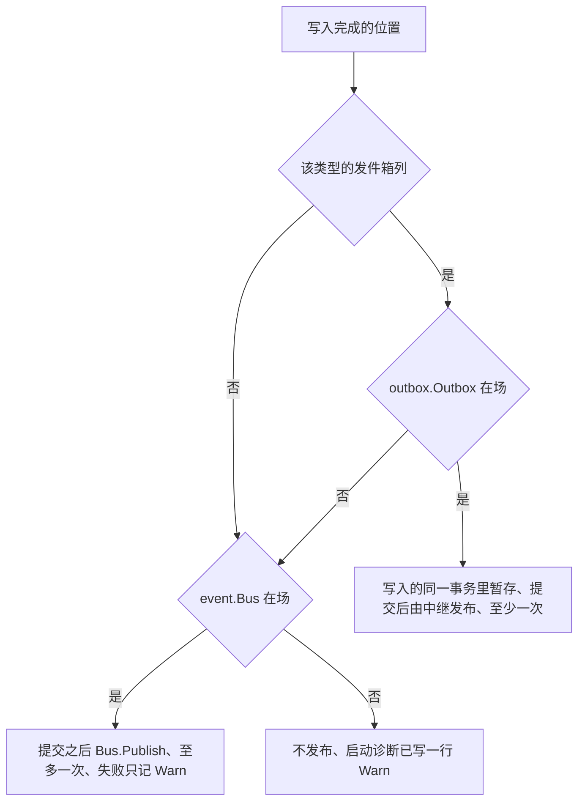
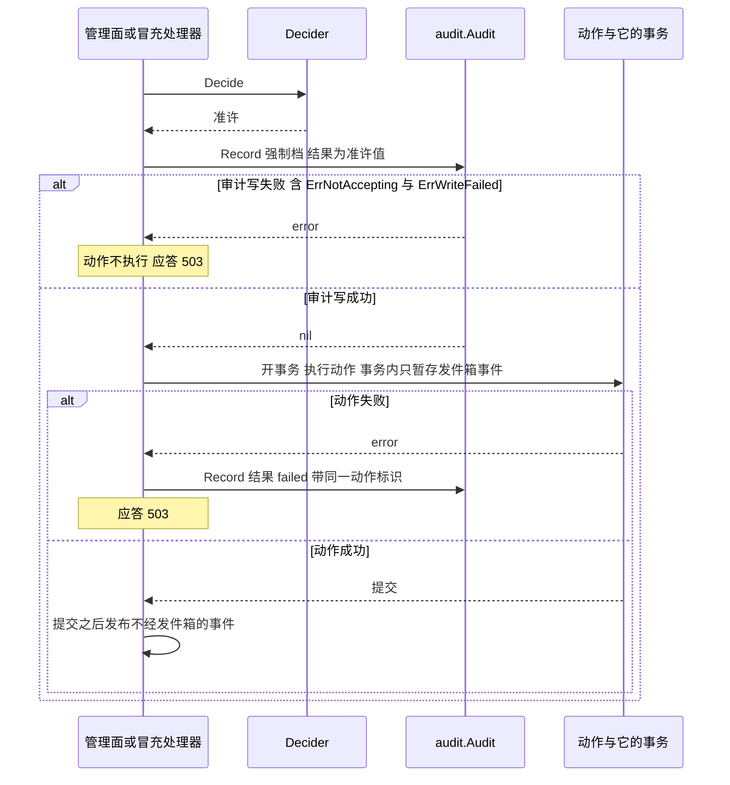

# authn 的事件、审计、日志与指标

## 职责

`pkg/authn` 功能目录各模块产生的可观察事实经事件、审计、日志、指标这几条通路离开认证。本文固定这些通路上认证名下的全部名字与形状：事件类型与载荷、审计动作与档位、日志字段与级别、指标仪器与属性。每个信号由产生它的模块在自己的代码里发出；本文不对应单独的包，不登记模块。取舍见 [ADR-authn-events-and-audit-2026-10-10](../../../adr/adr-authn-events-and-audit-2026-10-10.md)，身份的两个维度见 [ADR-authn-identity-2026-10-10](../../../adr/adr-authn-identity-2026-10-10.md)，冒充的审计先于动作见 [ADR-authn-impersonation-2026-10-10](../../../adr/adr-authn-impersonation-2026-10-10.md)。

本文承载下列事项（封闭集合，不在其内的事项归非职责一节点名的文档）：

- **事件**：事件类型的全集、载荷的顶层字段、租户放置、是否经发件箱、认证自己订阅的事件、载荷字段的取值域。
- **审计**：动作、对象、结果、档位的全集，明细键名的全集，`actor` 列的取法，强制档的写入顺序。
- **日志**：请求关联字段、各模块自加字段、级别判据、永不记录的判据。
- **指标**：`Meter` 名、仪器、单位与属性的闭集。

### 非职责

- **不实现通路本身。** 事件总线与发件箱、审计的写入与脱敏、日志的脱敏层、指标的提供者归 [design-event](../event/design-event.md)、[design-outbox](../event/design-event-outbox.md)、[design-audit](../audit/design-audit.md)、[design-log](../design-log.md)、[design-observability](../design-observability.md)；本文只写认证在这些通路上的用法与承诺。
- **不承载日志脱敏的登记内容。** 键名、值形状与字面量的登记全集，以及永不记录项的例举，归 [design-authn-gate](design-authn-gate.md) 的脱敏规则一节；本文只写永不记录的判据。
- **不承载配置键与设置键，包括放宽开关。** 归 [design-authn-config](design-authn-config.md)。
- **不承载哨兵错误与依赖不可用时各条路径的方向。** 归 [design-authn-failure](design-authn-failure.md)；本文只写各通路自身的失败方向。
- **不承载 `tenant.admission.decisions` 的属性与取值。** 该仪器归 tenant 目录，见 [design-tenant-admission](../tenant/design-tenant-admission.md)。
- **不规定事件、审计行与指标的消费方如何处理。** 授权、审计、宿主、看板的行为归它们自己；本文固定它们可以引用的名字、载荷与取值，以及投递语义的缺口。
- **不规定审计表的结构与审计的敏感键闭集。** 归 [design-audit](../audit/design-audit.md)；认证的明细键名不依赖那个闭集。
- **不承载威胁与对策。** 归 [design-authn-threats](design-authn-threats.md)。

## 术语表

以下术语的含义限于本文与引用本文的 `design-authn-*` 文档；它们不进项目术语表。实际操作者、责任键沿用 [design-authn](design-authn.md) 术语表的定义；生效账户指 `Identity.Account()` 的值，冒充时是被冒充者。

| 术语 | 英文 | 定义 |
|---|---|---|
| 强制档 | mandatory tier | 审计的一档：审计写成功是动作执行的前提。写入次序见核心算法与流程的「强制档的写入顺序」。 |
| 尽力档 | best-effort tier | 审计的一档：审计写失败只记 Error 日志与计数，不影响业务。 |
| 信封 | envelope | 事件的租户放在 `Event.TenantID` 上，载荷里不带租户字段；事件表的租户列写「信封」的类型即属此类。 |

## 外部接口契约

### 事件

事件是提示，不是权威。账户状态、成员关系、会话与撤销的权威在 db；订阅方只能用事件清本地缓存与触发清理，不得把它当唯一依据。总线各传输实现的投递语义不同（Redis 至多一次，NATS 可能重复，进程内只在本副本可见，`Start` 窗口内会丢，都不回放），所以每个订阅方按 `Event.ID` 去重，不依赖次序与次数，不依赖「先 created 后 changed」。

**类型。** 事件类型的集合是封闭集合，即下表。集合在各模块 `Init` 之前静态已知；类型按功能划分，不按 IdP、登录方式或租户展开，变化用载荷字段表达。没有登录失败事件：失败只走审计、日志与计数器，退避开始时才发 `authn.throttle.engaged`：发出方是调用 `Throttle.Fail` 并得到 `engaged` 为真的使用方，同时让 `authn.throttle.engagements` 加一；使用方的名单见 [design-authn-account](design-authn-account.md) 的 `Throttle` 一节。

**载荷。** 每个类型对应根包 `pkg/authn` 导出的一个具名载荷结构体：结构体名由类型名去掉 `authn.` 前缀后各段首字母大写连接而成（`authn.account.created` → `AccountCreated`，`authn.token.reuse-detected` → `TokenReuseDetected`），常量名是 `Event` 加结构体名（`EventAccountCreated`、`EventTokenReuseDetected`），常量值即下表的类型名；订阅方用 `event.DecodePayload` 解到该结构体。载荷的约束：

- JSON 标签小写下划线，顶层字段全是标量。
- 载荷的顶层字段只放标识、枚举与时刻。不放秘密、自由文本（理由、显示名）、邮箱、手机号与登录标识。判据：载荷的每个顶层字段都会被审计写进明细，所以放进去的值在审计明细里出现时必须无害。
- 时刻用 RFC 3339 字符串；数字经传输后成为 `json.Number`，超过 2^53 会被舍入。
- 事件订阅者拿到的上下文不带租户；需要租户的订阅方按 `Event.TenantID` 经 `Catalog.Enter` 进入。

**投递路径。** 下表「发件箱」列为「是」的类型，在 `outbox.Outbox` 在场时于写入的同一事务里暂存，由中继在提交之后发布，至少一次，同一个 `Event.ID`；发件箱缺席则在提交之后 `Bus.Publish`，尽力而为；发件箱与总线都不在场则不发布。「发件箱」列为「否」的类型一律在提交之后 `Bus.Publish`。发布失败只记 Warn，从不令业务操作失败。发件箱缺席时启动诊断写一行 Warn，点明经发件箱发出的那些类型在该装配里按尽力而为发出；总线也缺席时同一行注明不发布。发件箱在场则用，不构成硬依赖。

| 类型 | 载荷顶层字段 | `TenantID` | 发件箱 |
|---|---|---|---|
| `authn.account.created` | `account_id`、`kind`、`via`（`admin`、`jit`、`signup`、`import`） | 空 | 否 |
| `authn.account.status-changed` | `account_id`、`from`、`to`、`reason_class` | 空 | 是 |
| `authn.account.deleted` | `account_id` | 空 | 是 |
| `authn.identifier.changed` | `account_id`、`kind`、`change`（`added`、`removed`） | 空 | 否 |
| `authn.binding.changed` | `account_id`、`provider_class`（`google`、`github`、`wechat`、`oidc`、`saml`）、`change`（`linked`、`unlinked`）、`source`（`explicit`、`auto`、`jit`） | 空 | 否 |
| `authn.membership.changed` | `account_id`、`change`（`added`、`suspended`、`resumed`、`removed`、`sso-exempt-set`、`sso-exempt-cleared`）、`source` | 信封 | 是 |
| `authn.password.changed` | `account_id`、`by`（`self`、`admin`、`import`）；再哈希不发 | 空 | 否 |
| `authn.factor.changed` | `account_id`、`factor_id`、`kind`、`change`（`enrolled`、`removed`、`reset`、`flagged`）、`by` | 空 | 否 |
| `authn.login.succeeded` | `account_id`、`session_id`、`methods`（逗号连接）、`assurance`、`delivery` | 空 | 否 |
| `authn.session.revoked` | `session_id`（`scope=all` 时为空）、`account_id`、`scope`（`one`、`all`）、`reason_class` | 空 | 否 |
| `authn.throttle.engaged` | `scope`；`scope` 为 `account`、`factor` 时另带 `account_id` | 空 | 否 |
| `authn.token.reuse-detected` | `session_id`、`account_id` | 空 | 否 |
| `authn.impersonation.started` | `grant_id`、`actor_id`、`account_id`、`session_id`、`expires_at` | 信封 | 否 |
| `authn.impersonation.ended` | `grant_id`、`ended_by`（`actor`、`session-ended`、`disabled`、`membership-removed`、`revoked`） | 信封 | 否 |
| `authn.idp.changed` | `idp_id`、`change`（`created`、`updated`、`enabled`、`disabled`、`deleted`、`domain-verified`、`domain-unverified`、`domain-removed`） | 信封 | 否 |

括号里的取值集是该字段的封闭集合。下表是其余字段的取值域。

| 字段 | 出现于 | 取值域 |
|---|---|---|
| `reason_class` | `authn.account.status-changed`、`authn.session.revoked`，以及失败退避开始的那一行日志 | 封闭集合，见下文 |
| `from`、`to` | `authn.account.status-changed` | 账户状态的名字，状态的定义见 [design-authn-account](design-authn-account.md) |
| `kind` | `authn.account.created` | 账户种类 `user`、`service` |
| `kind` | `authn.identifier.changed` | 标识种类，见 [design-authn-account](design-authn-account.md) |
| `kind` | `authn.factor.changed` | 因素种类 `totp`、`sms`、`webauthn` |
| `by` | `authn.factor.changed` | 发起者的类别，取值域由产生该事件的模块文档承载 |
| `source` | `authn.membership.changed` | 成员关系的来源，取值域由 [design-authn-account](design-authn-account.md) 承载；来源可带 IdP 标识，仍是标识而不是自由文本 |
| `methods` | `authn.login.succeeded` | `Method` 的取值，逗号连接 |
| `delivery` | `authn.login.succeeded` | `session`、`token` |
| `assurance` | `authn.login.succeeded` | 保障等级的字符串形式，不用数值 |
| `scope` | `authn.throttle.engaged` | `identifier`、`account`、`factor`、`phone`、`client`，与 `authn.throttle.engagements` 的 `scope` 同一集合 |

`reason_class` 是类别名，不是自由文本；它的取值是下列封闭集合，调用方传入的 `reason` 取自这个集合，集合外的值不得传入。

| 取值 | 含义 |
|---|---|
| `admin` | 管理员发起的状态变更或撤销 |
| `self` | 账户持有人自己发起：登出、自助变更之后撤销其余会话 |
| `password-change` | 口令变更之后撤销其余会话 |
| `factor-reset` | 管理员重置因素之后撤销会话 |
| `refresh-reuse` | 刷新令牌重用检测命中，整族会话撤销 |
| `expired` | 到期 |
| `account-disabled` | 账户被停用 |
| `account-deleted` | 账户被删除 |
| `evicted` | 超出每账户会话上限，最久未使用的会话被撤销 |
| `throttled` | 失败退避开始：一个键越过自由次数而进入等待；只出现在退避那一行日志，不进事件载荷与审计明细 |

`throttled` 是退避那一行日志专有的类别。根包给出两个判定把它与其余取值分开：`ValidReasonClass` 对闭集全部取值为真（含 `throttled`），供日志与「是不是一个类别名」的核对用；`ValidPayloadReasonClass` 排除 `throttled`，写事件载荷与审计明细的模块用后者，把 `throttled` 挡在载荷与明细之外。

**authn 自己订阅的事件**是下表（封闭集合）。订阅全在 `Init` 里登记，类型静态，处理函数幂等，只做丢本地缓存与账户清理的补偿。

| 订阅方 | 订阅的类型 | 处理 |
|---|---|---|
| 交付 `Verifier` 的校验后端 | `authn.session.revoked`、`authn.account.status-changed`、`authn.account.deleted` | 清账户快照缓存；会话状态缓存归 `authn.session` 自己的订阅，本后端经 `Sessions` 接缝读、不另持一份 |
| 询问冒充记录是否有效的校验后端 | `authn.impersonation.ended` | 清冒充记录缓存 |
| `authn.session`、`authn.mfa` | `authn.account.status-changed`、`authn.account.deleted` | 发件箱在场时重做各自的账户清理，补偿同步钩子的失败 |
| `authn.sms` | `authn.account.deleted` | 发件箱在场时重做账户清理；短信的 `AccountDisabled` 是空操作，不订阅状态变更 |
| `authn.sso.saml`、`authn.sso.oidc` | `authn.idp.changed` | 清 `Provider` 与 `ServiceProvider` 缓存 |
| `tenant.admission` | `authn.membership.changed` | 清成员关系缓存；处理见 [design-tenant-admission](../tenant/design-tenant-admission.md) |
| 持有可在运行期改动的安全设置的模块（`authn.sms` 在其中） | `settings.changed` | 取值改到更宽松时写 Warn 并记尽力档审计 |

上表之外的订阅方由各自文档承载，授权、审计与宿主是例举，判据是以事件为输入而不在上表之内的消费方。审计只订阅 `audit.journal` 配置里点名的类型；可观测性不订阅总线（[ADR-observability-events-2026-09-22](../../../adr/adr-observability-events-2026-09-22.md)）。「发件箱」列为「是」的类型在发件箱在场时经中继发布，到达订阅方的上下文是中继的，不带发布方的身份：审计订阅这些类型得到的行没有主体，也没有 `on_behalf_of`、`impersonation_scope` 与 `session`（规则见 [design-audit](../audit/design-audit.md) 的非保证）。

### 审计

认证经 `audit.Audit.Record` 的接缝级通路写入，不是语句级也不是请求级。登录与 SSO 回调发生在没有身份的豁免路由上，请求级采集的 `actor` 为空，所以登录类动作由认证自己记。请求级与语句级采集沿用，不由认证配置。`Entry.Purpose` 装冒充理由。

**`actor` 与生效账户。** 审计同时记实际操作者与生效账户：

- `actor` 列恒取实际操作者的责任键 `Key()`。
- 冒充时，生效账户进 `Detail` 的 `on_behalf_of`，冒充范围进 `impersonation_scope`，会话进 `session`。这些键只由 `audit/journal` 在冒充行上写入，覆盖、剥掉与不改动调用方映射的规则只在 [design-audit](../audit/design-audit.md) 的审计行的补全一节。认证自己的接缝级行因此不得写这些名字，记会话标识用 `sid`。审计表的结构不变。
- 已认证路由上，`Record` 取上下文里的身份。登录引擎记登录审计行时用新认定的身份派生上下文（`internal/identity` 的 `With`，只在 authn 树内可见，登录引擎在 [design-authn](design-authn.md) 的写入方名单里，由依赖测试断言；派生的上下文只用于这一次 `Record`、不流回请求链），使 `actor` 是登录的账户而不是空串。
- 登录失败时 `actor` 为空，用 `identifier_mac` 关联同一标识的多次失败。

**明细键名**是下列封闭集合：`method`、`delivery`、`reason_class`、`sid`、`peer`、`identifier_mac`、`factor_id`、`kind`、`scope`、`by`、`tenant`、`change`、`provider`、`ttl_seconds`、`parent_sid`、`secret_id`、`source`、`on_behalf_of`、`impersonation_scope`、`session`、`grant_id`、`action_id`。明细键名不得取的名字有两部分：[design-audit](../audit/design-audit.md) 的审计敏感闭集，以及下列禁用名的封闭集合：`code`、`otp`、`refresh_token`、`id_token`、`assertion`、`state`。值只放标识、枚举、计数与密钥摘要的前缀：

- `identifier_mac` 是带密钥的摘要的前 16 个十六进制字符，用来关联同一标识的多次失败而不存标识。
- `grant_id` 是冒充开始的动作标识，在 `Decide` 通过之后、审计写入之前预先生成。
- `action_id` 是其余强制档动作的动作标识。强制档动作的先写行与补写的失败行带同一个动作标识（冒充开始用 `grant_id`，其余用 `action_id`），补写规则见核心算法与流程的「强制档的写入顺序」。
- 秘密、令牌、验证码、断言与 `state` 从不进明细；口令的管理员重置只记动作，明文从不进明细。

**动作表**是封闭集合。「档」列是动作的归属；归属的判据是：这个动作若没有记录，事后能不能问责，能问责则尽力，不能则强制。

| 动作 | 对象 | 结果 | 档 |
|---|---|---|---|
| `authn.login` | 账户标识（失败时空） | `success`、`failure`、`throttled`、`refused` | 尽力 |
| `authn.logout`、`authn.session.revoke` | 会话标识（批量撤销时逐个会话各占一行） | `success` | 尽力；管理员撤销他人会话时强制 |
| `authn.password.change`、`authn.factor.enroll`、`authn.factor.remove`、`authn.binding.link`、`authn.binding.unlink` | 账户标识 | `success`、`denied` | 尽力 |
| `authn.mfa.reset` | 账户标识 | `success` | 强制 |
| `authn.account.password` | 账户标识 | `success`、`denied` | 强制（管理员重置口令） |
| `authn.settings.relaxed` | 设置键名 | `relaxed` | 尽力（只含键名与方向，不含值） |
| `authn.account.create`、`authn.account.disable`、`authn.account.delete`、`authn.account.update` | 账户标识 | `success`、`denied` | 强制 |
| `authn.membership.set`、`authn.membership.remove` | 账户标识 | `success`、`denied` | 强制 |
| `authn.idp.put`、`authn.idp.delete`、`authn.idp.domain` | IdP 标识 | `success`、`denied` | 强制 |
| `authn.secret.create`、`authn.secret.revoke` | 服务账户标识 | `success` | 强制 |
| `authn.impersonation.start` | 目标账户标识 | `granted`、`denied`、`failed` | 强制；`Purpose` 是理由 |
| `authn.impersonation.end`、`authn.impersonation.revoke` | 目标账户标识 | `success` | 尽力；结束总是允许 |
| `authn.token.refresh-reuse` | 会话标识 | `detected` | 尽力 |
| `authn.sso.reject` | IdP 标识 | `signature`、`audience`、`time`、`replay`、`in-response-to`、`issuer`、`destination`、`other` | 尽力 |

**`authn.session.revoke` 的适用面是「撤销本身即那次动作」的路径**：管理员撤销他人的会话，以及自助面的登出与撤销会话。账户级动作（改口令、重置因素、停用账户、自助改凭据）与超限淘汰都会让会话结束，但那是它们的**副作用**而不是它们宣告的事实——它们各自写自己的动作行，不另写本动作。一次批量撤销命中多个对象时，准许行与失败行都逐对象各写一行。

**强制档的适用面。** 强制档只对 HTTP 管理面与冒充成立：`authn.admin` 与 `authn.impersonation` 把 `audit.Audit` 当必需依赖，装配里没有审计即启动失败。经 Go 接口的直接调用（宿主自己的命令）不受强制档约束，没有审计的装配里只写 Warn。

**语句级采集。** 语句级审计行对认证自己的表照常产生，只记表、动作与受影响行数，不记值，经模型路径的写才有；登录路径上的 `Touch`、`Throttle` 与计数推进走原生 SQL，不留行。这些行没有业务语义，业务语义由接缝级的行给出。

### 日志

**请求关联字段**由网关在盖章时经 `log.WithAttrs` 绑定，租户字段由租户解析层绑定。

| 字段 | 绑定方 | 值 | 条件 |
|---|---|---|---|
| `account` | `authn.gate` | 生效账户 | 已认证 |
| `actor` | `authn.gate` | 实际操作者 | 冒充时 |
| `impersonating` | `authn.gate` | `true` | 冒充时 |
| `session` | `authn.gate` | 登录会话标识 | 有会话时 |
| `backend` | `authn.gate` | 认定该身份的校验后端名 | 已认证 |
| `tenant_id` | 租户解析层 | 租户标识 | 租户已解析 |

任何模块都不使用日志字段 `subject`：该词在账户体系里指外部身份绑定的主体，同名字段会使读日志的人把两种标识读混；冒充时实际操作者与生效账户并存，所以身份值的字段是 `account`，实际操作者另用 `actor`。

**日志字段名一律小写，词间用下划线**（`trace_id`、`tenant_id`、`reason_class`、`attributed_to`），与日志模块的关联字段、事件载荷与审计明细的键同一风格；字段名里不用连字符。

**各模块自加的业务字段**是下列封闭集合：`method`、`flow`（公开流程标识，不是流程令牌）、`idp`（IdP 标识）、`endpoint`、`factor`。这个集合约束任何模块在它自己的任意记录上自加的字段。只出现在某一种记录上、由拥有这种记录的模块登记的字段是记录级字段，不属于这个集合，也不得出现在别的模块的记录里：口令表后端的行与网关的收口行、取凭据的拒绝行、启动诊断各有下面的登记表，记录级字段新增时登记在拥有这种记录的表里，不加进这个集合。

**口令表后端的日志字段**是下列封闭集合：`entry`（口令表里写着的主体名，一行写一个）、`entries`（只在大小写上不同、共用一个退避键的主体名，逗号连接）、`algorithm`（低于下限的条目的算法名）、`setting`（读不出或越出取值域的设置键名）、`reason_class`（退避那一行的类别，取值见上）。这些行只写表里写着的主体名，不写调用方出示的名字，也不写条目的任何部分；主体名的字段一律叫 `entry`，不叫 `subject`。

**放宽监视行的日志字段**是下列封闭集合：`setting`（被改动的设置键名）、`direction`（放宽的方向，取值见下）。持有放宽方向设置项的模块，在设置被改到更宽松时各写一行 `Warn`，只写键名与方向，不写值；这一行与审计 `authn.settings.relaxed` 的 `Detail` 取同一份键名与方向（明细键 `change` 的值即方向）。`setting` 与口令表后端行的 `setting` 同名同义（都是设置键名），一个模块同时写这两种记录时用同一个名字。

**放宽方向的取值**是下列封闭集合，也是 `authn.settings.relaxed` 明细键 `change` 的取值集：`increase`、`decrease`、`add-member`、`remove-member`、`to-false`、`to-zero`。判据：取值变大即放宽的用 `increase`，变小即放宽的用 `decrease`，列表加入成员即放宽的用 `add-member`，列表移除成员即放宽的用 `remove-member`，布尔由 `true` 改 `false` 即放宽的用 `to-false`，数值改为 0 即放宽（0 表示关闭）的用 `to-zero`。方向由设置项的语义给出，新增加宽项时按同一判据补列。

**网关的收口行、取凭据的拒绝行与启动诊断行**另写下表的字段。下表是网关日志字段的封闭集合，按对外接口面对待，网关新增字段先登记在这里；字段的值只含形状、计数、名字与成因文本，从不含凭据、令牌或口令。

| 字段 | 出现在 | 值 |
|---|---|---|
| `endpoint` | 收口行、启动诊断 | 端名（与上一段的 `endpoint` 是同一个字段） |
| `status` | 收口行 | 响应状态码 |
| `outcome` | 收口行、`anonymous` 放行行 | 与指标 `authn.gate.conclusions` 的 `outcome` 同一取值集 |
| `attributed_to` | 收口行 | 这条结局记在谁名下：后端名，网关自产的拒绝为 `authn.gate` |
| `cause` | 收口行、装配与启动检查的警告行 | 失败成因的文本；冒充范围拒绝取 `impersonation-scope` |
| `reason`、`backend` | 出口检查拒绝行（`backend` 另见 cookie 前缀警告行） | 出口检查拒绝的项（不带后端交出的值）与相关的后端名 |
| `scheme_length`、`scheme_separated`、`headers`、`cookie_name` | 取凭据的拒绝行与 cookie 前缀警告行 | 只记形状：scheme 的长度与是否带分隔、`Authorization` 头的个数、cookie 名 |
| `endpoints`、`schemes`、`cookies`、`accounts`、`impersonation`、`sso`、`configured`、`key` | 启动诊断 | `endpoints` 是展开后的受守端名清单，或冒充身份可到达的端名清单；各后端认领的 scheme、cookie 名与账户前缀，冒充与 SSO 的能力声明；`configured` 是配置读到的 `endpoints` 值，缺省时就是缺省值 `*`，不区分「键没写」与「显式写 `*`」；被核对的配置键名 |
| `exemptions`、`optional_routes`、`impersonable_routes`，以及各端名 | 启动诊断（冻结的登记表） | 某类登记在各端上开出的路由，写成「方法 路径」，逗号连接；端名是入口模块声明的端名，原样作字段名，一类登记在某端上为空时该端不写；整类登记为空时只写标题字段，值是没有登记的说明 |
| `panic`、`stack` | 网关自身 panic 的 Error 行 | recover 得到的值与调用栈；两者是排障信息，不在对外接口面之内 |

**级别**按谁有事要做定。判据：问题在调用方，记 Info；问题要运维去查，记 Warn；问题是缺陷，记 Error。下表的条目是例举，不是封闭集。

| 级别 | 例举 |
|---|---|
| Info | 登录失败、退避、验证码错、跨源检查不过、令牌过期、`link-required`、冒充被拒、`anonymous` 放行 |
| Warn | db 或 kv 不可用、短信发送方故障、IdP 断言验签失败或时间不符、刷新宽限命中、断言重放、克隆告警、放宽项在用、事件发布失败 |
| Error | 零值判决、证明形状不合、后端与网关 panic、强制档审计写失败、SAML 校验里库返回成功而补充校验失败 |

**永不记录**的判据：凡持有它即可冒用或重放认证过程的值，以及用户提交的原文。记录的是类别、标识与结果。例举与登记规则见 [design-authn-gate](design-authn-gate.md) 的脱敏规则一节。

- 退避、重放、克隆告警这类安全事件各写一行；账户标识可带，用户输入的标识字符串不带。退避的那一行带 `reason_class`，取值取自上文的封闭集合。
- `Sensitive` 的配置项不向日志模块登记规则，所以「`Sensitive` 值不进日志」是认证自己的纪律：持有秘密配置值的模块把值本身登记成日志的字面量匹配器，并由测试对每个模块的错误路径断言输出里不含配置里的哨兵值。

### 指标

指标经 `observability.MeterProvider` 报出，`Meter` 名取 `authn`。`MeterProvider` 缺席合法：缺提供者时静默跳过上报，取用得到缺提供者以外的错误则终止启动。业务指标归产生信号的模块自己上报，不进 observability 的文档。除网关的可观察计数器外，仪器都是同步计数器与直方图，事件稀疏，不为上报在请求路径上多付代价。

属性只取方式、协议、结果、因素、算法这类取值有限的维度，不含租户、账户、IdP 标识与路由。下表的属性集是封闭集合。

| 仪器名 | 单位 | 属性（闭集） |
|---|---|---|
| `authn.gate.conclusions`（可观察） | `{conclusion}` | `outcome`：`unspoken`、`authenticated`、`denied`、`unavailable`、`anonymous` |
| `authn.login.completions` | `{login}` | `method`：登录方式名，闭集，SSO 只到 `oidc`、`saml`，不含提供方标识；`outcome`：`success`、`failed`、`throttled`、`refused`、`unavailable`、`expired` |
| `authn.password.verifications` | `{verification}` | `outcome`：`ok`、`bad`、`cached`、`busy`、`upgraded` |
| `authn.password.derive.duration` | `s`（直方图） | `algorithm`：`argon2id`、`pbkdf2-sha256` |
| `authn.mfa.verifications` | `{verification}` | `factor`：`totp`、`sms`、`webauthn`；`outcome`：`ok`、`bad`、`replay`、`throttled`、`unavailable` |
| `authn.session.operations` | `{operation}` | `operation`：`created`、`elevated`、`revoked`、`revoked-all`、`purged` |
| `authn.token.operations` | `{operation}` | `operation`：`issued`、`refreshed`、`revoked`、`client-credentials`；`outcome`：`ok`、`invalid`、`reuse-detected`、`unavailable` |
| `authn.throttle.engagements` | `{engagement}` | `scope`：`identifier`、`account`、`factor`、`phone`、`client` |
| `authn.sms.sends` | `{message}` | `outcome`：`sent`、`uncertain`、`throttled`、`rejected`、`not-sendable`（模板被禁用或审核未过，未发）、`unsupported-region`、`budget-exhausted`、`suppressed`（号码未登记且注册关闭，未发）、`dropped`（队列满） |
| `authn.sso.assertions` | `{assertion}` | `protocol`：`saml`、`oidc`；`outcome`：`accepted`、`signature`、`audience`、`time`、`replay`、`in-response-to`、`issuer`、`destination`、`other` |
| `authn.impersonation.sessions` | `{session}` | `outcome`：`started`、`denied`、`ended` |
| `authn.audit.write-failures` | `{failure}` | `mandatory`：`true`、`false` |
| `authn.cleanup.failures` | `{failure}` | `hook`：`session`、`mfa`、`sms`、`secret`、`other`；账户停用、删除与服务密钥撤销之后钩子失败的次数 |

`authn.gate.conclusions` 的 `anonymous` 是可选路由上无凭据而放行的结局；`outcome` 各取值之和包含 `anonymous`。`authn.login.completions` 按方式聚合，看不到哪个 IdP 在失败，定位到 IdP 读日志里的 `idp` 字段。

### 对外接口面

- 本文登记的事件类型名与载荷字段名、审计动作名与明细键名、日志字段名、仪器名与属性名，对宿主可见；改名或改变含义按宿主可见面的破坏性变更处理。
- 本文登记的各取值集（事件载荷字段的取值、`reason_class`、审计结果、指标属性的取值）新增取值是兼容的，改名、删除或改变既有取值的含义是破坏性变更；事件载荷新增字段是兼容的，删除字段是破坏性变更。订阅方、看板与告警规则必须容忍未知取值与未知字段。

## 依赖

本文是文档，不是模块，没有自己的依赖；下表是各通路的信号发出方依赖的能力，缺席时的行为见[错误与失败语义](#错误与失败语义)。

| 通路 | 依赖的能力 | 缺席是否合法 | 方向 |
|---|---|---|---|
| 事件 | `event.Bus` | 合法，不发布 | authn 依赖 event，符合自底向上的依赖方向 |
| 事件 | `outbox.Outbox` | 合法，降为提交之后发布 | authn 依赖 event 目录下的发件箱 |
| 审计 | `audit.Audit` | 对 `authn.admin` 与 `authn.impersonation` 不合法，启动失败；对其余模块合法 | authn 依赖 audit；`audit/journal` 经根包读身份类型 |
| 日志 | `log.Logger` | 合法，写 `Optional` 的取用，使脱敏规则在 `New` 里先于 logger 绑定登记 | authn 依赖 log |
| 指标 | `observability.MeterProvider` | 合法，静默跳过 | authn 依赖 observability |

`audit/journal` 与 `ratelimit` 读根包的身份类型，不 import `pkg/authn/internal` 之下的包；责任键 `Key()` 的取值恒为 `string(Actor())`，它们不透明地使用它。

## UML 图

### 事件的发布路径

下图是一个事件类型从产生到发出所经的分支；规则的文字叙述见外部接口契约「事件」一节的投递路径。



### 强制档的时序

下图是强制档动作的时序；步骤的文字叙述见核心算法与流程的「强制档的写入顺序」。图看不出的约束：审计写入另占一条连接，在调用方事务开着时调用 `Record`，单写者引擎上会等调用方占着的写锁而失败，所以 `Record` 不在事务里调用。



## 核心数据结构

事件载荷是根包 `pkg/authn` 导出的具名结构体，每个事件类型一个。形状固定为：顶层字段、标量类型、小写下划线 JSON 标签。下面以 `authn.account.status-changed` 为例，其余类型按事件表的字段列同形。

```go
// 载荷：字段全是顶层标量，只放标识、枚举与时刻
type AccountStatusChanged struct {
	AccountID   string `json:"account_id"`
	From        string `json:"from"`
	To          string `json:"to"`
	ReasonClass string `json:"reason_class"`
}

const EventAccountStatusChanged = "authn.account.status-changed"
```

审计行经 `audit.Entry` 交出，认证填 `Action`、`Object`、`Outcome`、`Purpose` 与 `Detail`：

```go
audit.Entry{
	Action:  "authn.impersonation.start",
	Object:  "<目标账户标识>",
	Outcome: "granted",
	Purpose: "<冒充理由>",
	Detail:  map[string]string{ /* 只用明细键名的封闭集合 */ },
}
```

## 核心算法与流程

### 强制档的写入顺序

适用于全部强制档动作，次序是：

1. 判定：`Decider.Decide`；`false` 即 403，返回 error 即 503，`Decider` 缺席等同全拒。
2. 在事务之外 `audit.Record`，结果取动作表里的准许值（冒充开始为 `granted`，其余为 `success`），明细带动作标识。写失败（含 `ErrNotAccepting`、`ErrWriteFailed`）即应答 503、不开事务、不执行动作。
3. 开动作自己的事务执行动作；事务内只暂存发件箱事件，不调 `audit.Record` 与 `Bus.Publish`。
4. 动作失败：补写结果为 `failed` 的审计行，与先写的行用动作标识关联，应答 503。审计与动作之间没有原子性：审计里留有一行已准许而未生效的记录，核实动作是否发生读动作自己的表。
5. 动作成功：提交之后发布不经发件箱的事件。

冒充开始的动作标识 `grant_id` 在判定通过之后、审计写入之前生成；其余强制档动作的 `action_id` 同样在审计写入之前生成。

**一次动作命中多个对象时，准许行与失败行都逐对象各写一行。** 批量撤销一个账户的会话是这种动作：它在动作之前把将被结束的那一组会话逐个读出，为每个会话写一行准许行，这些行共用同一个动作标识；动作失败时逐会话补写失败行，仍带那个标识。读出那一组用的条件与结束它们用的条件相同，所以行不会漏掉被结束的会话。读与写仍是两次操作：自助面在同一条语句里完成，管理面读在前、写在后，两者之间与动作和审计之间一样没有原子性——那之间新建的会话会被结束而不占一行。准许行逐对象写，其中一行写失败与动作失败一样留下没有收口的行；核实动作是否发生读动作自己的表。

### 尽力档

尽力档的审计不阻塞动作。写失败只记 Error 日志并让 `authn.audit.write-failures`（`mandatory` 为 `false`）加一，动作的结果不变。冒充的结束总是允许：审计写失败不阻止结束，因为结束是向安全的方向的动作。

### `Start` 之前

`audit.Audit.Record` 在审计模块 `Start` 之前返回 `ErrNotAccepting`。`Start` 之前发生的动作只有启动引导，不走审计，改写一行启动诊断。

### 订阅方的处理约束

认证自己的订阅处理函数在 `Init` 里登记，处理函数幂等，只做丢本地缓存与账户清理的补偿，按 `Event.ID` 去重，不依赖事件的次序与次数。事件丢失（`Start` 窗口内、没有发件箱的装配）时，正确性的底线由 db 的权威（账户状态、会话的撤销、账户级 `valid_after`）承担，不由事件承担。

### 外部行为假设与守住它们的测试

下列断言依赖尚未核实的行为。每条是假设，各由一条测试守住；测试不成立时，本文中依赖它的条目失效，由新的设计取代。

| 假设 | 依赖它的条目 | 守住它的测试 |
|---|---|---|
| 语句级审计行不带列值，只带表、动作与受影响行数 | 认证的哪些表可以经模型路径写；含加密列的模型可以经模型路径写 | 含加密列的模型经模型路径写入，断言审计行里不出现秘密字节 |
| 审计把事件载荷的顶层字段原样写进明细，脱敏键名只比对扁平键 | 载荷只放标识、枚举与时刻 | 对每个载荷结构体反射检查：顶层字段全是标量，字段名不在审计敏感闭集与禁用名之内 |
| 接缝级 `Record` 在调用方事务里调用会在单写者引擎上等锁而失败 | 审计与动作不在同一事务里 | SQLite 文件库（默认 `IMMEDIATE` 事务）上冒充开始必须成功且审计行存在 |

不依赖未核实行为的纪律也各由测试守住：每个模块的错误路径输出里不含配置里的哨兵值；认证写出的每个审计明细键属于键名的封闭集合；每个仪器的属性键与取值属于指标表的闭集。

## 错误与失败语义

本节只写各通路自身的失败方向；哨兵与依赖不可用的全表见 [design-authn-failure](design-authn-failure.md)。

| 失败 | 方向 | 信号 |
|---|---|---|
| 事件发布失败 | 不令业务操作失败 | Warn 日志 |
| 发件箱或总线缺席 | 降级方式见外部接口契约「事件」一节的投递路径 | 启动诊断一行 Warn |
| 强制档审计写失败（含 `ErrNotAccepting`、`ErrWriteFailed`） | 动作不执行，次序见核心算法与流程的「强制档的写入顺序」 | Error 日志；`authn.audit.write-failures`（`mandatory` 为 `true`） |
| 尽力档审计写失败 | 业务不受影响 | Error 日志；`authn.audit.write-failures`（`mandatory` 为 `false`） |
| 装配里没有 `audit.Audit` | `authn.admin` 与 `authn.impersonation` 启动失败；其余模块不记审计，经 Go 接口的直接调用只写 Warn | 启动失败或 Warn |
| `MeterProvider` 缺席 | 静默跳过上报 | 无 |
| 取用 `MeterProvider` 得到缺席以外的错误，或仪器登记失败 | 终止启动 | 启动错误 |
| 账户停用、删除与服务密钥撤销之后钩子失败 | 同步调用返回错误，订阅补偿重做 | `authn.cleanup.failures` |

审计库故障时，冒充与高危管理动作不可用；这是偏向留痕的方向。登录的审计属于尽力档，审计库故障不使登录不可用。

**不保证的事项**，各自写明原因：

- 事件在没有发件箱的装配里是尽力而为；授权在这类装配里经账户读口对账，事件不是唯一依据。
- 强制档的审计与动作之间没有原子性，处理见核心算法与流程的「强制档的写入顺序」。
- 尽力档审计在审计模块拥塞时会丢，只留 Error 日志与计数。
- 强制档只约束 HTTP 管理面与冒充；宿主经 Go 接口直接调用账户管理的方法不受它约束。
- 按被冒充者聚合审计要扫 `Detail` 里的 JSON；高频聚合的需求由审计模块在审计表上加列来满足，那是审计模块自己的变更。
- 指标看不到哪个 IdP 或租户在失败。
- 事件载荷里的 `account_id` 是个人信息。审计只对配置里点名的类型订阅，被点名的类型的顶层字段会进入审计明细；要求更严的宿主不点名这些类型，或在导出端过滤。
- 「`Sensitive` 值不进日志」没有机制保证，只由逐模块的错误路径测试守住；宿主自己的 handler 若记录请求体，认证管不到。

## 并发与事务边界

- 每个模块只在自己的事务里写自己的表，事件因此由写入的模块发布；事务与事件、审计的先后关系见投递路径与「强制档的写入顺序」。
- 事件订阅表在模块 `Init` 之后冻结，没有退订；每个事件类型在 Redis 与 NATS 总线上占一条流，被订阅的类型另占一条读取连接。类型的集合因此是封闭的、静态的。
- 订阅处理函数可能被并发或重复调用，按 `Event.ID` 去重并保持幂等。
- 指标仪器由各模块在自己的 `Init` 里创建，之后只做同步的加一与记录，不持锁。

## 扩展点

- **宿主订阅事件。** 宿主订阅事件表里的类型，按 `Event.ID` 去重，必须容忍未知取值与字段；宿主表里引用账户标识的行由宿主订阅 `authn.account.deleted` 清理。
- **宿主选择审计的采集范围。** `audit.journal` 的配置点名要订阅的事件类型与要记的请求项；认证的接缝级审计不受这份配置约束。
- **宿主的看板与告警引用本文登记的仪器名与属性名**，依据对外接口面。

## 实现状态

下表逐项列出本文承载的能力。

| 能力 | 状态 | 代码 |
|---|---|---|
| 事件类型常量与载荷结构体 | 已实现 | `pkg/authn/events.go` `EventAccountStatusChanged`、`AccountStatusChanged`、`ReasonAdmin`、`ValidReasonClass`、`ValidPayloadReasonClass` |
| 事件的发布：经发件箱与经总线的路径、缺席时的启动诊断 | 已实现 | `pkg/authn/account/events.go`；`pkg/authn/session/lifecycle.go`；`pkg/authn/mfa/manage.go`；`pkg/authn/login/engine.go`；`pkg/authn/token/refresh.go` `revokeFamily`；`pkg/authn/events.go` |
| authn 自己的事件订阅与幂等补偿 | 已实现 | `pkg/authn/session/lifecycle.go`；`pkg/authn/mfa/manage.go`；`pkg/tenant/admission/admission.go`；`pkg/authn/token/subscribe.go` |
| 接缝级审计：强制档与尽力档、动作表、明细键名、`actor` 取法 | 已实现 | `pkg/authn/account/events.go`；`pkg/authn/login/engine.go`、`pkg/authn/login/identity.go` `auditLogin`、`auditBindingLink`；`pkg/authn/mfa/manage.go`；`pkg/authn/session/routes.go`；`pkg/authn/token/refresh.go` `revokeFamily`；`pkg/tenant/admission/decide.go`；`pkg/authn/sso/saml/reject.go` `actionSSOReject`、`pkg/authn/sso/oidc/method.go`；`pkg/authn/impersonation/signal.go` `writeAudit` |
| `authn.settings.relaxed` 的订阅与审计 | 已实现 | `pkg/authn/account/relax.go`；`pkg/authn/{sms,session,token,static,login,mfa,sso,impersonation}/relax.go`；`pkg/tenant/admission/relax.go` |
| 记录接缝 `audit.Audit.Record` 及其错误 `ErrNotAccepting`、`ErrWriteFailed` | 已实现 | `pkg/audit/audit.go` `Audit`、`Entry`、`ErrNotAccepting`、`ErrWriteFailed` |
| 登录引擎的派生上下文（`internal/identity` 的 `With` 供一次 `Record` 使用） | 已实现 | `pkg/authn/login/engine.go`；`pkg/authn/internal/identity/identity.go` `With` |
| 日志请求关联字段 | 已实现 | `pkg/authn/gate/serve.go` `identityAttrs` |
| 日志级别按谁有事要做：网关的收口 | 已实现 | `pkg/authn/gate/serve.go` `conclude`、`gatewayRefusal`、`outage` |
| 网关的记录级字段（收口行、取凭据的拒绝行、启动诊断、cookie 前缀警告行）与字段名的写法 | 已实现 | `pkg/authn/gate/serve.go` `conclude`、`credentialOf`；`pkg/authn/gate/gate.go` `diagnose`、`freeze`、`warnUnprefixedCookies` |
| 日志级别与字段：其余模块 | 已实现 | `pkg/authn/account/events.go`；`pkg/authn/session/routes.go`；`pkg/authn/mfa/routes.go`；`pkg/authn/login/engine.go`；`pkg/authn/token/refresh.go`；`pkg/authn/sms/pool.go`；`pkg/authn/mount/mount.go`；`pkg/tenant/admission/decide.go`；`pkg/authn/sso/saml/reject.go`、`pkg/authn/sso/oidc/method.go`；`pkg/authn/impersonation/routes.go` |
| 日志脱敏登记与永不记录 | 已实现 | `pkg/authn/gate/redact.go` `registerNewRules`、`registerValueRule`；`pkg/authn/login/{google,github,wechatweb,wechatmp}/secrecy_test.go`、`pkg/sms/{aliyun,tencent}/secrecy_test.go`、`pkg/authn/static/secrecy_test.go`、`pkg/authn/token/secrecy_test.go`、`pkg/authn/sso/saml/secrecy_test.go` |
| 指标 `authn.gate.conclusions` | 已实现 | `pkg/authn/gate/metrics.go` `takeMeter`、`bucketName` |
| 其余仪器（登录、口令、因素、会话、令牌、退避、短信、SSO、冒充、审计写失败、清理失败） | 已实现 | `pkg/authn/login/metrics.go`；`pkg/authn/mfa/mfa.go`；`pkg/authn/session/session.go`；`pkg/authn/token/product.go` `takeMeter`；`pkg/authn/account/meters.go`；`pkg/authn/sms/meters.go`；`pkg/tenant/admission/admission.go`；`pkg/authn/sso/oidc/metrics.go`、`pkg/authn/sso/saml/reject.go`；`pkg/authn/impersonation/signal.go` |
| 守住外部行为假设与纪律的测试 | 已实现 | `pkg/authn/summary_test.go`；`pkg/authn/account/audit_test.go`；`pkg/authn/session/observability_test.go`；`pkg/tenant/admission/decide_test.go` |

事件、审计与指标在各模块里的发出点，随各模块的实现状态由 [design-authn-session](design-authn-session.md) 等文档承载。
