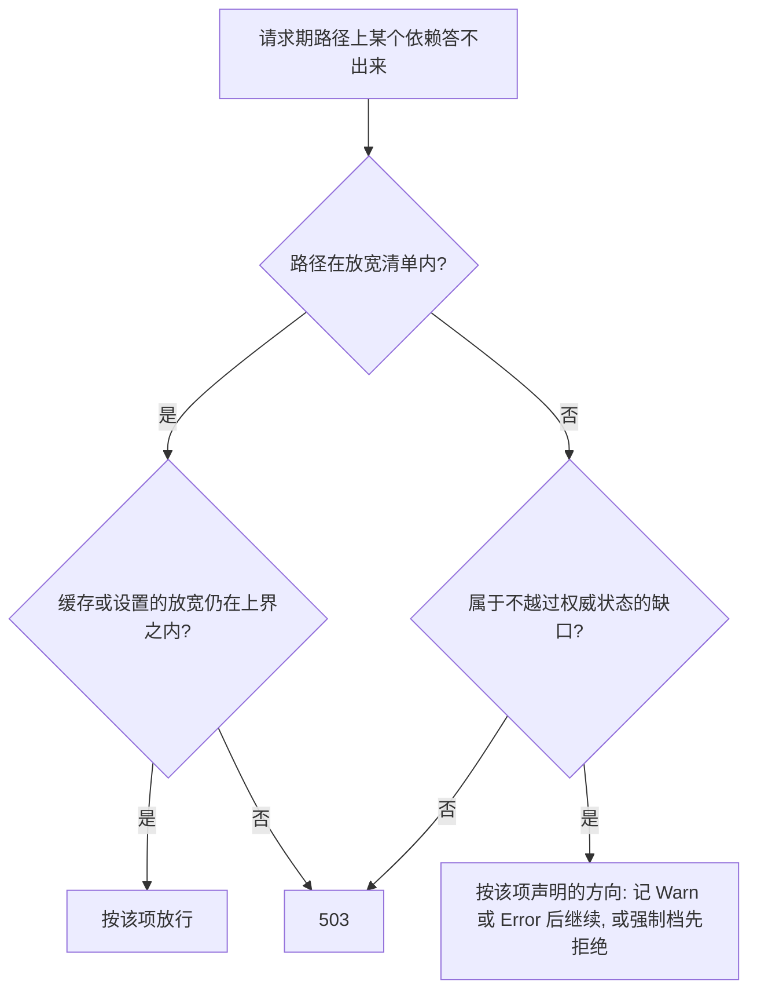
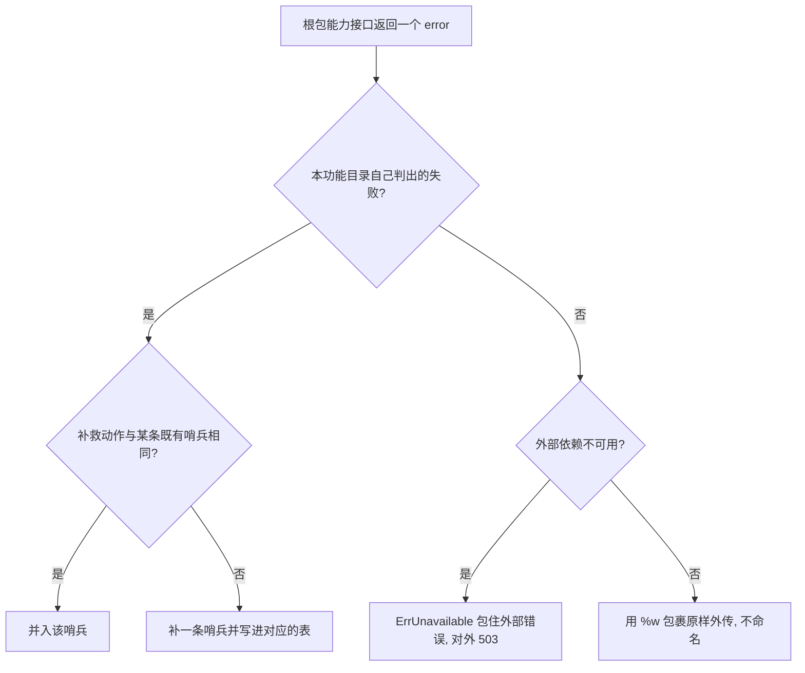

# authn-failure

## 职责

本文承载 `pkg/authn` 整个功能目录的失败语义：哪些失败有名字、请求期依赖不可用时每条路径往哪个方向走、哪些放宽被写明并带着上界、时间如何使用，以及认证检不出而只能写成前提的部署条件。本文不对应一个包，也不注册模块；它描述的是贯穿各 `authn.*` 模块与 `tenant.admission` 的一个方面。取舍与否决的写法见 [ADR-authn-failure-2026-10-10](../../../adr/adr-authn-failure-2026-10-10.md)，状态放置的判据见 [ADR-authn-state-placement-2026-10-10](../../../adr/adr-authn-state-placement-2026-10-10.md)。

本文承载下列事项（封闭集合，不在其内的事项归非职责一节点名的文档）：

- **启动期哨兵表**：触发条件与修复动作。
- **运行期哨兵表**：含义与对外的 HTTP 形状。
- **依赖不可用时每条路径的方向**，以及放宽的判据与封闭清单。
- **「没答」与「答了拒绝」的区分**、库返回成功而补充校验失败时的优先级规则。
- **时间的使用与容差**、**部署前提**及违反时的症状。
- **其他失败语义**：panic、上下文、幂等、启动顺序。

### 非职责

- **不承载配置键与设置键。** 键名、缺省值与取值域只在 [design-authn-config](design-authn-config.md) 给全；本文提到某个键，写的是它在失败语义里的角色。
- **不承载各模块的流程与状态机。** 登录引擎、会话校验次序、令牌校验次序各在自己的文档里；本文只汇总它们的哨兵与失败方向，各模块文档里的失败表是本文对应行的细化，不与之相悖。网关的请求期判定顺序、收口表与出口检查在 [design-authn-gate](design-authn-gate.md)。
- **不承载事件、审计、日志与指标的取值。** 审计的档位、事件名、指标名与属性取值在 [design-authn-events](design-authn-events.md)；本文只写失败时它们的方向。
- **不承载入口模块的错误形状。** `Problem` 的字段与 `Fail` 的行为在 [design-http](../http/design-http.md) 与 [ADR-http-errors-2026-10-10](../../../adr/adr-http-errors-2026-10-10.md)；本文写 authn 取用它时填什么。
- **不承载威胁与残余风险。** 失败被诱发的攻击面与对策在 [design-authn-threats](design-authn-threats.md)。
- **不规定相邻模块的失败方向。** 限流在计数后端不可达时放行、审计的请求级写失败放行，各在 [design-ratelimit](../design-ratelimit.md) 与 [design-audit](../audit/design-audit.md)；本文写的是 authn 自己的路径，以及 authn 调用它们时的方向。
- **不检测时钟偏差，也不检查本机时钟。** 偏差由部署前提处理，不在运行期被检查，也不被读作保证。
- **不为外部库的错误命名。** 经 authn 返回的库错误原样外传，不在哨兵表内。

## 术语表

下表的术语含义限于本文、各 `design-authn-*` 文档与认证主题的决策记录；它们不进项目术语表，也不重定义 [design-authn](design-authn.md) 术语表里的词。

| 术语 | 英文 | 定义 |
|---|---|---|
| 放宽 | relaxation | 按权威状态（db 里的账户、会话、撤销、退避，以及已生效的配置）本应拒绝的请求，因某个依赖答不出来，或某份缓存、设置、元数据尚未更新而被放行。满足这条判据的情形只出现在放宽清单里，清单之外的情形一律按拒绝。`authn.token.check-session` 设为假把会话有效性的核对推迟到令牌到期，与缓存滞后同形，所以并入清单。配置里的其余放宽开关是校验强度的部署选择，不进放宽清单，由启动诊断各占一行 Warn（见 [design-authn-config](design-authn-config.md) 的放宽开关一节）。 |
| 没答 | unspoken | 校验后端交回零值判决：它既没有说通过，也没有说拒绝，也没有说答不了。零值是后端的缺陷，与「答了拒绝」是不同的事实。 |

## 外部接口契约

### 哨兵的形状

失败对调用方的接口是哨兵错误。启动期哨兵与运行期哨兵在 `pkg/authn` 根包，不按启动期与运行期分文件：有同名形状的随形状，其余在 `errors.go`。`ErrInvalidAccountID` 与 `AccountID` 同在 `ids.go`，`ErrThrottled` 与 `ThrottledError` 同在 `throttle.go`；`ErrBusy` 由 `internal/password` 的并发与内存闸门抛出，闸门不是 `Throttle`，没有可依附的形状，所以在 `errors.go`。不在根包的是：口令表后端的 `static.ErrMalformedHash` 在 `pkg/authn/static`，由 `pkg/authn/internal/password` 与 `static` 共用；受限出站客户端的 `ErrDestinationDenied`、`ErrSchemeNotHTTPS`、`ErrBodyTooLarge` 在 `pkg/authn/internal/egress`，只在 `pkg/authn` 树内可见，调用方遇到它们一律按 IdP 不可用收口（见依赖不可用时每条路径的方向）；`tenant.admission` 的端名与路由判定用 `pkg/tenant` 根包的同类哨兵，与 `pkg/authn` 的同名哨兵各属自己的包。

- 调用方用 `errors.Is` 判别，包裹一律用 `%w`，使错误链保持完整。
- `ErrThrottled` 经 `*ThrottledError` 携带 `RetryAfter`，调用方用 `errors.As` 取得它；`ThrottledError` 的 `Is(ErrThrottled)` 为真。
- 取不到配置读取面时，`core` 的 `ErrMissingProvider` 原样外传，不另立哨兵：补救动作是宿主在驱动开始之前预置读取面（见 [design-core](../design-core.md)）。
- 启动诊断每行以 `authn: ` 起头；错误点名缺的那一项，不带秘密，不带口令哈希的任何部分。

### 对调用方的承诺

下表是本功能目录对失败作的承诺（封闭集合）。每条承诺的主语是它约束的对象，不是整个目录。

| 承诺 | 约束的对象 | 内容 |
|---|---|---|
| 启动期失败终止启动 | `Prepare`、`New`、`Init`、`Start` 里判出的每一类确定失败 | 终止启动并点名缺的那一项；不降级为请求期的行为差异，不记 Warn 而继续 |
| 哨兵表对自己判出的失败封闭 | `pkg/authn` 各包自己判出的每一类确定失败 | 新判出一类失败，并入补救动作相同的既有哨兵，或补一条；说不出名字的失败不允许由本功能目录造出 |
| 外部库的错误不命名 | 经根包能力接口返回的外部库与下游模块的错误 | 用 `%w` 包裹后原样外传，不在表内；外部依赖不可用时由 `ErrUnavailable` 包住它 |
| 请求期默认拒绝 | 每条请求期依赖外部依赖的路径 | 依赖答不出来时该路径答 503，不答 200，也不答 401 |
| 放宽只有封闭清单 | 请求期的全部路径 | 放宽只出现在放宽清单所列各项，每项带控制项与上界；新增依赖或路径时，不在清单里的按拒绝 |
| 对外不区分成因 | 每个对外的 503 应答 | 应答体不携带是哪个依赖不可用；成因只进日志与指标 |
| 没答与答了拒绝不混 | 网关对校验后端的收口 | 零值判决收口 401、单独计 `unspoken`、记 Error；凭据存在而后端答不了是 503，不是匿名，可选认证的路由上也一样（理由见 [ADR-authn-verdict-2026-10-10](../../../adr/adr-authn-verdict-2026-10-10.md)） |
| 补充校验不由库覆盖 | 本功能目录在库的校验之外另加的每一项检查 | 库返回成功而补充校验不通过，结果是失败，并记一条 Error |
| 403 的位置 | 全部 authn 与准入层的拒绝 | 403 只带 `impersonation-restricted`、`forbidden`、`method-disabled`、`account-unavailable` 四个码，且只在 authn 自己的处理器里；`ErrImpersonationRestricted` 与 `ErrImpersonationNeedsSession` 同带 `impersonation-restricted`；网关与 `tenant.admission` 不写 403 |
| 撤销不依赖时钟 | 会话、刷新令牌与访问令牌的撤销 | 撤销以会话行的 `revoked_at` 为准、不比较时间；时钟偏差不会让撤销失效 |

### 对外的失败应答

- **503 的形状。** authn 自己的处理器答 503 时，`Problem.Type` 为 `urn:speed:authn:unavailable`；令牌端点按 OAuth 的约定答 `temporarily_unavailable`。网关的 503 只带状态码（入口模块的 `Fail` 只带状态码），同样不区分成因。503 的应答里只有 `ErrBusy` 带 `Retry-After: 1`。
- **其余形状。** 机器可读的码取 `urn:speed:authn:<码>`，码的集合与新增规则在 [design-authn-login](design-authn-login.md)；运行期哨兵表的 HTTP 列是码与状态的对应。
- **并入 `login-failed` 的哨兵。** 运行期哨兵表的 HTTP 列写作「并入 `login-failed`」的哨兵，其应答不暴露各自的成因，成因只进日志。

### 对外接口面

- 哨兵的名字、含义与 `errors.Is` 的归类，是本功能目录对宿主与其他模块的接口面；删除或改变含义的修订属于不兼容变更。
- 哨兵表是封闭集，但封闭对象是本功能目录自己判出的失败：外部库升级带来的新错误不改变表。
- 运行期哨兵表里的 HTTP 状态与码，是 authn 自己的处理器与网关写出的形状；`Problem.Type` 的码只增不改。

## 依赖

本文不对应代码包，没有自己的 import。失败语义所依赖的相邻模块的约定如下；方向都是 authn 指向下层，不引入新的依赖方向，符合架构不变量（见 [architecture](../../architecture.md)）。

下表列出失败语义用到相邻模块之处（封闭集合）：

| 依赖 | 失败语义用到的约定 | 见 |
|---|---|---|
| `core` | `ErrMissingProvider` 原样外传；`Stop` 与 `Close` 收到的上下文去掉了取消；未被推进到的阶段其回调不执行 | [design-core](../design-core.md) |
| `http`（入口模块） | `Problem` 与 `Fail` 的形状；兜底层的 500 与已设 `Set-Cookie` 的带出 | [design-http](../http/design-http.md) |
| `db` | `gorm.ErrDuplicatedKey` 在两个引擎上同判；加密列的根密钥；迁移集的静态级纳入 | [design-db](../design-db.md) |
| `kv` | 流程记录的存放；Memcached 与 NATS 实现把写入副本的时钟写在值前面；`kv.memory` 只用于单副本 | [design-kv](../design-kv.md) |
| `settings` | 请求期读内存快照，不会失败；变更经事件与周期刷新传播 | [design-settings](../settings/design-settings.md) |
| `event`、`outbox` | 事件发布失败不阻塞业务；发件箱的 `Stage` 失败令该动作失败 | [design-event](../event/design-event.md)、[design-outbox](../event/design-event-outbox.md) |
| `audit` | 强制档与尽力档两档的写失败方向 | [design-audit](../audit/design-audit.md) |
| `log`、`observability` | 缺席时脱敏规则与计数的去向；失败信号经日志与指标报出 | [design-log](../design-log.md)、[design-observability](../design-observability.md) |

## UML 图

### 依赖答不出来时的方向判定

图固定一条判定次序：先问这条路径是否在放宽清单里，再问它是否属于不越过权威状态的缺口，都不是则拒绝。清单与缺口各自带方向与上界，写在核心算法与流程一节与「依赖不可用时每条路径的方向」一节；新增一条依赖路径时，沿这张图走一遍得出它的方向。



### 一个错误的归类

图固定哨兵表封闭的含义：只有本功能目录自己判出的失败才进表；外部依赖不可用由 `ErrUnavailable` 包住后外传；其余外部错误原样外传，不命名。



## 核心数据结构

### 方向的取值

本文各表的「方向」列取下列值，取值是封闭集：

| 方向 | 含义 |
|---|---|
| 拒 | 路径不放行：答 503，或在强制档下动作不执行 |
| 有界放 | 放宽清单里的一项：放行，上界由该项的设置给出 |
| 放 | 不越过权威状态的缺口：放行或业务继续，缺失的是记录或某一层减负，不是一次越权 |
| — | 不受该依赖影响 |

### 携带数据的哨兵

```go
// ErrThrottled 的携带形状；调用方用 errors.As 取 RetryAfter。
type ThrottledError struct{ RetryAfter time.Duration }
```

字段与算法由 [design-authn-account](design-authn-account.md) 承载。其余哨兵不携带字段。

## 核心算法与流程

### 放宽的判据与清单

判据是「术语表」里的放宽定义：按权威状态本应拒绝的请求被放行。下表是满足判据的全部情形（封闭集合）；每项带控制项与上界；控制项的键名、缺省值与取值域只在 [design-authn-config](design-authn-config.md) 给全，本表写的是它们在失败语义里的角色。

| 放宽项 | 控制项 | 上界与生效范围 | 不放宽的部分 |
|---|---|---|---|
| 会话的校验缓存 | `authn.session.check-ttl` | 缓存命中按缓存放行；上界是该控制项的取值上限，取最小值时每个请求都读库。撤销、停用与 `valid_after` 在其他副本上最多晚该控制项的当前值生效；缓存命中而 db 不可用，与命中而 db 可用，滞后是同一个上界 | 缓存未命中且 db 不可用时 503 |
| 成员关系的校验缓存 | `tenant.admission.check-ttl` | 与会话的校验缓存各用一份，数值各自可调；上界同样是该控制项的取值上限 | 同上 |
| `check-session` 的显式放宽 | `authn.token.check-session`：设为假即放宽，只取主配置源 | 访问令牌校验不核对会话是否有效，撤销最晚到令牌到期才生效；设为假时启动诊断里单独一行 Warn | 只放宽会话有效性这一项：账户状态、`valid_after` 与冒充记录的核对照常执行；冒充令牌不受影响 |
| 设置变更的传播 | 设置模块的刷新间隔（见 [design-settings](../settings/design-settings.md)） | 变更在各副本上的生效最晚到刷新间隔，含租户刚开启强制 MFA 与 SSO 刚开启时 | 凡安全上需要立刻生效的变更不走设置，走 db 的撤销面 |
| IdP 元数据的证书陈旧 | 管理员触发的刷新 | 元数据不自动刷新；刷新失败保留上一份有效配置并记 Warn，被 IdP 撤销的旧证书继续被接受，直到管理员更新成功。上界由管理员的动作而不是时间给出，没有自动到期 | 其余 IdP 与其余检查不受影响 |

**不越过权威状态的缺口另列，各自声明方向，不算放宽。** 下列是缺口的全部情形（封闭集合）：事件发布失败、尽力档动作的审计写失败、kv 上按来源地址的前置减负层不可用。它们在下文的方向表里逐行写出。

### 方向的判定次序

对请求期路径上依赖不可用的情形，按下列次序判定方向（图见 UML 图一节）：

1. 路径是否在放宽清单内：在，则按该项的设置放行，超出上界的按未命中处理，答 503。
2. 否则，路径是否属于不越过权威状态的缺口：是，则按方向表里该行声明的方向。
3. 否则拒绝：答 503，不答 200，也不答 401。

接缝（`Decider`、`Provisioner`、`ClaimsContributor`）返回 error 时同样按拒绝处理：不带着半份结果放行。

### 补充校验的优先级

凡本功能目录在库的校验之外另加的检查，任何一项不通过，结果都是失败，并记一条 Error，说明库的某条默认放行被补上了；补充检查的结论不由库的结论覆盖。下列各项按这条判据例举，不是封闭集：

- SAML：响应与断言都未签名时的拒绝、签名包装、SHA-1 签名的预扫描、断言的 `IssueInstant` 不早于当前减 `assertion-max-age`。
- JWT：头里的算法与密钥所配算法的对应，由本功能目录自己核对，不信库的默认行为。
- 口令条目：`DecodeHash` 成功而参数越界。
- TOTP 的重放判定与 WebAuthn 的签名计数写回。
- 网关的出口检查：后端自报的通过判决经复核才盖章。

### 时间的使用与容差

下表是用到时间的全部地方（封闭集合）：

| 用到时间的地方 | 容差与要求 |
|---|---|
| 访问令牌 `exp`、`nbf`、`iat` | `ValidateWithLeeway`，容差由 `authn.token.leeway` 设定（缺省与取值域见 [design-authn-config](design-authn-config.md)）：一个副本签发、另一个副本校验时，偏差超过容差则出现零星的 401 |
| OIDC 的 ID 令牌 | go-oidc 的 `exp` 与 5 分钟的 `nbf` 宽限；`auth_time` 只在步进里比较 |
| SAML 的 `Conditions` 与 `SubjectConfirmationData` | 全部由库按严格的当前时间判，没有容差设置；authn 另校验 `IssueInstant` 不早于当前减 `assertion-max-age`；SP 时钟与 IdP 的偏差超出库的严格时间判定与 `IssueInstant` 校验所容许的范围时，会零星拒掉合法断言，要求部署时间同步 |
| TOTP | 固定前后各一步（30 秒），不做漂移校正 |
| 会话与刷新令牌的期限、短信验证码、WebAuthn 仪式、流程记录 | 以写入副本的时钟记 `expires_at`，读取副本比较；期限在副本之间偏移同样的偏差。流程记录的 TTL 有取值域下限，偏差要远小于该下限；kv 的 Memcached 与 NATS 实现把写入副本的时钟写在值前面 |
| 撤销 | 不依赖时钟：以会话行的 `revoked_at` 为准、不比较时间；账户级 `valid_after` 的比较发生在同一个库写下的时间戳之间，所以时钟偏差不会让撤销失效，只会让期限类判断偏移 |
| 网关出口检查的 `AuthTime` | 与网关时钟比较，上限与比较方式见 [design-authn-gate](design-authn-gate.md) 的出口检查；该上限不是输入项，与令牌的容差设置无关 |

## 错误与失败语义

### 启动期哨兵

启动期的失败一律终止启动，错误点名缺的那一项而不带秘密。下表是本功能目录与 `tenant.admission` 判出的启动期失败的全部哨兵（封闭集合），每行写触发条件与修复动作：

| 哨兵 | 触发条件 | 修复动作 |
|---|---|---|
| `ErrNoRouter` | 网关的 `Init` 里取不到路由功能 | 把入口模块的 `ModuleName` 写进这条命令 |
| `ErrNoVerifier` | `ResolveAll[Verifier]` 为零个 | 把校验后端子包的模块名写进这条命令 |
| `ErrClaimConflict` | 两个校验后端同名，或认领同一个 scheme、同一个 cookie 名，或两个都不是 `static` 的后端声明的非空账户前缀互为前缀（含相同）；涉及 `static.` 的前缀归 `ErrInvalidClaim` | 点名双方与撞上的那一项 |
| `ErrInvalidClaim` | 载体认领形状不合法：scheme 不是 RFC 9110 token、cookie 名不合法、一个载体都不认领、名字为空；账户前缀的形状不合法（非空前缀超过 63 字节，或不能作账户标识的前缀）；`Name()` 为 `static` 的后端声明的前缀不是 `static.`，其他后端声明的非空前缀是 `static.` 的前缀或以 `static.` 起头；口令表一个主体都没写、主体名不合法或条目读不了（后者同时包住 `static.ErrMalformedHash`，`errors.Is` 对 `ErrInvalidClaim` 与 `static.ErrMalformedHash` 都成立）。后端是否交付库账户、该不该声明非空前缀网关判不出来，不在此列，见 [design-authn-gate](design-authn-gate.md) | 点名该后端与不合法之处 |
| `ErrInvalidConfig` | 配置取值跑不起来：`authn.gate.endpoints` 写成空、含空名、重名、`*` 与具体名混用；`tenant.admission.endpoints` 写成空、含空名或含 `*`；`mount.endpoint` 被 `ScopeGuard` 所守；`*` 展开后入口模块没有任何端；`call-budget` 或 `in-flight` 非正；`trusted-origins` 的某项不是能规范成浏览器发送形式的来源 `scheme://host[:port]`（带通配、用户信息、空端口、越界端口、非 ASCII 主机、路径、查询或片段）；口令表的 `cache-size` 或 `concurrency` 不在取值域内（取值域见 [design-authn-config](design-authn-config.md)）；令牌的 `issuer` 解析后为空（`issuer` 与 `authn.gate.mount.public-url` 都没给出，此时空的 `audience` 也无从取默认值）、`algorithm` 不是 `ES256` 或 `RS256`、`client-id` 为空；微信的某个模块缺必填项；`rp-id` 与基址主机无关；`public-url` 或 `base-path` 不合法，或需要 `public-url` 的模块遇到它为空；短信 `templates` 缺用途；`sign_requests` 无 SP 密钥；`password-memory-budget-mib` 低于 `m` 取值域上限的两倍 | 点名该项与不合法之处 |
| `ErrUnknownEndpoint` | `authn.gate.endpoints`、`mount.endpoint`、`Exempt`、`Optional`、`Impersonable` 登记里的端名在入口模块里不存在 | 点名该端名；出自登记时另点名方法与路径 |
| `ErrExemptionUnguarded` | `Exempt`、`Optional` 或 `Impersonable` 登记在网关不守的端上 | 把该端写进 `endpoints`，或把登记挪走 |
| `ErrAccessConflict` | 同一（端，方法，路径）既登记 `Exempt` 又登记 `Optional`，或既登记 `Exempt` 又登记 `Impersonable` | 去掉其中一个 |
| `ErrRoutesUnconfigured`、`ErrRoutesUnguarded` | `authn.mount` 在 `Init` 里发现 `mount.endpoint` 为空而入口声明的端不是恰好一个（零个或多个），网关在 `Start` 对同一规则再判一次；`mount.endpoint` 不是网关所守的端 | 配置 `authn.gate.mount.endpoint`；把它写进 `endpoints` |
| `ErrInsecureConfig` | `public-url` 不是 https（回环主机除外）而未开 `allow-insecure`；`same-site` 取 `none` | 改基址，或显式开 `allow-insecure`（仅开发） |
| `ErrNoEncryptionKey` | 加密列往返自检失败：`db` 的根密钥缺失或不可用 | 给 `db` 模块配 `encryption-key` |
| `ErrInvalidKey` | 签名或验证密钥文件读不了、类型与算法不符、RSA 小于 2048 位、`kid` 重复、没有任何密钥 | 点名文件 |
| `ErrNotMigrated` | 带表模块的 `Start` 探测不到自己的表 | 点名施加迁移的命令；把该模块静态级纳入它（`IncludeAllDeclarations`） |
| `ErrMethodConflict`、`ErrFactorConflict` | 两个 `LoginMethod` 同名、两个 `Factor` 同种 | 点名双方 |
| `ErrNoLoginMethod`、`ErrNoFactor` | 纳入 `authn.login` 而没有任何 `LoginMethod`；纳入 `authn.mfa` 而没有任何 `Factor`，却设了 `global-required` 或库里已有账户登记了某个种类而该种类没有实现 | 点名缺的模块 |
| `tenant.ErrUnknownEndpoint`、`tenant.ErrDuplicateEndpoint`、`tenant.ErrNoRouter`（`pkg/tenant` 根包，准入层使用） | `tenant.admission.endpoints` 里的端名在入口模块里不存在；同一个端名出现两次；准入层的 `Init` 里取不到路由功能 | 点名该端名；删掉重复的那一条；把入口模块的 `ModuleName` 写进这条命令 |
| `ErrDrainTimeout` | `Close` 等满 `call-budget` 仍有调用停在后端里 | 查那个不在预算内返回的后端；这些调用照常跑完，`Close` 放弃的只是等待 |
| `static.ErrMalformedHash` | 口令哈希读不了（`internal/password` 与 `static` 共用） | 启动期点名主体、不带哈希的任何部分；运行期按 `ErrInvalidCredentials` 处理（对外 `login-failed`）并记 Error |

**阶段与跳过。** 启动期判定随它所在的阶段一起执行；未被推进到的阶段其回调不执行，深度浅于该阶段的驱动不触发对应的哨兵（见 [design-core](../design-core.md)）。

### 运行期哨兵

运行期哨兵由根包能力接口返回，处理器据此映射成 HTTP 应答。下表是本功能目录自己判出的运行期失败的全部哨兵（封闭集合）；「HTTP」列写出对调用方的形状，成因不进响应体。

| 哨兵 | 含义 | HTTP |
|---|---|---|
| `ErrInvalidAccountID`、`ErrAccountNotFound`、`ErrAccountExists` | 标识格式不合法；账户不存在（含墓碑）；标识、登录名或绑定违反唯一约束（`gorm.ErrDuplicatedKey`，两个引擎同判） | 400；对外并入 `login-failed` 或 404；409 |
| `ErrInvalidCredentials` | 未知标识、错口令、验证码错、停用、无口令，一律此哨兵 | 401 `login-failed` |
| `ErrPasswordPolicy`、`ErrInvalidIdentifier` | 口令不合策略（过短、超长、等于本人标识、低于 OWASP 下限、与当前口令相同）；标识规范化失败（用户名、邮箱、手机格式不合） | 400 `bad-request` |
| `ErrInvalidArgument` | 写入的值越过调用允许的域：属性集越界、显示名过长、`via` 不在 `Verification` 接受的形式内、`reason` 不在 `ReasonClass` 闭集 | 管理路由 400 `bad-request`；模块在自己写下的值（会话载荷的 `idp.*` 属性）上遇到它是自身的缺陷，503 |
| `ErrFactorLimit`、`ErrIdentifierRequired` | 某种因素已达 `max-per-kind`；账户没有可作登录名的标识而要设口令 | 409 `conflict`、409 `login-identifier-required` |
| `ErrAccountUnavailable`、`ErrMethodDisabled` | 外部登录路径上账户停用；方法被 `disabled-methods` 关掉 | 403 `account-unavailable`、403 `method-disabled` |
| `ErrCleanupIncomplete` | 账户状态或服务密钥状态已生效而某个 `AccountLifecycle` 钩子失败（重试同一调用幂等地补完） | 503 |
| `ErrSessionRevoked` | `Sessions.ForCredential` 遇到已撤销的 service 会话行 | 拒绝换令牌；令牌端点的 `error` 取值见 [design-authn-token](design-authn-token.md) |
| `ErrThrottled`（经 `*ThrottledError` 与 `errors.As` 取 `RetryAfter`） | 退避中 | 429 `throttled`，带 `Retry-After`；令牌端点是 401 `invalid_client` 并带 `Retry-After`；Basic 路径是 `Denied` |
| `ErrFlowInvalid`、`ErrStepOutOfOrder` | 流程过期、已用、绑定不符、被并发消费；步序不符 | 401 `flow-invalid` |
| `ErrLinkRequired`、`ErrNotProvisioned`、`ErrSignupClosed`、`ErrDomainMismatch`、`ErrProvisionRefused` | 社交登录无绑定而邮箱命中现有账户；企业 SSO 未预开户或域不符；注册关闭；宿主拒绝开户 | `ErrLinkRequired` 是 401 `link-required`，其余对外一律 401 `login-failed`，成因进日志 |
| `ErrBindingConflict`、`ErrLastLoginMethod`、`ErrLastFactor` | 外部身份冲突；解绑最后一种登录方式；删最后一个因素 | 409 |
| `ErrFactorNotEnrolled`、`ErrReplay`、`ErrFactorFlagged` | 因素未登记；TOTP 计数器或 WebAuthn 签名计数重放；WebAuthn 凭据疑似克隆 | 对外并入 `login-failed` |
| `ErrStepUpRequired` | 保障等级或新鲜度不足 | 401 `insufficient_user_authentication` |
| `ErrSessionNotFound`、`ErrCSRF` | 会话不存在、已撤销或已过期；跨源检查不符 | 网关：401（`Denied`，成因进日志） |
| `ErrTokenInvalid`、`ErrInvalidGrant`、`ErrRefreshReuse`、`ErrNoSigningKey`、`ErrReservedClaim` | 访问令牌不合法；刷新令牌不合法或已用；重用命中（整族已撤销）；要签发而没有签名钥；`ClaimsContributor` 返回了保留名 | 401；令牌端点 `invalid_grant`；签发路径 503；`ErrReservedClaim` 是宿主实现的配置缺陷 |
| `ErrImpersonationRestricted`、`ErrImpersonationActive`、`ErrNotImpersonating`、`ErrImpersonationNeedsSession` | 违反冒充的硬性限制；该会话上已有未结束的冒充；结束时没有未结束的记录；调用方没有会话可绑 | 403 `impersonation-restricted`；409；404；403 `impersonation-restricted` |
| `ErrForbidden`、`ErrAuditRequired` | `Decider` 判否；强制档动作写审计失败 | 403 `forbidden`；503 |
| `ErrUnsupportedRegion` | 号码前缀不在放行表 | 400 `unsupported-region` |
| `sms.ErrThrottled`、`sms.ErrRejected`、`sms.ErrUncertain` | 发送方限流；模板、签名或号码被拒；发送后超时、不知是否送达（不得盲目重发）。由本模块的工作池归类 | 不外露，只记指标与日志，对触发发送的请求的应答不变 |
| `ErrDomainClaimed`、`ErrAssertionReplay` | 域名已被另一个 IdP 验证过；SAML 断言标识已见过 | 409；登录失败，记 Warn 与指标 |
| `ErrProviderNotFound` | 点名的身份提供方行不存在（`SSOProviders` 的 `Get`、`Secret`、`Tenant`、`Put` 的更新路径、`Delete`、`ClaimDomain` 如此报告） | 管理面 404：裸 404，不带本能力的 problem 码，与同表内 `ErrAccountNotFound`、`ErrNotImpersonating` 的处置一致 |
| `ErrUnavailable`、`ErrBusy` | kv、db、发送方、IdP 不可用（外部库错误包它）；口令派生的并发上限或内存预算已满 | 503；503 并带 `Retry-After: 1` |

**403 只出现在 authn 自己的处理器里**，范围见「对调用方的承诺」。`ErrUnavailable` 只指外部依赖不可用这一类，不是全部运行期失败的总称：调用方要区分配置缺陷、被拒绝与后端故障，补救动作不同。

### 依赖不可用时每条路径的方向

表中「方向」取值见核心数据结构一节；「有界放」各项的控制项与上界见放宽清单，本表不重复数值。下表是请求期路径的全部方向（封闭集合）：

| 不可用的依赖 | 路径 | 行为 | 方向 |
|---|---|---|---|
| db | 会话校验（cookie）、访问令牌校验（`check-session` 为真） | 缓存命中按缓存放行；未命中 503 | 有界放：会话的校验缓存 |
| db | 访问令牌校验（`check-session` 设为假） | 会话不读；账户状态、`valid_after` 与冒充记录的核对照常执行，其读取缓存未命中时 503 | 有界放：`check-session` 的显式放宽 |
| db | 登录（口令、短信、社交、SSO）、刷新令牌、撤销、因素校验、管理面、冒充 | 503，不校验也不撤销 | 拒 |
| db | `tenant.admission` 的成员检查 | 缓存命中按缓存放行，未命中 503 | 有界放：成员关系的校验缓存 |
| db | `authn.static` 的 Basic | 不受影响（配置里的表、进程内退避、进程内缓存） | — |
| db | 失败退避（`Throttle`） | 登录路径 503，不校验 | 拒 |
| kv | 开始与继续登录流程、WebAuthn 仪式 | 503 | 拒 |
| kv | 已建立的会话、访问令牌、刷新令牌 | 不受影响（在 db） | — |
| kv | 按来源地址的前置减负（若开） | 跳过该层，写 Warn 与计数 | 放：权威退避在 db，上界是退避的自由次数 |
| settings | 请求期读取 | 内存快照，不会失败；强制类开关读不出按拒绝，调参类取声明的默认值并记 Error，同一种故障只记一次，不逐请求记 | — |
| settings | 变更的传播 | 最终一致 | 有界放：设置变更的传播 |
| event | 发布 | 记 Warn，不阻塞业务 | 放：事件是提示 |
| outbox | 发件箱路径的 `Stage` | `Stage` 失败令该动作失败 | 拒 |
| audit | 强制档动作 | 先写审计、写成功才动作；写失败 503，动作不执行 | 拒 |
| audit | 尽力档动作 | 记 Error 与 `authn.audit.write-failures`，业务继续 | 放：审计缺失，写入非保证 |
| 账户生命周期钩子 | 停用、删除、撤销服务密钥之后的清理 | 账户状态已在本模块事务里生效；钩子失败返回 `ErrCleanupIncomplete`（503），重试幂等；发件箱在场时事件补偿；`valid_after` 与账户状态检查兜底 | 拒：状态已生效，清理待补 |
| 短信发送方 | 登录与因素的短信 | 异步工作池记 Warn 与指标，用户收不到；`sms.ErrUncertain` 不盲目重发；入队时队列满 503 | 拒：不发 |
| IdP（OIDC 发现、JWKS、令牌端点） | 企业 OIDC 与社交登录 | 该 IdP 的登录 503，流程保留至到期，其他 IdP 不受影响 | 拒 |
| 受限出站客户端拒绝的连接（目的地不是公网地址、方案不是 https、响应体超上限） | IdP 的发现文档、JWKS、元数据与 userinfo 的出站请求 | 与该 IdP 不可用同形：该 IdP 的登录 503，流程保留至到期，其他 IdP 不受影响；成因进日志，不进应答 | 拒 |
| IdP 元数据（SAML） | 证书更新 | 不自动刷新；管理员触发的刷新失败保留上一份有效配置并记 Warn | 有界放：IdP 元数据的证书陈旧 |
| 签名密钥文件 | 签发 | 没有签名钥则 503；验证用启动时已装入内存的密钥集，不依赖运行期读文件 | 拒 |
| `db` 根密钥缺失 | 加密列读写 | 503；启动期自检已拦 | 拒 |
| `Decider`、`Provisioner`、`ClaimsContributor` 返回 error | 管理面、冒充、首登开户、令牌签发 | 503，不带着半份结果放行 | 拒 |

### 没答与答了拒绝

- **零值判决是没答。** 校验后端交回零值判决，网关收口 401，记在后端名下，单独计入 `unspoken`，记 Error，使拒绝那一桶不被缺陷污染（[ADR-authn-verdict-2026-10-10](../../../adr/adr-authn-verdict-2026-10-10.md)）。
- **凭据存在而后端答不了是 503，不是匿名。** 校验后端的 `Unavailable`、超出调用预算、panic 与网关的在飞闸门已满都收口 503；可选认证的路由上也一样，理由见 [ADR-authn-verdict-2026-10-10](../../../adr/adr-authn-verdict-2026-10-10.md)。
- **库返回成功而补充校验失败，结果是失败**，见「补充校验的优先级」。

### 会话与 kv 的解耦

- 会话与撤销在 db，所以 kv 不可用时已登录的用户照常使用，只是不能开始或继续登录流程与 WebAuthn 仪式。
- db 不可用时，缓存未命中的 cookie 与令牌认证、登录、刷新、撤销、因素校验、管理面与冒充都答 503；不依赖 db 的口令表（`authn.static` 的 Basic）不受影响。
- kv 只存流程记录，丢键的后果是流程失败，不是放宽；判据见 [ADR-authn-state-placement-2026-10-10](../../../adr/adr-authn-state-placement-2026-10-10.md)。

### 其他失败语义

- **panic。** 登录引擎对每个方法与因素的调用 `recover`，把 panic 当作该方法的故障（503），记 Error 与调用栈。网关沿用 `recover`：网关自己的 panic 收口 500、不进收口计数的桶；后端的 panic 在调用点被接住，收口 503，记在该后端名下并带调用栈。管理面与自助处理器的 panic 落到入口模块的兜底层（500）；兜底层会带出已设的 `Set-Cookie`，所以处理器把 cookie 写在最后。
- **上下文。** 每个对外调用（db、kv、IdP、短信）都带请求上下文并受预算约束；后台协程自带时限；`Stop` 与 `Close` 的上下文去掉了取消（见 [design-core](../design-core.md)）。
- **幂等。** 下列操作幂等（例举，不是封闭集；各模块文档写各自的幂等项）：`Revoke`、`DELETE flows/current`、`POST token/revoke`、`AccountLifecycle` 各方法与在 `ErrCleanupIncomplete` 之后重试同一调用。登录完成靠流程记录的比较并交换保证只成功一次；管理面写入靠唯一约束与条件更新保证幂等与互斥。
- **启动顺序。** `New` 里不读写自己的表，因为首次启动时表还没建，`Migrate` 在 `New` 之后；需要读表的初始化（自检、清扫协程）放 `Start`。
- **不盲目重试。** 网关不重试后端调用；`sms.ErrUncertain` 不得盲目重发。

### 部署前提

下表是认证检不出、只能写成前提的部署条件（封闭集合）。它们不在运行期被检查，也不被读作保证；违反时的症状如右列。[design-authn-threats](design-authn-threats.md) 的部署层前提表另列威胁对策依赖的前提，与本表分工：时间同步与对外基址的症状只在本表写。

| 前提 | 违反时的症状 |
|---|---|
| 各副本使用 NTP 或等价同步，偏差远小于使用的最短期限 | 令牌零星 401；SAML 零星拒掉合法断言；会话、刷新令牌与验证码的期限在副本之间偏移；Memcached 与 NATS 的 kv 下，流程记录在不同副本上提前或延后过期 |
| 施加迁移的命令静态级纳入全部带表的 authn 模块（`IncludeAllDeclarations`），`db` 配了根密钥 | 带表模块 `Start` 探测不到表，以 `ErrNotMigrated` 终止；根密钥缺失时以 `ErrNoEncryptionKey` 终止 |
| kv 只存流程记录；`kv.memory` 只用于单副本 | 丢键使进行中的登录流程失败；`kv.memory` 在 `replicas>1` 时启动失败（见 [design-kv](../design-kv.md)） |
| `public-url` 与实际对外地址一致，用 https | `__Host-` cookie、WebAuthn 的 RP、SAML 的 ACS 与 OIDC 的回调这些依赖它的流程失败 |
| 需要运行期调参或租户层策略的宿主纳入 `settings`（带 `db` 与 `event`） | 全部设置键取声明的默认值，调参与租户层策略不生效 |
| 入口模块没有可信代理的输入项，`c.ClientIP()` 在代理之后恒为代理地址，所以按来源地址的限流需宿主显式开启、会话列表里的地址仅供展示 | 开启按来源地址的限流会使代理之后的全站共用一个桶 |

### 本机制不作的保证

下列性质声明不保证，每项写出上界或前提；它们不是缺陷，也不为它们改动别的模块（[ADR-authn-guarantees-2026-10-10](../../../adr/adr-authn-guarantees-2026-10-10.md)）。

- **放宽清单内的各项是写明的放宽。** 校验缓存有效期内、`check-session` 设为假后、设置传播窗口内、管理员更新证书之前，被撤销或被收紧的状态仍有请求通过。
- **对外不区分成因，排障靠日志与指标。** 日志与指标因此要能按成因检索。
- **时钟漂移的后果分散在令牌、SAML、会话期限与 kv 值的写入时刻几处，没有统一的检测。** 本功能目录不检查本机时钟；SAML 的时间条件没有容差，违反时间同步时表现为零星地拒绝合法断言。
- **口令表的失败退避在多副本下每副本各算一份**，总量不受保证。
- **口令表里只在大小写上不同的主体共用一份退避。** 退避键折叠大小写，一个被锁另一个也被锁；这个耦合保持，装配期不拒绝这样的表，启动诊断对每一组点名主体。
- **口令表的失败退避表有容量上界。** 固定键之外至多记 `MaxThrottleKeys` 个键（取值见 [design-authn-config](design-authn-config.md)），固定键是口令表里每个主体的键，建表时就在、永不被忘记；满时最久没有失败的非固定键先被挤出，它的计数随之丢失。被挤出的是不在表里的名字，它们没有口令可猜；表内主体的计数不会被喷洒别的名字的调用方挤掉，对表内主体的退避绕不开。机制见 [design-authn-gate](design-authn-gate.md)。
- **证书陈旧没有按时间的上界**，只有管理员的更新动作能结束它。
- **一个有缺陷的校验后端会让合法用户被拒绝**，直到缺陷被修；该后端被计入 `unspoken` 并写 Error，是发现它的唯一信号。

### 依赖未核实行为的断言

下列断言依赖的行为没有核实，写成假设，各配一条守住它的测试；测试不通过时对应条目的设计需要重议（取舍见 [ADR-authn-failure-2026-10-10](../../../adr/adr-authn-failure-2026-10-10.md) 的失效条件）。

| 假设 | 守住它的测试 |
|---|---|
| 库的某些默认行为会放行本功能目录要拒绝的输入，补充校验补上了它们：SAML 的响应与断言都未签名时的错误、签名包装、SHA-1 签名，以及 JWT 头里的算法与密钥所配算法的对应；这一点没有对库的每个版本逐条核实 | 表驱动测试：签名包装向量、全部未签名向量、SHA-1 签名向量与算法不符的令牌，每一条无论库自身是否拒绝，最终结果都必须是失败；库放行而补充校验拒绝的向量要产生那条 Error 日志 |
| 根包能力接口返回的每个错误，都能归到一条运行期哨兵，或是被包裹的外部错误 | 装配测试：断言根包能力接口返回的每个错误都能用 `errors.Is` 归到一条运行期哨兵，或是被包裹的外部错误 |
| 放宽只出现在清单所列的路径，且持续时间不超过该项声明的上界 | 对每个依赖逐一注入故障，断言每条路径的结果与方向表一致，放行只出现在放宽清单所列的路径上 |
| 依赖故障的应答是 503 且不含依赖种类，持有方据此保留凭据并重试 | 向令牌端点与受保护路由在依赖故障下发请求，应答须是 503 且不含依赖种类，不得是 200 或 401 |

## 实现状态

下表的状态以代码为准。

| 能力 | 状态 | 代码 |
|---|---|---|
| 网关的启动期哨兵 `ErrNoRouter`、`ErrNoVerifier`、`ErrDrainTimeout` | 已实现 | `pkg/authn/errors.go` `ErrNoRouter`、`ErrNoVerifier`、`ErrDrainTimeout`；`pkg/authn/gate/gate.go` `drain` |
| 网关的其余启动期哨兵 | 已实现 | `pkg/authn/errors.go`；`pkg/authn/gate/dispatch.go` `buildDispatch`；`pkg/authn/gate/config.go`；`pkg/authn/gate/exempt.go` `seal`；`pkg/authn/gate/gate.go` `checkMount`；`pkg/authn/internal/mount/endpoint.go` `Endpoint`；`pkg/authn/mount/config.go` |
| 带表模块、登录、因素与密钥的启动期哨兵 | 已实现 | `pkg/authn/errors.go` `ErrNoEncryptionKey`、`ErrInvalidKey`、`ErrNotMigrated`、`ErrMethodConflict`、`ErrFactorConflict`、`ErrNoLoginMethod`、`ErrNoFactor`；`pkg/authn/account/account.go`、`pkg/authn/session/session.go`、`pkg/authn/mfa/mfa.go`、`pkg/authn/token/module.go` `Start`、`pkg/authn/token/keys.go` `loadKeySet`；`pkg/authn/mfa/totp/totp.go` `(*factor).start`、`pkg/authn/mfa/totp/register.go` `roundTrip`；`pkg/authn/sms/start.go` `checkEncryptionKey` |
| 口令条目的哨兵 `static.ErrMalformedHash` | 已实现 | `pkg/authn/internal/password/phc.go` `ErrMalformedHash`、`Parse`；`pkg/authn/static/hash.go`；`pkg/authn/static/config.go`；`pkg/authn/account/password.go` `Verify` |
| 运行期哨兵表 | 已实现 | `pkg/authn/ids.go` `ErrInvalidAccountID`；`pkg/authn/throttle.go` `ErrThrottled`、`ThrottledError`；`pkg/authn/errors.go`；`pkg/authn/errors_test.go` `TestTheSentinelsAreExactlyTheDesignsTables` |
| 网关对后端答不了、超预算、panic、零值判决的收口 | 已实现 | `pkg/authn/gate/serve.go` `verify`、`enter`、`conclude`、`admit`；`pkg/authn/internal/verdict/verdict.go` `Unspoken` |
| 可选认证路由上凭据存在而后端答不了的方向 | 已实现 | `pkg/authn/gate/serve.go` `admit`、`credentialOf` |
| 出口检查的补充校验与库结论的优先级 | 已实现 | `pkg/authn/gate/exitcheck.go` `checkPrincipal` |
| 503 的 `Problem.Type` 为 `urn:speed:authn:unavailable`、令牌端点的 `temporarily_unavailable` | 已实现 | `pkg/authn/internal/mount/problem.go` `problem`、`Unavailable`、`Busy`；`pkg/authn/token/routes.go` `classifyGrantError`、`handleRevoke` |
| 放宽清单各项的设置与上界、依赖不可用的方向表 | 已实现 | `pkg/authn/session/cache.go`、`pkg/authn/session/verify.go`；`pkg/tenant/admission/cache.go`；`pkg/authn/account/lifecycle.go`；`pkg/authn/token/config.go`、`pkg/authn/token/verify.go`；`pkg/authn/sms/pool.go`、`pkg/authn/sms/send.go`；`pkg/authn/sso/config.go`、`pkg/authn/sso/saml/config.go` |
| 口令表的进程内退避（检查即预占、命中缓存不预占、成功不清零、固定键与容量上界）、并发上限与 `ErrBusy` | 已实现 | `pkg/authn/internal/password` `Throttle`、`Reserve`、`MaxThrottleKeys`、`Governor`；`pkg/authn/static/static.go` `Verify`；`pkg/authn/gate/serve.go` `outage` |
| 登录引擎对方法与因素的 `recover` | 已实现 | `pkg/authn/login/engine.go`、`pkg/authn/login/answer.go` |
| 令牌与 SAML 的时间容差、撤销不依赖时钟的会话行 | 已实现 | `pkg/authn/session/sessions.go` `Revoke`；`pkg/authn/token/verify.go`、`pkg/authn/token/settings.go`；`pkg/authn/sso/config.go`、`pkg/authn/sso/saml/assertion.go` `checkConditions` |
| `New` 不读写自己的表、`Start` 里自检与清扫 | 已实现 | `pkg/authn/account/account.go` `Start`、`pkg/authn/account/sweep.go`；`pkg/authn/session/session.go`、`pkg/authn/session/sweep.go`；`pkg/authn/mfa/mfa.go`、`pkg/authn/mfa/sweep.go`；`pkg/authn/token/module.go` `Start`、`pkg/authn/token/sweep.go`；`pkg/authn/sms/start.go`、`pkg/authn/sms/sweep.go`；`pkg/authn/mfa/totp/totp.go` `(*factor).start`、`pkg/authn/mfa/webauthn/webauthn.go` `(*product).start` |
| 哨兵归类的装配测试与按依赖注入故障的方向测试 | 已实现 | `pkg/authn/summary_failure_test.go`；`pkg/authn/account/assembly_test.go`；`pkg/authn/session/assembly_test.go`；`pkg/authn/mfa/assembly_test.go`；`pkg/authn/login/e2e_test.go` |
