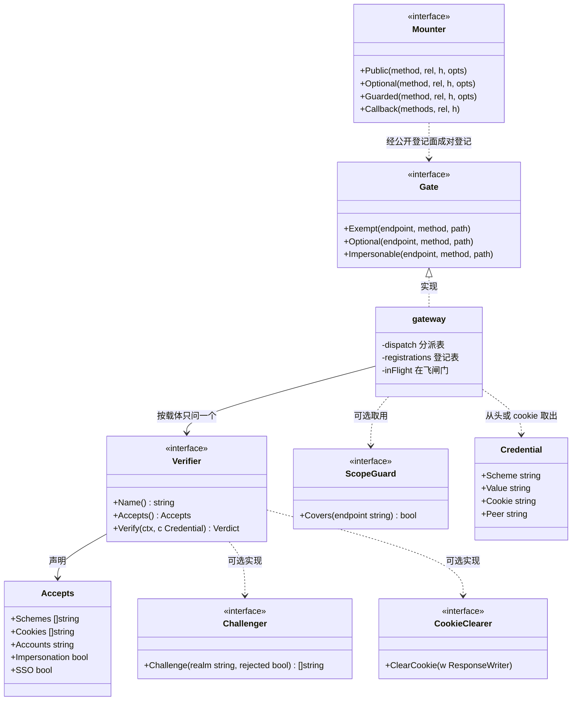
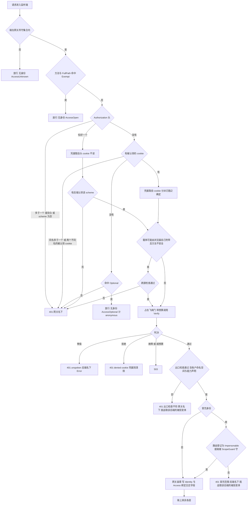
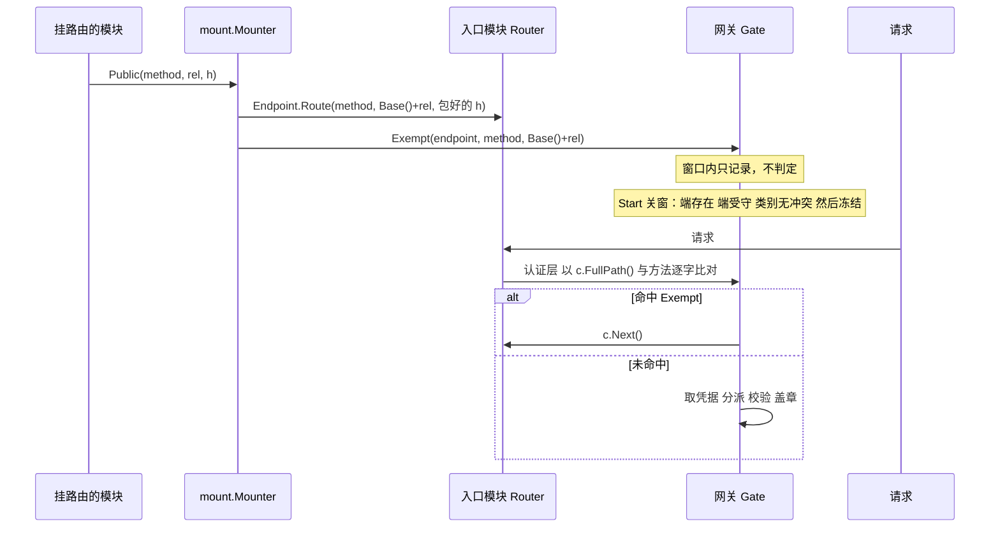

# authn-gate

## 职责

本文承载 `pkg/authn` 功能目录中的网关、路由挂载口与口令表，以及它们共同围绕的校验后端接缝。功能目录整体的职责、模块清单、身份与判决的形状、链上次序与非保证见 [design-authn](design-authn.md)。

- 守住入口模块的受守端：对每个请求取出凭据，交给认领该凭据载体的那一个校验后端，把后端的判决收口为放行或一次拒绝响应。**受守端**指本网关在其上登记了认证层的监听端；**载体**指一条凭据的出处，即 `Authorization` 头里的 scheme 或一个 cookie 名；**载体键**指一个 scheme 或一个 cookie 名。
- 定义校验后端的接缝：`Verifier`、`Accepts`、`Credential`、`Challenger`、`CookieClearer`，以及后端被纳入装配的准入条件。
- 受理路由登记：`Exempt`（免认证）、`Optional`（可选认证）、`Impersonable`（允许冒充身份通过），并在请求期按已匹配的路由逐字比对。
- 在写入身份之前复核后端交出的 `Principal`：形状与界限、账户命名空间、能力声明，以及冒充身份的范围；全部通过才盖章。
- 为每个受守端建立 401 的挑战头，登记凭据的脱敏规则，报出收口计数。
- `authn.mount` 交付路由挂载口 `mount.Mounter`，使 authn 自己的路由与它的访问级别成对登记。
- `authn.static` 是内置口令表后端，`basic` 的唯一认领者。

模块的登记形态与包的拆分见 [ADR-authn-packaging-2026-10-10](../../../adr/adr-authn-packaging-2026-10-10.md)，网关不依赖存储、不挂业务路由的判据见 [ADR-authn-wiring-2026-10-10](../../../adr/adr-authn-wiring-2026-10-10.md)，按载体认领与账户命名空间声明见 [ADR-authn-credential-dispatch-2026-10-10](../../../adr/adr-authn-credential-dispatch-2026-10-10.md)。

### 非职责

- **不解释任何凭据。** 网关只读 `Authorization` 头与 cookie 的名字和值的原文，连 `Basic` 也由认领它的后端自己解。网关对 scheme 的分支只有一处：跨源检查要判载体会不会由浏览器自己附带，cookie 会，`Authorization` 头里只有 `Bearer` 不会，规则见请求期判定里跨源检查的一步；判据是载体的附带方式，不读凭据里的内容（[ADR-authn-credential-dispatch-2026-10-10](../../../adr/adr-authn-credential-dispatch-2026-10-10.md)）。凭据来源只有 `Authorization` 头与被某个后端认领的 cookie；请求体、查询串与其他头不是凭据来源。
- **不持有会话、令牌与账户的存储，不依赖 `pkg/db`。** 读库的校验在会话与令牌后端里（见 [design-authn-session](design-authn-session.md)、[design-authn-token](design-authn-token.md)）。
- **不做授权判定，网关不写 403。** 跨源检查不通过的拒绝也是 401。「这个身份能不能做这件事」归授权与 `Decider`（见 [design-authn-admin](design-authn-admin.md)）。
- **不定义响应体的形状。** 本模块决定拒绝的状态码与必要的响应头，响应体由入口模块的 `Fail` 写出（见 [design-http](../http/design-http.md)）。
- **不判定租户成员关系与租户级认证强度，也不核对冒充身份的租户范围是否相符。** 这些由租户准入层判定（见 [design-tenant-admission](../tenant/design-tenant-admission.md)）；网关只决定冒充身份能否被放进某个端或某条路由。
- **不提供配置式的豁免与可选清单。** 登记只来自代码（[ADR-authn-exemption-2026-10-10](../../../adr/adr-authn-exemption-2026-10-10.md)）。
- **不读入口模块的路由表。** 登记面只列出端名，不枚举路由（见 [design-http](../http/design-http.md)）；网关无从核对一条登记是否对应一条已挂的路由。
- **不规定其他层的位置。** 网关只给出自己的层、它所属的阶段与锚点 `(*authn.Gate)(nil)`；同处鉴别阶段的层用 `After`、`Before` 指向它，链上次序见 [design-authn](design-authn.md)。
- **不决定哪条命令纳入网关。** 模块无从知道自己出现在哪条命令下（[ADR-command-tree-2026-09-20](../../../adr/adr-command-tree-2026-09-20.md)）。
- **不承载运行期可变的参数。** 判据是该值是否在数据库可用之前就被需要（[ADR-config-scope-2026-09-13](../../../adr/adr-config-scope-2026-09-13.md)）；网关守哪些端在其列，口令表的退避参数不在。

## 外部接口契约

### 登记单元与名字

本文承载的三个模块是 `authn.gate`、`authn.mount` 与 `authn.static`，各自的包、交付、排他与否、`Requires` 和取用见 [design-authn](design-authn.md#模块清单)，不在此重复。

每个模块的包导出自己的 `ModuleName`，配置与设置的命名空间取同一个取值。每个模块的 `Prepare` 只表态 `StateEnabled`，永不 `StateAuto`：是否运行是命令树上的决定，不是配置能推断的结论（[ADR-authn-wiring-2026-10-10](../../../adr/adr-authn-wiring-2026-10-10.md)）。**每个模块在包内以 `var _ authn.X = (*product)(nil)` 做编译期断言，并在装配测试里用真实注册表核对交付**：网关的 `Gate`、`authn.mount` 的 `Mounter`、口令表的 `Verifier` 各自由不同的实例交付，宿主与测试预置自己的 `Gate` 替身时不必同时实现 `Mounter`。

网关的描述符以 `(*authn.Gate)(nil)` 作为 `Provides`，登记的中间件以同一个功能标识作为自己在链上代表的功能，声明鉴别阶段。**这个标识与它所属的阶段是别的层定序的稳定锚点**：同处鉴别阶段的租户解析用 `After` 指向它，落在认证之内；更内的阶段（限流、记录、授权）按阶段本身落在认证之内，不由这条锚点决定。反方向网关声明不了：入口模块内建的兜底层不是功能标识，网关因此自备 `recover`（见错误与失败语义）。

### 校验后端的接缝

接口都定义在根包 `pkg/authn`，只依赖标准库：

```go
// Credential 是一条待校验的凭据，原文。
type Credential struct {
    Scheme string // 来自 Authorization 头时是 scheme，小写；来自 cookie 时为空
    Value  string // 头里 scheme 之后的取值，或 cookie 的值
    Cookie string // 来自 cookie 时是 cookie 名，否则为空
    Peer   string // 入口模块报出的对端地址（c.ClientIP()，位于代理之后时是代理地址）；只供后端记日志与节流，不作判定依据
}

// Accepts 声明一个后端整条认领哪些载体，以及它可交出什么样的身份。每个载体键只属于一个后端。
type Accepts struct {
    Schemes       []string // Authorization scheme，RFC 9110 的 token，小写
    Cookies       []string // cookie 名
    Accounts      string   // 可交出的账户标识前缀；空串表示库命名空间
    Impersonation bool     // 为真才可交出非零的 Actor 与 Scope
    SSO           bool     // 为真才可交出非零的 Provider 与 IDPAssured
}

// Verifier 是一个校验后端。非排他：多个后端并立在同一个网关之后。
type Verifier interface {
    Name() string
    Accepts() Accepts
    Verify(ctx context.Context, c Credential) Verdict
}

// Challenger 是可选接口：后端给出 401 里属于它的挑战。rejected 为真表示这次请求带着本后端认领的凭据而被拒。
type Challenger interface {
    Challenge(realm string, rejected bool) []string
}

// CookieClearer 是可选接口：凭据被判拒绝时，网关让认领该 cookie 的后端写出清除它的头。
type CookieClearer interface {
    ClearCookie(w http.ResponseWriter)
}
```

- **`Name()`** 报出后端的名字，形状 `[a-z0-9][a-z0-9.-]*`，在装配内唯一；取值是代码里的常量（口令表是 `static`，会话与令牌后端各自是 `session`、`token`），不是输入项。网关把它盖到身份的 `Backend()` 上。`ResolveAll` 返回的实例不带模块名，所以名字由功能接口自己提供。`Name()` 与该子包 `ModuleName` 是否一致只靠约定，机制不校验：网关拿不到实例的模块名。
- **`Accepts()`** 在 `Init` 里读取一次。`Schemes` 与 `Cookies` 是整条认领的载体：带这些 scheme 的头、或带这些名字的 cookie，一律交给本后端。网关把 `Accepts` 里的 scheme 折叠为小写并去掉空白后入表，与交给后端的 `Credential.Scheme` 同一形式；后端按字面比较大小写形式的 scheme 永不命中，判据是 HTTP 的 scheme 大小写不敏感（RFC 9110）。`Accounts` 是账户命名空间声明，一个后端只声明一个前缀；需要交出多片命名空间的宿主后端拆成多个后端。
- **`Verify`** 校验一条落在 `Accepts` 里的凭据，返回判决；`ctx` 携带网关给这次调用的预算作为 deadline，后端必须响应它。判决与 `Principal` 的形状见 [design-authn](design-authn.md)；`Verify` 没有调用方声称的主体入参，因为 cookie 与令牌里没有它，`Basic` 的用户名是登录名而不是账户标识。
- **`Challenger`** 与 **`CookieClearer`** 由后端按需实现，网关用类型断言发现。令牌后端用 `Challenger` 在被拒时加 `error="invalid_token"`（RFC 6750、RFC 9068）；会话后端用 `CookieClearer` 清除失效的 cookie。`Challenge` 返回的每个字符串是一条完整的挑战，即方案名加它的参数（`Bearer realm="…", error="invalid_token"`），不是只有参数；含换行的字符串被丢弃，因为换行会开出第二个响应头。入参 `realm` 已转义，可以直接写进引号串。网关把各后端的挑战去重、按字典序、以逗号连接成该端 401 唯一的一条 `WWW-Authenticate` 头。
- **交付声明**写作 `Provides: []core.Provision{{Token: (*Verifier)(nil)}}`，`Exclusive` 一律留空，这条不可局部违反：任何一个后端写成排他，结果按排他者自己的表态分：表态 `StateEnabled` 时，只要还有第二个启用的提供者，整组启动失败于 `ErrExclusiveViolated`；表态 `StateAuto` 时，同侪有表态 `StateEnabled` 的，它自己被传播静默踢掉而不产生任何失败，否则同样落到 `ErrExclusiveViolated`。本功能目录里的后端一律表态 `StateEnabled`，静默踢掉的分支只对宿主自写、表态 `StateAuto` 的后端可达（[ADR-module-enablement-2026-09-21](../../../adr/adr-module-enablement-2026-09-21.md)）。

### 准入条件

校验后端被纳入装配的条件包括装配期的校验与判决行为的判据。**装配期的校验**在网关的 `Init` 里逐条判定，违反即启动失败；下表是装配期校验的封闭集：

| 条件 | 违反时的哨兵 |
|---|---|
| `Name()` 非空且符合形状 | `ErrInvalidClaim` |
| 各后端的 `Name()` 两两不同 | `ErrClaimConflict`，点名双方 |
| `Accepts` 至少有一项载体非空；每个 scheme 是 token；每个 cookie 名是合法的 cookie 名 | `ErrInvalidClaim`，点名该后端与不合法之处 |
| 各后端的 scheme 之间、cookie 名之间各自不重叠 | `ErrClaimConflict`，点名双方与撞上的那一项 |
| 各后端声明的非空账户前缀两两互不为前缀（含相同） | `ErrClaimConflict`，点名双方 |
| 非空的账户前缀至多 63 字节且能作账户标识的前缀；前缀 `static.` 只许 `Name()` 为 `static` 的后端声明，且该后端只能声明 `static.`；其他后端声明的非空前缀不得是 `static.` 的前缀，也不得以 `static.` 起头 | `ErrInvalidClaim`，点名该后端与不合法之处 |
| 装配里至少有一个校验后端 | `ErrNoVerifier` |

与 `static.` 互为前缀的声明在逐后端的判定里即报 `ErrInvalidClaim`，先于两两比较，所以 `ErrClaimConflict` 的前缀判定只会发生在两个都不是 `static` 的后端之间。

空前缀（库命名空间）留给交付库账户身份的后端。网关无从判断一个后端交付的是不是库账户，宿主自写的目录后端应声明自己的非空前缀，这一条靠约定，装配期不拒绝空前缀，请求期由账户命名空间核对兜底（见出口检查）。

**判决行为的准入判据**网关在装配期判不出来，由后端自己满足，请求期的收口按它们为前提：

- 凭据来源不可达（宕机、连不上库）时答 `Unavailable`，不得答 `Denied`；
- 必须响应传入的 `ctx`，在它到点时尽快返回；
- 不得把「凭据不对」答成 `Unavailable`。

`Gate` 与 `Verifier` 都是宿主可以预置自己实现的接口，给它们加方法与改签名对预置了自己实现的宿主是不兼容变更（见稳定性承诺）。

### 网关交付的功能

```go
// Gate 是网关交付的功能，同时是路由登记的登记面。
type Gate interface {
    // Exempt 登记一条免认证路由：不取凭据，不问任何后端。
    Exempt(endpoint, method, path string)
    // Optional 登记一条可选认证路由：无凭据放行且无身份，有凭据照常认证，凭据错仍 401。
    Optional(endpoint, method, path string)
    // Impersonable 登记一条允许冒充身份通过的路由。
    Impersonable(endpoint, method, path string)
}
```

各登记方法共用同一套规则（[ADR-authn-exemption-2026-10-10](../../../adr/adr-authn-exemption-2026-10-10.md)）：

- `method` 与 `path` 是登记方传给 `Endpoint.Route` 的那一对，路径取 gin 规整后的写法，网关不解释路径。登记方把传给 `Route` 的那一对值原样传给登记方法，即与 `c.FullPath()` 逐字相同。
- **登记窗口借用 `Migrate` 到 `Start`**：登记只在这段时间内接受；窗口外调用登记方法一律 panic，这是调用点所处阶段的编程错误，不是运行期失败。登记方在自己的 `Init` 里 `core.Resolve[authn.Gate](reg)` 取登记面，不在 `Requires` 里声明它。取不到登记面时怎么处置由登记方自己决定；「取不到就跳过」这个默认写法落在放行一侧，列在 [design-authn](design-authn.md) 的非保证里。
- **`Start` 关窗后逐条校验，全部失败都终止启动**：端名必须是入口模块声明的端（`ErrUnknownEndpoint`）；登记所在的端必须被本网关守（`ErrExemptionUnguarded`，各类登记共用）；同一（端，方法，路径）不得既是 `Exempt` 又是 `Optional`，也不得既是 `Exempt` 又是 `Impersonable`（`ErrAccessConflict`）。同一路由同时登记 `Optional` 与 `Impersonable` 不冲突：`Optional` 只管没有凭据的请求，`Impersonable` 只管凭据校验得出冒充身份的请求，两者作用于互不相交的情形。校验通过后登记表冻结为只读快照。
- 同一类别内对同一（方法，路径）的重复登记仍是一条登记，冻结时合并，启动诊断里只出现一次。
- 审计行与诊断只写端名、方法与路径，不写自报的模块名：登记面拿不到调用方的身份。由此带来的非保证见 [design-authn](design-authn.md) 的非保证。

宿主为网关预置的实例不是本模块的产物时，网关对从 `Migrate` 到 `Close` 的回调都不做事（以 `productOf` 判别），预置的一方持有窗口、校验与冻结；`mount.endpoint` 是否受守、`Impersonable` 与 `ScopeGuard` 的核对也随之缺席，由预置自己网关的宿主负责。脱敏规则同样不登记，非保证见 [design-authn](design-authn.md)。这样的宿主仍可纳入 `authn.mount` 与挂路由的 authn 模块，它们只经 `Gate` 的公开登记面登记（[ADR-supplied-instance-2026-10-08](../../../adr/adr-supplied-instance-2026-10-08.md)）。

### 冒充范围守卫的取用

```go
// ScopeGuard 由租户准入层排他交付，声明它守哪些端。
type ScopeGuard interface {
    Covers(endpoint string) bool
}
```

网关在 `Init` 里对 `ScopeGuard` 做可选取用：在场时，冒充身份可以被放进 `Covers` 为真的端；缺席时，冒充身份只被放进登记为 `Impersonable` 的路由。接口在根包定义，使网关不 import `pkg/tenant`（依赖方向见依赖）。冒充范围的完整规则见核心算法与流程。

### 路由挂载口

`mount.Mounter` 的接口定义在 `pkg/authn/internal/mount`，只在 `pkg/authn/` 之下可见；由独立模块 `authn.mount` 排他交付，挂路由的 authn 模块（登录、会话、令牌、因素、SSO、冒充、管理面）`Requires` 它。`authn.mount` 自己 `Requires` `Gate`，经 `Gate` 的公开登记面成对登记。

```go
package mount

type Option func(*routeSpec)

// Impersonable 让这条路由允许冒充身份通过：经 Gate.Impersonable 登记。
func Impersonable() Option

type Mounter interface {
    Public(method, rel string, h gin.HandlerFunc, opts ...Option)    // 路由加 Exempt，成对登记
    Optional(method, rel string, h gin.HandlerFunc, opts ...Option)  // 路由加 Optional
    Guarded(method, rel string, h gin.HandlerFunc, opts ...Option)   // 只登记路由，网关守
    Callback(methods []string, rel string, h gin.HandlerFunc)        // 公开，且不做跨源检查（外部方的跨站回跳）
    Base() string                                                    // 基路径 B
    Endpoint() string                                                // 路由挂载所在的端名；处理器自答 401 时写作挑战的 realm
    PublicURL() string                                               // 对外基址
    CSRF() *http.CrossOriginProtection
}
```

每次登记在一处包好，宿主与子包因此没有「只挂路由、忘了登记」或「登记写错一个字符」的机会：

- 经本包装的处理器所写的响应加 `Cache-Control: no-store`（`Wrap` 在调用处理器之前写好该头，处理器可以覆盖它，如密钥集自带缓存头）；网关在处理器之前自产的 401/503 不经这一层，不带该头，入口模块对 panic 的缺陷响应按它自己的形状处置；
- 非 `Callback` 的 `POST`、`PUT`、`PATCH`、`DELETE` 先过跨源检查，不过即 401（`Wrap` 写的，只带 `Bearer` 与 `Cookie` 挑战）；
- 路径是 `Base() + rel`；路由冲突或窗口外的登记失败以 panic 拒绝，文本点名方法与路径（`Route` 的 panic 约定不点名路由，挂载端在重抛时补上）；
- 路由与访问级别在同一次调用里成对写入入口模块与 `Gate`。

`Mounter.CSRF()` 返回的 `CrossOriginProtection` 与网关自己的是各自独立的实例：`Gate` 只有登记方法，宿主又可以预置自己的 `Gate`，`authn.mount` 因此拿不到网关的实例而自建一份。两者的信任集都由 `internal/mount` 的同一份规则从 `public-url` 与 `trusted-origins` 推出（见可信来源的规范形式），不各推一遍。`Callback` 的旁路模式 `POST <base>/{provider}`（gin 的路径参数 `:provider` 在这里写成 `{provider}`）只加在 `authn.mount` 自己的实例上，回跳路由的旁路因此不会变成网关的口子。

宿主自己的路由仍是 `Route` 加 `Gate.Exempt`、`Gate.Optional` 或 `Gate.Impersonable` 的配对写法；条件挂载的正面做法是路由与登记写在同一个条件分支里、共用同一组方法与路径常量。

### 内置口令表

`authn.static` 是 `basic` 的唯一认领者。`Name()` 恒为 `static`，`Accepts` 为 `Schemes: ["basic"]`、`Accounts: "static."`，`Impersonation` 与 `SSO` 为假。包导出：

```go
const ModuleName, ConfigNamespace            // authn.static
func Module() core.Module
func Hash(password string) (string, error)   // 写 Argon2id 的 PHC 串
func HashPBKDF2(password string, iterations int) (string, error) // 写 PBKDF2-SHA256 的 PHC 串；iterations < 1 返回 ErrMalformedHash
func ParseHash(encoded string) error         // 只校验形状与界限，PHC 写法与遗留写法都认
var ErrMalformedHash error
```

`Verify` 自己解 `Basic`（base64 的 `用户名:口令`，按第一个 `:` 切）：用户名按出示的原样在表里查找，区分大小写，不在表里即快速 `Denied`，不派生；在表里则校验口令，通过时交出 `Principal{Account: "static." + 名, Methods: [MethodStatic], Assurance: AssuranceSingle, AuthTime: 此刻}`，无会话。口令表主体不是库账户，没有成员关系。条目的 PHC 写法、遗留写法与解析界限见 [design-authn-account](design-authn-account.md)，选择依据见 [ADR-authn-password-hash-2026-10-10](../../../adr/adr-authn-password-hash-2026-10-10.md)。

账户口令不经 `Basic`：账户口令走登录流程换会话或令牌，非交互客户端用服务账户。宿主要保留「账户口令经 `Basic`」的形态时，自写一个认领 `basic` 的后端，并且不纳入 `authn.static`，因为一个 scheme 只有一个认领者。

口令表的校验缓存、失败退避与并发上限见核心算法与流程。

### 配置

网关的输入项挂在 `authn.gate` 下，口令表的挂在 `authn.static` 下；全部配置键与设置键的类型、缺省与取值域见 [design-authn-config](design-authn-config.md)，本节只写各键的语义。命令行、环境变量与主配置源的取舍同样见该文档；决定守护面的清单（`endpoints`、`trusted-origins`）与放宽开关（`mount.allow-insecure`）只取主配置源。

| 键 | 语义 |
|---|---|
| `authn.gate.endpoints` | 网关守的端。缺省守入口模块声明的每一个端；保留端名 `*` 表示全部，写具体端名即收窄。具体端名必须存在（`ErrUnknownEndpoint`），不得为空名或重名；写成空清单，或把 `*` 与具体端名混写，都是 `ErrInvalidConfig`。空清单不表示关闭：守不住任何端的网关是配置错误，不想要网关就不纳入 `authn.gate`。清单之外的端没有认证层 |
| `authn.gate.call-budget` | 一次后端调用的期限；超出之后交回的答案一律作废为 503 |
| `authn.gate.in-flight` | 同时在飞的后端调用数；满则 503，不排队 |
| `authn.gate.mount.endpoint` | authn 自己的路由挂在哪个端。空且入口模块恰好声明了一个端时取那一个，否则 `ErrRoutesUnconfigured`；这一条由 `authn.mount` 在 `Init` 里判，因为入口模块的端要等路由器实例存在才读得到，网关在 `Start` 对同一规则再判一次；必须是网关所守的端（`ErrRoutesUnguarded`；缺省的唯一端必然受守，受守集合是入口声明端的非空子集）；不得是准入层所守的端（`ScopeGuard.Covers` 为真即 `ErrInvalidConfig`）；不得出现在 `tenant.resolve.endpoints` 里：全局账户的请求不带租户名，被解析层所守的端对它们答 404。网关在 `Start` 核对，读得出该清单且挂载端在其中时 `ErrInvalidConfig`，读不出解码形状时只写一行 `Warn`，不终止启动 |
| `authn.gate.mount.base-path` | 路由基路径 `B`；须是 gin 规整后的写法，以 `/` 起头、不以 `/` 结尾、无通配 |
| `authn.gate.mount.public-url` | 对外基址，只含来源、不含路径；入口模块没有对外基址的概念，不能从 `Host` 与 `X-Forwarded-*` 可靠推出。OIDC 的 `redirect_uri`、SAML 的 ACS 与实体标识、通行密钥的依赖方来源、令牌的 `iss`、`__Host-` cookie 都要它；需要它的模块在自己的 `Prepare` 里读，空即 `ErrInvalidConfig`。要求 `https`，回环主机除外，否则 `ErrInsecureConfig` |
| `authn.gate.mount.allow-insecure` | 仅开发：放行 http 基址，cookie 去掉 `__Host-` 前缀与 `Secure`；为真时启动诊断写一行 Warn |
| `authn.gate.trusted-origins` | 跨源检查与 `return_to` 额外信任的来源，每项 `scheme://host[:port]`；每项先规范成浏览器发送的形式再匹配，规则见可信来源的规范形式；`public-url` 的来源恒可信 |
| `authn.static.subjects` | 口令表：主体名到口令条目的映射；必填、敏感；主体名匹配 `[A-Za-z0-9][A-Za-z0-9_-]{0,56}` |
| `authn.static.cache-size`、`authn.static.concurrency` | 校验缓存的容量与口令派生的并发上限；构造时分配，所以是配置 |
| 设置 `authn.static.cache-ttl`、`free-attempts`、`fail-window`、`max-backoff` | 校验缓存的有效期（零关闭）与失败退避的各参数；`settings.Store` 缺席时取声明的默认值 |

`mount.*` 与 `trusted-origins` 由 `authn.gate` 声明，`authn.mount` 不声明输入项；`authn.mount` 与需要 `public-url` 的模块在自己的 `Prepare` 里读这几个键，这是已有的跨模块读法，不是重复声明。`authn.static.name` 不存在：口令表的名字是常量。

`base-path` 的形状检查与 `public-url` 的 https、回环判断在网关与 `authn.mount` 各有一份（各自的 `config` 校验做一次），因为预置自有 `Gate` 的宿主没有网关来校验这些键，而 `authn.mount` 把 `Base()` 与 `PublicURL()` 交给全部挂路由模块。可信来源的规范与挂载端规则则共用 `internal/mount` 的一份，不各推一遍。

### 对宿主的要求

下列各条与 [design-authn](design-authn.md) 列出的命令树纳入规则（逐条命令点名、不放进根命令、不对纳入 authn 的命令用 `IncludeAll()`、施加迁移的命令静态级纳入带表模块，以及对外提供服务的装配不为网关预置外来的实例）合起来，是网关在宿主一侧的全部前提，是封闭集。本模块既不能把它们声明出来，也没有检查它们的位置。

- **默认守全部端，宿主没有想到的端也被守住。** 探活、指标与运维端要显式处理：把要守的端逐个写进 `endpoints` 收窄，或由挂路由的模块经 `Gate.Exempt` 开出豁免。这是 [ADR-http-endpoints-2026-09-14](../../../adr/adr-http-endpoints-2026-09-14.md) 的「认证与限流只加在业务端」与默认守全部之间的衔接方式。
- **宿主自己的路由用 `Route` 加 `Gate.Exempt`、`Gate.Optional` 或 `Gate.Impersonable` 配对登记**，并共用同一组常量。
- **宿主自写校验后端时声明自己的账户前缀**，并自己负责它交回的账户标识的真伪。
- **在允许冒充的端上不对业务路由开租户解析的豁免**：这样的路由没有租户上下文，冒充身份仍到得了它们（见 [design-authn](design-authn.md) 的非保证）。
- **自备 `Gate` 时自己核对挂载端受守。** `mount.endpoint` 指向网关不守的端、而挂路由模块只登记 `Guarded` 路由时，唯一拦住它的是网关 `Start` 的 `ErrRoutesUnguarded`。宿主预置自己的 `Gate` 替身、不纳入 `authn.gate` 时没有这道检查，`Guarded` 路由会在无人守护的端上被静默公开。预置自有 `Gate` 的宿主因此自己负责这一核对。

### 稳定性承诺

- 根包符号的契约与不兼容变更的判据见 [design-authn](design-authn.md) 的稳定性承诺；本文不另列符号。
- `(*authn.Gate)(nil)` 与它声明的鉴别阶段是别层定序的稳定锚点，取值不变。
- 收口计数器 `authn.gate.conclusions`、它的单位、属性名 `outcome` 与全部桶名冻结：已有取值不改名，只许新增取值。
- 模块名、配置命名空间与哨兵的名字不变；哨兵的触发条件以本文的哨兵表为准。
- `pkg/authn/static` 的 `Hash`、`HashPBKDF2`、`ParseHash`、`ErrMalformedHash` 与条目格式是它与写表者之间的契约。

## 依赖

网关子包 import 根包、`pkg/core`、`pkg/config`、`pkg/http`、`pkg/log`，以及 `pkg/observability` 的接口包与它封装的指标 API；登记的中间件是 `gin.HandlerFunc`，gin 已在 `pkg/http` 的依赖闭包里；跨源检查用标准库 `net/http.CrossOriginProtection`。网关不 import `pkg/db`、`pkg/kv`、`pkg/event`、`pkg/settings`、`pkg/tenant`，也不 import `authn.static`，口令表后端同样不 import 网关；闭包守护测试按生产代码的闭包断言，网关的外部测试包为了对真实口令表跑集成用例而 import 后端，测试的 import 不是闭包的边。`authn.mount` import 根包、`pkg/core`、`pkg/config`、`pkg/http` 与 `internal/mount`。`authn.static` import 根包、`pkg/core`、`pkg/config`、`internal/password` 与 `pkg/settings`：设置存储的接口与它的实现声明在同一个包里，口令表后端的闭包因此含 `pkg/settings` 及其传递依赖（`pkg/db`、`pkg/event` 与 gorm），不含数据库驱动、消息与缓存客户端、网关与 `authntest`，闭包守护测试断言的正是这一份接受与不接受。校验后端子包 import 根包，以及它那个凭据来源所需的东西。

**网关的 `Requires` 为空，只对 `log.Logger` 写 `Optional`**（[ADR-authn-wiring-2026-10-10](../../../adr/adr-authn-wiring-2026-10-10.md)）。路由登记面、校验后端、`ScopeGuard` 与指标功能都在 `Init` 里取：`New` 里用不到它们，没有要排的构造次序；判据与否决的写法见该记录。取不到路由登记面是 `ErrNoRouter`，取到零个校验后端是 `ErrNoVerifier`，都是启动失败，不降级为放行。

**日志功能是 `Optional` 依赖**：声明它使脱敏规则能在 `New` 里先于任何 logger 绑定登记；缺席合法，规则无处登记，脱敏层为空。**指标功能不构成依赖**：缺提供者时计数只留在进程内；取用得到缺提供者以外的错误，或仪表登记失败，都终止启动，把它读成缺席会让计数无声地不报。

依赖方向的约束，包括网关不 import `pkg/tenant` 的理由、准入层经 `ScopeGuard` 与网关衔接的方式与对架构不变量的满足，见 [design-authn](design-authn.md#依赖方向)。

被依赖方向：`tenant/resolve` 的请求期层与网关同处鉴别阶段，以 `After` 指向 `(*authn.Gate)(nil)`；`ratelimit` 与 `audit` 按限流、记录两个阶段落在认证之内，不指向这条锚点；租户准入交付 `ScopeGuard` 并读身份（见 [design-tenant](../tenant/design-tenant.md)、[design-ratelimit](../design-ratelimit.md)、[design-audit](../design-audit.md)）。

## UML 图

接缝上的类型与它们的关系如下。图画不出的约束是时机与唯一性：分派表在 `Init` 建立、登记表在 `Start` 冻结，此后都只读；一个载体键在表里只属于一个后端；判决与身份之间的边只在判决为通过、且出口检查全部通过时成立。



`gateway` 未导出，它持有分派表、各端的登记表与在飞闸门。`Mounter` 不依赖 `gateway`，只依赖 `Gate` 的公开登记方法；网关因此可以被宿主的 `Gate` 替身顶替而不影响挂路由的模块。

请求期的判定顺序如下，图只含网关一侧；放行之后链上其余各层的次序见 [design-authn](design-authn.md)。每一档收口落进计数桶之一，归因与级别见核心算法与流程。



图固定的是定序：`Exempt` 的判定先于读取任何凭据，所以豁免路由上没有后端被调用；头优先且排他，头无效时不回退到 cookie；浏览器可能自己附带的载体上的不安全方法先过跨源检查再问后端；分派先于校验，一条凭据只到达认领它的那一个后端；出口检查与冒充范围核对发生在后端作答之后、盖章之前。图中每一条指向调用方的拒绝响应，都是网关设好响应头之后经入口模块的 `Fail` 写出的；网关自身 panic 的收口 500 不经过后端，图中不画。

登记与比对的时序如下。挂路由的模块经 `Mounter` 一次调用写下路由与登记，窗口关闭时网关一并校验，请求期只查冻结的表。



## 核心数据结构

**分派表**在 `Init` 建立，此后只读，由以下各项拼成：scheme 到后端、cookie 名到后端、各后端声明的账户前缀。表里的每一项带着报出它的后端的名字（取自 `Verifier.Name()`），重叠的报错因此点得到双方。建表不能早于 `Init`：`Prepare` 之间不保证顺序，那时 `ResolveAll` 至多取到预置的实例，建出的表不全（见 [design-core](../design-core.md)）。

**登记表**按端与类别分列：`Exempt`、`Optional`、`Impersonable` 各自一张，内容都是（方法，路径）的集合。窗口内由一把互斥保护；`Start` 校验并冻结为只读快照，请求期的键是（请求方法，`c.FullPath()`），对该端对应的那一张做一次查询。

**每端的挑战值**在 `Init` 时按端一次建成，请求期只读（规则见 `WWW-Authenticate`）。

**在飞闸门**是容量为 `in-flight` 的计数闸门：每次后端调用占一格，满则当场失败、不排队。

**收口计数桶**是一组穷尽且互斥的集合：`unspoken`、`authenticated`、`denied`、`unavailable`、`anonymous`。每一次对一条凭据或一个无凭据请求的收口恰好落进其中一个桶：

| 桶 | 落入 |
|---|---|
| `authenticated` | 判决为通过且盖章放行 |
| `denied` | 401：网关自产的拒绝、后端的拒绝、出口检查不符、冒充范围不符 |
| `unspoken` | 判决为零值 |
| `unavailable` | 503 的各种成因 |
| `anonymous` | 可选路由上没有凭据而放行 |

`Exempt` 命中与未受守的端上的请求不计；网关自己 panic 的 500 不是对一条凭据的判决，不进桶。503 的成因与 401 的归因由日志行区分，不由桶区分。请求自己的 context 在后端作答之前结束的那类 503 落进 `unavailable`，与后端故障只在日志行上分得开：记在网关名下、级别为 Info。按这一桶的计数告警的规则，在调用方大批断开的时段会看到它上涨。

**脱敏规则**由登记方向日志模块登记，规则全集见脱敏规则一节。

**口令表后端的状态**全在进程内：主体到条目的表（`Init` 前解析并校验）、校验缓存、失败退避表与派生的并发信号量。

## 核心算法与流程

### 阶段行为

| 阶段 | 网关 | `authn.mount` |
|---|---|---|
| `Prepare` | 取配置读取面并 `Decode` 自己那份配置；校验 `public-url`（非空时）与 `base-path` 的形状；表态 `StateEnabled`。任何输入项都有缺省，本阶段不因缺项失败 | 不声明输入项；读 `authn.gate.mount.*` 与 `trusted-origins`；表态 `StateEnabled` |
| `New` | 建在飞闸门、`CrossOriginProtection`（加入 `trusted-origins` 与 `public-url` 的来源）与 `Gate` 实例；向日志功能登记键名脱敏规则与不依赖 scheme 的值形状规则（JWT、令牌前缀、`otpauth://`、查询串里的机密对、会话 cookie 的 `sid` 对） | 建 `Mounter`，含它自己的 `CrossOriginProtection` |
| `Migrate` | 打开 `Exempt`、`Optional`、`Impersonable` 的登记窗口 | 无动作 |
| `Init` | 取 `Router`（缺则 `ErrNoRouter`）；`Router.Endpoints()` 得全集并算出受守的端；`ResolveAll[Verifier]` 建分派表并校验准入；可选取 `ScopeGuard`；逐端建挑战；逐端 `Use` 中间件；取日志（`Named`）与指标；登记依赖各后端认领的 scheme 的值形状脱敏规则；写启动诊断，其中每个不带 `__Host-` 前缀的被认领 cookie 名各占一行 `Warn` | 取 `Router`，经 `mount.Endpoint` 得出挂载端：键为空而入口声明的端不是恰好一个（零个或多个）即 `ErrRoutesUnconfigured`；挂路由的模块在各自的 `Init` 里经 `Mounter` 登记 |
| `Start` | 关闭登记窗口；校验并冻结登记表；校验生效的挂载端：存在、受守、不被 `ScopeGuard` 守；读得出 `tenant.resolve.endpoints` 的解码形状时，核对挂载端不在其中，读不出只写一行 `Warn`，不终止启动。配置写明的挂载端一律核对；键为空时，仅当装配里有交付 `mount.Mounter` 的模块才核对入口模块的唯一端，没有挂路由的模块就没有挂载端可核对，一个只有单端、该端本就开了租户解析而又不挂 authn 路由的命令因此不被误拒 | 无动作 |
| `Serve` | 无动作 | 无动作 |
| `Stop` | 停止接受新的后端调用 | 无动作 |
| `Close` | 等在飞调用排空，以 `call-budget` 为界，超时 `ErrDrainTimeout`；撤下收口计数的登记 | 无动作 |

**`Stop` 之后到达网关的请求**一律收口 503，不因进程正在关闭而放行；这类请求只出现在入口排空时限到期之后，其非保证见 [design-authn](design-authn.md) 的非保证。

**未被推进到的阶段其回调不执行**（[ADR-lifecycle-drive-2026-09-20](../../../adr/adr-lifecycle-drive-2026-09-20.md)），网关的每一条启动期判定随它所在的阶段一起被跳过：深度浅于 `Init` 的驱动不建分派表，认领冲突检不出；深度浅于 `Start` 的驱动不冻结登记表，端名与受守的校验都不发生；深度止于 `Migrate` 的驱动打开窗口而无人关上。以施加迁移为目的的命令不纳入网关，这个耦合不体现在任何一方的声明里。

**`Prepare` 里的失败按成因指向不同的修复动作。** 取配置读取面得到 `ErrMissingProvider`，说明宿主漏了预置读取面，错误点名缺失的提供者；`Decode` 得到的缺项或取值错误指向本模块那份配置，错误点名那一项。

### 受守端的展开

`Init` 里由 `Router.Endpoints()` 得到入口模块已声明的全部端名（升序、每次一份新切片，任何阶段都可调用）。`endpoints` 为 `["*"]` 时受守集合是这份全集；写具体端名时受守集合是那些端，每个名字必须在全集里。网关在受守的每个端上登记一层认证中间件。展开发生在 `Init`，此时入口模块已声明的端集合已定，默认值因此不依赖网关的配置里写过哪些端名。启动诊断写出展开后的受守端名清单，使「漏守」变成「漏豁免」：方向是故障时拒绝。

### 请求期判定

顺序见 UML 图的流程图。以下逐步写出各步的判定。

1. **端不在受守集合内**：放行，无身份，`AccessUnknown`。显式收窄 `endpoints` 时才出现这一档。
2. **`Exempt` 命中**：方法与 `c.FullPath()` 与登记逐字相同即命中，`FullPath` 为空串（没有匹配的路由）不命中。命中即放行，**不读 `Authorization`、不读 cookie、不问任何后端**，`AccessOpen`，不计桶。
3. **取凭据**：先给响应加 `Vary: Authorization, Cookie`（此后的放行与拒绝都带它）。头优先且排他。`Authorization` 头恰有一个时凭据取自头，此时 cookie 不读、不校验；头多于一个、值为空白或 scheme 为空即 401（网关名下）。头无效时不回退到 cookie。没有头时按分派表里的 cookie 名取：同名 cookie 出现多于一次，或同时出现两个不同名、各被某个后端认领的 cookie，都视为歧义，整体 401（fail-closed）；不择一校验，也不清任何一个 cookie，因为没有一条凭据被评判过。
4. **没有凭据**：`Optional` 命中则放行，无身份，`AccessOptional`，计 `anonymous`，写一条 Info；否则 401（网关名下）。
5. **分派**：头来源的凭据按 scheme 查表，没有后端认领即 401（网关自产：「不认识的 scheme」不是后端的拒绝）。cookie 来源的凭据在取凭据时已按 cookie 名分派：没有后端认领的 cookie 不是凭据来源，读作没有这一载体。
6. **载体可能由浏览器自己附带，且方法不安全**：过 `CrossOriginProtection.Check`，不过即 401（网关自产，不清 cookie，凭据不交给后端）。载体判据只在这里写：cookie 随浏览器自动发送；`Authorization` 头里，网关通告 `Basic` 挑战，浏览器因此缓存凭据，并在别的站点引起的导航与请求上自动带出，与 cookie 同形，`Digest`、`Negotiate`、`NTLM` 同样由浏览器自己处理；`Bearer` 头由页面自己的脚本写，同源策略不让别的站点的页面写它，不做这一道检查。网关不读凭据里的内容，无从判断一个它没有列出的 scheme 浏览器会不会自己处理，所以 `Bearer` 以外的头 scheme 一律受检，宿主后端认领的自定义 scheme 也在其内；要让别的站点的页面带着这类凭据调用，把那个来源列进 `trusted-origins`，或改用 `Bearer`（判据与否决项见 [ADR-authn-credential-dispatch-2026-10-10](../../../adr/adr-authn-credential-dispatch-2026-10-10.md)）。头里的凭据只在有后端认领它的 scheme 时才受检：没有认领者时请求先在分派一步被拒。安全方法按标准库的定义是 `GET`、`HEAD`、`OPTIONS`；既无 `Sec-Fetch-Site` 又无 `Origin` 的请求被标准库放行，所以这一道防线对不发送 `Sec-Fetch-Site` 与 `Origin` 的客户端不成立。
7. **调用**：占一格在飞闸门（满则 503；请求自己的 `ctx` 已结束则一个后端都不问，记在网关名下）、带 `call-budget` 的 deadline、带 `recover`，调用 `Verify`。超预算之后才交回的答案，通过也好、拒绝也好，一律作废为 503 并记在该后端名下。
8. **收口**：
   - 零值判决：401，记在后端名下，Error，计 `unspoken`；
   - `Denied`：401，记在后端名下，计 `denied`；凭据来自 cookie 且后端实现了 `CookieClearer` 时调用它清除该 cookie；
   - `Unavailable` 或超预算：503；
   - 通过：先做出口检查（不符即 401，网关自产，Error，计 `denied`），再做冒充范围核对（见下），都通过才盖章；出口检查与冒充范围核对这类网关自判的拒绝按「请求带着某后端认领的凭据而被拒」设挑战头，见 `WWW-Authenticate`。
9. **盖章与放行**：把 `Principal` 逐项写进 `Identity`（属性集深拷贝），`Backend()` 取自 `Verifier.Name()`，重新认证用的挑战方案名 `Challenge()` 按凭据载体盖章（来自头时是该 scheme 的规范写法，来自 cookie 时是 `Cookie`），`Backend()` 与 `Challenge()` 都不取自后端交出的任何值；写入 `Access`；经 `log.WithAttrs` 绑定日志字段 `account`、`backend`，冒充时加 `actor` 与 `impersonating=true`，有会话时加 `session`；更新 `c.Request` 的上下文；调用 `c.Next()`。

`Access` 取本次命中的登记级别：`Exempt` 命中是 `AccessOpen`；`Optional` 命中是 `AccessOptional`，带凭据通过的请求同样如此；其余受守请求是 `AccessRequired`；未受守的端不写，读出的是 `AccessUnknown`。`Identity` 与 `Access` 的读取形状见 [design-authn](design-authn.md)；`FromContext` 无回落，请求链上的注入只有网关做，注入口的写入方名单见 [design-authn](design-authn.md)。

**`Optional` 路由上带了凭据而凭据不成立，仍是 401**：`Optional` 只回答「没有凭据怎么办」，有凭据就一定走完分派到收口。**凭据存在而后端答不了是 503，不是匿名**，可选路由上也一样：把服务故障读成没有凭据，会让攻击者靠制造故障绕开认证。

### 归因与收口

下表是网关产生的全部收口，逐行互斥。拒绝与故障的响应经入口模块的 `Fail` 写出，状态码由本模块定；`Fail` 只带状态码，成因与归因不进响应体，只进日志。`WWW-Authenticate` 由网关在调用 `Fail` 之前设好，`Fail` 保留它，网关不自己 `WriteHeader`。

| 状态 | 成因 | 归因 | 级别 | 桶 |
|---|---|---|---|---|
| 401 | 没有凭据；头多于一个、空白或 scheme 为空；没有后端认领该 scheme；同名 cookie 多于一个，或两个不同名的被认领 cookie 并存；cookie 或 `Bearer` 以外的头来源的不安全方法跨源检查不通过 | 网关 | Info | `denied` |
| 401 | 出口检查不符（形状、账户命名空间、能力声明） | 网关 | Error | `denied` |
| 401 | 冒充身份到了既不被 `ScopeGuard` 守、也未登记 `Impersonable` 的路由（成因 `impersonation-scope`） | 后端名下 | Info | `denied` |
| 401 | 后端 `Denied`，含限流与退避锁定 | 后端 | Info | `denied` |
| 401 | 判决为零值 | 后端 | Error | `unspoken` |
| 503 | 后端 `Unavailable`、超预算、后端 panic | 后端 | Warn；panic 为 Error 并带调用栈 | `unavailable` |
| 503 | 网关已停止接受后端调用；在飞闸门满 | 网关 | Warn | `unavailable` |
| 503 | 请求自己的 `ctx` 在后端作答之前结束 | 网关 | Info | `unavailable` |
| 500 | 网关自己的 panic | 网关 | Error，带调用栈 | 不计 |
| 放行 | 可选路由上没有凭据 | 无 | Info | `anonymous` |
| 放行 | 判决为通过且盖章 | 无 | 无 | `authenticated` |

- **归因的判据是成因出自哪一侧，不是状态码。** 网关停止接受调用、在飞闸门满、请求自己的 `ctx` 先结束，后端一次都没被问到或正在如实报告自己答不了，算到后端头上会把操作者送去查一个正常的凭据来源，所以记在网关名下。
- **请求自己的 `ctx` 先结束时，改记到网关名下的只有「答不了」这一种回答。** 通过与拒绝是关于这条凭据的回答，零值是后端自己的缺陷，这几种判决照常收口。网关预算与请求 `ctx` 谁先到，决定它是调用方的事还是后端超出预算。
- **预算之内交回的拒绝，成因哪怕是一个超时错误值，仍是 401。** 抬成故障的只有一种情形：网关给这次调用的预算已经用完，由网关看自己塞进调用 `ctx` 的 deadline 判定，不看后端在拒绝里放了什么。否则单个后端即可把「口令不对」变成 503。
- **级别按谁有事要做定**：调用方的事（没有凭据、凭据不成立、跨源检查不过、冒充范围不符、可选路由的匿名放行、调用方自己断开）记 Info；要运维去查的故障记 Warn；缺陷（零值判决、出口检查不符、后端与网关的 panic）记 Error。出口检查不符记在网关名下，级别却与后端缺陷同档：归因说谁作出判定，级别说谁有事要做。级别是日志管线最先施加的过滤，零值判决写成 Info 会在生产配置下整体消失，所以它单独计数、单独记 Error。
- **500 靠网关自己 `recover` 才归得到它名下。** 不 `recover` 时 panic 落到入口模块的兜底层，那里写出的同样是 500，却不区分崩的是哪一层；后端的同步 panic 在调用点被接住，收口 503 并记在该后端名下。

### 出口检查

通过的判决由网关逐项复核后才盖章，不符即一次网关自产的 401，Error 级，计入 `denied`，记在网关名下。检查不信任后端自报的任何一项，信任边界是进程内的代码：宿主选择哪些后端，就是在选择信任谁来自报。下表是检查的封闭集（[ADR-authn-verdict-2026-10-10](../../../adr/adr-authn-verdict-2026-10-10.md)）：

| 检查项 | 内容 |
|---|---|
| 账户标识格式 | `Account` 通过 `ParseAccountID`；`Actor` 非零时同样通过 |
| `Actor` 的关系 | `Actor` 非零时不等于 `Account`，且 `Session` 与 `Scope` 非空；`Scope` 非零时 `Actor` 非零：`Scope` 只随冒充出现，单独出现的 `Scope` 不读作收窄，按拒绝处置 |
| 方式集 | `Methods` 非空、每项在闭集内、无重复，至多 8 项 |
| 等级 | `Assurance` 不超过 `AssuranceMulti`（零值按 `AssuranceSingle`）；`IDPAssured` 为真时等级为多因素且 `Provider` 非空 |
| 认证时刻 | `AuthTime` 非零且不晚于网关时钟加 120 秒；120 秒是网关里的常量，不是输入项，与令牌后端自己的时钟容差设置无关 |
| 范围与提供方的形状 | `Scope` 非空时具有租户标识的形状（非空、无空白与控制字符，同 `tenant.ID` 的值域；本包不 import tenant，只复核形状）；`Provider` 非空时是 UUID 文本的小写规范写法（8-4-4-4-12，大写拒绝）：提供方标识按字符串比较，一个值只有一种写法 |
| 属性集 | 符合下方的界限 |
| 后端名 | `Verifier.Name()` 符合准入条件里的形状 `[a-z0-9][a-z0-9.-]*`，与装配期是同一条判据，此处复核 |
| 账户命名空间 | 见下 |
| 能力声明 | `Actor` 或 `Scope` 非零时该后端的 `Accepts.Impersonation` 为真；`Provider` 非零或 `IDPAssured` 为真时 `Accepts.SSO` 为真 |

**账户命名空间核对。** `Account` 与 `Actor` 都必须落在该后端 `Accepts.Accounts` 声明的命名空间内：

- 声明非空前缀的后端只许交出以该前缀起头的标识；
- 声明为库命名空间（空前缀）的后端只许交出不以任何别的后端的非空前缀起头的标识；
- 前缀 `static.` 只属于 `Name()` 为 `static` 的后端，且该后端只许交出 `static.` 前缀的标识。

这条边界使「后端不能为不属于自己的账户盖章」不要求逐个主体登记：任何后端，包括 authn 自己有缺陷的令牌后端，铸不出 `static.ops`。`static.` 前缀是信任根：只有口令表后端交得出这个命名空间的标识。管理权限的判据不是前缀本身而是完整的账户标识 `static.<运营主体>`，由判定接缝按名字比对，有几个运营者就各列一个名字（见 [design-authn-admin](design-authn-admin.md)）。核对只约束到前缀，命名空间之内的标识真伪仍由后端负责：authn 自己的后端只验证 authn 自己写下的记录或签名，宿主自写的后端要自己负责它交回的账户。核对的开销是对各后端非空前缀的一次扫描，每请求一次，开销与装配里的后端数成正比。

**属性集的界限**由网关在盖章处检查，任一项不符按后端缺陷处置：

| 项 | 界限 |
|---|---|
| 键 | 匹配 `^[a-z0-9][a-z0-9._-]{0,63}$`。保留前缀 `idp.`（只由登录引擎按 IdP 的属性映射写入）与 `authn.`（留给 authn 内部）不在盖章处判定：网关分不出 authn 自己的后端与宿主自写的后端，也不知道一个后端交出的 `idp.*` 键是否真出自映射，所以保留前缀由写属性的一方保证，账户上由管理员或宿主设置的属性不得使用 `idp.` 与 `authn.` 前缀，由账户的写入面拒绝 |
| 条数与大小 | 至多 32 项，键与值合计至多 4 KiB；值为合法 UTF-8、无控制字符、至多 256 字节 |
| 分项上限 | 账户属性至多 24 项、键与值合计至多 2 KiB；会话载荷里的 `idp.*` 至多 8 项，键（含前缀）至多 32 字节、值至多 128 字节。分项上限保证各来源合并后不超过盖章处的界限（条数 24 + 8 = 32；大小最坏 2 KiB + 8 × (32 + 128) 字节 = 3328 字节，在 4 KiB 之内），盖章处的检查只是纵深；登录引擎写入 `idp.*`、会话写载荷都按本行的数，两处不另立数字 |
| 拷贝 | 盖章时深拷贝；`Attributes()` 每次返回副本；没有写入口 |
| 来源 | 账户属性（经账户快照读）并上登录会话里记下的 `idp.*`（该次登录的属性映射结果，随会话终结，不写入账户） |

属性集是独立的袋子，键不得与类型化字段竞争：认证方式、等级、会话、冒充范围、提供方只经类型化字段传递。

### 冒充范围规则

冒充身份指 `Actor` 非零的身份。网关对它核对范围，规则如下（[ADR-authn-impersonation-2026-10-10](../../../adr/adr-authn-impersonation-2026-10-10.md)）：

- 判决通过且 `Actor` 非零时，放行要求下列至少一条成立：本次命中的路由登记为 `Impersonable`；所在的端被 `ScopeGuard.Covers` 守（`ScopeGuard` 在场时）。都不成立即 401，网关自产，记在后端名下，Info，成因 `impersonation-scope`，计入 `denied`。
- `ScopeGuard` 缺席时只放 `Impersonable` 路由。
- 非冒充身份不受这条规则影响。
- 网关在 `Start` 校验挂载端不被 `ScopeGuard` 守：准入层对冒充身份且无租户上下文的请求答 404，覆盖 authn 自己的挂载端会使冒充身份连结束冒充都做不到。
- 冒充身份的租户范围本身由准入层核对（`Scope()` 不符答 404，见 [design-tenant-admission](../tenant/design-tenant-admission.md)）；`authn.impersonation` 把 `ScopeGuard` 当必需依赖，没有准入层的装配启动失败（见 [design-authn-impersonation](design-authn-impersonation.md)）。网关、准入层与 `authn.impersonation` 的必需依赖共同执行租户范围，缺其一，换一个不带租户解析的端就越过了限制；网关只管冒充身份能被放进哪里。
- 准入层不守的端对冒充身份只开放 `Impersonable` 路由，所以宿主的 admin 一类端对冒充身份是 401。`ScopeGuard.Covers` 只说准入层守哪些端，不核对租户解析的豁免；由此留下的缺口属于非保证，见 [design-authn](design-authn.md) 的非保证。

### 登记的比对

请求期用（请求方法，`c.FullPath()`）查该端对应类别的登记表，与登记的（方法，路径）逐字相同即命中。方法是比对的一部分：只豁免 `GET /both` 时，`POST /both` 照常要凭据。带路径参数与通配的路由，登记写成与路由登记时相同的写法，如 `GET /accounts/:id`、`GET /public/*path`。每请求的开销是对一张只读表的一次查询，路由匹配只发生一次，在 gin 里。各类命中的效果见 [ADR-authn-exemption-2026-10-10](../../../adr/adr-authn-exemption-2026-10-10.md)：`Exempt` 不取凭据；`Optional` 只改变「没有凭据」的结果；`Impersonable` 只改变冒充身份是否被放进这条路由，不改变凭据校验。

### 可信来源的规范形式

跨源检查信任的来源是 `public-url` 的来源，加上 `trusted-origins` 的每一项；规则放在 `internal/mount`，由网关与 `authn.mount` 共用同一份，两者因此不会从同一份配置推出不同的信任集。标准库按字节比对请求的 `Origin` 头与信任集，所以每一项先规范成浏览器发送的形式再入集：scheme 与主机小写，默认端口（`http` 的 80、`https` 的 443）省略，主机末尾的点去掉。写成 `https://Example.com:443` 的一项与浏览器发出的 `https://example.com` 是同一个来源。

不能规范成来源的项在启动期以 `ErrInvalidConfig` 失败，不是被跳过：被跳过的项读起来像一份已经生效的清单。`trusted-origins` 的一项是来源而不是 URL，带路径的项同样被拒；`public-url` 只含来源，路径另由 `base-path` 承载。错误文本只含不带用户信息、查询与片段的部分：`trusted-origins` 的项只以序号点名，不抄值，`public-url` 与 `base-path` 只回显去掉这些部分之后的值，因为配置里写错位置的值可能夹带口令。被拒的形态列在 [design-authn-config](design-authn-config.md) 的启动期自检表。

### `WWW-Authenticate`

401 必带 `WWW-Authenticate`，响应体不承载该出示哪种凭据，这个头是调用方判断它的唯一依据。每个端一个值，在 `Init` 时按端一次建成：

- 列出各后端认领的 scheme（去重、字典序）；后端实现了 `Challenger` 就用它给出的挑战，否则每个 scheme 写成 `<Scheme 首字母大写> realm="<端名>"`。
- **`Basic` 仅当有后端的 `Accepts().Schemes` 含 `basic` 时出现**，即 `authn.static` 在场；装配里没有后端认领 `basic` 时，浏览器不会为一条到不了任何后端的凭据弹出口令框。
- realm 取该监听端的端名，写进头之前转义引号与反斜线、丢弃换行，否则配置里的一个引号能在挑战里多带出几个参数，一个换行能多带出一个响应头。
- 请求带着某后端认领的凭据而被拒时，该后端的挑战用 `rejected=true` 重新生成；令牌后端写 `Bearer realm="…", error="invalid_token"`。这一条对网关自判的拒绝同样成立：出口检查不符与冒充范围不符，请求带着的仍是该后端认领的凭据，用普通挑战会让调用方去出示它已经出示过的凭据。凭据没有交给后端评判的拒绝用普通挑战：没有凭据、头不合规、没有后端认领该 scheme、被认领的 cookie 歧义、跨源检查不过。
- 没有任何后端认领头 scheme（只有 cookie 的装配）时，RFC 9110 要求 401 至少带一个挑战，写 `Cookie realm="<端名>"`。「Cookie」不在 IANA 的 HTTP 认证方案登记表里，是一个约定而不是标准，没有标准客户端认识它，只为满足「401 必带挑战」而存在；浏览器对 `Basic`、`Digest` 之外的方案名不弹口令框。
- 加强认证的挑战（`insufficient_user_authentication`）由 `guard.Require` 与 `tenant.admission` 另写，方案名取 `Identity.Challenge()`。authn 自己处理器答的 401 只带 `Bearer` 与 `Cookie` 挑战，不带 `Basic`。

### 脱敏规则

日志脱敏规则全由登记方自带，只管登记之后的记录（见 [design-log](../design-log.md)，[ADR-log-redaction-2026-09-13](../../../adr/adr-log-redaction-2026-09-13.md)）。键名规则与不依赖 scheme 的值形状规则由网关在 `New` 里登记；只有依赖各后端认领的 scheme 的那一条值形状规则要等 `Init` 才知道认领了哪些 scheme，由网关在 `Init` 登记；规则全集中其余部分的登记者是持有对应秘密的模块，它们在各自的 `New` 里先登记、再取 `Named` 日志器。下表是 authn 登记的规则全集：

| 类别 | 内容 |
|---|---|
| 键名（精确匹配；每个名字登记原写法、全小写与首字母大写，去重） | `Authorization`、`Cookie`、`Set-Cookie`、`Credential`、`password`、`new_password`、`current_password`、`code`、`otp`、`secret`、`client_secret`、`refresh_token`、`access_token`、`id_token`、`token`、`assertion`、`SAMLResponse`、`state`、`code_verifier`、`flow_token`、`credential` |
| 值的形状 | 各后端认领的 scheme 加空白加一个词（`schemeProse` 词表的放行判据，完整的一份在 `pkg/authn/gate/redact.go`）；JWT 形状（`eyJ` 起头的三段 base64url）；`spd_rt_`、`spd_cs_` 前缀的令牌；`otpauth://` 地址；查询串里的机密对（键名为 `secret`、`code`、`access_token`、`refresh_token`、`id_token`、`client_secret`、`samlresponse`、`assertion`、`password` 之一的 `键=值`）；会话 cookie 的 `sid=…` 对 |
| 字面量 | 配置里的客户端密钥、微信 `app-secret`、短信厂商密钥的值本身（精确子串匹配器） |

- **scheme 名后面紧跟一张固定公开词表里的词时不遮蔽**：scheme 名本身也是英文词，谈论凭据的文字在它后面写的是普通词，遮掉它会让拒绝成因读不懂。放行按词表而不按形状，判据是放行不泄露任何东西：词表公开，恰好等于表中某个词的凭据，读过词表的人都叫得出来。词表之外的词跟在 scheme 名后面时照样被遮蔽，这是登记过宽的一面，由登记方承担。
- **值形状规则只遮蔽 scheme 名之后的一个词**：以 auth-param 列表写出的凭据、取值跨了几个词的凭据、不带 scheme 名写出的凭据，都有部分或全部留在明文里。
- **登记只对此后的判定生效，经 `With` 绑定的属性在绑定时就判定完毕**：网关在 `Init` 登记的规则弱于日志模块给模块的时机保证（在自己的 `New` 里、取得 logger 之前登记）。在它之前已绑好的属性不受它约束，哪怕记录写在登记之后；各模块因此不在自己的 `New` 里往 logger 绑任何敏感属性，这条约束写进 `pkg/authn/AGENTS.md`。
- **永不记录凭据与一次性秘密的原文**；下列是例举，不是封闭集：请求体、表单字段、验证码、口令、令牌、cookie 值、断言原文、授权码、`state`、PKCE 校验串、流程令牌、微信带 `secret` 的 URL。记的是类别、标识与结果。
- **`Sensitive` 的配置项不向日志登记任何规则**（它只管错误文本、帮助默认值与必须带说明），所以「`Sensitive` 值不进日志」是 authn 自己的纪律：持有秘密配置值的模块把值本身登记成字面量匹配器，并有测试对每个模块的错误路径断言输出里不含配置里的哨兵值。审计的敏感键名是闭集（`password`、`secret`、`token`、`credential`、`authorization`，逐字比对、嵌套值里的键不比对），authn 写审计明细时只用事件与审计文档里的键名，不依赖闭集去遮蔽秘密（见 [design-authn-events](design-authn-events.md)）。

### 收口计数

计数经指标功能报出，是看板与告警读它的唯一途径：可观察计数器 `authn.gate.conclusions`，单位 `{conclusion}`，属性 `outcome`，取值是计数桶名。计数是网关自己持有的原子量，采集时才读，请求路径不为上报多付代价；每次采集报出全部桶，空桶也报，一个序列因此在第一次收口之前就有点。`anonymous` 是一种独立的收口结局，不另计就会无声地消失在其余桶之外，使这一组不再穷尽；看板里「对 `outcome` 全部取值求和」的口径因此包含这一类。装配里没有指标功能时计数只留在进程内，每次收口只剩日志行。

### 口令表的校验缓存、失败退避与并发

口令派生、校验缓存与失败退避的实现放在 `internal/password`，任何逐请求出示口令的后端都能用。

- **校验缓存**（进程内，仅逐请求出示口令的后端用）：键是 `HMAC-SHA256(进程启动时随机生成的密钥, 主体 ‖ 条目摘要 ‖ 口令)`，从不存口令或可逆形式；只缓存通过的结果；有效期取设置 `cache-ttl`（零关闭），容量取配置 `cache-size`（取值域见 [design-authn-config](design-authn-config.md)；要关缓存把 `cache-ttl` 设为零；淘汰最久未用，构造时分配）；条目一变，旧缓存自然失效。**有效期是绝对期限**：自一次真实派生通过起算，命中不续期，所以一个被反复出示的口令每个有效期内仍要重新派生一次。查表在缓存之前，缓存不绕过退避：命中前先做一次只读的等待检查，名字还在等待就不看缓存（见失败退避）。交互登录每次都派生，不经校验缓存。
- **失败退避**：键是出示的主体字符串去掉空白、字母折成小写之后的 SHA-256，与存在与否无关；恒在进程内，与 db 的可用性解耦：口令表是 db 故障时的运维后路（[ADR-authn-throttling-2026-10-10](../../../adr/adr-authn-throttling-2026-10-10.md)）。键空间与账户的标识范围分开，`ops` 之类重名不会互相触发退避。参数是设置（命名空间 `authn.static`：`free-attempts`、`fail-window`、`max-backoff`），与 `authn.account` 的退避参数各自生效、互不影响；自由次数、指数退避的曲线与封顶的形状同账户的 `Throttle`（见 [design-authn-account](design-authn-account.md)），计数的写法不同，因为口令表的口令逐请求出示：
  - **检查即预占。** 要派生的尝试，读等待时长与预占一次尝试在同一把锁下完成：键还在等待就不派生，直接拒绝；否则这次尝试先记作一次失败，再去派生。并发到达的尝试因此互相计数，免费的尝试数是自由次数，不是派生的并发宽度；「检查、派生、记失败」之间没有缺口。
  - **命中校验缓存的口令不预占。** 缓存里只有真实派生通过过的口令，命中的不是猜测，所以不计入自由次数，也不与并发的尝试互相计数：同名的命中请求再多，也不因此互相拒绝。它先做一次只读的等待检查，只看已经记下的失败与这些失败赚得的等待，不看在飞的预占，所以因失败而在等待的名字，连缓存里的口令也被拒绝。
  - **派生的结局决定预占的去留。** 通过则只退还这一次自己预占的尝试，此前的失败不动；不通过则保留。没有给出答案的派生不是一次猜测，同样退还：请求的上下文在派生给出答案之前已结束，或并发上限与内存预算已满。
  - **成功不清零。** 此前的失败只随时间老化：自最近一次失败起一个窗口内没有新失败，且这些失败赚得的等待已经走完，计数才归零。逐请求出示口令的后端里，每个请求都是一次认证，成功若清零，攻击者在两次猜测之间穿插一次自己账户的合法请求，退避就永不生效。
  - **表有容量上界。** 口令表里的每个主体的键是固定键，建表时就在、永不被忘记；其余的键，即不在表里的名字，至多 `MaxThrottleKeys` 个（取值见 [design-authn-config](design-authn-config.md)），满时最久没有失败的那一个先被挤出，它的计数随之丢失，被挤出的键重新得到自由次数，这是接受的代价；窗口走完的非固定键也被清扫。喷洒别的名字的调用方因此挤不掉表内主体的计数，对表内主体的退避绕不开。上界是 `internal/password` 的常量，不是输入项。
  - **键折叠大小写，所以只在大小写上不同的主体共用一份退避。** 口令表的主体名区分大小写、允许混合大小写，表里同时有 `Admin` 与 `admin` 这类名字时，它们共用一个退避键，一个被锁另一个也被锁。这个耦合保持，装配期不拒绝这样的表，因为已有的表可以合法地含有这类名字；启动诊断对每一组这样的主体写一行 `Warn`，点名这组主体（`entries`），让耦合在启动时可见。
  - 锁定中的主体答 `Denied`，成因是带着还要等待的时长的 `ThrottledError`。多副本时的总量不保证，见本机制不作的保证。
  - 一个名字刚好越过自由次数的那一次失败写一行 Info，带 `reason_class=throttled`（取值见 [design-authn-events](design-authn-events.md)）；表内主体的名字随行写出，不在表里的名字不写。
- **并发上限与内存预算**：口令派生受进程内信号量约束，上限取配置 `concurrency`；另有一份按字节计的内存预算，缺省 512 MiB，口令表为它不设键，由口令表后端自己持有，不与账户后端共用。任何一份已满都不排队等待，当场 `Unavailable`（503，响应带 `Retry-After: 1`）。标准库与 argon2 库的派生都不接收上下文、一旦开始就跑完，所以派生不受调用预算约束：口令表后端只在派生开始之前响应 `ctx`，已结束即答故障；信号量补上并发这一半。调用方在派生期间断开，既不中断它，也不改变它的结局：错口令照常记一次失败，否则断开连接就成了不被计数地试口令的办法。
- **弱条目的诊断**：启动诊断对迭代次数低于当前策略下限的条目逐个点名，不终止启动：表在配置里由运维写，「静默的弱条目」因此变成「有记录的弱条目」。遗留写法的条目可读，启动时逐条 `Warn`。这些行里主体名的字段叫 `entry`，不叫 `subject`（见 [design-authn-events](design-authn-events.md)）。这条 `Warn` 不被压制也不被放宽：宿主的测试用生产成本的条目，口令校验缓存使同一个口令在一个缓存有效期内只派生一次，测试不靠低成本条目避开它。
- **读不出或越出取值域的设置**按声明的默认值取用并记 `Error`。设置在每个请求里都被读取，所以同一种故障只记一次，故障的内容变了或恢复之后又出现时再记：逐请求记会被攻击流量刷屏，把有用的那一行淹掉。

## 错误与失败语义

启动期的失败一律终止启动。本模块为自己判定出的每一类失败提供哨兵错误，调用方以 `errors.Is` 判别，包裹一律用 `%w`。本模块自己产生的失败，其哨兵集是封闭的：新判定出一类确定失败，要么并入既有哨兵，要么补一条；经由本模块返回的其他失败（后端自己的错误）由它自己定义，本模块不为它们发明名字。全部哨兵在 `pkg/authn/errors.go`。

**哨兵表只有一个载体：[design-authn-failure](design-authn-failure.md) 的启动期哨兵表。** 网关与口令表后端判出的失败，其触发条件与修复动作逐条写在那里；本文不复述，只在产生判定的地方写判定本身：载体认领的装配期校验见准入条件，登记的校验见网关交付的功能，受守端、挂载端与基址的核对见配置键表与阶段行为，口令派生并发上限见口令表的校验缓存、失败退避与并发。

取不到配置读取面时，本模块把 `core` 的 `ErrMissingProvider` 原样外传，不另立哨兵：补救动作是宿主在驱动开始之前预置读取面（见 [design-core](../design-core.md)）。启动诊断每行以 `authn: ` 起头。网关的实例是本模块的产物时，成功路径上无条件写出：展开后的受守端名清单；各后端名与它们认领的 scheme、cookie 名与账户前缀；每个端上被 `Exempt`、`Optional`、`Impersonable` 开出的路由；冒充身份可到达的端（准入层所守的端）；放宽项。到场的后端名单是「宿主 import 了某个后端，却既没在命令树上列举它、也没有为它预置实例」这种情形的唯一察觉途径。实例不是本模块的产物时，这些都不写。

### 失败的方向

网关的方向规则是：依赖不可用时拒绝，有界的放宽逐项列出（[ADR-authn-failure-2026-10-10](../../../adr/adr-authn-failure-2026-10-10.md)）。

| 失败 | 方向 |
|---|---|
| 凭据存在而认领它的后端答不了（`Unavailable`、超预算、panic） | 503，不是匿名；可选路由上也一样 |
| 后端调用的在飞闸门满、网关已停止接受调用 | 503，不排队 |
| 请求自己的 `ctx` 先结束 | 一个后端都不问，503 记在网关名下 |
| 一个载体上的后端不可用 | 该载体上的请求整体 503，不由别的后端接管；会话与令牌后端读库，数据库变慢时在飞闸门与预算可能先满 |
| `ScopeGuard` 缺席 | 冒充身份只被放进 `Impersonable` 路由 |
| `settings.Store` 缺席（口令表的退避与缓存参数） | 取声明的默认值，行为与默认值下的设置完全一致，只是调不了 |
| 日志模块缺席 | 脱敏规则无处登记，脱敏层为空；这是放宽，写在 [design-authn](design-authn.md) 的非保证里（凭据不保证不进日志） |
| 指标功能缺席 | 计数只留在进程内；取用得到缺提供者以外的错误则终止启动 |
| 入口模块缺席 | `ErrNoRouter`，启动失败 |

**判决为零值与判决为拒绝不混**：零值收口 401 并单独计 `unspoken`、记 Error，使拒绝那一桶不被缺陷污染、缺陷那一桶能拿来发现后端写错（[ADR-authn-verdict-2026-10-10](../../../adr/adr-authn-verdict-2026-10-10.md)）。**库返回成功而补充校验失败，一律按失败**：出口检查是网关对后端自报的补充校验，通过的判决也要过它。

**网关不重试后端调用。** 校验对同一条凭据是幂等的，但口令表的退避对每次失败的尝试各计一次，所以重试会改变退避计数；网关把一次调用的结果收口成一个结论，调用方重试是调用方的事。

### 由设计带来的运行特性

以下是网关的行为事实，是例举而非封闭集；判据是该条为上文规则的直接后果，规则本身以上文为准：

- **头无效时不回退。** 带着过期头的客户端即使同时带着有效 cookie 也得到 401；同名 cookie 多于一个同样整体拒绝，即使其中一个有效。两个不同名的被认领 cookie 并存也整体拒绝：更换认领的 cookie 名的迁移期里，新旧名字并存的浏览器得 401，办法是先让旧 cookie 过期再启用新名。
- **可选路由上带着过期的 cookie 得到 401。** 网关清除失效的 cookie，下一次请求即为匿名，单页应用要处理这一次 401。
- **未命中 `Exempt` 的请求一律 401。** 404 与 405 到不了认证层，未认证的调用方分不清路径写错与没带凭据。豁免路由本身是公开的，且照常进入租户解析层。
- **豁免路由上没有身份。** 带着正确凭据访问一条豁免路由，`FromContext` 仍返回假；「登录可选」的页面用 `Optional`。
- **除 `Exempt` 命中的路由外，每个到达认证层的响应都带 `Vary: Authorization, Cookie`**，放行的与被拒绝的（401、503）都算；缓存键含 `Authorization` 与 `Cookie`，跨凭据不共享响应。`Exempt` 命中的响应不读凭据，不带它。
- **一个装配里同一时刻只有一个后端认领 `basic`。**
- **口令表的用户名因快速拒绝而可被枚举**：不在表里的用户名不派生，响应耗时与表内用户名不同。
- **越界的登记以 panic 拒绝。** 登记方从自己的协程里在窗口外写一次，跑着的进程当场崩；这与入口模块的登记闸门同类，注册表从不接 panic。
- **在飞闸门与预算约束的是本模块一侧协程与延迟的上界**，不含后端自己攥着的连接，也不含一个已被判超预算、仍在后台跑着的调用所产生的副作用。

### 本机制不作的保证

跨模块可见与装配级的非保证（例举：未被写进 `endpoints` 的端、链上能绕过认证的层、未纳入网关时的全开、预置的外来网关、命令之间后端到场不一致、凭据向内泄漏、缓存串身份、凭据进日志、入口排空超时之后的认证、准入层覆盖面之外的冒充拦截等）只在 [design-authn](design-authn.md) 与 [ADR-authn-guarantees-2026-10-10](../../../adr/adr-authn-guarantees-2026-10-10.md) 里写，本节不重复。以下是口令表机制自身不作的保证，也是本节的全部条目：

- **口令表的失败退避在多副本下不保证总量**：每副本各算一份，有效尝试次数放大为副本数倍。
- **口令表的失败退避表满时，被挤出的非固定键丢掉它的计数**：不在表里的名字没有口令可猜，丢掉的是它们自己的计数；表内主体的键是固定键，不在此列。

### 依赖未核实行为的断言

以下断言依赖的行为未经运行核实，按假设处理，各配一条守住它的测试；测试失败即该断言的前提不成立。

| 假设 | 守住它的测试 |
|---|---|
| 网关对 `ScopeGuard` 的可选取用，与准入层读身份不构成构造环 | 装配测试：用真实注册表同时装配网关与准入层，断言构造成功 |
| 链上次序由 `orderLayers` 的算法从各层声明的阶段与阶段内的 `After` 推得：准入层在限流与审计之内、在授权之外，网关声明鉴别阶段 | 装配测试：装配后读 `chain=` 那一行，断言各层的相对次序 |
| 不是本模块产物的预置 `Gate`，不会使 `authn.mount` 与挂路由的模块在构造期交付自检失败（`Mounter` 不由网关交付） | 装配测试：预置一个 `Gate` 替身，纳入 `authn.mount`，断言 `assertDelivered` 通过 |

## 并发与事务边界

分派表在 `Init` 写入、登记表在 `Start` 冻结，此后都只读，请求期读取不加锁。**登记窗口由一把互斥保护**：写入来自别的模块的回调，这些回调可以在自己的协程上登记，先后不能靠协程的创建建立；冻结之后的读取发生在随后创建的请求协程中。

**快照是唯一的屏障，而机制不强制后端只在构造期写它的声明。** 后端在 `Accepts` 里交出的是自己持有的数据，它在启动之后继续改写那份数据，与网关在建表时的读构成竞争。设计要求是声明只在 `New` 之前写定、此后只读；越过它不会被任何一处拦下。

后端调用发生在请求协程里，每次调用带自己的预算与 `recover`。在飞闸门限制本模块一侧同时进行的调用数。跨协程的 panic 不在 `recover` 的范围内：一个后端在自己起的协程里 panic，整个进程崩溃，网关堵不住。

口令表后端的校验缓存与失败退避由各自的锁保护，派生受信号量约束；缓存的随机密钥在进程启动时生成一次。

网关不开启任何事务，也不读写任何表；带表后端的事务边界归它自己（见 [design-db](../design-db.md)）。

## 扩展点

**校验后端。** 新增一种凭据来源即新增一个子包，交付 `Verifier`，非排他。除准入条件外，下列是子包要满足的形态：

- 必须声明 `Prepare` 并在其中 `Decode` 自己那份配置，缺项终止启动，错误点名缺的是哪一项、哪个后端缺的；表态只用 `StateEnabled`。
- 配置命名空间取 `authn.<后端>`，`Exclusive` 留空。
- 后端名取代码里的常量，`Accepts` 声明自己认领的载体、账户前缀与能力；自带凭据表的后端另外声明自己的迁移集并 `Requires` 数据库功能，这些都留在它自己的子包里。
- 持有秘密的后端在自己的 `New` 里登记脱敏规则，再取 `Named` 日志器，并且不在 `New` 里往 logger 绑敏感属性。
- `Verify` 响应 `ctx`；凭据来源不可达时答 `Unavailable`。
- 需要 401 里带自己的挑战时实现 `Challenger`；认领 cookie 时实现 `CookieClearer`。

**路由登记面。** 挂路由的模块经 `Gate` 的登记方法，或经 `Mounter`，开出自己的路由，不改本模块的任何代码。

**`ScopeGuard`。** 准入层交付它，网关只取用 `Covers`，不依赖交付者是谁。

## 实现状态

下表的状态以代码为准。

| 能力 | 状态 | 代码 |
|---|---|---|
| 网关模块、排他交付、鉴别阶段与 `(*Gate)(nil)` 锚点 | 已实现 | `pkg/authn/gate/gate.go` `Module`；`pkg/authn/gate/serve.go` `middlewareFor` |
| 后端调用的预算、在飞闸门、`recover` 与停机排空 | 已实现 | `pkg/authn/gate/serve.go` `enter`、`verify`；`pkg/authn/gate/gate.go` `drain` |
| `Exempt`、`Optional`、`Impersonable` 的登记窗口、校验、冻结与逐字比对，`ErrAccessConflict`，网关对 `Access` 的写入 | 已实现 | `pkg/authn/gate/exempt.go` `Exempt`、`Optional`、`Impersonable`、`open`、`seal`、`accessOf`；`pkg/authn/gate/serve.go` `admit` |
| 校验后端接缝：`Accepts`、`Credential` 的 `Cookie` 与 `Peer`、`Verify` 去掉主体入参、`Challenger`、`CookieClearer` | 已实现 | `pkg/authn/authn.go` |
| 按载体分派表与准入条件、cookie 凭据来源、浏览器可能自己附带的载体的跨源检查、被认领 cookie 并存时的整体拒绝 | 已实现 | `pkg/authn/gate/dispatch.go` `buildDispatch`、`admitBackend`；`pkg/authn/gate/serve.go` `credentialOf`、`identify`、`scriptWrittenScheme`、`attachedByBrowser`；`pkg/authn/gate/gate.go` `newGateway`；`pkg/authn/internal/mount/origin.go` `Origin`、`TrustedOrigins`、`CrossOrigin`；`pkg/authn/mount/mounter.go` |
| 出口检查：账户命名空间核对、能力声明核对、`Principal` 的形状与属性集界限、盖章 | 已实现 | `pkg/authn/gate/exitcheck.go` `checkPrincipal`；`pkg/authn/gate/dispatch.go` `inNamespace`；`pkg/authn/gate/serve.go` `identify` |
| 冒充范围核对与 `ScopeGuard` 的可选取用 | 已实现 | `pkg/authn/gate/serve.go` `impersonationAdmitted`；`pkg/authn/gate/gate.go` `wire` |
| `endpoints` 缺省守全部端（`Router.Endpoints()` 展开、`*`、空清单与混写的 `ErrInvalidConfig`） | 已实现 | `pkg/authn/gate/gate.go` `expandGuarded`；`pkg/authn/gate/config.go` `checkEndpoints` |
| 入口模块的端枚举与保留端名 `*` | 已实现 | `pkg/http/router.go` `(*router).Endpoints`；`pkg/http/config.go` `reservedEndpointName` |
| `authn.gate.mount.*` 与 `trusted-origins` 配置键，`Start` 对挂载端的核对（存在、受守、不被 `ScopeGuard` 守、不在 `tenant.resolve.endpoints` 里） | 已实现 | `pkg/authn/gate/config.go`；`pkg/authn/gate/gate.go` `wire`、`checkMount`、`checkResolution`；`pkg/authn/internal/mount/endpoint.go` `Endpoint`；`pkg/authn/mount/config.go` |
| `authn.mount` 与 `mount.Mounter` | 已实现 | `pkg/authn/mount/mount.go` `Module`；`pkg/authn/mount/mounter.go` `(product).Guarded`、`(product).Optional`、`(product).Public`、`(product).Endpoint`；`pkg/authn/internal/mount/mount.go` `Mounter`、`Option`、`Impersonable`、`Resolve`；`pkg/authn/internal/mount/endpoint.go` `Endpoint`；`pkg/authn/internal/mount/origin.go` `Origin`、`TrustedOrigins`、`CrossOrigin`；`pkg/authn/internal/mount/wrap.go` `Wrap`、`AllowCallback`；`pkg/authn/internal/mount/mounttest/mounttest.go` |
| 401 的挑战头：各后端认领的 scheme、`Challenger`、只有 cookie 时的 `Cookie` 挑战、被拒时按后端重新生成（含出口检查不符与冒充范围不符） | 已实现 | `pkg/authn/gate/challenge.go` `newChallenge`、`valueFor` |
| 脱敏规则的登记 | 已实现 | `pkg/authn/gate/redact.go` `registerNewRules`、`registerValueRule`、`credentialKeyNames`、`keySpellings`、`shapeMatcher`、`credentialMatcher`；`pkg/internal/literal/literal.go` `Register`、`Matcher` |
| 收口计数经指标功能报出，含 `anonymous` 桶，`Meter` 以 `authn` 命名（见 [design-authn-events](design-authn-events.md)） | 已实现 | `pkg/authn/gate/metrics.go` `takeMeter`、`bucketName`；`pkg/authn/gate/gate.go` `tally` |
| 启动诊断：展开后的受守端清单、各后端认领的 scheme 与 cookie 与账户前缀、`Exempt`、`Optional` 与 `Impersonable` 开出的路由、冒充可达的端、放宽项 | 已实现 | `pkg/authn/gate/gate.go` `diagnose`、`freeze`；`pkg/authn/gate/exempt.go` |
| 口令表后端：`Name()` 恒为 `static`、`Accepts` 声明、`Basic` 的解析与校验、`name` 键去掉 | 已实现 | `pkg/authn/static/static.go` `Name`、`Accepts`、`Verify`；`pkg/authn/static/config.go` |
| 口令表的校验缓存（绝对期限）、进程内失败退避（检查即预占、命中缓存不预占、成功不清零、固定键与容量上界）与并发信号量，设置里的缓存与退避参数 | 已实现 | `pkg/authn/internal/password` `Cache`、`Throttle`、`Reserve`、`Standing`、`Attempt`、`MaxThrottleKeys`、`Governor`；`pkg/authn/static/static.go` `Verify`、`fail`；`pkg/authn/static/config.go` `settingsSchema` |
| 口令条目的 PHC 写法、`HashPBKDF2`、`ParseHash` 只校验、遗留写法只读并逐条 `Warn` | 已实现 | `pkg/authn/internal/password/phc.go` `Parse`；`pkg/authn/static/hash.go` `Hash`、`HashPBKDF2`、`ParseHash`；`pkg/authn/static/static.go` `wire` |
| 哨兵错误 | 已实现 | `pkg/authn/errors.go`；`pkg/authn/internal/mount/endpoint.go` `Endpoint`；`pkg/authn/mount/config.go` |

行为由真实注册表与回环端口驱动的测试守住：描述符各回调的行为在 `pkg/authn/gate/assembly_test.go` 与 `pkg/authn/gate/endpoints_test.go`，登记、豁免比对、可选路由、无匹配路由与方法不允许时先于入口模块的应答在 `pkg/authn/gate/exempt_test.go` 与 `pkg/authn/gate/live_test.go`，冒充范围与挂载端的核对在 `pkg/authn/gate/scope_test.go` 与 `pkg/authn/gate/mountconfig_test.go`，共用的挂载端与可信来源规则在 `pkg/authn/internal/mount`，挑战头在 `pkg/authn/gate/challenge_test.go`，拒绝响应的形状与后端 panic 的收口在 `pkg/authn/gate/response_test.go`，出口检查在 `pkg/authn/gate/exitcheck_test.go`，口令表经真实网关与入口模块的口令校验、挑战头与失败退避在 `examples/orders-host/e2e_test.go`。
