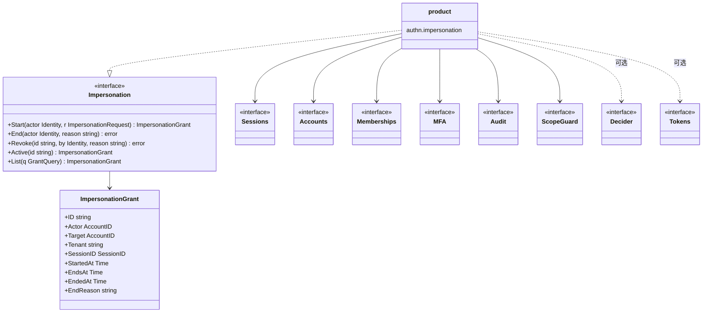
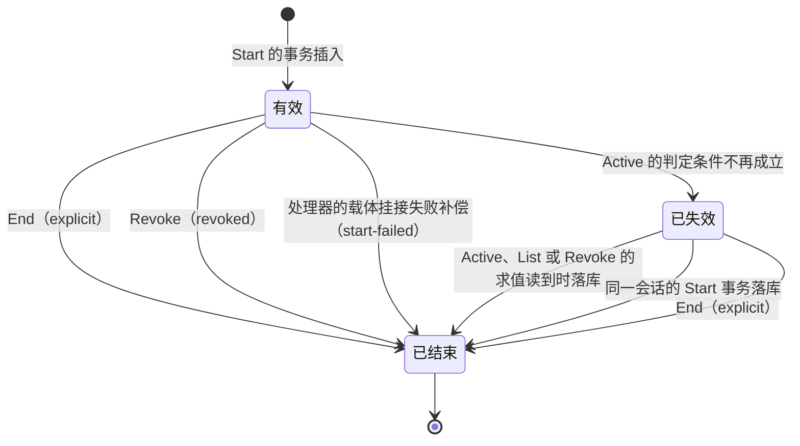
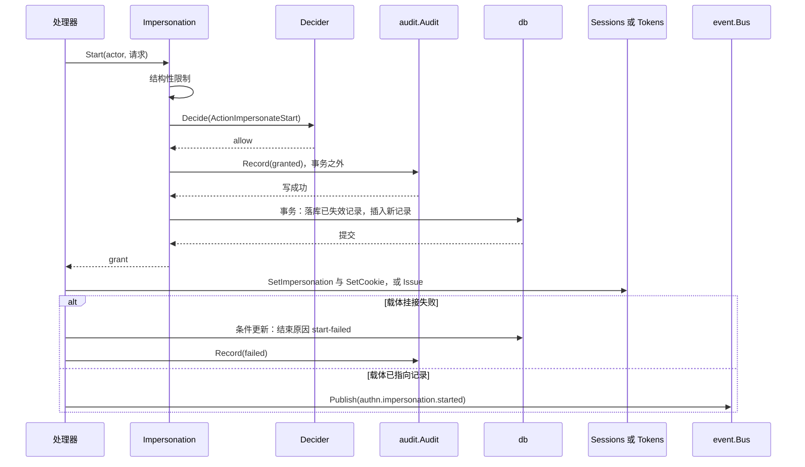
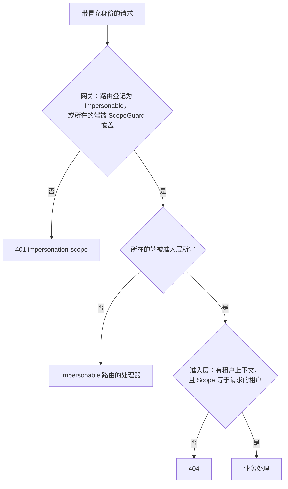

# authn.impersonation

## 职责

`authn.impersonation` 是冒充记录的唯一持有者。冒充是一条有期限、有理由、限定一个租户、全程留痕的记录，存放在表 `authn_impersonations`；它不是一枚新的凭据，也不是身份上的开关。包为 `pkg/authn/impersonation`，模块名为 `authn.impersonation`。取舍见 [ADR-authn-impersonation](../../../adr/adr-authn-impersonation.md)，身份的形状见 [ADR-authn-identity](../../../adr/adr-authn-identity.md)，判定接缝与管理面的分工见 [ADR-authn-decision-seam](../../../adr/adr-authn-decision-seam.md)。

本模块负责下列事项（封闭集合，不在其内的事项归非职责一节点名的模块）：

- 交付 `Impersonation`：冒充的开始、结束、撤销、有效性判定与按键集分页的查询。
- 独占 `authn_impersonations`：表的迁移、全部写入与全部读取只在本模块内发生。
- `Start` 内强制一组不依赖 `Decider` 的结构性限制，再询问 `Decider`，再写强制档审计，再写记录；载体挂接、补偿与 `started` 事件由登记 `B/impersonation` 的处理器在 `Start` 返回之后完成。
- 回答一条记录此刻是否仍然有效，并把读时发现的失效惰性落库。
- 把冒充的租户范围守在装配期：`ScopeGuard` 是必需依赖，没有准入层的装配启动失败。
- 经 `authn.mount` 登记 `B/impersonation` 一组自助路由（`B` 是路由基路径，由 [design-authn-gate](design-authn-gate.md) 声明），其中结束与查询登记为 `Impersonable`；以静态[特性](../../../glossary.md) `authn.impersonation` 声明这组路由。
- 定义冒充期间 authn 自己的处理器如何处理账户自助面，以及仍拒绝哪些操作、允许哪些路由。
- 写冒充的接缝级审计，发布 `authn.impersonation.started`、`authn.impersonation.ended`，记录指标 `authn.impersonation.sessions`。

### 非职责

- **不判定「谁有权冒充谁」。** 这一判定经判定接缝 `Decider` 取得（由 `authz.guard` 实现，[design-authz](../design-authz.md)），接缝、动作常量与管理面路由由 [design-authn-admin](design-authn-admin.md) 承载；`Decider` 缺席时本模块全拒。三个冒充动作是平台能力，在平台域上判定：`Decision.Tenant` 是记录被限定的数据，不是策略域，发起者不需要在目标租户持有权限，平台管理员也不必是该租户的成员。
- **不认识角色。** 「不得冒充权限更高或同级的账户」不是身份层面的事实，本模块无从核对；它由 `Decider` 的实现方负责。
- **不执行网关的范围规则，也不执行准入层的范围核对。** 网关对冒充身份只放进准入层所守的端与登记为 `Impersonable` 的路由（[design-authn-gate](design-authn-gate.md)）；准入层核对 `Scope()` 与请求的租户（[design-tenant-admission](../tenant/design-tenant-admission.md)）。本模块只持有必需依赖 `ScopeGuard`，使网关与准入层的范围执行在装配里必然有落点。
- **不持有登录会话与访问令牌。** 会话行上的冒充记录标识由 `Sessions.SetImpersonation` 写（[design-authn-session](design-authn-session.md)），冒充用的访问令牌由 `Tokens.Issue` 签发（[design-authn-token](design-authn-token.md)）；本模块只调用它们。
- **不判断账户、成员关系与因素的事实。** 账户状态与 `protected` 标记读自 `Accounts`，成员关系读自 `Memberships`（[design-authn-account](design-authn-account.md)），因素年龄读自 `MFA.Seasoned`（[design-authn-mfa](design-authn-mfa.md)）。
- **不通知被冒充者。** authn 没有通知通道；`authn.impersonation.started` 事件是宿主接通知的钩子。
- **不清除记录。** 记录永不由本模块删除，保留期是宿主的合规策略。
- **不判定冒充期间业务路由的权限。** 授权取生效账户，冒充期间按被冒充账户的权限判定（[design-authz](../design-authz.md)）；本模块只管 authn 自己的处理器，并保证它们不因冒充本身把属于账户持有人的操作拒掉。
- **不挂管理面路由。** 列出与撤销记录的 HTTP 路由 `B/tenants/:tenant/impersonations` 归 `authn.admin`，挂在平台管理作用域的基路径 `B` 下；本模块只提供它调用的 `List`、`Revoke` 与单条读取 `Get`。
- **不提供全局冒充、嵌套冒充、冒充服务账户与可续期的冒充令牌。**
- **不声明配置键与设置键。** 键的名字、取值域与缺省值只在 [design-authn-config](design-authn-config.md) 给全，本文只写它们的语义。
- **不定义事件、审计与指标的取值表。** 全部类型、载荷与属性的权威表在 [design-authn-events](design-authn-events.md)；本文只写本模块在何处写、写什么约束。

## 术语表

以下术语的含义限于本文，以及冒充主题的决策记录。

| 术语 | 适用范围 | 定义 |
|---|---|---|
| 冒充记录 | 本模块 | `authn_impersonations` 的一行，对应 `ImpersonationGrant`：谁、代谁、在哪个租户、因为什么、到何时。 |
| 发起者 | 冒充 | 开始冒充的管理员账户，即 `Actor()`。 |
| 目标 | 冒充 | 被冒充的账户，即冒充期间的 `Account()`。 |
| 冒充身份 | 请求期 | `Impersonating()` 为真的 `Identity`：`Account()` 是目标，`Actor()` 与 `Key()` 是发起者，`Scope()` 是记录的租户。 |
| 结构性限制 | 开始 | 身份层面的事实（谁、在哪个租户、多久、有没有被审计）所构成的限制，由本模块强制，`Decider` 只能在其上进一步收紧；与「谁有权」的判定相对。 |
| 结束 | 冒充记录 | 记录的 `ended_at` 非空。 |
| 失效 | 冒充记录 | `Active` 为假，成因见「有效性判定」。失效的记录可以仍处于未结束状态，读时发现后落库为结束。 |

## 外部接口契约

### 交付的功能

| 功能 | 排他 | 说明 |
|---|---|---|
| `Impersonation` | 是 | 交付声明写作 `Provides: []core.Provision{{Token: (*authn.Impersonation)(nil), Exclusive: true}}`。 |

模块的表态只能是 `StateEnabled`，永不 `StateAuto`：是否运行是命令树上的决定，不是配置能推断的结论（[ADR-authn-packaging](../../../adr/adr-authn-packaging.md)）。

### 根包的类型与接缝

下列类型与接口位于 `pkg/authn` 根包。本节只给签名与承诺，逐字与根包一致。

```go
type ImpersonationRequest struct {
	Target AccountID
	Tenant string        // 冒充限定的租户，必填
	Reason string        // 1 到 500 个字符，无控制字符
	TTL    time.Duration // 零表示取设置
}

type ImpersonationGrant struct {
	ID        string
	Actor     AccountID
	Target    AccountID
	Tenant    string
	Reason    string // 只在审计与本表里，不进事件
	SessionID SessionID
	StartedAt time.Time
	EndsAt    time.Time
	EndedAt   time.Time // 零值表示尚未结束
	EndedBy   string
	EndReason string    // 取值见「结束原因与写入点」
}

type GrantQuery struct {
	Actor, Target AccountID
	Tenant        string // 限定到该租户；空表示不限定
	After         string
	Limit         int
}

// Impersonation 由 authn.impersonation 排他交付。
type Impersonation interface {
	Start(ctx context.Context, actor Identity, r ImpersonationRequest) (ImpersonationGrant, error)
	End(ctx context.Context, actor Identity, reason string) error
	Revoke(ctx context.Context, id string, by Identity, reason string) error
	Active(ctx context.Context, id string) (ImpersonationGrant, bool, error)
	List(ctx context.Context, q GrantQuery) ([]ImpersonationGrant, string, error)
}
```

| 方法 | 语义 |
|---|---|
| `Start` | 在调用方身份 `actor` 上开始一次冒充：校验全部结构性限制，询问 `Decider`，写强制档审计，写记录。同一个会话同时至多一条未结束的记录。成功返回记录；失败返回的哨兵与对外形状见「错误与失败语义」。`Start` 不挂接载体、不签发令牌、不发 `started` 事件：换出的会话令牌与冒充访问令牌要交到响应里，而 `Start` 拿不到响应写出器，这三件事由处理器在 `Start` 返回之后完成。顺序与每一步的失败处置见「开始的顺序」。 |
| `End` | 结束 `actor` 的会话上未结束的那条记录，结束原因记 `explicit`。`actor` 可以是冒充身份，也可以是发起者自己的身份；会话上没有未结束的记录返回 `ErrNotImpersonating`。只改记录、写审计、发事件，不碰载体：不摘除会话行上的记录标识，不轮换会话令牌；cookie 凭据下的标识摘除由 `DELETE B/impersonation` 的处理器随后完成，不换令牌，撤销冒充令牌的路径没有 cookie，不做这一步。结束是向安全方向的动作，审计写失败不阻止结束。`reason` 是结束的说明，只进审计行，不进事件，也不进 `end_reason`。 |
| `Revoke` | 管理面强制结束记录 `id`，结束原因记 `revoked`；`by` 是撤销者。幂等：记录已结束时无操作。写 `revoked` 之前先对记录按「有效性判定」求值并落库，已失效的记录以它自己的原因结束，撤销随即是已结束的无操作：到期或会话已死的记录不会被记成管理员撤销，审计与事件也不为它写撤销。`Revoke` 不询问 `Decider`，授权由 `authn.admin` 的处理器在调用之前完成。 |
| `Active` | 回答记录 `id` 此刻是否仍然有效，判定条件见「有效性判定」。记录不存在、已结束或已失效时第二个返回值为假；读到失效而记录仍未结束时同时落库。返回错误时调用方按失败方向处理，不当作有效。 |
| `List` | 按 `GrantQuery` 过滤的键集分页：`After` 是上一页返回的游标，第二个返回值是下一页的游标，空串表示没有下一页。次序按记录 `id` 升序，`id` 是 UUIDv7（[REF-rfc9562](../../../references.md)）、接近开始次序，游标取上一页最后一条的 `id`；记录永不清除，所以按目标查询的结果是「谁冒充过谁」的完整来源。返回之前对页内未结束的记录按「有效性判定」求值并落库，返回的是落库之后的记录；这一次求值不经 `check-ttl` 缓存，缓存只服务校验的热路径。列表因此不会把已到期或已失效的记录陈述为生效中，已落库的记录与列出时才落库的记录读起来没有区别。 |

对外接口面：

- `Impersonation` 的方法集、`ImpersonationGrant` 的字段与 `end_reason` 的取值集合是对 `authn.session`、`authn.token`、`authn.admin` 与宿主的接口面。`end_reason` 是封闭集，新增取值需要同时修改根包、迁移的检查约束与本文。
- `Active` 的判定条件属于接口面：取用方（会话与令牌的校验后端）依赖它同时核对绑定会话、发起者、目标与成员关系，自己不重复核对。
- 冒充的理由只进审计与记录本身，不进事件；这一约束对 `authn.impersonation.*` 事件的任何载荷演进都成立。
- `Impersonation` 是排他功能：宿主可以不纳入 `authn.impersonation`，换上自己的实现，实现须满足上表的语义与「开始的顺序」写出的约束。

**发给管理面的单条读取不在公开接口里。** 管理面的记录路由要在询问 `Decider` 之前读出记录的租户与目标，这需要一个按标识读单条记录的方法，它不是公开 `Impersonation` 接口的一部分（公开接口交付的是上表的方法集）。本模块另行交付 `Get(ctx, id) (ImpersonationGrant, error)`，对不存在的记录返回 `ErrNotImpersonating`；`authn.admin` 在构造期把取到的 `Impersonation` 值断言到这个扩展形状上，满足才挂出记录组（[design-authn-admin](design-authn-admin.md)）。宿主换上自己的实现时，要让管理面的记录组可用，同样要交付它。

### 路由

下表是本模块经 `authn.mount` 登记的全部路由（封闭集合）。所有 authn 响应带 `Cache-Control: no-store`；「CSRF」指浏览器自行附带的凭据下的非安全方法过跨源检查。路由与访问级别由 `authn.mount` 成对登记。

| 方法与路径 | 访问 | 要求与应答 |
|---|---|---|
| `POST B/impersonation` | Required | CSRF；请求体 `{"account","tenant","reason","ttl_seconds"}`；调用 `Start`，成功后由处理器挂接载体并发事件（见「开始的顺序」）。cookie 凭据下应答带 `{grant:{id, target, tenant, ends_at}}`，换出的会话令牌经 `Sessions.SetCookie` 写出；Bearer（[REF-rfc6750](../../../references.md)）凭据下应答另带一枚冒充访问令牌。 |
| `GET B/impersonation` | Required，`Impersonable` | 返回当前会话上的冒充状态；会话上没有有效的记录时 404（裸 404，不带问题码）。 |
| `DELETE B/impersonation` | Required，`Impersonable` | CSRF；调用 `End`，冒充身份下允许；cookie 凭据下处理器随后清除会话上的记录标识，不换令牌、不写 cookie；Bearer 凭据下只结束记录。 |

`GET` 与 `DELETE` 登记为 `Impersonable`，使冒充中的管理员总能查看并结束冒充。本模块的挂载端（普通作用域的 `authn.gate.mount.endpoints.default`）不得是准入层所守的端：准入层对「冒充身份且无租户上下文」答 404，会让结束冒充都做不到。本模块在自己的 `Start` 里核对 `ScopeGuard.Covers(mount.endpoints.default)` 为假，为真即 `ErrInvalidConfig`（这既是所需依赖的用武之处，也使一段只被挂错端的装配当场失败）；网关在启动阶段的校验里对同一规则再核一次（[design-authn-gate](design-authn-gate.md)）。

### 声明的特性

**本模块以[静态特性](../../../glossary.md) `authn.impersonation` 声明 `B/impersonation` 这组路由。** 描述符的 `Resources` 带 `feature.Spec{Name: "authn.impersonation"}`（[feature](../design-feature.md)）。这个特性在场，表示本进程挂出「路由」一节的全部路由。路由无条件挂出：`mount.Mounter` 在 `Requires` 里，模块进入启用集即挂出它们，挂与不挂不另取决于配置或装配，所以声明为静态特性符合架构不变量 18（[architecture](../../architecture.md#架构不变量)）。

- **`Decider` 与 `Tokens` 缺席不改变路由集，不另立特性名。** 它们只改变路由的应答：`Decider` 缺席即全拒，`Tokens` 缺席时只有 cookie 凭据下的开始可用。
- **冒充的设置不发布。** `authn.impersonation.max-ttl` 与 `authn.impersonation.max-auth-age` 是参数，由 `Start` 逐次执行（「结构性限制」）。
- **记录的管理面不由本特性代表。** 列出与撤销记录的路由归 `authn.admin`，以它的条件特性 `authn.admin.impersonations` 声明（[design-authn-admin](design-authn-admin.md)）。
- **特性名属于对外接口面。** 前端经生成的特性名类型引用 `authn.impersonation`，改名、撤去或改变它所指的路由组是宿主可见的破坏性变更。

## 依赖

下表是本模块的依赖（封闭集合）。「取用」列写 `Requires` 里的排他功能，或 `Init` 里 `core.Resolve` 取得的功能；缺席合法者标○，缺席时对应的子功能不启用，启动诊断写一行说明。

| 依赖 | 取用 | 用途 |
|---|---|---|
| `db.Database` | `Requires` | 读写 `authn_impersonations`。 |
| `mount.Mounter`（`authn.mount` 排他交付） | `Requires` | 登记 `B/impersonation` 路由与访问级别。 |
| `Sessions` | `Requires` | `SetImpersonation` 挂接与摘除记录标识，`SetCookie` 写 cookie，`Status` 读绑定会话的有效性与剩余寿命。 |
| `Accounts` | `Requires` | 读发起者与目标的状态、种类、`protected` 标记。 |
| `Memberships` | `Requires` | 读目标在记录租户内的成员关系，不经缓存。 |
| `MFA` | `Requires` | `Seasoned` 判定发起者名下有启用已满一段时间的非短信因素。没有因素编排的装配里没有任何账户满足发起者的强认证要求，所以必需。 |
| `audit.Audit` | `Requires` | 接缝级审计写入。没有审计落点就不能冒充，所以必需。 |
| `ScopeGuard`（`tenant.admission` 排他交付） | `Requires` | 租户范围的装配期保证：缺准入层的装配以 `core.ErrMissingProvider` 在任何实例构造之前失败。 |
| `SignupVerification`（`authn.account` 排他交付） | `Requires` | 读发起者的注册验证状态；读作未验证（`SignupPending`）时拒绝发起，读失败答 503。 |
| `Decider` | `Init` 取用，○ | 询问「谁有权冒充谁」。缺席即全拒。 |
| `Tokens` | `Init` 取用，○ | Bearer 凭据下的开始签发冒充访问令牌。缺席时只有 cookie 凭据下的开始可用。 |
| `settings.Store` | `Init` 取用，○ | 读 `authn.impersonation.*` 设置；缺席取声明的缺省值。 |
| `event.Bus` | `Init` 取用，○ | 发布 `authn.impersonation.started` 与 `authn.impersonation.ended`；本模块不缓存 `Active`，所以不订阅自己的事件，订阅由会话与令牌的校验后端承担（见「并发与事务边界」）；缺席则不发布。 |
| `log.Logger`、`observability.MeterProvider` | `Init` 取用，○ | 日志与 `authn.impersonation.sessions` 指标；缺席合法，缺提供者静默跳过。 |

`Requires` 里只有排他功能与 `db.Database`：`Decider` 与 `Tokens` 是否在场是宿主的选择，写进 `Requires` 会让依赖闭包替宿主纳入它们（[ADR-authn-wiring](../../../adr/adr-authn-wiring.md)）。`Decider` 缺提供者（`core.ErrMissingProvider`）是合法配置，行为是全拒，所以不需要一个「默认拒绝」的模块被宿主点名。

方向满足架构不变量：本模块不 import `pkg/tenant`、`pkg/feature/board`，也不 import 别的 authn 叶子包。`pkg/feature` 根包只依赖标准库，本模块为以 `feature.Spec` 声明静态特性 import 它，不取用 `feature.Board`（[feature](../design-feature.md)）。`ScopeGuard` 是根包接口，tenant 目录交付它，`pkg/authn` 因此不依赖 `pkg/tenant`（[ADR-tenant-admission](../../../adr/adr-tenant-admission.md)）。`authn.session` 与 `authn.token` 反向取用 `Impersonation` 只在 `Init` 里取已构造的实例，所以与本模块对 `Sessions` 的 `Requires` 不构成构造环。

取用 `Impersonation` 的模块如下（宿主自写的取用者不在表内）。

| 取用方 | 用到的方法 |
|---|---|
| `authn.session` | `Active`（校验 cookie 时询问会话行上的记录标识） |
| `authn.token` | `Active`（校验冒充令牌）、`Revoke`（撤销冒充令牌时，以零值 `Identity` 结束该令牌的记录，原因 `revoked`；只结束记录，不摘除会话行上的标识，不轮换管理员的会话令牌） |
| `authn.admin` | `List`、`Revoke` |
| 宿主的命令 | `Revoke`、`List`，运维手段 |

## UML 图

### 接口与依赖

下图固定本模块交付的接口、它读写的值类型与它依赖的能力。实线箭头是 `Requires`，虚线箭头是 `Init` 里的可选取用。值类型都在根包。



`product` 是 `authn.impersonation` 的实例，一个实例满足它交付的接口。`ScopeGuard` 由 tenant 目录的准入层交付，在图中只是根包接口，本模块不知道它的实现。取用方向只有一个：本模块依赖 `Sessions`，`authn.session` 反向询问 `Impersonation` 只在 `Init` 里发生。

### 记录的生命周期

下图固定冒充记录的状态与转换。「有效」是记录未结束且 `Active` 为真；「已失效」是记录仍未结束而 `Active` 为假；「已结束」是 `ended_at` 非空，终态。



约束：

- 「有效」到「已失效」没有写入方，是时间与别处事实的变化；转为「已结束」才有写入，由幂等的条件更新完成（见「结束原因与写入点」）。
- 终态不可逆：已结束的记录不会复活，同一会话再次冒充是一条新记录。
- 同一个会话上，未结束的记录（含「已失效」）至多一条，由部分唯一索引守住；所以失效的记录必须在新记录插入之前落库。

## 核心数据结构

### 表 authn_impersonations

```sql
-- authn.impersonation
CREATE TABLE authn_impersonations (
    id         TEXT        NOT NULL PRIMARY KEY,
    actor_id   TEXT        NOT NULL,
    target_id  TEXT        NOT NULL,
    tenant_id  TEXT        NOT NULL CHECK (tenant_id <> ''),
    session_id TEXT        NOT NULL,                  -- 开始它的会话，即发起者的会话
    reason     TEXT        NOT NULL,
    started_at TIMESTAMPTZ NOT NULL,
    ends_at    TIMESTAMPTZ NOT NULL,
    ended_at   TIMESTAMPTZ NULL,
    ended_by   TEXT        NULL,
    end_reason TEXT        NULL
);
CREATE INDEX authn_imp_actor   ON authn_impersonations (actor_id, started_at);
CREATE INDEX authn_imp_target  ON authn_impersonations (target_id, started_at);
CREATE INDEX authn_imp_session ON authn_impersonations (session_id);
CREATE UNIQUE INDEX authn_imp_one_active ON authn_impersonations (session_id) WHERE ended_at IS NULL;
```

| 列与索引 | 语义 |
|---|---|
| `tenant_id` | 非空，检查约束拒绝空串：没有全局冒充。 |
| `session_id` | 开始冒充的会话，即发起者的会话；记录挂在发起者的会话上，不为目标另开会话。 |
| `reason` | 管理员写的自由文本，可能含个人信息，随记录长期保留，是已知残留（[ADR-authn-accounts](../../../adr/adr-authn-accounts.md)）；只进本表与审计行的 `Purpose`，不进事件、不进日志。 |
| `ended_by` | `End` 与 `Revoke` 写调用方身份的 `Key()`；读时落库的成因没有发起者，留空，成因记在 `end_reason`。 |
| `end_reason` | 闭集，取值与写入点见「结束原因与写入点」。 |
| `authn_imp_actor`、`authn_imp_target` | 按发起者与按目标查询冒充历史；按目标查询回答「谁冒充过谁」。 |
| `authn_imp_session` | 按会话取记录，`Start` 的事务与 `End` 用它找到会话上的记录。 |
| `authn_imp_one_active` | 部分唯一索引：同一会话至多一条 `ended_at IS NULL` 的记录；冲突即 `ErrImpersonationActive`。 |

记录永不由本模块清除。时间一律取自认证功能目录的统一时钟，写入 UTC。表没有外键：其他模块的表可能因模块未纳入而不存在，`pkg/db` 也没有跨模块传递事务句柄的通道（[ADR-authn-accounts](../../../adr/adr-authn-accounts.md)）。部分唯一索引在各个受支持的方言下的写法由迁移集按方言提供。

## 核心算法与流程

### 结构性限制

开始时逐组检查下表，每组内按所列次序，任一条不满足即拒绝，不进入后续的组。判据：这些条件是身份层面的事实，不是「谁有权限」的判定；`Decider` 只能在其上进一步收紧，不能放宽。组本身是封闭集，各组的内容以本表为准，取舍见 [ADR-authn-impersonation](../../../adr/adr-authn-impersonation.md)。

| 组 | 条件 | 守住的性质 |
|---|---|---|
| a 发起者 | 注册验证状态不是未验证（有邮箱而没有一条已证明的账户不能发起冒充，单独答 403 `contact-required`，见下；没有邮箱的账户不受此限）；身份不是冒充身份，不得链式；账户不是静态口令表主体，种类是 `user`，状态启用；有会话可绑，否则 `ErrImpersonationNeedsSession`（口令表主体与客户端凭据没有会话可绑）；`Identity.Satisfies(Requirement{Assurance: AssuranceMulti, MaxAge: authn.impersonation.max-auth-age, Local: true})`，即本地验证过的多因素，IdP 声明的不算；那次认证的方式集含 `otp` 或 `webauthn`，不接受只靠短信的多因素；`MFA.Seasoned(actor)` 为真，即名下有启用已满 `authn.mfa.sensitive-min-age` 的非短信因素。`Satisfies` 与方式集不满足时答 401 `insufficient_user_authentication`（[REF-rfc9470](../../../references.md)），管理员先做加强认证；`Seasoned` 不满足时答 403 `factor-not-seasoned`，加强认证解不了，要等因素启用满规定时长。 | 冒充只在发起者的强认证之下发生：发起者是已证明邮箱、有会话、可审计到人的用户账户，认证是本地验证过的新鲜多因素，且不只靠短信、不靠抢先登记的因素（[design-authn-mfa](design-authn-mfa.md)）。没有登记任何因素的账户因此永远不能冒充别人，这是设计内的结果。 |
| b 目标 | 账户存在、状态启用、种类是 `user`；不是发起者自己，不是静态主体，`protected` 不为真；是 `Tenant` 的有效成员，读 `authn_memberships`，不经缓存。 | 影响面是「该租户里的这个成员」：目标是启用的人类用户账户，不是服务账户、静态主体、已停用或已删除的账户，不是发起者自己。`protected` 是宿主打在要保护的账户上的人工标记；authn 不认识超级管理员，那是授权的概念。「目标不得是平台管理员」——不在平台域持有任何权限——同样由 `Decider` 的实现方执行，本模块只把目标账户与租户交给它。发起者本身就是平台管理员，目标是同级账户时权限相同，冒充换不来任何目标本人做不到的事。租户管理员不是排除项：目标是租户管理员时，冒充身份取得它在该租户的管理权限。 |
| c 参数 | `Tenant` 非空且形状合法；`Reason` 去空白后 1 到 500 个字符；有效期取下列各项的最小值：请求的 TTL（零表示由设置决定）、设置 `authn.impersonation.max-ttl`、发起者会话的剩余寿命，且有效期不超过 1 小时。这个 1 小时是硬上限，独立于 `max-ttl` 的取值域（`max-ttl` 的上界当前也取 1 小时，与这个硬上限指向同一个秒数）。 | 没有全局冒充；理由是审计的一部分；冒充的期限有硬上限。 |
| d 并发 | 同一个发起者会话任一时刻至多一条未结束的记录：先检是读 `authn_imp_session` 取该会话上未结束的记录，经 `Active` 求值仍有效即 `ErrImpersonationActive`；插入处的部分唯一索引是并发竞态的兜底。 | 同一会话上的冒充不并存。 |

- **发起者、目标、参数三组的违反一律答 403 `impersonation-restricted`，且不区分是哪一条**，避免向发起者泄露目标账户的状态。例外只涉及发起者自己的状态与并发：强认证类条件（保障等级、新鲜度、`Local`、认证方式集）不满足答 401；发起者名下没有启用已满规定时长的非短信因素答 403 `factor-not-seasoned`；没有会话可绑是 `ErrImpersonationNeedsSession`，对外同样是 403 `impersonation-restricted`；并发组的先检失败是 `ErrImpersonationActive`（409）。
- **注册验证状态单独判定，排在任一授权与强度判定之前。** 发起者读作未验证（`SignupPending`：有邮箱而没有一条已证明的）时不能发起冒充，答 403 `contact-required`（`ErrContactRequired`），与结构性限制的 403 `impersonation-restricted` 不同码，以便界面把用户引到验证邮箱的入口。它在身份确定之后、`Decider` 询问与保障等级、新鲜度、认证方式集、`Seasoned` 之前判定，只收紧不放行；否则未验证账户通常先撞上 `factor-not-seasoned`，拿不到解除限制的指引。服务账户不是发起者的候选（种类必须是 `user`），没有邮箱的账户读作 `SignupNone`、不受此限。状态经 `SignupVerification.SignupStateOf` 读取，读失败答 503，不按放行处理。
- **并发组有两道关口。** 先检在强制档审计之前，属于本表的拒绝，审计写 `denied`；两个并发的开始同时通过先检时，由记录事务插入处的部分唯一索引裁决，败者按「记录事务失败」处置：409，审计补一行 `failed`，见「开始失败的处置」。
- **被拒的尝试尽力写一行结果为 `denied` 的接缝级审计**，并计入指标的 `denied`；写不成不改变拒绝。
- **设置读取。** `authn.impersonation.max-ttl` 与 `authn.impersonation.max-auth-age` 读自设置的内存快照，不产生 IO；读不出时取声明的缺省值并记 Error（键、取值域与缺省值见 [design-authn-config](design-authn-config.md)）。

### 开始的顺序

通过结构性限制之后，开始按下列顺序进行，次序即依赖关系。`Decider` 询问、强制档审计与记录事务在 `Start` 之内，载体挂接与事件由处理器在 `Start` 返回之后完成：

1. **询问 `Decider`。** 以 `Decision{Action: ActionImpersonateStart, Actor: actor, Target: 目标, TargetAccount: 目标, Tenant: 租户, Params: {reason, ttl}}` 调 `Decide`。判定在平台域进行：`Tenant` 是记录被限定的数据，不是策略域，发起者不需要在该租户持有权限；目标必须在该租户有效这条限制已在组 b 核对，不受判定域影响。返回 `false` 即 403 `forbidden`；返回 error 或 panic 即 503，不当作放行；`Decider` 缺席等同全拒。
2. **强制档审计，事务之外。** `audit.Record`，动作 `authn.impersonation.start`，对象是目标账户，结果 `granted`，明细含租户、TTL、发起者会话标识与预先生成的 `grant_id`，理由放 `Purpose`。写失败（含 `ErrNotAccepting`）即 `ErrAuditRequired`、503，不开事务，冒充不开始。
3. **记录事务。** 先把本会话上已失效而 `ended_at IS NULL` 的记录落库结束，再插入新记录，`Start` 随后返回记录。事务内只写本模块的表，不调 `audit.Record`，不调 `Bus.Publish`。
4. **载体挂接，处理器完成。** 凭据种类按身份的 `Backend()` 分：`session` 是 cookie 凭据，`token` 是 Bearer 凭据。cookie 凭据：`Sessions.SetImpersonation(sid, grantID)` 换出会话令牌，再 `Sessions.SetCookie`，应答带 `{grant:{id, target, tenant, ends_at}}`。Bearer 凭据：不改会话，经 `Tokens.Issue` 签发冒充访问令牌，应答额外带这枚令牌。令牌的声明为 `sub`（目标）、`act.sub`（发起者）、`imp`（记录标识）、`imp_tenant`（租户）、`sid`（发起者的会话）、`acr`（发起者会话的保障等级），另经 `IssueToken` 带上发起者的方式集（`amr`）与认证时刻（`auth_time`），与会话端对称；有效期取 `min(authn.token.access-ttl, 记录剩余时限)`，而记录的硬上限是 1 小时，所以令牌有效期至多 1 小时；不签发刷新令牌。挂接失败时处理器补偿：以条件更新结束记录，结束原因 `start-failed`，不经 `End`，其处置见「开始失败的处置」。
5. **事件，处理器完成。** 载体挂接成功之后经 `Bus.Publish` 发 `authn.impersonation.started`，理由不进事件。发布失败只记 Warn，不使冒充失败。

**载体挂接与事件不在 `Start` 里**，判据在于 `Start` 的返回值交不出令牌，`Start` 与 `End` 也都拿不到响应写出器：换出的会话令牌与冒充访问令牌只能由持有响应的处理器交给调用方。`authn.token` 撤销冒充令牌时调用的是 `Revoke`，那条路径没有 cookie，`Revoke` 同样不碰载体，不会误摘会话行上的标识。`started` 事件放在载体挂接之后，使一次挂接失败的开始不对外发出事件。

**cookie 凭据下的开始换出会话令牌，旧令牌随即脱钩。** 换出发生在开始写入的应答里，而写入落定之前就已发出的、带旧令牌的请求会被拒为 401；这些请求之后的静默恢复（客户端在 401 上重读会话）若仍带着旧 cookie，就会读到「无人登录」。这不是会话结束，只是凭据被替换：客户端必须把开始写入整个窗口内的无人登录应答当作被换下凭据的应答丢弃，窗口结束后再读才落定（[web auth-core](../web/design-web-auth-core.md) 的 `beginIdentityTransition()`）。服务端不为这个窗口发信号，也不给旧令牌留宽限；窗口的边界由发起方自己掌握——它知道写入何时发出、何时落定。结束冒充不轮换令牌，没有这个窗口。

**强制档审计先于动作，且在事务之外**，判据在于审计接缝的写入另占一条连接、不加入调用方的事务：在调用方事务开着时调用它，单写者的 SQLite 上等的是调用方自己占着的写锁，只开一条连接的库上等的是调用方占着的那条连接，等满界限后 `Record` 以 `ErrWriteFailed` 失败，强制档因此永远写不成功（[ADR-audit-failure](../../../adr/adr-audit-failure.md)）。同一次序适用于全部管理面写操作：先 `Decider`，再强制审计，再写，再事件，写失败补一条 `failed` 的审计行（[design-authn-admin](design-authn-admin.md)）。

Bearer 凭据下开始而 `Tokens` 缺席时，处理器在调用 `Start` 之前以 `ErrUnavailable` 失败（503）：该路径没有载体可挂，不留下一行没有对应动作的 `granted` 审计。



图固定的是次序：`Decider` 与强制档审计在任何写入之前，审计与事务不重叠，事件在载体之后，载体挂接失败时补偿而不发事件。每一步失败的处置见下表。

#### 开始失败的处置

| 失败点 | 应答 | 审计 | 记录 |
|---|---|---|---|
| 结构性限制（含并发组的先检） | 403、401 或 409，见「结构性限制」 | 尽力写 `denied` | 无 |
| `Decider` 判否 | 403 `forbidden` | 尽力写 `denied` | 无 |
| `Decider` 返回 error | 503 | 无 | 无 |
| 结构性限制：发起者是未验证账户 | 403 `contact-required` | 无 | 无 |
| 结构性限制：注册验证状态读取失败 | 503 | 无 | 无 |
| 强制档审计写失败 | 503 | 无（写不进） | 无 |
| 记录事务失败 | 503；唯一索引冲突（并发竞态）为 409 `ErrImpersonationActive` | 补一行 `failed`，用 `grant_id` 与 `granted` 行关联 | 事务回滚，无 |
| 载体挂接失败（处理器） | 503 | 补一行 `failed`，写 Error 日志 | 补偿：条件更新结束记录，结束原因 `start-failed`，使记录不会处于「已生效而载体没指向它」的状态 |
| 事件发布失败（处理器） | 成功应答 | 无变化 | 无变化，只记 Warn |

动作失败时审计里是一行 `granted` 加一行补写的 `failed`，二者靠 `grant_id` 关联：审计行不是「动作发生过」的证明，要核实动作是否发生，读 `authn_impersonations`。

### 有效性判定

`Active(id)` 按下列次序求值（封闭集合，次序即判定与落库的次序）。任一条不成立即返回假；次序靠后的条件不成立而记录仍未结束时，以对应的结束原因落库。

| 次序 | 条件 | 不成立时的结束原因 |
|---|---|---|
| 1 | 记录存在且 `ended_at` 为空 | 不落库，记录已结束或不存在 |
| 2 | `ends_at` 晚于当前时刻 | `expired` |
| 3 | 绑定的发起者会话仍活：`Sessions.Status(session_id)` 有效，撤销与过期都不有效 | `session-ended` |
| 4 | 发起者账户启用 | `actor-disabled` |
| 5 | 目标账户启用，停用与删除都不启用 | `target-disabled` |
| 6 | 目标仍是记录租户的有效成员 | `membership-removed` |

多个条件同时不成立时，取次序靠前者作为结束原因。调用方（会话与令牌的校验后端）按 `check-ttl` 缓存 `Active` 的结果；订阅 `authn.impersonation.ended` 清除本副本的缓存，事件不保证次序与次数，缓存期是权威上界。

### 结束原因与写入点

到期与各类失效在读时判定、惰性落库：除 `End` 与 `Revoke` 之外，这些成因没有主动的写入方，所以一条已失效的记录仍满足 `ended_at IS NULL`。不落库则同一发起者会话再次开始冒充会撞部分唯一索引得 409，`end_reason` 的取值也没有写入方。落库一律用幂等的条件更新：

```sql
UPDATE authn_impersonations SET ended_at = ?, ended_by = ?, end_reason = ?
WHERE id = ? AND ended_at IS NULL
```

影响行数为 1 的调用方赢得落库，并负责该成因对应的事件；`End` 与 `Revoke` 另写各自的审计行。影响行数为 0 说明他人已落库，不重复。下表是 `end_reason` 的全部取值（封闭集合）：

| `end_reason` | 谁写、何时写 | 事件 `ended` 的 `ended_by` |
|---|---|---|
| `explicit` | `End`（`DELETE B/impersonation`） | `actor` |
| `revoked` | `Revoke`（管理面，或撤销冒充令牌） | `revoked` |
| `expired` | `Start` 的事务里对本会话上 `ends_at` 不晚于当前时刻且未结束的记录落库；`Active`、`List` 或 `Revoke` 的求值读到到期时也落库 | 不发事件 |
| `session-ended` | `Active`、`List`、`Revoke` 或 `Start` 的求值读到绑定的发起者会话已撤销或过期时落库 | `session-ended` |
| `actor-disabled`、`target-disabled` | `Active`、`List`、`Revoke` 或 `Start` 的求值读到发起者或目标不再启用时落库 | `disabled` |
| `membership-removed` | `Active`、`List`、`Revoke` 或 `Start` 的求值读到目标不再是该租户的有效成员时落库 | `membership-removed` |
| `start-failed` | 处理器在载体挂接失败时的补偿，不经 `End` | 不发事件（`started` 尚未发出） |

到期没有可发事件的写入方：需要「到期」信号的宿主按 `started` 的 `expires_at` 自己计算。`Start` 的事务按「有效性判定」一节的次序对本会话上未结束的记录求值，失效者以对应原因落库，再插入新行，所以同一发起者会话在记录失效后可以再次开始冒充；仍有效的记录则是 `ErrImpersonationActive`。

**落库由求值路径承担，没有后台清扫，登出也不即时结束记录。** 求值路径是 `Active`、`Start`、`List` 与 `Revoke`，它们对同一条记录给出同一个答案（「同一判断，同一失效」）。登出撤销的是承载会话，不碰记录；记录在下一次被求值路径读到时按 `session-ended`，或次序更靠前的 `expired` 落库。有效期不超过 1 小时，所以一条悬挂的记录最迟在 `ends_at` 之后的下一次求值落为 `expired`，管理员在这之前列出它时看到的也已是落库后的状态。没有求值路径读它的记录不发 `ended` 事件，各副本的校验缓存靠 `check-ttl` 收敛，缓存期本就是权威上界。`Start` 的事务里落库先前失效的记录时，赢得条件更新的一方在事务提交之后发事件并计数，事务内不发布，事务回滚时既不发事件也不计数。`List` 求值时依赖读失败，整页以 `ErrUnavailable` 失败，已落库的行保持，重试幂等。

### 结束与撤销

**`End`。** 经 `authn_imp_session` 找到 `actor` 会话上未结束的记录，没有则 `ErrNotImpersonating`。条件更新写 `explicit`，写审计 `authn.impersonation.end`，发 `authn.impersonation.ended`，不碰载体。**审计失败不阻止结束**：结束是向安全方向的动作，失败写 Error 日志。`DELETE B/impersonation` 的处理器在 cookie 凭据下于 `End` 之后以 `Sessions.SetImpersonation(sid, "")` 清除会话行上的标识，不换令牌、不写 cookie，旧令牌继续有效，身份已回到发起者自己（决策见 [ADR-authn-impersonation](../../../adr/adr-authn-impersonation.md)）；撤销冒充令牌的路径没有 cookie，不做这一步。会话行上的标识摘除失败不使记录恢复：记录已结束，校验端读到 `Active` 为假即按未冒充处理。

**`Revoke`。** 先对记录按「有效性判定」求值并落库，已失效的记录以它自己的原因结束，撤销随即是已结束的无操作，不写撤销审计、不发撤销事件。求值之后记录仍未结束，才条件更新写 `revoked`，写审计 `authn.impersonation.revoke`，发 `authn.impersonation.ended`。记录不存在返回 `ErrNotImpersonating`；已结束则无操作。求值读依赖失败时返回 `ErrUnavailable`，记录保持未结束。`Revoke` 不摘除发起者会话行上的标识，会话与令牌载体都经 `Active` 为假一致失效。

**同一判断，同一失效。** 记录结束的各成因（见「结束原因与写入点」）都体现为 `Active` 为假，所以会话与令牌载体一致失效。

### 载体

| 载体 | 承载 |
|---|---|
| 会话行 | 列 `impersonation_id`。校验后端每个请求查 `Impersonation.Active`；记录已失效时会话端**按未冒充处理**：发起者回到自己的身份，不是 401。能力缺席而标识非空判 `Denied`（[design-authn-session](design-authn-session.md)）。 |
| 访问令牌 | `sub` 为目标，`act`（[REF-rfc8693](../../../references.md)）为 `{"sub": 发起者}`，`imp`、`imp_tenant`、`sid`，`acr` 取发起者会话的保障等级；无刷新令牌；`exp` 不晚于记录到期。校验后端按令牌的校验次序重建 `Principal`：`Actor`，`Scope` 取自冒充记录而不取令牌的 `imp_tenant`，保障等级、认证时刻、方式集、`IDPAssured` 与提供方取自会话行，与发起者的会话同源；`check-session` 为假时取自令牌，令牌不携带的 `IDPAssured` 与提供方按普通令牌的同一条处置（为假、为空）。`check-session` 为假时 `Impersonation.Active` 仍照常核对。记录失效时令牌端 `Denied`：这是一枚专为冒充签发的令牌，记录失效它就失效（[design-authn-token](design-authn-token.md)）。 |
| `Identity` | `Account()` 为目标，`Actor()` 与 `Key()` 为发起者，`Impersonating()` 为真，`Scope()` 为该租户。认证事实——保障等级、认证时刻、方式集、`IDPAssured` 与提供方——取自发起者自己的会话，不封顶，也不取自被冒充账户；加强认证在发起者的会话上进行，核验发起者的因素。要求多因素的路由对冒充身份是否满足，因此取决于发起者自己是否满足。 |

### 冒充期间的请求

**冒充本身不缩小被冒充账户的能力。** 账户自助面上，冒充身份与被冒充账户本人等价：判据只取被冒充账户的权限，读写落在同一组路由上。

**仍被拒绝的操作**，下表是封闭集合，按操作列出，路由的权威集合在各自的文档：

| 操作 | 路由 | 判据 |
|---|---|---|
| 再次开始冒充 | `POST B/impersonation` | 冒充是平台能力，不属于任何目标账户。 |
| 平台域管理面，含服务密钥与冒充记录面 | 判定域为平台域的管理路由，即 `B/*` 下的那些 | 不属于目标账户的能力：目标不持平台域权限（REQ-platform-admin-108）。处理器另以 `Impersonating()` 自检，作为授权层之外的兜底。 |

**冒充期间允许的 authn 路由**（封闭集合，登记为 `Impersonable`）：`DELETE B/impersonation`、`GET B/impersonation`、`POST B/logout`、`GET B/session`、`GET B/me`、`PATCH B/me`、`PUT B/password`、`POST B/phone`、`POST B/phone/verify`、`POST B/identifiers`、`POST B/identifiers/verify`、`DELETE B/identifiers/:id`、`DELETE B/links/:id`、`POST B/flows/authenticated`（用途 `enroll`、`step-up` 与关联外部身份）、`GET B/factors`、`DELETE B/factors/:id`、`PATCH B/factors/:id`、`GET B/sessions`、`DELETE B/sessions`、`DELETE B/sessions/:id`，以及判定域为该租户的管理路由（`Bt/:tenant/*` 下的成员、邀请与 SSO 提供方面；[design-authn-admin](design-authn-admin.md)、[design-authz](../design-authz.md)）：目标是租户管理员时，它在该租户的管理权限按同一判据生效。`DELETE B/impersonation` 与 `GET B/impersonation` 由本模块登记；其余路由由各自的模块经 `mount.Impersonable()` 登记，访问级别以各自的路由表为准。

- `POST B/logout` 登出的是发起者自己的会话，冒充随之结束：会话撤销使绑定的会话失效，`Active` 为假。
- `GET B/sessions` 与 `DELETE B/sessions`、`DELETE B/sessions/:id` 读写的都是被冒充账户的会话，不含发起者自己的会话；`DELETE B/sessions` 的「除当前会话外」因此不排除发起者那一条，它在被冒充账户的会话集合之外。
- `POST B/flows/authenticated` 的三个用途都在发起者的会话上进行，需要证明现有因素的那几步核验发起者的因素，刷新的是发起者会话的认证时刻与保障等级；流程记录的生效账户仍是被冒充账户，`enroll` 与 `link` 的终态动作落在它上面。被冒充账户名下登记了因素时，要求的是新鲜的本地多因素，满足它的是发起者自己的多因素（[design-authn-login](design-authn-login.md) 的「在已登录身份上开始流程」）。

authn 之外的模块与宿主经 `Gate.Impersonable` 登记的路由不在这个集合里，由登记方各自的文档承载。例：`feature.board` 把特性文档的读面 `GET /api/v1/features` 登记为 `Impersonable`，冒充期间前端照常读到特性文档；特性文档与调用者身份无关，冒充开始或结束都不改变它（[feature](../design-feature.md)）。

**分层拒绝。** 不在允许集合内的 authn 路由，冒充身份先被网关挡下：authn 的挂载端不被准入层守，网关对冒充身份只放进准入层所守的端与登记为 `Impersonable` 的路由，其余 401。处理器对 `Impersonating()` 再自检一次，答 403 `impersonation-restricted`，作为路由登记出错时的后备防线；网关与准入层从不写 403（[design-authn-gate](design-authn-gate.md)）。

**冒充身份不受租户的「要求多因素」「要求 SSO」约束。** 这些策略证明的是目标本人的身份，而冒充按定义不是目标本人，发起者的强认证已在开始时核验；不豁免则冒充在启用了强制 SSO 的租户里根本不可用。准入层对冒充身份跳过它们（[design-tenant-admission](../tenant/design-tenant-admission.md)）。`authz.guard` 与宿主的业务判定按生效账户取权限，不因冒充本身把属于账户持有人的操作拒掉；它们若对某个业务另有约束，是它们自己的设计，authn 不替它们写 403。

### 租户范围的执行

`ScopeGuard` 的接口与语义（含 `Covers`）由 [design-authn-admin](design-authn-admin.md) 承载，`tenant.admission` 交付（[design-tenant-admission](../tenant/design-tenant-admission.md)）。本模块把它当必需依赖，网关当可选依赖。

「限定一个租户」由下表的执行点合起来才成为结构性限制，只靠其中任何一处，换一个不带租户解析的端就越过了（[ADR-authn-impersonation](../../../adr/adr-authn-impersonation.md)）：

| 执行点 | 位置与规则 | 挡住的越界 | 越界的结果 |
|---|---|---|---|
| `ScopeGuard` 必需依赖 | 装配期。`authn.impersonation` 把准入层交付的 `ScopeGuard` 写进 `Requires`。 | 没有准入层的部署仍能开始冒充。 | 缺准入层的装配以 `core.ErrMissingProvider` 在构造之前失败。 |
| 网关的范围规则 | 请求期，校验后端通过之后、盖章之前。`Actor` 非零时：路由登记为 `Impersonable`，或所在的端被 `ScopeGuard.Covers`；都不是即拒绝；`ScopeGuard` 缺席时只放 `Impersonable` 路由。 | 准入层不守的端上，冒充身份与被冒充者本人无异。 | 401，记在后端名下，Info，成因 `impersonation-scope`，计入 `denied`。 |
| 准入层的范围核对 | 请求期，租户解析与成员核对所在的层。冒充身份的 `Scope()` 须等于请求的租户；没有租户上下文的路由，冒充身份同样不通过。 | 同一个端上，租户 A 的冒充身份访问租户 B。 | 404，与「非成员」同形，不区分原因。 |



图固定的是判定次序与失败形状：网关的 401 先于准入层的 404；`Impersonable` 路由所在的端不被准入层守时，范围由路由登记本身限定，不是任意路由。网关与准入层的完整判定顺序在各自的文档。

### 留痕

| 面 | 内容 |
|---|---|
| 日志 | 网关绑 `account`（目标）、`actor`（发起者）、`session`、`impersonating=true`；开始与结束各一行 Info；强制档审计写失败与载体挂接失败写 Error。理由不进日志。 |
| 审计，请求级与语句级 | `actor` 列取 `Key()`，即发起者；明细增 `on_behalf_of`（目标）、`impersonation_scope`、`session`，由审计模块在身份存在且 `Impersonating()` 为真时组装。「某账户名下被冒充操作过的全部动作」可经明细查询；按列聚合由审计模块另议。 |
| 审计，接缝级 | 本模块写 `authn.impersonation.start`、`authn.impersonation.end` 与 `authn.impersonation.revoke` 三个动作。开始的强制档审计在事务之外、动作之前；被拒、补偿、结束与撤销的审计为尽力档。对象是目标账户标识，理由只放 `Purpose`。动作的结果取值与档位见 [design-authn-events](design-authn-events.md)。 |
| 事件 | `authn.impersonation.started`、`authn.impersonation.ended`，租户在信封上；载荷不放理由。载荷表见 [design-authn-events](design-authn-events.md)。 |
| 指标 | 记录 `authn.impersonation.sessions`：开始、被拒与结束各计一次；仪器与属性取值见 [design-authn-events](design-authn-events.md)。 |
| 限流 | 按 `Key()` 计数，即发起者；冒充不占用目标的额度，也不能被用来耗尽别人的额度（[design-ratelimit](../design-ratelimit.md)）。 |

## 错误与失败语义

### 哨兵

本表只列本模块产生或经本模块返回的哨兵；全部哨兵与对外的响应形状在 [design-authn-failure](design-authn-failure.md)。「方向」写失败时是拒绝还是放宽。

| 哨兵 | 何时 | 对外 | 方向 |
|---|---|---|---|
| `ErrImpersonationRestricted` | 开始时违反发起者、目标、参数三组的条件，强认证类条件、`Seasoned` 与没有会话可绑除外（不区分是哪一条）；冒充期间 authn 的处理器自检被拒 | 403 `impersonation-restricted` | 拒 |
| `ErrImpersonationActive` | 同一发起者会话上已有未结束的有效记录：并发组的先检，或部分唯一索引冲突 | 409 | 拒 |
| `ErrNotImpersonating` | 结束时会话上没有未结束的记录；撤销的记录不存在；查询时会话上没有有效记录 | 404（裸 404，不带问题码） | 拒 |
| `ErrImpersonationNeedsSession` | 调用方没有会话可绑 | 403 `impersonation-restricted`，与 `ErrImpersonationRestricted` 对外不区分 | 拒 |
| `ErrStepUpRequired` | 发起者的保障等级、新鲜度、`Local` 或认证方式集不满足 | 401 `insufficient_user_authentication` | 拒 |
| `ErrFactorNotSeasoned` | 发起者名下没有启用已满 `sensitive-min-age` 的非短信因素（`Seasoned` 为假），在上一行的各项都满足之后判定 | 403 `factor-not-seasoned` | 拒 |
| `ErrForbidden` | `Decider` 判否；`Decider` 缺席 | 403 `forbidden` | 拒 |
| `ErrContactRequired` | 发起者是未验证账户（`SignupStateOf` 为 `SignupPending`：有邮箱而没有一条已证明的） | 403 `contact-required` | 拒 |
| `ErrAuditRequired` | 开始时强制档审计写失败，含 `ErrNotAccepting` | 503 | 拒 |
| `ErrUnavailable` | db、`Decider`、`Sessions`、`Tokens` 不可用或返回错误；Bearer 凭据下开始而 `Tokens` 缺席 | 503 | 拒 |
| `core.ErrMissingProvider` | 装配里缺 `ScopeGuard`、`MFA`、`audit.Audit` 等必需功能 | 启动失败，早于迁移与实例构造 | 拒 |
| `ErrNotMigrated` | `Start` 探测不到 `authn_impersonations` | 启动失败 | 拒 |

### 失败方向

- **依赖不可用时拒绝。** db 不可用时开始、结束、撤销与查询返回 503；`Decider` 返回 error 或 panic 按 503 收口，不当作放行也不当作拒绝；`SignupVerification` 读不出发起者的状态时同样 503，不按未验证或已验证放行；对外不区分是哪个依赖。
- **强制档审计先写、失败即拒绝。** 开始在审计写成功之前不动作；审计库不可用时冒充开不了，结束不受此限：结束是向安全方向的动作，审计写失败只记 Error 日志。
- **事件是提示，权威在 db。** 发布失败只记 Warn，不使开始、结束或撤销失败。
- **部分成功用补偿收口。** 载体挂接失败时处理器补偿地结束记录并补一行 `failed` 的审计，记录事务失败时补一行 `failed` 的审计；两处都使记录不会停在「已生效而载体没指向它」的状态。
- **缓存使放宽有界。** 记录失效到各副本上的校验后端察觉之间，最多相差调用方的缓存期 `check-ttl`；之后会话端按未冒充处理，令牌端拒绝。上界是缓存期，事件只缩短它，不保证。
- **`Decider` 与 `Tokens` 缺席。** `Decider` 缺席即全拒，是合法配置；`Tokens` 缺席时只有 cookie 凭据下的开始可用，Bearer 凭据下的开始以 503 失败，且在审计之前。
- **启动期。** `Start` 探测不到自己的表即以 `ErrNotMigrated` 终止；`New` 里不读写自己的表。

### 本模块不作的保证

下列性质写成非保证，不为它们改动别的模块（[ADR-authn-guarantees](../../../adr/adr-authn-guarantees.md)）；列表是例举，判据是该性质取决于宿主的配置或别的模块的行为，本模块无从核对。

- **被冒充者不知情。** authn 没有通知通道，`authn.impersonation.started` 是宿主接通知的钩子。
- **租户解析豁免的路由。** 准入层所守的端上，租户解析豁免的业务路由没有租户上下文：非冒充身份照常放行，冒充身份在准入层得 404，但在网关一侧仍到得了它们，对它们的拒绝完全落在准入层对「无租户上下文」的判定上。宿主不应在允许冒充的端上对业务路由开租户解析的豁免。
- **准入层不守的端。** 这些端只放冒充身份进 `Impersonable` 路由，宿主的 admin 一类端对冒充身份是 401。`ScopeGuard.Covers` 只说明准入层守哪些端，不核对宿主有没有在那些端上开解析豁免。
- **外部资源服务器的范围。** 外部校验方若不读冒充令牌的 `imp_tenant`，则不受租户范围约束；本进程校验时范围取自记录。
- **「不得冒充谁」。** 不得冒充权限更高或同级的账户，本模块做不到，它不认识角色；这是 `Decider` 的实现方（`authz.guard` 或宿主）的责任，也是对授权承诺的一部分。
- **Go 接口的直接调用。** `Revoke`、`End` 与 `List` 经 Go 接口直接调用时不询问 `Decider`，授权在 `authn.admin` 的处理器里完成；宿主自己的命令借此撤销冒充，是运维手段。
- **冒充理由的个人信息。** 理由是管理员写的自由文本，随记录长期保留，是已知残留。

### 威胁与对策

威胁模型的全貌见 [design-authn-threats](design-authn-threats.md)；本节只列冒充自己的威胁，对策指向本文的落点。

| 威胁 | 对策 | 残余风险 |
|---|---|---|
| 冒充身份越过租户范围：访问不带租户解析的端，或带着 cookie 与令牌去别处 | 网关对冒充身份只放进准入层所守的端与 `Impersonable` 路由；`ScopeGuard` 必需依赖；准入层对无租户上下文与范围不符答 404；冒充令牌带 `imp_tenant`（「租户范围的执行」） | 见「本模块不作的保证」：租户解析豁免的路由、外部资源服务器不读 `imp_tenant`；接受 |
| 只知道口令的人抢先登记因素，换取冒充 | 发起者须有本地验证过的新鲜多因素、方式含 `otp` 或 `webauthn`，且 `MFA.Seasoned` 为真（「结构性限制」） | 没有登记因素的真管理员要等因素启用满一段时间，或由管理员重置；接受 |
| 冒充变成长寿命凭据或借以接管目标账户 | 冒充令牌不可刷新、不可嵌套、不可冒充服务账户；期限有硬上限；目标不持平台域权限；每个动作的审计记为发起者并带被冒充账户（「冒充期间的请求」「留痕」） | 期限之内可以改被冒充者的凭据并接管其账户，只能靠审计事后发现 |
| 一次没有记录的冒充 | `audit.Audit` 必需依赖；强制档审计写成功才开始（「开始的顺序」） | 审计库不可用时冒充开不了；补偿行的写法见「开始失败的处置」 |
| 借被冒充者的额度或会话清单作恶 | 限流与日志按 `Key()` 即发起者计；冒充不占会话额度，被冒充者的会话清单不含冒充 | 无 |
| 宿主的判定过宽 | 结构性限制是不依赖 `Decider` 的底线，`Decider` 只能收紧 | 「谁有权冒充谁」仍取决于 `Decider` 的实现 |

### 实现所依赖的假设

下列行为未经核实，对应的断言按假设处理，各自带守住它的测试。

- **假设：** 部分唯一索引（未结束的记录按会话唯一）在各个受支持的方言下写法兼容且迁移可用。**测试：** 同一会话上并发两次开始，恰一次成功、另一次得 `ErrImpersonationActive`；记录到期之后再次开始可以成功。
- **假设：** 强制档审计在事务之外写，在 SQLite 文件库（默认 `IMMEDIATE` 事务）上可以成功。**测试：** 该库上的开始冒充必须成功，审计行存在，事务内没有调用审计。
- **假设：** `authn.gate` 对 `ScopeGuard` 的可选取用，与准入层在链上相对网关的位置不构成构造环：网关声明鉴别阶段、准入层声明授权阶段，先后由阶段顺序给出，不是构造依赖。准入层落在记录阶段与限流阶段之内；它与 `authz.guard` 同属授权阶段，排在 `authz.guard` 之外。**测试：** 同时纳入网关、准入层与冒充模块的装配测试，断言构造成功；没有准入层时冒充模块以缺少提供者失败；链序符合阶段顺序。
- **假设：** 准入层对范围不符、无租户上下文与非成员的应答形状相同，都是 404。**测试：** 准入层的表驱动测试，并有一条端到端测试：租户 A 的冒充身份访问租户 B 的路由得 404，访问不受准入层守且未登记 `Impersonable` 的端得 401。
- **假设：** 记录失效的各个成因（到期、会话结束、发起者或目标停用、成员移除、撤销）都使 `Active` 为假，且落库后同一会话可再次开始。**测试：** 逐成因一条：记录的结束原因被写入，会话端回到发起者自己的身份，令牌端被拒。

## 并发与事务边界

- **每个模块只在自己的事务里写自己的表。** 本模块的事务只写 `authn_impersonations`；会话行上的记录标识由 `authn.session` 在自己的事务里写，一致性靠次序与补偿，不靠跨模块事务。
- **部分唯一索引是并发开始的仲裁者。** 同一会话上的并发开始，恰一个插入成功，其余得 `ErrImpersonationActive`。
- **条件更新是并发落库的仲裁者。** `WHERE id = ? AND ended_at IS NULL` 的影响行数判胜负，不依赖 `RETURNING`；多个副本同时读到同一条失效记录时，只有一个落库并发事件。
- **审计与事件不进事务。** 接缝级审计的写入另占一条连接，事务内不调 `audit.Record`；事务内也不调 `Bus.Publish`。
- **读路径含写。** `Active` 读到失效时落库，是校验路径上唯一的写，幂等，写失败不改变「失效」的结论；管理面的 `List` 与 `Revoke` 求值时同样落库。
- **缓存在调用方。** 本模块不缓存 `Active`；会话与令牌的校验后端按 `check-ttl` 缓存，订阅 `authn.impersonation.ended` 清缓存。
- **时间一律取自认证功能目录的统一时钟，写入 UTC。**

## 扩展点

- **`Impersonation` 是排他功能。** 宿主可以换上自己的实现，须满足「外部接口契约」的承诺与「开始的顺序」的约束，并同样以 `ScopeGuard`、`audit.Audit` 为必需依赖。
- **`Decider` 接缝。** 非本模块的扩展点，而是它的取用点：宿主或 `authz.guard` 交付 `Decider`，在结构性限制之上收紧「谁能冒充谁」。结构性限制本身不可经 `Decider` 放宽，也没有配置项可以关闭其中任何一条。
- **`Impersonable` 登记。** 宿主自己的路由可以经 `Gate.Impersonable` 登记为冒充中允许；authn 自己的路由只有「冒充期间的请求」一节列出的几条。
- **`authn.impersonation.started` 事件。** 宿主接通知、接监控的钩子。

## 实现状态

下表逐项列出本模块的能力。`pkg/authn/impersonation` 交付 `Impersonation`，并独占表 `authn_impersonations` 与它的迁移；根包里与冒充有关的是接缝与值类型、哨兵、`ScopeGuard`、`Identity.Impersonating` 与网关的范围规则。

| 能力 | 状态 | 代码 |
|---|---|---|
| `Seasoned` 不满足答 403 `factor-not-seasoned`（`ErrFactorNotSeasoned`） | 已实现 | `pkg/authn/impersonation/start.go` `checkActor`；`pkg/authn/impersonation/routes.go` `startFailure` |
| 根包的接缝与值类型：`Impersonation`、`ImpersonationRequest`、`ImpersonationGrant`、`GrantQuery` | 已实现 | `pkg/authn/impersonation.go` `Impersonation`；`pkg/authn/internal/model/impersonation.go` `ImpersonationRequest`、`ImpersonationGrant`、`GrantQuery` |
| 冒充的哨兵：`ErrImpersonationRestricted`、`ErrImpersonationActive`、`ErrNotImpersonating`、`ErrImpersonationNeedsSession` | 已实现 | `pkg/authn/errors.go` `ErrImpersonationRestricted`、`ErrImpersonationActive`、`ErrNotImpersonating`、`ErrImpersonationNeedsSession` |
| `ScopeGuard` 的根包接口 | 已实现 | `pkg/authn/scope.go` `ScopeGuard`；`pkg/authn/gate/serve.go` `impersonationAdmitted` |
| 模块 `authn.impersonation` 的登记与阶段行为（`Prepare`、`New`、`Migrate`、`Init`、`Start`、`Stop`），含 `var _` 编译期断言 | 已实现 | `pkg/authn/impersonation/impersonation.go` `Module`、`(*product)` 与 `var _ authn.Impersonation`；`Migrate` 由 `db.Migrations` 资源声明 |
| 表 `authn_impersonations`、部分唯一索引与按方言的迁移集 | 已实现 | `pkg/authn/impersonation/migrations/{postgres,sqlite}/0001_authn_impersonations.sql` `authn_imp_one_active` |
| 结构性限制：发起者、目标、参数、并发各组 | 已实现 | `pkg/authn/impersonation/start.go` `checkActor`、`checkTarget`、`checkParams`、`checkConcurrency` |
| 开始的顺序：`Decider`、事务之外的强制档审计、记录事务、载体挂接、事件，与各失败点的补偿 | 已实现 | `pkg/authn/impersonation/start.go` `Start`、`mandatoryAudit`、`record`；`pkg/authn/impersonation/routes.go` `handleStart`、`compensate` |
| 有效性判定与惰性落库 | 已实现 | `pkg/authn/impersonation/active.go` `Active`、`lapseReason` |
| `List` 与 `Revoke` 在返回、写入之前按有效性判定求值并落库 | 已实现 | `pkg/authn/impersonation/active.go` `settle`、`judge`；`pkg/authn/impersonation/end.go` `List`、`Revoke` |
| `End`、`Revoke`、`List` | 已实现 | `pkg/authn/impersonation/end.go` `End`、`Revoke`、`List`；`pkg/authn/impersonation/store.go` `list` |
| 结束冒充只清除会话行上的标识、不换令牌 | 已实现 | `pkg/authn/impersonation/routes.go` `handleEnd`；`pkg/authn/session/sessions.go` `SetImpersonation`；`pkg/authn/impersonation/http_end_test.go` `TestEndingAnImpersonationKeepsTheSessionToken` |
| 路由 `POST`、`GET`、`DELETE B/impersonation`，其中 `GET` 与 `DELETE` 登记为 `Impersonable` | 已实现 | `pkg/authn/impersonation/routes.go` `mountRoutes`、`handleStart`、`handleStatus`、`handleEnd` |
| Bearer 凭据下的冒充访问令牌签发 | 已实现 | `pkg/authn/impersonation/routes.go` `issueImpersonation`（`authn.IssueToken` 的 `sub`、`act`、`imp`、`imp_tenant`、`sid`、有效期取 `min(access-ttl, 记录剩余时限)`）；令牌侧 `pkg/authn/token/issue.go` `signAccess` |
| 接缝级审计、事件、日志与指标 `authn.impersonation.sessions` | 已实现 | `pkg/authn/impersonation/signal.go` `writeAudit`、`publish`、`recordSession`；开始/结束的日志在 `routes.go` |
| 不缓存 `Active`（订阅 `authn.impersonation.ended` 清缓存的职责由校验后端承担） | 已实现 | `pkg/authn/impersonation/active.go` `Active` 每次读记录、会话与账户；订阅在 `pkg/authn/session/lifecycle.go`、`pkg/authn/token/subscribe.go` |
| 守住假设的测试：并发开始、SQLite 文件库上的开始、各成因的失效、强认证与范围限制、装配测试 | 已实现 | `pkg/authn/impersonation/start_test.go` `TestTwoStartsOnOneSessionRaceToOne`、`TestStartWritesTheMandatoryAuditBeforeTheTransaction`、`TestStartRefusesEachStructuralRestriction`；`pkg/authn/impersonation/active_test.go` `TestActiveLapsesForEachReason`；`pkg/authn/impersonation/guard_test.go` `TestGuardRequireRefusesAnImpersonatingIdentity`、`TestAnImpersonatingIdentityIsKeyedByItsActor`（`Identity.Key()` 取冒充发起者）；`pkg/authn/impersonation/get_test.go` `TestListConfinesToTheQueriedTenant`；`pkg/authn/impersonation/assembly_test.go` `TestTheDriveRefusesAGuardedMountEndpoint` |
| operation 声明与 OpenAPI（[REF-openapi](../../../references.md)）片段生成 | 已实现 | `pkg/authn/impersonation/operations.go`；`pkg/authn/impersonation/openapi_generated_test.go`；片段 `pkg/authn/impersonation/openapi/impersonation.json` |
| 静态特性 `authn.impersonation` 的声明 | 已实现 | `pkg/authn/impersonation/impersonation.go` `Module`；`pkg/authn/impersonation/feature_test.go` `TestTheModuleDeclaresTheImpersonationFeature` |
| 发起者的注册验证状态门控 | 已实现 | `pkg/authn/impersonation/start.go` `(*product).Start`、`checkActor`、`checkSignup`、`quietRefusal`；`pkg/authn/impersonation/impersonation.go` `Module`、`product.verification` |
| 冒充身份在账户自助面上与被冒充账户等价：处理器与网关不因冒充拒绝，认证事实取自发起者 | 已实现 | `pkg/authn/profile/write.go` `guardPatch`、`handlePatchMe`；`pkg/authn/profile/routes.go` `mountRoutes`；`pkg/authn/login/internal/selfservice/guard.go` `(*routes).authorize`；`pkg/authn/login/internal/selfservice/selfservice.go` `(*Service).Mount`；`pkg/authn/login/routes.go` `identityPrecheck`、`mountRoutes`；`pkg/authn/login/start.go` `startAuthenticated`；`pkg/authn/login/action.go` `review`；`pkg/authn/login/engine.go` `flowAccount`、`resolveAndDecide`；`pkg/authn/mfa/policy.go` `(*product).Require`；`pkg/authn/mfa/routes.go` `mountRoutes`、`deleteFactor`；`pkg/authn/session/routes.go` `mountRoutes`、`ownSessionCaller`；`pkg/authn/session/verify.go` `impersonate`；`pkg/authn/token/verify.go` `authenticate`；`pkg/authn/token/issue.go` `assuranceText` |

网关的范围规则、准入层的范围核对、会话与令牌载体的校验各自的实现状态由 [design-authn-gate](design-authn-gate.md)、[design-tenant-admission](../tenant/design-tenant-admission.md)、[design-authn-session](design-authn-session.md)、[design-authn-token](design-authn-token.md) 承载。
