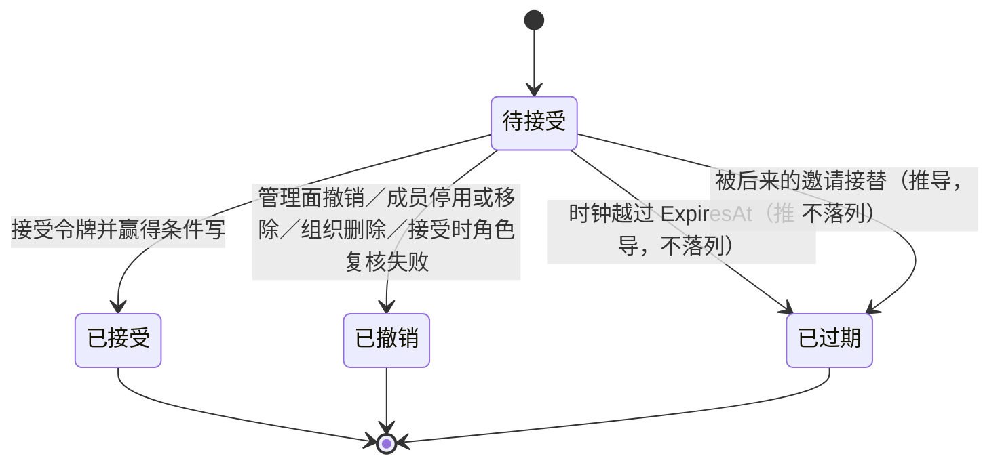

# authn/invite

本模块持有邀请的状态机与 `authn_invitations` 表：一张邀请点名一个地址与一个[租户](../../../glossary.md)，在被接受之前不产生成员行，也不产生账户；一条邀请还可以再携带一个角色，接受时与成员关系一起写下。接受令牌授予“加入这个租户”的能力，不证明被邀请地址的归属：签发者手里也有这枚令牌。接受要求一个已登录的账户，并且该账户自己持有与被邀请地址相同的已证明邮箱；地址不必是该账户的登录方式。签发与重发成功后，本模块经可选接口 `authn.InviteNotifier` 请一次接受通知，投递成功时应答不再交出令牌；重发作用在同一条邀请上，换一枚令牌并重新投递，邀请标识、到期时间与角色不变。成员被停用或移除时，本模块撤销该账户在该租户下的待接受邀请，组织被删除时撤销该租户的全部待接受邀请。接受还按可选的 `authn.TenantStateResolver` 判定租户是否仍在服务：已删除的租户令该行作废，停用的租户令该行保持待接受并答 409 `invitation-tenant-inactive`。公开读取对匿名访客展示邀请摘要，地址在服务端打码；已登录的账户另经一个必须登录的接口得知邀请状态与自己是否已证明受邀地址。签发与接受的两档预算把签发、重发与探测都限在固定窗口内。它不渲染通知、不持邮件载体、不持账户与成员关系的表与规则，也不判定租户成员资格或持有策略数据：角色绑定经授权模块交付的事务内接口写下。读职责清单前应持有的一句话心智模型：邀请是一条待兑现的成员关系授予，可以附带一个角色；令牌只兑现加入，邮箱归属由接受人自己证明。

第一遍按顺序读的节是职责与非职责、术语表、外部接口契约、依赖、UML 图、核心数据结构、核心算法与流程；术语表在遇到邀请、接受令牌、待接受态、投递结果时回看，UML 图的状态机给出邀请的去向、类型图给出通知接口的位置，核心数据结构的状态一览说明每个状态在做什么，核心算法与流程的走查、签发、重发、接受与通知给出一次兑现、一次换令牌与一次送达的落库与外部调用过程。错误与失败语义与并发与事务边界是最后自检的节；扩展点与实现状态在主体之后回看。

## 职责

- **驱动邀请的状态机。** 经一张 `authn_invitations` 表驱动邀请从“待接受”到终态的每一次迁移，签发、列表、重发、撤销与接受都经它。邀请是一次**待兑现的成员关系授予**：它点名一个地址与一个租户，在被接受之前没有任何成员行存在，也没有任何账户由它建立。
- **只在目标可邀请、期限有界、角色可授予时签发。** 签发在写行之前拒绝不合格的目标与在途邀请：被邀请地址已经属于该租户的活跃成员或停用成员，被邀请地址属于服务账户，目标租户是系统租户，以及该地址已有一条未过期的待接受邀请。显式期限必须晚于当前时刻，且不得晚于签发时刻加 90 天；不带期限时取设置时长，设置本身的取值域同样是 1 小时到 90 天。带角色签发时另经 `authn.InviteRolePolicy` 判定：角色在该租户不存在是 `authn.ErrRoleUnknown`，调用方没有角色管理权限是 `authn.ErrForbidden`，角色是 `platform-admin`、含调用方不持有的授予或宿主写保护拒绝是 `authn.ErrRoleProtected`；装配没有该能力时带角色的签发失败关闭。同一（租户，地址）下至多一条未过期的待接受邀请，并发的签发在插入处由部分唯一索引仲裁，输者得到 `ErrInvitationPending`。地址的旧邀请已过期时允许签发：新签发在插入新行之前给旧行写 `superseded_at`，旧行仍读作已过期，不转已撤销；已接受与已撤销的行永远不被改写。首次签发记一次发送，写 `last_sent_at` 与 `send_count = 1`。
- **接受即验证并兑现一次授予。** 一次接受消费一个令牌，并把一条来源为 `invite` 的成员行写给**已登录的调用者账户**：这是 `Membership.Source` 早已声明的取值之一（`pkg/authn/internal/model/directory.go` `Membership.Source`）。调用者必须持有与被邀请地址相同的已证明邮箱标识（规范化后比较）；该地址可以是、也可以不是调用者的登录方式。没有这条证明的账户被拒绝，令牌保持可兑现。邀请携带角色时，成员行与角色绑定在同一事务里写下：占用邀请行、写成员关系、写角色绑定三件事一起提交或一起回滚。接受从不新建账户，账户规则仍归 `authn.account`。
- **令牌授予加入，不证明地址归属。** 令牌只以摘要留存，明文在签发或重发应答里至多出现一次（投递成功时连这一次也不出现，链接已由通知送达）；撤销因此是改状态，不是撤销一个签名。签发者手里也有令牌，所以仅凭令牌出示不能成立一次接受，候选账户必须自己证明被邀请地址。
- **签发或重发之后请一次通知，并决定令牌是否随应答交出。** 签发或重发成功后，本模块经可选接口 `authn.InviteNotifier` 请一次接受通知，限时五秒，把投递结果作为 `sent`、`failed` 或 `not_configured` 写进应答。投递成功说明收件地址已经持有链接，应答不再交出令牌；投递失败或未配置时，签发者仍需转交链接，应答交出令牌。通知失败不撤销邀请，签发仍为 201、重发仍为 200；失败记一行 `Error` 日志与一条尽力档 `authn.invitation.deliver` 审计行。通知的正文、语言与投递归通知接口的实现（`authn.invitemail` 是仓库提供的那一份），本模块只交出通知所需的租户名称、邀请人显示名、地址、令牌、期限与请求语言。
- **重发在同一条邀请上换令牌。** 重发按邀请标识作用，条件写要求该行状态仍为待接受、未过期且未被后来的邀请接替；命中时只改写 `token_digest`、`last_sent_at`、`send_count + 1` 与 `updated_at`，邀请标识、租户、地址与到期时间都不变，旧令牌随即失效。已接受、已过期与已撤销的行不能重发，答 409 `invitation-terminal`。重发与签发共用发送预算、通知与令牌交出规则；重发不重新检查成员关系、服务账户与系统租户，一条已成立的邀请仍可按原样再送（[ADR-authn-invitation-resend](../../../adr/adr-authn-invitation-resend.md)）。
- **成员退出时撤销他的待接受邀请。** 本模块订阅 `authn.membership.changed`：成员被停用或移除时，把这个账户的邮箱在该租户下的待接受邀请置为已撤销，并写 `revoked_at`。邀请行仍是权威，事件只是提示，撤销以“状态仍为待接受且未过期”为条件。
- **组织删除时收回该租户的全部待接受邀请。** 本模块排他交付根包的 `authn.InvitationRevoker`；租户归属模块在删除提交之后调用它，把该租户状态仍为待接受且未过期的邀请置为已撤销。调用是尽力而为的，失败只留警告；接受本身还会因租户不再服务而拒绝。
- **接受按租户状态决定拒绝方向。** 接受读取可选的 `authn.TenantStateResolver`：租户在服务时照常兑现，已停用时答 409 `invitation-tenant-inactive` 且邀请保持待接受（重新启用后同一令牌可再兑现），已删除时撤销该行并答 404。没有解析器的装配没有租户状态可判，接受照常进行。
- **以模块 `authn.invite` 排他交付接口 `Invites` 与 `authn.InvitationRevoker`。** 邀请的签发、列表、撤销与接受都由本模块经 `Invites` 作答，别的模块取用邀请能力没有第二条入口；接口与数据类型随它同处本子包（[design-authn](design-authn.md)）。组织删除时的收回经 `InvitationRevoker` 交付。

### 非职责

- **不做组织树。** 没有节点、没有层级、没有子树数据范围，接受只落一条成员关系，不带任何位置。早期实现有一棵多级组织树，本方案刻意不做它（[ADR-org-invitation](../../../adr/adr-org-invitation.md)）。
- **不渲染通知，不排队，不重试。** 本模块不构造邮件正文、不选语言、不触达邮件载体；它只把 `InviteNotice` 交给 `authn.InviteNotifier` 的实现，由后者渲染并投递。通知在签发与重发的路径上同步调用一次，没有提醒、没有自动重发、没有后台重试：重发只能由一次显式的重发调用发起，它换掉同一条邀请的令牌，不新建邀请行。
- **不持账户、成员关系、标识的表与规则。** 接受只读调用者的标识、写一条成员行（经 `provisioning.MembershipWriter.PutJoiningTx` 写在接受的事务里），从不建账户、不写标识、不证明邮箱；这些写入归 `authn.account`，账户与成员关系的规则与哨兵也归 [authn-account](design-authn-account.md)。
- **不做邮件的送达证明。** `sent` 只表示载体接受了这条消息，不证明地址可达、收件箱收到或被打开。地址可达性仍由投递渠道与收件方承担，签发者始终可以复制链接另交。
- **不判定租户成员资格，不 import `pkg/tenant`。** 租户标识在本模块里是字符串；请求期判定归 `tenant.admission`（[design-tenant-admission](../tenant/design-tenant-admission.md)）。租户是否存在与是否在服务也不由本模块判定：它只经可选的 `authn.TenantStateResolver` 读取，按读到的状态决定拒绝或撤销。
- **不持有角色与绑定数据。** 邀请只记录它携带的角色名；角色是否存在、调用方能否授予、邀请人是否仍持有它，都由 `authn.InviteRolePolicy` 判定，绑定由 `authz.policy` 交付的事务内经接口写下（[design-authz](../design-authz.md)）。本模块不 import 授权功能目录，也不直接读写策略表。
- **不代替签发者决定把谁拉进租户。** 管理面的判定接口回答“这个发起者能不能签发”，本模块保证签发者的身份与租户范围，不保证他选的人对不对。

## 术语表

以下术语的含义限于本文档与邀请主题的决策记录；它们不进项目术语表。

| 术语 | 英文 | 适用范围 | 定义 |
|---|---|---|---|
| 邀请 | invitation | 本文档与邀请主题的决策记录 | 一次待兑现的成员关系授予：点名一个地址与一个租户，带状态与期限。接受之前不产生成员行，也不产生账户。 |
| 接受令牌 | acceptance token | 本文档与邀请主题的决策记录 | 接受所凭的凭据，签发或重发应答至多交出一次，只以摘要留存的 256 位随机串。它授予加入该租户的能力，不证明被邀请地址的归属。 |
| 待接受态 | pending | 本文档与邀请主题的决策记录 | 邀请已签发、未接受、未撤销且未过期的状态。它属于邀请自己的一行，不属于账户表：账户表没有可放待接受行的行态。 |
| 投递结果 | delivery outcome | 本文档与邀请主题的决策记录 | 一次接受通知的结局，封闭集为 `sent`、`failed`、`not_configured`。它只说明这次通知有没有被载体接受，不说明地址可达或消息被阅读。 |
| 重发 | resend | 本文档与邀请主题的决策记录 | 对同一条邀请换一枚接受令牌并重新投递；邀请标识与到期时间不变，旧令牌立即失效。 |
| 打码地址 | masked address | 本文档与邀请主题的决策记录 | 服务端为公开读取生成的地址形式，保留本地部分首字符与完整域名，例如 `alice@example.com` 读作 `a***@example.com`。 |

## 外部接口契约

### 交付的功能

本模块排他交付接口 `Invites`，由本模块回答。接口、值类型与哨兵一并定义在 `pkg/authn/invite`，不随其余认证接口放进根包 `pkg/authn`（[design-authn](design-authn.md)；理由见 [ADR-authn-invitation](../../../adr/adr-authn-invitation.md)）。

```go
// 邀请接口：持有邀请的状态机，决定一条邀请能不能签发、能不能被一个令牌兑现。
type Invites interface {
    // Issue 签发一条邀请。同一（租户，地址）下已有未过期的待接受邀请时拒绝，
    // 旧邀请已过期时由新邀请接替。返回值里的令牌只在此处交出一次。
    Issue(ctx context.Context, in IssueInvite) (Issued, error)
    // List 列出某租户的邀请，一页一条游标。
    List(ctx context.Context, tenant string, page Page) ([]Invitation, string, error)
    // Revoke 撤销一条邀请，使其令牌失效。撤销已过期或已接受的邀请是
    // ErrInvitationExpired 或 ErrInvitationAlreadyAccepted；撤销已撤销的邀请是幂等成功。
    Revoke(ctx context.Context, tenant, id string) error
    // Accept 用令牌兑现一条邀请，为已登录且持有被邀请地址已证明邮箱的
    // 调用者写一条成员行（source = invite），并在同一事务里绑定邀请携带的
    // 角色。它从不建账户，也从不证明邮箱。
    Accept(ctx context.Context, in AcceptInvite) (Accepted, error)
}

type IssueInvite struct {
    Tenant    string    // 字符串形式的租户标识
    Email     string    // 被邀请人的地址，规范化前的原值
    ExpiresAt time.Time // 绝对期限；零值取设置的时长
    Role      string    // 邀请携带的角色；空串表示不带角色
}

// Accepted 是一次接受的领域结果：成员关系与接受时绑定的角色。
type Accepted struct {
    Membership
    Role string // 空串表示邀请没有携带角色
}

// Issued 是一次签发的领域结果。投递结果不在这里：通知在管理面路由上
// 请取，由路由把它与令牌是否随应答交出一起决定。
type Issued struct {
    Invitation Invitation
    Token      string // 接受令牌，只在此处交出一次；不得写日志、事件或追踪属性
}

type Invitation struct {
    ID           string
    Tenant       string
    Email        string // 规范化后的地址
    Status       InvitationStatus
    InvitedBy    AccountID
    Role         string // 邀请携带的角色；空串表示不带角色
    ExpiresAt    time.Time
    AcceptedAt   *time.Time // nil：尚未接受
    RevokedAt    *time.Time // nil：尚未撤销
    LastSentAt   time.Time  // 最近一次发送；签发一定写入，所以非空
    SendCount    int        // 累计发送次数，首次签发记 1
    // SupersededAt 是后来的邀请接替这一行的时刻；读取侧据此把待接受行读作已过期。
    // 视图不发布它。
    SupersededAt *time.Time
    CreatedAt    time.Time
}

type AcceptInvite struct {
    Token       string // 接受令牌
    Username    string // 忽略：接受从不建账户
    DisplayName string // 忽略：接受从不建账户
    Password    string // 忽略：接受从不建账户
}

// InvitationStatus 是邀请状态的封闭集。零值 Pending 与存量列一致。
type InvitationStatus uint8

const (
    InvitationPending  InvitationStatus = iota // 待接受（零值）
    InvitationAccepted                         // 已接受
    InvitationRevoked                          // 已撤销
)

// Valid 报告 s 是否在存量列里。已过期的待接受邀请仍是 InvitationPending：
// 过期由时钟与 ExpiresAt 或接替标记推出，不落列。
func (s InvitationStatus) Valid() bool { return s <= InvitationRevoked }

// InviteRolePolicy 是邀请对角色提出的两个判定，定义在根包
// pkg/authn/invite_role.go，由 authz.policy 实现并交付。
type InviteRolePolicy interface {
    // Grantable 回答 account 能否在 tenant 里授予 role：调用方持有
    // authz.tenant.role.manage、角色存在、角色不是 platform-admin、每条授予
    // 都在调用方的持有集内、宿主写保护放行。权限先于角色名判定，所以没有
    // 角色管理权限的调用方无法从两种应答探出角色是否存在。account 为空是
    // 宿主命令：判定收窄为角色存在、不是 platform-admin、写保护放行。
    // 拒绝是 authn.ErrRoleUnknown、authn.ErrForbidden 或
    // authn.ErrRoleProtected。
    Grantable(ctx context.Context, tenant, account, role string) error
    // StillGrantable 回答 role 是否仍可代 inviter 绑定：inviter 仍是该租户
    // 的活跃成员、仍持有 authz.tenant.role.manage、仍持有角色的每条授予，
    // 且角色仍存在、仍不是 platform-admin。成员关系单独读，因为停用保留
    // 绑定。inviter 为空时只核对角色存在（宿主命令签发的邀请没有邀请人可
    // 复核）。
    StillGrantable(ctx context.Context, tenant, role, inviter string) error
}

// InviteNotifier 是接受通知的投递接口，可选。定义在根包
// pkg/authn/invite_notice.go，由宿主或 authn.invitemail 交付。
type InviteNotifier interface {
    // Notify 按 notice 的地址与语言送出一次通知，并报告投递结果。
    // 失败不回滚邀请；调用方仍以 201 作答，并按结果决定应答是否交出令牌。
    Notify(ctx context.Context, notice InviteNotice) (InviteDelivery, error)
}

type InviteNotice struct {
    Tenant    string    // 租户名称；通知里不出现内部标识
    Inviter   string    // 邀请人的显示名；空串表示签发时没有邀请人
    Email     string    // 规范化后的被邀请地址
    Token     string    // 接受令牌；不得写日志、追踪、事件或错误文本
    ExpiresAt time.Time // 邀请的绝对期限；零值表示调用方不知道
    Locale    string    // 请求点名的 BCP 47 语言，空串表示没有点名
}

// InviteDelivery 是一次通知的结果。零值是 InviteNotConfigured。
type InviteDelivery uint8

const (
    InviteNotConfigured InviteDelivery = iota // 本部署没有配置通知通道，什么也没发
    InviteSent                                // 载体接受了这条消息
    InviteFailed                              // 载体拒绝，或结果未知
)
```

**`Invitation` 不含令牌。** 令牌明文在 `Issued` 里出现一次，此后任何视图、列表、事件与诊断都不带它；`Invitation` 是给管理面读的只读视图。管理面签发与重发应答只在投递没有成功时带一次令牌：投递成功说明收件地址已经握有链接，应答再交出明文就多了一份持有者；投递失败或未配置时签发者必须自己转交，应答照常交出。

**管理视图另带状态与邀请人姓名。** 视图的 `state` 是服务端按当前时刻给出的四态 `pending`、`expired`、`accepted`、`revoked`，与列表分组用同一个时钟判断。`status` 仍是存量三态，保留给需要区分“存储状态”的调用方。`invited_by_name` 与 `invited_by_username` 取自 `invited_by` 指向的账户：宿主命令签发时 `invited_by` 为空，两个键都不出现；账户已不存在（墓碑）时同样不出现；账户没有用户名标识时只有用户名不出现；账户读取失败时两个键都不出现，管理面不因一次名字读取失败而整页失败。两个键都是缺席而不是空串。冒充期间 `invited_by` 记生效账户，所以两个名字也是被冒充账户的；审计仍记操作者。公开读取是唯一的例外：它读不到邀请人的显示名时答 503，不返回缺名字的摘要。

**角色是邀请的一个字段，空值以键的缺席表示。** 管理视图、列表、签发与重发应答都带 `role`，公开读取在待接受状态带它，接受应答带实际绑定的角色；不带角色时这个键不出现，不是 null。待接受邀请的角色不可修改，重发沿用原角色；要换角色就撤销后重新签发。

**重发不是 `Invites` 的方法。** 重发只由管理面路由调用本模块的领域方法，其它模块不需要经接口重发；`Invites` 的方法集保持不变，`Issued` 既用于签发也用于重发。

**组织删除收走待接受邀请。** 本模块排他交付根包的 `authn.InvitationRevoker`：

```go
// InvitationRevoker 在租户被删除后收回它还能发出的全部授予。
type InvitationRevoker interface {
    // RevokeTenantInvitations 把该租户的全部待接受邀请置为已撤销。
    // 空租户或没有待接受行返回 nil；已接受与已撤销的行不被改写。
    RevokeTenantInvitations(ctx context.Context, tenant string) error
}
```

租户归属模块在删除提交之后调用它，失败只记一行警告而不让删除失败；接受本身还会按租户状态拒绝，所以调用没到达时令牌也不能兑现。撤销写以“状态仍为待接受”为条件，重复调用不改变结果。

**接受按租户状态分流。** 接受读取可选的 `authn.TenantStateResolver`（`TenantStateOf` 返回 `TenantServing`、`TenantDisabled` 或 `TenantDeleted`）：租户在服务时继续核对；已停用时答 409 `invitation-tenant-inactive`（`ErrInvitationTenantInactive`）且邀请保持待接受，所以重新启用后同一令牌还能兑现；已删除、或解析器回答闭集之外的状态时，撤销该行并答 404 `ErrInvitationNotFound`。装配没有解析器时没有租户状态可判，接受照常进行。读租户状态失败是 503，不按可接受处理。

**投递结果是通知的结果，不是邀请的状态。** 它取 `sent`、`failed`、`not_configured` 之一；`not_configured` 表示没有通知接口、部署选择不发邮件，或所选载体（日志载体）不把消息交给收件人，`failed` 表示载体拒绝或结果未知。三者都不改变邀请行与 HTTP 状态；只有 `sent` 让应答不交出令牌。`InviteDelivery` 的零值就是 `not_configured`，所以一个从未设置过的结果读起来是“没有发”，而不是“发失败了”。

**`InvitationStatus` 的存量列是 `{待接受，已接受，已撤销}`，观察态是它加“已过期”。** 已过期不是一次写出的迁移，而是“状态为待接受，且当前时刻不早于 `ExpiresAt`”的推导；接受与列表都按当前时刻判定，不靠清扫器翻转状态。判据是状态放置的方向：一次丢失的过期翻转只让一条已经不能接受的邀请看起来还能接受，而接受路径自己会拒绝它，安全性不依赖这次翻转（[ADR-authn-state-placement](../../../adr/adr-authn-state-placement.md)）。

**`IssueInvite` 与 `AcceptInvite` 的字段语义是承诺**：`IssueInvite.Email` 是未规范化的原值，规范化归本模块；`Issued.Token` 是只交出一次的凭据；`AcceptInvite` 的 `Username`、`DisplayName` 与 `Password` 被忽略：接受从不建账户，保留它们只是让旧客户端仍然可以发送而不被拒绝。

**签发在写行之前判资格、期限与在途邀请。** 被邀请地址已经属于该租户的成员时（成员关系按读到的行判定，停用也仍是成员），再签发一条邀请没有可授予的东西，签发被拒绝且不写行；被邀请地址属于服务账户时同样拒绝，因为服务账户以服务密钥登录，没有可接受的成员关系；目标租户是系统租户时也拒绝，系统租户不接受邀请加入。该地址已有一条未过期的待接受邀请时拒绝，避免两条并存的活链接；旧邀请已过期时允许签发，新邀请接替旧行，旧行仍读作已过期。显式期限必须晚于当前时刻且不晚于签发时刻加 90 天；不带期限时取设置时长，设置的取值域为 1 小时到 90 天，越出时取声明默认值。管理面请求体的期限省略或为 null 表示不带期限；显式给出零值时刻按非法输入答 400，不当作省略。带角色时，签发还要经 `authn.InviteRolePolicy.Grantable` 判定：调用方没有 `authz.tenant.role.manage` 答 403 `forbidden`，角色在该租户不存在答 400 `invitation-role-unknown`，角色是 `platform-admin`、含调用方不持有的授予或宿主写保护拒绝答 403 `invitation-role-protected`；权限先于角色名判定，所以没有角色管理权限的调用方对存在与不存在的角色得到同一答案。宿主命令没有调用方账户，判定收窄为角色存在、不是 `platform-admin`、写保护放行，因为宿主本就可以直接绑定角色；宿主与否按请求有没有身份判定，有身份而账户为空时答 503，因为它既不是宿主命令，也没有可复核的账户。装配没有该能力时带角色的签发答 503，不写行。这些判定都在写任何行之前完成，系统租户与不合格地址的判据经必需的 `authn.TenantDescriptionResolver` 与账户读取取得。

**接受的前提是身份与地址归属，二者缺一不可。** 令牌只授予加入，签发者持有同一枚令牌，所以令牌本身不能成立一次接受。调用者必须是已登录账户；该账户必须持有一条与被邀请地址规范化后相等的邮箱标识，且这条标识的验证渠道属于 `Verification.Proves` 为真的那一类（`email-code`、`sms-code`、`idp:<提供方标识>`）。满足条件后，接受在一个事务里占用邀请行、经 `provisioning.MembershipWriter.PutJoiningTx` 写一条来源 `invite` 的成员行，再经 `provisioning.RoleBinder` 写下邀请携带的角色。接受从不新建账户、从不写标识、从不证明邮箱；证明由账户自己的邮箱验证路径完成。

### 接受的前提与成员行

- **没有身份**：`401`，带该能力的强认证挑战；不询问令牌是否真实。`ErrInvitationUnauthenticated`。
- **调用者不是用户账户**：`403 invitation-target-invalid`；服务账户以服务密钥登录，没有可接受的成员关系，没有账户行的主体（如静态凭据表主体）也没有可授予的账户，两者都按不可邀请的目标拒绝，接受不替它们写成员行。`ErrInvitationTargetInvalid`。
- **读调用者账户失败**：`503`，不按放行处理；邀请保持待接受，同一令牌稍后可以再兑现。
- **没有证明被邀请地址**：`403 invitation-email-unproved`；邀请保持待接受。`ErrInvitationEmailUnproved`。地址的证明渠道必须是证据一类；`invite`、`admin`、`import-unverified` 与 `self` 都不算。
- **地址不必是登录方式**：成为被邀请地址的已证明邮箱不把该地址选作登录标识，也不把它设为默认联系地址；这两项分别按 REQ-account-064 与 REQ-account-063 由持有人选择、由账户模块维护（[ADR-authn-contact-and-login-ways](../../../adr/adr-authn-contact-and-login-ways.md)）。
- **地址尚无账户**：接受不替当事人开户；没有已登录账户就没有可写的成员行。当事人先在装配开放注册（或在别处已有账户）的前提下登录并证明地址，再回到链接接受（REQ-tenancy-018）。
- **已有成员关系且仍启用**：直接兑现，保留其来源与 SSO 豁免，并照常补绑邀请里的角色；一次接受只是补上成员行与绑定，不改写当事人如何成为成员。
- **已有成员关系且已停用**：`409 membership-inactive`，并撤销这条待接受邀请；停用的成员不能借一枚仍有效的令牌复活。`ErrInvitationMembershipInactive`。
- **租户已停用**：`409 invitation-tenant-inactive`，邀请保持待接受；重新启用后同一令牌可以再兑现。`ErrInvitationTenantInactive`。
- **租户已删除**：`404`，并撤销这条邀请；一个不再存在的租户不再有任何可授予的成员关系。
- **邀请携带的角色已不可授予**：邀请人此刻已不是该租户的活跃成员、不再持有 `authz.tenant.role.manage`、不再持有角色的每条授予，或者角色在该租户已不存在、已是 `platform-admin`，接受被拒绝并撤销这条邀请，撤销写一条审计行。邀请人的账户须为启用状态：已停用或已不存在同样撤销，因为账户级停用保留成员关系与绑定，只有账户状态能看见。成员关系要单独读：成员被停用后绑定保留，只看持有集会漏掉邀请人已经离开。读邀请人账户失败不是拒绝：邀请保持待接受，答 503，依赖不可用不能当作角色的决定。宿主写保护不在复核之内：接受兑现的是签发时已经放行的授予。宿主命令签发的邀请没有邀请人可复核，只核对角色仍存在。静态主体（`static.` 前缀，部署配置的凭据表账户）与宿主命令一样跳过账户状态检查，但仍走角色可授予检查：它的权限来自部署配置，移除须改配置并重启，按账户库判定会把它签发的邀请全部误撤销。已知取舍是被移出配置的静态主体，此前签发的待接受邀请仍可授出角色，直到过期或被手动撤销；demo 的 `(*tenancyProduct).IsMember`（`starters/demo/server/tenancy.go`）对任何 `static.` 主体答真，同一个理由。`ErrInvitationRoleWithdrawn`，答 409 `invitation-terminal`；成员关系与绑定都不写。
- **成员行的来源写 `invite`**：本模块落下的每一条新成员行，`Membership.Source` 都取 `invite`。`provisioning.MembershipWriter.PutJoiningTx` 的成员关系变更事件（`authn.membership.changed`）随带该来源，订阅方据此分清邀请加入与管理员直加（[design-authn-events](design-authn-events.md)）。
- **令牌只能兑现一次**：条件写把行从待接受翻到已接受并写 `accepted_at`，条件是状态仍为待接受、未过期且未被后来的邀请接替；两个并发接受至多一个赢家，输者按终态报告，不写成员行。这次翻转、成员关系与角色绑定在同一个事务里提交，任一步失败整体回滚，邀请仍是待接受。

**接受不写验证渠道 `invite`。** `Verification` 的封闭集仍含 `invite`（`pkg/authn/internal/model/directory.go` `VerifiedViaInvite`），但它不再证明地址归属：`Verification.Proves` 对 `invite`、`admin`、`import-unverified` 与 `self` 都为假。令牌被送达并出示只说明持有者收到了链接，与短信验证码同类的是“一个载荷被出示”，而签发者也持有这枚载荷，所以它不足以证明邮箱属于接受人。

### 公开读取、打码与 eligibility

**公开读取保持公开。** `GET B/invitations/:token` 登记为 `Public`，令牌是它展示邀请摘要的全部凭据。匿名访客带着有效令牌到达时，读取返回组织名称与显示名、邀请人显示名、打码后的受邀地址、到期时间、角色与状态；它不返回邀请人的账户标识，也不返回完整地址，不带角色时 `role` 键不出现。显示名是组织自由填写、可以没有的文本，名称则必然存在，所以两者都随摘要返回。打码在服务端完成，对所有调用方一致：本地部分只保留首字符，域名完整保留，例如 `alice@example.com` 读作 `a***@example.com`；本地部分为空时读作 `***@域名`，没有域名（规范化不会产生）时读作空串。

**终态分开说明。** 已过期与已撤销的令牌只返回 `state`，不返回地址、租户与有效期；已接受的令牌返回组织名称与显示名，不返回地址与邀请人。

**eligibility 必须登录。** 是否已证明受邀地址是一个关于账户的问题，另开 `GET B/invitations/:token/eligibility`，登记为 `Guarded`。它只对已登录的当前账户回答邀请状态与 `email_proved`，不返回完整地址、邀请人与组织，并和公开读取一样按令牌摘要与客户端地址计入探测预算。没有可用凭据的请求在处理器之前得到 401（[ADR-authn-invitation](../../../adr/adr-authn-invitation.md)）。

### 登记单元与名字

| 包 | 模块名 | 交付 | 排他 |
|---|---|---|---|
| `pkg/authn/invite` | `authn.invite` | `Invites` 与 `authn.InvitationRevoker`，以及 `Invitation`、`InvitationStatus`、`Issued`、`IssueInvite`、`AcceptInvite` 与哨兵 | 排他 |
| `pkg/authn/invitemail` | `authn.invitemail` | `InviteNotifier` 的邮件实现 | 排他 |

模块名照顶层能力：嵌套子包取 `authn.<功能>`，本模块取 `authn.invite`（[design-authn](design-authn.md)）。设置命名空间取同一取值；模块仍声明一个没有输入项的配置节，使旧配置里的 `authn.invite.ttl` 按完整路径报未知键。`InviteNotifier`、`InviteNotice` 与 `InviteDelivery` 定义在根包 `pkg/authn/invite_notice.go`，不在任何一个实现子包。

### 通知的邮件实现 `authn.invitemail`

`authn.invitemail` 是仓库提供的通知实现：它把一次 `InviteNotice` 渲染成邮件并交给 `pkg/mail.Sender` 的载体，排他交付 `InviteNotifier`。一条命令可以点名它，也可以换成宿主自己的实现；两个实现同时在场在消解阶段失败。

- **配置项 `authn.invitemail.accept-base-url` 给出接受页所在的绝对来源。** 取值须是绝对 http/https URL、带主机、无查询与片段；末尾的 `/` 归一化掉。通知的链接是 `<accept-base-url>/invitations/<令牌>`，路径由模块拼接、令牌按单个路径段转义，配置改不了接受路由的结构。值不合法时在 `Prepare` 阶段终止启动，点名输入项且不回显取值。
- **通知里的租户名取名称。** `InviteNotice.Tenant` 携带的是租户名称，由本模块在调用通知接口之前经可选的 `authn.TenantNameResolver` 解析；主题与正文都写这个名称，解析器缺席、解析失败或解析不到时写空串，不回退成内部标识，`authn.invitemail` 按收到的名称渲染，不自行解析。
- **通知写明邀请人的显示名。** `InviteNotice.Inviter` 是邀请人的显示名，不是账户标识；有值时正文使用带邀请人的变体，没有值（宿主命令签发）时使用无人称变体。

**空值是合法的未配置部署。** 模块保持启用，不触达载体，答 `InviteNotConfigured` 与 nil 错误。选 `mail.carrier: none` 的运行里没有任何发送载体，模块随邮件能力一并 `StateDisabled`，不因一个缺席的依赖让整个装配起不来；这样的运行不校验接受来源。
- **语言取自请求，缺目录时回退。** 通知按 `InviteNotice.Locale` 选择消息：先按原标签，再按主语言子标签，最后英文。模板在模块的 `locales/zh-CN.json` 与 `locales/en-US.json`，包含主题、纯文本与 HTML；`New` 在启动时渲染每个目录的每条消息，缺键即启动失败，不等到第一次发送才发出一条只有键的消息。
- **期限写易读的日期时间并标注 UTC。** `InviteNotice.ExpiresAt` 是邀请的唯一期限，以带年月日与时分、结尾写 `UTC` 的布局插入正文；`Localizer.Translate` 不带时区格式化，正文因此读作 UTC。受邀人可能还没有账户，也可能没有时区设置，邮件不使用请求的时区。零值表示调用方不知道，整句省略，不编造一个时刻。
- **令牌、收件人与正文不写日志、不进错误文本。** 每次发送只记一行结果与耗时，行里没有令牌、地址、租户或正文；实现方返回给调用方的错误是载体自己的错误，不含令牌。
- **载体错误按原分类透传。** `mail.ErrThrottled`、`mail.ErrRejected`、`mail.ErrUncertain` 原样返回，由邀请模块决定怎么记；本模块不加自己的分类，也不重试。
- **消息不带去重标识。** 每次签发或重发都画一个新令牌，重发改写同一条邀请的令牌，旧令牌随即失效；一个稳定的 `DedupeID` 会压掉一条合法的通知，而载体本身对每次调用只投递一次。

装配上，`starters/demo/server/capabilities.go` 把本模块编入每次构建并交给 `serve` 点名；审查与本地配置给它一个接受来源并选 `mail.carrier: log`。日志载体只写进程日志、不把消息交给收件人，`authn.invitemail` 因此把邀请的投递结果报为 `not_configured`：每次签发或重发都由管理面的一次性面板交出接受链接，通知不写进进程日志；验证码等其余邮件仍按日志载体自己的行为处理（[design-starters](../design-starters.md)）。

### 路由

本模块经 `mount.Mounter` 挂管理面与 account 侧的路由。管理面路由登记为 `Guarded`，并登记为 `Impersonable`：它们按路径里的租户域判定，目标是该租户管理员时，冒充身份持有它在该租户的管理权限，邀请路由照常可用（[design-authn-impersonation](design-authn-impersonation.md)）。接受的读取路由登记为 `Public`：令牌是它展示邀请摘要的全部凭据。资格读取路由登记为 `Guarded`：答案是关于某个账户的，没有可用凭据即 401。接受的兑现路由登记为 `Optional`：请求带凭据时网关给出身份，处理器拒绝没有身份的请求。管理面按租户寻址且在该租户的策略域判定，因此落在 `tenants` 作用域与受租户两层守护的端上；接受与资格读取路由按令牌寻址、没有租户，落在普通路由（[ADR-http-api-path-scopes](../../../adr/adr-http-api-path-scopes.md)）。

| 面 | 方法 路径 | 登记 | 授权 |
|---|---|---|---|
| 管理面 | `POST Bt/:tenant/invitations` | `Guarded`，`Impersonable` | 判定接口 + 强制档审计；签发后尽力通知，并按下述规则决定应答是否带令牌 |
| 管理面 | `GET Bt/:tenant/invitations` | `Guarded`，`Impersonable` | 判定接口；读不写审计；可按 `status` 收窄 |
| 管理面 | `DELETE Bt/:tenant/invitations/:id` | `Guarded`，`Impersonable` | 判定接口 + 强制档审计 |
| 管理面 | `POST Bt/:tenant/invitations/:id/resend` | `Guarded`，`Impersonable` | 判定接口 + 强制档审计；重发后尽力通知，并按签发相同的规则决定应答是否带令牌 |
| account 侧 | `GET B/invitations/:token` | `Public` | 令牌 |
| account 侧 | `GET B/invitations/:token/eligibility` | `Guarded` | 已登录的调用者 + 令牌；只回答当前账户 |
| account 侧 | `POST B/invitations/:token` | `Optional` | 已登录的调用者 + 被邀请地址的已证明邮箱 + 令牌 |

`B` 是普通路由的基路径，`Bt` 是 `tenants` 作用域的基路径（`authn.gate.mount.bases`，见 [authn-gate](design-authn-gate.md)）。接受的读取路由对仍可兑现的令牌返回邀请摘要，摘要带组织名称与显示名、邀请人显示名、打码地址、到期时间与角色（有则）；已过期与已撤销的令牌只返回 `state`，不返回地址、租户名与有效期：链接不再授予任何东西时，摘要里的字段也一并消失；已接受的令牌返回组织名称与显示名，供已是成员的会话进入组织，不返回地址与邀请人。资格读取只返回 `state` 与 `email_proved`。兑现路由在核对令牌之前先读租户状态，停用与删除的拒绝方向见上一节。

基路径 `B` 由 [authn-gate](design-authn-gate.md) 声明。管理面路由按路径里的租户标识寻址，不按名称表，所以本模块不依赖租户名册；接受路由按令牌寻址，路径里不出现租户。`POST B/invitations/:token` 读调用者的身份与其邮箱标识，不读正文里的用户名、显示名或口令；没有身份答 401，调用者不是用户账户答 403 `invitation-target-invalid`，没有证明被邀请地址答 403 `invitation-email-unproved`。请求声明长度为零时不绑定正文并按错误请求拒绝；`{}` 是一段正文，照常接受。

**接受的读取与兑现共用一组探测预算。** 两条路由在查令牌之前按令牌摘要与客户端地址计数（`authn.invite.probe-*`），超限答 429 并带 `Retry-After`；令牌键是摘要，从不是明文。计数键在查令牌之前写入，所以 429 不透露令牌是否存在。

**列表的 `status` 查询把一页收窄到一种观察态。** 取值是封闭集 `pending`、`expired`、`accepted`、`revoked`；缺省列出全部，集合外的值答 400，不当作“全部”。`pending` 是状态为待接受且 `expires_at` 晚于当前时刻的行，`expired` 是状态仍为待接受而 `expires_at` 不晚于当前时刻的行，`accepted` 与 `revoked` 是两种终态。过期仍不落列：两个 `pending` 分支读的是同一列状态，差别只在时钟与期限的比较。收窄只发生在管理面路由，`Invites.List` 本身仍列出全部。

### 管理面的判定顺序

管理面路由的判定在 handler 内做出，不经请求中间件的声明判定，与 `authn.admin` 一致（[ADR-authn-invitation](../../../adr/adr-authn-invitation.md)）。顺序固定：

1. **读发起者。** 请求没有身份是 401 加强认证挑战，不询问接口。
2. **注册验证状态的门控。** 发起者是用户账户且视为未验证（`SignupPending`：有邮箱而没有一条已证明的）时，签发、重发与撤销答 403 `contact-required`；列表是读，不受影响。门控在身份确定之后、判定接口与强制审计之前，只收紧不放行，被拦下的请求不询问接口、不写审计。状态经 `SignupVerification.SignupStateOf` 读取，读失败答 503，不按放行处理；服务账户与视为 `SignupNone`（没有任何邮箱）的发起者豁免。
3. **询问判定接口。** 签发、列表、重发与撤销都以 `Action authn.membership.manage` 询问 `Decider`：邀请授予的是一条成员关系，动作与成员关系的写同属一个动作（`pkg/authn/decide.go` `ActionMembershipManage`）。`Decision.Tenant` 取路径里的租户标识，`Target` 在重发与撤销时取邀请标识、其余为空。接口缺席即全拒，与其余管理面一致（[design-authn-admin](design-authn-admin.md)）。接口拒绝时答 403，故障答 503。
4. **分支。** 门控与判定之后：签发先解析正文、跑结构校验，再落强制档审计，再调 `Invites.Issue`；重发与撤销不读正文，落强制档审计后分别调本模块的重发与撤销；列表调 `Invites.List` 直接应答。强制档审计落不进即 503，动作不执行；所有回绝映射成应答。

**判定接口由本模块取用，不由 `authn.admin` 代挂。** 邀请有独立状态机与自己的表，路由因此挂在本模块；授权依据与成员关系的写一致，所以复用同一个动作，不新增动作常量。

**冒充期间的归属按字段分别取。** 管理面路由登记为 `Impersonable`：目标是该租户管理员时，冒充身份可以签发、重发与撤销。签发的邀请把 `invited_by` 记成生效账户（`Identity.Account()`），即被冒充的账户，管理面与公开链接显示的邀请人都是它。审计行的 `actor` 列与发起账户这一档签发预算取 `Key()`，即发起冒充的管理员：动作记在操作者名下，被拒绝的请求也占他的额度，不占被冒充账户的额度。

### 声明的特性

**`authn.invite` 以[静态特性](../../../glossary.md) `authn.invitations` 声明邀请路由。** 描述符的 `Resources` 带 `feature.Spec{Name: "authn.invitations"}`（[feature](../design-feature.md)）。这个特性在场，表示本进程挂出“路由”一节的全部路由：管理面的签发、列表、重发与撤销，以及接受路由的公开读取、资格读取与接受。路由无条件挂出：`mount.Mounter` 是必需依赖，模块进入启用集即挂出它们，挂与不挂不另取决于配置或装配，所以声明为静态特性符合架构不变量 18（[architecture](../../architecture.md#架构不变量)）。邀请的存活期 `authn.invite.ttl` 是设置项，不发布。

特性文档只对已认证调用者可读；接受的公开读取路由是唯一的匿名邀请路由，资格读取是 `Guarded`，兑现是 `Optional`，邀请是否装配不经任何匿名发现接口发布。

### 预算

- **签发预算**：按发起账户、被邀请地址与整个部署分别计数，三者共用同一个窗口。发起账户这一档最先计入；资格与在途检查通过后才计入地址与部署两档，任一超限即拒绝签发并在写行之前返回 429。重发是另一次发送，消耗同一组预算。地址按规范化后的收件箱形态计数，`+` 后缀与 Gmail 的局部点号不能放大额度。没有身份的宿主命令跳过发起账户这一档，地址与部署两档仍生效。
- **探测预算**：公开读取、资格读取与接受按令牌摘要与客户端地址计数，令牌档与客户端档都在查令牌之前写入。IPv6 客户端按 /64 计数。计数后端读不到时答 503，不按放行处理。
- **两档预算的窗口与上限都是设置**：`authn.invite.issue-window`、`authn.invite.issue-address-limit`、`authn.invite.issue-issuer-limit`、`authn.invite.issue-global-limit`、`authn.invite.probe-window`、`authn.invite.probe-token-limit`、`authn.invite.probe-client-limit`。读取失败或取值越界时取声明默认值并记一行 `Error`，不把预算静默关掉。
- **增量先于判定，被拒请求只消耗发起账户这一档。** 每次检查先把计数加一，再与上限比较，所以被预算拒绝的检查仍计入它被计到的那一档。签发的资格与在途检查拒绝的请求只消耗已经计入的发起账户这一档，地址与部署两档不因这类请求减少，针对某个地址的重复被拒签发不能耗尽该地址的窗口额度。签发的缺省窗口是一小时，地址、发起账户与部署的缺省上限是 5、50、500；探测的缺省窗口是一分钟，令牌与客户端的缺省上限是 10、30。探测的两档都在查令牌之前计入，被拒绝的探测仍计入它被计到的那一档。计数后端缺席或读不到时答 503，不按放行处理。

### 宿主可见的接口

- **模块名**：`authn.invite`。宿主的命令树点模块名纳入，设置命名空间取同一取值。
- **设置输入项**：`authn.invite.ttl`（时长，缺省 `168h`，取值域 1h 到 2160h）。每次不带期限的签发读它；设置缺席时取声明默认值，读取失败或取值越界时取声明默认值并记一行 `Error`，签发照常。存活期变长即放宽：本模块订阅 `settings.changed`，改到更长时写一行 `Warn` 并经审计接口记 `authn.settings.relaxed`，方向 `increase`。键的名字、取值域与缺省在 [design-authn-config](design-authn-config.md)。
- **路由**：`Bt/:tenant/invitations` 下的签发、列表与撤销、`Bt/:tenant/invitations/:id/resend` 的重发，以及 `B/invitations/:token` 下的公开读取、资格读取与接受；列表的 `status` 查询与签发、重发应答的 `email_delivery` 字段；询问的动作 `authn.membership.manage`。签发与重发应答在 `email_delivery` 为 `sent` 时不带 `token`，其余两个取值时带一次。
- **预算设置项**：`authn.invite.issue-window`、`authn.invite.issue-address-limit`、`authn.invite.issue-issuer-limit`、`authn.invite.issue-global-limit`、`authn.invite.probe-window`、`authn.invite.probe-token-limit`、`authn.invite.probe-client-limit`；取值与缺省在 [design-authn-config](design-authn-config.md) 与 `pkg/authn/invite` 的 `AGENTS.md`。
- **通知接口**：`InviteNotifier`、`InviteNotice`、`InviteDelivery` 与三个结果取值；本模块只取用接口，宿主或 `authn.invitemail` 交付实现。
- **组织删除的收回接口**：`authn.InvitationRevoker` 排他交付，`RevokeTenantInvitations` 收回一个租户的全部待接受邀请；租户归属模块在删除提交之后取用。
- **租户状态读取**：可选取用 `authn.TenantStateResolver`；缺席时接受没有租户状态可判。
- **令牌前缀**：接受令牌以 `spd_inv_` 起头，供日志脱敏识别（对照 `spd_rt_`、`spd_cs_` 两条既有前缀，见 [design-authn-token](design-authn-token.md)）。
- **审计动作**：`authn.invitation.issue`、`authn.invitation.resend` 与 `authn.invitation.revoke` 是每次管理面写落的强制档行；`authn.invitation.accept` 是每次接受写落的强制档行，明细带 `tenant`、角色（有就写）与 `invited_by`。接受结算的三处系统撤销（接受遇到已停用的成员关系、接受遇到已删除的租户、接受时角色复核失败）各写一条尽力档 `authn.invitation.revoke` 行，明细在 `action_id` 与 `tenant` 之外带 `reason_class`，取对应的 `invitation-*` 类别；这些行的 `actor` 是正在接受邀请的账户，`tenant` 读不到租户名时写租户标识。`authn.invitation.deliver` 是一次签发或重发通知失败时写的尽力档行。所有明细都不带地址与令牌。
- **特性名**：`authn.invitations`，静态特性（见“声明的特性”）。

### 对外接口

- `Invites` 的方法集，`Invitation`、`InvitationStatus`、`Issued`、`Accepted`、`IssueInvite`、`AcceptInvite` 的字段与方法集，`InviteNotifier`、`InviteNotice`、`InviteDelivery` 与三个结果取值，根包的 `InviteRolePolicy` 与两个角色哨兵，以及本模块的全部哨兵，属于对外接口。
- 路由路径与每条管理面路由询问的动作属于对外接口；`InvitationStatus` 的存量列、`status` 查询的四个取值、“已过期由时钟或接替推出、不落列”、签发与重发应答的 `email_delivery` 取值、“投递成功时应答不带令牌”、公开读取按状态返回的字段（待接受的组织名称与显示名、邀请人显示名、打码地址、到期时间与角色（有则），已接受的组织名称与显示名，已过期与已撤销只返回 `state`）、资格读取的 `state` 与 `email_proved`、管理视图的 `state` 与 `invited_by_name`／`invited_by_username`、列表的四组排序与携带分组的游标、管理面的问题码 `invitation-terminal`、`invitation-member`、`invitation-pending`、`invitation-role-unknown` 与 `invitation-role-protected`，接受面的 `invitation-target-invalid`（签发面答 400、接受面答 403）与 `invitation-tenant-inactive`，以及视图里“不带角色时 `role` 键不出现”的规则，同属接口。
- 成员行的 `Source = invite`、令牌前缀 `spd_inv_`、设置键 `authn.invite.ttl` 与特性名 `authn.invitations` 是宿主可见的接口的一部分，改名即破坏性变更；前端经生成的特性名类型引用特性名，撤去它或改变它所指的接口同样是破坏性变更。配置不再承载 `authn.invite.ttl`：旧配置里仍写着它的宿主在启动时按未知键失败。

### 哨兵错误

| 哨兵 | 定义处 | 含义 |
|---|---|---|
| `ErrInvitationNotFound` | `pkg/authn/invite` | 令牌或邀请标识不指向任何一条邀请 |
| `ErrInvitationExpired` | `pkg/authn/invite` | 令牌属于一条已过期的待接受邀请，或对一条已过期的邀请重发或撤销 |
| `ErrInvitationRevoked` | `pkg/authn/invite` | 令牌属于一条已撤销的邀请，或对一条已撤销的邀请重发 |
| `ErrInvitationAlreadyAccepted` | `pkg/authn/invite` | 令牌属于一条已接受的邀请，或对一条已接受的邀请重发或撤销 |
| `ErrInvitationPending` | `pkg/authn/invite` | 该（租户，地址）已有一条未过期的待接受邀请；并发的签发在插入处输掉时也报告 |
| `ErrInvitationMember` | `pkg/authn/invite` | 被邀请地址已属于该租户的成员，活跃或停用 |
| `ErrInvitationTargetInvalid` | `pkg/authn/invite` | 被邀请地址属于服务账户，目标是系统租户，或接受调用者不是用户账户（服务账户，或没有账户行的主体）；签发面答 400，接受面答 403 |
| `ErrInvitationExpiryTooLong` | `pkg/authn/invite` | 显式期限晚于签发时刻加 90 天 |
| `ErrInvitationUnauthenticated` | `pkg/authn/invite` | 接受请求没有已登录的调用者；令牌单独不成立。调用者已登录但不是用户账户时是 `ErrInvitationTargetInvalid` |
| `ErrInvitationEmailUnproved` | `pkg/authn/invite` | 调用者没有持有被邀请地址的已证明邮箱标识 |
| `ErrInvitationMembershipInactive` | `pkg/authn/invite` | 调用者在该租户的成员关系已停用；邀请被撤销 |
| `ErrInvitationTenantInactive` | `pkg/authn/invite` | 邀请所属的租户已停用；邀请保持待接受 |
| `ErrInvitationRoleWithdrawn` | `pkg/authn/invite` | 邀请携带的角色在接受时已不存在，或邀请人已不再持有它的全部授予；邀请被撤销 |
| `ErrInvalidEmail` | `pkg/authn/invite` | 被邀请的地址不成形 |
| `ErrInvite` | `pkg/authn/invite` | 本模块自己的构造错误（令牌熵源失败一类），归 503 |

调用方以 `errors.Is` 判别，包裹一律用 `%w`。错误文本不携带地址或令牌。

## 依赖

| 依赖 | 用途 |
|---|---|
| `pkg/core` | 模块描述符与交付功能 |
| `pkg/config` | 一个没有输入项的配置节：旧配置里的 `authn.invite.ttl` 因而按完整路径报未知键 |
| `pkg/settings` | `Optional`：声明并读取设置项 `authn.invite.ttl` 与签发、探测两档预算，订阅 `settings.changed` 监视放宽方向 |
| `pkg/db` | `authn_invitations` 表与迁移 |
| `pkg/kv` | 签发、重发与探测预算的计数后端；必需，缺席即启动失败 |
| `pkg/authn`（根包） | `Membership`、`AccountID`、`Member`；`Invites` 与值类型取自本子包 |
| `Memberships`（根包声明，由 `authn.account` 交付） | 读调用者在该租户的成员关系；接受经事务内的 `PutJoiningTx` 写成员行 |
| `provisioning.MembershipWriter`（`pkg/authn/provisioning` 声明，由 `authn.account` 交付） | 接受在事务里读成员关系（`MembershipTx`）并写成员行（`PutJoiningTx`） |
| `authn.InviteRolePolicy`（根包声明，由 `authz.policy` 交付） | 签发时判定调用方能否授予角色，接受时复核角色是否仍可授；可选取用，缺失时带角色的签发与接受失败关闭 |
| `provisioning.RoleBinder`（`pkg/authn/provisioning` 声明，由 `authz.policy` 交付） | 接受在事务里写邀请携带的角色绑定；可选取用，缺失时带角色的接受失败关闭 |
| `Accounts`（根包声明，由 `authn.account` 交付） | 读调用者的标识，用来核对被邀请地址是否已证明；签发时按地址查账户，判定是否已是成员或服务账户 |
| `mount.Mounter`（`pkg/authn/internal/mount`） | 挂管理面与接受路由 |
| `Decider`（根包） | 管理面判定；可选取用，缺席即全拒 |
| `SignupVerification`（根包声明，由 `authn.account` 交付） | 管理面由人发起的写经 `SignupStateOf` 读发起者的注册验证状态；必需，读失败答 503 |
| `audit.Audit` | 管理面写路由的强制档审计，加通知失败的尽力档行；必需 |
| `InviteNotifier`（根包） | 可选：签发或重发成功后请求一次接受通知；缺席时结果答 `not_configured` |
| `pkg/i18n` | 从请求上下文取通知语言；没有点名语言时 `InviteNotice.Locale` 为空 |
| `event.Bus` | 可选：签发与生命周期事件；成员关系变更经它送达撤销订阅 |
| `authn.TenantStateResolver`（根包） | 可选：接受判定租户是否在服务；缺席时没有租户状态可判 |
| `authn.TenantDescriptionResolver`（根包） | 必需：读租户名称、显示名与是否系统租户；签发据此拒绝系统租户，公开读取据此写组织名称与显示名；缺席即启动失败 |
| `log.Logger` | 可选：诊断 |
| `pkg/feature`（根包） | 以 `feature.Spec` 声明静态特性 `authn.invitations`；不取用 `feature.Board` |

**方向核对。** `authn.invite` 位于认证功能目录内，不 import `pkg/tenant`、授权功能目录、宿主、`pkg/mail` 与 `pkg/feature/board`，也不 import 认证功能目录里别的实现子包。通知经由根包接口取用，渲染与邮件投递在 `authn.invitemail` 里，故邀请模块的依赖闭包不出现任何邮件载体。`pkg/feature` 根包只依赖标准库，为声明特性 import 它不扩大本模块的闭包（[feature](../design-feature.md)）。管理面判定经根包的 `Decider`，与 `authn.admin` 同一个接口（[design-authn-admin](design-authn-admin.md)）。

## UML 图

### 状态机

下图固定邀请的去向。存量列只写三态；“已过期”由时钟越过 `ExpiresAt` 推出，或被后来的邀请接替时推出，是观察态而不是一列，所以图上它是从待接受出发的迁移，注明了它不落列。终态不再有出边：一条已接受、已撤销或已过期的邀请不能回到待接受。重发与撤销只作用于待接受且未过期的行，不新增状态；地址的旧邀请已过期时由新签发接替，旧行仍读作已过期。



### 类型与接口

下图固定本模块交付什么、取用什么。`Invites` 与 `inviteProduct` 同处 `pkg/authn/invite`，后者排他实现前者；接受路由按令牌兑现，管理面经 `Decider` 判定。图上看不出的是：同一（租户，地址）下最多一条未过期的待接受邀请，由部分唯一索引（条件为待接受且 `superseded_at` 为空）保证；签发拒绝未过期的重复邀请，只接替已过期的旧行。

```mermaid
classDiagram
    class Invites {
        <<interface>>
        +Issue(ctx, in) Issued
        +List(ctx, tenant, page) []Invitation, string
        +Revoke(ctx, tenant, id)
        +Accept(ctx, in) Accepted
    }
    class IssueInvite
    class AcceptInvite
    class Issued
    class Accepted
    class Invitation
    class InvitationStatus
    class InviteRolePolicy {
        <<interface>>
        +Grantable(ctx, tenant, account, role) error
        +StillGrantable(ctx, tenant, role, inviter) error
    }
    class MembershipWriter {
        <<interface>>
        +MembershipTx(ctx, tx, tenant, account) Membership, bool, error
        +PutJoiningTx(ctx, tx, membership, wasActive) bool, func, error
    }
    class RoleBinder {
        <<interface>>
        +BindRoleTx(ctx, tx, tenant, account, role) func, error
    }
    class InviteNotifier {
        <<interface>>
        +Notify(ctx, notice) InviteDelivery, error
    }
    class InviteNotice
    class InviteDelivery
    class InvitationRevoker {
        <<interface>>
        +RevokeTenantInvitations(ctx, tenant)
    }
    class TenantStateResolver {
        <<interface>>
        +TenantStateOf(ctx, id) TenantState, error
    }
    class TenantDescriptionResolver {
        <<interface>>
        +TenantDescriptionOf(ctx, id) TenantDescription, error
    }
    class inviteProduct
    class Decider {
        <<interface>>
        +Decide(ctx, d) bool, error
    }
    class Memberships {
        <<interface>>
    }
    class Accounts {
        <<interface>>
    }
    inviteProduct ..|> Invites
    inviteProduct ..|> InvitationRevoker
    inviteProduct ..> TenantStateResolver : 可选取用
    inviteProduct ..> TenantDescriptionResolver : 读名称、显示名与系统租户
    inviteProduct ..> Decider : 可选取用
    inviteProduct ..> InviteNotifier : 可选取用，签发后一次
    inviteProduct ..> InviteRolePolicy : 可选取用，签发与接受各一次
    inviteProduct ..> Memberships : 读成员关系
    inviteProduct ..> MembershipWriter : 事务内读、写成员关系
    inviteProduct ..> RoleBinder : 事务内写角色绑定
    inviteProduct ..> Accounts : 读调用者的标识
    Invites ..> IssueInvite
    Invites ..> AcceptInvite
    Invites ..> Issued
    Invites ..> Accepted
    Invites ..> Invitation
    Invites ..> InviteDelivery
    Invitation ..> InvitationStatus
    InviteNotifier ..> InviteNotice : 入参
    InviteNotifier ..> InviteDelivery : 结果
```



**通知接口在根包里，渲染与投递在实现方。** `inviteProduct` 只取用 `InviteNotifier`，从不 import 邮件包；`authn.invitemail` 是仓库提供的实现，它把 `InviteNotice` 渲染成邮件并交给 `pkg/mail.Sender`。`InviteNotice` 是本模块交给通知实现、携带接受令牌的唯一值，实现方必须把它挡在日志、追踪、事件与错误文本之外。

## 核心数据结构

| 概念 | 类型 | 说明 |
|---|---|---|
| 邀请 | `Invitation` | 一条邀请的只读视图：标识、租户、地址、状态、签发者、角色、期限、接受时刻、撤销时刻、最近发送时刻、发送次数、创建时刻；不含令牌；尚未发生的时刻为 nil，不带角色时角色为空串 |
| 状态 | `InvitationStatus` | `待接受`（零值）／`已接受`／`已撤销` 的存量封闭集；“已过期”由时钟或接替推出 |
| 签发结果 | `Issued` | 邀请视图与一次交出的令牌 |
| 接受结果 | `Accepted` | 写下的成员关系与绑定到该账户的角色；不带角色时角色为空串 |
| 通知输入 | `InviteNotice` | 租户、邀请人显示名、规范化地址、令牌、期限与请求语言；唯一携带令牌的通知值 |
| 投递结果 | `InviteDelivery` | `not_configured`（零值）／`sent`／`failed`；只描述通知，不描述邀请；`sent` 时应答不带令牌 |
| 打码地址视图 | `AuthnInviteLink` | 公开读取的摘要：组织名称与显示名、邀请人显示名、打码地址、到期时间与角色（有则，缺时键不出现）；已接受时只带组织名称与显示名 |
| 资格读取视图 | `AuthnInviteEligibility` | 邀请状态与当前账户是否已证明受邀地址 |
| 签发入参 | `IssueInvite` | 租户、地址、可选期限、可选角色 |
| 接受入参 | `AcceptInvite` | 令牌；用户名、显示名与口令被忽略，保留只为旧客户端可发送 |

**`authn_invitations` 表**，在 `pkg/authn/invite` 的一份迁移集里，`migrations/postgres/` 与 `migrations/sqlite/` 各一份同名文件，序号自 `0001_` 起；建表、生命周期新增的列与部分唯一索引同在 `0001_authn_invitations.sql`，状态筛选索引在 `0002_authn_invitations_status_index.sql`。地址与 `authn_identifiers.value` 一样按规范化后的明文存，不加密；令牌只存摘要。下面写 PostgreSQL 的形态；SQLite 的差别只有类型与部分索引的写法。

```sql
CREATE TABLE authn_invitations (
    id            TEXT        NOT NULL PRIMARY KEY,   -- 邀请标识，随机、不可推测
    tenant_id     TEXT        NOT NULL CHECK (tenant_id <> ''),
    email         TEXT        NOT NULL,               -- 规范化后的地址
    token_digest  TEXT        NOT NULL,               -- 令牌的 SHA-256 十六进制
    status        SMALLINT    NOT NULL DEFAULT 0 CHECK (status IN (0, 1, 2)), -- 0 待接受、1 已接受、2 已撤销
    invited_by    TEXT        NOT NULL,               -- 签发者的账户标识，无外键
    role          TEXT        NOT NULL DEFAULT '',    -- 邀请携带的角色；空串表示不带角色
    expires_at    TIMESTAMPTZ NOT NULL,
    accepted_at   TIMESTAMPTZ NULL,                   -- 接受时刻
    revoked_at    TIMESTAMPTZ NULL,                   -- 撤销时刻
    last_sent_at  TIMESTAMPTZ NOT NULL,               -- 最近发送时刻；签发时必写
    send_count    INTEGER     NOT NULL DEFAULT 1,     -- 累计发送次数，默认值为首次签发的 1
    superseded_at TIMESTAMPTZ NULL,                   -- 被后来的邀请接替的时刻
    created_at    TIMESTAMPTZ NOT NULL,
    updated_at    TIMESTAMPTZ NOT NULL,
    UNIQUE (token_digest)
);
CREATE INDEX authn_invitations_tenant ON authn_invitations (tenant_id, created_at);
CREATE UNIQUE INDEX authn_invitations_one_pending ON authn_invitations (tenant_id, email) WHERE status = 0 AND superseded_at IS NULL;
```

- **`token_digest` 全局唯一**：一个令牌映射到一条邀请，接受按摘要查行，查询不带租户谓词：接受者还没有该租户的成员归属，链接也不含租户。这是本模块唯一不按租户过滤的查询：兑现前不存在可依附的租户，令牌是唯一的定位键。
- **部分唯一索引 `authn_invitations_one_pending`** 仲裁同一（租户，地址）下至多一条未过期的待接受邀请：条件为 `status = 0 AND superseded_at IS NULL`。一条新签发在插入处与并发的签发相撞即 `ErrInvitationPending`，而不是留下两条并存的活令牌；被后来邀请接替的过期旧行不再占这一格。
- **`revoked_at` 记撤销时刻**：管理员撤销与系统撤销（成员停用或移除、组织删除、接受时角色复核失败、接受遇到已停用的成员关系、接受失败结算）都写它；一条从未撤销的行保持 NULL。
- **`last_sent_at` 与 `send_count` 记发送**：首次签发记 `send_count = 1` 并写 `last_sent_at`，每次重发加一并刷新。签发一定写入 `last_sent_at`，所以该列非空，管理视图的 `last_sent_at` 也总是时刻而不是 null。
- **`superseded_at` 记接替**：地址的旧邀请已过期而被新签发接替时写它；旧行的 `status` 仍是待接受，因此仍读作已过期，不转已撤销。多实例时钟偏差下，被接替的行期限可能仍在前面，读取侧同样读作已过期：它的活位已经由后来的邀请占用。
- **`invited_by` 是账户标识，不建外键**：与认证其余表一样，表之间不建外键，完整性由写入方在自己的事务里保证（[design-authn-account](design-authn-account.md)）。
- **`role` 是邀请携带的角色名**：空串表示不带角色，所以角色列之前的行读作不带角色。角色是邀请自己的一个字段，重发只换令牌、不改它；待接受邀请的角色不能修改，要改就撤销后重新签发。角色是否存在与是否可授予不在这张表里判定。
- **状态筛选索引 `authn_invitations_tenant_status_created`** 由 `0002_authn_invitations_status_index.sql` 建立，列为 `(tenant_id, status, created_at)`：租户与存量状态先收窄，创建时刻再排序。两个待接受观察态共用 `status = 0`，差别在 `expires_at` 的比较，因此都走这一条索引。

### 状态一览

存量状态是“待接受”“已接受”“已撤销”，加上由时钟或接替推出的观察态“已过期”；转换见 UML 图的状态机。

| 状态 | 一句话含义 | 当前动作（邀请） | 直觉画面 |
|---|---|---|---|
| 待接受 | 已签发、未接受、未撤销且未过期 | 等待持有者出示令牌兑现 | 一张还没打孔的入场券 |
| 已接受 | 令牌已被一次兑现，终态 | 不再参与兑现，成员关系已由账户模块写下 | 已检票入场的票根 |
| 已撤销 | 管理面撤销、成员停用／移除、组织删除或接受时角色复核失败，终态 | 拒绝该令牌的后续出示 | 作废的票 |
| 已过期 | 待接受而时钟已越过 `ExpiresAt`，或已被后来的邀请接替，由推导得出，不落列 | 列在已过期组，令牌不能兑现 | 过期未用的票 |

## 核心算法与流程

### 走查

初始状态：`authn_invitations` 里有一条待接受的邀请；受邀人已经登录，并在自己的账户上证明了被邀请的地址。没有身份的请求在处理器里先得到 401，这一支不在走查的初态里。

1. 计入探测预算；超限即 429，不查令牌。
2. 核对调用者是用户账户：读调用者的账户，账户存在且是用户账户。账户不存在（例如静态凭据表主体）或不是用户账户即 403 `invitation-target-invalid`；读账户失败答 503。持久状态不变。
3. 按令牌摘要查行：命中，状态为待接受，时钟未越过 `ExpiresAt`。持久状态不变。
4. 核对租户状态：装配有 `authn.TenantStateResolver` 时读它；租户停用即 409、邀请保持待接受，租户已删除即 404、邀请被撤销。装配没有解析器时跳过。持久状态不变。
5. 核对被邀请地址的证明：账户的标识里有一条与邀请地址相等的已证明邮箱。没有这条证明即 403，邀请保持待接受；读标识失败答 503。
6. 复核邀请携带的角色（有则）：邀请人仍是该租户的活跃成员、仍持有 `authz.tenant.role.manage`、仍持有角色的每条授予，且角色仍存在、仍不是 `platform-admin`。邀请人的账户须为启用状态，已停用或已不存在同样撤销这条邀请；读邀请人账户失败不撤销，邀请保持待接受并答 503。静态主体跳过账户状态检查，但仍走角色可授予检查（理由见“接受的前提与成员行”）。宿主写保护不重跑：它约束的是管理员发起的绑定写，接受兑现的是签发时已经放行的授予。任一不满足即撤销这条待接受邀请并答 409 `invitation-terminal`；持久状态是这一行已撤销、`revoked_at` 非空，成员关系与绑定都不写。
7. 同一个事务里写三件事：条件写把该行从待接受翻到已接受并写 `accepted_at`；`MembershipTx` 读成员关系，已停用则整个事务回滚，随后撤销邀请并答 409 `membership-inactive`；`PutJoiningTx` 写成员行，新建的来源为 `invite`，已有的保留来源与 SSO 豁免；邀请携带角色时 `RoleBinder` 写绑定。持久状态是这一行已接受、新增或补上的成员行、以及新增的绑定，三者一起提交。
8. 提交后运行两个事务内写交回的闭包：成员关系事件与策略快照重读。
9. 返回成员关系与绑定的角色。邀请行保持已接受，令牌不再可用。

事务里任一步失败整体回滚：邀请仍是待接受，成员关系与绑定都不写，同一令牌可以重试。

### 签发

1. 校验租户标识：空、超过 255 字节或含空白与控制字符即 `ErrInvalidArgument`，在写任何行之前拒绝。
2. 规范化地址；不成形即 `ErrInvalidEmail`，在写任何行之前拒绝。
3. 计入发起账户这一档签发预算；请求没有身份时跳过这一档。计数先加一，再与上限比较，超限即 429，在写任何行之前拒绝。
4. 确定期限：显式期限必须晚于当前时刻，否则 `ErrInvalidArgument`；晚于签发时刻加 90 天即 `ErrInvitationExpiryTooLong`；不带期限时取设置时长，设置读取失败或越出 1 小时到 90 天的取值域时取声明默认值并记一行 `Error`。
5. 拒绝不合格目标、在途邀请与不可授予的角色：被邀请地址已属于该租户的活跃成员或停用成员、该地址属于服务账户、目标租户是系统租户、或该地址已有未过期的待接受邀请时，拒绝这次签发；带角色时经 `authn.InviteRolePolicy.Grantable` 判定，调用方无角色管理权限答 `authn.ErrForbidden`，角色不存在答 `authn.ErrRoleUnknown`，角色是 `platform-admin`、含调用方不持有的授予或宿主写保护拒绝答 `authn.ErrRoleProtected`；权限先于角色名判定。宿主命令没有调用方账户，判定收窄为角色存在、不是 `platform-admin`、写保护放行。判据在读标识与成员关系之后、写行之前；装配没有角色判定能力时，带角色的签发答 503。被这一步拒绝的请求只消耗发起账户这一档预算。
6. 通过资格检查后，计入被邀请地址与整个部署两档预算；任一超限即 429，在写任何行之前拒绝。地址按规范化后的收件箱形态计数。
7. 生成令牌（256 位随机、`spd_inv_` 前缀、base64url）与它的 SHA-256。
8. 一个事务里：给同一（租户，地址）下已过期的待接受旧邀请写 `superseded_at`（条件写，不改状态），插入新邀请行；新行写 `last_sent_at` 与 `send_count = 1`。部分唯一索引在插入处仲裁并发签发。
9. 发布事件。
10. 若装配交付了 `InviteNotifier`，以五秒上限请求一次通知；结果归入 `InviteDelivery`。没有通知接口、或实现答“未配置”时是 `not_configured`。
11. 返回签发应答：邀请视图、投递结果，以及只在投递不是 `sent` 时出现一次的令牌明文。

签发不使已过期的旧链接复活：旧行保持已过期并由 `superseded_at` 标记接替，它的令牌从来不能兑现；已接受与已撤销的行不被改写。对已有未过期待接受邀请的地址签发被拒绝，重发是另一条路径。

### 重发

1. 校验租户与邀请标识非空；按（租户，标识）读行，查不到即 `ErrInvitationNotFound`，答 404。
2. 计入发起账户这一档签发预算；请求没有身份时跳过这一档。被拒绝的重发仍计入这一档。
3. 终态判定：已接受、已过期、已撤销分别给出对应哨兵，都映射为 409 `invitation-terminal`。
4. 通过终态判定后，计入同一地址与整个部署两档预算；任一超限即 429，在写行之前拒绝。
5. 生成新令牌与它的摘要；条件写要求该行状态仍为待接受、未过期且未被后来的邀请接替，只改写 `token_digest`、`last_sent_at`、`send_count + 1` 与 `updated_at`。
6. 命中 0 行时重读，按终态作答或 404；邀请标识、租户、地址与到期时间始终不变。
7. 通知与令牌交出规则与签发相同，应答为 200。

重发不再判定目标资格：地址与租户在签发时已经判定，之后出现的成员关系或系统租户不使重发失败。

### 通知

1. 通知只在签发或重发成功之后请求，且只请求一次；它不在邀请的事务里，也不回写邀请行。
2. 请求把一个 `InviteNotice` 交给实现：租户名称、邀请人显示名、规范化地址、令牌、绝对期限与请求语言。语言取自请求上下文，没有被点名时是空串，由实现方按自己的目录回退。
3. 调用带五秒上限。实现返回 `InviteSent` 且无错误即 `sent`；实现返回 `InviteNotConfigured` 且无错误即 `not_configured`，不记日志、不写审计；其余结果（含超时、拒绝、未知结果与 panic）一律 `failed`。
4. `failed` 写一行 `Error` 日志（租户、邀请标识、结果与成因，不含地址与令牌），并写一条尽力档 `authn.invitation.deliver` 审计行，以 `action_id` 关联同一次签发或重发。
5. 通知的结果不改变邀请行与 HTTP 状态，只决定应答是否带令牌：`sent` 不带，`failed` 与 `not_configured` 带一次。实现方自身负责渲染与投递，本模块不猜测它说了什么、经哪条通道送出。

### 接受

1. **要求身份。** 请求没有已登录调用者即 `ErrInvitationUnauthenticated`，答 401 与强认证挑战；不查令牌也读不到邀请。
2. **计入探测预算。** 按令牌摘要与客户端地址在查令牌之前计数；超限答 429，不透露令牌是否存在。
3. **要求用户账户。** 读调用者的账户：账户不是用户账户，或账户不存在（静态凭据表主体没有账户行），即 `ErrInvitationTargetInvalid`，答 403 `invitation-target-invalid`，不查令牌；读账户失败答 503，邀请保持待接受。这一步在探测预算之后，所以反复以非用户账户尝试的来源与别的探测一样被计数。
4. **按摘要查行。** 令牌不成形或查不到行即 `ErrInvitationNotFound`；查到但状态非待接受，按状态答 `ErrInvitationAlreadyAccepted` 或 `ErrInvitationRevoked`；时钟不早于 `ExpiresAt` 即 `ErrInvitationExpired`。这三种终态只按状态报告，不读地址与租户名。
5. **核对租户状态。** 有 `authn.TenantStateResolver` 时读租户状态：停用即 `ErrInvitationTenantInactive`，邀请保持待接受；已删除或闭集之外即撤销该行并答 `ErrInvitationNotFound`；读失败答 503。
6. **核对被邀请地址的证明。** 读调用者账户的标识，找一条 `kind` 为邮箱、值与邀请地址（规范化后）相等且 `Verification.Proves` 为真的标识。没有这条标识即 `ErrInvitationEmailUnproved`，邀请保持待接受；读标识失败不是拒绝，答 503。地址不需要是该账户的登录方式。
7. **复核邀请携带的角色。** 邀请带角色时，在开事务之前经 `authn.InviteRolePolicy.StillGrantable` 判四件事：邀请人此刻仍是该租户的活跃成员；仍持有 `authz.tenant.role.manage`；仍持有角色的每条授予；角色仍存在且仍不是 `platform-admin`。邀请人的账户状态另读一次：账户已停用或已不存在即撤销，账户级停用保留成员关系与绑定，只有账户状态能看见；读账户失败不撤销，邀请保持待接受、答 503。静态主体（`static.` 前缀，部署配置的凭据表账户）跳过账户状态检查但仍走角色可授予复核：它的权限来自部署配置，移除须改配置并重启，按账户库判定会把它签发的邀请全部误撤销。宿主写保护不在其中：它约束管理员发起的绑定写，接受兑现的是签发时已经放行的授予。成员关系单独读，因为停用保留绑定。任一不满足即撤销这条待接受邀请、答 `ErrInvitationRoleWithdrawn`（409 `invitation-terminal`），成员关系与绑定都不写，撤销写一条尽力档审计行。宿主命令签发的邀请没有邀请人可复核，只核对角色仍存在。判定放在开事务之前：它读策略表的另一条连接，单写库上会等它不属于的事务。装配没有该能力时带角色的接受答 503，邀请保持待接受。
8. **写接受审计。** 每次接受在事务之前写一条强制档 `authn.invitation.accept` 审计行，明细带租户、角色（有就写）与邀请人；审计写不进即答 503，接受不执行。这行只写一次：重读重试沿用第一次的 `action_id`，不重复写；尝试最终失败时另补一条共享该标识的失败行。
9. **一个事务里兑现。** 条件写把该行从待接受翻到已接受，条件是状态仍为待接受、未过期、未被后来的邀请接替且令牌摘要仍是所呈令牌的；`MembershipTx` 读调用者的成员关系，已停用即整体回滚，随后撤销邀请并答 409 `membership-inactive`；`PutJoiningTx` 写成员行，新建的来源 `invite`，已有的保留来源与 SSO 豁免，读到活跃而在写入时已被停用或移除的成员关系不会被复活；邀请带角色时 `RoleBinder.BindRoleTx` 写绑定。两个并发接受同一令牌至多一个赢得翻转：输者重读该行，按读到的终态答 409 `invitation-terminal`。并发重发不进入翻转的争用：重发替换令牌摘要后旧令牌不再解析，接受答 404 `ErrInvitationNotFound`。有界重试是防御性的上限：正常路径下抢不到翻转时会读到终态或令牌已不存在，三次重试用尽只作兜底，答 503。任一步失败整体回滚：邀请仍是待接受，成员关系与绑定都不写。
10. **提交后运行闭包。** `PutJoiningTx` 与 `BindRoleTx` 交回的成员关系事件与策略快照重读在提交之后运行；它们失败只记日志，不改变已经提交的接受。

### 列表与撤销

- **列表**按租户取一页，分四组依次列出：未过期的待接受、已过期的待接受、已接受、已撤销；组内按创建时刻倒序，再按标识倒序。游标是不透明的串，带上一页末条的分组、创建时刻与标识，所以下一页从同一组同一位置继续。已过期的待接受行照常列出（REQ-tenancy-015）：它仍是一行待接受，视图的 `state` 与 `expires_at` 让调用方读得出它已经陈旧；隐藏它会把一条已送出的邀请显示成一条从未发出的邀请。被后来的邀请接替的行列在已过期组、读作已过期，即使期限仍在前面：它的活位已经由后来的邀请占用。管理面路由另按 `status` 收窄：`pending` 只看未过期的待接受行，`expired` 只看已过期的待接受行，`accepted` 与 `revoked` 各看一种终态；缺省列出全部。收窄谓词与分页谓词叠在同一次查询上，游标仍按同一次排序推进。
- **翻页不是快照，跨页时行可能换组。** 分组由当前时刻、期限与接替标记比较得出，不落列；一页读完到下一页之间，一条待接受行可能刚好过期，于是从第一组落到第二组。按游标续读时它可能再次出现（新的分组排在游标之后），不会被跳过：时钟只让分组向后移动，行不会移到游标之前。调用方按 `id` 去重，需要严格快照时重新从头读。管理面的 `state` 与分组用同一个时钟判断，所以同一条应答里两者不会互相矛盾。游标带格式版本，本版本不认识的游标答 400，不当作第一页续读。
- **撤销只作用于待接受且未过期的邀请。** 条件写把状态仍为待接受、未过期且未被后来的邀请接替的行转已撤销并写 `revoked_at`。已过期与已接受的行不静默改写，答 409 `invitation-terminal`（移除成员是 `Memberships.Remove` 与成员管理路由的事）；已撤销的邀请再撤销是幂等成功，保留原 `revoked_at`。管理员撤销、成员停用或移除、组织删除、接受时角色复核失败、接受遇到已停用的成员关系、接受失败结算都写 `revoked_at`。
- **重发在同一条邀请上换令牌。** 重发按邀请标识作用，条件写要求状态仍为待接受、未过期且未被后来的邀请接替，只改写令牌摘要、最近发送时刻、发送次数与更新时间；邀请标识、地址与到期时间不变，旧令牌立即失效。已接受、已过期与已撤销的行不能重发，答 409 `invitation-terminal`；不存在答 404。重发与签发共用同一地址的发送预算。返回的 `send_count` 取自本次写入前的读数加一，并发重发时可能比库里的计数少一，库里的计数是权威值。

### 复杂度

- 签发、重发、接受与撤销按唯一索引（`token_digest`、主键、部分唯一索引）定位，单行读写。
- 列表按 `authn_invitations_tenant` 或 `authn_invitations_tenant_status_created` 索引收窄租户与状态，条数由 `Page.EffectiveLimit` 界定。分组由 `CASE` 表达式从状态、接替标记与期限算出，不落列，排序用不上这两条索引：两种引擎都在结果集上另做一次排序（SQLite 的执行计划为 `TEMP B-TREE`）。
- 通知是一次有界外部调用，复杂度由实现方决定；本模块只加一次五秒上限与一次可能的日志、审计写入。

## 错误与失败语义

| 情形 | 表现 |
|---|---|
| 地址不成形 | 签发 `ErrInvalidEmail`，在写行之前拒绝 |
| 租户标识不成形，或显式期限不晚于当前时刻 | 签发 `ErrInvalidArgument`，在写行之前拒绝 |
| 显式期限晚于签发时刻加 90 天 | 签发 `ErrInvitationExpiryTooLong`，在写行之前拒绝 |
| 被邀请地址已属于该租户的活跃或停用成员 | 拒绝签发（`ErrInvitationMember`），在写行之前拒绝 |
| 被邀请地址属于服务账户，或目标是系统租户 | 拒绝签发（`ErrInvitationTargetInvalid`），在写行之前拒绝 |
| 同一（租户，地址）已有未过期的待接受邀请 | `ErrInvitationPending`；并发的签发在插入处输掉时同样报告 |
| 签发带角色而角色在该租户不存在 | 400 `invitation-role-unknown`（`authn.ErrRoleUnknown`），在写行之前拒绝 |
| 签发带角色而调用方没有角色管理权限 | 403 `forbidden`（`authn.ErrForbidden`），在写行之前拒绝 |
| 签发带角色而角色是 `platform-admin`、含调用方不持有的授予或宿主写保护拒绝 | 403 `invitation-role-protected`（`authn.ErrRoleProtected`），在写行之前拒绝 |
| 签发带角色而装配没有角色判定能力 | 503，在写行之前拒绝 |
| 令牌不成形、无对应行 | `ErrInvitationNotFound` |
| 令牌属于已过期的待接受邀请 | `ErrInvitationExpired` |
| 令牌属于已撤销的邀请 | `ErrInvitationRevoked` |
| 令牌属于已接受的邀请 | `ErrInvitationAlreadyAccepted` |
| 重发一条已过期、已接受或已撤销的邀请，或撤销一条已过期或已接受的邀请 | 409 `invitation-terminal`；按终态由对应哨兵报告 |
| 撤销一条已撤销的邀请 | 幂等成功，保留原 `revoked_at` |
| 接受请求没有身份 | 401 与强认证挑战；不查令牌 |
| 接受调用者不是用户账户，或没有账户行 | 403 `invitation-target-invalid`，邀请保持待接受；不查令牌 |
| 读取接受调用者的账户失败 | 503，邀请保持待接受 |
| 接受者没有证明被邀请地址 | 403 `invitation-email-unproved`，邀请保持待接受 |
| 接受者在该租户的成员关系已停用 | 409 `membership-inactive`，并撤销该待接受邀请 |
| 接受者面对的租户已停用 | 409 `invitation-tenant-inactive`，邀请保持待接受 |
| 接受者面对的租户已删除 | 404，并撤销该邀请 |
| 邀请携带的角色已不存在、邀请人已不再持有它的全部授予，或邀请人账户已停用、已不存在 | 撤销该邀请，409 `invitation-terminal`（`ErrInvitationRoleWithdrawn`），成员关系与绑定都不写；静态主体没有账户行，跳过账户状态检查（理由见“接受的前提与成员行”），仍走角色可授予检查 |
| 读取邀请人账户失败 | 503，邀请保持待接受 |
| 接受带角色而装配没有角色判定或绑定写能力 | 503，邀请保持待接受 |
| 接受写成员关系或绑定失败 | 事务整体回滚，邀请保持待接受，成员关系与绑定都不写，返回失败 |
| 读取租户状态失败 | 503，不按可接受处理 |
| 接受读取命中已过期或已撤销的令牌 | 200，只带 `state` |
| 接受读取命中已接受的令牌 | 200，带组织名称与显示名，不带地址与邀请人 |
| 资格读取没有可用凭据 | 401，处理器之前由网关拒绝 |
| 资格读取命中任何状态的令牌 | 200，只带 `state` 与 `email_proved` |
| 组织删除后的收回失败 | 删除成功；记一行警告，接受侧仍按租户状态拒绝 |
| 接受事务的提交后闭包失败 | 接受已提交；记一行 `Error`，不改变应答 |
| 签发或探测的预算超限 | 429 `throttled`，带 `Retry-After` |
| 预算计数后端读不到 | 503，不按放行处理 |
| 管理面判定接口缺席，或 `Decide` 返回假 | 403 `forbidden` |
| 发起者是未验证账户，而这是签发、重发或撤销 | 403 `contact-required`，不询问判定接口与 `Invites`、不写审计 |
| 读取发起者的注册验证状态失败 | 503，动作不执行 |
| 管理面强制档审计写不进 | 503，动作不执行 |
| 接受路由依赖不可用 | 503 |
| 签发或重发后通知失败、超时或实现 panic | `email_delivery` 为 `failed`，签发仍为 201、重发仍为 200，邀请成立且应答带一次令牌；记一行 `Error` 与一条尽力档 `authn.invitation.deliver` 审计行 |
| 装配没有通知接口，或实现答未配置 | `email_delivery` 为 `not_configured`，签发仍为 201、重发仍为 200；不记日志、不写审计 |
| `status` 查询的值不在封闭集里 | 400，不答未过滤的一页 |
| 签发读取存活期设置失败或取值越界 | 取声明默认值并记一行 `Error`，签发照常进行 |
| 配置里仍写着 `authn.invite.ttl` | 启动失败，按未知键点名该键 |

**回绝映射是封闭的。** 管理面：400（`urn:speed:authn:bad-request`）是地址不成形、租户标识不成形、期限越界、正文结构不可读、`status` 不在封闭集里与其余参数错误；`invitation-target-invalid`（400）是服务账户或系统租户，`invitation-expiry-too-long`（400）是显式期限越过 90 天，`invitation-role-unknown`（400）是角色在该租户不存在。403（`urn:speed:authn:forbidden`）是判定接口的拒绝、调用方没有角色管理权限与 `contact-required`；`invitation-role-protected`（403）是角色为 `platform-admin`、含调用方不持有的授予，或宿主写保护拒绝；404 是邀请标识不指向任何一条邀请；409 是 `invitation-member`（地址已是成员）、`invitation-pending`（已有未过期待接受邀请）与 `invitation-terminal`（重发一条终态邀请，或撤销一条已过期或已接受的邀请）；429 是签发预算耗尽；503（`urn:speed:authn:unavailable`）是其余失败，以及没落地的强制档审计，成因只进日志。接受面：401 是无身份，403 `invitation-target-invalid` 是调用者不是用户账户（含没有账户行的静态主体），403 `invitation-email-unproved` 是地址未证明，409 `membership-inactive` 是停用的成员关系，409 `invitation-terminal` 是已过期、已撤销、已接受或邀请的角色已不可授予，409 `invitation-tenant-inactive` 是租户已停用，404 是令牌不存在或租户已删除，429 是探测预算耗尽，503 是其余失败。资格读取：401 是没有可用凭据，404 是令牌不存在，429 是探测预算耗尽，503 是其余失败。`Problem.Type` 前缀与码集归 `pkg/authn/internal/mount`。

**通知的失败不进错误映射。** 它是一次尽力而为的附带动作，结果在 201 应答的 `email_delivery` 字段里；把它映射成 4xx 或 5xx 会把一条已经成立的邀请说成没发出去。实现方返回的错误只用于日志与审计行。

### 非保证

- **接受证明的是被邀请地址的归属，不是受邀人的身份。** 当事人必须自己证明该地址；持有链接本身不足以接受，转发链接也不足以让第三方接受。邮箱被共享、被转发或被回收时，能证明该地址的账户就是受邀人，这是邮箱归属作为判据的边界。
- **停用不是终态，删除才是。** 租户停用期间的令牌被拒绝，但邀请保持待接受；租户重新启用后同一令牌可以再兑现。只有已接受、已撤销与已删除租户的行才是不可再兑现的。接受读取对已过期与已撤销的令牌只暴露状态；已接受的令牌只暴露组织名称与显示名，不暴露地址与邀请人。
- **签发拒绝的是可判定的不合格目标与非在途邀请，不是全部错误目标。** 签发在写行之前拒绝已属于该租户的成员、服务账户、系统租户与已有未过期待接受邀请的地址；它不核对地址是否真的属于受邀人，也不阻止签发者把邀请发给错误的人。
- **被拒的签发请求只消耗发起账户这一档预算，跨账户探测因此只受账户数量约束。** 资格与在途检查拒绝的请求不写行，不消耗地址与部署两档；发起账户这一档按账户各自计（缺省 50），所以同一个窗口里 N 个持有管理权限的账户合计有 N 乘 50 次被拒尝试，部署档的 500 约束不到它们。凭 400 `invitation-target-invalid`、409 `invitation-member`、409 `invitation-pending` 与 201 的差别，这些账户能探出某个地址是否属于服务账户、是否是某个租户的成员、是否已有待接受邀请；探到的是这个地址与租户的关系，不是账户的其他资料。
- **签发能探出某地址是否为平台服务账户的联系邮箱。** 签发按全平台账户目录读取被邀请地址的账户，服务账户答 400 `invitation-target-invalid`；任一持有该租户管理权限的管理员可借此探出该地址是否属于某个服务账户。这是服务账户拒绝规则带来的取舍，行为不改；与上一条一样，探到的是地址与账户种类的关系，不是账户的其他资料。
- **角色复核与领取之间有一个窄窗口。** 复核在事务之外完成：它读策略表的另一条连接，单写库上不能移进接受的事务。复核通过之后、条件写领取成功之前，邀请人可能被降权、移出租户或停用，这一窗口里的接受仍会授出角色。这是残余风险；已经授出的角色由管理员撤销绑定或移除成员纠正，不由接受路径回收。
- **打码只降低泄露面，不构成保密。** 保留首字符与完整域名是为了让受邀人认出地址，任何拿到链接的人都能看到这个形式；它不隐藏域，也不替代令牌本身的保密。
- **签发者选的人对不对不归本模块。** 一次签发给谁由发起者决定，本模块保证发起者的身份与租户范围。
- **投递质量由通知实现与载体承担。** 本模块只知道这次通知的结果是 `sent`、`failed` 还是 `not_configured`；`sent` 不证明地址可达或被阅读，`failed` 也不证明消息没有送出（超时与未知结果同样记作 `failed`）。本模块不重试、不排队。

### 假设与守住它们的测试

以下行为未经运行核实，依赖它们的断言以对应的测试守住，测试失败即视为前提不成立：

- **假设账户的标识里，一条已证明邮箱足以代表地址归属。** 接受按 `(kind, value)` 找标识并以 `Verification.Proves` 判定；测试断言 `email-code`、`sms-code` 与 `idp:<提供方标识>` 通过，`invite`、`admin`、`import-unverified` 与 `self` 被拒绝，且被拒绝时不写成员行。
- **假设条件写在两个并发接受之间只放一个赢家。** 测试并发兑现同一令牌，断言恰好一条成员行、恰好一次兑现成功。
- **假设成员关系变更事件会被至少送达一次。** 撤销以“状态仍为待接受”为条件，所以重复送达不改变结果；测试断言停用与移除各撤销一行，已接受与已撤销的行不动。
- **假设成员关系的写是条件写，读到活跃与写到落地之间不会被停用或移除穿透。** 测试在读写之间停用成员，断言接受答 409、邀请被撤销、没有成员行被复活。
- **假设占用邀请行、写成员关系与写角色绑定在一个事务里整体回滚。** 测试注入一次失败的绑定写，跑在真实成员存储上，断言邀请仍为待接受、成员关系没有写入。
- **假设角色的判定与绑定写如实回答。** 测试对不存在的角色、`platform-admin`、缺少角色管理权限、超出调用方持有集的角色分别断言四类拒绝；对邀请人失去一条授予与角色被删除断言接受被拒、邀请被撤销、成员关系与绑定都没有写入。
- **假设租户状态接口如实报告在服务、停用与删除。** 测试断言停用的租户答 409 且行保持待接受、重新启用后同一令牌可接受；已删除的租户答 404 且行被撤销；组织删除的收回只动该租户状态为待接受的行。
- **假设重发的条件写与终态判定之间没有可复用的窗口。** 测试对终态重发断言 409 且令牌摘要、发送次数、最近发送时间不变；对待接受重发断言邀请标识与行数不变、到期时间不变、发送次数加一，旧令牌读取 404，新令牌读取为待接受。
- **假设打码对所有地址给出同一形态。** 测试断言本地部分首字符加 `***@域名`，本地部分为空时读作 `***@域名`，缺域名读作空串。
- **假设资格读取与公开读取共用同一份令牌状态判定。** 测试断言两者对同一令牌给出同一 `state`，资格读取不返回地址，未登录得到 401，且它计入与公开读取相同的探测预算。

## 并发与事务边界

- **接受是一次事务。** 占用邀请行是条件写（状态仍为待接受、未过期、未被后来的邀请接替、令牌摘要仍是所呈令牌的），`RowsAffected` 为一是赢的条件；成员关系与角色绑定在同一个 `*gorm.DB` 上写，三者一起提交或一起回滚。争用下接受最多重读并重试三次，每次都重新核对身份、租户状态、角色与成员关系；仍未赢得翻转时答 503。角色的复核在事务之前，因为策略读取另一条连接，单写库上会等一个不属于它的事务。
- **成员关系的写也是条件写。** `PutJoiningTx` 只在账户原本没有成员关系、或其成员关系仍活跃时写下活跃成员；读过之后被停用或移除的成员关系不被复活，事务回滚、邀请被撤销，接受答 409。
- **撤销与收回都以状态为条件。** 成员停用或移除的事件撤销、组织删除后的 `RevokeTenantInvitations`、接受时角色复核失败的撤销，都以“状态仍为待接受”更新；重复调用不改变结果，已接受与已撤销的行不被改写。收回失败不回滚删除，接受侧仍按租户状态拒绝。
- **跨模块的三次写共享调用方的事务。** 邀请行是本模块的表；成员关系与角色绑定分别由 `authn.account` 与 `authz.policy` 的事务内接口写，句柄是接受自己开的那一个，提交后的快照重读与事件发布由本模块运行。事务之外没有补偿路径：任一步失败整体回滚，邀请仍是待接受，成员关系与绑定都不写（[design-authn-account](design-authn-account.md)、[design-authz](../design-authz.md)）。
- **签发在同一事务里接替旧行并插入新行。** 已过期的旧行在同一事务里写 `superseded_at`，新行随后插入；两条写共享一条事务，部分唯一索引在插入处仲裁并发签发。
- **重发与撤销都是单条条件写。** 命中 0 行时重读并按终态作答；已撤销的再撤销保持幂等，不刷新 `revoked_at`。
- **管理面处理器不持有事务。** 接口的询问、强制审计与 `Invites` 的写各自独立；强制审计不在调用方事务里（[design-authn-admin](design-authn-admin.md)）。
- **通知在签发或重发事务之外、在应答之前同步调用。** 它带五秒上限，不持有邀请行的事务；失败的尽力档审计也不在事务里。实现方必须并发安全，且不得把令牌写进日志、追踪、事件或错误文本。实现方的 panic 在调用处被收回并记为 `failed`，不会把一条已完成的签发或重发变成 500。
- **`Invites` 的实现在请求路径上同步调用**，必须并发安全。

## 扩展点

- **新增一条签发的资格判据。** 谁可以签发由 `Decider` 实现决定，本模块只保证 `Decision` 的填法（路径里的租户、`membership.manage` 动作）。新增资格不改本模块。
- **邀请换成另一种地址种类**（例如按手机号邀请）：扩展的是地址的规范化、送出通知的通道与接受时的证明核对，签发与状态机不变；接受仍然只写成员行，不为当事人开户。
- **通知是扩展点，由宿主或 `authn.invitemail` 实现。** 换一个通知实现即换渲染语言、正文与投递渠道；本模块只交出 `InviteNotice`，不定义渠道、模板与语言目录。`authn.invitemail` 是仓库提供的那一份，把通知渲染成邮件后交给 `pkg/mail.Sender`。

## 实现状态

| 能力 | 状态 | 代码 |
|---|---|---|
| `Invites` 接口、值类型与哨兵 | 已实现 | `pkg/authn/invite/seam.go` `Invites`、`IssueInvite`、`Issued`、`Accepted`、`Invitation`、`AcceptInvite`、`InvitationStatus`、`ErrInvitationNotFound`、`ErrInvitationExpired`、`ErrInvitationRevoked`、`ErrInvitationAlreadyAccepted`、`ErrInvitationPending`、`ErrInvitationMember`、`ErrInvitationTargetInvalid`、`ErrInvitationExpiryTooLong`、`ErrInvitationUnauthenticated`、`ErrInvitationEmailUnproved`、`ErrInvitationMembershipInactive`、`ErrInvitationTenantInactive`、`ErrInvitationRoleWithdrawn`、`ErrInvalidEmail`、`ErrInvite` |
| 邀请携带角色：签发判定、接受复核与视图字段 | 已实现 | `pkg/authn/invite/seam.go` `IssueInvite.Role`、`Invitation.Role`、`Accepted.Role`；`pkg/authn/invite/role.go` `(*product).requireGrantableRole`、`(*product).requireRoleStillGrantable`；`pkg/authn/invite_role.go` `InviteRolePolicy`、`ErrRoleUnknown`、`ErrRoleProtected`；`pkg/authz/policy/invite_role.go` `(*product).Grantable`、`(*product).StillGrantable`；`pkg/authz/policy/escalation.go` `(*product).RoleSubsetHeld`、`roleGrantsHeld`；`pkg/authn/invite/views.go` `invitationViewOf`、`pendingLinkOf`、`acceptViewOf` |
| 接受在一个事务里写邀请行、成员关系与角色绑定，并写接受审计 | 已实现 | `pkg/authn/invite/accept.go` `(*product).Accept`、`(*product).redeem`、`(*product).acceptAudit`、`(*product).runAfter`；`pkg/authn/provisioning/provisioning.go` `MembershipWriter.PutJoiningTx`、`RoleBinder`；`pkg/authn/account/memberships.go` `(*product).PutJoiningTx`；`pkg/authz/policy/invite_role.go` `(*product).BindRoleTx`；`pkg/authn/invite/audit.go` `actionAccept`、`detailRole`、`detailInvitedBy` |
| 通知接口 `InviteNotifier`、`InviteNotice`、`InviteDelivery`、签发与重发应答的 `email_delivery` 与“投递成功时不带令牌” | 已实现 | `pkg/authn/invite_notice.go` `InviteNotifier`、`InviteNotice`、`InviteDelivery`、`InviteSent`、`InviteFailed`、`InviteNotConfigured`；`pkg/authn/invite/deliver.go` `(*product).deliverInvite`、`(*product).notify`；`pkg/authn/invite/admin.go` `handleIssue`、`handleResend`；`pkg/authn/invite/views.go` `issuedViewOf` |
| 签发或重发通知失败的日志与尽力档审计行 | 已实现 | `pkg/authn/invite/deliver.go` `(*product).deliverInvite`；`pkg/authn/invite/audit.go` `actionIssue`、`actionResend`、`actionRevoke`、`actionDeliver`、`mandatory`、`failedAudit`、`deliveryAudit` |
| 列表的 `status` 筛选与状态索引 | 已实现 | `pkg/authn/invite/query.go` `listFilter`、`parseListFilter`、`(*product).list`；`pkg/authn/invite/admin.go` `handleList`；`pkg/authn/invite/migrations/postgres/0002_authn_invitations_status_index.sql`、`pkg/authn/invite/migrations/sqlite/0002_authn_invitations_status_index.sql` |
| 邀请邮件的渲染与投递模块 `authn.invitemail` | 已实现 | `pkg/authn/invitemail/module.go` `Module`；`pkg/authn/invitemail/config.go`；`pkg/authn/invitemail/messages.go`、`locales/zh-CN.json`、`locales/en-US.json` |
| `authn.invite` 模块、`authn_invitations` 表与迁移、状态机、签发／列表／重发／撤销／接受 | 已实现 | `pkg/authn/invite/invite.go` `Module`；`pkg/authn/invite/store.go` `tableInvitations`、`invitationRow`、`toInvitation`；`pkg/authn/invite/migrations/postgres/0001_authn_invitations.sql`、`pkg/authn/invite/migrations/sqlite/0001_authn_invitations.sql`；`pkg/authn/invite/issue.go` `(*product).Issue`；`pkg/authn/invite/query.go` `(*product).List`、`(*product).Revoke`；`pkg/authn/invite/resend.go` `(*product).Resend`；`pkg/authn/invite/accept.go` `(*product).Accept` |
| 重发在原行换令牌并记发送次数 | 已实现 | `pkg/authn/invite/resend.go` `(*product).Resend`；`pkg/authn/invite/admin.go` `handleResend`；`pkg/authn/invite/operations.go` `resendOperation`、`resendInput` |
| 签发资格：成员、服务账户、系统租户与在途邀请 | 已实现 | `pkg/authn/invite/eligibility.go` `(*product).refuseSystemTenant`、`(*product).refuseIneligibleAddress`、`(*product).refusePendingInvitation`；`pkg/authn/invite/issue.go` `(*product).Issue`、`maxExplicitLifetime` |
| 撤销终态与 `revoked_at` | 已实现 | `pkg/authn/invite/query.go` `(*product).Revoke`；`pkg/authn/invite/accept.go` `(*product).revokePending`；`pkg/authn/invite/lifecycle.go` `(*product).onMembershipChanged`、`(*product).RevokeTenantInvitations` |
| 管理面路由（判定顺序、强制审计、回绝映射） | 已实现 | `pkg/authn/invite/routes.go` `mountRoutes`；`pkg/authn/invite/admin.go` `handleIssue`、`handleList`、`handleRevoke`、`handleResend`；`pkg/authn/invite/pipeline.go` `admit`、`asks`、`callDecider`、`auditRequired`、`auditBestEffort`、`answer`、`acceptAnswerReply`；`pkg/authn/internal/mount/problem.go` `CodeInvitationTerminal`、`CodeInvitationMember`、`CodeInvitationPending`、`CodeInvitationTargetInvalid`、`CodeInvitationExpiryTooLong`、`CodeInvitationRoleUnknown`、`CodeInvitationRoleProtected`、`CodeInvitationTenantInactive` |
| 公开读取与须登录的资格读取 | 已实现 | `pkg/authn/invite/routes.go` `mountRoutes`；`pkg/authn/invite/accept_http.go` `(*product).handleAcceptView`、`(*product).viewToken`；`pkg/authn/invite/eligibility_http.go` `(*product).handleEligibility`；`pkg/authn/invite/operations.go` `acceptViewOperation`、`eligibilityOperation`、`AuthnInviteView`、`AuthnInviteLink`、`AuthnInviteEligibility` |
| 打码地址与按状态返回字段 | 已实现 | `pkg/authn/invite/views.go` `maskedEmail`、`pendingLinkOf`、`acceptedLinkOf`、`readState`、`invitationViewOf` |
| 受邀地址已证明的判定与来源为 `invite` 的成员行 | 已实现 | `pkg/authn/invite/accept.go` `(*product).Accept`、`(*product).requireProvenInvitedEmail`、`(*product).provesInvitedEmail`、`acceptedMembership`；`pkg/authn/invite/token.go` `SourceInvite`；`pkg/authn/account/memberships.go` `(*product).PutJoiningTx` |
| 验证渠道 `invite` 保留在封闭集但不证明归属 | 已实现 | `pkg/authn/internal/model/directory.go` `VerifiedViaInvite`、`Verification.Valid`、`Verification.Proves` |
| 签发、重发与探测预算 | 已实现 | `pkg/authn/invite/budget.go` `(*product).chargeIssue`、`(*product).chargeProbe`；`pkg/authn/invite/accept_http.go`、`pkg/authn/invite/eligibility_http.go`、`pkg/authn/invite/admin.go`、`pkg/authn/invite/resend.go` 的调用点 |
| 成员被停用或移除时撤销待接受邀请 | 已实现 | `pkg/authn/invite/lifecycle.go` `(*product).onMembershipChanged`；`pkg/authn/invite/invite.go` `wire` |
| 组织删除时收回一个租户的待接受邀请（`authn.InvitationRevoker`） | 已实现 | `pkg/authn/invite/lifecycle.go` `(*product).RevokeTenantInvitations`；`pkg/authn/invite_cleanup.go` `InvitationRevoker`；`pkg/tenant/ownership/delete.go` `(*product).DeleteOrganization` |
| 接受按租户状态拒绝停用或已删除的租户 | 已实现 | `pkg/authn/invite/accept.go` `(*product).refuseUnservedTenant`；`pkg/tenant/catalog/roster.go` `(*roster).TenantStateOf` |
| 租户名称、显示名与系统租户的读取 | 已实现 | `pkg/authn/tenant_name.go` `TenantDescriptionResolver`、`TenantDescription`；`pkg/tenant/catalog/roster.go` `(*roster).TenantDescriptionOf`；`pkg/authn/invite/name.go` `(*product).nameOf`、`(*product).descriptionOf`、`(*product).inviterNameOf` |
| 成员关系写是条件写，不复活已停用的成员 | 已实现 | `pkg/authn/invite/accept.go` `(*product).Accept`、`(*product).redeem`；`pkg/authn/account/memberships.go` `(*product).PutJoiningTx` |
| operation 声明与 OpenAPI（[REF-openapi](../../../references.md)）片段生成 | 已实现 | `pkg/authn/invite/operations.go`；`pkg/authn/invite/openapi_generated_test.go`；片段 `pkg/authn/invite/openapi/invite.json`、`pkg/authn/invite/openapi/invite.tenants.json` |
| 静态特性 `authn.invitations` 的声明 | 已实现 | `pkg/authn/invite/invite.go` `Module`；`pkg/authn/invite/feature_test.go` `TestTheModuleDeclaresTheInvitationsFeature` |
| 注册验证状态的门控 | 已实现 | `pkg/authn/invite/pipeline.go` `(*product).gateSignup`；`pkg/authn/invite/admin.go` `handleIssue`、`handleRevoke`、`handleResend`；`pkg/authn/invite/invite.go` `Module`、`product.verification` |
