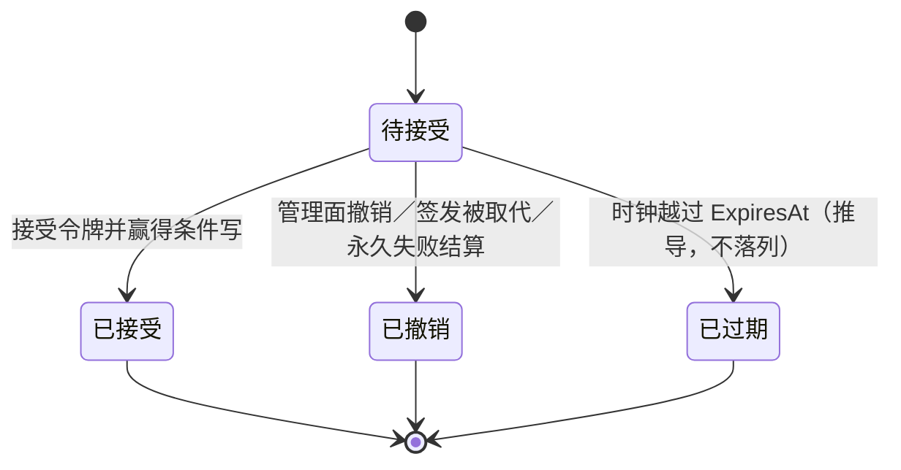
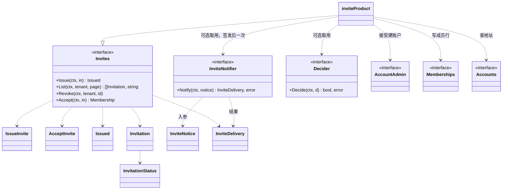

# authn/invite

本模块持有邀请的状态机与 `authn_invitations` 表：一张邀请点名一个地址与一个[租户](../../../glossary.md)，在被接受之前不产生账户或成员行，接受时把地址接到一个账户与一条成员关系上。令牌是唯一凭据，只以摘要留存，接受不需要身份。签发成功后，本模块经可选接口 `authn.InviteNotifier` 请一次接受通知，并把这个结果随应答交出；它不渲染通知、不持邮件载体、不持账户与成员关系的表与规则，也不判定租户成员资格。读职责清单前应持有的一句话心智模型：邀请是一条待兑现的成员关系授予，令牌兑现一次即止，通知只是这条授予的送达尝试。

第一遍按顺序读的节是职责与非职责、术语表、外部接口契约、依赖、UML 图、核心数据结构、核心算法与流程；术语表在遇到邀请、接受令牌、待接受态、投递结果时回看，UML 图的状态机给出邀请的去向、类型图给出通知接口的位置，核心数据结构的状态一览说明每个状态在做什么，核心算法与流程的走查、签发、接受与通知给出一次兑现与一次送达的落库与外部调用过程。错误与失败语义与并发与事务边界是最后自检的节；扩展点与实现状态在主体之后回看。

## 职责

- **驱动邀请的状态机。** 经一张 `authn_invitations` 表驱动邀请从「待接受」到终态的每一次迁移，签发、列表、撤销与接受都经它。邀请是一次**待兑现的成员关系授予**：它点名一个地址与一个租户，在被接受之前没有任何账户或成员行存在。
- **接受即兑现。** 一次接受消费一个令牌，把一个地址接上一个账户与一条成员关系：地址已有账户时加成员行，是某账户的未证明预留时在该账户上把邮箱证成标识，两者都没有时新建账户；成员行的来源写 `invite`——这是 `Membership.Source` 早已声明的取值之一（`pkg/authn/internal/model/directory.go` `Membership.Source`）。接受的账户创建经 `AccountAdmin.Create`，账户规则仍归 `authn.account`。
- **把接受令牌作为唯一凭据，只以摘要留存。** 接受不需要身份：持有令牌即持有加入该租户的能力。令牌明文只在签发应答里交出一次，落表的是它的 SHA-256；撤销因此是改状态，不是撤销一个签名。
- **签发之后请一次通知，并报告结果。** 签发成功后，本模块经可选接口 `authn.InviteNotifier` 请一次接受通知，限时五秒，把结果作为 `sent`、`failed` 或 `not_configured` 写进签发应答。通知失败不撤销邀请，HTTP 仍为 201，令牌照常交出；失败记一行 `Error` 日志与一条尽力档 `authn.invitation.deliver` 审计行。通知的正文、语言与投递归通知接口的实现（`authn.invitemail` 是仓库提供的那一份），本模块只交出通知所需的租户、地址、令牌、期限与请求语言。
- **以模块 `authn.invite` 排他交付接口 `Invites`。** 邀请的签发、列表、撤销与接受都由本模块经这个接口作答，别的模块取用邀请能力没有第二条入口；接口与数据类型随它同处本子包（[design-authn](design-authn.md)）。

### 非职责

- **不做组织树。** 没有节点、没有层级、没有子树数据范围，接受只落一条成员关系，不带任何位置。早期实现有一棵多级组织树，本方案刻意不做它（[ADR-org-invitation](../../../adr/adr-org-invitation.md)）。
- **不渲染通知，不排队，不重试。** 本模块不构造邮件正文、不选语言、不触达邮件载体；它只把 `InviteNotice` 交给 `authn.InviteNotifier` 的实现，由后者渲染并投递。通知在签发路径上同步调用一次，没有提醒、没有自动重发、没有后台重试：一条新的待接受邀请只能来自一次新的签发调用，一次重发就是一次新的签发。
- **不持账户、成员关系、口令的表与规则。** 接受的账户创建与标识写入经 `AccountAdmin.Create`、`AccountAdmin.AddIdentifier`，成员行写经 `Memberships.Put`；账户与成员关系的规则与哨兵在 [authn-account](design-authn-account.md)。
- **不做邮件的送达证明。** `sent` 只表示载体接受了这条消息，不证明地址可达、收件箱收到或被打开。地址可达性仍由投递渠道与收件方承担，签发者始终可以复制链接另交。
- **不判定租户成员资格，不 import `pkg/tenant`。** 租户标识在本模块里是字符串；请求期判定归 `tenant.admission`（[design-tenant-admission](../tenant/design-tenant-admission.md)）。
- **不承载角色。** 接受只落成员关系，角色按（账户，租户）绑定归 `authz.policy`（[design-authz](../design-authz.md)）。
- **不代替签发者决定把谁拉进租户。** 管理面的判定接口回答「这个发起者能不能签发」，本模块保证签发者的身份与租户范围，不保证他选的人对不对。

## 术语表

以下术语的含义限于本文档与邀请主题的决策记录；它们不进项目术语表。

| 术语 | 英文 | 适用范围 | 定义 |
|---|---|---|---|
| 邀请 | invitation | 本文档与邀请主题的决策记录 | 一次待兑现的成员关系授予：点名一个地址与一个租户，带状态与期限。接受之前不产生账户或成员行。 |
| 接受令牌 | acceptance token | 本文档与邀请主题的决策记录 | 接受所凭的凭据，签发时交出一次，只以摘要留存的 256 位随机串。持有它即持有加入该租户的能力。 |
| 待接受态 | pending | 本文档与邀请主题的决策记录 | 邀请已签发、未接受、未撤销且未过期的状态。它属于邀请自己的一行，不属于账户表——`AccountAdmin.Create` 没有可放它的行。 |
| 投递结果 | delivery outcome | 本文档与邀请主题的决策记录 | 一次接受通知的结局，封闭集为 `sent`、`failed`、`not_configured`。它只说明这次通知有没有被载体接受，不说明地址可达或消息被阅读。 |

## 外部接口契约

### 交付的功能

本模块排他交付接口 `Invites`，由本模块回答。接口、值类型与哨兵一并定义在 `pkg/authn/invite`，不随其余认证接口放进根包 `pkg/authn`（[design-authn](design-authn.md)；理由见 [ADR-authn-invitation](../../../adr/adr-authn-invitation.md)）。

```go
// 邀请接口：持有邀请的状态机，决定一条邀请能不能签发、能不能被一个令牌兑现。
type Invites interface {
    // Issue 签发一条邀请。同一（租户，地址）下已有的待接受邀请被取代。
    // 返回值里的令牌只在此处交出一次。
    Issue(ctx context.Context, in IssueInvite) (Issued, error)
    // List 列出某租户的邀请，一页一条游标。
    List(ctx context.Context, tenant string, page Page) ([]Invitation, string, error)
    // Revoke 撤销一条邀请，使其令牌失效。撤销已接受的邀请是 ErrInvitationAlreadyAccepted。
    Revoke(ctx context.Context, tenant, id string) error
    // Accept 用令牌兑现一条邀请：建账户（需要时）、写成员行（source = invite）。
    Accept(ctx context.Context, in AcceptInvite) (Membership, error)
}

type IssueInvite struct {
    Tenant    string    // 字符串形式的租户标识
    Email     string    // 被邀请人的地址，规范化前的原值
    ExpiresAt time.Time // 绝对期限；零值取设置的时长
}

type Issued struct {
    Invitation    Invitation
    Token         string           // 接受令牌，只在此处交出一次；不得写日志、事件或追踪属性
    EmailDelivery InviteDelivery   // 这次接受通知的结果
}

type Invitation struct {
    ID         string
    Tenant     string
    Email      string // 规范化后的地址
    Status     InvitationStatus
    InvitedBy  AccountID
    ExpiresAt  time.Time
    AcceptedAt time.Time // 零值：尚未接受
    CreatedAt  time.Time
}

type AcceptInvite struct {
    Token       string // 接受令牌
    DisplayName string // 该地址还没有账户时用来建账户
    Password    string // 同上，账户的初始口令
}

// InvitationStatus 是邀请状态的封闭集。零值 Pending 与存量列一致。
type InvitationStatus uint8

const (
    InvitationPending  InvitationStatus = iota // 待接受（零值）
    InvitationAccepted                         // 已接受
    InvitationRevoked                          // 已撤销
)

// Valid 报告 s 是否在存量列里。已过期的待接受邀请仍是 InvitationPending：
// 过期由时钟与 ExpiresAt 推出，不落列。
func (s InvitationStatus) Valid() bool { return s <= InvitationRevoked }

// InviteNotifier 是接受通知的投递接口，可选。定义在根包
// pkg/authn/invite_notice.go，由宿主或 authn.invitemail 交付。
type InviteNotifier interface {
    // Notify 按 notice 的地址与语言送出一次通知，并报告投递结果。
    // 失败不回滚邀请；调用方仍以 201 交出一次性令牌。
    Notify(ctx context.Context, notice InviteNotice) (InviteDelivery, error)
}

type InviteNotice struct {
    Tenant    string    // 邀请所授予成员关系的租户标识
    Email     string    // 规范化后的被邀请地址
    Token     string    // 接受令牌；不得写日志、追踪、事件或错误文本
    ExpiresAt time.Time // 邀请的绝对期限；零值表示调用方不知道
    Locale    string    // 请求点名的 BCP 47 语言，空串表示没有点名
}

// InviteDelivery 是一次通知的结果。零值是 InviteNotConfigured。
type InviteDelivery uint8

const (
    InviteNotConfigured InviteDelivery = iota // 本部署没有配置通知通道，什么也没发
    InviteSent                                // 载体接受了这条消息
    InviteFailed                              // 载体拒绝，或结果未知
)
```

**`Invitation` 不含令牌。** 令牌的明文在 `Issued` 里出现一次，此后任何视图、列表、事件与诊断都不带它；`Invitation` 是给管理面读的只读视图。

**`Issued.EmailDelivery` 是这次通知的结果，不是邀请的状态。** 它取 `sent`、`failed`、`not_configured` 之一；`not_configured` 表示没有通知接口或部署选择不发邮件，`failed` 表示载体拒绝或结果未知。两者都不改变邀请行、HTTP 状态与令牌。`InviteDelivery` 的零值就是 `not_configured`，所以一个从未设置过的结果读起来是「没有发」，而不是「发失败了」。

**`InvitationStatus` 的存量列是 `{待接受，已接受，已撤销}`，观察态是它加「已过期」。** 已过期不是一次写出的迁移，而是「状态为待接受，且当前时刻不早于 `ExpiresAt`」的推导；接受与列表都按当前时刻判定，不靠清扫器翻转状态。判据是状态放置的方向：一次丢失的过期翻转只让一条已经不能接受的邀请看起来还能接受，而接受路径自己会拒绝它，安全性不依赖这次翻转（[ADR-authn-state-placement](../../../adr/adr-authn-state-placement.md)）。

**`IssueInvite` 与 `AcceptInvite` 的字段语义是承诺**：`IssueInvite.Email` 是未规范化的原值，规范化归本模块；`Issued.Token` 是只交出一次的凭据；`AcceptInvite.Password` 只在为一条尚无账户的邀请建账户时读，已有账户时忽略。

**接受的账户创建经 `AccountAdmin.Create`，不另开一条开户路径。** 该接口要求地址带一个合法的验证渠道，且没有可放待验证行的行——它只接纳一条已经成立的账户；邀请写入的渠道是 `invite`，一条真实的归属证明，因此新建的账户视为已验证而不是未验证。邀请因此自己持有待接受态：一条邀请是一行，直到接受才把已经成立的事实交给 `AccountAdmin.Create` 与 `Memberships.Put`（[ADR-authn-invitation](../../../adr/adr-authn-invitation.md)）。归属已证明只说明账户拥有该地址，不说明该地址被选作登录方式，也不说明它是默认联系地址；这两项分别按 REQ-account-064 与 REQ-account-063 由持有人选择、由账户模块维护（[ADR-authn-contact-and-login-ways](../../../adr/adr-authn-contact-and-login-ways.md)）。

### 接受的账户与成员行

- **地址已是某账户的标识**：不建账户，成员行加到那个账户上。令牌证明持有者收到了发往该地址的链接，与短信验证码同类；成员关系成立。
- **地址尚无账户**：接受路由在摘要下要求一个用户名与口令（显示名可选）；用户名经规范化与保留字校验通过后，经 `AccountAdmin.Create` 建一个启用的用户账户，用户名标识以 `via = self` 写入，地址作为一条已登记并已证明的邮箱写入（验证渠道 `invite`），成员行加到新账户。没有合法用户名不建账户。写入邮箱只证明该地址的所有权，不把它选作登录方式；默认联系地址按 REQ-account-063 由账户模块维护，不由邀请路径指定。
- **成员行的来源写 `invite`**：本模块落下的每一条成员行，`Membership.Source` 都取 `invite`。`Memberships.Put` 的成员关系变更事件（`authn.membership.changed`）随带该来源，订阅方据此分清邀请加入与管理员直加（[design-authn-events](design-authn-events.md)）。
- **被邀请地址正是一条未证明预留**：接受路由没有身份，配对只能按地址做——经账户模块的 `SignupVerification.PendingAccountByContact` 反查该地址的未证明预留的所有者，命中时以 `invite` 证明同一邮箱：经 `AccountAdmin.AddIdentifier`（`via = invite`）写入已验证邮箱（账户模块在同一事务里把该地址的预留置为已持有、写首次证明时刻，自助注册账户的 `signup_state` 置 `2`），成员行挂到那个账户，不新建第二个账户。这条写入同样只登记一条已证明的邮箱，不改变账户的登录方式选择；默认联系地址按 REQ-account-063 由账户模块维护。推断的地址控制权来自邀请令牌本身：它被送达该地址并由持有者出示，所以调用这个反查时地址已经被证明；本模块是它唯一的调用方。`(kind, value)` 的全局唯一索引使同一地址至多一条预留、至多一个所有者；未命中时按「尚无账户」新建，不猜该挂到哪一个。命中这一条让先注册后受邀的人在原账户上解除限制，而不是撞上标识的唯一约束后失败（REQ-tenancy-019）。
- **接受不受 `signup` 设置约束**：邀请接受是一次由租户管理员发起的显式授予，不是自助首次登录；`authn.account.signup` 只约束经社交或短信首次登录的开户。用户名在建号前取得，不受该设置约束：它与用户名格式、保留字规则一样，是账户完整所必需的内容（[ADR-authn-username-required](../../../adr/adr-authn-username-required.md)）。

**接受的地址验证来源是 `invite`。** 接受把被邀请的地址写成邮箱标识时（经 `AccountAdmin.Create` 建账户，或经 `AccountAdmin.AddIdentifier` 挂到已有账户），地址的验证渠道是「邀请送达该地址并被兑现」，与 `sms-code` 同类（一个送达该地址的载荷被持有者出示）。认证账户模型的 `Verification` 封闭集是 `sms-code`、`email-code`、`invite`、`idp:<提供方标识>`、`admin`、`import-unverified`、`self`（`pkg/authn/internal/model/directory.go` `Verification`、`VerifiedViaInvite`）。它属于证据一类（`Verification.Proves` 为真），与 `admin`、`import-unverified`、`self` 这类未证明渠道分开。

### 登记单元与名字

| 包 | 模块名 | 交付 | 排他 |
|---|---|---|---|
| `pkg/authn/invite` | `authn.invite` | `Invites`，以及 `Invitation`、`InvitationStatus`、`Issued`、`IssueInvite`、`AcceptInvite` 与哨兵 | 排他 |
| `pkg/authn/invitemail` | `authn.invitemail` | `InviteNotifier` 的邮件实现 | 排他 |

模块名照顶层能力：嵌套子包取 `authn.<功能>`，本模块取 `authn.invite`（[design-authn](design-authn.md)）。设置命名空间取同一取值；模块仍声明一个没有输入项的配置节，使旧配置里的 `authn.invite.ttl` 按完整路径报未知键。`InviteNotifier`、`InviteNotice` 与 `InviteDelivery` 定义在根包 `pkg/authn/invite_notice.go`，不在任何一个实现子包。

### 通知的邮件实现 `authn.invitemail`

`authn.invitemail` 是仓库提供的通知实现：它把一次 `InviteNotice` 渲染成邮件并交给 `pkg/mail.Sender` 的载体，排他交付 `InviteNotifier`。一条命令可以点名它，也可以换成宿主自己的实现；两个实现同时在场在消解阶段失败。

- **配置项 `authn.invitemail.accept-base-url` 给出接受页所在的绝对来源。** 取值须是绝对 http/https URL、带主机、无查询与片段；末尾的 `/` 归一化掉。通知的链接是 `<accept-base-url>/invitations/<令牌>`，路径由模块拼接、令牌按单个路径段转义，配置改不了接受路由的形状。值不合法时在 `Prepare` 阶段终止启动，点名输入项且不回显取值。
- **通知里的租户名取别名。** `InviteNotice` 携带租户的内部标识，渲染前经可选的 `authn.TenantAliasResolver` 换成别名；主题与正文都写别名，接缝缺席、解析失败或解析不到时写空串，不回退成内部标识。

**空值是合法的未配置部署。** 模块保持启用，不触达载体，答 `InviteNotConfigured` 与 nil 错误。选 `mail.carrier: none` 的运行里没有任何发送载体，模块随邮件能力一并 `StateDisabled`，不因一个缺席的依赖让整个装配起不来；这样的运行不校验接受来源。
- **语言取自请求，缺目录时回退。** 通知按 `InviteNotice.Locale` 选择消息：先按原标签，再按主语言子标签，最后英文。模板在模块的 `locales/zh-CN.json` 与 `locales/en-US.json`，包含主题、纯文本与 HTML；`New` 在启动时渲染每个目录的每条消息，缺键即启动失败，不等到第一次发送才发出一条只有键的消息。
- **期限按 UTC 写。** `InviteNotice.ExpiresAt` 是邀请的唯一期限，按 RFC 3339 的 UTC 时刻插入正文；零值表示调用方不知道，渲染为空，不编造一个时刻。
- **令牌、收件人与正文不写日志、不进错误文本。** 每次发送只记一行结果与耗时，行里没有令牌、地址、租户或正文；实现方返回给调用方的错误是载体自己的错误，不含令牌。
- **载体错误按原分类透传。** `mail.ErrThrottled`、`mail.ErrRejected`、`mail.ErrUncertain` 原样返回，由邀请模块决定怎么记；本模块不加自己的分类，也不重试。
- **消息不带去重标识。** 每次签发都画一个新令牌，重发是一条取代旧行的新邀请；一个稳定的 `DedupeID` 会压掉一条合法的通知，而载体本身对每次调用只投递一次。

装配上，`starters/demo/server/capabilities.go` 把本模块编入每次构建并交给 `serve` 点名；审查与本地配置给它一个接受来源并选 `mail.carrier: log`，走查因此能从进程日志读到渲染后的通知（[design-starters](../design-starters.md)）。

### 路由

本模块经 `mount.Mounter` 挂管理面与 account 侧的路由。管理面路由登记为 `Guarded`，并登记为 `Impersonable`：它们按路径里的租户域判定，目标是该租户管理员时，冒充身份持有它在该租户的管理权限，邀请路由照常可用（[design-authn-impersonation](design-authn-impersonation.md)）。接受路由登记为 `Public`，无身份。管理面按租户寻址且在该租户的策略域判定，因此落在 `tenants` 作用域与受租户两层守护的端上；接受路由按令牌寻址、没有租户，落在普通路由（[ADR-http-api-path-scopes](../../../adr/adr-http-api-path-scopes.md)）。

| 面 | 方法 路径 | 登记 | 授权 |
|---|---|---|---|
| 管理面 | `POST Bt/:tenant/invitations` | `Guarded`，`Impersonable` | 判定接口 + 强制档审计；签发后尽力通知 |
| 管理面 | `GET Bt/:tenant/invitations` | `Guarded`，`Impersonable` | 判定接口；读不写审计；可按 `status` 收窄 |
| 管理面 | `DELETE Bt/:tenant/invitations/:id` | `Guarded`，`Impersonable` | 判定接口 + 强制档审计 |
| account 侧 | `GET B/invitations/:token` | `Public` | 令牌 |
| account 侧 | `POST B/invitations/:token` | `Public` | 令牌 |

`B` 是普通路由的基路径，`Bt` 是 `tenants` 作用域的基路径（`authn.gate.mount.bases`，见 [authn-gate](design-authn-gate.md)）。

基路径 `B` 由 [authn-gate](design-authn-gate.md) 声明。管理面路由按路径里的租户标识寻址，不按名称表，所以本模块不依赖租户名册；接受路由按令牌寻址，路径里不出现租户。`POST B/invitations/:token` 在地址尚无账户时要求用户名与口令（显示名可选）；地址已有账户时只凭令牌兑现，不建账户，也不读用户名。

**列表的 `status` 查询把一页收窄到一种观察态。** 取值是封闭集 `pending`、`expired`、`accepted`、`revoked`；缺省列出全部，集合外的值答 400，不当作「全部」。`pending` 是状态为待接受且 `expires_at` 晚于当前时刻的行，`expired` 是状态仍为待接受而 `expires_at` 不晚于当前时刻的行，`accepted` 与 `revoked` 是两种终态。过期仍不落列：两个 `pending` 分支读的是同一列状态，差别只在时钟与期限的比较。收窄只发生在管理面路由，`Invites.List` 本身仍列出全部。

### 管理面的判定顺序

管理面路由的判定在 handler 内做出，不经请求中间件的声明判定，与 `authn.admin` 一致（[ADR-authn-invitation](../../../adr/adr-authn-invitation.md)）。顺序固定：

1. **读发起者。** 请求没有身份是 401 加强认证挑战，不询问接口。
2. **注册验证状态的门控。** 发起者是用户账户且视为未验证（`SignupPending`：有邮箱而没有一条已证明的）时，签发（含取代旧待接受邀请的那次重发）与撤销答 403 `contact-required`；列表是读，不受影响。门控在身份确定之后、判定接口与强制审计之前，只收紧不放行，被拦下的请求不询问接口、不写审计。状态经 `SignupVerification.SignupStateOf` 读取，读失败答 503，不按放行处理；服务账户与视为 `SignupNone`（没有任何邮箱）的发起者豁免。
3. **询问判定接口。** 签发、列表与撤销都以 `Action authn.membership.manage` 询问 `Decider`——邀请授予的是一条成员关系，动作与成员关系的写同属一个动作（`pkg/authn/decide.go` `ActionMembershipManage`）。`Decision.Tenant` 取路径里的租户标识，`Target` 在撤销时取邀请标识、其余为空。接口缺席即全拒，与其余管理面一致（[design-authn-admin](design-authn-admin.md)）。接口拒绝时答 403，故障答 503。
4. **分支。** 门控与判定之后：写路由先解析正文、跑结构校验，再落强制档审计（落不进即 503、动作不执行），再调 `Invites`，把回绝映射成应答；列表调 `Invites.List` 直接应答。

**判定接口由本模块取用，不由 `authn.admin` 代挂。** 邀请有独立状态机与自己的表，路由因此挂在本模块；授权依据与成员关系的写一致，所以复用同一个动作，不新增动作常量。

### 声明的特性

**`authn.invite` 以[静态特性](../../../glossary.md) `authn.invitations` 声明邀请路由。** 描述符的 `Resources` 带 `feature.Spec{Name: "authn.invitations"}`（[feature](../design-feature.md)）。这个特性在场，表示本进程挂出「路由」一节的全部路由：管理面的签发、列表与撤销，以及接受路由的读取与接受。路由无条件挂出：`mount.Mounter` 是必需依赖，模块进入启用集即挂出它们，挂与不挂不另取决于配置或装配，所以声明为静态特性符合架构不变量 18（[architecture](../../architecture.md#架构不变量)）。邀请的存活期 `authn.invite.ttl` 是设置项，不发布。

特性文档只对已认证调用者可读；接受路由是 `Public`，但邀请是否装配不经任何匿名发现接口发布。

### 宿主可见的接口

- **模块名**：`authn.invite`。宿主的命令树点模块名纳入，设置命名空间取同一取值。
- **设置输入项**：`authn.invite.ttl`（时长，缺省 `168h`，取值域 1h 到 2160h）。每次不带期限的签发读它；设置缺席时取声明默认值，读取失败或取值越界时取声明默认值并记一行 `Error`，签发照常。存活期变长即放宽：本模块订阅 `settings.changed`，改到更长时写一行 `Warn` 并经审计接口记 `authn.settings.relaxed`，方向 `increase`。键的名字、取值域与缺省在 [design-authn-config](design-authn-config.md)。
- **路由**：`Bt/:tenant/invitations` 下的签发、列表与撤销，以及 `B/invitations/:token` 下的读取与接受；列表的 `status` 查询与签发应答的 `email_delivery` 字段；询问的动作 `authn.membership.manage`。
- **通知接口**：`InviteNotifier`、`InviteNotice`、`InviteDelivery` 与三个结果取值；本模块只取用接口，宿主或 `authn.invitemail` 交付实现。
- **令牌前缀**：接受令牌以 `spd_inv_` 起头，供日志脱敏识别（对照 `spd_rt_`、`spd_cs_` 两条既有前缀，见 [design-authn-token](design-authn-token.md)）。
- **审计动作** `authn.invitation.deliver`：一次签发通知失败时写的尽力档行，明细带 `action_id` 与 `tenant`，不带地址与令牌。
- **特性名**：`authn.invitations`，静态特性（见「声明的特性」）。

### 对外接口

- `Invites` 的方法集，`Invitation`、`InvitationStatus`、`Issued`、`IssueInvite`、`AcceptInvite` 的字段与方法集，`InviteNotifier`、`InviteNotice`、`InviteDelivery` 与三个结果取值，以及本模块的全部哨兵，属于对外接口。
- 路由路径与每条管理面路由询问的动作属于对外接口；`InvitationStatus` 的存量列、`status` 查询的四个取值、「已过期由时钟推出、不落列」，以及 `Issued.EmailDelivery` 的取值与「投递失败不撤销邀请」同属接口。
- 成员行的 `Source = invite`、令牌前缀 `spd_inv_`、设置键 `authn.invite.ttl` 与特性名 `authn.invitations` 是宿主可见的接口的一部分，改名即破坏性变更；前端经生成的特性名类型引用特性名，撤去它或改变它所指的接口同样是破坏性变更。配置不再承载 `authn.invite.ttl`：旧配置里仍写着它的宿主在启动时按未知键失败。

### 哨兵错误

| 哨兵 | 定义处 | 含义 |
|---|---|---|
| `ErrInvitationNotFound` | `pkg/authn/invite` | 令牌或邀请标识不指向任何一条邀请 |
| `ErrInvitationExpired` | `pkg/authn/invite` | 令牌属于一条已过期的待接受邀请 |
| `ErrInvitationRevoked` | `pkg/authn/invite` | 令牌属于一条已撤销的邀请 |
| `ErrInvitationAlreadyAccepted` | `pkg/authn/invite` | 令牌属于一条已接受的邀请，或撤销一条已接受的邀请 |
| `ErrInvitationPending` | `pkg/authn/invite` | 该（租户，地址）已有一条待接受邀请，签发的取代竞态输掉时报告 |
| `ErrInvalidEmail` | `pkg/authn/invite` | 被邀请的地址不成形 |
| `ErrInvite` | `pkg/authn/invite` | 本模块自己的构造错误（令牌熵源失败一类），归 503 |

调用方以 `errors.Is` 判别，包裹一律用 `%w`。错误文本不携带地址或令牌。

## 依赖

| 依赖 | 用途 |
|---|---|
| `pkg/core` | 模块描述符与交付功能 |
| `pkg/config` | 一个没有输入项的配置节：旧配置里的 `authn.invite.ttl` 因而按完整路径报未知键 |
| `pkg/settings` | `Optional`：声明并读取设置项 `authn.invite.ttl`，订阅 `settings.changed` 监视放宽方向 |
| `pkg/db` | `authn_invitations` 表与迁移 |
| `pkg/authn`（根包） | `Membership`、`AccountID`；`Invites` 与值类型取自本子包 |
| `AccountAdmin`（根包声明，由 `authn.account` 交付） | 接受时建账户 |
| `Memberships`（根包声明，由 `authn.account` 交付） | 读地址所属账户、写来源为 `invite` 的成员行 |
| `Accounts`（根包声明，由 `authn.account` 交付） | 接受时按标识查地址是否已有账户 |
| `mount.Mounter`（`pkg/authn/internal/mount`） | 挂管理面与接受路由 |
| `Decider`（根包） | 管理面判定；可选取用，缺席即全拒 |
| `SignupVerification`（根包声明，由 `authn.account` 交付） | 管理面由人发起的写经 `SignupStateOf` 读发起者的注册验证状态；接受经 `PendingAccountByContact` 反查地址的未证明预留所有者；必需，读失败答 503 |
| `audit.Audit` | 管理面写路由的强制档审计，加通知失败的尽力档行；必需 |
| `InviteNotifier`（根包） | 可选：签发成功后请求一次接受通知；缺席时结果答 `not_configured` |
| `pkg/i18n` | 从请求上下文取通知语言；没有点名语言时 `InviteNotice.Locale` 为空 |
| `Throttle`（根包声明，由 `authn.account` 交付） | 接受路由的来源层减负；可选 |
| `event.Bus`、`outbox.Outbox` | 可选：邀请生命周期事件 |
| `log.Logger` | 可选：诊断 |
| `pkg/feature`（根包） | 以 `feature.Spec` 声明静态特性 `authn.invitations`；不取用 `feature.Board` |

**方向核对。** `authn.invite` 位于认证功能目录内，不 import `pkg/tenant`、授权功能目录、宿主、`pkg/mail` 与 `pkg/feature/board`，也不 import 认证功能目录里别的实现子包。通知经由根包接口取用，渲染与邮件投递在 `authn.invitemail` 里，故邀请模块的依赖闭包不出现任何邮件载体。`pkg/feature` 根包只依赖标准库，为声明特性 import 它不扩大本模块的闭包（[feature](../design-feature.md)）。管理面判定经根包的 `Decider`，与 `authn.admin` 同一个接口（[design-authn-admin](design-authn-admin.md)）。

## UML 图

### 状态机

下图固定邀请的去向。存量列只写三态；「已过期」由时钟越过 `ExpiresAt` 推出，是观察态而不是一列，所以图上它是从待接受出发的一条迁移，注明了它不落列。终态不再有出边：一条已接受、已撤销或已过期的邀请不能回到待接受。



### 类型与接口

下图固定本模块交付什么、取用什么。`Invites` 与 `inviteProduct` 同处 `pkg/authn/invite`，后者排他实现前者；接受路由按令牌兑现，管理面经 `Decider` 判定。图上看不出的是：同一（租户，地址）下最多一条待接受邀请，由部分唯一索引与签发的取代路径共同保证。



**通知接口在根包里，渲染与投递在实现方。** `inviteProduct` 只取用 `InviteNotifier`，从不 import 邮件包；`authn.invitemail` 是仓库提供的实现，它把 `InviteNotice` 渲染成邮件并交给 `pkg/mail.Sender`。`InviteNotice` 是本模块交给通知实现、携带接受令牌的唯一值，实现方必须把它挡在日志、追踪、事件与错误文本之外。

## 核心数据结构

| 概念 | 类型 | 说明 |
|---|---|---|
| 邀请 | `Invitation` | 一条邀请的只读视图：标识、租户、地址、状态、签发者、期限、接受时刻、创建时刻；不含令牌 |
| 状态 | `InvitationStatus` | `待接受`（零值）／`已接受`／`已撤销` 的存量封闭集；「已过期」由时钟推出 |
| 签发结果 | `Issued` | 邀请视图、一次交出的令牌与这次通知的投递结果 |
| 通知输入 | `InviteNotice` | 租户、规范化地址、令牌、期限与请求语言；唯一携带令牌的通知值 |
| 投递结果 | `InviteDelivery` | `not_configured`（零值）／`sent`／`failed`；只描述通知，不描述邀请 |
| 签发入参 | `IssueInvite` | 租户、地址、可选期限 |
| 接受入参 | `AcceptInvite` | 令牌，加为一条尚无账户的邀请建账户所需的用户名、口令与可选显示名 |

**`authn_invitations` 表**，在 `pkg/authn/invite` 的一份迁移集里，`migrations/postgres/` 与 `migrations/sqlite/` 各一份同名文件，序号自 `0001_` 起。地址与 `authn_identifiers.value` 一样按规范化后的明文存，不加密；令牌只存摘要。下面写 PostgreSQL 的形态；SQLite 的差别只有类型与部分索引的写法。

```sql
CREATE TABLE authn_invitations (
    id           TEXT        NOT NULL PRIMARY KEY,   -- 邀请标识，随机、不可推测
    tenant_id    TEXT        NOT NULL CHECK (tenant_id <> ''),
    email        TEXT        NOT NULL,               -- 规范化后的地址
    token_digest TEXT        NOT NULL,               -- 令牌的 SHA-256 十六进制
    status       SMALLINT    NOT NULL DEFAULT 0 CHECK (status IN (0, 1, 2)), -- 0 待接受、1 已接受、2 已撤销
    invited_by   TEXT        NOT NULL,               -- 签发者的账户标识，无外键
    expires_at   TIMESTAMPTZ NOT NULL,
    accepted_at  TIMESTAMPTZ NULL,
    created_at   TIMESTAMPTZ NOT NULL,
    updated_at   TIMESTAMPTZ NOT NULL,
    UNIQUE (token_digest)
);
CREATE INDEX authn_invitations_tenant ON authn_invitations (tenant_id, created_at);
CREATE UNIQUE INDEX authn_invitations_one_pending ON authn_invitations (tenant_id, email) WHERE status = 0;
```

- **`token_digest` 全局唯一**：一个令牌映射到一条邀请，接受按摘要查行，查询不带租户谓词——接受者还没有任何租户归属。这是本模块唯一不按租户过滤的查询，理由与「接受无身份」是同一件事：兑现前不存在可依附的租户。
- **部分唯一索引 `authn_invitations_one_pending`** 仲裁同一（租户，地址）下至多一条待接受邀请：一条新签发在插入处与并发的签发相撞即 `ErrInvitationPending`，而不是留下两条并存的活令牌。
- **`invited_by` 是账户标识，不建外键**：与认证其余表一样，表之间不建外键，完整性由写入方在自己的事务里保证（[design-authn-account](design-authn-account.md)）。
- **状态筛选索引 `authn_invitations_tenant_status_created`** 由 `0002_authn_invitations_status_index.sql` 建立，列为 `(tenant_id, status, created_at)`：租户与存量状态先收窄，创建时刻再排序。两个待接受观察态共用 `status = 0`，差别在 `expires_at` 的比较，因此都走这一条索引。

### 状态一览

存量状态是「待接受」「已接受」「已撤销」，加上由时钟推出的观察态「已过期」；转换见 UML 图的状态机。

| 状态 | 一句话含义 | 当前动作（邀请） | 直觉画面 |
|---|---|---|---|
| 待接受 | 已签发、未接受、未撤销且未过期 | 等待持有者出示令牌兑现 | 一张还没打孔的入场券 |
| 已接受 | 令牌已被一次兑现，终态 | 不再参与兑现，成员关系已由账户模块写下 | 已检票入场的票根 |
| 已撤销 | 管理面撤销、签发被取代或永久失败结算，终态 | 拒绝该令牌的后续出示 | 作废的票 |
| 已过期 | 待接受而时钟已越过 `ExpiresAt`，由推导得出，不落列 | 仍列在待接受里，接受路径按当前时刻拒绝它 | 过期未用的票 |

## 核心算法与流程

### 走查

初始状态：`authn_invitations` 里有一条待接受的邀请，被邀请地址既不是任何账户的标识，也没有未证明预留。

1. 按令牌摘要查行：命中，状态为待接受，时钟未越过 `ExpiresAt`。持久状态不变。
2. 抢先兑现：条件写把该行从待接受翻到已接受。持久状态是这一行 `status` 变为已接受、`accepted_at` 非空。
3. 核对地址：`Accounts.Lookup` 未命中，`SignupVerification.PendingAccountByContact` 也返回未命中。持久状态不变。
4. 取得一个合法用户名后，`AccountAdmin.Create` 建启用的用户账户（用户名标识 `via = self`，地址作为验证渠道 `invite` 的已证明邮箱），再 `Memberships.Put` 写来源 `invite` 的成员行。持久状态是新增的账户行、用户名标识行、已证明邮箱标识行与成员行。
5. 返回成员关系。邀请行保持已接受，令牌不再可用。

建账户与写成员行若是临时失败，邀请退回待接受，同一令牌可以重试；永久失败则结算为已撤销。

### 签发

1. 规范化地址；不成形即 `ErrInvalidEmail`，在写任何行之前拒绝。
2. 生成令牌（256 位随机、`spd_inv_` 前缀、base64url）与它的 SHA-256。
3. 一个事务里：把同一（租户，地址）下仍为待接受的旧邀请置为已撤销（按部分唯一索引筛选，条件写），插入新邀请行。
4. 发布事件。
5. 若装配交付了 `InviteNotifier`，以五秒上限请求一次通知；结果归入 `InviteDelivery`。没有通知接口、或实现答「未配置」时是 `not_configured`。
6. 返回 `Issued`：邀请视图、令牌明文与投递结果。令牌只在此处交出一次。

签发使旧链接立即失效：旧行转已撤销，它的令牌此后一律 `ErrInvitationRevoked`。

### 通知

1. 通知只在签发成功之后请求，且只请求一次；它不在邀请的事务里，也不回写邀请行。
2. 请求把一个 `InviteNotice` 交给实现：租户、规范化地址、令牌、绝对期限与请求语言。语言取自请求上下文，没有被点名时是空串，由实现方按自己的目录回退。
3. 调用带五秒上限。实现返回 `InviteSent` 且无错误即 `sent`；实现返回 `InviteNotConfigured` 且无错误即 `not_configured`，不记日志、不写审计；其余结果（含超时、拒绝、未知结果与 panic）一律 `failed`。
4. `failed` 写一行 `Error` 日志（租户、邀请标识、结果与成因，不含地址与令牌），并写一条尽力档 `authn.invitation.deliver` 审计行，以 `action_id` 关联同一次签发。
5. 通知的结果不改变邀请、令牌与 HTTP 状态。实现方自身负责渲染与投递，本模块不猜测它说了什么、经哪条通道送出。

### 接受

1. **按摘要查行。** 令牌不成形或查不到行即 `ErrInvitationNotFound`；查到但状态非待接受，按状态答 `ErrInvitationAlreadyAccepted` 或 `ErrInvitationRevoked`；时钟不早于 `ExpiresAt` 即 `ErrInvitationExpired`。
2. **抢先兑现。** 条件写把该行从待接受翻到已接受，条件是状态仍为待接受且未过期；两个并发接受同一令牌至多一个赢得这次翻转，输者按终态报告，不建任何行。
3. **核对地址。** 先经 `Accounts.Lookup` 查该地址是否已是某账户的标识；没有命中时，经 `SignupVerification.PendingAccountByContact(ctx, "email", 地址)` 反查该地址是否被某自助注册账户以未证明预留预占。反查的返回值分三支：
   - **命中**（`ok` 为真）：地址是那个 `signup_state = 1` 账户的未证明预留，走第 4 步的「命中未证明预留」。
   - **未命中**（`ok` 为假）：既不是标识，也没有未证明预留；反查不猜归属，走第 4 步的「两者都没有」。
   - **读取失败**（`err` 非空）：不按未命中处理，也不继续兑现；以 503 返回调用方，并在第 5 步按临时失败把这次抢先还给待接受。把一次读失败当成未命中会让一个地址出现两个账户。

   反查只读 `authn_pending_contacts`，不读标识表；标识已由 `Accounts.Lookup` 覆盖。本模块是 `PendingAccountByContact` 唯一的调用方，调用前提是令牌已被送达并出示于该地址——地址的控制权已由邀请令牌证明，与本模块把地址写成标识所依据的证据是同一件事。
4. **兑现。**
   - 已有账户：`Memberships.Put`，来源 `invite`。
   - 命中未证明预留：`AccountAdmin.AddIdentifier`（`via = invite`）把该邮箱写成已验证标识，账户模块在同一事务里把该地址的预留置为已持有、写首次证明时刻，自助注册账户的 `signup_state` 置 `2`；`Memberships.Put` 把成员行挂到该账户，不建账户。
   - 两者都没有：先取得一个合法用户名（规范化与保留字校验，规则见 [design-authn-account](design-authn-account.md) 的「标识的规范化」），`AccountAdmin.Create` 建启用的用户账户（地址作标识，验证渠道为邀请；用户名标识 `via = self`），再 `Memberships.Put`，来源 `invite`。用户名的三种拒绝（占用、保留、格式）是当事人可改的值：不建账户，邀请回到待接受，令牌不被这次拒绝用掉；其余使兑现无法完成的失败才按永久失败结算。
5. **失败结算。** 第 3 步的反查与第 4 步的兑现跨模块，各自在自己的事务里，与第 2 步的翻转不在一条事务里。它们失败时按失败性质结算这次抢先：临时失败把它还给待接受（重试不被锁死），永久失败（地址与账户冲突一类）把它结算为已撤销（一条再也兑现不了的邀请不该把令牌留到 TTL 结束）。结算是「状态仍为已接受」的条件写，绝不无条件覆盖；结算本身的失败只记 Error，不改变返回给调用方的错误。账户已建而某个生命周期钩子失败时，账户模块返回 `ErrCleanupIncomplete`：它不是永久失败，邀请退回待接受，原样向上传递（503），重试时账户已存在、只补写成员关系与该做的清理。

### 列表与撤销

- **列表**按租户取一页，待接受的在前（按创建时刻倒序），游标是上一页末条的创建时刻与标识。已过期的待接受行照常列出（REQ-tenancy-015）——它仍是一行待接受，调用方按 `ExpiresAt` 读得出它已经陈旧；隐藏它会把一条已送出的邀请显示成一条从未发出的邀请。管理面路由另按 `status` 收窄：`pending` 只看未过期的待接受行，`expired` 只看已过期的待接受行，`accepted` 与 `revoked` 各看一种终态；缺省列出全部。收窄谓词与分页谓词叠在同一次查询上，游标仍按同一次排序推进。
- **撤销**把一条待接受邀请转已撤销，条件是状态仍为待接受。已接受的邀请不静默退群，答 `ErrInvitationAlreadyAccepted`（移除成员是 `Memberships.Remove` 与成员管理路由的事）；已撤销的邀请再撤销是幂等成功。

### 复杂度

- 签发、接受与撤销按唯一索引（`token_digest`、主键、部分唯一索引）定位，单行读写。
- 列表按 `authn_invitations_tenant` 或 `authn_invitations_tenant_status_created` 索引走一页，条数由 `Page.EffectiveLimit` 界定。带 `status` 的读多一个状态谓词，仍是一页的范围。
- 通知是一次有界外部调用，复杂度由实现方决定；本模块只加一次五秒上限与一次可能的日志、审计写入。

## 错误与失败语义

| 情形 | 表现 |
|---|---|
| 地址不成形 | 签发 `ErrInvalidEmail`，在写行之前拒绝 |
| 同一（租户，地址）已有待接受邀请且并发的签发赢在插入处 | `ErrInvitationPending` |
| 令牌不成形、无对应行 | `ErrInvitationNotFound` |
| 令牌属于已过期的待接受邀请 | `ErrInvitationExpired` |
| 令牌属于已撤销的邀请 | `ErrInvitationRevoked` |
| 令牌属于已接受的邀请 | `ErrInvitationAlreadyAccepted` |
| 撤销一条已接受的邀请 | `ErrInvitationAlreadyAccepted` |
| 撤销一条已撤销的邀请 | 幂等成功 |
| 接受赢了条件写而建账户或写成员行临时失败 | 结算回待接受，返回失败 |
| 接受建了账户而账户生命周期钩子失败 | 返回 `ErrCleanupIncomplete`（503，原样传递，不并入 `ErrUnavailable`），结算回待接受；重试补完清理 |
| 接受反查未证明预留读取失败 | 503，按临时失败结算回待接受，不新建账户 |
| 接受赢了条件写而用户名被拒（占用、保留、格式） | 结算回待接受，返回该拒绝；同一令牌可用合法用户名重试 |
| 接受赢了条件写而兑现永久失败（地址已被别的账户预留、绑定冲突） | 结算为已撤销，返回失败 |
| 管理面判定接口缺席，或 `Decide` 返回假 | 403 `forbidden` |
| 发起者是未验证账户，而这是签发或撤销 | 403 `contact-required`，不询问判定接口与 `Invites`、不写审计 |
| 读取发起者的注册验证状态失败 | 503，动作不执行 |
| 管理面强制档审计写不进 | 503，动作不执行 |
| 接受路由依赖不可用 | 503 |
| 签发后通知失败、超时或实现 panic | `email_delivery` 为 `failed`，HTTP 仍为 201，邀请与令牌照常；记一行 `Error` 与一条尽力档 `authn.invitation.deliver` 审计行 |
| 装配没有通知接口，或实现答未配置 | `email_delivery` 为 `not_configured`，HTTP 仍为 201；不记日志、不写审计 |
| `status` 查询的值不在封闭集里 | 400，不答未过滤的一页 |
| 签发读取存活期设置失败或取值越界 | 取声明默认值并记一行 `Error`，签发照常进行 |
| 配置里仍写着 `authn.invite.ttl` | 启动失败，按未知键点名该键 |

**管理面的回绝映射是封闭的。** 400（`Problem.Type` 为 `urn:speed:authn:bad-request`）：地址不成形、正文结构不可读、`status` 不在封闭集里与其余参数错误。403（`urn:speed:authn:forbidden`）：判定接口的拒绝。404：邀请标识不指向任何一条邀请。409（`urn:speed:authn:conflict`）：`ErrInvitationAlreadyAccepted`。503（`urn:speed:authn:unavailable`）：其余失败，以及没落地的强制档审计，成因只进日志。`Problem.Type` 前缀与码集归 `pkg/authn/internal/mount`。

**通知的失败不进错误映射。** 它是一次尽力而为的附带动作，结果在 201 应答的 `email_delivery` 字段里；把它映射成 4xx 或 5xx 会把一条已经成立的邀请说成没发出去。实现方返回的错误只用于日志与审计行。

### 非保证

- **接受不证明地址可达，只证明有人收到了链接并出示了它。** 令牌可被转发；把链接转发给第三方即把加入能力交给第三方，这是能力语义的代价。
- **签发者选的人对不对不归本模块。** 一次签发给谁由发起者决定，本模块保证发起者的身份与租户范围。
- **投递质量由通知实现与载体承担。** 本模块只知道这次通知的结果是 `sent`、`failed` 还是 `not_configured`；`sent` 不证明地址可达或被阅读，`failed` 也不证明消息没有送出（超时与未知结果同样记作 `failed`）。本模块不重试、不排队。

### 假设与守住它们的测试

以下行为未经运行核实，依赖它们的断言以对应的测试守住，测试失败即视为前提不成立：

- **假设 `AccountAdmin.Create` 在地址已有账户时不产生第二条账户。** 接受按 `Accounts.Lookup` 在「已有账户加分成员」与「尚无账户建账户」之间分派；测试断言每一支各落一条成员行，且地址只对应一个账户。
- **假设条件写在两个并发接受之间只放一个赢家。** 测试并发兑现同一令牌，断言恰好一条成员行、恰好一次兑现成功。

## 并发与事务边界

- **抢先兑现是条件写。** 接受的第二步是「状态仍为待接受且未过期」的更新，`RowsAffected` 为一是赢的条件；输者不建任何行。
- **本模块只在自己的事务里写自己的表。** 邀请行的写在本模块的事务里；账户与成员行的写在 `authn.account` 的事务里。跨模块的两次写用结算补偿，至少一次、非原子；正确性的底线由条件写与状态检查承担，不靠结算做完（[design-authn](design-authn.md)）。
- **签发在同一事务里取代旧行并插入新行。** 两条写共享一条事务，部分唯一索引在插入处仲裁并发签发。
- **管理面处理器不持有事务。** 接口的询问、强制审计与 `Invites` 的写各自独立；强制审计不在调用方事务里（[design-authn-admin](design-authn-admin.md)）。
- **通知在签发事务之外、在应答之前同步调用。** 它带五秒上限，不持有邀请行的事务；失败的尽力档审计也不在事务里。实现方必须并发安全，且不得把令牌写进日志、追踪、事件或错误文本。实现方的 panic 在调用处被收回并记为 `failed`，不会把一条已完成的签发变成 500。
- **`Invites` 的实现在请求路径上同步调用**，必须并发安全。

## 扩展点

- **新增一条签发的资格判据。** 谁可以签发由 `Decider` 实现决定，本模块只保证 `Decision` 的填法（路径里的租户、`membership.manage` 动作）。新增资格不改本模块。
- **接受路由新增一条支路**（例如按手机号邀请）：扩展的是令牌兑现后落账户与成员行的方式，签发与状态机不变。
- **通知是扩展点，由宿主或 `authn.invitemail` 实现。** 换一个通知实现即换渲染语言、正文与投递渠道；本模块只交出 `InviteNotice`，不定义渠道、模板与语言目录。`authn.invitemail` 是仓库提供的那一份，把通知渲染成邮件后交给 `pkg/mail.Sender`。

## 实现状态

| 能力 | 状态 | 代码 |
|---|---|---|
| `Invites` 接口、值类型与哨兵 | 部分实现 | `pkg/authn/invite/seam.go` `Invites`、`IssueInvite`、`Issued`、`Invitation`、`AcceptInvite`、`InvitationStatus`、`ErrInvitationNotFound`、`ErrInvitationExpired`、`ErrInvitationRevoked`、`ErrInvitationAlreadyAccepted`、`ErrInvitationPending`、`ErrInvalidEmail`、`ErrInvite` |
| 通知接口 `InviteNotifier`、`InviteNotice`、`InviteDelivery` 与签发应答的 `email_delivery` | 已实现 | `pkg/authn/invite_notice.go` `InviteNotifier`、`InviteNotice`、`InviteDelivery`、`InviteSent`、`InviteFailed`、`InviteNotConfigured`；`pkg/authn/invite/deliver.go` `(*product).deliverInvite`、`(*product).notify`；`pkg/authn/invite/admin.go` `handleIssue`；`pkg/authn/invite/views.go` `issuedViewOf` |
| 签发通知失败的日志与尽力档审计行 | 已实现 | `pkg/authn/invite/deliver.go` `(*product).deliverInvite`；`pkg/authn/invite/audit.go` `actionDeliver`、`deliveryAudit` |
| 列表的 `status` 筛选与状态索引 | 已实现 | `pkg/authn/invite/query.go` `listFilter`、`parseListFilter`、`(*product).list`；`pkg/authn/invite/admin.go` `handleList`；`pkg/authn/invite/migrations/postgres/0002_authn_invitations_status_index.sql`、`pkg/authn/invite/migrations/sqlite/0002_authn_invitations_status_index.sql` |
| 邀请邮件的渲染与投递模块 `authn.invitemail` | 已实现 | `pkg/authn/invitemail/module.go` `Module`；`pkg/authn/invitemail/config.go`；`pkg/authn/invitemail/messages.go`、`locales/zh-CN.json`、`locales/en-US.json` |
| `authn.invite` 模块、`authn_invitations` 表与迁移、状态机、签发／列表／撤销／接受 | 已实现 | `pkg/authn/invite/invite.go` `Module`；`pkg/authn/invite/store.go` `tableInvitations`；`pkg/authn/invite/migrations/postgres/0001_authn_invitations.sql`、`pkg/authn/invite/migrations/sqlite/0001_authn_invitations.sql`；`pkg/authn/invite/issue.go` `Issue`；`pkg/authn/invite/query.go` `List`、`Revoke`；`pkg/authn/invite/accept.go` `Accept` |
| 管理面路由（判定顺序、强制审计、回绝映射） | 已实现 | `pkg/authn/invite/routes.go` `mountRoutes`；`pkg/authn/invite/admin.go` `handleIssue`、`handleList`、`handleRevoke`；`pkg/authn/invite/pipeline.go` `admit`、`asks`、`callDecider`、`auditRequired`、`auditBestEffort`、`answer` |
| 接受路由（无身份、凭令牌） | 已实现 | `pkg/authn/invite/routes.go` `mountRoutes`；`pkg/authn/invite/accept_http.go` `handleAcceptView`、`handleAccept`、`viewToken` |
| 接受的账户创建与来源为 `invite` 的成员行 | 部分实现 | `pkg/authn/invite/accept.go` `createAccount`、`putMembership`；`pkg/authn/invite/token.go` `SourceInvite` |
| 地址验证渠道 `invite`（`pkg/authn/internal/model` `Verification` 的扩展） | 已实现 | `pkg/authn/internal/model/directory.go` `VerifiedViaInvite`、`Verification.Valid` |
| operation 声明与 OpenAPI（[REF-openapi](../../../references.md)）片段生成 | 已实现 | `pkg/authn/invite/operations.go`；`pkg/authn/invite/openapi_generated_test.go`；片段 `pkg/authn/invite/openapi/invite.json` |
| 静态特性 `authn.invitations` 的声明 | 已实现 | `pkg/authn/invite/invite.go` `Module`；`pkg/authn/invite/feature_test.go` `TestTheModuleDeclaresTheInvitationsFeature` |
| 注册验证状态的门控 | 已实现 | `pkg/authn/invite/pipeline.go` `(*product).gateSignup`；`pkg/authn/invite/admin.go` `handleIssue`、`handleRevoke`；`pkg/authn/invite/invite.go` `Module`、`product.verification` |
| 接受时按邀请地址反查未证明预留并把成员行挂到该账户 | 已实现 | `pkg/authn/invite/accept.go` `(*product).redeem`、`(*product).verifyPending` |
