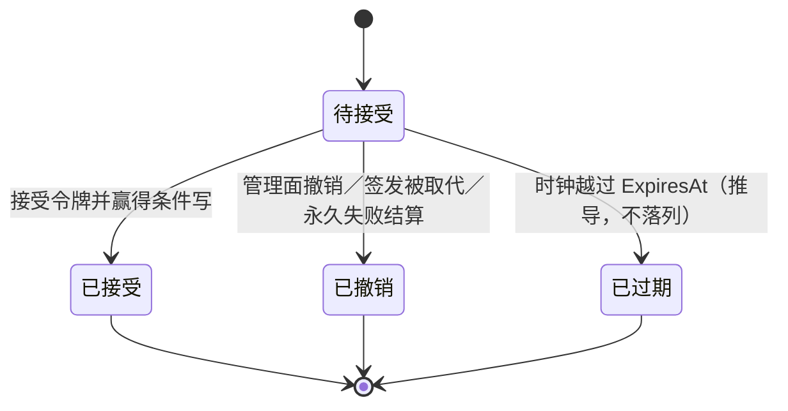
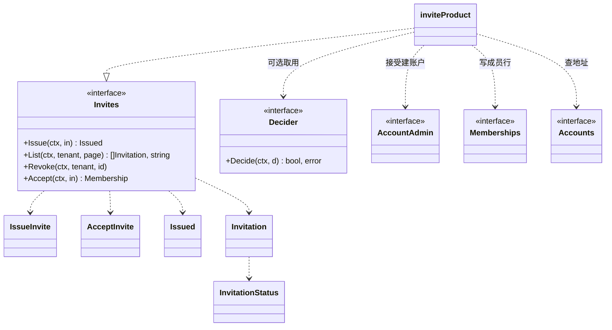

# authn/invite

## 职责

- **持有邀请的状态机。** 一张 `authn_invitations` 表持有从「待接受」到终态的每一次迁移；签发、列表、撤销与接受都经它。邀请是一次**待兑现的成员关系授予**：它点名一个地址与一个租户，在被接受之前没有任何账户或成员行存在。
- **接受即兑现。** 一次接受消费一个令牌，把一个地址接上一个账户与一条成员关系：地址已有账户时加成员行，是某账户的待验证联系方式时在该账户上把邮箱证成标识，两者都没有时新建账户；成员行的来源写 `invite`——这是 `Membership.Source` 早已声明的取值之一（`pkg/authn/internal/model/directory.go` `Membership.Source`）。接受的账户创建经 `AccountAdmin.Create`，账户规则仍归 `authn.account`。
- **令牌是唯一凭据，只以摘要留存。** 接受不需要身份：持有令牌即持有加入该租户的能力。令牌明文只在签发应答里交出一次，落表的是它的 SHA-256；撤销因此是改状态，不是撤销一个签名。
- **登记为模块 `authn.invite`**，排他交付接口 `Invites`；接口与数据类型随它同处本子包（[design-authn](design-authn.md)）。

### 非职责

- **不做组织树。** 没有节点、没有层级、没有子树数据范围，接受只落一条成员关系，不带任何位置。早期实现有一棵多级组织树，本方案刻意不做它（[ADR-org-invitation-2026-10-15](../../../adr/adr-org-invitation-2026-10-15.md)）。
- **不投递邀请，不排队，不重试。** 本模块不发送任何消息——邮件投递归 mail 模块，邀请的送达由签发者或宿主完成（[design-authn](design-authn.md)）。签发应答把接受链接连同令牌一次性交给签发者，投递交由签发者或宿主经它自己的渠道完成。没有提醒、没有自动重发：一条新的待接受邀请只能来自一次新的签发调用。
- **不持账户、成员关系、口令的表与规则。** 接受的账户创建与标识写入经 `AccountAdmin.Create`、`AccountAdmin.AddIdentifier`，成员行写经 `Memberships.Put`；账户与成员关系的规则与哨兵在 [authn-account](design-authn-account.md)。
- **不做邮件的送达证明。** 令牌证明持有者收到了这条链接，不证明地址可达。地址可达性由签发者按他送出链接的渠道承担。
- **不判定租户成员资格，不 import `pkg/tenant`。** 租户标识在本模块里是字符串；请求期判定归 `tenant.admission`（[design-tenant-admission](../tenant/design-tenant-admission.md)）。
- **不承载角色。** 接受只落成员关系，角色按（账户，租户）绑定归 `authz.policy`（[design-authz](../design-authz.md)）。
- **不代替签发者决定把谁拉进租户。** 管理面的判定接缝回答「这个发起者能不能签发」，本模块保证签发者的身份与租户范围，不保证他选的人对不对。

## 术语表

以下术语的含义限于本文档与邀请主题的决策记录；它们不进项目术语表。

| 术语 | 英文 | 定义 |
|---|---|---|
| 邀请 | invitation | 一次待兑现的成员关系授予：点名一个地址与一个租户，带状态与期限。接受之前不产生账户或成员行。 |
| 接受令牌 | acceptance token | 接受凭的凭据，签发时交出一次，只以摘要留存的 256 位随机串。持有它即持有加入该租户的能力。 |
| 待接受态 | pending | 邀请已签发、未接受、未撤销且未过期的状态。它属于邀请自己的一行，不属于账户表——`AccountAdmin.Create` 没有可放它的行。 |

## 外部接口契约

### 交付的功能

本模块排他交付接口 `Invites`，由本模块回答。接口、值类型与哨兵一并定义在 `pkg/authn/invite`，不随其余认证接缝放进根包 `pkg/authn`（[design-authn](design-authn.md)；理由见 [ADR-authn-invitation-2026-10-15](../../../adr/adr-authn-invitation-2026-10-15.md)）。

```go
// 邀请接缝：持有邀请的状态机，决定一条邀请能不能签发、能不能被一个令牌兑现。
type Invites interface {
    // Issue 签发一条邀请。同一（租户，地址）下已有的待接受邀请被取代。
    // 返回值里的令牌只在此处交出一次。
    Issue(ctx context.Context, in IssueInvite) (Issued, error)
    // List 列出某租户的邀请，一页一条游标。
    List(ctx context.Context, tenant string, page Page) ([]Invitation, string, error)
    // Revoke 撤销一条邀请，使其令牌失效。撤销已接受的邀请是 ErrInvitationAlreadyAccepted。
    Revoke(ctx context.Context, tenant, id string) error
    // Accept 用令牌兑现一条邀请：建账户（需要时）、写成员行（source = invite）。
    Accept(ctx context.Context, in AcceptInvite) (Membership, error)
}

type IssueInvite struct {
    Tenant    string    // 字符串形式的租户标识
    Email     string    // 被邀请人的地址，规范化前的原值
    ExpiresAt time.Time // 绝对期限；零值取设置的时长
}

type Issued struct {
    Invitation Invitation
    Token      string // 接受令牌，只在此处交出一次；不得写日志、事件或追踪属性
}

type Invitation struct {
    ID         string
    Tenant     string
    Email      string // 规范化后的地址
    Status     InvitationStatus
    InvitedBy  AccountID
    ExpiresAt  time.Time
    AcceptedAt time.Time // 零值：尚未接受
    CreatedAt  time.Time
}

type AcceptInvite struct {
    Token       string // 接受令牌
    DisplayName string // 该地址还没有账户时用来建账户
    Password    string // 同上，账户的初始口令
}

// InvitationStatus 是邀请状态的封闭集。零值 Pending 与存量列一致。
type InvitationStatus uint8

const (
    InvitationPending  InvitationStatus = iota // 待接受（零值）
    InvitationAccepted                         // 已接受
    InvitationRevoked                          // 已撤销
)

// Valid 报告 s 是否在存量列里。已过期的待接受邀请仍是 InvitationPending：
// 过期由时钟与 ExpiresAt 推出，不落列。
func (s InvitationStatus) Valid() bool { return s <= InvitationRevoked }
```

**`Invitation` 不含令牌。** 令牌的明文在 `Issued` 里出现一次，此后任何视图、列表、事件与诊断都不带它；`Invitation` 是给管理面读的只读视图。

**`InvitationStatus` 的存量列是 `{待接受，已接受，已撤销}`，观察态是它加「已过期」。** 已过期不是一次写出的迁移，而是「状态为待接受、且当前时刻不早于 `ExpiresAt`」的推导；接受与列表都按当前时刻判定，不靠清扫器翻转状态。判据是状态放置的方向：一次丢失的过期翻转只让一条已经不能接受的邀请看起来还能接受，而接受路径自己会拒绝它，安全性不依赖这次翻转（[ADR-authn-state-placement-2026-10-10](../../../adr/adr-authn-state-placement-2026-10-10.md)）。

**`IssueInvite` 与 `AcceptInvite` 的字段语义是承诺**：`IssueInvite.Email` 是未规范化的原值，规范化归本模块；`Issued.Token` 是只交出一次的凭据；`AcceptInvite.Password` 只在为一条尚无账户的邀请建账户时读，已有账户时忽略。

**接受的账户创建经 `AccountAdmin.Create`，不另开一条开户路径。** 该接口要求地址「已经过验证」，且没有可放待验证行的行——它只接纳一条已经成立的账户。邀请因此自己持有待接受态：一条邀请是一行，直到接受才把已经成立的事实交给 `AccountAdmin.Create` 与 `Memberships.Put`（[ADR-authn-invitation-2026-10-15](../../../adr/adr-authn-invitation-2026-10-15.md)）。

### 接受的账户与成员行

- **地址已是某账户的标识**：不建账户，成员行加到那个账户上。令牌证明持有者收到了发往该地址的链接，与短信验证码同类；成员关系成立。
- **地址尚无账户**：经 `AccountAdmin.Create` 建一个启用的用户账户，地址作为它的标识写入，成员行加到新账户。
- **成员行的来源写 `invite`**：本模块落下的每一条成员行，`Membership.Source` 都取 `invite`。`Memberships.Put` 的成员关系变更事件（`authn.membership.changed`）随带该来源，订阅方据此分清邀请加入与管理员直加（[design-authn-events](design-authn-events.md)）。
- **被邀请地址正是一条待验证联系方式**：接受面没有身份，配对只能按地址做——经账户模块的 `SignupVerification.PendingAccountByContact` 反查该地址的待验证所有者，命中时以 `invite` 证明同一邮箱：经 `AccountAdmin.AddIdentifier`（`via = invite`）写入已验证邮箱（账户模块在同一事务里把 `signup_state` 置 `2`），成员行挂到那个账户，不新建第二个账户。推断的地址控制权来自邀请令牌本身：它被送达该地址并由持有者出示，所以调用这个反查时地址已经被证明；本模块是它唯一的调用方。同一地址被多个未验证账户列为待验证目标时反查不返回归属（`ok` 为假），接受按「尚无账户」新建，不猜该挂到哪一个。命中这一条让先注册后受邀的人在原账户上解除限制，而不是撞上标识的唯一约束后失败。
- **接受不受 `signup` 设置约束**：邀请接受是一次由租户管理员发起的显式授予，不是自助首次登录；`authn.account.signup` 只约束经社交或短信首次登录的开户。

**接受的地址验证来源是 `invite`。** 接受把被邀请的地址写成标识时（经 `AccountAdmin.Create` 建账户，或经 `AccountAdmin.AddIdentifier` 挂到已有账户），地址的验证渠道是「邀请送达该地址并被兑现」，与 `sms-code` 同类（一个送达地址的载荷被持有者出示）。认证账户模型的 `Verification` 封闭集是 `sms-code`、`email-code`、`invite`、`idp:<提供方标识>`、`admin`、`import-unverified`、`self`（`pkg/authn/internal/model/directory.go` `Verification`、`VerifiedViaInvite`）。它属于证据一类（`Verification.Proves` 为真），与 `admin`、`import-unverified`、`self` 这类未证明渠道分开。

### 登记单元与名字

| 包 | 模块名 | 交付 | 排他 |
|---|---|---|---|
| `pkg/authn/invite` | `authn.invite` | `Invites`，以及 `Invitation`、`InvitationStatus`、`Issued`、`IssueInvite`、`AcceptInvite` 与哨兵 | 排他 |

模块名照顶层能力：嵌套子包取 `authn.<功能>`，本模块取 `authn.invite`（[design-authn](design-authn.md)）。设置命名空间取同一取值；模块仍声明一个没有输入项的配置节，使旧配置里的 `authn.invite.ttl` 按完整路径报未知键。

### 路由

本模块经 `mount.Mounter` 挂管理面与 account 面的路由。管理面路由全部登记为 `Guarded` 且不登记 `Impersonable`（网关对冒充身份答 401，处理器再核一次）；接受面路由登记为 `Public`，无身份。

| 面 | 方法 路径 | 登记 | 授权 |
|---|---|---|---|
`B` 是普通面的基路径，`Bt` 是 `tenants` 作用域的基路径（`authn.gate.mount.bases`，见 [authn-gate](design-authn-gate.md)）。

| 管理面 | `POST Bt/:tenant/invitations` | `Guarded` | 判定接缝 + 强制档审计 |
| 管理面 | `GET Bt/:tenant/invitations` | `Guarded` | 判定接缝；读不写审计 |
| 管理面 | `DELETE Bt/:tenant/invitations/:id` | `Guarded` | 判定接缝 + 强制档审计 |
| account 面 | `GET B/invitations/:token` | `Public` | 令牌 |
| account 面 | `POST B/invitations/:token` | `Public` | 令牌 |

基路径 `B` 由 [authn-gate](design-authn-gate.md) 声明。管理面路由按路径里的租户标识寻址，不按名称表，所以本模块不依赖租户名册；接受面路由按令牌寻址，路径里不出现租户。

### 管理面的判定顺序

管理面路由的判定在 handler 内做出，不经请求中间件的声明判定，与 `authn.admin` 同形（[ADR-authn-invitation-2026-10-15](../../../adr/adr-authn-invitation-2026-10-15.md)）。顺序固定：

1. **读发起者。** 请求没有身份是 401 加强认证挑战，不询问接缝。
2. **注册验证状态的门控。** 发起者是用户账户且 `signup_state = 1` 时，签发（含取代旧待接受邀请的那次重发）与撤销答 403 `contact-required`；列表是读，不受影响。门控在身份确定之后、判定接缝与强制审计之前，只收紧不放行，被拦下的请求不询问接缝、不写审计。状态经 `SignupVerification.SignupStateOf` 读取，读失败答 503，不按放行处理；服务账户与 `signup_state = 0` 的发起者豁免。
3. **面向判定接缝。** 签发、列表与撤销都以 `Action authn.membership.manage` 询问 `Decider`——邀请授予的是一条成员关系，动作与成员关系的写同属一个（`pkg/authn/decide.go` `ActionMembershipManage`）。`Decision.Tenant` 取路径里的租户标识，`Target` 在撤销时取邀请标识、其余为空。接缝缺席即全拒，与其余管理面同形（[design-authn-admin](design-authn-admin.md)）。接缝的拒绝由接缝写出 403，故障写 503。
4. **分叉。** 门控与判定之后：写路由先解析正文、跑形状检查，再落强制档审计（落不进即 503、动作不执行），再调 `Invites`，把回绝映射成应答；列表调 `Invites.List` 直接应答。

**判定接缝由本模块取用，不由 `authn.admin` 代挂。** 邀请有独立状态机与自己的表，路由因此挂在本模块；授权依据与成员关系的写一致，所以复用同一个动作，不新增动作常量。

### 声明的特性

**`authn.invite` 以[静态特性](../../../glossary.md) `authn.invitations` 声明邀请面。** 描述符的 `Resources` 带 `feature.Spec{Name: "authn.invitations"}`（[feature](../design-feature.md)）。这个特性在场，表示本进程挂出「路由」一节的全部路由：管理面的签发、列表与撤销，以及接受面的读取与接受。路由无条件挂出：`mount.Mounter` 是必需依赖，模块进入启用集即挂出它们，挂与不挂不另取决于配置或装配，所以声明为静态特性符合架构不变量 18（[architecture](../../architecture.md#架构不变量)）。邀请的存活期 `authn.invite.ttl` 是设置项，不发布。

特性文档只对已认证调用者可读；接受面路由是 `Public`，但邀请是否装配不经任何匿名发现面发布。

### 宿主可见面

- **模块名**：`authn.invite`。宿主的命令树点模块名纳入，设置命名空间取同一取值。
- **设置输入项**：`authn.invite.ttl`（时长，缺省 `168h`，取值域 1h 到 2160h）。每次不带期限的签发读它；设置缺席时取声明默认值，读取失败或取值越界时取声明默认值并记一行 `Error`，签发照常。存活期变长即放宽：本模块订阅 `settings.changed`，改到更长时写一行 `Warn` 并经审计接缝记 `authn.settings.relaxed`，方向 `increase`。键的名字、取值域与缺省在 [design-authn-config](design-authn-config.md)。
- **路由**：`Bt/:tenant/invitations` 下的签发、列表与撤销，以及 `B/invitations/:token` 下的读取与接受；询问的动作 `authn.membership.manage`。
- **令牌前缀**：接受令牌以 `spd_inv_` 起头，供日志脱敏识别（对照 `spd_rt_`、`spd_cs_` 两条既有前缀，见 [design-authn-token](design-authn-token.md)）。
- **特性名**：`authn.invitations`，静态特性（见「声明的特性」）。

### 对外接口面

- `Invites` 的方法集，`Invitation`、`InvitationStatus`、`Issued`、`IssueInvite`、`AcceptInvite` 的字段与方法集，以及本模块的全部哨兵，属于对外接口面。
- 路由路径与每条管理面路由询问的动作属于对外接口面；`InvitationStatus` 的存量列与「已过期由时钟推出、不落列」同属接口面。
- 成员行的 `Source = invite`、令牌前缀 `spd_inv_`、设置键 `authn.invite.ttl` 与特性名 `authn.invitations` 是宿主可见面的一部分，改名即破坏性变更；前端经生成的特性名类型引用特性名，撤去它或改变它所指的面同样是破坏性变更。配置不再承载 `authn.invite.ttl`：旧配置里仍写着它的宿主在启动时按未知键失败。

### 哨兵错误

| 哨兵 | 定义处 | 含义 |
|---|---|---|
| `ErrInvitationNotFound` | `pkg/authn/invite` | 令牌或邀请标识不指向任何一条邀请 |
| `ErrInvitationExpired` | `pkg/authn/invite` | 令牌属于一条已过期的待接受邀请 |
| `ErrInvitationRevoked` | `pkg/authn/invite` | 令牌属于一条已撤销的邀请 |
| `ErrInvitationAlreadyAccepted` | `pkg/authn/invite` | 令牌属于一条已接受的邀请，或撤销一条已接受的邀请 |
| `ErrInvitationPending` | `pkg/authn/invite` | 该（租户，地址）已有一条待接受邀请，签发的取代竞态输掉时报告 |
| `ErrInvalidEmail` | `pkg/authn/invite` | 被邀请的地址不成形 |
| `ErrInvite` | `pkg/authn/invite` | 本模块自己的构造错误（令牌熵源失败一类），归 503 |

调用方以 `errors.Is` 判别，包裹一律用 `%w`。错误文本不携带地址或令牌。

## 依赖

| 依赖 | 用途 |
|---|---|
| `pkg/core` | 模块描述符与交付功能 |
| `pkg/config` | 一个没有输入项的配置节：旧配置里的 `authn.invite.ttl` 因而按完整路径报未知键 |
| `pkg/settings` | `Optional`：声明并读取设置项 `authn.invite.ttl`，订阅 `settings.changed` 监视放宽方向 |
| `pkg/db` | `authn_invitations` 表与迁移 |
| `pkg/authn`（根包） | `Membership`、`AccountID`；`Invites` 与值类型取自本子包 |
| `AccountAdmin`（根包声明，由 `authn.account` 交付） | 接受时建账户 |
| `Memberships`（根包声明，由 `authn.account` 交付） | 读地址所属账户、写来源为 `invite` 的成员行 |
| `Accounts`（根包声明，由 `authn.account` 交付） | 接受时按标识查地址是否已有账户 |
| `mount.Mounter`（`pkg/authn/internal/mount`） | 挂管理面与接受面路由 |
| `Decider`（根包） | 管理面判定；可选取用，缺席即全拒 |
| `SignupVerification`（根包声明，由 `authn.account` 交付） | 管理面的人类写经 `SignupStateOf` 读发起者的注册验证状态；接受经 `PendingAccountByContact` 反查地址的待验证所有者；必需，读失败答 503 |
| `audit.Audit` | 管理面写路由的强制档审计；必需 |
| `Throttle`（根包声明，由 `authn.account` 交付） | 接受面的来源层减负；可选 |
| `event.Bus`、`outbox.Outbox` | 可选：邀请生命周期事件 |
| `log.Logger` | 可选：诊断 |
| `pkg/feature`（根包） | 以 `feature.Spec` 声明静态特性 `authn.invitations`；不取用 `feature.Board` |

**方向核对。** `authn.invite` 位于认证功能目录内，不 import `pkg/tenant`、授权功能目录、宿主与 `pkg/feature/board`，也不 import 认证功能目录里别的实现子包。`pkg/feature` 根包只依赖标准库，为声明特性 import 它不扩大本模块的闭包（[feature](../design-feature.md)）。管理面判定经根包的 `Decider`，与 `authn.admin` 同一条接缝（[design-authn-admin](design-authn-admin.md)）。

## UML 图

### 状态机

下图固定邀请的去向。存量列只写三态；「已过期」由时钟越过 `ExpiresAt` 推出，是观察态而不是一列，所以图上它是从待接受出发的一条迁移，注明了它不落列。终态不再有出边：一条已接受、已撤销或已过期的邀请不能回到待接受。



### 类型与接缝

下图固定本模块交付什么、取用什么。`Invites` 与 `inviteProduct` 同处 `pkg/authn/invite`，后者排他实现前者；接受面按令牌兑现，管理面经 `Decider` 判定。图上看不出的是：同一（租户，地址）下最多一条待接受邀请，由部分唯一索引与签发的取代路径共同保证。



## 核心数据结构

| 概念 | 类型 | 说明 |
|---|---|---|
| 邀请 | `Invitation` | 一条邀请的只读视图：标识、租户、地址、状态、签发者、期限、接受时刻、创建时刻；不含令牌 |
| 状态 | `InvitationStatus` | `待接受`（零值）／`已接受`／`已撤销` 的存量封闭集；「已过期」由时钟推出 |
| 签发结果 | `Issued` | 邀请视图加一次交出的令牌 |
| 签发入参 | `IssueInvite` | 租户、地址、可选期限 |
| 接受入参 | `AcceptInvite` | 令牌，加为一条尚无账户的邀请建账户所需的显示名与口令 |

**`authn_invitations` 表**，在 `pkg/authn/invite` 的一份迁移集里，`migrations/postgres/` 与 `migrations/sqlite/` 各一份同名文件，序号自 `0001_` 起。地址与 `authn_identifiers.value` 一样按规范化后的明文存，不加密；令牌只存摘要。下面写 PostgreSQL 的形态；SQLite 的差别只有类型与部分索引的写法。

```sql
CREATE TABLE authn_invitations (
    id           TEXT        NOT NULL PRIMARY KEY,   -- 邀请标识，随机、不可推测
    tenant_id    TEXT        NOT NULL CHECK (tenant_id <> ''),
    email        TEXT        NOT NULL,               -- 规范化后的地址
    token_digest TEXT        NOT NULL,               -- 令牌的 SHA-256 十六进制
    status       SMALLINT    NOT NULL DEFAULT 0 CHECK (status IN (0, 1, 2)), -- 0 待接受、1 已接受、2 已撤销
    invited_by   TEXT        NOT NULL,               -- 签发者的账户标识，无外键
    expires_at   TIMESTAMPTZ NOT NULL,
    accepted_at  TIMESTAMPTZ NULL,
    created_at   TIMESTAMPTZ NOT NULL,
    updated_at   TIMESTAMPTZ NOT NULL,
    UNIQUE (token_digest)
);
CREATE INDEX authn_invitations_tenant ON authn_invitations (tenant_id, created_at);
CREATE UNIQUE INDEX authn_invitations_one_pending ON authn_invitations (tenant_id, email) WHERE status = 0;
```

- **`token_digest` 全局唯一**：一个令牌映射到一条邀请，接受按摘要查行，查询不带租户谓词——接受者还没有任何租户归属。这是本模块唯一不按租户过滤的查询，理由与「接受无身份」是同一件事：兑现前不存在可依附的租户。
- **部分唯一索引 `authn_invitations_one_pending`** 仲裁同一（租户，地址）下至多一条待接受邀请：一条新签发在插入处与并发的签发相撞即 `ErrInvitationPending`，而不是留下两条并存的活令牌。
- **`invited_by` 是账户标识，不建外键**：与认证其余表一样，表之间不建外键，完整性由写入方在自己的事务里保证（[design-authn-account](design-authn-account.md)）。

## 核心算法与流程

### 签发

1. 规范化地址；不成形即 `ErrInvalidEmail`，在写任何行之前拒绝。
2. 生成令牌（256 位随机、`spd_inv_` 前缀、base64url）与它的 SHA-256。
3. 一个事务里：把同（租户，地址）下仍为待接受的旧邀请置为已撤销（按部分唯一索引筛选，条件写），插入新邀请行。
4. 发布事件。
5. 返回 `Issued`：邀请视图加令牌明文，令牌只在此处交出一次。

签发使旧链接立即失效：旧行转已撤销，它的令牌此后一律 `ErrInvitationRevoked`。

### 接受

1. **按摘要查行。** 令牌不成形或查不到行即 `ErrInvitationNotFound`；查到但状态非待接受，按状态答 `ErrInvitationAlreadyAccepted` 或 `ErrInvitationRevoked`；时钟不早于 `ExpiresAt` 即 `ErrInvitationExpired`。
2. **抢先兑现。** 条件写把该行从待接受翻到已接受，条件是状态仍为待接受且未过期；两个并发接受同一令牌至多一个赢得这次翻转，输者按终态报告，不建任何行。
3. **核对地址。** 先经 `Accounts.Lookup` 查该地址是否已是某账户的标识；没有命中时，经 `SignupVerification.PendingAccountByContact(ctx, "email", 地址)` 反查该地址是不是某待验证账户的联系方式。反查的返回值分三支：
   - **命中**（`ok` 为真）：地址是 `signup_state = 1` 的那个账户的待验证联系方式，走第 4 步的「命中待验证联系方式」。
   - **未命中**（`ok` 为假）：既不是标识，也没有唯一的待验证所有者——地址可能同时被多个账户列为待验证目标，反查不猜归属；走第 4 步的「两者都没有」。
   - **读取失败**（`err` 非空）：不按未命中处理，也不继续兑现；按 503 返回调用方，并在第 5 步按临时失败把这次抢先还给待接受。把一次读失败读成未命中会让一个地址出现两个账户。

   反查只读 `authn_pending_contacts`，不读标识表；标识已由 `Accounts.Lookup` 覆盖。本模块是 `PendingAccountByContact` 唯一的调用方，调用前提是令牌已被送达并出示于该地址——地址的控制权已由邀请令牌证明，与本模块把地址写成标识所依据的证据是同一件事。
4. **兑现。**
   - 已有账户：`Memberships.Put`，来源 `invite`。
   - 命中待验证联系方式：`AccountAdmin.AddIdentifier`（`via = invite`）把该邮箱写成已验证标识，账户模块在同一事务里把 `signup_state` 置 `2`；`Memberships.Put` 把成员行挂到该账户，不建账户。
   - 两者都没有：`AccountAdmin.Create` 建启用的用户账户（地址作标识，验证渠道为邀请），再 `Memberships.Put`，来源 `invite`。
5. **失败结算。** 第 3 步的反查与第 4 步的兑现跨模块，各自在自己的事务里，与第 2 步的翻转不在一条事务里。它们失败时按失败性质结算这次抢先：临时失败把它还给待接受（重试不被锁死），永久失败（地址与账户冲突一类）把它结算为已撤销（一条再也兑现不了的邀请不该把令牌留到 TTL 结束）。结算是「状态仍为已接受」的条件写，绝不无条件覆盖；结算本身的失败只记 Error，不改变返回给调用方的错误。

### 列表与撤销

- **列表**按租户取一页，待接受的在前（按创建时刻倒序），游标是上一页末条的创建时刻与标识。已过期的待接受行照常列出——它仍是一行待接受，调用方按 `ExpiresAt` 读得出它已经陈旧；隐藏它会把一条已送出的邀请显示成一条从未发出的邀请。
- **撤销**把一条待接受邀请转已撤销，条件是状态仍为待接受。已接受的邀请不静默退群，答 `ErrInvitationAlreadyAccepted`（移除成员是 `Memberships.Remove` 与成员管理路由的事）；已撤销的邀请再撤销是幂等成功。

### 复杂度

- 签发、接受与撤销按唯一索引（`token_digest`、主键、部分唯一索引）定位，单行读写。
- 列表按 `authn_invitations_tenant` 索引走一页，条数由 `Page.EffectiveLimit` 界定。

## 错误与失败语义

| 情形 | 表现 |
|---|---|
| 地址不成形 | 签发 `ErrInvalidEmail`，在写行之前拒绝 |
| 同一（租户，地址）已有待接受邀请且并发的签发赢在插入处 | `ErrInvitationPending` |
| 令牌不成形、无对应行 | `ErrInvitationNotFound` |
| 令牌属于已过期的待接受邀请 | `ErrInvitationExpired` |
| 令牌属于已撤销的邀请 | `ErrInvitationRevoked` |
| 令牌属于已接受的邀请 | `ErrInvitationAlreadyAccepted` |
| 撤销一条已接受的邀请 | `ErrInvitationAlreadyAccepted` |
| 撤销一条已撤销的邀请 | 幂等成功 |
| 接受赢了条件写而建账户或写成员行临时失败 | 结算回待接受，返回失败 |
| 接受反查待验证联系方式读取失败 | 503，按临时失败结算回待接受，不新建账户 |
| 接受赢了条件写而兑现永久失败（地址／账户冲突） | 结算为已撤销，返回失败 |
| 管理面判定接缝缺席，或 `Decide` 返回假 | 403 `forbidden` |
| 发起者是未验证账户，而这是签发或撤销 | 403 `contact-required`，不询问判定接缝与 `Invites`、不写审计 |
| 读取发起者的注册验证状态失败 | 503，动作不执行 |
| 管理面强制档审计写不进 | 503，动作不执行 |
| 接受面依赖不可用 | 503 |
| 签发读取存活期设置失败或取值越界 | 取声明默认值并记一行 `Error`，签发照常进行 |
| 配置里仍写着 `authn.invite.ttl` | 启动失败，按未知键点名该键 |

**管理面的回绝映射是封闭的。** 400（`Problem.Type` 为 `urn:speed:authn:bad-request`）：地址不成形、正文形状不可读与其余参数错误。403（`urn:speed:authn:forbidden`）：判定接缝的拒绝。404：邀请标识不指向任何一条邀请。409（`urn:speed:authn:conflict`）：`ErrInvitationAlreadyAccepted`。503（`urn:speed:authn:unavailable`）：其余失败，以及没落地的强制档审计，成因只进日志。`Problem.Type` 前缀与码集归 `pkg/authn/internal/mount`。

### 非保证

- **接受不证明地址可达，只证明有人收到了链接并出示了它。** 令牌可被转发；把链接转发给第三方即把加入能力交给第三方，这是能力语义的代价。
- **签发者选的人对不对不归本模块。** 一次签发给谁由发起者决定，本模块保证发起者的身份与租户范围。
- **投递质量由宿主承担。** 本模块不发送、不重试、不感知送达；一条链接送出与否，本模块无从知道。

### 假设与守住它们的测试

以下行为未经运行核实，依赖它们的断言以对应的测试守住，测试失败即视为前提不成立：

- **假设 `AccountAdmin.Create` 在地址已有账户时不产生第二条账户。** 接受按 `Accounts.Lookup` 在「已有账户加分成员」与「尚无账户建账户」之间分派；测试断言每一支各落一条成员行、且地址只对应一个账户。
- **假设条件写在两个并发接受之间只放一个赢家。** 测试并发兑现同一令牌，断言恰好一条成员行、恰好一次兑现成功。

## 并发与事务边界

- **抢先兑现是条件写。** 接受的第二步是「状态仍为待接受且未过期」的更新，`RowsAffected` 为一是赢的条件；输者不建任何行。
- **本模块只在自己的事务里写自己的表。** 邀请行的写在本模块的事务里；账户与成员行的写在 `authn.account` 的事务里。跨模块的两次写用结算补偿，至少一次、非原子；正确性的底线由条件写与状态检查承担，不靠结算做完（[design-authn](design-authn.md)）。
- **签发在同一事务里取代旧行并插入新行。** 两条写共享一条事务，部分唯一索引在插入处仲裁并发签发。
- **管理面处理器不持有事务。** 接缝的询问、强制审计与 `Invites` 的写各自独立；强制审计不在调用方事务里（[design-authn-admin](design-authn-admin.md)）。
- **`Invites` 的实现在请求路径上同步调用**，必须并发安全。

## 扩展点

- **新增一条签发的资格判据。** 谁可以签发由 `Decider` 实现决定，本模块只保证 `Decision` 的填法（路径里的租户、`membership.manage` 动作）。新增资格不改本模块。
- **接受面新增一条支路**（例如按手机号邀请）：扩展的是令牌兑现后落账户与成员行的方式，签署与状态机不变。
- **投递接缝由宿主在其渠道侧实现**：本模块交出链接，不定义渠道。

## 实现状态

| 能力 | 状态 | 代码 |
|---|---|---|
| `Invites` 接缝、值类型与哨兵 | 已实现 | `pkg/authn/invite/seam.go` `Invites`、`IssueInvite`、`Issued`、`Invitation`、`AcceptInvite`、`InvitationStatus`、`ErrInvitationNotFound`、`ErrInvitationExpired`、`ErrInvitationRevoked`、`ErrInvitationAlreadyAccepted`、`ErrInvitationPending`、`ErrInvalidEmail`、`ErrInvite` |
| `authn.invite` 模块、`authn_invitations` 表与迁移、状态机、签发／列表／撤销／接受 | 已实现 | `pkg/authn/invite/invite.go` `Module`；`pkg/authn/invite/store.go` `tableInvitations`；`pkg/authn/invite/migrations/postgres/0001_authn_invitations.sql`、`pkg/authn/invite/migrations/sqlite/0001_authn_invitations.sql`；`pkg/authn/invite/issue.go` `Issue`；`pkg/authn/invite/query.go` `List`、`Revoke`；`pkg/authn/invite/accept.go` `Accept` |
| 管理面路由（判定顺序、强制审计、回绝映射） | 已实现 | `pkg/authn/invite/routes.go` `mountRoutes`；`pkg/authn/invite/admin.go` `handleIssue`、`handleList`、`handleRevoke`；`pkg/authn/invite/pipeline.go` `admit`、`asks`、`callDecider`、`auditRequired`、`auditBestEffort`、`answer` |
| 接受面路由（无身份、凭令牌） | 已实现 | `pkg/authn/invite/routes.go` `mountRoutes`；`pkg/authn/invite/accept_http.go` `handleAcceptView`、`handleAccept`、`viewToken` |
| 接受的账户创建与来源为 `invite` 的成员行 | 已实现 | `pkg/authn/invite/accept.go` `createAccount`、`putMembership`；`pkg/authn/invite/token.go` `SourceInvite` |
| 地址验证渠道 `invite`（`pkg/authn/internal/model` `Verification` 的扩展） | 已实现 | `pkg/authn/internal/model/directory.go` `VerifiedViaInvite`、`Verification.Valid` |
| operation 声明与 OpenAPI 片段生成 | 已实现 | `pkg/authn/invite/operations.go`；`pkg/authn/invite/openapi_generated_test.go`；片段 `pkg/authn/invite/openapi/invite.json` |
| 静态特性 `authn.invitations` 的声明 | 已实现 | `pkg/authn/invite/invite.go` `Module`；`pkg/authn/invite/feature_test.go` `TestTheModuleDeclaresTheInvitationsFeature` |
| 注册验证状态的门控 | 已实现 | `pkg/authn/invite/pipeline.go` `(*product).gateSignup`；`pkg/authn/invite/admin.go` `handleIssue`、`handleRevoke`；`pkg/authn/invite/invite.go` `Module`、`product.verification` |
| 接受时按邀请地址反查待验证联系方式并把成员行挂到该账户 | 已实现 | `pkg/authn/invite/accept.go` `(*product).redeem`、`(*product).verifyPending` |
