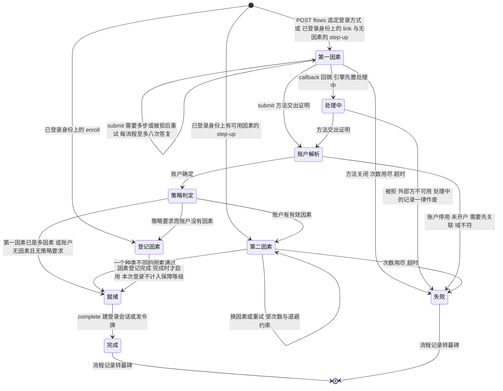
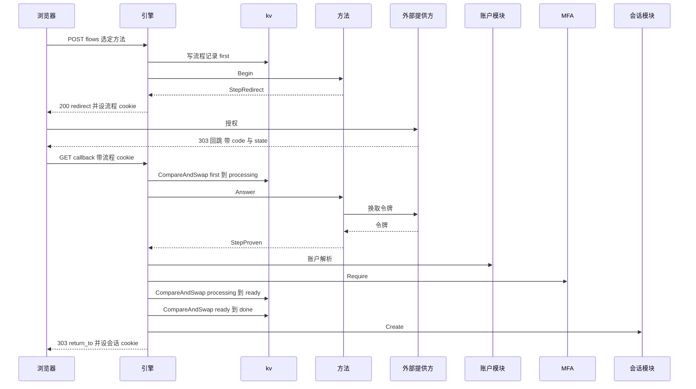
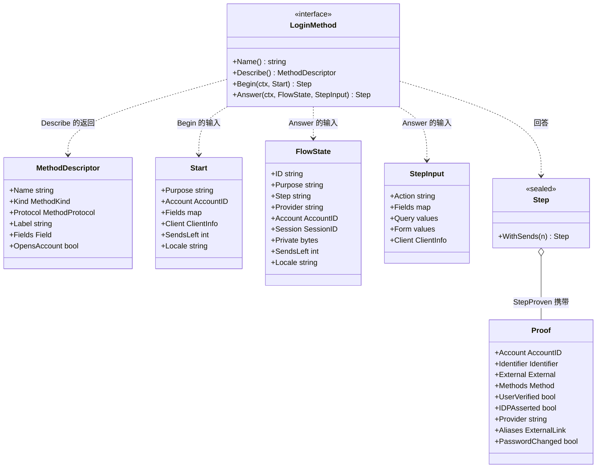

# authn 登录

## 职责

- 持有登录流程。一次登录是 kv 里的一条流程记录，由引擎驱动的多步状态机推进，每次迁移是对流程记录的比较并交换。引擎、流程记录、绑定、迁移表与终态动作只在 `authn/login` 一处实现（[ADR-authn-login-flow-2026-10-10](../../../adr/adr-authn-login-flow-2026-10-10.md)）。
- 定义 `LoginMethod` 接缝与方法的准入条件。接缝在根包 `pkg/authn` 导出；方法只回答「这个人证明了什么」，以 `Proof` 交出事实，不做账户解析、开户、关联、第二因素判定、建会话或发令牌。
- 在第一因素通过之后做与方式无关的全部动作：把证明解析成账户（含开户与关联）、向 `MFA` 询问是否还要第二因素或登记因素、建登录会话或发令牌。账户解析的规则归 [authn-account](design-authn-account.md)，因素、策略与保障等级的合成归 [authn-mfa](design-authn-mfa.md)，本文只写引擎怎样调用它们、怎样处理它们的结果。
- 让目的 `login`、`link`、`step-up`、`enroll` 共用同一台状态机，终态动作按目的区分。目的取值是封闭集。
- 在 `authn.gate.mount.endpoint` 指定的端、`mount.base-path` 之下挂登录路由、回跳路由、方式列表与账户自助路由。路由与访问级别经 `mount.Mounter` 用同一个调用声明（[authn-gate](design-authn-gate.md)）。
- 规定认证前的失败退避与枚举防护在登录路径上的形状：在何处计数、何时拒绝校验、应答怎样同形同时。退避状态的存取面 `Throttle` 与 `authn_throttles` 表归 [authn-account](design-authn-account.md)（[ADR-authn-throttling-2026-10-10](../../../adr/adr-authn-throttling-2026-10-10.md)）。
- 规定口令、社交登录（Google、GitHub）与微信各方式的流程。短信、通行密钥、企业 OIDC 与 SAML 作为方式接入同一接缝，各自的状态机与校验分别归 [authn-sms](design-authn-sms.md)、[authn-mfa](design-authn-mfa.md)、[authn-sso](design-authn-sso.md)。

### 非职责

- **不存账户，不定账户解析的规则。** 账户、标识、外部身份绑定、成员关系与口令凭据的存取，以及自动关联与首登开户的判据，归 [authn-account](design-authn-account.md)；引擎只按那里的规则调用。
- **不建会话、不签令牌。** 会话的建立、cookie 的写出与撤销归 [authn-session](design-authn-session.md)，令牌的签发归 [authn-token](design-authn-token.md)；引擎经 `Sessions` 与 `Tokens` 调用，不自己拼 cookie。
- **不实现因素，不合成保障等级。** 因素的登记、校验与保障等级的唯一计算处是 `authn.mfa`；方法只交出 `Proof.UserVerified` 与 `Proof.IDPAsserted` 这类事实。
- **不持有短信验证码的状态。** 挑战行、预算、尝试次数与发送归 [authn-sms](design-authn-sms.md)。
- **不登记企业 IdP，不校验 SAML 断言。** 提供方行、域声明、元数据与断言校验归 [authn-sso](design-authn-sso.md)。
- **不认识租户。** 账户全局，登录请求不带租户名；没有按租户启停登录方式的能力，只有全局的紧急开关。租户级的认证强度策略与成员判定在请求期由 [tenant-admission](../tenant/design-tenant-admission.md) 执行，`pkg/authn` 的任何子包都不 import `pkg/tenant`。
- **不经 `pkg/ratelimit` 限流。** 该模块的配额层落在限流阶段、排在鉴别阶段之内、无身份即放行、维度只有（租户，责任键），认证前的失败退避由 `Throttle` 承担（算法归 [authn-account](design-authn-account.md)）。
- **不写网关自产的 401。** 网关为各端建成的挑战与「没有凭据」的 401 归 [authn-gate](design-authn-gate.md)；本模块只写自己处理器的应答。
- **不提供登录页，不做人机验证。** 界面是宿主的前端，本模块只给 JSON 接口；人机验证与入口层面的洪泛限流是宿主的部署责任。
- **不做授权判定。** 本模块的 403 只转述认证之外的策略，且只出现在 authn 自己的处理器里（[authn-admin](design-authn-admin.md)）。

## 外部接口契约

### 登记单元

根包 `pkg/authn` 只放接口与数据类型，不登记模块。`authn.login` 不交付任何功能，是流程引擎加路由；每个方法住在一个叶子包、登记一个模块、非排他地交付 `LoginMethod`，引擎经 `core.ResolveAll` 取用（[ADR-authn-wiring-2026-10-10](../../../adr/adr-authn-wiring-2026-10-10.md)、[ADR-authn-packaging-2026-10-10](../../../adr/adr-authn-packaging-2026-10-10.md)）。本表列出本仓库交付的方法，是该范围内的封闭集；第三方方法自带名字，不在表内。配置键与设置键的全表见 [authn-config](design-authn-config.md)。

| 包 | 模块名 | 方法名（`Name()`） | 说明 |
|---|---|---|---|
| `authn/login` | `authn.login` | — | 引擎与路由，不交付功能 |
| `authn/login/password` | `authn.login.password` | `password` | 本文规定流程 |
| `authn/login/sms` | `authn.login.sms` | `sms` | 验证码状态机归 [authn-sms](design-authn-sms.md) |
| `authn/login/google` | `authn.login.google` | `google` | 本文规定流程 |
| `authn/login/github` | `authn.login.github` | `github` | 本文规定流程 |
| `authn/login/wechatweb` | `authn.login.wechat-web` | `wechat.web` | 网站应用扫码；本文规定流程 |
| `authn/login/wechatmp` | `authn.login.wechat-mp` | `wechat.mp` | 公众号网页授权；本文规定流程 |
| `authn/mfa/webauthn` | `authn.mfa.webauthn` | `passkey` | 同一模块还交付 `Factor`，见 [authn-mfa](design-authn-mfa.md) |
| `authn/sso/oidc` | `authn.sso.oidc` | `oidc` | 企业 OIDC，见 [authn-sso](design-authn-sso.md) |
| `authn/sso/saml` | `authn.sso.saml` | `saml` | 企业 SAML，见 [authn-sso](design-authn-sso.md) |

### LoginMethod 接缝

接缝与它的数据类型在根包导出，引擎之外没有任何调用方。以下是签名，裁剪到承载设计含义的部分。

```go
// LoginMethod 是一种第一因素。非排他，经 core.ResolveAll 取用。
type LoginMethod interface {
	// Name 是稳定名，出现在路由、流程记录、指标属性里；全局唯一，重名即 ErrMethodConflict。
	Name() string
	// Describe 自报该方法在发现端点里的描述符；它是纯常量，不读存储与配置。
	Describe() MethodDescriptor
	Begin(ctx context.Context, s Start) (Step, error)
	// Answer 处理客户端对上一步的答复，或外部回跳（OAuth 的授权码、SAML 的断言）。
	Answer(ctx context.Context, f FlowState, in StepInput) (Step, error)
}

type Start struct {
	Purpose   string            // login、link、step-up、enroll
	Account   AccountID         // link 与 step-up 时已知
	Fields    map[string]string // 开始请求的 input，至多 8 个、每个至多 512 字符
	Client    ClientInfo        // 来源地址与用户代理：供日志与审计，不作判定与绑定依据
	SendsLeft int               // 本流程还可发的短信条数，见「短信发送的每流程上限」
	Locale    string            // 请求语言：i18n 协商结果原样带出，命名语言时为空串（见「流程记录」的 locale）
}

// FlowState 是引擎交给方法的、方法不得改写的视图，加上方法私有的字节。
type FlowState struct {
	ID        string    // 公开的流程标识，只用于日志关联，不是密钥
	Purpose   string
	Step      string    // 方法自己命名的当前步骤
	Provider  string    // 回跳路径必须点名的提供方：社交方法是方法名，企业提供方是标识，空表示不限定
	Account   AccountID
	Session   SessionID // authenticated 流程：发起它的登录会话
	Private   []byte    // 方法私有、不透明、至多 8 KiB，引擎原样保存
	SendsLeft int       // 本流程还可发的短信条数，见「短信发送的每流程上限」
	Locale    string    // 同 Start.Locale，从发起请求沿用
}

type StepInput struct {
	Action string            // submit 或 callback
	Fields map[string]string
	Query  url.Values        // 仅外部回跳
	Form   url.Values        // 仅外部回跳（SAML 的 POST 绑定）
	Client ClientInfo
}
```

`Step` 是方法对引擎的回答，字段不导出，只能由构造器与 `WithSends` 产生；零值读作「没答」。回答的种类是下列构造器给出的封闭集：

```go
func StepPrompt(step string, private []byte, fields ...Field) Step // 向客户端要这些字段
func StepRedirect(step string, private []byte, to string) Step     // 让用户代理去外部方；to 必须是 https
func StepData(step string, private []byte, v any) Step             // 回给客户端一段 JSON（因素或方法自己的对象）
func StepProven(p Proof) Step                                      // 第一因素通过
func StepRefused(cause error) Step                                 // 凭据不成立；对外统一答复，成因只进日志
func StepThrottled(retryAfter time.Duration) Step                  // 429 加 Retry-After
func StepUnavailable(cause error) Step                             // 此刻答不了；503
func StepPassed(p Pass) Step                                       // 因素阶段：该因素通过
func StepEnrolled(r FactorRecord) Step                             // 登记流程：因素已登记

func (s Step) WithSends(n int) Step // 报告本次调用已成功调用 SMSCodes.Send 的次数；加在任一种非零回答上
```

`Field` 是 `{Name, Kind, Required, Secret}`，`Kind` 的取值是封闭集：`text`、`password`、`code`、`phone`，对应根包常量 `FieldText`、`FieldPassword`、`FieldCode`、`FieldPhone`。`StepPassed` 与 `StepEnrolled` 只由因素实现经 `authn.mfa` 交出，第一因素的方法不使用它们。`WithSends` 的用法见「短信发送的每流程上限」。

**`Step` 的读取面是包级函数，只在 `pkg/authn` 树内可见。** 判据与 `Verdict` 的读取函数相同：方法会随别名带到任何包，包级函数才把读取限在树内，而只有登录引擎有理由拆开一个回答；`WithSends` 是唯一的方法，因为它是方法与因素往回答上添东西的途径，属于方法作者看得见的那一面。读取函数按回答的种类各有一个：`KindOf` 报种类（零值报没答）；`NameOf`、`PrivateOf`、`FieldsOf` 读 `StepPrompt`、`StepRedirect`、`StepData` 带的步骤名、方法私有状态与字段；`RedirectOf`、`DataOf` 读跳转目标与 JSON 载荷；`ProofOf`、`PassOf`、`RecordOf` 读 `StepProven`、`StepPassed`、`StepEnrolled` 的载荷；`CauseOf` 读 `StepRefused` 与 `StepUnavailable` 的成因，`RetryAfterOf` 读 `StepThrottled` 的等待；`SendsOf` 读 `WithSends` 设置的条数。读取函数对不属于它那一种的回答返回零值：空串、`nil`、零 `Proof`、零 `Pass`、零时长。在错误的种类上读不到任何东西，零 `Proof` 不指任何账户，账户解析因而失败，零 `Pass` 不带任何方式；引擎因此先按 `KindOf` 分支再读。返回切片、映射或指针的读取函数交出副本，构造器收进来的同类值也先拷贝；`StepData` 的载荷是 `any`，无法深拷贝，按原值持有，方法交出之后不得再改它。

`Proof` 是方法交出的全部事实。来源字段 `Account`、`Identifier`、`External` 恰有一个非空，其余字段是附加事实：

```go
type Proof struct {
	Account      AccountID      // 方法自己已确定账户（口令、通行密钥）
	Identifier   *Identifier    // 方法证明了一个标识的所有权（短信验证的手机）
	External     *External      // 外部身份
	Methods      []Method
	UserVerified bool           // 通行密钥断言带用户验证：该因素自己就相当于两个因素
	IDPAsserted  bool           // 企业 IdP 声明已做多因素，且提供方行的 trust_idp_mfa 与 mfa_acr_values 命中
	Provider     string         // 企业 SSO 提供方标识
	Aliases      []ExternalLink // 同一外部身份此前可能绑定的旧键
	PasswordChanged bool        // 口令方法在自己重设了凭据时置真，引擎据此在完成时撤销其余会话
}
```

`Proof` 只报事实，不报保障等级；等级只在 `authn.mfa` 的 `MFA.Assurance` 一处合成。引擎据 `Proof` 解析账户，不信任方法对账户存在与否的任何断言。`Aliases` 供微信把 `wechat-openid:<appid>` 键升级为 `unionid` 键，规则见 [authn-account](design-authn-account.md)。

### 方法的准入条件

下列条件的全集约束每一个 `LoginMethod`，第三方方法同受约束：

- 必须响应 `ctx`。引擎对单次方法调用另设预算（设置 `authn.login.call-budget`，含外部提供方往返），超出即作废该次回答。
- 宕机时交 `StepUnavailable`，不交 `StepRefused`：503 与 401 不混桶。
- 不自己开户、并入或建会话；不碰 HTTP、gin、会话与令牌；不自己读写流程记录，比较并交换归引擎。
- 失败时不得因标识存不存在而在耗时与错误形态上有差别。
- `Name()` 全局唯一。
- 发送短信的方法在每次调用 `SMSCodes.Send` 之前核对 `Start.SendsLeft` 或 `FlowState.SendsLeft`，并按「短信发送的每流程上限」报告已发条数。
- panic 由引擎 `recover`，按该方法故障收口为 503，记 Error 与调用栈；一个方法的缺陷不波及其他方法。

方法不依赖 HTTP 与存储，所以可以脱离二者单测：测试直接构造 `Start`、`FlowState`、`StepInput`，断言回答的种类。

### 路由

基路径 `B` 取 `authn.gate.mount.base-path`（默认值见 [authn-config](design-authn-config.md)）。「访问」是 `Mounter` 登记时同时声明的级别：`Open` 即豁免，`Optional` 即可选认证，`Required` 即网关认证。本表是本模块挂的路由的全集：

| 方法 路径 | 访问 | 作用 |
|---|---|---|
| `GET B/methods` | Open | 列出已纳入且未被 `disabled-methods` 关掉的登录方式描述符，并发布注册开关与可用的第二因素种类 |
| `POST B/flows` | Open | 开始 `login` 流程，body `{method, delivery, return_to, binding, input}`；不读 cookie；流程绑定在此建立 |
| `POST B/flows/authenticated` | Required | 在已登录的身份上开始 `link`、`step-up` 或 `enroll`（body 同上加 `purpose`）；流程记录绑定当前账户与会话；冒充中拒绝；`enroll` 是因素登记的唯一入口；起始状态与前置要求见「在已登录身份上开始流程」 |
| `POST B/flows/answer` | Open | 答复当前步，body `{seq, step, input}`；`step` 取 `answer`、`factor`、`enroll`、`complete`；要求流程绑定 |
| `GET B/flows/current`、`DELETE B/flows/current` | Open | 读当前流程状态，供界面刷新后续接；放弃流程，幂等；要求绑定 |
| `GET\|POST B/callback/:provider` | Open | OAuth 与企业 OIDC 的回跳、SAML 的 ACS；`:provider` 对社交类方法是方法名，对企业 SSO 是 IdP 标识；`POST` 登记跨源检查旁路；SAML 回跳的体上限见 [authn-sso](design-authn-sso.md) |
| `PUT B/password`、`POST B/phone`、`POST B/phone/verify`、`POST B/identifiers`、`POST B/identifiers/verify`、`DELETE B/identifiers/:id`、`DELETE B/links/:id` | Required | 账户自助：改口令、添加或更换手机、添加登录标识、删标识、解绑外部身份；改动认证事实的都要新鲜认证并过 CSRF，冒充中一律拒绝；`POST B/phone` 与 `POST B/phone/verify` 只在 `SMSCodes` 在场时挂；`POST B/identifiers` 的邮箱分支只在 `EmailCodeSender` 在场时可用 |

`B/me` 的两条路由——本人的资料视图与它的写——归 [authn-profile](design-authn-profile.md)，本模块不挂。

该端不得被 `tenant.resolve` 所守：全局账户的登录请求不带租户名，被守时拿到的是解析层的 404。装配期对此做核对，核不了（读不出 `tenant.resolve.endpoints` 的解码形状）时写一行 `Warn`，不终止启动。

### 请求与应答的形状

请求体一律 `application/json`，否则 415；拒绝未知字段；体上限 64 KiB（SAML 回跳例外），超过上限归 400 `bad-request`（与体不合法同答，不为超限另立码）。开始请求的 `input`（`Start.Fields`）至多 8 个字段、每个至多 512 字符；答复的 `input`（`StepInput.Fields`）至多 8 个字段，每个的上界更大——通行密钥的凭据 JSON 超过 1 KiB——且仍远小于 64 KiB 的体上限；两者越界一律归 400 `bad-request`。经 `Mounter` 登记的处理器所写的响应带 `Cache-Control: no-store`：`Wrap` 在调用处理器之前写好该头，处理器可以覆盖它（如密钥集自带缓存头）。网关在处理器之前自产的 401/503，以及入口模块对 panic 的缺陷响应，不在这一范围内：前者不经 `Wrap`，后者由入口模块按它自己的缺陷应答形状处置，会删去 `Cache-Control` 一类表示性头。

`GET B/methods` 的应答是方法描述符文档：`{"methods":[{name, kind, protocol, label, opens_account, fields}], "signup":{"enabled"}, "mfa":{"factors":[...]}}`。`methods` 按方法名排序，每项是一个方法自报的描述符：`kind` 是渲染类别（`form`/`redirect`/`enterprise`/`webauthn`），`protocol` 是 `redirect` 与 `enterprise` 类方法所讲的线协议（`oauth2`/`oidc`/`saml`，其余为空），`label` 是方法品牌名（如 `Google`、`WeChat`，缺失时客户端按方法名查 i18n 回退），`fields` 是该方法首步所要的字段（仅 `form` 类给出，取自 `Begin` 以空字段调用时所答的首个 prompt），`opens_account` 是该法能否在首登为未知标识开户。`signup.enabled` 由账户模块的注册开关 `authn.account.signup` 派生；`mfa.factors` 是装配收到的第二因素种类，属部署级，与 `GET B/factors` 所答的本人已登记因素语义不同。企业 SSO 的提供方清单不进此应答，仍走 `POST B/sso/discover`。

成功应答是 `{"seq": 2, "state": "...", "next": {"kind": "..."}}`。`next.kind` 的取值是封闭集：

| `next.kind` | 内容 |
|---|---|
| `challenge` | 要提交的字段、`expires_in`、`resend_after` |
| `redirect` | `url`、`method` |
| `factor` | `factors: [{id, kind, label}]`，种类须与第一因素不同 |
| `enroll` | `kinds` |
| `complete` | 流程已就绪，客户端以 `step=complete` 取走结果 |
| `webauthn` | 数据步：`options` 是该因素自己的 JSON 对象——通行密钥的仪式取库生成的创建或请求选项，TOTP 登记取 `otpauth_uri`（二维码由客户端画） |

完成时，`delivery=session` 设 cookie，体为 `{"state":"authenticated","session":{"id","expires_at"}}`；`delivery=token` 体为 `{"state":"authenticated","token_type":"Bearer","access_token","expires_in","refresh_token"}`。

### 问题码

失败一律是 `application/problem+json`，机器可读的码放在 `Problem.Type`，取 `urn:speed:authn:<码>`；入口模块的 `Problem` 没有扩展成员，`type` 是现成字段。`Fail` 之前设置的响应头保留，响应体不带成因。码的集合是封闭集，新增码只增不改：

| 状态 | 码 | 场景 |
|---|---|---|
| 400 | `bad-request`、`unsupported-region` | 体不合法、字段缺失、未知字段、体超过 64 KiB 上限、方法不存在、`return_to` 不合规；短信号码前缀不在放行表里 |
| 401 | `login-failed` | 未知标识、错口令、停用、无口令、验证码错、方法内校验失败；**同一个应答**，成因是号码前缀不在放行表或标识无法规范化时按 400 答 |
| 401 | `flow-invalid` | 流程过期、已用、绑定不符、步序不符、被并发消费 |
| 401 | `link-required` | 社交登录无绑定而已验证邮箱命中现有账户 |
| 401 | `insufficient_user_authentication` | 加强认证，同时带 `WWW-Authenticate`（[authn-mfa](design-authn-mfa.md)） |
| 403 | `method-disabled`、`account-unavailable`、`impersonation-restricted`、`forbidden` | 对认证之外的策略的转述，只在 authn 自己的处理器里写 |
| 409 | `conflict`、`login-identifier-required` | 外部身份冲突、解绑最后一种登录方式、删最后一个因素、某种因素已达上限；账户没有可作登录名的标识而设口令 |
| 415、429、503 | `unsupported-media-type`、`throttled`（带 `Retry-After`）、`unavailable` | `unavailable` 对外不区分是哪个依赖不可用 |

401 一律带 `WWW-Authenticate`。挂在本模块路由上的 401 有三种来源。**网关自产的 401**（没有凭据、头不合规、出口检查不符、冒充范围不符，以及网关自己对浏览器会自行附带的凭据做的跨源检查不过）取网关为该端建成的挑战，含口令表后端在场时的 `Basic`。**本模块处理器答的 401**（`login-failed`、`flow-invalid`、`link-required`、`insufficient_user_authentication`）与 **`Mounter` 的 `Wrap` 为挂载路由写的跨源检查 401**，挑战去掉 `Basic`，只用 `Bearer` 与 `Cookie`：同源页面的 `fetch` 收到带 `Basic` 的 401 会让浏览器弹出原生口令框，而这些 401 不是在要求 Basic 凭据（[ADR-authn-credential-dispatch-2026-10-10](../../../adr/adr-authn-credential-dispatch-2026-10-10.md)）。三种 401 的 realm 都取该端点的端名，与网关写的 realm 同源：处理器与 `Wrap` 经 `mount.Mounter.Endpoint()` 得到端名，再交给路由部件的 401 写出函数（[authn-gate](design-authn-gate.md)）。

自助路由没有 404 问题码：`ErrAccountNotFound` 在自助路由上读作身份已失效，答裸 401（不带问题码）。`impersonation-restricted` 在自助路由上实为兜底：主防线是网关对冒充身份的冒充范围核对与路由对冒充身份的整体拒绝，这条码只在处理器自己查到身份在冒充中时写出。

### 校验顺序与 return_to

读请求体之前，按下列次序校验，任一项不过即拒绝：

1. `CrossOriginProtection.Check`：先看 `Sec-Fetch-Site`，缺失时比较 `Origin` 与 `Host`；可信来源是 `public-url` 的来源加 `trusted-origins`；回跳端点旁路。
2. `Content-Type`。
3. 流程绑定，`POST flows` 与 `POST flows/authenticated` 除外。
4. `seq` 与 `step`。

跨源检查由 `Mounter` 的 `Wrap` 在处理器之前施加（[authn-gate](design-authn-gate.md)）：不过即 `Wrap` 写的 401（只带 `Bearer` 与 `Cookie`），处理器不被调用，所以下节的问题码不含它；`Content-Type` 的 415 因而只对已通过跨源检查的请求给出。

`return_to` 在 `Begin` 时校验并存入记录，取值是：以单个 `/` 开头的相对路径，不以 `//` 起头，不含反斜线、控制字符与 `@`，至多 2048 字节；或来源在 `trusted-origins` 里的绝对 URL。其余一律 `bad-request`。回跳时只用记录里的值，不读回跳请求的任何参数。`redirect_uri` 由配置的 `public-url` 拼出，从不取自请求的 `Host` 或转发头。

### 对外接口面

- 方法名只增不改：它出现在路由、流程记录与指标属性里，看板与回跳登记都会引用它。
- 问题码是封闭集，只增不改。
- 流程记录带版本字段，读到不认识的版本一律拒绝。
- `LoginMethod`、`Step` 构造器、`Proof` 的字段是第三方方法依赖的面，增加字段不破坏既有方法；删改它们是不兼容变更，按宿主可见面的变更处理。

## 依赖

| 依赖 | 必需 | 用途 |
|---|---|---|
| `mount.Mounter` | 是 | 路由与访问级别成对登记（[authn-gate](design-authn-gate.md)） |
| `kv.KV` | 是 | 流程记录、手机号验证记录与来源地址减负的计数 |
| `Accounts`、`AccountAdmin` | 是 | 账户解析、开户、关联、`Touch`（[authn-account](design-authn-account.md)） |
| `Passwords` | 是 | 自助改口令的处理器；口令方式的校验在方法包里经同一接口完成 |
| `Memberships` | 是 | 企业 SSO 首登开户与并入判定所需的成员关系读写 |
| `Throttle` | 是 | 失败退避的存取面 |
| `Sessions` | 是 | `Create`、`Current`、`Revoke`、`StatusFresh`、`Elevate`、`RevokeAccount`、`Rotate`、`SetCookie`：`session` 与 `token` 交付都先建会话；请求带着可解析的旧会话 cookie 时撤销旧会话；`link`、`step-up`、`enroll` 的完成复核 |
| `MFA` | 是 | 第二因素与登记的编排、保障等级的合成 |
| 全部 `LoginMethod` | 经 `ResolveAll` | 缺席合法，但没有任何方法即启动期 `ErrNoLoginMethod` |
| `Tokens` | 可选 | `Issue` 与 `NewRefresh`；缺席时 `delivery=token` 不启用，启动诊断写一行 |
| `SMSCodes` | 可选 | `POST B/phone` 与 `POST B/phone/verify` 经它发码与校验；缺席时不挂这些路由，启动诊断写一行。短信登录方式的发码在 `authn.login.sms` 里，不经引擎 |
| `EmailCodeSender` | 可选 | `POST B/identifiers` 的邮箱分支经它把验证码投递到该地址；缺席时该分支答 503 `unavailable`，启动诊断写一行。验证码的产生、记录与比对在本模块的自助件里，不经它 |
| `SSOProviders` | 可选 | IdP 发起的 SAML 读提供方行的 `allow_idp_initiated` |
| `Provisioner` | 可选 | 首登开户之前的宿主钩子 |
| `settings.Store` | 可选 | 本模块的设置，缺席取声明的默认值 |
| `audit.Audit`、`event.Bus` | 可选 | 登录审计与 `authn.login.succeeded`；缺席时对应输出不做，启动诊断写一行 |

方向满足架构不变量：`authn/login` 只依赖根包、内部包与依赖表里的功能接口，不依赖任何方法叶子包，也不 import `pkg/tenant`；叶子包只依赖根包与 `internal/egress`、`internal/password` 这类内部包，库类型只出现在叶子包里，不出现在根包签名里（[ADR-authn-packaging-2026-10-10](../../../adr/adr-authn-packaging-2026-10-10.md)、[ADR-authn-wiring-2026-10-10](../../../adr/adr-authn-wiring-2026-10-10.md)）。`authn.login` 把 `MFA` 当必需：装配里没有 MFA 模块而库里已有账户登记了因素时，登录不得无声跳过第二因素。

状态放置按丢失的方向判：流程记录丢了只让流程失败，放 kv；退避计数、会话、账户丢了会放宽校验，放 db（[ADR-authn-state-placement-2026-10-10](../../../adr/adr-authn-state-placement-2026-10-10.md)）。

## UML 图

### 状态机

一次登录在 kv 里是一条流程记录，每步用比较并交换推进。图里的 `账户解析` 与 `策略判定` 是同一次请求内的瞬时步骤，不落入流程记录；落入记录的状态是 `first`、`processing`、`second`、`enroll`、`ready` 与终态墓碑 `done`、`failed`（对应图中的第一因素、处理中、第二因素、登记因素、就绪、完成、失败）。`POST flows` 总是从第一因素进入；`POST flows/authenticated` 按目的从第一因素、第二因素或登记因素进入，见「在已登录身份上开始流程」。回跳类的一步先把记录置为处理中再调用方法，使授权码与断言至多被处理一次；`完成` 之后才建登录会话或发令牌。目的 `link`、`step-up`、`enroll` 复用这台机器，终态动作不同，见「终态动作」。逐条迁移、答复与副作用见「答复与迁移」。



### 社交登录的跨模块交互

下图是一次 `delivery=session`、`binding=cookie` 的社交登录。它固定下列次序：回跳先置处理中再调方法；`ready` 先交换成墓碑 `done`，再建会话；会话 cookie 在回跳的 `303` 响应里写出，在最后一个可能失败的步骤之后。



### 接缝的类型

`LoginMethod` 的 `Begin` 与 `Answer` 返回 `Step`，`Describe` 返回 `MethodDescriptor`；`Step` 的真身在内部包，根包只导出构造器；`Proof` 是 `StepProven` 的载荷。`FlowState` 与 `StepInput` 是引擎交给方法的只读输入。



## 核心数据结构

### 流程记录

kv 键是 `authn:flow:<流程令牌的 SHA-256 十六进制>`。kv 不划分命名空间，与限流的键共处，所以键自带 `authn:` 前缀。值是 JSON，有效期由设置 `authn.login.flow-ttl` 决定，缺省与上限见 [authn-config](design-authn-config.md)。字段的全集：

| 字段 | 含义 |
|---|---|
| `v` | 记录格式版本；读到不认识的版本一律拒绝 |
| `purpose`、`method`、`state` | 目的（`login`、`link`、`step-up`、`enroll`）、方法名、状态机状态 |
| `provider` | 回跳路径 `:provider` 的期望值：社交方法的记录取方法名，企业 SSO 的记录取 `Begin` 时 `input.provider` 给的值；回跳时分发之前与路径逐字比对（见「回跳类的一步」） |
| `seq` | 步序号，每次迁移加一；请求必须带当前值，不符即 `ErrStepOutOfOrder`。置为处理中的那次迁移不改 `seq`，因为回跳请求不带它 |
| `binding` | 绑定秘密的 SHA-256；外部回跳与每次答复都以请求带来的流程令牌重算后常量时间比对 |
| `account`、`proof` | 解析出的账户标识与方法交出的证明，解析之后才有 |
| `mfa` | `{required, offered, challenge_ref, attempts, passed, enrolled}`：`passed` 是第二因素通过的结论，形如 `{methods, user_verified}`，供完成时经 `MFA.Assurance` 合成保障等级；`enrolled` 是 `enroll` 状态里已登记的因素标识（因素行在 `MFA.Enroll` 的最后一步已置为启用，记录只留它的标识） |
| `method_state` | 方法私有状态：OAuth 的 `state` 摘要、PKCE 校验串、`nonce`；SAML 的请求标识与提供方标识；WebAuthn 仪式数据 |
| `method_step` | 方法自己的步名，`FlowState.Step` 取它：方法在 `StepPrompt` 上命名的步（如口令的 `new_password`），答复时按它分派回方法 |
| `merged` | 本次账户解析是否发生了自动并入（A4 的自动关联、A5 的 `merge_existing`），完成时据此执行 A10 |
| `delivery`、`return_to` | `session` 或 `token`；登录后的回跳，`Begin` 时校验，回跳时只用记录里的值 |
| `session`、`answers`、`sends` | `session`：`link`、`step-up`、`enroll` 流程发起时的登录会话标识，完成时复核；`answers`：已接受的答复数，至多 8；`sends`：本流程已发的短信数，由引擎把方法与因素经 `Step.WithSends` 报告的条数累加进同一次比较并交换，上限与核对见「短信发送的每流程上限」 |
| `require_multi` | `link` 与 `enroll` 在开始时取定的判据：账户当时有有效因素为真。完成复核按它读回同一份要求，见「在已登录身份上开始流程」的「完成时的复核」 |
| `locale` | `Begin` 时取到的请求语言：`i18n.FromContext` 定下的那个（`localeOf`），取不到时为空串；没有 i18n 中间件的装配里 `localeOf` 退回读 `Accept-Language` 的第一个标签、原样带出。它原样交给 `SendCode.Locale`，由短信模块解析到载体声明的语言、落不到时用配置的默认语言 |
| `created_at`、`expires_at` | 绝对到期，与键的生存期一致 |

`state` 的取值是封闭集：`first`（第一因素）、`processing`（处理中，仅回跳类）、`second`（第二因素）、`enroll`（登记因素）、`ready`（就绪），以及终态墓碑 `done` 与 `failed`。墓碑与记录同寿，交换不改动过期。

**记录格式与滚动升级。** 记录按拒绝未知字段解码，`v` 是格式版本，读到不认识的 `v` 一律拒绝。`provider` 与 `require_multi` 是记录的可选字段，都不抬高 `v`，缺省取各自的零值。滚动升级期里，旧二进制读到带 `provider` 的记录会因未知字段被拒读，新二进制读到旧记录时 `provider` 为空即与回跳路径不符——两条路径都 fail-closed，被拒的是该次回跳，用户重新开始。`require_multi` 缺省为假：新二进制读到缺该字段的旧记录时，完成复核按「账户无有效因素」取要求，对一份账户当时有有效因素的记录，这让完成按新鲜的第一因素核对，其窗口比开始时按的新鲜本地多因素更短，方向是更严而非放宽。在途流程因此作废或有界，窗口有界：流程 TTL 至多 30 分钟。

流程记录里的 PKCE 校验串对持有 kv 读权限的人不是秘密：能读 kv 的人加上受害者的授权码才能完成交换，而授权码一次有效且短命、回调还要求流程绑定。kv 的读权限因此要按凭据对待。

### 流程令牌与绑定

流程令牌是 256 位随机数，库里只存 SHA-256；它同时是绑定秘密。承载由开始请求的 `binding` 字段决定：

| `binding` | 承载 | 响应体 |
|---|---|---|
| `cookie`（缺省） | cookie `__Host-authn-flow` | 不含 `flow_token`，脚本读不到绑定秘密，XSS 取不到 |
| `header` | 请求头 `Authn-Flow` | 返回 `flow_token`，不设 cookie |

cookie 的属性是 `Secure; HttpOnly; Path=/`、无 `Domain`、**`SameSite=None`**。SAML 的断言是 IdP 页面发起的跨站 POST，`Lax` 的 cookie 不随跨站 POST 发送，绑定会丢。`SameSite=None` 使它随所有跨站请求发出；它只承载一个不透明值、只对流程端点有意义、流程完成即作废、服务端只存哈希，对其他端点没有权限；`__Host-` 前缀使子域不能写入同名 cookie。`allow-insecure`（仅开发）时去掉前缀与 `Secure`。

回跳请求是用户代理的导航，带不了自定义请求头，所以回跳类方法只能在 `binding=cookie` 的流程里走完；`binding=header` 的流程里它们的回跳因绑定缺失以 `flow-invalid` 失败。回跳与每次答复都要求绑定匹配，这是对登录 CSRF 与流程固定的主要防线：`state` 与 SAML 的 `InResponseTo` 各自只证明请求与某个流程对得上，不证明流程与发起它的浏览器对得上。

## 核心算法与流程

每步迁移的代价是对 kv 的一次读与一次 `CompareAndSwap`，与方法的复杂度无关；没有性能敏感的算法，不作复杂度分析。

### 开始流程

`POST B/flows` 按下列次序处理：

1. 按「校验顺序与 return_to」校验；不读 cookie，所以浏览器里残留的过期会话 cookie 不会挡住登录。
2. 取 `method`：方法不存在按 `bad-request`，已被设置 `authn.login.disabled-methods` 关闭按 `method-disabled`。
3. 取 `delivery`，缺省 `session`。`token` 要求 `Tokens` 在场且设置 `delivery-modes` 允许；令牌发放把刷新令牌交给脚本可读的环境，对浏览器应用是更弱的选择，所以它是显式选择，宿主可以关掉。
4. 校验并保存 `return_to`，确定 `binding`，生成流程令牌，写入 `first` 状态的记录。kv 不可用时答 503。
5. 带 `call-budget` 调用方法的 `Begin`，按「答复与迁移」处理它交回的 `Step`。

一个浏览器同一时刻只有一个流程 cookie，所以后开始流程的标签页会顶掉先前的流程。

### 在已登录身份上开始流程

`POST B/flows/authenticated` 的访问级别是 `Required`，请求到达处理器时网关已认定身份。按下列次序处理，任一项不过即拒绝，不写流程记录：

1. 按「校验顺序与 return_to」校验。身份在冒充中，403 `impersonation-restricted`。
2. 取 `purpose`：`link`、`step-up`、`enroll` 之外一律 `bad-request`。
3. `Sessions.StatusFresh(身份的会话)` 须有效，账户与身份一致。
4. 按下表确定记录的 `method`、起始状态与起始要求；起始要求不满足，401 `insufficient_user_authentication`。
5. 写记录：`account` 与 `session` 取身份的账户与会话，`delivery` 取会话的种类（`browser` 种为 `session`，`token` 种为 `token`），`binding` 与 `return_to` 取自请求，`answers` 与 `sends` 从零起。
6. 按起始状态做第一次调用，按「答复与迁移」处理回答：`first` 以 `Start{Purpose, Account, Fields, SendsLeft}` 调方法的 `Begin`；`enroll` 以 `Fields` 调 `MFA.Enroll`；`second` 不调用，应答 `next.kind = factor`，清单即记录里的 `mfa.offered`。

下表是各目的在起始阶段的取值，目的取值是封闭集：

| 目的 | 请求里带 | 记录的 `method` | 起始状态 | 起始要求 |
|---|---|---|---|---|
| `link` | `method`、`input` | 请求的 `method` | `first` | 账户安全类动作的要求 |
| `step-up`，账户有可用因素 | 不带 `method` | 空 | `second` | 无附加要求 |
| `step-up`，账户没有因素 | `method` | 请求的 `method` | `first` | 无附加要求 |
| `enroll` | `input.kind` | 空；因素种类交给 `MFA.Enroll` | `enroll` | 账户安全类动作的要求 |

「账户安全类动作的要求」是 `Requirement`：账户有有效因素（`MFA.Factors` 里状态为启用的行）时为新鲜的本地多因素，没有因素时为新鲜的第一因素，取值与单位归 [authn-mfa](design-authn-mfa.md)。引擎以 `StatusFresh` 交回的 `Assurance`、`AuthTime`、`IDPAssured` 按 `Identity.Satisfies` 的同一判据核对。

`step-up` 的可用清单这样产生：引擎以会话的方式集构造只含 `Methods` 的 `Proof`，调 `MFA.Require(账户, Proof)` 取认证方式与会话方式不相交的启用因素，再剔除启用时刻不早于会话 `AuthTime` 的因素（`FactorRecord.ActivatedAt`）：登录期间登记的因素不得用来加强认证。`Require` 的结局不是 `MFAFactor` 即账户没有因素，起始状态取 `first`；结局是 `MFAFactor` 而剔除后清单为空，401 `insufficient_user_authentication`，不写记录。清单为空在只有一种因素种类的装配里是常态：会话在登录时已答过该种类，没有不相交的因素可提供，所以这样的装配取到满足要求的 200 靠登录时完成第二因素，加强认证的入口留给种类多于一种的装配。

`step-up` 在 `first` 起始时，方法证明的账户必须等于记录的 `account`，否则落入 `failed`，401 `login-failed`；`link` 的外部身份不按绑定解析账户，账户取记录的 `account`。

**完成时的复核**由 `complete` 在终态动作之前做，`link`、`step-up`、`enroll` 共用：`StatusFresh(记录的 session)` 有效、会话账户与记录的 `account` 一致、会话不在冒充中，任一项不过为 401 `flow-invalid`；`link` 与 `enroll` 另按上表的起始要求再核对一次，不满足为 401 `insufficient_user_authentication`；该要求取流程开始时账户有无有效因素取定的那一份（记录的 `require_multi`），使登记在其最后一步刚置启用的因素不抬高它自己完成所按的门槛（[ADR-authn-login-flow-2026-10-10](../../../adr/adr-authn-login-flow-2026-10-10.md)）。

### 答复与迁移

`POST B/flows/answer` 先校验绑定，读出记录，再核对：`seq` 等于记录的 `seq`，否则 `ErrStepOutOfOrder`；`step` 与记录状态相容，`answer` 只在 `first`，`factor` 只在 `second`，`enroll` 只在 `enroll`，`complete` 只在 `ready`；`answers` 未达 8。`seq`、`step` 与 `answers` 任一不符都应答 `flow-invalid`。`step=answer` 交给方法的 `Answer`；`step=factor` 与 `step=enroll` 交给 `MFA`，具体字段由因素决定（[authn-mfa](design-authn-mfa.md)）；`step=complete` 由引擎执行终态动作。

迁移是读出旧字节、改完后 `CompareAndSwap(旧, 新)`。交换落空说明被并发改动，当前请求按流程失效拒绝，不重试。每个方法的 `StepRefused` 只对 `submit` 类的一步保留流程，对 `callback` 类的一步作废流程：授权码与断言一次性，重来要重新开始。

流程的完整迁移表如下，「答复」是对客户端的应答，「副作用」是引擎做的事：

| 当前状态 | 事件 | 下一状态 | 答复 | 副作用 |
|---|---|---|---|---|
| `first` | `submit`，方法交出 `StepPrompt`、`StepData`、`StepRedirect` | `first`，`seq` 加一，`answers` 加一，`sends` 累加 | 200 | 无 |
| `first` | `submit`，`StepRefused` | `first`，`seq` 加一，`answers` 加一，受 8 次上限 | 401 `login-failed`；成因是 `ErrUnsupportedRegion` 或 `ErrInvalidIdentifier` 时按 400 答（`unsupported-region`、`bad-request`） | 方法自己记退避 |
| `first` | `submit`，`StepThrottled` | 不变 | 429 带 `Retry-After`；`retryAfter` 为零时不带 | 无 |
| `first` | `submit`，`StepUnavailable` | 不变 | 503 | 无 |
| `first` | `submit`，`StepProven` | 账户解析，随后按策略判定落入 `second`、`enroll` 或 `ready`；解析失败落入 `failed` | 200 或 401 | 见「账户解析与策略判定」 |
| `first` | `callback` | 先交换成 `processing`，再调 `Answer` | 无 | 无 |
| `processing` | `StepProven` | 同上，账户解析与策略判定 | 303 或 200 | 无 |
| `processing` | `StepRefused`、`StepUnavailable`、账户解析失败 | `failed` | 401 `login-failed`、503、401 | 授权码已用，用户重新开始 |
| `processing` | 并发的第二次回跳，或崩溃遗留 | 不改 | 401 `flow-invalid` | 无 |
| `second` | 因素通过 | `ready` | 200 | 无 |
| `second` | 因素被拒 | `second`，`seq` 加一，`answers` 加一 | 401 `login-failed` | 因素退避（`ScopeFactor`，由 `MFA` 记） |
| `second` | `StepThrottled`（`ScopeFactor` 退避中） | 不变 | 429 带 `Retry-After` | 无 |
| `second` | `StepUnavailable` | 不变 | 503 | 无 |
| `second` | 答复数用尽、超时 | `failed` | 401 `login-failed` | 无 |
| `enroll` | 因素实现交出 `StepEnrolled` | `ready` | 200 | 因素标识存入记录的 `mfa.enrolled`；本次登记的因素不计入保障等级 |
| `ready` | `complete` | `done` | 见「终态动作」 | 终态动作 |
| 任意 | `answers` 达 8、过期、`DELETE flows/current`、方法被 `disabled-methods` 关 | `failed` | 401 `flow-invalid` | 无 |

过期靠键的生存期兜底，不需要任何清扫。submit 类的一步落入 `ready` 时应答 `next.kind = complete`，客户端以 `step=complete` 取走结果；回跳类的收尾见「回跳类的收尾」。

### 回跳类的一步

`GET|POST B/callback/:provider` 由引擎处理，分发给方法。引擎先核对：流程存在且处于 `first`；回跳路径的 `:provider` 与记录里的 `provider` 一致（社交方法的记录记方法名，企业 SSO 的记录记 `Begin` 时 `input.provider` 给的值）；绑定匹配。通过后引擎**在调用 `Answer` 之前**先把记录交换成 `processing`，`seq` 与方法状态不变。并发的第二次回跳败于这一步，当场得到 `flow-invalid`，所以授权码至多换一次、SAML 断言至多处理一次。

`Answer` 返回之后，引擎再把记录交换成新状态；方法交回 `StepRefused` 或 `StepUnavailable` 时置 `failed` 墓碑。停在 `processing` 的记录，即进程崩溃而 `Answer` 没有返回的情形，一律按失效处理，用户重新开始。方法自己不对流程记录做任何写。这一做法的取舍见 [ADR-authn-login-flow-2026-10-10](../../../adr/adr-authn-login-flow-2026-10-10.md)。

### 账户解析与策略判定

方法交出 `StepProven` 之后，引擎在同一次请求内依次做账户解析与策略判定。

**账户解析。** 引擎按 `Proof` 的来源字段解析账户：

- `Account` 非空：引擎仍读取账户并核对状态为启用，不信任方法的断言。
- `Identifier` 非空（短信验证的手机）：按标识查账户；查不到时按注册设置决定开户或失败。
- `External` 非空：按（提供方，主体）查绑定；无绑定时按外部身份的来源与设置走关联或首登开户；`Aliases` 用于旧键升级。键永远是（提供方，主体），不用邮箱。社交证明的提供方不带 `oidc:`、`saml:` 命名空间，企业证明的提供方属于一个租户；社交证明落在 `oidc:`、`saml:` 命名空间，或企业证明的 `ext.Tenant` 与提供方行的租户不一致，都按 `ErrInvalidArgument` 拒绝（fail-closed，判据隐含于 A1 的命名空间与 A5 的租户归属）。

关联、自动并入、企业 SSO 的域核对与预开户、首登开户、`Provisioner` 钩子的判据全部归 [authn-account](design-authn-account.md)（[ADR-authn-external-binding-2026-10-10](../../../adr/adr-authn-external-binding-2026-10-10.md)）。引擎承担的是这些规则的结果怎样落到流程上：

| 解析结果 | 流程 | 对外 |
|---|---|---|
| 账户确定 | 进入策略判定 | — |
| 账户非启用，来源是外部登录 | `failed` | 403 `account-unavailable`，调用方已在 IdP 处认证过 |
| 账户非启用，来源是口令或短信 | `failed` | 401 `login-failed`，与错口令同形 |
| 账户是 `service` 类型（任何来源） | `failed` | 401 `login-failed`：服务账户是 API 客户端，不是交互登录目标 |
| 无绑定且注册关闭（`ErrSignupClosed`）、域不符（`ErrDomainMismatch`）、未预开户（`ErrNotProvisioned`）、宿主拒绝开户（`ErrProvisionRefused`） | `failed` | 401 `login-failed`，成因进日志 |
| 无绑定而已验证邮箱命中现有账户（`ErrLinkRequired`） | `failed` | 401 `link-required` |
| 外部身份已被别的账户占用（`ErrBindingConflict`） | `failed` | 409 `conflict` |

自动并入成功后的会话与口令处置由 [authn-account](design-authn-account.md) 的规则 A10 规定；引擎在建新会话之前执行它，次序见「并发与事务边界」。显式关联（`link`）不触发。

**策略判定。** 引擎调用 `MFA.Require(账户, Proof)`。结局的判据与可用清单的计算归 [authn-mfa](design-authn-mfa.md)；引擎按结局落入流程状态：`MFANone` 落入 `ready`，`MFAFactor` 落入 `second` 并把清单存入记录的 `mfa.offered`，`MFAEnroll` 落入 `enroll`。

`MFAFactor` 的可用清单为空，或装配里没有账户所登记因素种类的实现时，该次登录无法完成，应答 `login-failed`，运维从日志与事件发现；不得当作账户没有因素。租户级的强度策略在请求期由 [tenant-admission](../tenant/design-tenant-admission.md) 执行，登录时账户全局、租户未知，登录期间的任何范围线索都能被绕开。

### 终态动作

`ready` 上的 `complete` 先把记录交换成墓碑 `done`，再执行终态动作表里的动作。交换的败者拒绝，所以每条流程的终态动作至多执行一次；交换之后的动作失败时，流程已消耗，用户重新开始。`link`、`step-up`、`enroll` 的动作以「在已登录身份上开始流程」里的完成复核开头。

| 目的 | 完成时 |
|---|---|
| `login` | 以 `MFA.Assurance` 合成强度；记录的 `mfa.enrolled` 非空（策略要求登记而账户没有因素的登录）时本次会话仍记单因素；`Sessions.Create` 建会话，`delivery=session` 时 `Kind` 为 `browser`、cookie 经 `Sessions.SetCookie` 写出，`delivery=token` 时 `Kind` 为 `token`、不写 cookie，并对该会话调 `Tokens.Issue` 与 `Tokens.NewRefresh`；账户 `Touch`；写 `authn.login` 审计（尽力）；发 `authn.login.succeeded`；请求带着可解析的旧会话 cookie（`Sessions.Current`）时经 `Sessions.Revoke` 撤销旧会话 |
| `link` | 复核；`AccountAdmin.LinkExternal`，外部身份已被别的账户占用则 409 `conflict`，不并入；`Sessions.RevokeAccount(except = 发起会话)`；发 `authn.binding.changed`；不建新会话 |
| `step-up` | 复核；`Sessions.Elevate` 更新等级、认证时刻与方式集并轮换令牌，不建新会话；cookie 会话写新 cookie，令牌会话在应答里带新访问令牌。`Elevation` 的方式集、等级与 `IDPAssured` 取 `MFA.Assurance`（以会话方式集构成的 `Proof` 与通过的 `Pass`）的结果 |
| `enroll` | 复核；`Sessions.RevokeAccount(except = 发起会话)`；不改会话等级 |

`login` 建会话时 `NewSession` 的取值：`Account` 是解析出的账户；`Methods` 是 `Proof.Methods` 加第二因素 `Pass.Methods`；`Assurance` 与 `IDPAssured` 取 `MFA.Assurance` 的结果（结局为 `MFAEnroll` 时为单因素、`IDPAssured` 为假）；`AuthTime` 是完成时刻；`Provider` 取 `Proof.Provider`，`Attributes` 取 `Proof.External.Attributes`；`Client` 取请求的 `ClientInfo`。令牌的 `IssueToken` 由同一份取值与 `Issued.ID` 构成。

**完成应答体。** `login` 见「请求与应答的形状」的 `authenticated` 体（`delivery=session` 设 cookie 并回 `session`，`delivery=token` 回令牌对）。`step-up` 的 cookie 会话写新 cookie 并回与 `login` 同形的 `authenticated` 体，令牌会话回 `{"state":"elevated","token_type":"Bearer","access_token","expires_in"}`。`link` 回 `{"state":"linked"}`。`enroll` 回 `{"state":"enrolled"}`；因素行在 `MFA.Enroll` 的最后一步已置为启用，引擎不再调任何启用方法。`step-up`、`link`、`enroll` 在回跳类里的收尾形态见「回跳类的收尾」。

说明：

- `login` 撤销旧会话不是会话固定防护所依赖的环节：登录总是新建会话、不沿用任何旧令牌。SAML 的跨站 POST 不带 `SameSite=Lax` 的 cookie，旧会话无从撤销，这是已知的例外。
- 口令方式的 `must_change` 路径完成后，引擎调 `Sessions.RevokeAccount(except = 新会话)`，因为口令变了。引擎判断这条路径有没有走由 `Proof.PasswordChanged` 承载：口令方法在自己重设了凭据（`Passwords.Set` 成功）时把它的证明上的该字段置真，引擎据此在完成时撤销其余会话。撤销其余会话只对 `login` 生效；`step-up` 的 `must_change`（账户无因素时以口令走第一因素）同样置真，但 `step-up` 完成时不撤销其余会话，本设计不为它加这一动作。
- `login` 的审计行用新认定的身份派生上下文，使 `actor` 是登录的账户而不是空串；登录失败写同名审计行，`actor` 为空，`identifier_mac` 作关联。失败不发事件，只走审计、日志与计数器，否则 `login.failed` 会成为枚举旁路（[authn-events](design-authn-events.md)、[ADR-authn-events-and-audit-2026-10-10](../../../adr/adr-authn-events-and-audit-2026-10-10.md)）。
- 会话与令牌的期限、cookie 的属性与 CSRF 归 [authn-session](design-authn-session.md) 与 [authn-token](design-authn-token.md)。

### 回跳类的收尾

回调证明通过后，按流程的 `delivery` 与后续步骤分情况收尾，收尾情况的全集如下：

| 情况 | 收尾 |
|---|---|
| `delivery=session` 且无后续步骤 | 直接在回调响应里完成：建会话、设 cookie、`303` 到记录里的 `return_to` |
| 仍需第二因素或登记因素 | `303` 到 `return_to`，流程仍在 cookie 里；前端用 `GET flows/current` 读状态继续 |
| `delivery=token` | 令牌不能放进回跳 URL，流程停在 `ready`；客户端随后以带流程绑定的 `POST flows/answer {"step":"complete"}` 取走令牌 |

会话 cookie 在回调的 `303` 响应里设立不引入新的伪造面：流程绑定、`state` 与一次性消费已经把回调限定在发起流程的那个浏览器上。

### IdP 发起的 SAML

`POST B/callback/:provider` 没有流程 cookie、而提供方行的 `allow_idp_initiated` 为真时，引擎当场新建一条 `purpose=login`、`delivery=session` 的流程记录，`return_to` 取设置 `authn.login.default-return-to`（按 `return_to` 的规则校验），并直接置 `processing`，其余同回跳；新流程 cookie 随应答设立。方法不创建流程记录。没有可比对的绑定，所以这一路径防不了登录 CSRF，该方式由提供方行缺省关闭（[authn-sso](design-authn-sso.md)）。

### 失败退避

退避的算法、`Throttle` 的范围集合、账户级静默、读不到退避状态时的方向与口令派生的并发上限归 [authn-account](design-authn-account.md)；本节只写登录路径上的调用形状：

- 方法在校验之前先 `Check`：退避中交 `StepThrottled`，应答 429 带 `Retry-After`，不派生、不比对。
- 校验成功 `Succeed`，被拒 `Fail`，各方式使用的范围见各方式一节与迁移表。
- 账户级的退避对调用方不可见：达到阈值后，应答与普通的凭据错误同形（401 `login-failed`），不返回 429；可见的 429 来自标识级、因素级、号码级与客户端级的退避。
- `Throttle` 读写失败时登录路径答 503、不校验。

**来源地址的前置减负**放 kv，由设置 `authn.login.ip-limit` 控制，缺省关闭。入口模块不信任任何代理，且没有可信代理的配置口，`ClientIP()` 恒为对端地址；开启会让代理之后的全站共用一个桶，所以缺省关闭，并在启动诊断里点出。它是权威退避之前的一层粗粒度减负，不是防线：kv 不可用时跳过该层并留 Warn 与计数，放宽的上界是自由次数。

### 枚举防护

所有可能泄露账户、标识、号码是否存在的分支都走同一个失败应答，耗时相当。口令路径上的诱饵派生与哈希参数变更后的计时差归 [authn-account](design-authn-account.md)；其余分支在登录路径上的形状如下：

- 口令、验证码、因素、断言不成立，以及账户不存在、无口令、已停用，统一 `login-failed`。
- 短信号码未登记且注册关闭时，照样写一行 `suppressed = true` 的挑战行，不入队、不发送，使重发间隔与各项预算按与已登记号码完全相同的路径累计；应答与「已发送」同形；随后的答复一律按 `login-failed` 失败，并经一次诱饵校验耗费同样的时间。预算与挑战行归 [authn-sms](design-authn-sms.md)（[ADR-authn-sms-2026-10-10](../../../adr/adr-authn-sms-2026-10-10.md)）。
- 发现接口只回答与域名有关的公开信息（[authn-sso](design-authn-sso.md)）。
- 外部登录路径上，调用方已在 IdP 处证明过身份，才会看到 `account-unavailable` 与 `link-required`；`link-required` 只在 `External.EmailVerified` 为真时给，因此只对已被提供方证明拥有该邮箱的调用者暴露其账户存在。
- 因素清单只在第一因素通过之后给。

### 短信发送的每流程上限

每流程至多发 `authn.sms.per-flow-sends` 条短信。调用 `SMSCodes.Send` 的是方法（`authn.login.sms`）与因素（`authn.mfa.sms`），引擎看不到这次调用，所以上限的分工如下：

- **引擎供数。** 每次调用方法或经 `MFA` 调用因素之前，引擎把设置值减去记录的 `sends`（下限为零）写进 `Start.SendsLeft` 或 `FlowState.SendsLeft`。
- **方法与因素在 `Send` 之前核对。** 一次调用里发送的条数不超过 `SendsLeft`；`SendsLeft` 为零时不调 `Send`，交 `StepThrottled(0)`，对外 429 `throttled`、不带 `Retry-After`。
- **方法与因素报告。** 回答上用 `Step.WithSends(n)` 带出本次成功返回的 `Send` 调用数；它设置条数而不累加，负数按零读，因为引擎据此核减上限，一个负的条数会放宽上限；加在没答的零值回答上不生效，一份报告做不成一个回答。`MFA` 转交因素的回答时保留该报告。
- **引擎累加。** 不论回答是哪一种，引擎在写这一步迁移的比较并交换里把 `n` 加进 `sends`。报告值超过交给方法的 `SendsLeft` 是方法缺陷：记 Error，按该方法故障收口为 503，流程置 `failed`。

`POST B/phone` 与 `POST B/phone/verify` 不在流程里，不受这一上限约束，由 [authn-sms](design-authn-sms.md) 的号码级与账户级预算约束。

### 口令（password）

`Begin` 收 `identifier` 与 `password`。方法只服务 `login` 与 `step-up` 两个目的；`link`、`enroll` 或空目的一律交 `StepRefused`，既不读入参也不计数——口令证明的是账户，不是外部身份或因素。

口令方法先以提交的标识为键 `Throttle.Check(ScopeIdentifier, 键)`，退避中（等待非零，含为负的保守情形）交 `StepThrottled`；然后调 `Passwords.Verify`。键只把提交的标识去首尾空白并折小写再取 SHA-256，不含账户模块 `NormalizeIdentifier` 的其余规则（NFKC、邮箱域名、手机 E.164）；某些拼写（NFKC 等价的全角与半角等）在这里落到不同键，靠账户模块的账户级静默退避把它们合在一起计数（[authn-account](design-authn-account.md)）。逐条：

- 成功：`Throttle.Succeed` 清零，交 `StepProven`，`Methods = [pwd]`，`Proof.Account` 是校验出的账户。
- `ErrInvalidCredentials`、`ErrAccountNotFound`：`Throttle.Fail`，交 `StepRefused`，成因 `ErrInvalidCredentials`，对外 401 `login-failed`。
- `ErrInvalidIdentifier`：交 `StepRefused`，成因保留 `ErrInvalidIdentifier`，**不计入退避**（标识无法规范化即不对应任何账户，不是一次猜测）；引擎按 `StepRefused` 的成因把它答成 400 `bad-request`，与 [authn-account](design-authn-account.md) 的运行期哨兵表把该哨兵映到 400 一致。所以迁移表里 `first` 状态的 `StepRefused` 对外不都是 401：成因是 `ErrInvalidIdentifier` 时是 400。
- `ErrBusy` 与其他依赖故障：交 `StepUnavailable`，应答 503（`ErrBusy` 带 `Retry-After: 1`）。

`Passwords.Verify` 交回 `VerifyResult.MustChange` 为真时，方法不立即 `StepProven`，而返回 `StepPrompt(step = "new_password", private = <口令已验证的标记，不含口令>, Field{new_password})`，并把随后那次成功的证明置 `PasswordChanged`。答复 `new_password` 时方法调 `Passwords.Set`，走策略校验，新口令不得与当前口令相同；`ErrPasswordPolicy` 经 `(Step, error)` 两个返回值同时交回——步仍是 `new_password`（流程保留，客户端可再答），错误链里带 `ErrPasswordPolicy`，引擎据此答 400 `bad-request`；成功才 `StepProven`。这一步不经 `Throttle`：它跟在一次已通过的口令校验之后，不是一次猜测。管理员创建账户与重置口令缺省置 `must_change`，临时口令因此不会长期有效。

账户口令不经 `Basic`：`Basic` 只属于口令表后端（[authn-gate](design-authn-gate.md)）。

### 社交登录与企业 OIDC 的共同事务

适用于 `google`、`github` 与企业 `oidc`。库的分工与自做部分的判据见 [ADR-authn-oauth-flow-2026-10-10](../../../adr/adr-authn-oauth-flow-2026-10-10.md)。本节与「微信」一节里的社交方法，连同企业 `oidc` 与 `saml`，服务 `login`、`link` 与 `step-up` 三个目的，不受理 `enroll`：只有交回 `External` 的方法能承担 `link`（外部绑定经它建立与解绑），而 `enroll` 是登记第二因素、由 `MFA.Enroll` 承担。空目的与 `enroll` 在读到任何参数之前被拒。

**`Begin`。** 方法生成 `state`（32 字节随机数的 base64url）、PKCE 校验串（`oauth2.GenerateVerifier`）、OIDC 的 `nonce`（32 字节随机数），连同绑定存入 `method_state`，`state` 存摘要。授权地址由 `oauth2.Config.AuthCodeURL(state, oauth2.S256ChallengeOption(verifier), oidc.Nonce(nonce))` 生成，PKCE 一律 S256。`redirect_uri` 是 `public-url + B/callback/<提供方>`，每个提供方的回跳路径不同，把 A 的回跳投给 B 因路径不同而不可能；回跳里若带 `iss` 仍与该提供方的 issuer 比对（RFC 9207）。

**回跳。** 引擎已核对流程状态、方法与路径、绑定，并已置 `processing`（见「回跳类的一步」）。方法依次：

1. 回跳带 `error` 参数则按 `cancelled` 交 `StepRefused`，不读任何其他参数；按 callback 类被拒处理，流程作废，对外 401 `login-failed`。
2. `state` 经 SHA-256 后与记录里的摘要常量时间比较。
3. 比对 `iss`（若带）。
4. `Exchange(ctx, code, oauth2.VerifierOption(verifier))`。
5. OIDC：`Provider.Verifier` 验 `id_token` 的签名、`iss`、`aud`、`exp`；**另自行校验** `nonce` 与多受众时的 `azp`；不调 userinfo，只取 ID 令牌里的声明；`email_verified` 为布尔真才视为已验证邮箱。

出站客户端全经 `internal/egress`：超时、体上限、不跟随重定向、连接时拒绝非公网地址；并以 `oidc.ClientContext` 注入，未注入时库用无超时的默认客户端，所以未经注入的出站调用本身是缺陷。授权码与令牌都不进日志。方法交出的 `Proof.External` 带（提供方，主体）、邮箱与 `EmailVerified`，邮箱只是线索。

**Google。** 对 issuer `https://accounts.google.com` 用 go-oidc 做发现，首次使用时懒发现、缓存，失败不终止启动，期间该方式答 503。`sub` 作主体。配置了 `hosted-domain` 时检查 ID 令牌的 `hd` 声明：限定组织的依据是 `hd`，不是邮箱域名，授权请求里的 `hd` 参数只是界面优化。

**验证路径上的取键集不受调用预算约束。** go-oidc 构造密钥集时用 `context.Background()` 而非本次调用的 `ctx`，叠加 `internal/egress` 按设计不设总超时，一个接受连接却不作答的密钥集端点能把这次登录请求拖过 `authn.login.call-budget`。这条缺陷的修法在 `egress`（加总超时选项）或引擎（并发跑方法、作废迟到的回答），不在方法叶子包里。受此影响，验证路径上取键集失败一律答 `StepRefused`，不答 `StepUnavailable`：go-oidc 把「取不到密钥集」与「验签失败」压成同一个错误字符串，两者无法区分；发现与换令牌的不可用仍答 `StepUnavailable`。

**GitHub。** `x/oauth2` 加 `endpoints.GitHub`，作用域 `read:user user:email`，PKCE S256。GitHub 是纯 OAuth 2.0，没有 discovery、没有 issuer，也从不发 `iss`，所以共同事务里「回跳带 `iss` 就与该提供方的 issuer 比对」对它不适用。授权码换到访问令牌后自写对 `/user` 与 `/user/emails` 的 GET：`/user` 取数字 `id` 作主体；`/user/emails` 取 `primary` 且 `verified` 的邮箱，没有这样的一条时邮箱为空、`EmailVerified` 为假，不报错。`/user` 返回的 `email` 没有已验证标记，不采用。**这两次 GET 返回非 200、或 `/user` 里没有正整数 `id`，都答 `StepRefused`（拒绝，fail-closed），不是 `StepUnavailable`；只有传输失败或响应体解不开才答 `StepUnavailable`。** 因此 `/user/emails` 临时抖动会让一个此前已绑定的身份也登录不上，这是 fail-closed 的代价。访问令牌用完即弃，不存、不刷新。取舍见 [ADR-authn-oauth-flow-2026-10-10](../../../adr/adr-authn-oauth-flow-2026-10-10.md)。

### 微信（wechat.web 与 wechat.mp）

`wechat.web` 是网站应用扫码登录（`qrconnect`），作用域 `snsapi_login`；`wechat.mp` 是公众号网页授权，作用域 `snsapi_userinfo`。两个入口的授权地址末尾都必须带 `#wechat_redirect`——微信的 `qrconnect` 与网页授权端点都要求该片段——由共用客户端对两者统一带上。`authn.login.wechat-web` 与 `authn.login.wechat-mp` 各是一个模块，共用 `authn/login/internal/wechat` 里的薄客户端，客户端自写，不引任何微信 SDK（[ADR-authn-wechat-2026-10-10](../../../adr/adr-authn-wechat-2026-10-10.md)）。

- **`state`**：32 字节随机数的十六进制，64 字符，满足公众号侧「字母数字、至多 128 字节」的限制。
- **换令牌**：`GET https://api.weixin.qq.com/sns/oauth2/access_token?appid&secret&code&grant_type=authorization_code`；HTTP 200 加 `errcode` 非零按失败。
- **`secret` 在查询串里**：携带 `secret` 的 URL 不得以任何形式离开客户端包。出站错误一律剥去 URL 再记日志（`*url.Error` 带全 URL）；该客户端不套 `observability.Transport`；配置里 `app-secret` 的值另登记为日志脱敏的字面量匹配器，登记在模块的 `New` 里、先于日志器绑定。
- **不调 `/sns/userinfo`**：昵称头像不是授权依据，也省一次出站调用；显示名固定「微信用户」；不合成邮箱。
- **主体**：有 `unionid` 时，`Proof.External` 的主体取 `unionid`，`Aliases` 填 `wechat-openid:<appid>` 命名空间加 `openid` 的键，使此前以 `openid` 键建立的绑定能升级为 `unionid` 键；没有 `unionid` 时，主体取该 `openid` 键，`Aliases` 为空。升级规则见 [authn-account](design-authn-account.md)。
- **残余风险**：协议没有 PKCE、没有 `nonce`、没有 ID 令牌，回跳的防线只有 `state` 加流程绑定。
- 本地开发与自动化测试只能对模拟的微信服务端测。

### 短信与其他方式

- **短信（`sms`）**：`phone`（E.164）步与 `code` 步。号码前缀必须在放行表里，缺省为空即一律拒绝（`unsupported-region`）。发码、预算、挑战行与抑制行归 [authn-sms](design-authn-sms.md)；方法在发码前后按「短信发送的每流程上限」核对并报告条数；验证码通过时交 `StepProven`，`Proof.Identifier` 是被证明的手机，`Methods = [sms]`。**单凭短信码只算一个因素。**
- **通行密钥（`passkey`）**：WebAuthn 仪式数据放在 `FlowState.Private`，由 `StepData` 把选项交给客户端；断言带用户验证时 `Proof.UserVerified` 为真（[authn-mfa](design-authn-mfa.md)）。
- **企业 OIDC 与 SAML**：提供方是库里的行，不是配置；校验与补充校验归 [authn-sso](design-authn-sso.md)。

### 账户自助

下列路由在已认证的身份上执行。凡改动认证事实的，要求新鲜认证并过 CSRF，冒充中一律拒绝。新鲜认证的强度取「账户安全类动作的要求」：账户有因素时是新鲜的本地多因素，没有因素时退回新鲜的第一因素（[authn-mfa](design-authn-mfa.md)）。

| 路由 | 行为 |
|---|---|
| `PUT B/password` | 改口令；请求体的当前口令可空（经提供方开户的账户没有口令），经 `SetPasswordOptions.Current` 交给 `Passwords.Set`，由账户模块校验当前口令与策略、失败即 `ErrPasswordPolicy`（400）或 `ErrInvalidCredentials`（401），本路由不单独计数退避；成功后处理器调 `Sessions.Rotate` 与 `Sessions.RevokeAccount(except = 当前会话)`；账户没有可作登录名的标识（没有用户名也没有已验证邮箱）时 409 `login-identifier-required` |
| `POST B/phone`、`POST B/phone/verify` | 添加或更换手机，经短信验证新号码（`verified_via = sms-code`）；成功后撤销其余会话；服务端状态与步骤见「手机号验证」 |
| `POST B/identifiers` | 添加本人登录标识，体 `{kind, value}`：`kind` 取 `username` 或 `email`，手机走 `POST B/phone`。用户名是登录名，无所有权可证，一步写入，`verified_via = self`；邮箱先经 `EmailCodeSender` 发码并在 kv 写一条按会话的待验证记录，应答 `{state: "pending", expires_in, resend_after}`（用户名成功应答 `{state: "added"}`）；没有 `EmailCodeSender` 时邮箱分支答 503 `unavailable`；对同一归一化地址、间隔内的重发答 429 `throttled`（窗口按地址持有，跨会话与账户共享，一个地址在一次窗口内只发一条码）；成功写入撤销其余会话。`verified_via` 由写标识的这一步定，非管理员自陈，见 [ADR-authn-selfservice-identifier-2026-10-16](../../../adr/adr-authn-selfservice-identifier-2026-10-16.md) |
| `POST B/identifiers/verify` | 提交自助邮箱验证码，体 `{code}`：读会话的待验证记录，比对码；不符计数、用尽五次即废、记录过期靠键的生存期；通过才以 `verified_via = email-code` 调 `AccountAdmin.AddIdentifier` 写标识、删记录并撤销其余会话；没有待验证记录（或记录不属于本账户）为 401 `flow-invalid` |
| `DELETE B/identifiers/:id` | 删本人持有的标识；标识不属本人与不存在同形，都答 400 `bad-request`；不检查最后登录方式（那是解绑外部身份才有的规则），也不撤销会话；`authn.identifier.changed` 由 [authn-account](design-authn-account.md) 在删除时发布 |
| `DELETE B/links/:id` | 解绑外部身份；账户有因素时，IdP 声明的多因素不算；解绑后账户至少还剩一种可用登录方式，否则 409 `conflict`；成功后撤销其余会话并发 `authn.binding.changed` |

邮箱与用户名此前只由管理员或 IdP 断言成为标识；自助添加见上表的 `POST B/identifiers` 与 `POST B/identifiers/verify`，`verified_via` 的归属与验证回路见 [ADR-authn-selfservice-identifier-2026-10-16](../../../adr/adr-authn-selfservice-identifier-2026-10-16.md)。规则的判据归 [authn-account](design-authn-account.md)。

自助路由上的新鲜认证从设置 `authn.mfa.recent-window` 取 `MaxAge`，手机路由从 `authn.sms.code-ttl` 与 `authn.sms.resend-interval` 取记录的期限与应答里的 `resend_after`，邮箱路由从本模块声明的 `authn.login.email-code-ttl` 与 `authn.login.email-resend-interval` 取码的期限与重发间隔。手机的两个键由 [authn-mfa](design-authn-mfa.md) 与 [authn-sms](design-authn-sms.md) 声明，邮箱的两个键由本模块声明；读它们的是使用方——本模块的自助路由处理器、登录流程与准入层——各经设置存储从全局层读同一个键，读取出错或取值越出取值域时取声明的缺省。

`authn.identifier.changed` 由 [authn-account](design-authn-account.md) 在写标识时发布（管理面的 `AddIdentifier`、`RemoveIdentifier` 与自助路由都落到它），所以本模块的自助删标识不自己发它。本模块只发 `authn.binding.changed`（解绑），`authn.password.changed` 由 `Passwords.Set` 发。解绑的绑定行提供方不在 `authn.binding.changed` 载荷的封闭类集合（`google`、`github`、`wechat`、`oidc`、`saml`）内时，为不给事件写一个集合外的值，本模块不发该事件，改为记一行 `Warn`；解绑本身照常完成。`PUT B/password` 在 `Set` 成功后 `Rotate` 失败时留下部分成功：口令已改、当前会话的令牌未轮换，处理器按依赖不可用答 503，用户会话仍有效。

### 手机号验证

手机号验证不是流程，没有流程记录；验证码与号码的对应关系放在 kv 里，键是 `authn:phone:<发起会话标识的 SHA-256 十六进制>`，一个会话同一时刻至多一条，值是 `{account, phone, challenge_id}`，有效期不长于挑战行的有效期（[authn-sms](design-authn-sms.md)）。客户端不提交挑战标识与号码之外的凭据，也无从选择验证哪个号码。

- **`POST B/phone {phone}`**：规范化号码；`SMSCodes.Send(Purpose = enroll, Account = 身份的账户, Deliver = true)`；写记录，覆盖该会话先前的记录；应答 `{expires_in, resend_after}`，不含挑战标识。这条路由不经流程记录，`SendCode.Locale` 取 `smsLocale(ctx)`（`i18n.FromContext` 定下的语言，取不到时为空串），由短信模块解析到载体声明的语言、落不到时用配置的默认语言。号码已被别的账户占用时同样应答并发码，占用情况不外露，冲突在 `verify` 写入标识时以 `ErrAccountExists` 为准。
- **`POST B/phone/verify {code}`**：读取该会话的记录，账户与身份不一致或记录不存在为 401 `flow-invalid`；先 `Throttle.Check(ScopePhone, 号码摘要)`，再 `SMSCodes.Verify(challenge_id, code)`，被拒 `Throttle.Fail`，通过 `Throttle.Succeed`；通过后以记录里的号码调 `AccountAdmin.AddIdentifier(账户, IdentifierPhone, 号码, sms-code)`（账户已有手机标识时即更换，规则归 [authn-account](design-authn-account.md)），删除记录，撤销其余会话。
- **kv 不可用**：`POST B/phone` 与 `POST B/phone/verify` 都答 503，不发码、不校验。记录丢失只使验证失败，用户重发。

## 错误与失败语义

登录路径的默认方向是依赖不可用时拒绝：对应路径答 503，不答 200，也不答 401——客户端会把 401 当作凭据无效而丢弃令牌与会话。对外不区分是哪个依赖不可用，应答是 `urn:speed:authn:unavailable`，成因只进日志。全部哨兵与全部路径的失败方向的权威表在 [authn-failure](design-authn-failure.md)，原则见 [ADR-authn-failure-2026-10-10](../../../adr/adr-authn-failure-2026-10-10.md)；本节只写登录引擎与登录路由涉及的部分。

### 失败方向

| 条件 | 路径 | 行为 | 方向 |
|---|---|---|---|
| kv 不可用 | 开始与继续流程、通行密钥的仪式 | 503 | 拒 |
| kv 不可用 | 已建立的会话、访问令牌、刷新令牌 | 不受影响，它们在 db | — |
| kv 不可用 | 来源地址前置减负（若开启） | 跳过该层，写 Warn 与计数 | 放，上界是自由次数：权威退避在 db |
| db 不可用 | 全部登录方式、因素校验 | 503，不校验 | 拒 |
| 退避状态读不到 | 登录路径 | 503，不校验：读不到退避状态就不能放行校验 | 拒 |
| 方法超过 `call-budget` | 该次方法调用 | 503；超预算后交回的答案一律作废 | 拒 |
| 方法 panic | 该次方法调用 | `recover`，503，记 Error 与调用栈 | 拒 |
| 方法交回零值 `Step` | 该步 | 500，记 Error | 拒 |
| 外部提供方不可用 | 回跳 | 方法交 `StepUnavailable`，503；callback 类的一步，流程作废 | 拒 |
| `Provisioner` 返回 `ErrProvisionRefused` | 首登开户 | 拒绝开户，401 `login-failed` | 拒 |
| `Provisioner` 返回其他错误 | 首登开户 | 503，不带着半份结果放行 | 拒 |
| 账户登记的因素种类没有实现 | 登录 | 按该因素不可用处理，`login-failed` | 拒 |
| 审计写失败 | `authn.login`（尽力档） | 不挡登录；Error 日志与计数 | 放，审计是尽力档 |
| 事件发布失败 | `authn.login.succeeded` | Warn，不阻塞登录；事件是提示，不是保证 | 放 |
| 设置读取 | 调参类 | 读内存快照；读不出取声明的默认值并记 Error | — |

### 引擎处理的哨兵与应答

调用方用 `errors.Is` 判别，包裹一律 `%w`。引擎把别的功能返回的哨兵映射成应答时，沿用该功能的哨兵表给出的「对外」形状：账户、口令、退避、账户解析与自助类哨兵见 [authn-account](design-authn-account.md)，因素类与 `ErrStepUpRequired` 见 [authn-mfa](design-authn-mfa.md)，短信类见 [authn-sms](design-authn-sms.md)，全表见 [authn-failure](design-authn-failure.md)。本表只列登录引擎自己产生的哨兵：

| 哨兵 | 含义 | 对外 |
|---|---|---|
| `ErrFlowInvalid`、`ErrStepOutOfOrder` | 流程过期、已用、绑定不符、被并发消费、完成复核不过；步序不符 | 401 `flow-invalid` |
| `ErrMethodDisabled` | 方法被 `disabled-methods` 关闭 | 403 `method-disabled` |

启动期的 `ErrNoLoginMethod`（纳入 `authn.login` 而没有任何 `LoginMethod`）与 `ErrMethodConflict`（两个方法同名）终止启动并点名缺的或冲突的双方。

### 幂等与重试

- 引擎不重试：交换落空即按流程失效拒绝，方法超时与不可用不自动重发。
- `DELETE flows/current` 幂等；登录完成靠对流程记录的比较并交换保证只成功一次；回跳至多被处理一次。
- 短信发送结果不确定（超时，不知是否已发）时不盲目重发，用户走重发按钮，计入预算（[authn-sms](design-authn-sms.md)）。
- 停在 `processing` 的记录不重试、不复用，用户重新开始流程。

### 依赖未核实行为的假设

下列断言依赖未经运行核实的行为，按假设处理，各配一条守住它的测试；测试失败即该断言的前提不成立。

| 假设 | 守住它的测试 |
|---|---|
| 每个 kv 实现对 `CompareAndSwap` 都满足「只在当前值等于旧值时写入」，包括并发写入者抢先时的重新判定 | 对每个 kv 实现并发提交同一次回跳，断言只有一个越过 `processing` |
| 通行密钥的仪式数据序列化后放得进 `FlowState.Private` 的上限 | 按允许的凭据清单增长测量序列化大小 |
| `SameSite=None` 的 `__Host-` cookie 随 IdP 页面发起的跨站 POST 送达回跳端点，且跨源检查的旁路只覆盖回跳路由；gin 的 `:provider` 写成 `ServeMux` 的 `{provider}` 后模式能命中 | 对回跳路由的跨站 POST 用例，同时断言其他流程路由的跨源请求仍被拒 |
| Google 的授权端点接受带 `code_challenge`（S256）的请求 | 用测试客户端对授权端点发带 `code_challenge` 的请求 |
| 微信：成功路径上 `POST` 是否被接受；`snsapi_login` 与 `snsapi_userinfo` 下 `unionid` 的下发条件；网页授权是否只能在微信内置浏览器发起 | 需要真实应用凭据，自动化只对模拟服务端测，真实行为在联调时核实 |
| 能读出 `tenant.resolve.endpoints` 的解码形状以核对挂载端不被解析层所守 | 解不开则只记 `Warn` 而不失败；用一个形状不符的配置读取面断言启动不终止 |

## 并发与事务边界

- **流程记录是唯一的并发裁判。** 每次迁移是 `CompareAndSwap(旧, 新)`，同一条流程上的并发请求至多一个胜出；败者按 `flow-invalid` 拒绝，不重试，也不做第二次读。
- **回跳的并发消费在方法之外裁决。** 两个并发回跳读到同一份旧记录时，只有一个能交换成 `processing`；败者在 `Answer` 被调用之前就被挡住，所以授权码至多换一次。
- **终态动作先交换后执行。** `ready` 交换成 `done` 的败者拒绝，胜者执行动作；动作失败时流程已消耗。这使「登录完成只成功一次」只依赖 kv 的原子性。
- **跨模块的写不在一个事务里。** 账户解析、开户与绑定在 `authn.account` 自己的事务里完成；会话、因素、审计、事件各在自己的模块里写。引擎的一次完成因而是一串各自原子的调用：失败时可能留下已建而未交付的会话，它不可用于认证之外的任何事，随期限到期，用户重新登录。
- **自动并入先撤销后建会话。** 撤销该账户既有会话发生在本次登录建立新会话之前，次序不可颠倒，否则新会话也会被撤销。
- **口令派生的并发约束归 [authn-account](design-authn-account.md)。** 登录路径只把 `ErrBusy` 映射成 503。
- **kv 不保证次序与持久。** 流程记录的丢失只使流程失败；`CompareAndSwap` 之外，引擎不依赖 kv 的任何其他一致性。

## 扩展点

- **第三方 `LoginMethod`。** 实现接缝并满足准入条件，登记为一个模块、非排他地交付 `LoginMethod`，即被引擎经 `ResolveAll` 取用；新增方法不新增路由，路由由 `flows` 与 `callback` 承载。名字全局唯一，重名即启动失败。社交类回跳方法的路径是 `callback/<方法名>`，企业 SSO 的路径是 `callback/<提供方标识>`。
- **`Provisioner`。** 根包的可选接口，非排他。联合登录或短信首登开户之前被调用，宿主可改写拟创建账户的显示名与属性，或返回 `ErrProvisionRefused` 拒绝开户；返回的 `CreateAccount` 只可改显示名与属性。
- **紧急开关与交付方式。** 设置 `authn.login.disabled-methods` 在运行期关闭某个方法（例如遭遇短信轰炸时关 `sms`），`delivery-modes` 限定允许的交付方式；`disabled-methods` 与 `delivery-modes` 是设置，不是配置。改到更宽松的取值时写一行 Warn 并经审计接缝记一条尽力档记录（[authn-config](design-authn-config.md)）。

## 实现状态

`pkg/authn` 目前含网关、口令表后端、身份与判决的类型、值类型、登录方法与因素的根包接缝、`Step`、路由共用部件 `internal/mount`、登录引擎 `authn.login`、口令方法 `authn.login.password`、短信方法 `authn.login.sms`，以及社交与微信登录方式 `authn.login.google`、`authn.login.github`、`authn.login.wechat-web`、`authn.login.wechat-mp`（微信两方式共用 `login/internal/wechat` 薄客户端）。引擎把两块内容放在内部包里：`login/internal/resolve` 把 `Proof` 解析成账户（开户、绑定、并入外部身份，交回一个 `Result`），`login/internal/selfservice` 挂账户凭据自助路由（改口令、手机号、加标识、删标识、解绑）；两个包都只被引擎构造与调用，别的模块够不到。

| 能力 | 状态 | 代码 |
|---|---|---|
| 根包登录接缝：`LoginMethod`、`Start`、`FlowState`、`StepInput`、`Step` 及构造器、`Proof`、`Field` | 已实现 | `pkg/authn/login.go` `LoginMethod`、`StepPrompt`；`pkg/authn/ids.go` `Proof`、`Field`、`Start`、`FlowState`、`StepInput`；`pkg/authn/internal/step/step.go` `Step`、`Prompt`、`KindOf`、`ProofOf`；`pkg/authn/internal/model/flow.go` `Start`、`FlowState`、`StepInput`；`pkg/authn/internal/model/login.go` `Proof`、`Field` |
| 登录引擎：流程记录、状态机、迁移、比较并交换 | 已实现 | `pkg/authn/login/login.go` `Module`；`pkg/authn/login/engine.go`、`pkg/authn/login/flow.go` |
| 流程令牌的承载与绑定（cookie 与请求头载体） | 已实现 | `pkg/authn/login/flow.go`、`pkg/authn/login/callback.go` |
| 账户解析与策略判定的引擎侧编排 | 已实现 | `pkg/authn/login/engine.go`、`pkg/authn/login/identity.go`；`pkg/authn/login/internal/resolve` `Resolver`、`Result`、`Outcome` |
| 终态动作（`login`、`link`、`step-up`、`enroll`）与完成复核 | 已实现 | `pkg/authn/login/action.go` |
| 在已登录身份上开始流程（`POST B/flows/authenticated`） | 已实现 | `pkg/authn/login/start.go` |
| 短信发送的每流程上限（`SendsLeft`、`Step.WithSends`） | 已实现 | `pkg/authn/login/engine.go`；`pkg/authn/internal/step/step.go` `(Step).WithSends`、`SendsOf`；`pkg/authn/internal/model/flow.go` `Start`、`FlowState` |
| IdP 发起的 SAML 的流程创建 | 已实现 | `pkg/authn/login/callback.go` `callbackIDPInitiated`；`pkg/authn/login/flow.go` `flowProvider`（社交方法的记录取方法名、企业 SSO 的记录取 `input.provider`；`FlowState.Provider` 同源交给方法） |
| 路由、请求与应答的形状、问题码 | 已实现 | `pkg/authn/login/routes.go`、`pkg/authn/login/respond.go`；`pkg/authn/login/answer.go`；`pkg/authn/internal/mount/problem.go` |
| 账户凭据自助路由与手机号验证 | 已实现 | `pkg/authn/login/internal/selfservice` `Service`、`Deps`；`pkg/authn/login/routes.go` |
| 登录标识的自助添加（用户名一步写入、邮箱经验证码证明） | 已实现 | `pkg/authn/login/internal/selfservice/addidentifier.go` `(routes).addIdentifier`、`(routes).verifyIdentifier`；`pkg/authn/email.go` `EmailCodeSender`；`pkg/authn/login/login.go` `(*product).emailSender` |
| 失败退避的流程侧、枚举防护与来源地址前置减负 | 已实现 | `pkg/authn/login/engine.go`、`pkg/authn/login/answer.go` |
| 口令方法 `authn.login.password` | 已实现 | `pkg/authn/login/password/password.go` `Module`、`(method).Begin`、`(method).Answer`、`(method).Name` |
| 短信方法 `authn.login.sms` | 已实现 | `pkg/authn/login/sms/sms.go` `Module` |
| Google 方法 `authn.login.google` | 已实现 | `pkg/authn/login/google/google.go` `Module`；`pkg/authn/login/google/method.go` `Begin`、`Answer`、`exchange`；`pkg/authn/login/google/state.go` |
| GitHub 方法 `authn.login.github` | 已实现 | `pkg/authn/login/github/github.go` `Module`、`Begin`、`Answer`；`pkg/authn/login/github/api.go` `fetchUser`、`fetchPrimaryVerifiedEmail` |
| 微信方法 `authn.login.wechat-web`、`authn.login.wechat-mp` 与共用客户端 | 已实现 | `pkg/authn/login/wechatweb/wechatweb.go` `Module`、`Begin`、`Answer`；`pkg/authn/login/wechatmp/wechatmp.go` `Module`、`Begin`、`Answer`；`pkg/authn/login/internal/wechat/client.go` `Client`、`Exchange`、`AuthorizeURL`；`pkg/authn/login/internal/wechat/identity.go`、`state.go` |
| 对外契约片段：`openapi/login.json`，经模块的 `Spec` 资源声明 | 已实现 | `pkg/authn/login/login.go` `Module`、`defaultEndpoint` |
