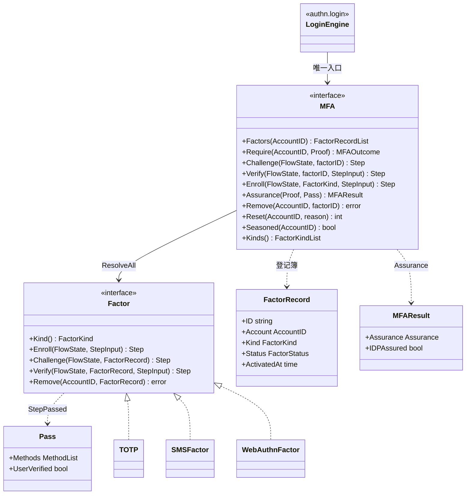
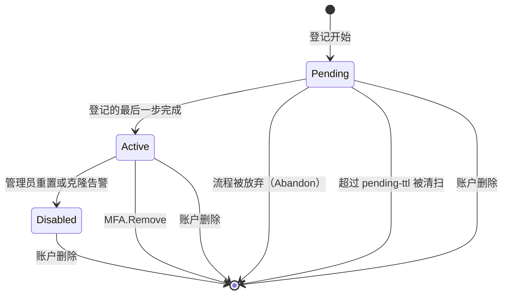
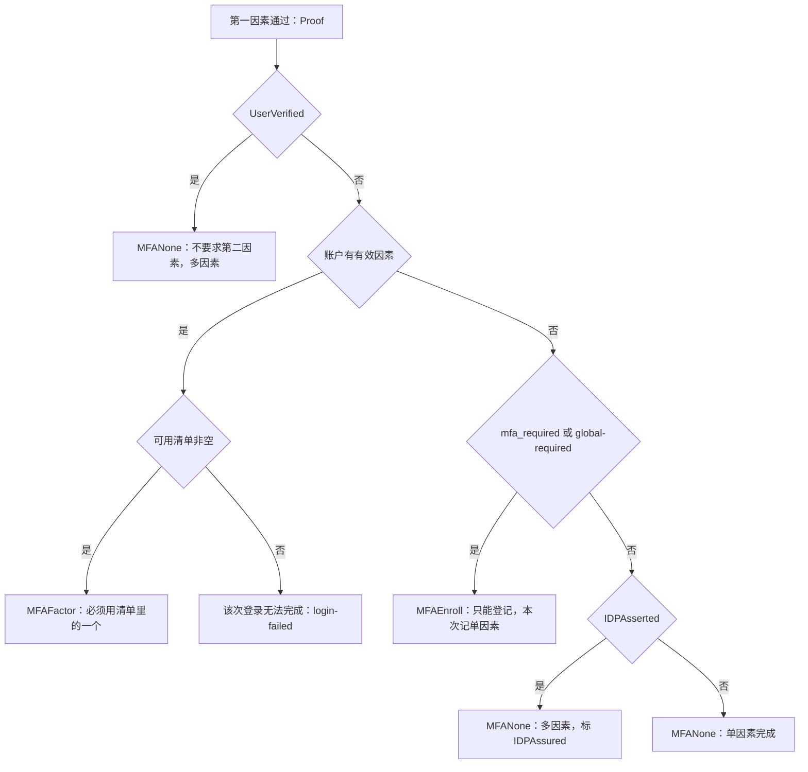
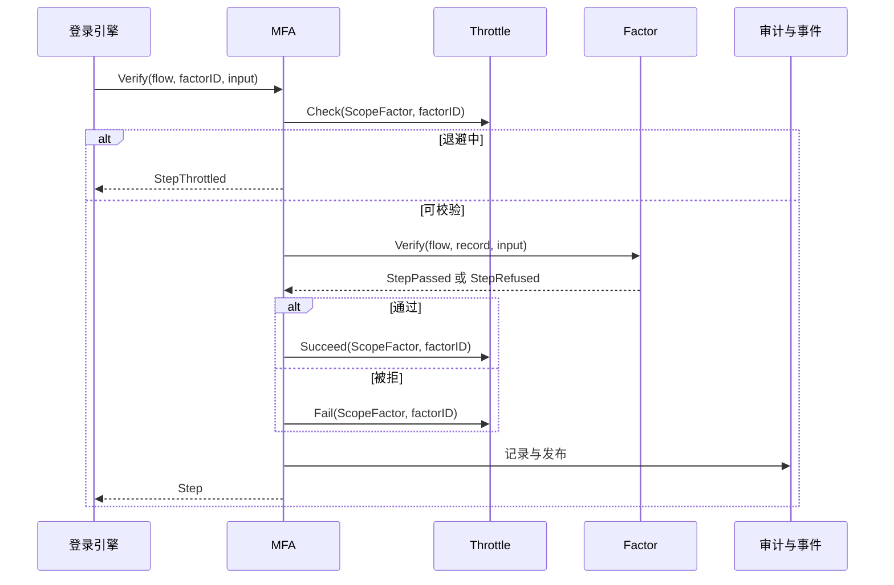

# authn 多因素

## 职责

- **因素登记簿。** 账户的每个因素在 `authn_factors` 里占一行，登记簿统一放在 `authn.mfa`；只有种类专属的数据（TOTP 种子、通行密钥的凭据，[REF-rfc6238](../../../references.md)、[REF-webauthn](../../../references.md)）才放各因素子包自己的表。
- **第二因素的策略判定。** 第一因素通过之后，按账户级与全局级策略回答账户是否还要第二因素，并给出可用的因素清单。租户级策略在请求期执行，不在这里（[tenant.admission](../tenant/design-tenant-admission.md)）。
- **因素的登记、发码与校验的编排。** `MFA` 驱动各因素实现；失败退避、审计记录与事件发布在 `MFA` 里统一做一遍，因素实现不做（[ADR-authn-mfa](../../../adr/adr-authn-mfa.md)）。
- **保障等级的唯一合成处。** `MFA.Assurance` 是整个认证功能目录里计算保障等级的唯一位置；网关的校验后端、请求期的租户准入、`guard.Require` 与冒充发起读到的都是登录会话行里已记录的值。
- **最高权限动作的因素门槛。** 回答 `MFA.Seasoned`；约定账户安全类动作对 `Requirement.Local` 与因素年龄的要求。
- **因素的删除与重置，以及随账户删除的清理。** `MFA.Remove`、`MFA.Reset`，以及对账户生命周期钩子的实现。
- **因素种类的实现。** TOTP、短信、WebAuthn 各是一个子包与一个模块，只做密码学与自己的状态。
- **因素自助面的路由。** `GET B/factors`、`DELETE B/factors/:id`、`PATCH B/factors/:id`；基路径 `B` 由 [authn-gate](design-authn-gate.md) 声明。这个面以静态[特性](../../../glossary.md) `authn.mfa` 声明（见「声明的特性」）。

认证功能目录的术语（因素、保障等级、认证方式、登录会话等）登记在 [authn](design-authn.md) 的模块局部术语表，本文沿用。

### 非职责

- **不实现第一因素，也不驱动登录流程。** 第一因素的方法、流程记录与状态机、登记与加强认证的入口路由都在登录引擎（[authn-login](design-authn-login.md)）；本模块只被引擎经 `MFA` 调用。`authn.mfa.webauthn` 同时交付的通行密钥登录方法遵守同一份方法契约。
- **不执行租户级 MFA 强制。** 登录时账户全局、租户未知，租户级强制只能在请求期判；该判定属于 `tenant.admission`，它读本模块经登录会话行记录的值。
- **不做授权判定，不写 403。** 管理员重置因素的授权经 `Decider`，其接缝与管理面路由在 [authn-admin](design-authn-admin.md)；本模块不认识角色。
- **不实现短信验证码引擎与发送方。** 短信因素复用 `authn.sms` 的 `SMSCodes`（[authn-sms](design-authn-sms.md)）。
- **不持有登录会话。** 加强认证完成后更新会话的是 `Sessions.Elevate`（[authn-session](design-authn-session.md)）；`MFA.Reset` 与删除因素时的撤销、轮换只经 `Sessions` 发起。`MFA.Remove` 本身不撤销会话、也不对会话作任何承诺，删除后的撤销与轮换由用户面 DELETE 路由编排（见「删除与重置」）。
- **不实现失败退避的算法与存储。** 本模块经 `Throttle` 使用范围 `ScopeFactor`，退避算法与表由 `authn.account` 承载（[authn-account](design-authn-account.md)）。
- **不提供恢复码、不提供「记住此设备」、不以短信或邮箱找回因素。** 找回途径限于本文「找回途径」一节列出的各项；口令的匿名重置归 [design-authn-login](design-authn-login.md)。
- **不核验求助者的身份。** 确认来求助的人就是账户主人是组织流程，不由本模块自动化。
- **不发邮件。** 认证功能目录不拥有邮件投递通道；邮箱验证码经 `EmailCodeSender` 接缝交由 mail 模块投递。
- **不读写流程记录，不依赖 kv。** WebAuthn 的仪式数据放进流程记录的私有字节，由引擎保存与一次性消费。
- **不声明配置键与设置键。** 键的名字、取值域与缺省值只在 [authn-config](design-authn-config.md) 给全，本文只写它们的语义。

## 外部接口契约

### 根包的因素类型与接缝

下列类型与接口位于 `pkg/authn` 根包（值类型的真身在 `internal/model`，根包以别名转出）。本节只给签名与承诺，逐字与根包一致。

```go
type FactorKind string

const (
	FactorTOTP     FactorKind = "totp"
	FactorSMS      FactorKind = "sms"
	FactorWebAuthn FactorKind = "webauthn"
)

type FactorStatus uint8

const (
	FactorPending  FactorStatus = iota // 零值：待确认，不得用于验证
	FactorActive
	FactorDisabled
)

type FactorRecord struct {
	ID          string
	Account     AccountID
	Kind        FactorKind
	Label       string
	Status      FactorStatus
	CreatedAt   time.Time
	ActivatedAt time.Time
	LastUsedAt  time.Time
}

// Pass 是一个因素通过的结论。
type Pass struct {
	Methods      []Method // totp 为 otp，sms 为 sms，通行密钥为 webauthn
	UserVerified bool     // 通行密钥断言里是否带用户验证
}

// Factor 是一种第二因素。非排他，经 core.ResolveAll 取用，只被 authn.mfa 取到。
type Factor interface {
	Kind() FactorKind
	Enroll(ctx context.Context, f FlowState, in StepInput) (Step, error)
	Challenge(ctx context.Context, f FlowState, rec FactorRecord) (Step, error)
	Verify(ctx context.Context, f FlowState, rec FactorRecord, in StepInput) (Step, error)
	Remove(ctx context.Context, account AccountID, rec FactorRecord) error
}

type MFAOutcome uint8

const (
	MFANone   MFAOutcome = iota
	MFAFactor            // 账户已有有效因素，必须用一个
	MFAEnroll            // 策略要求而账户尚无因素
)

type MFAResult struct {
	Assurance  Assurance
	IDPAssured bool // 多因素来自企业 IdP 的声明，不是本地验证过的因素
}

// MFA 由 authn.mfa 排他交付。
type MFA interface {
	Factors(ctx context.Context, id AccountID) ([]FactorRecord, error)
	Require(ctx context.Context, proof, requirement AccountID, first Proof) (MFAOutcome, []FactorRecord, error)
	Challenge(ctx context.Context, f FlowState, factorID string) (Step, error)
	Verify(ctx context.Context, f FlowState, factorID string, in StepInput) (Step, error)
	Enroll(ctx context.Context, f FlowState, kind FactorKind, in StepInput) (Step, error)
	Assurance(first Proof, second *Pass) MFAResult
	Remove(ctx context.Context, id AccountID, factorID string) error
	Reset(ctx context.Context, id AccountID, reason string) (removed int, err error)
	Seasoned(ctx context.Context, id AccountID) (bool, error)
	Kinds() []FactorKind
}
```

`FlowState`、`StepInput`、`Step`、`Proof`、`Method`、`Assurance`、`Requirement` 的定义归登录引擎与身份类型的文档（[authn-login](design-authn-login.md)、[authn](design-authn.md)）。`Factor` 与 `MFA` 的方法名与同一模块交付的其他接口的方法名不相交。

### `MFA` 各方法的承诺

| 方法 | 承诺 |
|---|---|
| `Factors` | 返回账户名下的因素行，含状态；不含任何种子、公钥或其他种类专属数据。 |
| `Require` | 按「策略判定」一节的顺序回答结局；结局为 `MFAFactor` 时同时返回可用清单：状态为启用、且认证方式与 `first.Methods` 不相交的因素。清单可以为空，空清单即该次登录无法完成。结局按 `requirement` 账户的因素与策略取定，清单取 `proof` 账户的因素：两者在普通登录里是同一账户，冒充期间分别是生效账户与发起者自己的账户。 |
| `Challenge` | 对选定的因素发码或生成断言选项；先 `Throttle.Check`，退避中不发。TOTP 无事可做。 |
| `Verify` | 先 `Throttle.Check`（`ScopeFactor`，键为因素标识），退避中不校验；再转调 `Factor.Verify`；失败 `Throttle.Fail`，成功 `Throttle.Succeed`；审计与事件在此统一。 |
| `Enroll` | 登记的唯一入口：按种类核对上限（`max-per-kind`，验证器应用另封顶为 1，再登记即替换）、写待确认行、转调 `Factor.Enroll`、最后一步置启用。 |
| `Assurance` | 保障等级的唯一计算处，纯函数，不读库；规则见「保障等级的合成」。 |
| `Remove` | 对因素调 `Factor.Remove` 清理种类专属数据，再删因素行。不撤销会话，也不对账户的会话作任何承诺；删除后的会话效果属于路由（见「删除与重置」）。`mfa_required` 的账户删最后一个因素返回 `ErrLastFactor`，该拒绝先于任何会话动作。 |
| `Reset` | 效果见「删除与重置」；返回被停用的因素个数。授权与强认证核验不在此处，在管理面处理器里。 |
| `Seasoned` | 账户有至少一个非短信、状态为启用且启用已满 `sensitive-min-age` 的因素时为真。 |
| `Kinds` | 已纳入的因素种类，用于启动诊断与登录期的「该因素不可用」判断。 |

`authn.mfa` 另外实现登录引擎的可选放弃回调 `authn.MethodAbandoner`（`Abandon`）：它不是 `MFA` 的一部分，只在流程被放弃时由登录引擎经类型断言找到，见「因素登记」。

**统一收口的范围。** `Challenge`、`Verify`、`Enroll` 里的失败退避、审计记录与事件发布由 `MFA` 统一做；审计动作 `authn.factor.enroll`、`authn.factor.remove` 为尽力档，`authn.mfa.reset` 为强制档，事件 `authn.factor.changed` 的 `change` 取 `enrolled`、`removed`、`reset`、`flagged`；名字与载荷的完整定义在 [authn-events](design-authn-events.md)。

### 登记、删除与加强认证的路由与要求

「新鲜的第一因素」指 `Requirement{Assurance: AssuranceSingle, MaxAge: 5 分钟}`，5 分钟是固定值，不是设置。「新鲜的本地多因素」指 `Requirement{Assurance: AssuranceMulti, MaxAge: recent-window, Local: true}`，`recent-window` 是设置 `authn.mfa.recent-window`。读这个键的是各使用方，不是本模块：因素路由的处理器、登录引擎的自助路由与准入层各自经设置存储从全局层读同一个键，构成 `MaxAge`；读取出错或取值越出取值域时取声明的缺省（10 分钟）。`MaxAge` 为零或负读作没有任何身份满足，不是「不要求新鲜」：取值域由读取方保证，构造 `Requirement` 时落进来的域外取值因此落在拒绝一侧。路由相对基路径 `B`，访问级别均为 `Required`。除管理面的 `POST B/accounts/:id/mfa-reset` 外，下表路由登记为 `Impersonable`：冒充期间它们作用于被冒充账户（[design-authn-impersonation](design-authn-impersonation.md)）。下表是这些动作的完整集合。

| 动作 | 路由 | 要求 |
|---|---|---|
| 列出自己的因素 | `GET B/factors` | 无附加要求 |
| 登记因素 | `POST B/flows/authenticated {purpose:"enroll", input:{kind, label?}}`，随后经 `POST B/flows/answer {step:"enroll"}` 推进；登记只经登录引擎这一个入口 | 账户已有有效因素：新鲜的本地多因素；账户没有因素：新鲜的第一因素；CSRF。冒充期间登记的是被冒充账户的因素，认证事实取自发起者自己的会话。 |
| 删除因素 | `DELETE B/factors/:id` | 新鲜的本地多因素；目标正是账户最后一个启用因素时改以新鲜的第一因素放行（有口令的账户须再证明口令，没有口令的账户凭一次重新登录），因为那一个不能证明自己的删除；该例外不适用于冒充中的发起者，那时仍要发起者自己的新鲜本地多因素；`mfa_required` 的账户仍不得删最后一个；CSRF。冒充期间删除的是被冒充账户的因素。因素标识不存在或不属于调用者时按已删除处理，答 204，删除因此是幂等的；两种情况不区分，区分会变成存在性探测。行已不在也可能是「删除已落地、会话收口失败」的重试，故这次 204 仍收口会话，并在轮换时带上新 cookie。 |
| 改名因素 | `PATCH B/factors/:id` | 无附加要求，标签是元数据；CSRF。冒充期间改名的是被冒充账户的因素。因素标识不存在或不属于调用者时答 404，`Problem.Type` 为 `urn:speed:authn:factor-not-found`；两种情况共用一个码，区分会变成存在性探测。 |
| 加强认证 | `POST B/flows/authenticated {purpose:"step-up"}` | 复用登录引擎；见「加强认证」 |
| 管理员重置因素 | `POST B/accounts/:id/mfa-reset`（路由由 `authn.admin` 挂） | 见「删除与重置」 |

账户已有因素时，登记要求的是本地验证过的多因素，不是会话里已有的单因素，被盗会话因此无法为攻击者添加因素。

### 账户安全类动作与 `Requirement.Local`、`Seasoned`

**判据。** 账户安全类动作是能改变账户的凭据或身份绑定、或授予更高权限的动作。它们要求本地验证过的因素：`Requirement.Local` 为真时，`Identity.AssuranceFromIDP()` 为真的身份不满足。账户没有因素时，自助类动作退回要求新鲜的第一因素。

下表是该判据的例举，不是封闭集；新增的动作按判据归入。

| 动作 | 要求 |
|---|---|
| 删除因素、解绑与关联外部身份、改口令、添加用户名、把邮箱或手机选作或取消登录方式、设置默认联系地址、删除标识 | 账户有因素：新鲜的本地多因素；无因素：新鲜的第一因素；改口令不绕过多因素；删除因素另有一个单一因素账户的例外，见上表 |
| 账户删除与停用、创建与撤销服务密钥（管理面） | 新鲜的本地多因素 |
| 管理员重置因素、管理员重置口令 | 新鲜的本地多因素，且其强认证的方式集含 `otp` 或 `webauthn`；发起者 `MFA.Seasoned` 为真；发起者不是静态口令表主体、不在冒充中 |
| 冒充发起 | 新鲜的本地多因素，方式集含 `otp` 或 `webauthn`；`MFA.Seasoned(actor)` 为真；其余限制见 [authn-impersonation](design-authn-impersonation.md) |

短信因素允许登记与使用，但在管理员重置与冒充发起的强认证里不计：短信是受限认证器（[REF-nist-sp-800-63b](../../../references.md)）。没有登记任何因素的账户永远不能发起冒充，也不能重置他人的因素或口令，这是 `MFA.Seasoned` 的直接结果。`Seasoned` 为假时这些动作答 403 `factor-not-seasoned`（`ErrFactorNotSeasoned`），加强认证解不了这一条，要等因素启用满 `sensitive-min-age`，或先登记一个非短信因素再等；保障等级、新鲜度、`Local` 与认证方式集不满足答 401 `insufficient_user_authentication`（[REF-rfc9470](../../../references.md)），加强认证可解。应答不带年龄，年龄是部署配置，界面据码给出等待说明。`Seasoned` 的年龄门槛使登录期间抢先登记的因素换不到这些动作。

### 加强认证的应答与 `guard.Require`

宿主与授权模块的路由用 `guard.Require(authn.Requirement{...})` 挂在自己的处理链里。`guard` 子包不登记模块，只 import 根包、`pkg/http` 与 gin（[REF-gin](../../../references.md)）。身份不满足要求时应答：

```
401  Problem.Type = urn:speed:authn:insufficient_user_authentication
WWW-Authenticate: <Identity.Challenge()> error="insufficient_user_authentication",
    error_description="…", acr_values="2", max_age="600"
```

`insufficient_user_authentication`、`acr_values`、`max_age` 取自 RFC 9470。RFC 把它们定义在 Bearer（[REF-rfc6750](../../../references.md)）方案的挑战里，对 Cookie 与 Basic 载体沿用同名参数是认证功能目录的约定，不是 RFC 的规定。`acr_values` 取要求等级的十进制文本，零等级（路由不要求特定等级，`Requirement.Assurance` 的零值 `AssuranceNone`）写作 `"0"`；`guard.Require` 与路由部件的挑战一致，都按 `Requirement.Assurance` 写它，零等级因此都写 `"0"`。`max_age` 取要求的 `MaxAge` 的秒数。访问令牌的 `acr` 用同一记法写等级，但把零等级读作单因素，使自己的取值不越出非零等级这一闭集；`acr_values` 不这样归一，写的是要求本身的取值。

`guard.Require` 已由 `pkg/authn/guard/guard.go` 交付：需要这一应答的路由把它挂进处理链。登录引擎与因素路由的处理器按路由部件各自写出同形的 401，准入层按它的判定次序应答：多因素要求写同一个问题码，SSO 要求写 `sso_required`（见下），挑战的构成与 `guard.Require` 一致，因为参数取自同一个 `Identity.Challenge()` 与同一套 `MaxAge` 读法。

**SSO 加强认证用 `sso_required`。** 租户的 `require-sso` 未满足时，准入层的 401 的 `Problem.Type` 为 `urn:speed:authn:sso_required`；`WWW-Authenticate` 与多因素同形（`error="insufficient_user_authentication"`），`acr_values="sso"`。单独的码使客户端知道本地的 TOTP、短信与通行密钥都满足不了这次要求，只有经本租户的提供方重新登录才行；多因素要求仍答 `insufficient_user_authentication`。判定与其余应答见 [tenant.admission](../tenant/design-tenant-admission.md)。

一次加强认证（`purpose=step-up`）要求一个认证方式不落在会话已有方式里的因素：启用时刻早于会话认证时刻的因素可直接使用，本次会话期间登记的因素须在账户再次证明口令之后使用。只有一种因素种类的装配里没有可用的加强认证因素：这样的装配取到满足要求的 200 靠登录时完成第二因素，加强认证的入口留给种类多于一种的装配。同一份约束见 [design-authn-login](design-authn-login.md) 的「在已登录身份上开始流程」一节。

### 声明的特性

**`authn.mfa` 以[静态特性](../../../glossary.md) `authn.mfa` 声明多因素的自助面。** 描述符的 `Resources` 带 `feature.Spec{Name: "authn.mfa"}`（[feature](../design-feature.md)）。这个特性在场，表示本进程运行 `authn.mfa`、已挂出 `GET B/factors`、`DELETE B/factors/:id` 与 `PATCH B/factors/:id`。`mount.Mounter` 是必需依赖，模块进入启用集即挂出这组路由，挂与不挂不另取决于配置或装配，所以声明为静态特性符合架构不变量 18（[architecture](../../architecture.md#架构不变量)）。

- **同一事实只有一个发布点。** 特性文档只说多因素的自助面是否存在，不按因素种类分出特性名；可登记的种类只经 `GET B/methods` 的 `mfa.factors` 发布（[authn-login](design-authn-login.md)、[ADR-feature-ownership](../../../adr/adr-feature-ownership.md)）。
- **本模块的设置不发布。** 全局强制 MFA（`authn.mfa.global-required`）经登录流程的登记步送达；其余设置是时长、上限一类参数。

### 对外接口面

- `Factor`、`MFA`、`FactorRecord`、`Pass`、`MFAOutcome`、`MFAResult` 的签名与上表所列同属对外接口面。
- `FactorKind` 的取值是闭集，与 `authn_factors.kind` 的检查约束一致；新增种类要同时改根包常量、检查约束与迁移。
- 可用的因素种类经登录发现端点 `GET B/methods` 的 `mfa.factors` 发布（[authn-login](design-authn-login.md)），属部署级：装配收哪些种类；本人已登记的因素另走 `GET B/factors`。
- 声明的特性名 `authn.mfa` 与它所指的面：前端经生成的特性名类型引用它，改名、撤去或改变所指的面是宿主可见的破坏性变更。
- 保障等级的非零取值是闭集：单因素与多因素。新增取值时合成处仍只有 `MFA.Assurance`。
- 因素行的零值状态是待确认；待确认的行永不用于验证。
- 哨兵错误的名字见「错误与失败语义」，经 `errors.Is` 判别。

## 依赖

| 依赖 | 方式 | 说明 |
|---|---|---|
| `db.Database` | 必需 | 因素登记簿与 TOTP、WebAuthn 子表；条件更新判胜负。 |
| `mount.Mounter` | 必需 | 登记 `GET B/factors`、`DELETE B/factors/:id`、`PATCH B/factors/:id`。 |
| `Accounts`、`AccountAdmin` | 必需 | 读账户的 `mfa_required` 与手机标识；`Reset` 经 `AccountAdmin.SetMFARequired` 置位。`Accounts` 与 `AccountAdmin` 都由 `authn.account` 交付。 |
| `Throttle` | 必需 | 范围 `ScopeFactor`，键为因素标识。 |
| 全部 `Factor` | `ResolveAll` | 因素实现；`authn.mfa` 对因素子包只经根包的 `Factor` 接口，不 import 它们。 |
| `Sessions` | 可选 | `Reset` 撤销账户的全部会话；用户面删除已启用因素后先撤销除发起会话之外的会话，再轮换发起会话并写回其 cookie。缺席时跳过并写一行 Warn，会话保持有效。 |
| `settings.Store` | 可选 | 运行期可调的策略与期限；缺席时取声明的默认值。 |
| `audit.Audit` | 可选 | 尽力档审计；强制档动作的审计由管理面处理器承担，那里把它当必需。 |
| `event.Bus` | 可选 | 发布 `authn.factor.changed`，提交之后 `Bus.Publish`，不经发件箱；订阅 `authn.account.deleted` 作补偿。 |

因素子包的依赖：`authn.mfa.totp` 依赖 `db.Database`、`MFA` 与 `Accounts`；`authn.mfa.sms` 依赖 `SMSCodes` 与 `Accounts`；`authn.mfa.webauthn` 依赖 `db.Database`、`MFA` 与 `Accounts`，另交付通行密钥登录方法。各因素子包都不依赖 kv。因素子包用到的第三方库在 `pkg/go.mod` 里精确钉版：`authn.mfa.totp` 用 `github.com/pquerna/otp`（[REF-pquerna-otp](../../../references.md)） v1.5.0，`authn.mfa.webauthn` 用 `github.com/go-webauthn/webauthn`（[REF-go-webauthn](../../../references.md)） v0.18.2；各库只被对应的因素叶子包 import，两条都由 `pkg/authn/deps_test.go` 的守卫守住。

**被依赖方向。** `authn.login` 把 `MFA` 当必需：库里已有账户登记了因素而装配里没有因素编排时，登录不能无声跳过第二因素。`authn.impersonation` 也把 `MFA` 当必需：没有因素编排的装配里没有任何账户满足发起者的强认证要求。`authn.admin` 把 `MFA` 当可选，缺席时没有 `mfa-*` 与 `password` 路由，因为这些路由要核对 `MFA.Seasoned`。

**方向核对。** 根包只依赖标准库；`authn.mfa` 位于认证功能目录内，不指向授权、租户或宿主，也不 import 认证功能目录里别的实现子包。`pkg/feature` 根包只依赖标准库，为声明特性 import 它不扩大本模块的闭包；本模块不 import `pkg/feature/board`，也不取用 `feature.Board`（[feature](../design-feature.md)）。租户准入读本模块记录的值，不反向被本模块引用。

## UML 图

### 类型关系

下图固定接缝与记录的关系：`MFA` 排他、`Factor` 并立，登录引擎只见 `MFA`。约束：`Factor` 只被 `authn.mfa` 取到；`MFAResult` 只由 `MFA.Assurance` 产生。



### 因素行的状态

因素行的状态由登记、重置与克隆告警驱动。约束：待确认的行不用于验证；启用的行才进可用清单与 `Seasoned`；账户删除可在任一状态清除因素。



状态名对应 `FactorPending`、`FactorActive`、`FactorDisabled`。

### 策略判定

下图是登录时 `MFA.Require` 自上而下的判定顺序，取第一条命中；表格形式的结局在「策略判定」一节。



### 第二因素的校验

下图固定 `MFA.Verify` 里退避、因素实现、审计与事件的次序。约束：退避中的尝试不进入因素实现，因而不派生、不比对。



## 核心数据结构

### 表

表归声明它的模块，迁移集放在各自包的 `migrations/<方言>/` 下。时间一律 UTC。表间没有外键，账户存在与否由调用方核对，清理走账户生命周期钩子。

```sql
-- authn.mfa
CREATE TABLE authn_factors (
    id           TEXT        NOT NULL PRIMARY KEY,
    account_id   TEXT        NOT NULL,
    kind         TEXT        NOT NULL CHECK (kind IN ('totp', 'sms', 'webauthn')),
    label        TEXT        NOT NULL DEFAULT '' CHECK (length(label) <= 64),   -- 登记方提交的显示名称；空值表示没有名称（取值域见「因素登记」）
    status       SMALLINT    NOT NULL DEFAULT 0 CHECK (status IN (0, 1, 2)),   -- 0 待确认（零值）
    created_at   TIMESTAMPTZ NOT NULL,
    activated_at TIMESTAMPTZ NULL,
    last_used_at TIMESTAMPTZ NULL
);
CREATE INDEX authn_factors_account ON authn_factors (account_id, status);

-- authn.mfa.totp
CREATE TABLE authn_totp_secrets (
    factor_id    TEXT        NOT NULL PRIMARY KEY,
    secret       TEXT        NOT NULL,                       -- 加密列（serializer:encrypted）
    algorithm    TEXT        NOT NULL DEFAULT 'SHA1',
    digits       INTEGER     NOT NULL DEFAULT 6,
    period       INTEGER     NOT NULL DEFAULT 30,
    last_counter BIGINT      NOT NULL DEFAULT 0              -- 已用的最大计数器，防重放
);

-- authn.mfa.webauthn
CREATE TABLE authn_webauthn_users (
    account_id TEXT NOT NULL PRIMARY KEY,
    handle     TEXT NOT NULL UNIQUE                          -- 32 字节随机数的 base64url，不含个人信息
);
CREATE TABLE authn_webauthn_credentials (
    factor_id        TEXT    NOT NULL PRIMARY KEY,
    rp_id            TEXT    NOT NULL,
    credential_id    TEXT    NOT NULL,                       -- base64url
    public_key       TEXT    NOT NULL,                       -- base64url，COSE 编码；不加密
    aaguid           TEXT    NOT NULL,
    attestation_type TEXT    NOT NULL,
    transports       TEXT    NOT NULL DEFAULT '',
    sign_count       BIGINT  NOT NULL DEFAULT 0,
    clone_warning    BOOLEAN NOT NULL DEFAULT FALSE,
    user_verified    BOOLEAN NOT NULL,
    backup_eligible  BOOLEAN NOT NULL,
    backup_state     BOOLEAN NOT NULL,
    passkey          BOOLEAN NOT NULL,                       -- 以通行密钥档案登记：可发现凭据、要求用户验证
    UNIQUE (rp_id, credential_id)
);
```

- 因素登记簿放 db：丢失会放宽校验（账户读作没有因素），所以不放 kv（[ADR-authn-state-placement](../../../adr/adr-authn-state-placement.md)）。TOTP 的重放计数器同理，放在 `last_counter` 一列。
- `secret` 是加密列，使用 `pkg/db` 的加密列能力；根密钥缺失时启动自检失败。
- `public_key` 不加密：它不是秘密，完整性比保密重要。
- WebAuthn 库文档的示例表是 PostgreSQL 专用写法，表里用两个方言都能表达的类型。
- 短信因素没有子表：它绑定账户当前那条已验证的手机标识，手机变更（要求新渠道验证）使因素指向新号码。
- 每个账户每种因素至多 `max-per-kind` 个，验证器应用（TOTP）除外：它固定为 1。再登记一次验证器应用是替换：新行在旧行仍启用时以待确认写入，新码被证明后在同一事务里启用新行、停用旧行（保留行与种类数据，留审计轨迹）；新码被证明之前旧行照常可用于验证，登记被取消或验证失败时旧行不变。按种类的上限由本模块的策略给出（验证器应用 1，其它取设置值），不在各处理器里重复判断。

### 登录会话行里与本模块相关的字段

`assurance`、`idp_assured`、认证方式集与认证时刻记在登录会话行，归 `authn.session`（[authn-session](design-authn-session.md)）；本模块只产生值，不写那张表。

## 核心算法与流程

### 策略判定

登录时 `MFA.Require` 的判定顺序，自上而下取第一条命中。账户级策略是账户的 `mfa_required`，全局级策略是设置 `authn.mfa.global-required`，租户级策略是 `tenant.admission.require-mfa`，不在本表。

| 条件 | 结果 |
|---|---|
| 第一因素带用户验证（`Proof.UserVerified`；登录断言要求用户验证，所以通行密钥第一因素即多因素） | 不要求第二因素；`MFA.Assurance` 记多因素 |
| 账户有任何有效因素 | `MFAFactor`：必须用一个与第一因素种类不同的因素；即使第一因素是声明了多因素的 IdP，IdP 的声明盖不过账户自己的因素 |
| 账户 `mfa_required` 为真，或 `global-required` 为真，而账户尚无有效因素 | `MFAEnroll`：只能登记；本次登录会话记单因素，登记的因素不计入本次保障等级 |
| `Proof.IDPAsserted` 为真，而账户没有因素、也没有账户级与全局级的强制 | 不要求第二因素；`MFA.Assurance` 记多因素并标 `IDPAssured` |
| 其余 | 单因素完成 |

- **策略只加严，不放宽。** 任一级不得抵消另一级。
- **第二因素的认证方式不得与第一因素已有的方式相交。** 可用清单已剔除相交者。短信登录之后不能用短信因素当第二因素：二者走同一条通道，对 SIM 劫持而言等于一个因素。账户只有同种类的因素时清单为空，该次登录无法完成，应答 `login-failed`，用户走管理员重置。
- **因素实现缺席按「该因素不可用」处理。** 装配里没有某个因素种类的实现而账户有该种类的有效因素时，该因素不进可用清单，不得当作账户没有因素；账户没有任何可用因素时登录无法完成，运维从启动诊断（已登记的因素种类）与事件发现。
- **没有「记住此设备」。** 除第一因素本身已证明两类因素（带用户验证的通行密钥）外，每次登录都要答第二因素。客户端留下的任何标记都不是服务端能证明的设备身份。
- **租户级强制只在请求期判。** 登录时账户是全局的，任何范围线索都能被绕开。

### 保障等级的合成

`MFA.Assurance(first, second)` 是纯函数，输入是第一因素交出的事实（`Proof.UserVerified`、`Proof.IDPAsserted`、`Proof.Methods`）与可空的第二因素结论 `Pass`。判据是已证明的因素种类：

- 第一因素是带用户验证的通行密钥：登录断言要求用户验证，该因素自己就证明了两类因素，多因素。
- 第一因素加一个认证方式与之不相交的第二因素：多因素。
- 其余：单因素。
- 第一因素的方法不报等级；校验后端与请求期准入读登录会话行里已记录的等级与 `idp_assured`，不重新判断。

**IdP 声明的采信条件。** 企业 IdP 断言里的 `amr`、`acr` 是外部声明，默认不采信（应用自己验证这些声明才合规，IdP 不给声明时按最低强度）。同时满足以下全部条件才抬高，封闭集：

1. 提供方行显式开启信任（`trust_idp_mfa`），断言里带落在该行 `mfa_acr_values` 内的取值；`Proof.IDPAsserted` 即上述判定的结论。
2. 账户没有任何有效因素。
3. 账户 `mfa_required` 与全局 `global-required` 都不要求登记。

抬高时合成结果为多因素并标 `IDPAssured`，会话记 `idp_assured`。该多因素是 IdP 的声明，不是本地验证过的因素：

- 只在该提供方所属的租户内算数；在别的租户的 `require-mfa` 里不计。
- 设了 `Requirement.Local` 的动作不采信它。
- 本地因素完成加强认证后，`Elevation.IDPAssured` 为假，会话转为本地多因素。

**调用约定。** 登录引擎只在结局为 `MFANone` 与第二因素通过之后调用 `Assurance`。结局为 `MFAEnroll` 的登录不调用它：会话记单因素，`Methods` 只含第一因素，`IDPAssured` 为假。第二因素通过时，`Assurance` 不抬高 `IDPAssured`：账户有有效因素即不满足采信条件。

**本次会话期间登记的因素不抬高登记它们的这次登录的强度。** 这次登录的会话记单因素。要得到多因素，须下一次登录，或做加强认证：加强认证先要求账户再次证明口令，通过之后才提供本次会话期间登记的因素；启用时刻早于当前会话 `AuthTime` 的因素无需再次证明口令。

### 请求期的租户级判定

租户级 `require-mfa` 为真而 `Assurance` 低于多因素时，准入层应答 `401 insufficient_user_authentication`；`require-sso` 为真而未满足时应答 `401 sso_required`，`acr_values="sso"`；`IDPAssured` 的多因素只在该提供方所属的租户内计数。账户没有因素时同一应答告诉客户端去登记。`authn.mfa` 在 `Start` 里若 `core.Registry.Participating("tenant.admission")` 为假，写一行 `Warn`：租户级强制多因素无人执行。判定顺序与应答在 [tenant.admission](../tenant/design-tenant-admission.md)。登记与加强认证的端点所在的端不受租户解析守卫，所以客户端总有路可走。

### 统一收口：`Challenge`、`Verify`、`Enroll`

1. 先 `Throttle.Check(ScopeFactor, 因素标识)`；退避中返回 `StepThrottled`，不转调因素实现。
2. 转调 `Factor` 的对应方法。因素实现只做密码学与自己的状态。
3. `Verify` 失败调 `Throttle.Fail`，成功调 `Throttle.Succeed`；退避的自由次数、指数与封顶与登录同一套参数（见 [authn-config](design-authn-config.md)），退避开始时发 `authn.throttle.engaged`。
4. 写审计记录，发布事件；对外的失败一律并入 `login-failed`，成因只进日志。

对因素实现的调用受登录引擎的单次调用预算约束，并由引擎 `recover` panic，按该因素故障收口 503。

### 因素登记

登记是登录引擎的 `enroll` 目的，经 `flows` 路由推进，`MFA.Enroll` 驱动各步：

1. 前置要求见「登记、删除与加强认证的路由与要求」一节，由引擎在开始与完成时复核发起会话。
2. 核对该种类的数量上限，超出返回 `ErrFactorLimit`。
3. 写一行 `status=0` 的待确认行，转调 `Factor.Enroll`。可选名称取自第一步的 `input.label`，见下。
4. 因素实现的最后一步交出 `StepEnrolled`，`MFA` 把行置为启用（`FactorActive`），写入 `activated_at`，写审计并发 `authn.factor.changed`（`enrolled`）。
5. 引擎在完成时撤销该账户除发起会话之外的其余会话；会话的保障等级不变（[authn-login](design-authn-login.md)）。

**放弃登记流程。** 引擎在删除流程记录前把流程的私有字节交给 `MFA.Abandon`；它从中取出这次流程写下的待确认行标识，按「仍为待确认」条件删除该行，并让该因素的实现清掉它为这行保存的数据。同一账户里另一条登记写下的待确认行不受影响；标识缺失、行已不在或已不是待确认时按无事发生处理，因此对同一流程重复放弃是安全的。回调失败只记日志，流程记录照常删除（[authn-login](design-authn-login.md)）。

**名称。** 名称只属于一个账户可能持有多条的方式（通行密钥）——它们靠名称互相区分；验证器应用只有一个，条目就是种类本身，因此登记验证器应用时携带非空 `label` 是 400 `bad-request`（不忽略、不静默丢弃），清单行也恒显示种类名。名称的取值域是：先去除首尾空白，最多 64 个字符，不得含控制字符（含换行与制表符）。登记在第一步接收可选的 `input.label`，按该取值域规整后原样存入因素行；空值表示这个因素没有名称，服务端不生成任何名称。后续步骤不再读取名称。改名走 `PATCH B/factors/:id`，请求体 `{label}` 用同一取值域，空值清除名称，应答是更新后的因素行。改名只写因素行的 `label`：它是元数据，不要求新鲜认证，不写审计行，也不发事件。因素标识属于别的账户时按不存在应答 404 `factor-not-found`，与标识不存在无从区分。

首次登记因素按信任首次使用：账户尚无因素时，持口令者与真用户不可区分，本模块不以邮箱验证码作为因素登记的带外证明。这一条把抢先登记的危害限制在普通业务路由上：抢先登记的因素计不进本次强度，换不到 `Seasoned` 所守的最高权限动作。待确认超过 `pending-ttl` 的行由 `authn.mfa` 在 `Start` 起的有界清扫协程每小时删一次，`Stop` 与 `Close` 的 context 去掉了取消，协程的退出自带时限。

### 加强认证

加强认证以新鲜度为判据：敏感动作要求 `Identity.Satisfies(Requirement{AssuranceMulti, MaxAge})`，`MaxAge` 缺省取 `recent-window`。

- 入口是 `POST B/flows/authenticated {purpose:"step-up"}`，复用登录引擎：账户有早于会话认证时刻的因素时直接进入第二因素待答；账户没有因素，或因素都在本次会话期间登记录入时，要求重新证明第一因素，其中因素都在本次会话期间登记时以 `password` 作第一因素，口令证明后这些因素进入第二因素待答。
- 完成时不建新会话，由 `Sessions.Elevate` 更新当前会话的 `assurance`、`auth_time`、方式集并轮换会话令牌，防会话固定。令牌发放的客户端在 `complete` 的应答里拿到新访问令牌，`acr` 与 `auth_time` 已更新。
- 加强认证可直接使用启用时刻早于当前会话 `AuthTime` 的因素；本次会话期间登记的因素须在再次证明口令之后使用，账户没有口令时该步进答 401 `insufficient_user_authentication`。
- 联邦登录的会话步进重走同一个 IdP：OIDC（[REF-openid-connect-core](../../../references.md)）加 `prompt=login`，回来后核对 `auth_time` 不早于流程开始；SAML（[REF-saml2](../../../references.md)）请求带 `ForceAuthn`。SAML 库不支持 `ForceAuthn` 时，联邦会话的步进改为要求账户已登记因素并走因素流程。

### TOTP

- **登记。** 用 `pquerna/otp` 的 `totp.Generate`：20 字节随机密钥、SHA-1、6 位、30 秒，与各认证器应用的公约一致。写一行待确认因素与加密的种子，返回 `otpauth://`（[REF-otpauth-key-uri-format](../../../references.md)）地址；二维码由客户端画，服务端不调库里的图像函数。**种子只在这次应答里出现一次。** 地址的标签是「发行者:账户名」：账户名取该账户的用户名标识，账户没有用户名或读取失败时取账户 ID，不因此失败登记；发行者是部署可配置的站点名（见 [authn-config](design-authn-config.md)）。登记的确认步要求提交一个有效码才转启用。
- **校验。** 自写（取舍见 [ADR-authn-mfa](../../../adr/adr-authn-mfa.md)）：用 `GenerateCodeCustom` 对前一步、当前步、后一步各生成一次，逐个做常量时间比较，取命中的计数器 `c`，要求 `c > last_counter`，然后条件更新：

  ```sql
  UPDATE authn_totp_secrets SET last_counter = ? WHERE factor_id = ? AND last_counter < ?
  ```

  影响行数为 1 才算通过；为 0 即重放，返回 `ErrReplay`，对外仍是 `login-failed`。判胜负靠影响行数，不依赖 `RETURNING`。
- **窗口。** 固定为前后各一步，不是设置。不做时钟漂移校正，要求部署做时间同步。
- **失败。** 对因素标识记 `Throttle.Fail`（`ScopeFactor`）；退避期内的尝试不校验。

### 短信因素

- 登记要求账户已持有已验证的手机标识；没有则先走 `POST B/phone`、`POST B/phone/verify`，这些路由要求新渠道验证，本身不要求新鲜认证，但新号码取代已启用短信因素发码目标时，证明要求新鲜认证。
- 发码与校验共用 `authn.sms` 的验证码引擎，用途为 `mfa`，同一套预算、重发间隔、尝试次数、摘要与消费语义（[authn-sms](design-authn-sms.md)）。
- 发码时因素把 `FlowState.Source` 原样填进 `SendCode.Source`，所以短信第二因素也计入来源预算。`FlowState.Source` 只由登录引擎的 `challengeFactor` 从发起这次挑战的请求填入；因素自己没有请求，空值表示没有可信来源，引擎按 fail-open 不施加来源维度。因素不读 HTTP，也不从别处猜一个地址。
- 通过的结论 `Pass.Methods` 为 `sms`。短信因素是受限认证器：允许登记与使用，管理员重置与冒充发起的强认证里不计。
- 登录与因素的短信预算按用途分设，登录的预算被耗尽不挤占已通过口令的第二因素与登记。

### WebAuthn 与通行密钥

库的协议部分（`BeginRegistration`、`FinishRegistration`、`BeginLogin`、`FinishLogin`、`BeginDiscoverableLogin`、`FinishPasskeyLogin`）直接用，适配与状态在 `authn.mfa.webauthn`。库类型不出该包。

| 事项 | 做法 |
|---|---|
| `User` 适配 | `WebAuthnID` 取 `authn_webauthn_users.handle`（随机、不含个人信息）；`WebAuthnName` 取用户名标识，没有则取账户标识；`WebAuthnCredentials` 从表装出 |
| 登记档案 | 通行密钥（`passkey=true`）：可发现凭据加用户验证 `required`，可作第一因素（登录方法名 `passkey`，断言要求用户验证，因而即多因素）与第二因素。安全密钥（`passkey=false`）：用户验证 `preferred`，只作第二因素。证明格式取 `none`；登记时 `WithExclusions` 排除该账户的启用凭据，停用因素的凭据不排除，使同一认证器可重新登记。登录（第一因素）断言要求 `required`，第二因素的断言保持 `preferred` |
| 来源与 RP ID | RP ID、站点名与来源集合由配置给出（键、取值与缺省见 [authn-config](design-authn-config.md)）；启动校验 `rp-id` 等于基址主机或其父域。**全局账户对应一个 RP ID**：凭据绑定 RP ID，换 RP ID 就是另一批凭据，库提供的单次仪式覆盖 RP ID 的口子不启用。公共后缀表（[REF-public-suffix-list](../../../references.md)）的核对不做，是残余风险 |
| 仪式数据 | 放流程记录的私有字节；`Timeouts.Login.Enforce` 与 `Timeouts.Registration.Enforce` 固定为真，库只在它为真时才设过期；一次性消费靠引擎对流程记录的比较并交换，库不防同一份仪式数据被消费两次；只取本库序列化、由服务端保完整的字节，被篡改的字节能让库按长度前缀分配数 GB 内存 |
| 每次断言成功 | 条件更新写回 `sign_count`（`WHERE sign_count <= ?`）、`clone_warning`、`user_verified`、`backup_state`，库不替调用方落库；更新失败按重放处理。同步通行密钥的计数常恒为 0，库只在新计数不大于旧计数且不全为零时才置告警，所以不误伤 |
| 克隆告警 | `clone_warning` 为真则本次校验失败：因素以 `StepRefused(authn.ErrFactorFlagged)` 拒绝本次断言，`MFA.Verify` 据该成因把因素行置停用并发布 `authn.factor.changed`（`flagged`）；断言本身的计数回退也写 `clone_warning` 并同样以该成因拒绝。通行密钥作第一因素时由登录引擎直接驱动方法、不经 `MFA` 编排，那一路只拒绝本次断言（对外并入 `login-failed`），写一行 Warn 安全日志，不置停用、不发事件；断言重放同样只拒绝并写一行 Info 安全日志。凭据自身的 `clone_warning` 使它在该路与 `Factor` 路上都不可用，清除该行经 `MFA.Remove` |
| 版本 | go-webauthn 是 0.x，`pkg/go.mod` 精确钉在 v0.18.2（由 `pkg/authn/deps_test.go` 的守卫守住）；升级要读其迁移说明并排空在途仪式，`SessionData` 的序列化形状随版本变 |

`Pass.UserVerified` 取自断言里的用户验证位。通行密钥作第一因素时，登录断言要求用户验证，断言因此带该位，策略判定里「第一因素带用户验证」那一条命中。

### 删除与重置

**`MFA.Remove`。** 调 `Factor.Remove` 清理种类专属数据，再删因素行。它不撤销会话，也不对账户的会话作任何承诺；会话效果由用户面 DELETE 路由编排，宿主直接调用 `MFA.Remove` 时其余会话不受影响。删除失败时因素行留在原处，重复调用能补完，因为因素的删除是幂等的。`mfa_required` 的账户不得删最后一个因素（`ErrLastFactor`）。

**删除用户面路由的会话效果。** `DELETE B/factors/:id` 先读被删因素的当前状态（行删掉之后就无处再读），调用 `MFA.Remove`，成功之后按当时的状态决定会话：

1. 被删因素处于启用状态：经 `Sessions.RevokeAccount(ctx, account, 发起会话, authn.ReasonSelf)` 撤销该账户除发起会话之外的其余会话；撤销成功之后经 `Sessions.Rotate` 为发起会话换令牌，并经 `Sessions.SetCookie` 把它写回应答。发起删除的设备因此以新令牌保持登录，旧令牌不再有效。`Sessions` 缺席时跳过并写一行 Warn，会话保持有效。
2. 待确认或已停用：不撤销、不轮换。这两种因素不改变账户已有的强度，删掉它们不改变其余会话的可信度。

拒绝（`ErrLastFactor`、账户读失败）与删除本身的失败都发生在撤销之前，被拒或失败的删除不动会话。撤销与轮换都在因素行删掉之后进行，且撤销先于轮换：`Sessions.RevokeAccount` 或 `Sessions.Rotate` 失败时路由答 503，此时因素已经删掉，发起会话在撤销失败时不被轮换、在轮换失败时保持原令牌，重发同一请求按「因素已不存在」处理并补完撤销与轮换。一个本来就不存在的名字与一个已删掉的名字无从区分，同样按已删处理并结束其余会话、轮换发起会话——这是重试得以收口的代价，账下本没有这个因素时这两步只是把该账户按更严的方向收口。代价说白：一条把因素标识写错的 DELETE，会结束调用者自己的其他会话并换掉自己的令牌。

删除单个因素的原因是账户持有人在改自己的凭据，会话撤销取 `authn.ReasonSelf`，与解绑等自助变更同类；`Reset` 是管理员动作，固定用 `authn.ReasonFactorReset`。

**`MFA.Reset` 的效果。** 按下列次序，任一步失败返回错误，重试幂等；次序使中途失败时账户处于更严而不是更松的状态：

1. 经 `AccountAdmin.SetMFARequired` 置 `mfa_required` 为真。
2. 本模块事务内把账户的全部因素置停用。
3. 经 `Sessions.RevokeAccount` 撤销账户的全部会话；`Sessions` 缺席时跳过。
4. 事务提交之后 `Bus.Publish` `authn.factor.changed`（`reset`）。

重置不绕过第一因素：重置后的下一次登录仍要先过第一因素，然后只能登记新因素；不提供「重置后直接登录」。重置也不借道冒充接缝。

**重置的授权与强认证核验在管理面处理器。** 处理器先经 `Decider`（动作 `authn.mfa.reset`，`Decider` 缺席即全拒），再核验发起者的要求（见「账户安全类动作与 `Requirement.Local`、`Seasoned`」），然后写强制审计，审计写成功之后、调用 `MFA.Reset` 之前，经 `AccountAdmin.HasLoginWayOtherThanPasskey` 核对目标账户是否持有口令凭据、`Proves` 为真的手机号与外部身份中的至少一种；一种都没有（只剩因素，例如只有通行密钥，或只剩未证明的手机号）时答 409 `last-login-method`（`ErrLastLoginMethod`），不调 `Reset`，补一条 `failed` 审计行。重置失败时同样补 `failed` 行（[authn-admin](design-authn-admin.md)）。`Reset` 的 `reason` 形参由处理器填入，本模块不使用它记录或发事件：`authn.factor.changed`（`reset`）不带原因，会话撤销固定用 `authn.ReasonFactorReset`，重置的来由落在处理器写的强制档审计里。签名保留该形参，供宿主与处理器表达重置的来由。

**`MFA.Seasoned`。** 读账户的因素行：存在 `kind` 不是 `sms`、`status` 为启用、`activated_at` 与当前时刻之差不小于 `sensitive-min-age` 的行即为真。该判定不看会话，只看登记簿。

### 找回途径

找回途径限于下列各项（封闭集），排列顺序即使用顺序：依赖的外部判断由少到多，靠前的不可用时才退到靠后的（[ADR-authn-mfa-recovery](../../../adr/adr-authn-mfa-recovery.md)）。

1. **冗余。** 账户登记了不止一个因素时，丢了一个，用另一种做加强认证，撤销丢失的并重新登记。账户只有一个因素时，本实现不发 `warnings` 提示：登录与登记的应答不带该字段，建议再登记一个的提示由客户端承担。
2. **匿名口令重置。** 路由见 [design-authn-login](design-authn-login.md) 的「匿名口令重置」。账户本人凭一条已证明的邮箱（`email-code`）或手机（`sms-code`）收码并设定新口令，不建立会话；因素行不被触碰，重置后的下一次登录仍要先过第一因素，再按账户原来的要求过第二因素。
3. **管理员重置因素。** 路由 `POST B/accounts/:id/mfa-reset`，效果见「删除与重置」。发起者必须有新鲜的本地多因素，其强认证里含非短信因素，名下有启用已满 `sensitive-min-age` 的非短信因素（`MFA.Seasoned`），不得是静态口令表主体，不得在冒充中。`Decider` 可以实现双人复核。
4. **管理员重置口令。** 路由 `POST B/accounts/:id/password`，经 `Decider`（动作 `authn.account.update`，缺席即全拒）；发起者的要求同管理员重置因素；管理员提交的临时口令是请求体，从不回显、不进日志与审计，缺省置 `must_change`；强制审计；成功后撤销该账户的全部会话。这是只有口令登录名的管理员创建账户的唯一重置路径，也是组织内的口令找回途径。
5. **运维经 Go 接口。** 宿主的命令直接调用 `MFA.Reset` 与 `Passwords.Set`，不经 `Decider`，是最后手段。

找回途径限于本节列出的各项；经其他登录方式登录同样要过该账户的第二因素。匿名口令重置只解决口令，不解决因素丢失：同时丢失口令与唯一强因素的账户仍走管理员或运维。找回途径的判据见 [ADR-authn-mfa-recovery](../../../adr/adr-authn-mfa-recovery.md)。

**接受的代价。**

- 只有一个因素又没有可用管理员的账户，丢失该因素后无法自助找回，只能由运维直接改库。
- 匿名口令重置的强度取决于账户本人证明过的那条邮箱或手机：持有该渠道的人可以改口令。第二因素保护登录，不保护改凭据这一动作；没有第二因素的账户因此可被渠道的持有者接管。
- 管理员重置是找回链上最弱的一环（社会工程）；本模块只提供判定接缝、审计与事件，身份核验在认证功能目录之外。
- 首次登记因素是信任首次使用；真用户会在 `sensitive-min-age` 内被自己不拥有的因素挡在最高权限动作之外，要靠管理员重置。
- 没有「记住设备」使以第二因素达成多因素的用户每次登录都要答第二因素；第一因素本身已证明两类因素（带用户验证的通行密钥）时不再要求第二因素。

### 账户生命周期

`authn.mfa` 实现 `AccountLifecycle`。`AccountDeleted` 对账户的每个因素调 `Factor.Remove`（清 TOTP 种子、通行密钥公钥），再删因素行与 `authn_webauthn_users` 里该账户的行；账户停用与启用都不动因素，`AccountEnabled` 返回 nil。本模块同时订阅 `authn.account.deleted` 作补偿，处理函数幂等，只做清理。

## 错误与失败语义

### 哨兵

本表只列本模块产生或经本模块返回的哨兵；全部哨兵与对外的响应形状在 [authn-failure](design-authn-failure.md)。「方向」写失败时是拒绝还是放宽。

| 哨兵 | 何时 | 对外 | 方向 |
|---|---|---|---|
| `ErrFactorLimit` | 某种因素已达 `max-per-kind` | 409 `conflict` | 拒 |
| `ErrLastFactor` | `mfa_required` 的账户删最后一个因素 | 409 | 拒 |
| `ErrFactorNotEnrolled` | 因素未登记，或待确认的行被用于验证 | 并入 `login-failed` | 拒 |
| `ErrReplay` | TOTP 计数器或 WebAuthn 签名计数重放 | 并入 `login-failed` | 拒 |
| `ErrFactorFlagged` | WebAuthn 凭据疑似克隆（计数回退或库置的克隆告警） | 并入 `login-failed`；因素以此作成因拒绝，`MFA.Verify` 据它停用该因素行并发 `authn.factor.changed`（`flagged`） | 拒 |
| `ErrThrottled` | `ScopeFactor` 退避中 | 429 带 `Retry-After` | 拒 |
| `ErrStepUpRequired` | 保障等级、新鲜度或 `Local` 不满足 | 401 `insufficient_user_authentication` | 拒 |
| `ErrFactorNotSeasoned` | `Seasoned` 为假：冒充发起、管理员重置因素与重置口令的发起者名下没有启用已满 `sensitive-min-age` 的非短信因素 | 403 `factor-not-seasoned` | 拒 |
| `ErrNoFactor` | 纳入 `authn.mfa` 而没有任何 `Factor`，且设了 `global-required`，或库里已有账户登记了某个种类而该种类没有实现 | 启动失败，点名缺的模块 | 拒 |
| `ErrFactorConflict` | 两个 `Factor` 同种 | 启动失败，点名双方 | 拒 |
| `ErrLastLoginMethod` | 重置因素时目标账户没有口令凭据、`Proves` 为真的手机号与外部身份中的任何一种（未证明的手机号不算），只剩因素一种登录方式 | 409 `last-login-method` | 拒 |
| `ErrForbidden`、`ErrAuditRequired` | 重置因素时 `Decider` 判否；强制审计写失败 | 403；503 | 拒 |

### 失败方向

- **依赖不可用时拒绝。** db 不可用时，因素校验与登记返回 503，不校验；退避状态读不到就不能放行校验。kv 不可用时，开始与继续登录流程（含 WebAuthn 仪式）返回 503；已建立的会话不受影响。对外不区分是哪个依赖。
- **审计与事件。** 强制档的重置在审计写成功之前不动作；尽力档的因素登记与删除审计写失败只记 Error 与计数，业务继续。事件发布失败只记 Warn，不使业务失败；事件是提示，权威在 db。
- **库成功而补充校验失败，按失败。** TOTP 的重放判定与 WebAuthn 的计数写回是库之外补上的校验，失败即拒绝，记 Error。
- **读设置出错的方向。** `global-required` 属强制类开关，读不出来按拒绝（503）；调参类的期限与上限读不出来取声明的默认值并记 Error。
- **克隆告警经拒绝的成因交回。** 因素判定断言来自疑似克隆的凭据（库置的克隆告警或签名计数回退）时，以 `StepRefused(authn.ErrFactorFlagged)` 交回；`MFA.Verify` 据该成因把该因素行置停用、发布 `authn.factor.changed`（`flagged`），并使该失败计入退避。该哨兵是因素把这一事实交给 `MFA` 的通道，由根包导出，因素与 `MFA` 都经 `errors.Is` 判别。
- **因素实现的故障。** 因素实现宕机时交 `StepUnavailable`，对外 503，不与 `StepRefused` 的 401 混桶。
- **登记的种类没有实现。** 启动期已按 `ErrNoFactor` 拒绝（见哨兵表）。运行期仍遇到账户登记的种类没有对应实现时（例如某实现模块在运行期缺席），本模块把它按该因素不可用处理，交 `StepRefused` 并以 `ErrNoFactor` 为成因，对外并入 `login-failed`，不退避；不为这一运行期情形另立哨兵，复用启动期哨兵作成因。
- **`Reset` 的部分失败。** 返回错误，账户处于更严的状态；重试幂等。`AccountDeleted` 清理失败时返回错误，由 `authn.account` 汇总为 `ErrCleanupIncomplete`，重试同一调用幂等地补完，事件补偿与 `valid_after` 兜底。
- **启动期。** 带表的 `Start` 探测不到自己的表即以 `ErrNotMigrated` 终止；`New` 里不读写自己的表，清扫协程在 `Start` 起。

### 实现所依赖的假设

下列行为未经核实，对应的断言按假设处理，各自带守住它的测试。

- **假设：** TOTP 的条件更新在 `pkg/db` 支持的每个方言下，并发提交同一个码时恰好一个得到影响行数 1，不依赖 `RETURNING`。**测试：** 对每个方言并发提交同一个码，断言只有一次通过、其余为重放。
- **假设：** WebAuthn 的仪式数据序列化后放得进流程记录私有字节的上限。**测试：** 测量序列化后的大小，随允许的凭据清单增长的情形一并覆盖（[authn-login](design-authn-login.md)）。
- **假设：** `go-webauthn` 在新计数不大于旧计数且不全为零时才置克隆告警，同步通行密钥恒报 0 时不误伤。**测试：** 计数恒为 0 的连续断言全部通过。
- **假设：** 依赖方要求用户验证时，浏览器不会产出一份不带用户验证的断言，因此「无 UV 断言被服务端拒绝」这条只能在服务端用例上驱动。**测试：** 端到端层以不带用户验证的虚拟认证器尝试登录，断言仪式失败、不产生提交且不进入应用；服务端用例提交一份无 UV 断言，断言被拒（`TestAPasskeyWithoutUserVerificationIsRefused`）。Chromium 的虚拟认证器在依赖方要求 UV 时以 `NotAllowedError` 结束仪式。
- **假设：** `go-webauthn` 所要求的工具链版本在 `pkg` 模块下可编译，并与同模块的其他依赖并存。**测试：** `pkg` 模块的构建与依赖图检查；不能并存时 WebAuthn 子包另立模块。
- **假设：** SAML 库支持请求带 `ForceAuthn`。**测试：** 构造带 `ForceAuthn` 的请求并核对出站消息；不支持时按「加强认证」一节的回退处理。

## 并发与事务边界

- **每个模块只在自己的事务里写自己的表。** `Reset` 跨模块：`mfa_required` 由 `authn.account` 的事务写，因素行由本模块的事务写，会话撤销由 `authn.session` 的事务写；一致性靠次序与幂等重试，不靠跨模块事务。
- **TOTP 判胜负靠条件更新的影响行数。** 并发提交同一个码，恰好一个通过。
- **WebAuthn 的断言写回同样是条件更新。** `WHERE sign_count <= ?`，影响行数不为 1 按重放处理。
- **仪式数据的一次性消费靠引擎对流程记录的比较并交换。** 本模块不持有 kv。
- **退避的原子递增在 `Throttle` 一侧**，本模块的 `Check`、`Fail`、`Succeed` 不自带锁。
- **清扫协程每小时删一次待确认的过期行。** 删除只作用于状态为待确认且超过 `pending-ttl` 的行，与登记并发时不触及进行中的登记。
- **放弃流程只删这次流程写下的那一行。** `Abandon` 以私有字节里的行标识与账户为条件找到行，再以「状态仍为待确认」为条件删除，与清扫和登记完成并发时不删别人的行；删除成功后才清该行种类自己的数据。
- **删除路由与 `MFA.Remove` 各读一次因素状态，两次读之间有一个窄窗口。** 状态在这期间翻转时，撤销会保守地多执行一次（启用转为停用）或漏掉一次（待确认转为启用）。这是不保证：不为它另造机制，也不写用例假装覆盖；窗口内的一次误撤销只会把账户按更严的方向收口，一次漏撤销要等下一次改动凭据才收口。
- **时间一律取自认证功能目录的统一时钟，写入 UTC。**

## 扩展点

- **`Factor` 接缝。** 非排他并立，一个模块交付一个因素实现。第三方因素的准入条件：
  - 种类必须落在 `FactorKind` 的闭集内；新增种类要改根包、检查约束与迁移。
  - 必须响应 `ctx`；宕机时交 `StepUnavailable` 而不是 `StepRefused`。
  - 只做密码学与自己的状态；不自己做失败退避、审计与事件，不读写流程记录，不自己建会话。
  - 失败时不得因因素存不存在而在耗时与错误形态上有差别。
  - 同一种类至多一个实现，同种两个实现启动失败（`ErrFactorConflict`）。
- **保障等级的新增取值。** 出现需要把抗钓鱼本身作为准入条件的策略时，取值在 `Assurance` 里新增，合成处仍只有 `MFA.Assurance`。
- **采信 IdP 声明的条件不可扩展。** 采信条件是封闭集，放宽只能改本模块的合成处。
- **邮件投递。** 认证功能目录不拥有邮件投递通道；邮箱验证码经 `EmailCodeSender` 接缝，匿名口令重置码经 `EmailResetCodeSender` 接缝。带外证明与以短信或邮箱清除因素不在扩展点内。

## 实现状态

`pkg/authn` 目前含网关、口令表后端、身份与判决的类型、值类型、多因素的根包接缝，多因素模块 `authn.mfa` 的登记簿与编排，以及三种因素种类（TOTP、短信、WebAuthn）与 `guard.Require`。

| 能力 | 状态 | 代码 |
|---|---|---|
| 根包的因素类型与接缝：`FactorKind`、`FactorStatus`、`FactorRecord`、`Pass`、`Factor`、`MFAOutcome`、`MFAResult`、`MFA` | 已实现 | `pkg/authn/factor.go` `Factor`、`MFA`；`pkg/authn/internal/model/factor.go` `FactorKind`、`FactorStatus`、`FactorRecord`、`MFAOutcome`、`MFAResult`；`pkg/authn/internal/model/login.go` `Pass`；`pkg/authn/ids.go` |
| `Requirement` 的 `Local` 与 `Identity.Satisfies`、`AssuranceFromIDP` | 已实现 | `pkg/authn/internal/model/assurance.go` `Requirement`；`pkg/authn/internal/identity/identity.go` `Satisfies`、`AssuranceFromIDP` |
| `authn.mfa` 模块：登记簿、策略判定、`Challenge`、`Verify`、`Enroll`、`Remove` | 已实现 | `pkg/authn/mfa/mfa.go` `Module`；`pkg/authn/mfa/orchestrate.go` `Enroll`、`Verify`、`Challenge`；`pkg/authn/mfa/manage.go` `Remove`、`Factors`、`Kinds`；`pkg/authn/mfa/register.go` |
| 保障等级的合成与 IdP 声明的采信条件 | 已实现 | `pkg/authn/mfa/policy.go` `Assurance`、`Require` |
| `Seasoned`、`Reset` | 已实现 | `pkg/authn/mfa/manage.go` `Seasoned`、`Reset` |
| `ErrFactorNotSeasoned` 与 403 `factor-not-seasoned` | 已实现 | `pkg/authn/errors.go` `ErrFactorNotSeasoned`；`pkg/authn/internal/mount/problem.go` `CodeFactorNotSeasoned` |
| 准入层的 SSO 加强认证码 `sso_required` | 已实现 | `pkg/tenant/admission/admission.go` `ssoRequired` |
| 待确认行的清扫协程 | 已实现 | `pkg/authn/mfa/sweep.go` |
| `Start` 里对 `tenant.admission` 参与性的判定与 `Warn` | 已实现 | `pkg/authn/mfa/mfa.go` `admissionModule` |
| 账户生命周期钩子与 `authn.account.deleted` 的补偿订阅 | 已实现 | `pkg/authn/mfa/manage.go` `AccountDeleted`、`AccountDisabled`、`AccountEnabled`、`ServiceSecretRevoked`；`pkg/authn/mfa/lifecycle.go`；`pkg/authn/mfa/lifecycle_test.go` |
| `GET B/factors`、`DELETE B/factors/:id` | 已实现 | `pkg/authn/mfa/routes.go` |
| TOTP 因素 | 已实现 | `pkg/authn/mfa/totp/factor.go`、`config.go`、`register.go`、`migrations/` |
| 短信因素 | 已实现 | `pkg/authn/mfa/sms/sms.go` |
| WebAuthn 因素与通行密钥登录方法 | 已实现 | `pkg/authn/mfa/webauthn/factor.go`、`method.go`、`ceremony.go`、`register.go`、`config.go` |
| `guard.Require` 与加强认证应答 | 已实现 | `pkg/authn/guard/guard.go` |
| 加强认证的 `Elevate` 与仪式数据承载；归 [authn-session](design-authn-session.md) 与 [authn-login](design-authn-login.md) | 已实现 | `pkg/authn/session/sessions.go` `Elevate`；`pkg/authn/login/engine.go` |
| 根包 import 守卫 | 已实现 | `pkg/authn/deps_test.go` `TestTheRootPackageImportsOnlyWhatItMay`、`TestTheRootPackageClosureHoldsNoThirdPartyPackage` |
| operation 声明与对外契约片段生成：`openapi/mfa.json` | 已实现 | `pkg/authn/mfa/operations.go`；`pkg/authn/mfa/openapi_generated_test.go`；片段 `pkg/authn/mfa/openapi/mfa.json` |
| 静态特性 `authn.mfa` 的声明 | 已实现 | `pkg/authn/mfa/mfa.go` `Module`；`pkg/authn/mfa/feature_test.go` `TestTheModuleDeclaresTheMultiFactorFeature` |
| 找回途径中的匿名口令重置（因素保留、下一次登录仍过第二因素） | 已实现 | `pkg/authn/login/reset.go` `(*routes).passwordResetComplete`；`pkg/authn/login/reset_test.go` `TestResetKeepsTheSecondFactor` |
