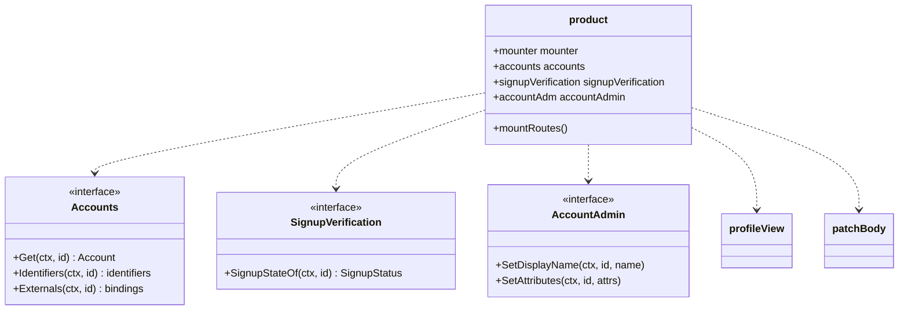

# authn-profile

## 职责

本模块交付认证能力的**用户档案自服务面**：把「账户读改自己的档案」暴露成挂在基路径下的路由，身份取自请求上下文，路径里不出现账户标识。

- **路由面。** `GET B/me` 读本人的档案，`PATCH B/me` 改本人的档案；`B` 是普通面的基路径（`authn.gate.mount.bases.default`，缺省 `/api/v1/auth`，见 [authn-config](design-authn-config.md)）。
- **身份取自上下文。** 路由经 `authn.FromContext` 取发起者的身份，账户由身份给出，不由路径或正文里的标识给出。授权依据是「发起者就是这个账户」这条无须策略的事实，自助范围的判据见 [authn-admin](design-authn-admin.md)。
- **自写字段集。** 可自写的字段是一个封闭集：显示名、属性、语言、时区；其余字段不可自写。
- **复用既有写面。** 写经根包接缝 `authn.AccountAdmin` 的 `SetDisplayName` 与 `SetAttributes` 落到账户模块；语言与时区是账户属性集里的具名用法，键由 `i18n.LocaleAttributeKey`、`i18n.TimeZoneAttributeKey` 命名，由 [i18n](../design-i18n.md) 的账户桥接读回，其存储归账户属性集的通用界面（[ADR-i18n-preferences-storage-2026-10-13](../../../adr/adr-i18n-preferences-storage-2026-10-13.md)）。本模块不另造写面、不新持状态、不新增存储。
- **注册验证状态的只读面。** `GET B/me` 的 `verification` 取自账户模块的 `SignupVerification.SignupStateOf`，`identifiers` 的每一项带 `proven`（由 `Verification.Proves` 派生）。本模块不写注册验证状态；它由 `Proves` 为真的邮箱的写入派生（[authn-account](design-authn-account.md)、[ADR-authn-signup-2026-10-22](../../../adr/adr-authn-signup-2026-10-22.md)）。
- **不交付功能接口。** 本模块只挂路由，仿 `authn.admin`。

### 非职责

- **不持账户数据与写规则。** 账户的形状、属性集的边界、显示名的上限归 `authn.account`（[authn-account](design-authn-account.md)）；本模块只调用接缝并把回绝映射成应答。
- **不做管理面判定。** 本模块不经 `Decider`、不问权限点；管理面归 `authn.admin`（[authn-admin](design-authn-admin.md)）。自助面与管理面分立的判据见 [ADR-authn-selfservice-profile-2026-10-15](../../../adr/adr-authn-selfservice-profile-2026-10-15.md)。
- **不挂账户的其他自助路由。** 改口令、添加或更换手机、删除标识、解绑外部身份改动的是账户的认证事实，归登录引擎，在 [authn-login](design-authn-login.md)。
- **不自写不可自写字段。** 账户状态、标识符（邮箱、手机、用户名）、外部身份绑定不在自写字段集里，各有其路由与更强的认证要求。
- **不实现偏好存储。** 语言与时区在账户属性集里，键归 `pkg/i18n`；本模块不新增偏好表或偏好接缝。
- **不声明配置键与设置键。** 键的名字、取值域与缺省值只在 [authn-config](design-authn-config.md) 给全。
- **不发布事件。** 账户写的事件由 `authn.account` 的能力接口发出（[authn-events](design-authn-events.md)）。

## 外部接口契约

### 交付的功能

本模块不交付功能接口，只把路由挂到基路径 `B` 上。路由的全集（封闭集）：

| 方法 路径 | 访问 | 作用 |
|---|---|---|
| `GET B/me` | Required | 读本人的档案 |
| `PATCH B/me` | Required | 改本人的档案，限于自写字段集 |

「访问」是 `Mounter` 登记时同时声明的级别；表中所列的路由都登记为 `Required`，网关认证该端，没有凭据的请求到不了处理器。

`GET B/me` 是唯一允许冒充身份到达的路由（登记为 `Impersonable`），到达时读的是被冒充的账户；`PATCH B/me` 不登记为可冒充，冒充中的请求一律拒绝，处理器另核一次同样的条件作为误登记的兜底（[authn-impersonation](design-authn-impersonation.md)）。

### 读的应答

`GET B/me` 应答 200 与一份档案视图，逐字段从账户模块的读面构造，从不把值原样交出：`account_id`、`kind`、`display_name`、`mfa_required`、`password_set`、`created_at`、`attributes`、`locale`、`time_zone`、`identifiers`、`verification`、`links`。

- `attributes` 是账户的属性集；`locale` 与 `time_zone` 从它的 `i18n.locale`、`i18n.tz` 键解出，各自没有时为空。
- `identifiers` 与 `links` 是本人的标识与外部身份绑定，只读，取自 `Accounts.Identifiers` 与 `Accounts.Externals`；绑定项不含 `Subject` 原文。`identifiers` 的每一项带 `proven`，由该标识的 `Verification.Proves` 派生：`sms-code`、`email-code`、`invite` 与 `idp:<提供方标识>` 为真，`admin`、`import-unverified` 与 `self` 为假。待验证邮箱不在 `identifiers` 里。
- `verification` 是 `{state, email, since}`：`state` 取 `none`、`pending`、`verified`，对应 `SignupState` 的 `0`、`1`、`2`。`email` 的取值是确定的：`verified` 取 `Proves` 为真、`verified_at` 最早的邮箱，同一时刻按标识 ID 排序取第一个；`pending` 取待验证联系方式里的邮箱，账户没有待验证目标时为空——删除最后一个已验证邮箱会把账户从 `verified` 拉回 `pending` 而不重建目标，空值是合法状态，界面据此给出添加邮箱的入口，不假设未验证账户总有地址；`none` 为空。`since` 是 `signup_verified_at`，只在账户第一次进入 `verified` 时写入，之后再验证其他邮箱不更新，`verified` 回到 `pending` 时保留；未验证时为空串。它由 `SignupVerification.SignupStateOf` 请求期活读，不进会话、身份或访问令牌。
- 时间按 UTC 以 RFC 3339 写出，零时间写空串。

### 写的请求与应答

`PATCH B/me` 的正文是 JSON，字段全部可选，缺席即不变，未知字段即拒绝：

```json
{
  "display_name": "张三",
  "attributes": {"dept": "eng"},
  "locale": "zh-CN",
  "time_zone": "Asia/Shanghai"
}
```

- `display_name`：字符串，至多 100 字符；经 `AccountAdmin.SetDisplayName` 写入。
- `attributes`：一个属性映射；给定时**整体替换**账户当前的属性集；经 `AccountAdmin.SetAttributes` 写入。
- `locale`：BCP 47 标签，经 `i18n.ValidLocaleTag` 校验，写到属性集的 `i18n.locale` 键。
- `time_zone`：IANA 名称，经 `i18n.ValidTimeZone` 校验，写到属性集的 `i18n.tz` 键。

应答是 200 与一份视图，给出写后存下的可自写字段：`display_name`、`attributes`、`locale`、`time_zone`。

属性集按「读当前、并入、整体写回」合成一次 `SetAttributes`：`attributes` 给定时整体替换，`locale` 与 `time_zone` 给定时覆盖对应键。合并语义与既有的语言、时区偏好写同形：并发的、改不同键的请求会丢其一，最后的写胜出，损失限于并发的那一对。

### 自写字段集

| 字段 | 写入接缝 | 校验与边界 |
|---|---|---|
| 显示名 | `AccountAdmin.SetDisplayName` | 至多 100 字符，更长是 `ErrInvalidArgument` |
| 属性 | `AccountAdmin.SetAttributes` | 账户属性集的边界：条数、键形状、保留前缀、值长度与总字节，常量在 `pkg/authn/ids.go`（`AccountAttributesMax` 与它旁边的各项） |
| 语言 | `AccountAdmin.SetAttributes`，键 `i18n.locale` | `i18n.ValidLocaleTag` |
| 时区 | `AccountAdmin.SetAttributes`，键 `i18n.tz` | `i18n.ValidTimeZone` |

**不可自写：账户状态、标识符、外部身份绑定、注册验证状态。** 它们的改动各有其路由，并带比本面更强的认证要求：状态与标识符的增删在管理面（[authn-admin](design-authn-admin.md)），标识符的删除与外部身份的解绑在登录引擎的自助路由（[authn-login](design-authn-login.md)），注册验证状态由 `Proves` 为真的邮箱的写入派生。集合是封闭的：自写字段集里新增一项要有新的决定。

### 登记单元与名字

本模块登记一个名字 `authn.profile`，包 `pkg/authn/profile`，命名照顶层能力加叶子。`Requires` 路由挂载口 `mount.Mounter`、账户读面 `authn.Accounts`、注册验证状态读面 `authn.SignupVerification` 与写面 `authn.AccountAdmin`；`Init` 里取用可选的 `audit.Audit` 与日志。它像 `authn.admin` 一样，只被想要这条面的命令纳入；不纳入时 `/me` 不挂，账户的读改仍可经 Go 接口由宿主命令调用。

### 与账户其他自助路由的关系

本模块接替登录引擎当前挂在同端上的 `GET B/me` 读面与 `PATCH B/me/preferences` 写面：档案的自读自写集中在本模块，登录引擎保留改动认证事实的自助路由（改口令、手机、删标识、解绑）。登录引擎与本模块挂在同一个 `self` 基路径 `Bs` 上，同一路径不得被两处登记，所以 `/me` 只由本模块挂。

### 对外接口面

- 路由路径 `GET B/me`、`PATCH B/me` 与访问级别 `Required` 是宿主可见面；`GET B/me` 登记为可冒充，`PATCH B/me` 不登记为可冒充。
- 模块名 `authn.profile` 是宿主可见面。
- 自写字段集的字段名（`display_name`、`attributes`、`locale`、`time_zone`）与应答字段名是宿主可见面；请求体的字段集是封闭集，新增可自写字段要有新的决定。
- `GET B/me` 应答的 `verification.state`、`verification.email`、`verification.since` 与 `identifiers[].proven` 是宿主可见面；`state` 的取值是封闭集 `none`、`pending`、`verified`。
- 不可自写字段集同属接口面：不在集合里的字段，本面永不写。

## 依赖

| 依赖 | 用途 |
|---|---|
| `pkg/core` | 模块描述符与登记 |
| `pkg/authn`（根包） | `FromContext` 读身份；`Accounts` 读账户、标识与外部绑定；`SignupVerification` 读注册验证状态；`AccountAdmin` 写显示名与属性；`Identity` 的账户、冒充与新鲜度判定 |
| `pkg/authn/internal/mount` | 挂路由与访问级别；401、403 与回绝的应答部件 |
| `pkg/i18n` | 语言与时区的属性键（`LocaleAttributeKey`、`TimeZoneAttributeKey`）与校验（`ValidLocaleTag`、`ValidTimeZone`） |
| `pkg/audit`（可选） | 写档案时写尽力档审计行 |
| `pkg/log`（可选） | 故障与拒绝的诊断 |

**本模块 import `pkg/authn` 根包与 `pkg/i18n`，不 import 授权功能目录，也不经 `Decider`。** 判据是自助面只要求一个已认证的身份，不需要策略。方向满足架构不变量：authn 根包不 import 本模块，`pkg/authn` 不 import 授权功能目录，授权只经根包接缝消费 authn（[authn-admin](design-authn-admin.md)）。

## UML 图

本模块是一份路由面，经账户读面 `Accounts`、注册验证状态读面 `SignupVerification` 与写面 `AccountAdmin` 落到账户模块。图里看不出的是：本模块不经 `Decider`（自助面不过授权接缝），身份来自上下文而非路径；写是 `SetDisplayName` 与 `SetAttributes` 各一次调用，属性集与语言、时区合并成一次 `SetAttributes`；注册验证状态是请求期活读，不写。



## 核心数据结构

| 概念 | 类型 | 说明 |
|---|---|---|
| 档案视图 | `profileView` | `GET B/me` 的应答：账户标识、种类、显示名、属性、语言、时区、创建时刻、标识（含 `proven`）、注册验证状态与外部绑定 |
| 写请求 | `patchBody` | `PATCH B/me` 的正文：`display_name`、`attributes`、`locale`、`time_zone`，字段均可选 |

`profileView` 与 `patchBody` 都只在本模块内构造与消费；账户、标识与绑定的形状归账户模块的根包接缝，本模块不复制它们。

## 核心算法与流程

### 一次读

读身份：`authn.FromContext` 没有身份或身份没有账户即 401。取账户（`Accounts.Get`）、标识（`Accounts.Identifiers`）、外部绑定（`Accounts.Externals`）与注册验证状态（`SignupVerification.SignupStateOf`），按档案视图逐字段构造应答；标识的 `proven` 由 `Verification.Proves` 派生，待验证邮箱只经 `verification.email` 出现。本面不解引用任何客户端给的账户标识。

### 一次写

操作序：

1. 读身份：没有身份或身份没有账户即 401。
2. 冒充中的身份即 403，不读正文、不调任何接缝。
3. 没有登录会话即 401。
4. 不满足账户因素所要求的新鲜度即 401 加强认证（判据见 [authn-admin](design-authn-admin.md) 的自助范围）。
5. 读正文：形状不符、`display_name` 超过 100 字符、属性越界、`locale` 或 `time_zone` 取值域不符，任一即 400。
6. 读账户、按「整体替换或并入键」合成新的属性集。
7. `SetDisplayName` 与 `SetAttributes` 各调一次；`display_name` 缺席则略过 `SetDisplayName`，`attributes`、`locale`、`time_zone` 全缺席则略过 `SetAttributes`。
8. 若审计能力在场，写一行尽力档审计；写失败只记 Error，不改应答。
9. 应答 200 与写后的可自写字段。

`SetDisplayName` 与 `SetAttributes` 各是一次账户模块的写，不构成一次原子变更：`SetDisplayName` 成功而 `SetAttributes` 失败时，显示名的改动已生效，应答是那次失败的应答（与管理面逐字段写、失败即收口同形）。

## 错误与失败语义

| 情形 | 表现 |
|---|---|
| 请求没有身份，或身份没有账户 | 401 |
| 冒充中的身份到达 `PATCH B/me` | 403 `impersonation-restricted` |
| 没有登录会话 | 401 |
| 不满足账户因素所要求的新鲜度 | 401 加强认证 |
| 正文形状不符、有未知字段、`display_name` 超过 100 字符、属性越过账户边界、`locale` 或 `time_zone` 取值域不符 | 400 `bad-request` |
| 账户模块答 `ErrAccountNotFound`（身份的账户是墓碑或读不到） | 401 |
| 账户模块答 `ErrInvalidArgument` | 400 `bad-request` |
| `SignupVerification.SignupStateOf` 答 `ErrUnavailable` 或读不出状态 | 503，不按 `none` 放行 |
| 依赖不可用 | 503 |
| 其余失败 | 503，成因只进日志 |

**本模块不重试、不降级。** 一次写失败即那次失败，不排队待写、不部分回滚。

## 并发与事务边界

- **本模块不持状态，不开事务。** 每次写是一次账户模块的写，事务在账户模块内。
- **属性集的合成是「读当前、并入、整体写回」。** 并发的、改不同键的 `PATCH B/me` 会丢其一，最后的写胜出，损失限于并发的那一对；这与既有的偏好写同形。
- **显示名与属性各自独立写入。** 一次 `PATCH B/me` 不是一次原子变更，写之间的短暂不一致对外可见。

## 实现状态

| 能力 | 状态 | 代码 |
|---|---|---|
| 用户档案自服务面（`GET B/me`、`PATCH B/me`） | 已实现 | `pkg/authn/profile/profile.go` `Module`；`pkg/authn/profile/routes.go` `mountRoutes`；`pkg/authn/profile/read.go` `handleGetMe`；`pkg/authn/profile/write.go` `handlePatchMe` |
| operation 声明与 OpenAPI 片段生成 | 已实现 | `pkg/authn/profile/operations.go`；`pkg/authn/profile/openapi_generated_test.go`；片段 `pkg/authn/profile/openapi/profile.json` |
| `GET B/me` 的注册验证状态 `verification` 与标识的 `proven` | 已实现 | `pkg/authn/profile/read.go` `handleGetMe`；`pkg/authn/profile/views.go` `AuthnProfileVerification`、`AuthnProfileIdentifier.Proven`、`profileViewOf`、`signupStateName`；`pkg/authn/profile/profile.go` `Module`、`product.signupVerification` |
