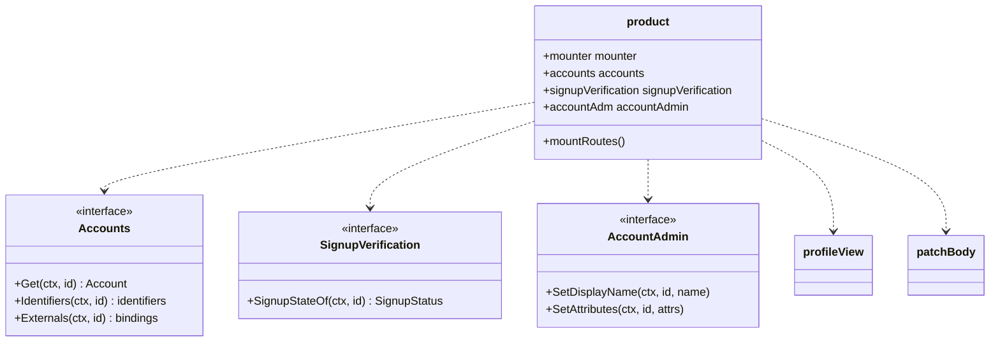

# authn-profile

## 职责

本模块交付认证能力的**用户档案自服务面**：把「账户读改自己的档案」暴露成挂在基路径下的路由，身份取自请求上下文，路径里不出现账户标识。

- **路由面。** `GET B/me` 读本人的档案，`PATCH B/me` 改本人的档案；`B` 是普通面的基路径（`authn.gate.mount.bases.default`，缺省 `/api/v1/auth`，见 [authn-config](design-authn-config.md)）。
- **身份取自上下文。** 路由经 `authn.FromContext` 取发起者的身份，账户由身份给出，不由路径或正文里的标识给出。授权依据是「发起者就是这个账户」这条无须策略的事实，自助范围的判据见 [authn-admin](design-authn-admin.md)。
- **自写字段集。** 可自写的字段是一个封闭集：显示名、属性、语言、时区、颜色模式；其余字段不可自写。
- **复用既有写面。** 写经根包接缝 `authn.AccountAdmin` 的 `SetDisplayName` 与 `SetAttributes` 落到账户模块；语言、时区与颜色模式是账户属性集里的具名用法。语言与时区的键由 `i18n.LocaleAttributeKey`、`i18n.TimeZoneAttributeKey` 命名，由 [i18n](../design-i18n.md) 的账户桥接读回；颜色模式的键由本模块的 `ColorModeAttributeKey` 命名（`presentation.color-mode`），没有别的 Go 模块读它。三者的存储都归账户属性集的通用界面（[ADR-i18n-preferences-storage](../../../adr/adr-i18n-preferences-storage.md)）。本模块不另造写面、不新持状态、不新增存储。
- **注册验证状态与联系方式、登录方式的只读面。** `GET B/me` 的 `verification` 取自账户模块的 `SignupVerification.SignupStateOf`；`identifiers` 的每一条邮箱与手机带 `proven`（由 `Verification.Proves` 派生）、`contact`（联系方式）、`sign_in`（是否作登录方式）与 `default_contact`（是否为默认联系地址）。邮箱与手机标识从登记起恒为联系方式，登录方式由持有人选择（REQ-account-061）；验证只证明所有权，不决定登录方式上的选择（REQ-account-062）。联系方式、登录方式与默认联系地址的取舍见 [ADR-authn-contact-and-login-ways](../../../adr/adr-authn-contact-and-login-ways.md)。本模块不写注册验证状态，也不写登录方式与默认联系地址上的选择；验证状态由账户持有的邮箱标识与未证明预留派生，判定不区分账户是自助注册、管理员预置还是导入写出的（[authn-account](design-authn-account.md)、[ADR-authn-signup](../../../adr/adr-authn-signup.md)）。
- **不交付功能接口。** 本模块只挂路由，仿 `authn.admin`。

### 非职责

- **不持账户数据与写规则。** 账户的形状、属性集的边界、显示名的上限归 `authn.account`（[authn-account](design-authn-account.md)）；本模块只调用接缝并把回绝映射成应答。
- **不做管理面判定。** 本模块不经 `Decider`、不问权限点；管理面归 `authn.admin`（[authn-admin](design-authn-admin.md)）。自助面与管理面分立的判据见 [ADR-authn-selfservice-profile](../../../adr/adr-authn-selfservice-profile.md)。
- **不挂账户的其他自助路由。** 改口令、添加或更换手机、删除标识、选择默认联系地址、选择哪些邮箱与手机可作登录方式、解绑外部身份改动的是账户的认证事实，归登录引擎，在 [authn-login](design-authn-login.md)。
- **不自写不可自写字段。** 账户状态、标识符（邮箱、手机、用户名）、外部身份绑定不在自写字段集里，各有其路由与更强的认证要求。
- **不实现偏好存储。** 语言、时区与颜色模式都在账户属性集里；语言与时区的键归 `pkg/i18n`，颜色模式的键归本模块。本模块不新增偏好表或偏好接缝。
- **不声明配置键与设置键。** 键的名字、取值域与缺省值只在 [authn-config](design-authn-config.md) 给全。
- **不发布事件。** 账户写的事件由 `authn.account` 的能力接口发出（[authn-events](design-authn-events.md)）。

## 外部接口契约

### 交付的功能

本模块不交付功能接口，只把路由挂到基路径 `B` 上。路由的全集（封闭集）：

| 方法 路径 | 访问 | 作用 |
|---|---|---|
| `GET B/me` | Required | 读本人的档案 |
| `PATCH B/me` | Required | 改本人的档案，限于自写字段集 |

「访问」是 `Mounter` 登记时同时声明的级别；表中所列的路由都登记为 `Required`，网关认证该端，没有凭据的请求到不了处理器。

两条路由都登记为可冒充：冒充身份读的是被冒充的账户，写的也是被冒充的账户，判据只取该账户的权限，发起者自己的权限不生效（[authn-impersonation](design-authn-impersonation.md)）。

### 读的应答

`GET B/me` 应答 200 与一份档案视图，逐字段从账户模块的读面构造，从不把值原样交出：`account_id`、`kind`、`display_name`、`mfa_required`、`password_set`、`created_at`、`attributes`、`locale`、`time_zone`、`color_mode`、`identifiers`、`verification`、`links`。

- `attributes` 是账户的属性集；`locale`、`time_zone` 与 `color_mode` 从它的 `i18n.locale`、`i18n.tz` 与 `presentation.color-mode` 键解出，各自没有时为空。
- `identifiers` 与 `links` 是本人的标识与外部身份绑定，只读，取自 `Accounts.Identifiers` 与 `Accounts.Externals`；绑定项不含 `Subject` 原文。`identifiers` 列出账户已登记的每一项值：邮箱与手机各带 `proven`（由该标识的 `Verification.Proves` 派生：`sms-code`、`email-code`、`invite` 与 `idp:<提供方标识>` 为真，`admin`、`import-unverified` 与 `self` 为假），以及联系方式 `contact`、登录方式 `sign_in` 与默认联系地址 `default_contact`。邮箱与手机标识恒为联系方式，登录方式由持有人选择（REQ-account-061）；`proven` 是二值的，不按渠道细分：经管理员或导入写下的邮箱标识在列表里就是一条未证明的邮箱标识，没有第三态。用户名是口令登录名，`contact` 与 `default_contact` 恒为假、`sign_in` 恒为真，不标归属；`links` 里的每一个外部身份是一类独立的登录方式，不属联系方式（REQ-account-067）。未证明的邮箱预留不在 `identifiers` 里——它不是标识——但经 `verification.email` 出现。未证明的邮箱或手机的 `sign_in` 与 `default_contact` 都是假，`contact` 对登记的行恒为真；`sign_in` 与 `default_contact` 在该值被证明之后才可被持有人取真（REQ-account-065、REQ-account-066）。正常写入下用户账户总有用户名标识：自助注册、首登开户、邀请受理、管理面预置、初始装配与导入建出的用户账户都带一个用户名。可能没有用户名的只有服务账户与绕过写入面的行。读方不得把「有用户名」当作新建账户或某种创建路径的判据；`identifiers` 只说明此账户此刻持有哪些标识。
- `default_contact` 只在一条已证明的邮箱标识上为真：账户在已登记并已证明的邮箱地址中恰好有一个默认联系地址，没有这样的地址时全部为假（REQ-account-063）；持有人未选时，默认联系地址取最早证明的那一条，持有人可以改选另一个已登记并已证明的邮箱地址，改选后原地址不再是。它只作通知的收件地址，不是登录方式的一种。
- `verification` 是 `{state, email, since}`：`state` 取 `none`、`pending`、`verified`，对应 `SignupState` 的 `0`、`1`、`2`。判据是二值的：账户持有至少一条 `proven` 为真的邮箱标识即 `verified`；否则持有任何邮箱——一条 `proven` 为假的邮箱标识，或一条未证明预留——即 `pending`；一条邮箱也没有即 `none`，本规则不拦截它。`email` 的取值是确定的：`verified` 取 `Proves` 为真、`verified_at` 最早的邮箱，同一时刻按标识 ID 排序取第一个；`pending` 取未证明邮箱标识与未证明预留中创建时刻最早的一条，同一时刻按行标识排序取第一个，账户因此可能有一个目标地址，也可能在删掉最后一条邮箱标识后什么也没有（那时读作 `none`）；`none` 为空。`since` 是 `signup_verified_at`，在任一账户第一次证明邮箱时写入，之后再验证其他邮箱不更新，`verified` 回到 `pending` 时保留；`verified` 而该列为空时取最早那条证明标识的 `VerifiedAt`；从未证明过邮箱时为空串。它由 `SignupVerification.SignupStateOf` 请求期活读，不进会话、身份或访问令牌。
- 时间按 UTC 以 RFC 3339 写出，零时间写空串。

### 写的请求与应答

`PATCH B/me` 的正文是 JSON，字段全部可选，缺席即不变，未知字段即拒绝：

```json
{
  "display_name": "张三",
  "attributes": {"dept": "eng"},
  "locale": "zh-CN",
  "time_zone": "Asia/Shanghai",
  "color_mode": "dark"
}
```

- `display_name`：字符串，至多 100 字符；经 `AccountAdmin.SetDisplayName` 写入。
- `attributes`：一个属性映射；给定时**整体替换**账户当前的属性集；经 `AccountAdmin.SetAttributes` 写入。
- `locale`：BCP 47 标签，经 `i18n.ValidLocaleTag` 校验，写到属性集的 `i18n.locale` 键。
- `time_zone`：IANA 名称，经 `i18n.ValidTimeZone` 校验，写到属性集的 `i18n.tz` 键。
- `color_mode`：`light`、`dark`、`system` 之一，经 `ValidColorMode` 校验，写到属性集的 `presentation.color-mode` 键。

应答是 200 与一份视图，给出写后存下的可自写字段：`display_name`、`attributes`、`locale`、`time_zone`、`color_mode`。

属性集按「读当前、并入、整体写回」合成一次 `SetAttributes`：`attributes` 给定时整体替换，`locale`、`time_zone` 与 `color_mode` 给定时覆盖对应键。合并语义与既有的语言、时区偏好写同形：并发的、改不同键的请求会丢其一，最后的写胜出，损失限于并发的那一对。

### 自写字段集

| 字段 | 写入接缝 | 校验与边界 |
|---|---|---|
| 显示名 | `AccountAdmin.SetDisplayName` | 至多 100 字符，更长是 `ErrInvalidArgument` |
| 属性 | `AccountAdmin.SetAttributes` | 账户属性集的边界：条数、键形状、保留前缀、值长度与总字节，常量在 `pkg/authn/ids.go`（`AccountAttributesMax` 与它旁边的各项） |
| 语言 | `AccountAdmin.SetAttributes`，键 `i18n.locale` | `i18n.ValidLocaleTag` |
| 时区 | `AccountAdmin.SetAttributes`，键 `i18n.tz` | `i18n.ValidTimeZone` |
| 颜色模式 | `AccountAdmin.SetAttributes`，键 `presentation.color-mode` | `ValidColorMode`，取值 `light`、`dark`、`system` |

**不可自写：账户状态、标识符、外部身份绑定、注册验证状态。** 它们的改动各有其路由，并带比本面更强的认证要求：状态与标识符的增删在管理面（[authn-admin](design-authn-admin.md)），标识符的删除与外部身份的解绑在登录引擎的自助路由（[authn-login](design-authn-login.md)），注册验证状态由 `Proves` 为真的邮箱的写入派生。集合是封闭的：自写字段集里新增一项要有新的决定。

### 登记单元与名字

本模块登记一个名字 `authn.profile`，包 `pkg/authn/profile`，命名照顶层能力加叶子。`Requires` 路由挂载口 `mount.Mounter`、账户读面 `authn.Accounts`、注册验证状态读面 `authn.SignupVerification` 与写面 `authn.AccountAdmin`；`Init` 里取用可选的 `audit.Audit` 与日志。它像 `authn.admin` 一样，只被想要这条面的命令纳入；不纳入时 `/me` 不挂，账户的读改仍可经 Go 接口由宿主命令调用。

### 与账户其他自助路由的关系

本模块接替登录引擎当前挂在同端上的 `GET B/me` 读面与 `PATCH B/me/preferences` 写面：档案的自读自写集中在本模块，登录引擎保留改动认证事实的自助路由（改口令、手机、删标识、选择默认联系地址与登录方式、解绑）。登录引擎与本模块挂在同一个 `self` 基路径 `Bs` 上，同一路径不得被两处登记，所以 `/me` 只由本模块挂。

### 对外接口面

- 路由路径 `GET B/me`、`PATCH B/me` 与访问级别 `Required` 是宿主可见面；两条路由都登记为可冒充。
- 模块名 `authn.profile` 是宿主可见面。
- 自写字段集的字段名（`display_name`、`attributes`、`locale`、`time_zone`、`color_mode`）与应答字段名是宿主可见面；请求体的字段集是封闭集，新增可自写字段要有新的决定。`color_mode` 的取值是封闭集 `light`、`dark`、`system`。
- `GET B/me` 应答的 `verification.state`、`verification.email`、`verification.since` 与 `identifiers[].proven`、`identifiers[].contact`、`identifiers[].sign_in`、`identifiers[].default_contact` 是宿主可见面；`state` 的取值是封闭集 `none`、`pending`、`verified`——`pending` 是「有邮箱而没有一条已证明的」，`none` 是「没有邮箱」，没有第四种取值。
- 不可自写字段集同属接口面：不在集合里的字段，本面永不写。

## 依赖

| 依赖 | 用途 |
|---|---|
| `pkg/core` | 模块描述符与登记 |
| `pkg/authn`（根包） | `FromContext` 读身份；`Accounts` 读账户、标识与外部绑定；`SignupVerification` 读注册验证状态；`AccountAdmin` 写显示名与属性；`Identity` 的账户与冒充判定 |
| `pkg/authn/internal/mount` | 挂路由与访问级别；401、403 与回绝的应答部件 |
| `pkg/i18n` | 语言与时区的属性键（`LocaleAttributeKey`、`TimeZoneAttributeKey`）与校验（`ValidLocaleTag`、`ValidTimeZone`） |
| `pkg/audit`（可选） | 写档案时写尽力档审计行 |
| `pkg/log`（可选） | 故障与拒绝的诊断 |

**本模块 import `pkg/authn` 根包与 `pkg/i18n`，不 import 授权功能目录，也不经 `Decider`。** 判据是自助面只要求一个已认证的身份，不需要策略。方向满足架构不变量：authn 根包不 import 本模块，`pkg/authn` 不 import 授权功能目录，授权只经根包接缝消费 authn（[authn-admin](design-authn-admin.md)）。

## UML 图

本模块是一份路由面，经账户读面 `Accounts`、注册验证状态读面 `SignupVerification` 与写面 `AccountAdmin` 落到账户模块。图里看不出的是：本模块不经 `Decider`（自助面不过授权接缝），身份来自上下文而非路径；写是 `SetDisplayName` 与 `SetAttributes` 各一次调用，属性集与语言、时区合并成一次 `SetAttributes`；注册验证状态是请求期活读，不写。



## 核心数据结构

| 概念 | 类型 | 说明 |
|---|---|---|
| 档案视图 | `profileView` | `GET B/me` 的应答：账户标识、种类、显示名、属性、语言、时区、颜色模式、创建时刻、标识（含 `proven`、`contact`、`sign_in` 与 `default_contact`）、注册验证状态与外部绑定 |
| 写请求 | `patchBody` | `PATCH B/me` 的正文：`display_name`、`attributes`、`locale`、`time_zone`、`color_mode`，字段均可选 |

`profileView` 与 `patchBody` 都只在本模块内构造与消费；账户、标识与绑定的形状归账户模块的根包接缝，本模块不复制它们。

## 核心算法与流程

### 一次读

读身份：`authn.FromContext` 没有身份或身份没有账户即 401。取账户（`Accounts.Get`）、标识（`Accounts.Identifiers`）、外部绑定（`Accounts.Externals`）与注册验证状态（`SignupVerification.SignupStateOf`），按档案视图逐字段构造应答；标识的 `proven` 由 `Verification.Proves` 派生，`contact`、`sign_in` 与 `default_contact` 取自账户模块同名标记；未证明的邮箱或手机的 `sign_in` 与 `default_contact` 为假，`contact` 由持有人选择、可为真，未证明预留只经 `verification.email` 出现。本面不解引用任何客户端给的账户标识。

### 一次写

操作序：

1. 读身份：没有身份或身份没有账户即 401。
2. 没有登录会话即 401。
3. 读正文：形状不符、`display_name` 超过 100 字符、属性越界、`locale`、`time_zone` 或 `color_mode` 取值域不符，任一即 400。
4. 读账户、按「整体替换或并入键」合成新的属性集。
5. `SetDisplayName` 与 `SetAttributes` 各调一次；`display_name` 缺席则略过 `SetDisplayName`，`attributes`、`locale`、`time_zone`、`color_mode` 全缺席则略过 `SetAttributes`。
6. 若审计能力在场，写一行尽力档审计；写失败只记 Error，不改应答。冒充身份的审计行把实际操作者记为发起者，并带被冒充账户、组织与会话。
7. 应答 200 与写后的可自写字段。

`SetDisplayName` 与 `SetAttributes` 各是一次账户模块的写，不构成一次原子变更：`SetDisplayName` 成功而 `SetAttributes` 失败时，显示名的改动已生效，应答是那次失败的应答（与管理面逐字段写、失败即收口同形）。

## 错误与失败语义

| 情形 | 表现 |
|---|---|
| 请求没有身份，或身份没有账户 | 401 |
| 没有登录会话 | 401 |
| 正文形状不符、有未知字段、`display_name` 超过 100 字符、属性越过账户边界、`locale`、`time_zone` 或 `color_mode` 取值域不符 | 400 `bad-request` |
| 账户模块答 `ErrAccountNotFound`（身份的账户是墓碑或读不到） | 401 |
| 账户模块答 `ErrInvalidArgument` | 400 `bad-request` |
| `SignupVerification.SignupStateOf` 答 `ErrUnavailable` 或读不出状态 | 503，不按 `none` 放行 |
| 依赖不可用 | 503 |
| 其余失败 | 503，成因只进日志 |

**本模块不重试、不降级。** 一次写失败即那次失败，不排队待写、不部分回滚。

## 并发与事务边界

- **本模块不持状态，不开事务。** 每次写是一次账户模块的写，事务在账户模块内。
- **属性集的合成是「读当前、并入、整体写回」。** 并发的、改不同键的 `PATCH B/me` 会丢其一，最后的写胜出，损失限于并发的那一对；这与既有的偏好写同形。
- **显示名与属性各自独立写入。** 一次 `PATCH B/me` 不是一次原子变更，写之间的短暂不一致对外可见。

## 实现状态

| 能力 | 状态 | 代码 |
|---|---|---|
| 用户档案自服务面（`GET B/me`、`PATCH B/me`） | 已实现 | `pkg/authn/profile/profile.go` `Module`；`pkg/authn/profile/routes.go` `mountRoutes`；`pkg/authn/profile/read.go` `handleGetMe`；`pkg/authn/profile/write.go` `handlePatchMe` |
| 颜色模式偏好的自写与读出（`color_mode`、属性键 `presentation.color-mode`） | 已实现 | `pkg/authn/profile/color_mode.go` `ColorModeAttributeKey`、`ValidColorMode`；`pkg/authn/profile/write.go` `patchInput`、`handlePatchMe`、`mergeAttributes`；`pkg/authn/profile/views.go` `AuthnProfileProfile`、`AuthnProfilePatch` |
| operation 声明与 OpenAPI 片段生成 | 已实现 | `pkg/authn/profile/operations.go`；`pkg/authn/profile/openapi_generated_test.go`；片段 `pkg/authn/profile/openapi/profile.json` |
| `GET B/me` 的注册验证状态 `verification` 与标识的 `proven` | 已实现 | `pkg/authn/profile/read.go` `handleGetMe`；`pkg/authn/profile/views.go` `AuthnProfileVerification`、`AuthnProfileIdentifier.Proven`、`profileViewOf`、`signupStateName`；`pkg/authn/profile/profile.go` `Module`、`product.signupVerification` |
| 联系方式、登录方式与默认联系地址的读出：`identifiers[].contact`、`identifiers[].sign_in`、`identifiers[].default_contact`、用户名不标归属，外部身份列在登录方式中 | 已实现 | `pkg/authn/account/accounts.go` `product.Identifiers` |
