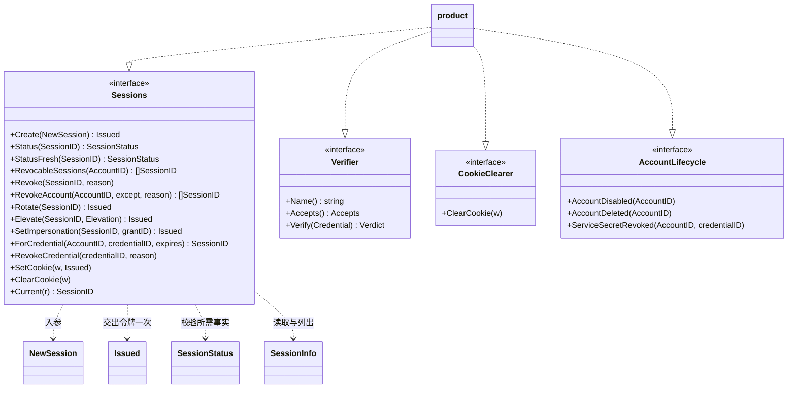
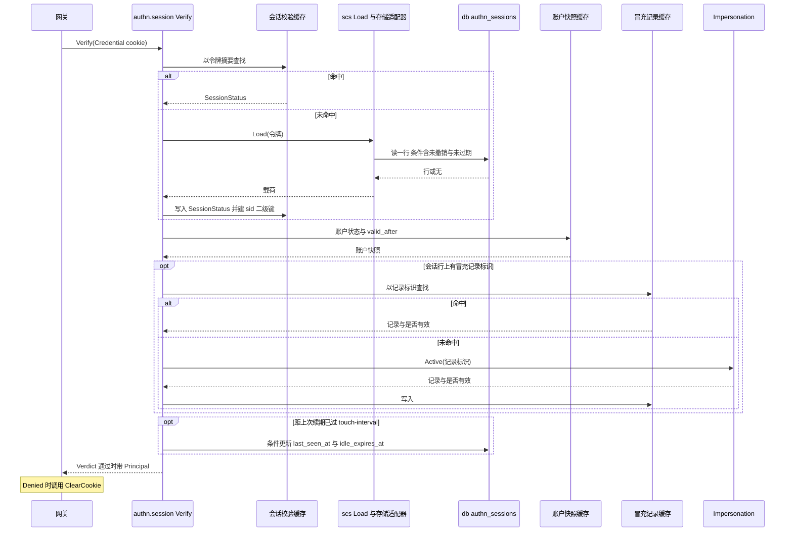
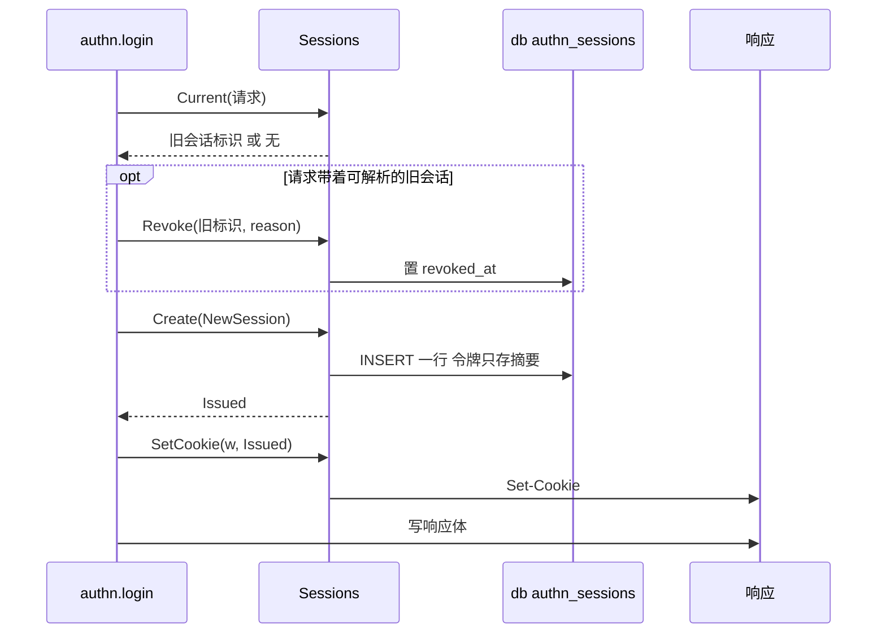
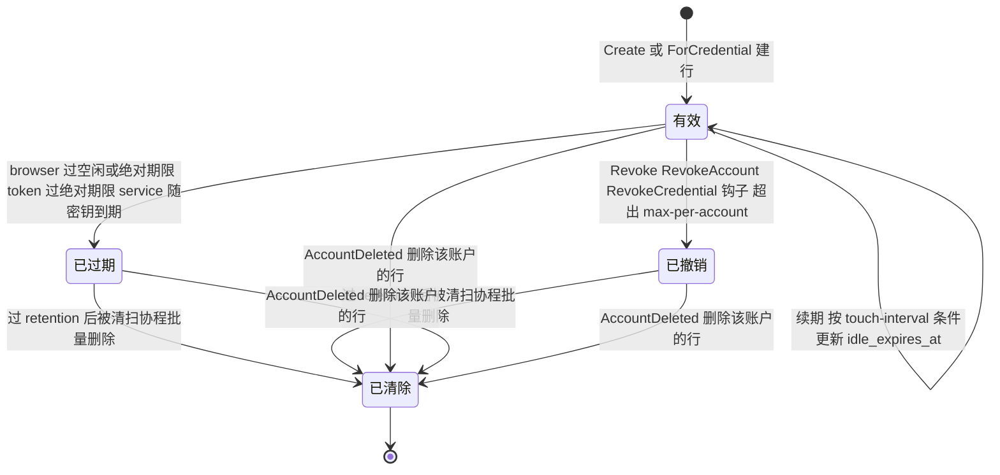

# authn.session

## 职责

`authn.session` 是登录会话的唯一持有者。浏览器的 cookie 会话、非浏览器客户端的访问令牌与刷新令牌所挂靠的会话、服务账户每个密钥对应的会话，共用一张表 `authn_sessions` 与一套撤销面。包为 `pkg/authn/session`，模块名为 `authn.session`。本文的「会话」一律指登录会话。取舍见 [ADR-authn-session-2026-10-10](../../../adr/adr-authn-session-2026-10-10.md)，状态放置的判据见 [ADR-authn-state-placement-2026-10-10](../../../adr/adr-authn-state-placement-2026-10-10.md)。

本模块负责下列事项（封闭集合，不在其内的事项归非职责一节点名的模块）：

- 交付 `Sessions`：会话的创建、读取、列出、撤销、轮换、提权、冒充挂接、按服务密钥取建与撤销。权威存放在 db 的 `authn_sessions`，不在 kv。
- 作为登录会话 cookie 的写出、清除与读取的唯一一处：cookie 的名字、前缀、`SameSite`、`Domain`、`Secure` 只在本模块决定，别的模块只经 `Sessions.SetCookie` 与 `Sessions.ClearCookie` 写 cookie。
- 作为校验后端认领会话 cookie，把 cookie 认成一份 `Principal`：先查进程内缓存，再读库，再核对账户状态与冒充记录（冒充记录的有效性同样经进程内缓存），最后交给网关盖章。
- 按种类判定会话是否有效：`browser`、`token`、`service` 各有自己的期限语义。
- 维护唯一的撤销面：撤销一个会话即撤销挂在它上面的访问令牌、刷新令牌与冒充记录，撤销以会话行的 `revoked_at` 为准，不比较时间。
- 实现 `AccountLifecycle`：账户停用、删除与服务密钥撤销之后清理本模块的行与缓存。
- 经 `authn.mount` 登记 `B/session`、`B/logout`、`B/sessions` 一组自助路由（`B` 是路由基路径）。
- 在 `Start` 起的常驻协程里清扫到期并过了保留期的行。
- 发布 `authn.session.revoked`，订阅 `authn.session.revoked`、`authn.impersonation.ended`、`authn.account.status-changed`、`authn.account.deleted` 以清缓存与补偿清理。

### 非职责

- **不执行跨源检查。** 浏览器自行附带的凭据下的跨源检查由网关在调用校验后端之前执行，规则写在本文的「浏览器自行附带的凭据下的跨源检查」一节，载体判据、执行点与拒绝形状见 [design-authn-gate](design-authn-gate.md)。
- **不认证任何人。** 第一因素与第二因素由登录引擎与因素编排完成（[design-authn-login](design-authn-login.md)、[design-authn-mfa](design-authn-mfa.md)），登录完成后调用 `Sessions.Create`；本模块不创建没有账户的匿名会话。
- **不持有账户状态。** 账户的启用、停用、删除与 `valid_after` 归 `authn.account`（[design-authn-account](design-authn-account.md)）；本模块只读，并在每次校验时核对。
- **不签发、不校验访问令牌与刷新令牌。** 令牌、刷新令牌表 `authn_refresh_tokens` 与服务密钥的换令牌流程归 `authn.token`（[design-authn-token](design-authn-token.md)）；`token` 种与 `service` 种的会话行住在本模块，行里没有令牌。
- **不持有冒充记录。** `authn_impersonations` 归 `authn.impersonation`（[design-authn-impersonation](design-authn-impersonation.md)）；本模块只在会话行上记冒充记录标识，并在校验时向它询问记录是否仍然有效。
- **不写管理面路由。** 列出与撤销他人会话、按账户批量撤销的 HTTP 路由、判定接缝与强制审计归 `authn.admin`（[design-authn-admin](design-authn-admin.md)）；本模块只提供它调用的方法。
- **不做授权，不写 403。** 本模块回答「这个 cookie 属于哪个账户、会话是否有效」，不回答「能不能做某件事」。
- **不定义审计、事件与指标的取值。** 审计的写入点与档位、事件与指标的取值表归 [design-authn-events](design-authn-events.md)；本文只写本模块在何处发布与订阅。
- **不提供 CORS 层。** 单页应用与 API 跨域时需要一个排在网关之外的 CORS 层（防护阶段），由宿主提供。
- **不提供「记住我」，不绑定设备或来源地址，不做令牌式 CSRF。** 长期免登录只经刷新令牌，面向非浏览器客户端。
- **不保存登录流程状态。** OAuth 的 `state`、一次性占位等流程记录在 kv，由登录引擎持有（[design-authn-login](design-authn-login.md)）。

## 外部接口契约

### 交付的功能

下表是 `authn.session` 交付的全部功能（封闭集合）。

| 功能 | 排他 | 说明 |
|---|---|---|
| `Sessions` | 是 | 会话的全部操作，以及 cookie 的写出、清除与读取。 |
| `Verifier` | 否 | `Name()` 恒为 `session`。`Accepts` 为 `{Cookies: [会话 cookie 名], Accounts: 空串（库命名空间）, Impersonation: true, SSO: true}`，`Schemes` 为空：本模块认领会话 cookie，不认领任何 `Authorization` scheme。 |
| `AccountLifecycle` | 否 | 见「账户停用、删除与服务密钥撤销之后的清理」一节。 |

同一模块的各能力接口方法名两两不相交：一个模块只有一个实例，`core.Resolve[T]` 对它做类型断言，构造期核对逐个检查 `Provides` 里声明的接口。包内为每个交付的接口加 `var _ authn.X = (*product)(nil)` 编译期断言，`assembly_test` 用真实注册表跑一遍交付核对。

`Verifier` 实例另实现可选接口 `CookieClearer`，它不是交付的功能，不进 `Provides`：网关对后端用类型断言发现它，凭据被判拒绝时据此清除失效的 cookie。`CookieClearer.ClearCookie(w)` 与 `Sessions.ClearCookie(w)` 同签名，一个方法同时满足两者。cookie 来源的 401 挑战由网关写出，本模块不实现 `Challenger`（[design-authn-gate](design-authn-gate.md)）。

### Sessions

```go
type Sessions interface {
	Create(ctx context.Context, in NewSession) (Issued, error)
	Get(ctx context.Context, id SessionID) (SessionInfo, error)                 // ErrSessionNotFound
	List(ctx context.Context, account AccountID) ([]SessionInfo, error)         // 只含活的 browser 与 token 种
	RevocableSessions(ctx context.Context, account AccountID) ([]SessionID, error) // RevokeAccount 会结束的那一组
	Revoke(ctx context.Context, id SessionID, reason string) error              // 幂等
	RevokeAccount(ctx context.Context, account AccountID, except SessionID, reason string) ([]SessionID, error)
	Rotate(ctx context.Context, id SessionID) (Issued, error)
	Elevate(ctx context.Context, id SessionID, e Elevation) (Issued, error)
	SetImpersonation(ctx context.Context, id SessionID, grantID string) (Issued, error)
	Status(ctx context.Context, id SessionID) (SessionStatus, error)            // 受 check-ttl 缓存
	StatusFresh(ctx context.Context, id SessionID) (SessionStatus, error)       // 不走缓存
	ForCredential(ctx context.Context, account AccountID, credentialID string, expires *time.Time) (SessionID, error)
	RevokeCredential(ctx context.Context, credentialID, reason string) error

	SetCookie(w http.ResponseWriter, in Issued)
	ClearCookie(w http.ResponseWriter)
	Current(r *http.Request) (id SessionID, ok bool, err error)
}
```

值类型（`NewSession`、`Issued`、`SessionInfo`、`SessionStatus`、`Elevation`、`ClientInfo`、`SessionKind`）见「核心数据结构」。

下表逐方法写出承诺（封闭集合，与上面的方法一一对应）。

| 方法 | 承诺 |
|---|---|
| `Create` | 建一个 `browser` 或 `token` 种会话；`service` 种被拒绝，只经 `ForCredential` 建。`Issued.Token` 是秘密，只此一次交出：`browser` 种是 cookie 的值，其余种类为空。期限由 `Create` 统一计算（见「期限的计算」）。属性集越过根包规定的界限，或载荷超过 8 KiB，拒绝写入。账户的 `browser` 与 `token` 种会话数超过 `max-per-account` 时，撤销该账户最久未使用的会话。 |
| `Get` | 按公开标识读一行，含已撤销与已过期的行；没有则 `ErrSessionNotFound`。 |
| `List` | 只含该账户活的 `browser` 与 `token` 种；`service` 种不列出。 |
| `RevocableSessions` | 交出该账户未撤销的 `browser` 与 `token` 行，条件是 `RevokeAccount` 的那一条。`except` 为空时读到的集合就是那条语句改动的集合，管理面的批量撤销读它正是为此；`except` 非空时它不扣掉那一个，读到的大于被改动的。已过期而未撤销的行在其中：那条语句会结束它，按行写审计的调用方因此得点名它。`service` 种不在其内。 |
| `Revoke` | 幂等。置 `revoked_at` 与 `revoke_reason`，清本副本缓存，发布 `authn.session.revoked`。刷新令牌随之失效：刷新每次都核对会话行，本方法不级联写刷新令牌表。对 `service` 种的行同样置 `revoked_at`，之后 `ForCredential` 对该密钥返回 `ErrSessionRevoked`；访问令牌的撤销接口对 `service` 种是无操作，持有访问令牌的人走不到这一路径。 |
| `RevokeAccount` | 对该账户的 `browser` 与 `token` 种做一条 `UPDATE`；`except` 非空则保留那一个会话，为空则全撤；交出撤销的标识。`service` 种不在其内。 |
| `Rotate` | 为当前会话换令牌，保留标识、等级与期限；只对 `browser` 种有内容，其余种类无事可做。它与 `RevokeAccount` 是两个动作：前者换当前会话的令牌，后者撤销其余会话。 |
| `Elevate` | 加强认证完成后更新等级、认证时刻、方式集与 `IDPAssured`，并对 `browser` 种换令牌；保留标识与绝对期限，不建新会话。 |
| `SetImpersonation` | 写入冒充记录标识，空串表示结束。写入非空标识时对 `browser` 种换令牌；空串（结束）只清除标识、不换令牌，旧令牌继续有效。保留标识与期限。 |
| `Status` | 回答会话是否仍然有效，并交出校验后端建立身份所需的全部事实；受 `check-ttl` 缓存。库里没有该会话返回 `ErrSessionNotFound`；会话存在而失效（已撤销、过期、账户停用、会话早于账户的 `valid_after`）返回 `Active` 为假的 `SessionStatus`。 |
| `StatusFresh` | 与 `Status` 同判据，不走缓存；刷新令牌轮换与登录流程完成时使用。 |
| `ForCredential` | 对 `credential_id` 的唯一约束做原子的取或建，一个服务密钥一行（`service` 种）。行不存在则建；存在且未撤销则把 `expires_at` 更新为 `expires` 并返回同一标识（`expires` 为空指针表示密钥不过期，`expires_at` 置空）；行的 `created_at` 早于账户的 `valid_after` 时一并置为当前时刻；存在但已撤销返回 `ErrSessionRevoked`。 |
| `RevokeCredential` | 撤销该密钥那一行 `service` 种会话；幂等。 |
| `SetCookie` | 写 `Set-Cookie`，值取 `Issued.Token`；调用方在处理器里最后一个可能失败的步骤之后调用。 |
| `ClearCookie` | 写 `Max-Age=0` 的 `Set-Cookie`。 |
| `Current` | 只读请求里的会话 cookie，按令牌摘要查行取得会话标识；cookie 缺失或查不到行则 `ok` 为假。用于登录完成时撤销请求带来的旧会话，不是防线，与认证无关。 |

### 路由

下表是本模块经 `authn.mount` 登记的全部路由（封闭集合）。所有 authn 响应带 `Cache-Control: no-store`；「CSRF」指浏览器自行附带的凭据下的非安全方法过跨源检查；`Impersonable` 经 `mount.Impersonable()` 登记，冒充身份在网关只被放进这样的路由，冒充期间允许的路由的完整集合见 [design-authn-impersonation](design-authn-impersonation.md)。

| 方法与路径 | 访问 | 要求 |
|---|---|---|
| `GET B/session` | Optional，`Impersonable` | 返回当前会话摘要；无凭据时返回 `{"authenticated": false}`，使前端启动时不产生 401；带了过期的 cookie 仍是 401。冒充中仍可读。 |
| `POST B/logout` | Required，`Impersonable` | CSRF；调用 `Sessions.Revoke`，应答清除 cookie。冒充中登出的是发起者自己的会话，冒充随之结束。 |
| `GET B/sessions` | Required | 调用 `Sessions.List`，只含活的 `browser` 与 `token` 种：`id`、种类、创建时刻、最近使用时刻、到期时刻、来源地址、用户代理与 `current` 标记。 |
| `DELETE B/sessions` | Required | CSRF；撤销除当前会话外的全部会话；冒充中拒绝，不登记 `Impersonable`。 |
| `DELETE B/sessions/:id` | Required | CSRF；只能撤销自己的会话；冒充中拒绝，不登记 `Impersonable`。 |

### 配置面

本模块声明的配置项只有 `authn.session.cookie-domain` 与 `authn.session.same-site`；类型、缺省与取值写在 [design-authn-config](design-authn-config.md)。语义如下：

- `cookie-domain` 非空时 cookie 名改为 `__Secure-sid`，写出 `Domain` 属性；`__Host-` 前缀所保证的「子域不可写」随之失去，启动诊断为此写一行 Warn。改动 `cookie-domain` 或 `allow-insecure` 会更换 cookie 名：同时带着旧名与新名两个被认领 cookie 的浏览器，网关整体答 401，既不择一校验也不清除其中任何一个，所以切换要先让旧 cookie 过期，再启用新名（见 [design-authn-gate](design-authn-gate.md)）。
- `same-site` 取 `lax` 或 `strict`；取 `none` 是 `ErrInsecureConfig`。

cookie 的 `Secure` 没有独立开关。`public-url` 不是 https（回环主机除外）而未开 `authn.gate.mount.allow-insecure` 是 `ErrInsecureConfig`；回环主机的 http 基址按 https 处理，保留 `__Host-` 前缀与 `Secure`，不写 Warn；`allow-insecure`（仅开发）同时去掉 `__Host-` 前缀与 `Secure`，启动诊断为此写一行 Warn。`public-url` 与 `allow-insecure` 由 `authn.gate` 声明，本模块在 `Prepare` 里读取，它们决定 cookie 名、前缀与 `Secure`（[design-authn-gate](design-authn-gate.md)）。`trusted-origins` 同样由 `authn.gate` 声明，但本模块不读它：消费它的是网关与 `authn.mount` 建的跨源检查，本模块用不到该值。

### 设置面

本模块的设置键都在 `authn.session.` 之下，运行期可变，只读全局层；`settings.Store` 缺席的装配里全部取缺省值。键的类型、缺省、取值域与放宽方向只写在 [design-authn-config](design-authn-config.md)，下面是语义（封闭集合）：

- `idle-timeout`：`browser` 种的空闲期限。
- `absolute-timeout`：`browser` 种的绝对期限。
- `token-absolute-timeout`：`token` 种的绝对期限，同时是刷新令牌的绝对期限。
- `sso-absolute-timeout`：凡 `Provider` 非空的会话，不论种类，绝对期限与各自种类的绝对期限取较小者。
- `touch-interval`：`browser` 种空闲续期的节流间隔。
- `check-ttl`：会话校验缓存、账户快照缓存与冒充记录缓存的有效期；0 表示每个请求都读库。
- `max-per-account`：每账户 `browser` 与 `token` 种会话数上限；`service` 种不占，冒充不占。
- `retention`：到期之后的行（`service` 种为已撤销之后的行）保留多久，留作审计与列出已撤销记录。

### 对外接口面

- `Sessions` 与它的值类型位于 `pkg/authn` 根包。`Sessions` 是宿主可以预置自己实现的接口：加方法与改签名对预置了自己实现的宿主是不兼容变更。
- `SessionKind` 的取值集合是封闭的：`browser`、`token`、`service`。
- 会话 cookie 的名字与属性、`Sessions` 的方法集、路由表里的路径与访问级别、设置键的名字，都是宿主可见面；变更它们是不兼容变更。

## 依赖

下表是本模块的依赖（封闭集合）。「取用」列写 `Requires` 里的排他功能，或 `Init` 里 `core.Resolve` 取得的功能；缺席合法者标○，缺席时对应的子功能不启用，启动诊断写一行说明。

| 依赖 | 取用 | 用途 |
|---|---|---|
| `db.Database` | `Requires` | 读写 `authn_sessions`。会话要求宿主有 db。 |
| `mount.Mounter`（`authn.mount` 排他交付） | `Requires` | 登记自助路由，路由与访问级别成对登记，并统一加 `Cache-Control: no-store` 与跨源检查。 |
| `Accounts` | `Requires` | 读账户状态与 `valid_after` 与属性，进程内缓存在 `internal/acctcache`，有效期同 `check-ttl`。 |
| `Impersonation` | `Init` 取用，○ | 校验时询问冒充记录是否仍然有效，结果缓存在本进程内，有效期同 `check-ttl`。能力缺席而会话行上的冒充记录标识非空，判 `Denied`。 |
| `settings.Store` | `Init` 取用，○ | 读 `authn.session.*` 设置；缺席取缺省值。 |
| `event.Bus` | `Init` 取用，○ | 发布与订阅 `authn.session.revoked` 等事件，订阅 `authn.impersonation.ended` 清冒充记录缓存；缺席则不发布也不订阅，跨副本的缓存失效只靠缓存有效期。 |
| `log.Logger`、`observability.MeterProvider` | `Init` 取用，○ | 日志与 `authn.session.operations` 指标；缺席合法，缺提供者静默跳过。 |
| `alexedwards/scs/v2` | 库 | 令牌生成、存储里只留令牌的 SHA-256、cookie 属性写出、创建路径、可换的编码器与存储接缝。库只出现在本叶子包里，不 import 本模块的宿主不背负它。 |
| gin | 库 | 路由处理器的胶水，经 `pkg/http` 的登记面；不出现在根包签名里。 |

方向：本模块只依赖 `pkg/authn` 根包的接口与值类型、`pkg/db`、`pkg/settings`、`pkg/event`、`pkg/log`、`pkg/observability` 与 `authn.mount`；不 import `pkg/tenant`，也不 import 别的 authn 叶子包。`Impersonation` 不写进 `Requires`：`authn.impersonation` 把 `Sessions` 写进自己的 `Requires`，反向取用只能在 `Init` 里取已构造的实例，所以不构成构造环。

authn 树内取用 `Sessions` 的模块如下（宿主自写的取用者不在表内）。

| 取用方 | 用到的方法 |
|---|---|
| `authn.login` | `Create`（`browser` 种，`delivery=token` 时建 `token` 种）、`Current`、`Revoke`（登录完成时撤销旧会话）、`StatusFresh`、`Elevate`、`Rotate`、`SetCookie`、`RevokeAccount`（改口令、关联与解绑外部身份、启用因素、改手机之后） |
| `authn.token` | `Status`、`StatusFresh`、`ForCredential`、`Revoke` |
| `authn.mfa` | `RevokeAccount`（删除因素与重置因素之后） |
| `authn.impersonation` | `SetImpersonation`、`SetCookie`、`Status` |
| `authn.admin` | `Get`、`List`、`Revoke`、`RevocableSessions`（批量撤销在动作前读它要结束的那一组，好逐会话写审计行）、`RevokeAccount` |
| `authn.gate` | 经 `Verifier` 与 `CookieClearer`，不直接取 `Sessions` |

## UML 图

下图固定本模块交付的接口与它们读写的值类型。`product` 是 `authn.session` 的实例，一个实例满足全部交付的接口；值类型都在根包，库类型不出现在签名里。



下图是一次带 cookie 的请求在网关与本模块之间的校验次序。会话校验缓存先于 `scs.Load`，使缓存命中的请求不调 scs、不读库；账户核对经账户快照缓存，冒充询问经冒充记录缓存，三者的有效期都是 `check-ttl`。每一步的判决见「cookie 校验」一节。



下图是登录完成时本模块与登录引擎的交互。`SetCookie` 的调用位置见「cookie」一节的写出时机。



## 核心数据结构

### 根包的值类型

```go
type SessionKind string

const (
	SessionBrowser SessionKind = "browser" // cookie
	SessionToken   SessionKind = "token"   // 访问令牌加刷新令牌
	SessionService SessionKind = "service" // 服务账户的客户端凭据，每个密钥一行
)

type ClientInfo struct {
	IP        string // 来源地址；代理之后是代理地址，仅供记录与展示
	UserAgent string // 截断到 200 字符
}

type NewSession struct {
	Account     AccountID
	Kind        SessionKind       // browser 或 token；service 种只经 ForCredential 建，Create 拒绝它
	Methods     []Method
	Assurance   Assurance
	IDPAssured  bool              // 多因素来自企业 IdP 的声明
	AuthTime    time.Time
	Provider    string            // SSO 提供方标识
	Attributes  map[string]string // 属性映射得到的 idp.* 快照
	Client      ClientInfo
	AbsoluteTTL time.Duration     // 零表示取设置里该种会话的绝对期限；非零时不得超过该种的设置值
}

// Issued 是一次建会话的结果。Token 是秘密，只此一次交出。
type Issued struct {
	ID        SessionID
	Token     string // browser 种是 cookie 的值，其余为空
	ExpiresAt time.Time
}

type SessionInfo struct {
	ID              SessionID
	Account         AccountID
	Kind            SessionKind
	Assurance       Assurance
	AuthTime        time.Time
	ImpersonationID string
	CredentialID    string    // service 种：对应的服务密钥标识
	CreatedAt       time.Time
	LastSeenAt      time.Time
	ExpiresAt       time.Time // service 种可为零值，表示随密钥
	Revoked         bool
}

// SessionStatus 供校验后端使用：会话是否仍然有效，以及校验后端建立身份需要的全部事实。
type SessionStatus struct {
	Active          bool
	Account         AccountID
	Kind            SessionKind
	Methods         []Method
	Assurance       Assurance
	IDPAssured      bool
	AuthTime        time.Time
	Provider        string
	Attributes      map[string]string
	ImpersonationID string
	CredentialID    string
	CreatedAt       time.Time
	ExpiresAt       time.Time
}

type Elevation struct {
	Methods    []Method
	Assurance  Assurance
	IDPAssured bool // 本地因素完成加强认证后为假
	AuthTime   time.Time
}
```

`SessionStatus.Active` 的定义是「该种类的期限条件成立」且「账户处于启用」且「会话的 `CreatedAt` 不早于账户的 `valid_after`」，其中账户启用与 `valid_after` 两项对全部种类共有，所以 cookie、访问令牌与刷新令牌的校验共用同一判据。

### 表 authn_sessions

表归本模块，迁移集随模块声明，按方言各一份，位于 `pkg/authn/session/migrations/<方言>/`。表不建外键，`account_id` 不引用账户表；时间列存 UTC。

```sql
CREATE TABLE authn_sessions (
    id                TEXT        NOT NULL PRIMARY KEY,      -- SessionID，公开标识，不是凭据
    token_hash        TEXT        NULL UNIQUE,               -- scs 交给存储的键（令牌的 SHA-256，base64url）；token 与 service 种为空
    account_id        TEXT        NOT NULL,
    kind              TEXT        NOT NULL CHECK (kind IN ('browser', 'token', 'service')),
    credential_id     TEXT        NULL UNIQUE,               -- service 种：一个密钥一行
    impersonation_id  TEXT        NULL,                      -- 当前挂在本会话上的冒充记录
    data              TEXT        NOT NULL CHECK (length(data) <= 8192),  -- 编解码器写出的 JSON
    client_ip         TEXT        NOT NULL DEFAULT '',
    user_agent        TEXT        NOT NULL DEFAULT '' CHECK (length(user_agent) <= 200),
    created_at        TIMESTAMPTZ NOT NULL,
    last_seen_at      TIMESTAMPTZ NOT NULL,
    idle_expires_at   TIMESTAMPTZ NULL,                      -- 只对 browser 种有意义
    expires_at        TIMESTAMPTZ NULL,                      -- 绝对期限；只有 service 种可为空（随密钥）
    revoked_at        TIMESTAMPTZ NULL,
    revoke_reason     TEXT        NULL,
    CHECK ((kind = 'browser' AND idle_expires_at IS NOT NULL AND expires_at IS NOT NULL)
        OR (kind = 'token'   AND idle_expires_at IS NULL     AND expires_at IS NOT NULL)
        OR (kind = 'service' AND idle_expires_at IS NULL))
);
CREATE INDEX authn_sessions_account ON authn_sessions (account_id, revoked_at);
CREATE INDEX authn_sessions_expires ON authn_sessions (expires_at);
```

- 行里不存令牌明文，只存令牌的 SHA-256，库转储得不到可用的 cookie。
- `data` 是编解码器写出的 JSON，承载校验后端建立身份所需、又不是独立列的会话事实：会话标识（`sid`）、账户、种类、方式集、等级、`IDPAssured` 标记、认证时刻、提供方、`idp.*` 属性、绝对期限（`exp`）与空闲期限（`idle`）。载荷里的属性集不越过根包规定的界限，`idp.*` 受 [design-authn-gate](design-authn-gate.md#出口检查) 属性集界限表里的分项上限约束（条数、键长、值长以那一份为准）；超过 8 KiB 拒绝写入。
- `idle_expires_at` 只对 `browser` 种有意义；`token` 种的空闲约束由刷新令牌行承担，`service` 种没有空闲期限。
- `revoked_at` 是撤销的唯一依据，不与任何时间比较。

## 核心算法与流程

### 期限的计算

`Create` 与 `ForCredential` 按种类算出 `idle_expires_at` 与 `expires_at`，写进行与载荷。`Create` 统一计算绝对期限：`AbsoluteTTL` 为零取设置里该种类的值，非零时不得超过该设置值；`Provider` 非空时，不论种类，再与 `sso-absolute-timeout` 取较小者。下表是各种类的期限与有效条件（封闭集合）；每个种类的有效性另加「账户处于启用」与「`CreatedAt` 不早于账户的 `valid_after`」。

| 种类 | `idle_expires_at` | `expires_at` | 有效的条件 | 续期 |
|---|---|---|---|---|
| `browser` | 取 `idle-timeout`，空闲续期 | 取 `absolute-timeout`；`Provider` 非空则与 `sso-absolute-timeout` 取较小者 | `revoked_at IS NULL` 且 `idle_expires_at > now` 且 `expires_at > now` | 按 `touch-interval` 节流 |
| `token` | 空：空闲约束由刷新令牌行承担，每次轮换重置 | 取 `token-absolute-timeout`；`Provider` 非空则与 `sso-absolute-timeout` 取较小者；刷新令牌的绝对期限就是它 | `revoked_at IS NULL` 且 `expires_at > now` | 无：访问令牌校验后端不续期，也无需续期 |
| `service` | 空 | 空表示随密钥：`ForCredential` 每次换令牌时按密钥当前的到期时刻写入，密钥不过期则为空 | `revoked_at IS NULL` 且（`expires_at` 为空或 `> now`） | 无 |

`service` 种的行随密钥终结：

- `ForCredential` 复用同一行，行到期不会把客户端锁死，`expires_at` 每次换令牌都由密钥当前的到期时刻重算。
- 密钥被撤销时，`AccountLifecycle.ServiceSecretRevoked` 撤销该行。
- `authn.token` 的访问令牌撤销接口对 `service` 种的访问令牌是无操作，持有访问令牌的人不能借撤销废掉服务客户端的会话行，也就没有复活已撤销行的路径。
- 账户停用再启用之后，`service` 行因 `created_at` 早于 `valid_after` 而无效；客户端用仍有效的密钥重新换令牌时，`ForCredential` 把 `created_at` 置为当前时刻，即恢复。已撤销的行只由 `revoked_at` 表示，`ForCredential` 不改它。
- `max-per-account` 不统计 `service` 种。

守住这一组性质的测试：`token` 会话在 `idle-timeout` 之后仍能用访问令牌与刷新令牌；`service` 会话在密钥有效期内任意时刻都能换到令牌；并发首次调用 `ForCredential` 只建一行；账户停用再启用之后服务客户端换令牌即恢复；已撤销的行返回 `ErrSessionRevoked`；`browser` 会话在空闲期限或绝对期限任一到期后被拒。

### 行的生命周期

下图是一个会话行的状态。「过期」与「已撤销」都是读时判定：过期不写库，撤销写 `revoked_at`；两者都使行不能再用于认证。`service` 种没有「空闲过期」，其「过期」随密钥。



没有从「已撤销」回到「有效」的迁移：会话行的每一次续期与轮换都以 `revoked_at IS NULL` 为写入条件，写不会把已撤销的会话写回。账户停用再启用之后，`service` 种的行经 `ForCredential` 把 `created_at` 置为当前时刻而恢复有效；`revoked_at` 不变，已撤销的行不恢复。

### scs 的适配与必须绕开的部分

本模块只用 scs 的令牌生成（32 字节随机、`base64.RawURLEncoding`）、存储里只留令牌的 SHA-256（`HashTokenInStore`）、cookie 属性的写出、`Load` 与 `Commit` 的创建路径、可换的 `Codec` 与 `CtxStore` 接缝；公开会话标识、按账户的索引与撤销、空闲期限的节流续期、令牌轮换、存储适配器与 gin 胶水由本模块自写。只显式调用 scs 的 `Load`、`Commit`、`WriteSessionCookie`，不用 `LoadAndSave` 中间件，提交点必须在首次写响应之前。绕开 scs 默认用法的各项取舍见 [ADR-authn-session-2026-10-10](../../../adr/adr-authn-session-2026-10-10.md)。

令牌绝不由客户端指定：scs 对库里找不到的令牌创建一个新的空会话，不沿用客户端给的字符串；校验后端据载荷里没有 `sid` 判为无此会话，所以预置令牌的固定攻击不成立。登录与提权时仍换令牌，作为纵深。

下表是适配规则（封闭集合，以编号命名，scs 升级时逐条先重测）。

| 编号 | 规则 | 守住它的测试 |
|---|---|---|
| S1 | `scs.New()` 配 `Lifetime` 取各会话种类绝对期限设置域上界中的最大者（设置域写在 [design-authn-config](design-authn-config.md)），不取设置的当前值；当前的绝对期限由本模块在建会话时读设置、写进载荷的 `exp`，并由本模块强制；`IdleTimeout` 置 0；`HashTokenInStore` 为真；`Codec` 换成 JSON。 | 构造后断言 `Lifetime`、`IdleTimeout` 与 `HashTokenInStore` 的取值；载荷往返为 JSON；库里不出现令牌明文。 |
| S2 | 空闲期限不交给 scs，由本模块按 `touch-interval` 节流地执行 `UPDATE … SET last_seen_at, idle_expires_at WHERE id = ? AND revoked_at IS NULL`；`WHERE` 里的 `revoked_at IS NULL` 保证续期写不会把刚撤销的会话写回。 | 撤销后的续期写影响行数为零且会话保持已撤销；`touch-interval` 之内的连续请求只写一次库。 |
| S3 | `CommitCtx(token, blob, expiry)` 只用于创建：先解出载荷取 `sid`、账户、种类、`exp` 与 `idle`，再 `INSERT`；`expires_at` 与 `idle_expires_at` 一律取载荷里本模块按设置算出的值，忽略 `CommitCtx` 传入的 `expiry`。`expiry` 由 S1 的 `Lifetime` 推出，不反映设置的当前值，`Status` 只看行。换算出的存储期限小于等于零时不写，按过期处理。 | `Lifetime` 取设置域上界、`absolute-timeout` 为 12 小时时，会话在 12 小时零 1 秒后 `Status` 判为过期；换算出的存储期限小于等于零时不写。 |
| S4 | `FindCtx(token)` 只对 `browser` 种的行（`token_hash` 非空）：命中行的条件是 `revoked_at IS NULL AND idle_expires_at > now AND expires_at > now`，否则按「找不到」返回。`DeleteCtx` 只把 `token_hash` 置空（脱钩），不设 `revoked_at`；真正的撤销只经 `Sessions.Revoke`。 | 已撤销、空闲过期、绝对过期的 `browser` 行返回找不到；`token` 与 `service` 行不被命中；`DeleteCtx` 之后行仍在、`token_hash` 为空、`revoked_at` 仍为空。 |
| S5 | 轮换不用 scs 的 `RenewToken`，因为 `Elevate` 与 `SetImpersonation` 按公开标识寻址，API 端调用时手里没有 cookie 令牌。轮换由本模块完成：生成同格式的新令牌，存储键按 scs 的哈希函数（令牌的 SHA-256，编码同令牌）算出，再以 `UPDATE … SET token_hash = <新> WHERE id = ? AND token_hash = <旧> AND revoked_at IS NULL` 原子替换。 | 断言本模块算出的存储键与 scs 为同一令牌算出的一致，scs 升级时它先失败；条件更新影响行数为零时旧行不变、不丢会话。 |
| S6 | 适配器不缓存；缓存放在校验后端，一处负责一个放宽上界。 | 缓存未命中的请求读一次库，命中的请求不调 `scs.Load`、不读库；连续两次适配器读取各读库一次。 |

### cookie

下表是会话 cookie 的全部取值（封闭集合）。

| 项 | 取值 |
|---|---|
| 名 | `__Host-sid`（`public-url` 为 https 或回环主机时）。配了 `authn.session.cookie-domain` 则 `__Secure-sid`，且无法再保证子域不可写。`allow-insecure`（仅开发）去掉前缀并写 Warn。 |
| 属性 | `Path=/`；`Secure`，不可单独关闭，由本模块在启动校验里强制，不留给 scs 的默认值（scs 默认 `Secure=false`）；`HttpOnly`；`SameSite=Lax`，`authn.session.same-site` 可设 `strict`，`none` 拒绝；无 `Domain`（配了 `cookie-domain` 除外）；不设 `Max-Age` 与 `Expires`，即会话期（scs 的 `Persist` 置假）。响应带 `Cache-Control: no-store`。 |
| 写出的时机 | 一律经 `Sessions.SetCookie`，在处理器里最后一个可能失败的步骤之后（`Commit` 成功之后、写响应体之前）调用。入口模块的兜底层写出的 500 会带出已设置的 `Set-Cookie`，先设 cookie 再失败的处理器会把有效会话带进错误响应；这一位置避开它。 |
| 清除 | 一律经 `Sessions.ClearCookie`（也是 `CookieClearer` 的实现）：登出、撤销、凭据被判 `Denied` 时写 `Max-Age=0`。跨源检查不通过时不清除：cookie 本身有效，被拒的是请求的意图，跨站请求不能借一次被拒的 POST 让用户登出。 |

没有「记住我」：cookie 为会话期，关闭浏览器即丢；长期免登录只经刷新令牌。

### cookie 校验

`authn.session` 作为 `Verifier` 校验一条取自 cookie 的凭据。网关的取用规则：`Authorization` 头恰有一个时它优先，此时 cookie 不被读、不被校验；无 `Authorization` 时才读被某个校验后端认领的 cookie；同名 cookie 出现多于一次，或同时出现两个不同名的被认领 cookie，视为歧义，整体 401。下表按先后次序列出校验的各阶段（封闭集合）；某一阶段不通过时，排在它之后的阶段不执行。

| 阶段 | 做什么 | 不通过时 |
|---|---|---|
| 长度与摘要 | 值长度超过 256 即拒；算 `h = SHA-256(令牌)`。 | `Denied` |
| 缓存 | 以 `h` 为键查进程内缓存（值是 `SessionStatus`，有效期 `check-ttl`，容量上限 1 万条，超出按最久未用淘汰，键里没有令牌明文）。命中则直接进入账户核对，不调 scs、不读库。缓存必须先于 `scs.Load`：`Load` 对非空令牌总会读一次存储，缓存放在它之后则每个 cookie 请求都读库。 | — |
| 读取 | 未命中时 `scs.Load`，经 `FindCtx` 读一次库（条件见 S4）；载荷里没有 `sid` 即无此会话；用这一次读取的结果构造 `SessionStatus` 写入缓存，同时以 `sid` 为二级键建索引。`Sessions.Status(sid)` 复用这次读取，不读第二次库。已撤销、已过空闲期限或绝对期限的会话同样拒绝。 | `Load` 出错（db 不可用）是 `Unavailable`；无此会话、已撤销、已过期是 `Denied` |
| 账户核对 | 经账户快照缓存（`internal/acctcache`，有效期同 `check-ttl`）核对：账户非启用，或会话的 `CreatedAt` 早于账户的 `valid_after`。这与 `Sessions.Status` 里的同一判据是双重校验：停用账户时的清理钩子漏了，也不放行。 | `Denied` |
| 冒充 | 会话行的 `ImpersonationID` 非空时，经冒充记录缓存取 `Impersonation.Active(id)` 的结果（键是记录标识，有效期 `check-ttl`，容量与淘汰同会话校验缓存，`Active` 出错不写入），未命中才询问：记录仍有效则按冒充构造 `Principal`（`Account` 为被冒充账户，`Actor` 为会话账户，`Scope` 为记录的租户，等级封顶 `AssuranceSingle`，`IDPAssured` 为假）；记录已结束或过期则按未冒充处理，管理员回到自己的身份，不是 401。 | 能力缺席而 `ImpersonationID` 非空：`Denied`；`Active` 出错：`Unavailable` |
| 续期 | 距上次续期已过 `touch-interval` 时，按 S2 条件更新 `last_seen_at` 与 `idle_expires_at`。 | 续期失败被忽略，请求照常通过，只影响空闲续期的精度 |
| 构造身份 | 方式集、等级、`IDPAssured`、认证时刻、提供方取自会话行（冒充时等级与 `IDPAssured` 按冒充阶段）；属性为账户快照的 `attributes` 并上会话载荷里的 `idp.*`；`Session` 取 `sid`。 | — |

`Denied` 时网关调用 `ClearCookie` 清除失效的 cookie；`Unavailable` 与超预算由网关收口为 503，不清 cookie。

**会话模块持有的进程内缓存各是 `internal/acctcache` 的一个实例，键与值各自不同，互不共享条目。** 会话校验缓存以令牌摘要 `h` 为键，值是 `SessionStatus`；账户快照缓存以账户标识为键，值是账户状态、`valid_after` 与属性的快照；冒充记录缓存以记录标识为键，值是 `Active` 的结果。它们的有效期都是 `check-ttl`，容量上限各为 1 万条，超出按最久未用淘汰；容量是构造参数，写在会话模块里，不是配置键或设置键，缓存的大小不是运维调参的旋钮。`acctcache` 只按单一字符串键存取，没有二级键：会话校验缓存按 `sid` 清除条目所需的 `sid` 索引由会话模块在缓存之外自己维护，同样以 1 万条为界，索引里指向已被淘汰条目的项清除时是空操作。各缓存的写入都先取 `Epoch`、读库之后用 `PutIfEpoch` 写：清除无论键在不在都使纪元前进，在清除之前读到旧值的在途读取因此写不回缓存，一份已被事件清掉的旧快照不会再服务一个有效期。缓存里的值被所有命中它的请求共享，是只读的，要并入别的东西的读者先拷贝。

**放宽的上界是缓存有效期。** 撤销、账户状态变更与冒充记录的结束在其他副本上最多晚 `check-ttl` 生效。需要立刻生效的动作（管理员立即踢下线）在本副本直接清缓存，其他副本靠 `authn.session.revoked` 事件清；冒充记录缓存订阅 `authn.impersonation.ended`，按事件的 `grant_id` 清除条目。事件丢了由缓存有效期兜底。缓存不可用时每个已认证请求一次库读，`check-ttl` 设为 0 即严格，代价是每个请求读库。

### 轮换、撤销、列出与踢下线

**轮换点**是下列动作（封闭集合）：登录完成；加强认证完成；改口令；登记或删除因素；改手机或邮箱；关联或解绑外部身份；冒充的开始。冒充的结束不是轮换点，只清除会话行上的标识（决策见 [ADR-authn-impersonation-2026-10-10](../../../adr/adr-authn-impersonation-2026-10-10.md)）。轮换指旧令牌脱钩、新令牌写入，对会话行的条件更新，行已被撤销则整件事失败。调用方在动作成功之后调用 `Rotate`（改口令、登记或删除因素、改手机、关联与解绑）、`Elevate`（加强认证）或 `SetImpersonation`（冒充开始；结束只清标识，不换令牌也不写 cookie），再调用 `SetCookie`。改口令、删除因素、解绑外部身份成功之后，各自的处理器另调 `RevokeAccount(except = 当前会话)`；`Rotate` 换当前会话的令牌，`RevokeAccount` 撤销其余会话，二者是两个动作。`Passwords.Set` 不替调用方撤销，使 `Passwords` 不依赖会话模块。

登录完成时，请求若带着可解析的旧会话 cookie（经 `Sessions.Current`），旧会话被撤销，不让它继续并存。这不是会话固定的防线：防线是登录总是新建会话与新令牌，加上令牌只由服务端生成。SAML 的跨站 POST 不带 `SameSite=Lax` 的 cookie，旧会话无从撤销。

下表是撤销面的入口与它们的后续动作（封闭集合）。

| 入口 | 做法 |
|---|---|
| 登出 | `POST B/logout`：`Sessions.Revoke`，应答清除 cookie。 |
| 凭据与绑定变更 | 改口令、删除因素、解绑外部身份成功之后，处理器调 `RevokeAccount(except = 当前会话)`。 |
| 列出自己的会话 | `GET B/sessions`：只含活的 `browser` 与 `token` 种，带 `current` 标记。 |
| 踢下线（自己的） | `DELETE B/sessions/:id` 只能撤销自己的；`DELETE B/sessions` 撤销除当前外的全部；冒充中拒绝。 |
| 踢下线（他人的）、批量撤销 | 由 `authn.admin` 的管理面路由调用 `Revoke`、`RevokeAccount`；判定与强制审计在 `authn.admin`。 |
| 超出 `max-per-account` | `Create` 撤销该账户最久未使用的会话，`reason` 为 `evicted`。 |
| 账户停用、删除与服务密钥撤销 | 经 `AccountLifecycle`，见下节。 |
| 撤销的生效时延 | 本副本主动清缓存；其他副本经 `authn.session.revoked` 清缓存；上界是 `check-ttl`；账户级 `valid_after` 与账户停用同走这个上界。 |

`reason` 写入 `revoke_reason`，并作为 `authn.session.revoked` 的 `reason_class`；取值是闭集的类别名，不是自由文本，闭集见 [design-authn-events](design-authn-events.md)。`authn.session.revoked` 的载荷在 `scope=all` 时 `session_id` 为空，订阅方按 `account_id` 清除该账户的缓存条目。本模块在 `Create`、`Elevate`、`Revoke`、`RevokeAccount` 之后上报 `authn.session.operations`，取值见 [design-authn-events](design-authn-events.md)。

### 账户停用、删除与服务密钥撤销之后的清理

每个模块只在自己的事务里写自己的表：`authn.account` 在账户事务里写自己的表并暂存事件，提交之后同步调用全部 `AccountLifecycle`；钩子失败或进程崩在提交与钩子之间时由事件补偿（[ADR-authn-account-lifecycle-2026-10-10](../../../adr/adr-authn-account-lifecycle-2026-10-10.md)，账户一侧的流程见 [design-authn-account](design-authn-account.md)）。三个钩子都幂等：账户已停用、已删除、数据已清时返回 nil；调用发生在账户事务提交之后，所以实现不读账户行。

| 钩子 | 本模块的动作 |
|---|---|
| `AccountDisabled` | 调 `RevokeAccount` 撤销该账户的 `browser` 与 `token` 种会话，并清缓存；`service` 种靠 `valid_after` 与账户状态失效，重新启用后经 `ForCredential` 恢复。 |
| `AccountDeleted` | 撤销并删除该账户的全部会话行，并清缓存。 |
| `ServiceSecretRevoked` | 调 `RevokeCredential` 撤销该密钥那一行 `service` 种会话。 |

发件箱在场时，本模块另订阅 `authn.account.status-changed` 与 `authn.account.deleted`，重做上述清理，处理函数幂等，按 `Event.ID` 去重。事件订阅全部在 `Init` 里、类型静态。

**正确性的底线不靠清理做完。** 校验后端每次建立身份时除了检查会话行，还检查账户状态与 `valid_after`；`Sessions.Status` 本身把这两项写进有效性。所以钩子没做完也不放行：残留的会话行不能换出一个有效身份，账户之后被重新启用也不会复活它们。守住它的测试：钩子失败时 `Sessions.Status` 仍判无效；账户停用后重新启用，旧会话仍无效；删除账户之后 `authn_sessions` 里没有该账户的行。

### 到期行的清扫

`Start` 起一个常驻协程，每 10 分钟批量删除到期并过了 `retention` 的行，每批至多 1000 行（`DELETE … WHERE id IN (SELECT id … LIMIT 1000)`，两个方言通用）。`browser` 与 `token` 种按 `expires_at` 判到期；`service` 种的行只在已撤销且过了 `retention` 之后删除，随密钥的行不按期限删。每个副本都跑，条件删除互不冲突。`Stop` 以自带的 5 秒为界等协程退出（`Stop` 的 context 已去掉取消）。每批删除后本模块上报 `authn.session.operations`。

### 浏览器自行附带的凭据下的跨源检查

规则的执行点在网关，位于调用校验后端之前；本节固定规则本身。

- **适用范围。** 载体可能由浏览器自己附带、且方法不是 `GET`、`HEAD`、`OPTIONS` 的请求；哪些载体算在内的判据与执行点只在 [design-authn-gate](design-authn-gate.md)，本节不重复。
- **检查。** 调用标准库 `http.CrossOriginProtection.Check`：它以 `Sec-Fetch-Site` 判跨源，只放行 `same-origin` 与 `none`；缺失时比较 `Origin` 与 `Host`；`Sec-Fetch-Site` 与 `Origin` 都没有的请求按「非浏览器或同源」放行。`same-site`（兄弟子域）按跨源处理，除非把那个来源加进可信来源。
- **可信来源。** `public-url` 的来源加 `authn.gate.trusted-origins`（仅主配置源；每项先规范成浏览器发送的形式再匹配，规则见 [design-authn-gate](design-authn-gate.md#可信来源的规范形式)）。SAML 的断言消费端点等外部方回跳经 `Mounter.Callback` 登记旁路（`AddInsecureBypassPattern`，模式语法同 `ServeMux`，gin 的 `:provider` 写成 `{provider}`）。
- **不通过。** 401，由网关自产，计入 `denied` 桶、记在网关名下；不写 403；不清除 cookie。
- **覆盖面。** authn 自己的 POST 路由（登录与步进等）经 `Mounter` 登记时先过同一检查，防登录 CSRF；可选认证的路由上 cookie 凭据同样要过，`Optional` 只放过「没带凭据」。
- **不做令牌式 CSRF。** 这一检查与 `SameSite=Lax` 互为兜底。跨源的单页应用用承载令牌，不用 cookie：承载令牌没有环境凭据，也就没有 CSRF 面。

### 外部行为假设与守住它们的测试

下表是依赖外部库或标准库行为、没有经过运行核实的断言（封闭集合）。每一项以对应的测试守住，测试失败即视为本设计的前提不成立。

| 假设 | 守住它的测试 |
|---|---|
| 本模块按 scs v2.9.0 的哈希函数算出的存储键，与 scs 为同一令牌算出的存储键一致。 | 断言两者相等；scs 升级时它先失败（S5）。 |
| `scs.Load` 对库里找不到的令牌创建新的空会话，不沿用客户端给的字符串，预置令牌的固定攻击因此不成立。 | 提交一个预置令牌，断言会话判为无此会话；随后建立的会话令牌不等于预置令牌。 |
| 存储适配器与 JSON 编码器按适配规则工作而不破坏 scs 的内部假设，含 `SetDeadline` 的用例。 | 覆盖创建、读取、转换到已撤销与过期各条路径。 |
| 忽略 `CommitCtx` 的 `expiry` 之后，绝对期限由本模块算出的值强制。 | 适配规则 S3 的测试。 |
| `Sessions.ForCredential` 对 `credential_id` 唯一约束的原子取或建在各数据库方言上都成立，以影响行数判胜负，不依赖 `RETURNING`。 | 并发首次调用只建一行；账户停用再启用之后服务客户端换令牌即恢复；已撤销的行返回 `ErrSessionRevoked`。 |
| `CrossOriginProtection` 的旁路模式语法可以覆盖 gin 的路径参数，写法是把 `:provider` 写成 `{provider}`。 | 外部回跳端点的旁路测试。 |

## 错误与失败语义

失败的总方向：依赖不可用时拒绝，不放行；有界的放宽只出现在下面写明的几项里，每一项有上界。

### 启动期

下表是本模块的启动失败成因（封闭集合）。启动期失败一律终止启动，错误点名缺的那一项且不带秘密。

| 哨兵 | 触发条件 | 修复动作 |
|---|---|---|
| `ErrInsecureConfig` | `public-url` 不是 https（回环主机除外）而未开 `allow-insecure`；`same-site` 取 `none` | 改基址，或显式开 `allow-insecure`（仅开发）；`same-site` 取 `lax` 或 `strict` |
| `ErrInvalidConfig` | `public-url` 为空或不合法；`base-path` 不合法 | 点名该项 |
| `ErrRoutesUnconfigured`、`ErrRoutesUnguarded` | `mount.endpoint` 为空而入口声明的端不是恰好一个；`mount.endpoint` 不是网关所守的端 | 配置 `authn.gate.mount.endpoint`；把它写进 `endpoints` |
| `ErrNotMigrated` | `Start` 探测不到 `authn_sessions` | 点名施加迁移的命令；把本模块静态级纳入它（`IncludeAllDeclarations`） |
| `ErrMissingProvider` | 宿主漏点名 `Requires` 里的排他功能（`db.Database`、`mount.Mounter`、`Accounts`） | 把对应模块写进这条命令 |

`New` 里不读写自己的表：首次启动时表还没建，`Migrate` 在 `New` 之后。需要读表的初始化（存在性探测、清扫协程）放 `Start`。

### 运行期

下表是本模块的运行期哨兵与它们的对外形状（封闭集合）；成因不进响应体。

| 哨兵 | 含义 | 对外 |
|---|---|---|
| `ErrSessionNotFound` | 库里没有该会话（`Get`、`Status`、`Rotate` 等） | 网关：401（`Denied`，成因进日志） |
| `ErrSessionRevoked` | `ForCredential` 遇到已撤销的 `service` 会话行 | 拒绝换令牌 |
| `ErrCSRF` | 跨源检查不符；由网关产生 | 401，不清 cookie |
| `ErrUnavailable` | db 不可用（外部库错误包它） | 503；校验后端收口为 `Unavailable` |
| `ErrCleanupIncomplete` | 账户一侧的返回：某个 `AccountLifecycle` 钩子失败 | 503，重试同一调用幂等地补完 |

### 依赖不可用时的方向

| 不可用的依赖 | 路径 | 行为 | 方向与上界 |
|---|---|---|---|
| db | cookie 校验 | 缓存命中按缓存放行至 `check-ttl`；未命中 `Unavailable`（503） | 有界放：`check-ttl` |
| db | `Create`、`Rotate`、`Elevate`、`SetImpersonation`、`Revoke`、`RevokeAccount`、`ForCredential`、`StatusFresh` | 返回错误，处理器答 503 | 拒 |
| db | 空闲续期 | 续期写失败被忽略，请求照常通过 | 放，只影响空闲续期的精度 |
| kv | 全部 | 不涉及：会话在 db，kv 不可用时已登录的用户照常用 | — |
| settings | 请求期读取 | 内存快照，不会失败 | — |
| settings | 变更的传播 | 最终一致 | 有界放：设置模块的刷新间隔 |
| event | 发布 `authn.session.revoked` | 记 Warn，不使撤销失败 | 跨副本的缓存失效退化为只靠缓存有效期，上界 `check-ttl` |
| `Impersonation` | 会话行上冒充记录标识非空而能力缺席 | `Denied` | 拒 |
| `Impersonation` | `Active` 出错且冒充记录缓存未命中 | `Unavailable`（503） | 拒；命中则按缓存至 `check-ttl` |
| `AccountLifecycle` 钩子 | 清理 | 账户状态已在账户事务里生效，钩子失败由账户一侧返回 `ErrCleanupIncomplete`；事件补偿；`valid_after` 与账户状态检查兜底 | 拒（状态已生效，清理待补） |

本模块的有界放宽是下面几项（封闭集合）：会话校验缓存、账户快照缓存与冒充记录缓存的有效期 `check-ttl`；撤销事件丢失时由缓存有效期兜底；空闲续期的节流间隔 `touch-interval`；设置变更的传播延迟。它们是明说的放宽，不是缺陷。

### 本模块不作的保证

- **会话令牌没有设备或网络绑定。** 令牌在 `HttpOnly` cookie 里，脚本读不到，但注入的脚本能借浏览器发出同源请求；窃取者在会话有效期内可用。缩短期限与 `same-site=strict` 是缓解，不是保证。
- **实际空闲超时可能比 `idle-timeout` 长至多一个 `touch-interval`。**
- **`ClientInfo.IP` 在代理之后是代理地址。** 入口模块没有可信代理的输入项，`c.ClientIP()` 在代理之后恒为代理地址，列出会话时的来源地址仅供展示。
- **跨源检查对既无 `Sec-Fetch-Site` 又无 `Origin` 的请求放行。** 不发送它们的浏览器与非浏览器客户端落在这一档；兄弟子域按跨源处理，除非把它的来源加进可信来源。
- **同源脚本注入不在防护内。** 它靠宿主前端的内容安全策略。
- **SAML 的跨站 POST 回跳时，旧会话无从撤销。**
- **`cookie-domain` 非空或 `allow-insecure` 为真时，`__Host-` 前缀的保证失去。** 启动诊断写 Warn。
- **缓存里的撤销滞后以 `check-ttl` 为上界，不是零。** 缓存有效期之外 db 不可用时，已登录用户也被拒。
- **没有发件箱的装配里，账户删除后的抹除不保证。** 崩溃发生在账户事务提交与钩子之间时，残留的行不能用于认证，但不一定被删除。

察觉：撤销的生效时延没有信号，只能由 `check-ttl` 的取值推算；缓存与续期的失败只记日志；`authn.session.operations` 的取值可观察撤销与清扫的发生。

### 时钟

撤销不依赖时钟：撤销以会话行的 `revoked_at` 为准，账户级 `valid_after` 的比较发生在同一库的时间戳之间，所以时钟偏差不会让撤销失效。期限类判断以写入副本的时钟记 `expires_at`，读取副本比较，期限在副本之间偏移同样的偏差。部署要求各副本使用 NTP 或等价的时间同步，偏差远小于使用的最短期限。

### 处理器的 panic

本模块的路由处理器不设 `recover`，panic 落到入口模块的兜底层（500）；`SetCookie` 的位置见「cookie」一节的写出时机。

## 并发与事务边界

- **本模块只在自己的事务里写自己的表。** `pkg/db` 没有跨模块传递事务句柄的通道；账户与会话分处两个模块，清理走钩子与事件，不进账户的事务。
- **条件更新是并发的仲裁者。** 续期、轮换、提权、冒充挂接都以 `revoked_at IS NULL` 为条件，轮换另以 `token_hash = <旧>` 为条件，影响行数判胜负；写不会把已撤销的会话写回。
- **`ForCredential` 以唯一约束与影响行数做原子的取或建**，不依赖 `RETURNING`，并发首次调用只建一行。
- **缓存是进程内的，由本模块加锁。** 本副本的撤销直接清令牌摘要键与 `sid` 二级键下的条目；其他副本经事件清。冒充记录缓存的条目由 `authn.impersonation.ended` 清除。适配器不缓存（S6）。
- **`Status` 复用校验时的那一次读取。** 缓存未命中的 cookie 请求只读一次库。
- **清扫协程在每个副本上各跑一个。** 条件删除互不冲突；`Stop` 以自带的 5 秒为界等它退出。
- **审计与动作不在同一事务里**；本模块的写不加入调用方的事务。

## 扩展点

`Sessions` 是排他功能：宿主可以不纳入 `authn.session`，换上自己的会话模块，交付 `Sessions` 与认领自己的 cookie 名的 `Verifier`（该 `Verifier` 另实现 `CookieClearer`）。`authn.login`、`authn.impersonation` 等别的模块，以及这个宿主模块，都只经 `SetCookie` 与 `ClearCookie` 写 cookie，不自己拼。宿主换上的模块要满足本文「外部接口契约」写出的方法承诺，包括撤销面唯一与以 `revoked_at` 为准。scs 的 `Codec` 与存储接缝是本模块的内部构造，不是扩展点。

## 实现状态

下表逐项列出本模块的能力。本模块已实现，逐项状态与代码如下。

| 能力 | 状态 | 代码 |
|---|---|---|
| `Sessions` 接缝与根包值类型（`SessionKind`、`NewSession`、`Issued`、`SessionInfo`、`SessionStatus`、`Elevation`、`ClientInfo`） | 已实现 | `pkg/authn/session.go` `Sessions`；`pkg/authn/internal/model/session.go` `SessionKind`、`NewSession`、`Issued`、`SessionInfo`、`SessionStatus`、`Elevation`、`ClientInfo`；`pkg/authn/internal/model/bounds.go` `CheckIDPAttributes`、`SessionIDPAttributesMax`、`TruncateUTF8` |
| 模块 `authn.session` 的登记与阶段行为（`Prepare`、`New`、`Migrate`、`Init`、`Start`、`Stop`），含 `var _` 编译期断言与 `assembly_test` | 已实现 | `pkg/authn/session/session.go` `Module`、`(*product)` 的编译期断言；`pkg/authn/session/assembly_test.go` |
| 表 `authn_sessions` 与按方言的迁移集 | 已实现 | `pkg/authn/session/store.go`；`pkg/authn/session/migrations/postgres`、`pkg/authn/session/migrations/sqlite` |
| scs 的适配：存储适配器、JSON 编码器与适配规则 | 已实现 | `pkg/authn/session/adapter.go` `storeAdapter`；`pkg/authn/session/payload.go` `jsonCodec` |
| 会话的创建、读取、列出、撤销与按账户批量撤销 | 已实现 | `pkg/authn/session/sessions.go` `Create`、`Get`、`List`、`RevocableSessions`、`Revoke`、`RevokeAccount` |
| 冒充结束只清除标识、不换令牌 | 已实现 | `pkg/authn/session/sessions.go` `SetImpersonation`；`pkg/authn/session/sessions_test.go` `TestSetImpersonationAttachesAndEndsARecord` |
| 令牌轮换、提权与冒充挂接 | 已实现 | `pkg/authn/session/sessions.go` `Rotate`、`Elevate`、`SetImpersonation` |
| cookie 的写出、清除、读取与启动校验 | 已实现 | `pkg/authn/session/sessions.go` `SetCookie`、`ClearCookie`；`pkg/authn/session/config.go` |
| `Verifier`：cookie 校验、会话校验缓存、账户核对与冒充记录缓存 | 已实现 | `pkg/authn/session/verify.go` `Verify`、`Accepts`、`Name`；`pkg/authn/session/cache.go` |
| 账户快照的进程内缓存 `internal/acctcache`，供会话校验后端核对账户 | 已实现 | `pkg/authn/internal/acctcache/acctcache.go` `Cache`、`Epoch`、`PutIfEpoch`；`pkg/authn/session/cache.go` |
| `CookieClearer` | 已实现 | `pkg/authn/session/sessions.go` `ClearCookie`；`pkg/authn/session.go` `CookieClearer` |
| `service` 种：`ForCredential` 与 `RevokeCredential` | 已实现 | `pkg/authn/session/sessions.go` `ForCredential`、`RevokeCredential` |
| `AccountLifecycle` 钩子与事件补偿订阅 | 已实现 | `pkg/authn/session/lifecycle.go` `AccountDisabled`、`AccountDeleted`、`ServiceSecretRevoked` |
| 自助路由 `B/session`、`B/logout`、`B/sessions` | 已实现 | `pkg/authn/session/routes.go` |
| 到期行的清扫协程 | 已实现 | `pkg/authn/session/sweep.go` |
| `authn.session.revoked` 事件的发布与订阅、`authn.impersonation.ended` 的订阅、`authn.session.operations` 指标 | 已实现 | `pkg/authn/session/lifecycle.go`；`pkg/authn/session/status.go` |
| 本模块提供的 API 的 OpenAPI 片段 | 已实现 | `pkg/authn/session/openapi/session.json`；`pkg/authn/session/session.go` `Module`、`defaultEndpoint`、`sessionFragment` |

浏览器自行附带的凭据下的跨源检查由网关执行，它的实现状态由 [design-authn-gate](design-authn-gate.md) 承载。
