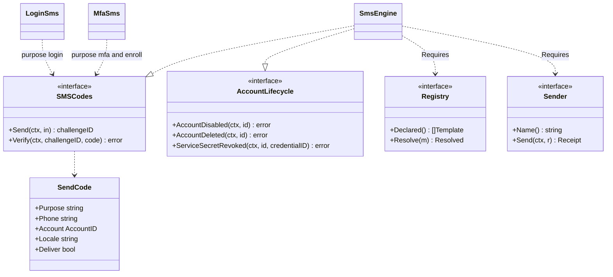
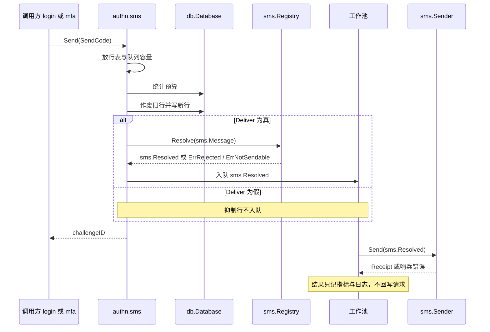
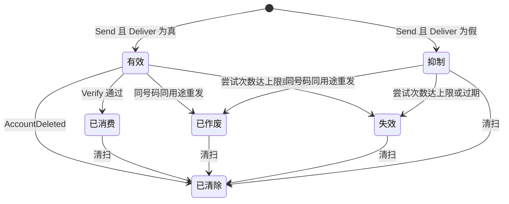
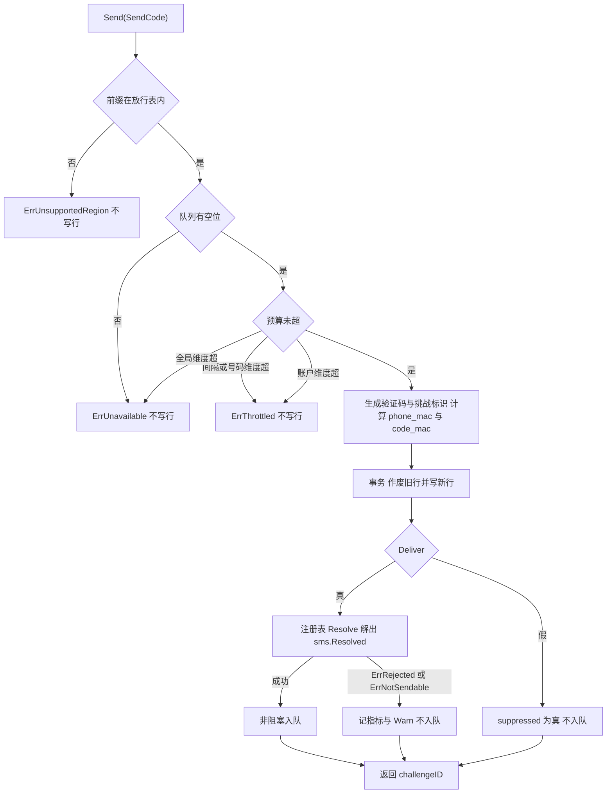

# authn/sms

## 职责

本模块持有短信验证码的**全部状态机**：写挑战行、发放预算、尝试次数、消费、入队与发送。短信验证码按用途区分，用途是封闭集：`login`（作第一因素）、`mfa`（作第二因素）、`enroll`（登记手机或短信因素时证明号码归属）。各用途对挑战的要求相同：一次性消费、尝试次数上限、发送预算，所以挑战状态只有一处持有，使用方是 `authn.login.sms`（用途 `login`）、`authn.mfa.sms`（用途 `mfa`）与登录引擎的手机号验证路由（用途 `enroll`），它们不持有挑战状态（[ADR-authn-sms-2026-10-10](../../../adr/adr-authn-sms-2026-10-10.md)）。

本功能包括下列部分：

- **`SMSCodes`**：由 `authn.sms` 排他交付，挑战状态机的唯一入口。验证码明文从不离开本模块：不写库、不写日志、不进事件与指标，只存在于入队项与交给发送方的调用参数里。
- **发送**：经顶层发送能力 `pkg/sms` 的 `Registry` 与 `Sender` 把每条挑战发出去。本模块不认识厂商，只按自己所需的模板键构造一条 `sms.Message` 交给注册表解出 `sms.Resolved`，再把解出的形状交给载体；模板声明、厂商编号与参数次序归 `pkg/sms`（[design-sms](../design-sms.md)、[ADR-sms-capability-2026-10-13](../../../adr/adr-sms-capability-2026-10-13.md)）。
- **账户清理**：`authn.sms` 实现 `AccountLifecycle`，账户删除之后抹除该账户的挑战行，并按周期清扫过了预算统计窗口的挑战行。

### 非职责

- **不挂路由，不写 HTTP。** 短信登录与短信因素的路由、请求与响应形状归登录引擎与 MFA 编排（见 [design-authn-login](design-authn-login.md)、[design-authn-mfa](design-authn-mfa.md)）。本模块只回答「这条挑战发出去了没有、这个码对不对」。
- **不判定号码是否已登记，不解析账户。** `SendCode.Deliver` 由调用方依据号码的登记状态与注册开关决定；本模块对 `Deliver` 为假的请求写抑制行，不探知为什么为假。手机标识的写入（`verified_via = sms-code`）归 `authn.account`（见 [design-authn-account](design-authn-account.md)）。
- **不持有失败退避。** 退避状态在 `authn.account` 交付的 `Throttle` 里，由使用方在答复阶段施加，施加的方式见「失败退避的施加」；本模块不依赖 `Throttle`，只管每条挑战自己的尝试次数。
- **不持有流程记录，不核对每流程的发送上限。** 流程记录的 `sends` 在 kv 里，由登录引擎在调用 `Send` 之前核对（见 [design-authn-login](design-authn-login.md)）。
- **不定保障等级。** 单凭短信码只算一个因素，等级只在 `authn.mfa` 一处合成。
- **不规范化号码。** `SendCode.Phone` 由调用方规范化为 E.164；`BlindIndex` 对输入原样计算，不规范化（见 [design-db](../design-db.md)）。
- **不托管厂商侧验证码，不重试厂商调用。** 生成、校验、重放与失败计数的规则全在本模块；适配器从不自行重发。
- **不承载邮件或其他渠道。** 本模块经 `pkg/sms` 的 `Sender` 发送，那条接缝是短信专用的；邮件通道是与它对称的另一个接缝（根包 `EmailCodeSender`，`pkg/authn/email.go`），属登录模块的自助件，不在本模块之内。
- **不认识租户。** 账户全局，`authn` 的任何子包都不 import `pkg/tenant`。

## 术语表

下列术语的含义限于本文档与 [ADR-authn-sms-2026-10-10](../../../adr/adr-authn-sms-2026-10-10.md)，以及它所指向的认证主题决策记录。

| 术语 | 适用范围 | 定义 |
|---|---|---|
| 挑战 | 本文档与 ADR-authn-sms-2026-10-10 | 一次短信验证码的发放记录，落在表 `authn_challenges` 的一行：号码与验证码都只以带密钥摘要留存，附尝试次数与期限。它与校验后端在拒绝响应里发出的质询（`WWW-Authenticate`、`Challenger`）无关。 |
| 抑制行 | 本文档与 ADR-authn-sms-2026-10-10 | `suppressed` 为真的挑战行：号码未登记且注册关闭时写入，不入队、不发送，但与真实行走同一条计数路径，计入全部预算，对外应答与「已发送」同形。 |

## 外部接口契约

### 登记单元与名字

| 包 | 模块名 | 交付 | 排他 | 构造期依赖 | 其余取用（缺席合法） | 表 |
|---|---|---|---|---|---|---|
| `pkg/authn/sms` | `authn.sms` | `SMSCodes`；`AccountLifecycle` | `SMSCodes` 排他 | `db.Database`、`sms.Registry`、`sms.Sender` | `settings.Store`、`event.Bus`、`audit.Audit`、`log.Logger` | `authn_challenges` |

`SMSCodes` 的接口定义在 `pkg/authn` 根包，根包自身不登记模块。`sms.Registry` 与 `sms.Sender` 的接口定义在 `pkg/sms` 根包（形状见 [design-sms](../design-sms.md)）。每个登记模块的包导出 `ModuleName`，配置命名空间取同一个取值。模板注册表与发送方各由顶层发送能力的一个登记模块交付，本模块经 `sms.Registry` 与 `sms.Sender` 取用，宿主在命令树上各自选定一个；两个载体（`sms.aliyun`、`sms.tencent`）同时纳入在消解阶段以排他冲突失败。

### 发送方的接取：经 sms.Registry 与 sms.Sender

模板注册表与发送接缝各是顶层发送能力 `pkg/sms` 的一个接缝（形状见 [design-sms](../design-sms.md)）。本模块把两者都当作排他的构造期依赖取用（`Requires` 记 `(*sms.Registry)(nil)` 与 `(*sms.Sender)(nil)`），宿主在命令树上各选定一个；同一接缝的两个实现同时纳入在消解阶段失败。本模块先取注册表，因为覆盖核对读的是注册表的声明、发送时解出的形状也来自注册表，再取载体。本模块不 import 任何厂商适配叶子包。

本模块把每条挑战构造成一条 `sms.Message`，交给注册表的 `Resolve` 解出 `sms.Resolved`，再把解出的形状交给载体：

```go
func message(in SendCode, challengeID, code, ttlMinutes string) sms.Message {
	return sms.Message{
		To:       in.Phone,                    // 已规范化的 E.164
		Template: purposeTemplate(in.Purpose), // authn.code.login / mfa / enroll
		Params:   map[string]string{"code": code, "ttl_minutes": ttlMinutes},
		Locale:   resolveLocale(in.Locale, defaultLocale, declared), // 解析到注册表声明的语言，缺省落配置的默认语言
		DedupeID: challengeID,
	}
}
```

模板键是 `authn.code.login`、`authn.code.mfa`、`authn.code.enroll`，按用途映射；参数名固定为 `code` 与 `ttl_minutes`。这几个模板名、参数名与配置的默认语言是与注册表的配置契约：注册表持有的 `templates` 里必须写这几个模板名、恰好这两个参数，每个模板至少一种语言，且每个模板覆盖配置的默认语言——多声明一个本模块不发送的参数，该模板就没有任何消息能满足。**一条消息的语言集是它所属模板声明的语言集**：本模块不声明任何语言表，一条消息能发出去的语言是它用途映射到的那个模板声明的语言；不同用途的模板可以声明不同的语言集，每个模板各自覆盖配置的默认语言。**模板的语言集是有效语言集（厂商编号与本地正文的并集），所以同样的三个模板在按编号发送的载体与按正文发送的载体上都能用**：按正文发送的载体由配置里的 `bodies` 提供正文，本模块不写任何载体特有的文案。

**覆盖由本模块在 `New` 核对。** `pkg/sms` 只让注册表报告自己持有什么，覆盖哪些组合由消费方核对，所以本模块在 `newProduct` 取到 `sms.Registry` 后立即调 `registry.Declared()`，逐项核对自己所需的（模板，参数）契约——每个必需模板的名字都要在、每个模板至少声明一种语言、每个模板都要覆盖配置的默认语言、参数名表须恰为本模块所发的两个（少一个或多一个都即 `ErrInvalidConfig` 并点名那个参数）；`New` 返回错误同样终止启动，早于服务。`Prepare` 早于 `New`、拿不到实例，核对因此落在 `New`。配置的默认语言用 `reader.Decode(i18n.ConfigNamespace, &cfg)` 读，`cfg` 的字段带 `config:"default-locale"` 且预置为 `en-US`，因而一个没有纳入 i18n 引擎、也就没有该命名空间的装配，读到的仍是英文，与那个引擎自己会读的默认一致。

`sms.Registry.Resolve` 把 `sms.Message` 解成载体直接可用于构造请求的形状；一条注册表解不出的消息以 `ErrRejected` 拒绝，一条模板被禁用或审核未过的消息以 `ErrNotSendable` 拒绝，两者都在请求路径上只记指标与日志、不外露。`sms.Sender.Send` 返回的错误取自封闭集 `sms.ErrThrottled`、`sms.ErrRejected`、`sms.ErrUnroutable`、`sms.ErrUncertain`；本模块的工作池归类它们、只记指标与日志，不外露（见「发送工作池与失败归类」）。空 `Locale` 或注册表里没有的（模板，语言）组合在 `pkg/sms` 一侧以 `ErrRejected` 拒绝、不调厂商。

### SMSCodes：挑战状态机

```go
type SendCode struct {
	Purpose string    // login、mfa、enroll
	Phone   string    // E.164，已规范化
	Account AccountID // mfa、enroll 必填；login 不填，也不按它计数
	Locale  string    // 调用方填入的请求语言；空读作配置的默认语言，非空时解析到注册表声明的语言
	Deliver bool      // 为假：只写抑制行并计入全部预算，不入队不发送
}

type SMSCodes interface {
	// 校验放行表与全部预算，写挑战行，把发送交给有界工作池，立即返回；
	// 响应时间与厂商延迟无关。
	// 错误取自 ErrUnsupportedRegion、ErrThrottled（带 RetryAfter）、ErrUnavailable。
	Send(ctx context.Context, in SendCode) (challengeID string, err error)
	// 先对挑战行做条件的尝试次数加一，再比对带密钥摘要，通过则条件更新消费时间；
	// 一切不通过的情形统一返回 ErrInvalidCredentials。
	Verify(ctx context.Context, challengeID, code string) error
}
```

契约的内容如下：

- **`Send` 的调用方责任。** `Purpose` 取自封闭集，`Phone` 已规范化，`mfa` 与 `enroll` 的 `Account` 非空；违反即调用方缺陷，`Send` 返回普通错误，不属于哨兵集。每流程发送上限由调用方在 `Send` 之前核对。
- **`Send` 对 `Deliver` 为真与为假的调用走同一条路径。** 应答只有 `challengeID` 一种形状，调用方无法从返回值、状态码或错误形态区分抑制行与真实行（耗时见「非保证」）。
- **`Locale` 的来源与取值。** 本模块不声明任何语言表：它的受支持语言集是注册表声明的语言集（`registry.Declared()`），按用途模板逐条持有、由本模块在 `New` 派生一次，一条消息的可用语言是它 `Template` 指向的那个模板声明的语言，不是各模板的并集（[ADR-i18n-language-set-2026-10-13](../../../adr/adr-i18n-language-set-2026-10-13.md)）。`pkg/sms` 不声明语言闭集，把语言当作不透明串（[design-sms](../design-sms.md)）。本模块不读 HTTP，也不解析 `Accept-Language`：那次解析由登录引擎在发起流程的请求上做（优先取 i18n 协商结果，取不到时为空串），存入流程记录，经方法与因素的入参交给调用方，调用方原样填入 `SendCode.Locale`；解析本身归 [design-authn-login](design-authn-login.md)。**请求语言由本模块解析到该用途模板声明的语言**：`SendCode.Locale` 为空时读作配置的默认语言；非空时取该模板声明的语言中主子标签与它相等的那一个（比较不分大小写）；没有相等的则落到配置的默认语言。**一个不受支持的请求语言因此不是被拒，而是落到默认语言**——语言是调用方的偏好，该模板声明的集合才是这条消息实际能发出去的语言。这与直接调用 `sms.Registry.Resolve` 不同：那时空 `Locale` 与编号表里没有的语言都被 `pkg/sms` 读作调用方缺陷、以 `ErrRejected` 拒绝、不调厂商（[design-sms](../design-sms.md)）。本模块构造的 `sms.Message.Locale` 取 `resolveLocale(SendCode.Locale, 配置的默认语言, 该用途模板声明的语言)`。
- **`Verify` 不回传号码与账户。** 通过只证明持有该挑战标识的调用方出示了正确的码；码发往哪个号码，由调用方在自己的流程记录里保存，以发起时的号码为准。
- **`Verify` 对抑制行恒返回 `ErrInvalidCredentials`**，照样计数并做一次诱饵比对。
- **方法名核对。** 同一模块交付的各能力接口方法名两两不相交的规则见 [design-authn](design-authn.md#扩展点)。`authn.sms` 交付的 `SMSCodes` 的方法（`Send`、`Verify`）与 `AccountLifecycle` 的方法（`AccountDisabled`、`AccountDeleted`、`ServiceSecretRevoked`）互不重名；`sms.Sender` 的 `Send` 与 `SMSCodes` 的 `Send` 同名异签，二者由不同模块交付（`sms.Sender` 由 `pkg/sms` 的载体叶子，`SMSCodes` 由 `authn.sms`），不会落在同一个类型上。

### 输入项的语义

输入项的完整表（取值、缺省、范围、敏感标记）只在 [design-authn-config](design-authn-config.md) 给出，本节写语义。分界判据是该值是否在数据库可用之前就被需要，或塑造启动结构、改变要重启（[ADR-authn-settings-and-secrets-2026-10-10](../../../adr/adr-authn-settings-and-secrets-2026-10-10.md)）。

| 归属 | 项 | 语义 |
|---|---|---|
| 配置，`authn.sms` | `workers`、`queue-size` | 异步发送工作池的协程数与队列容量，构造时分配 |
| 设置，`authn.sms` | `allowed-prefixes` | 放行表：允许发送的 E.164 号码前缀；缺省为空，空即一律拒绝 |
| 设置，`authn.sms` | `code-length`、`code-ttl`、`code-attempts` | 验证码位数、有效期、每码尝试上限 |
| 设置，`authn.sms` | `resend-interval`、`per-phone-hourly`、`per-phone-daily` | 同号码的重发间隔与每小时、每日发放上限 |
| 设置，`authn.sms` | `global-hourly-login`、`global-hourly-mfa`、`global-hourly-enroll` | 按用途分设的全局每小时上限 |
| 设置，`authn.sms` | `per-flow-sends`、`per-account-hourly` | 每流程发送上限（由调用方核对）与每账户每小时上限（只对 `mfa`、`enroll` 计） |

本模块不声明语言闭集：`SendCode.Locale` 的取值由该用途模板声明的语言集与配置的默认语言共同给出，请求语言按主子标签解析到前者、落不到时用后者。`pkg/sms` 不声明语言闭集，把语言当作不透明串（[design-sms](../design-sms.md)）。配置的默认语言来自 i18n 能力目录的 `i18n.default-locale` 项，与那个引擎读的是同一个，一处声明服务两个能力目录。

这些键由本模块声明。除 `per-flow-sends` 外，各键由本模块读；`code-ttl` 与 `resend-interval` 另由登录模块的手机号自助路由读（构成记录的有效期与应答里的 `resend_after`，见 [design-authn-login](design-authn-login.md) 的「手机号验证」），`per-flow-sends` 由登录引擎读（构成交给方法与因素的 `SendsLeft`）。各键经设置存储从全局层读，读取出错或取值越出取值域时取声明的缺省。`per-flow-sends` 的声明模块不在装配里时（没有装配 `authn.sms`），登录引擎按设置的缺席规则取声明缺省，不记 `Error`；声明在场而读取失败或取值越出取值域才记 `Error`（[design-authn-config](design-authn-config.md) 的「设置缺席与读取出错」）。

`allowed-prefixes` 与预算项是设置，改到更宽松的取值时，本模块写一行 `Warn` 并经审计接缝记一条尽力档记录，事前不拦（[ADR-authn-settings-and-secrets-2026-10-10](../../../adr/adr-authn-settings-and-secrets-2026-10-10.md)）。

### 对外接口面

- `SMSCodes`、`SendCode` 的字段与方法集，以及用途与模板键这两个封闭集，是本模块对使用方的接口面。`SendCode.Locale` 的取值不是封闭集：它是一个 BCP 47 标签，由本模块解析到该消息所用模板声明的语言；模板键（`authn.code.login`、`authn.code.mfa`、`authn.code.enroll`）是配置文件里出现的取值，是本模块与载体的配置接口面。增删封闭集的成员会同时改变使用方与载体看到的面，两者一并复核。
- 挑战表的列与索引是本模块私有的存储形状，不在对外接口面内：其他模块不读 `authn_challenges`，只经 `SMSCodes` 与 `AccountLifecycle` 交互。
- 单个载体叶子包可替换、可撤掉，不改变 `SMSCodes` 的行为。

## 依赖

| 依赖 | 方式 | 用途 | 缺席时 |
|---|---|---|---|
| `db.Database` | `Requires` | 挑战表的读写；`BlindIndex` 计算带密钥摘要；迁移集 | 构造失败 |
| `sms.Registry` | `Requires`（排他功能） | 取得模板注册表；核对模板覆盖、解出可发送的形状；缺失或多个同时纳入在消解阶段失败 | 构造失败 |
| `sms.Sender` | `Requires`（排他功能） | 取得发送方；缺失或多个同时纳入在消解阶段失败 | 构造失败 |
| `settings.Store` | 取用，缺席合法 | 放行表、预算与验证码参数 | 各项取声明的缺省值；放行表缺省为空，所以没有设置模块的装配里短信一律不发 |
| `event.Bus` | 取用，缺席合法 | 订阅 `authn.account.deleted` 与 `settings.changed` | 只剩同步钩子，没有事件补偿；不影响正确性底线 |
| `audit.Audit` | 取用，缺席合法 | 放宽设置的尽力档审计 | 只写 `Warn` |
| `log.Logger` | 取用，缺席合法 | 脱敏规则登记、日志 | 无日志 |

厂商适配住在顶层 `pkg/sms` 下（`pkg/sms/aliyun`、`pkg/sms/tencent`），只绑定各自的厂商 SDK，所以 SDK 只进 import 了该叶子包的宿主的依赖闭包（[ADR-authn-packaging-2026-10-10](../../../adr/adr-authn-packaging-2026-10-10.md)、[ADR-sms-capability-2026-10-13](../../../adr/adr-sms-capability-2026-10-13.md)）。两家 SDK 的封边与钉版由 `pkg/sms/deps_test.go` 的守卫守住，版本与阿里云 SDK 的 genproto 备注见 [design-sms](../design-sms.md)。本模块只经 `sms.Registry` 与 `sms.Sender` 取用模板与发送方，不 import 任何载体叶子包。

依赖方向满足架构不变量：

- `Requires` 只写排他功能，并立功能一律经 `ResolveAll` 取用（[ADR-authn-wiring-2026-10-10](../../../adr/adr-authn-wiring-2026-10-10.md)）。`AccountLifecycle` 是并立功能，`authn.account` 在 `Init` 里 `ResolveAll[AccountLifecycle]` 取到本模块的实例；`authn.account` 在运行期调用本模块，编译期与构造期都不 import 它，所以不构成环。
- `authn.login.sms`、`authn.mfa.sms` 依赖 `SMSCodes`，本模块不依赖它们。失败退避由使用方经 `Throttle` 施加（「失败退避的施加」一节），所以 `authn.login.sms` 另依赖 `Throttle`，本模块不依赖。
- 本模块不用 kv：挑战行的丢失会放宽预算，状态放置的判据要求进 db（[ADR-authn-state-placement-2026-10-10](../../../adr/adr-authn-state-placement-2026-10-10.md)）。
- 构造阶段（`New`）不读写自己的表，首次启动时表尚未建立；需要读表的初始化与清扫协程放在 `Start`。

## UML 图

### 结构

类图固定能力与使用方的关系：`SmsEngine` 是 `authn.sms` 的产物，同时实现 `SMSCodes` 与 `AccountLifecycle`，并以构造期依赖持有顶层发送能力的 `Registry` 与 `Sender`（图中各记作 `Registry` 与 `Sender`，其实现是 `pkg/sms` 下的注册表模块与载体模块，见 [design-sms](../design-sms.md)）；使用方只认 `SMSCodes`。



### 发送的交互

时序图固定一次发送涉及的模块与同步边界：写挑战行、向注册表解出可发送的形状与应答都在请求内完成，厂商调用在工作池里异步完成，应答不等它。



### 挑战行的生命周期

状态图固定挑战行的去向。状态由列推出：消费与作废在存储上同样表现为 `consumed_at` 非空；用尽与过期不改行，由尝试次数与 `expires_at` 推出。



## 核心数据结构

### authn_challenges

表由 `authn.sms` 拥有，迁移集随模块，`postgres/` 与 `sqlite/` 各一份同名文件。表之间与对其他模块的表都不建外键，不嵌入 `tenant.Model`；时间一律经 `internal/clock` 取、一律 `.UTC()`，SQLite 把时间存成文本并按字符串比较，非 UTC 的值会使窗口统计判错。

| 列 | 类型 | 含义 |
|---|---|---|
| `id` | 文本，主键 | 挑战标识，随机、不可推测；也是 `sms.Message.DedupeID` |
| `purpose` | 文本 | `login`、`mfa`、`enroll` |
| `phone_mac` | 文本 | 规范化号码的带密钥摘要，用于预算统计与关联；号码本身不在表里留存 |
| `account_id` | 文本，可空 | `mfa`、`enroll` 用途填，每账户预算与账户删除的清理凭它；`login` 不填 |
| `suppressed` | 布尔，缺省假 | 抑制行标记 |
| `code_mac` | 文本 | 带密钥摘要，覆盖挑战标识与验证码 |
| `attempts` | 整数，缺省 0 | 已计数的比对次数 |
| `max_attempts` | 整数 | 写入时取设置的每码尝试上限 |
| `created_at` | 时间戳 | 发放时刻；预算统计的时间轴 |
| `expires_at` | 时间戳 | 写入时取设置的有效期 |
| `consumed_at` | 时间戳，可空 | 消费或作废的时刻 |

索引：`(phone_mac, created_at)` 服务于号码维度的预算统计与重发间隔；`expires_at` 上的索引服务于清扫。账户维度与用途维度的统计走 `created_at` 范围，行数上界由预算与清扫共同给出。

**摘要。** 验证码空间只有百万量级，不带密钥的摘要等于明文，所以 `code_mac` 与 `phone_mac` 都经 `db.Database.BlindIndex`（HMAC-SHA256，密钥由 db 根密钥派生）计算：`code_mac` 的输入是 `<挑战标识>|<验证码>`，`phone_mac` 的输入是规范化后的 E.164 号码。`BlindIndex` 在没有根密钥时 panic，所以 `Start` 里做一次包 `recover` 的自检，缺根密钥即以 `ErrNoEncryptionKey` 终止启动，不降级为无密钥摘要。

**验证码。** 取自 `crypto/rand` 的均匀十进制数字，位数、有效期、每码尝试上限取设置；`sms.Message.Params` 的键集固定为 `code` 与 `ttl_minutes`。

### 入队项

发送工作池的队列元素是一条已解出的 `sms.Resolved`，其 `Params` 与 `Ordered` 带验证码明文。队列在进程内，容量有界，元素不落库；这是明文唯一的停留处，进程退出即丢失。

## 核心算法与流程

### 发送

下列判定按顺序执行，同一请求落在多项上时只报第一项。已登记与未登记的号码、`Deliver` 为真与为假的请求，走的是同一条路径，只在入队这一步分叉。



1. **放行表。** 规范化后的号码前缀不在放行表内，返回 `ErrUnsupportedRegion`，不写行。判定只看前缀，与号码是否登记无关；放行表缺省为空，不明确放行就不发。
2. **队列容量。** 队列已满，返回 `ErrUnavailable`，不写行、不作废旧行。这一步对真实行与抑制行同样执行，使「队列满」不成为区分已登记与未登记号码的观察点。
3. **预算。** 依据 `authn_challenges` 的行数统计，见下表；统计包含抑制行、已消费行与已作废行，只有清扫才使行退出统计。被拒绝的请求不写行。
4. **生成与写入。** 生成验证码与挑战标识，计算 `phone_mac` 与 `code_mac`；在一个事务里把同（`phone_mac`，用途）下尚未消费且未过期的旧行作废（条件更新 `consumed_at`），再写新行，`suppressed` 取 `Deliver` 的反。
5. **解出可发送的形状。** `Deliver` 为真时，把构造的 `sms.Message` 交给注册表的 `Resolve` 解出 `sms.Resolved`；注册表以 `ErrRejected`（消息形状）或 `ErrNotSendable`（模板被禁用或审核未过）拒绝时，记指标与 `Warn`、不入队，`Send` 仍返回 `challengeID`（行已写、预算已计），用户走重发。`Deliver` 为假时不解出。
6. **入队。** 解出成功后非阻塞入队；`Deliver` 为假时不入队。事务提交与入队之间队列恰被填满时，该发送被丢弃并计入 `dropped`（见「结果与指标」），`Send` 仍返回 `challengeID`，用户走重发。

### 预算维度

预算全由 `authn_challenges` 的行数得出。维度是封闭集；窗口自 `created_at` 起算，口径一律含抑制行。一个维度的已有行数达到上限时，再发即超限，所以窗口内至多发放上限条。

| 维度 | 统计口径 | 适用用途 | 超限的结果 |
|---|---|---|---|
| 重发间隔（`resend-interval`） | 同 `phone_mac` 最近一行距今 | 全部 | `ErrThrottled`，`RetryAfter` 为间隔的剩余时间 |
| 每号码每小时（`per-phone-hourly`） | 同 `phone_mac` 近一小时的行数 | 全部 | `ErrThrottled` |
| 每号码每日（`per-phone-daily`） | 同 `phone_mac` 近一日的行数 | 全部 | `ErrThrottled` |
| 全局每小时，按用途分设（`global-hourly-login`、`global-hourly-mfa`、`global-hourly-enroll`） | 同用途近一小时的行数 | 各自的用途 | `ErrUnavailable` |
| 每账户每小时（`per-account-hourly`） | 同 `account_id` 近一小时的行数 | 只对 `mfa`、`enroll` 计 | `ErrThrottled` |
| 每流程发送数（`per-flow-sends`） | 流程记录的 `sends` | 全部 | 由调用方核对，不在本模块 |

约束的理由如下：

- **全局预算按用途分设。** 匿名流量耗尽 `login` 的预算，不挤占已通过口令的第二因素与登记的发送。
- **账户维度只对 `mfa` 与 `enroll` 计。** 判据是账户不得由手机号推出：这两种用途的账户由第一因素或会话确定；`login` 用途若按账户计，已登记号码有账户可计、未登记号码没有，应答随之不同。
- **号码维度跨用途累计。** 同一号码换一个用途不能绕开另一个用途的重发间隔与小时、日上限。

### 抑制行与应答同形

号码未登记且注册关闭时，调用方传 `Deliver = false`。本模块照常通过放行表、队列容量与全部预算，照常生成验证码、计算摘要、写一行 `suppressed` 为真的挑战行，只是不入队。随后的 `Verify` 对该行照样条件计数并做一次比对，恒返回 `ErrInvalidCredentials`。判据是：真实发送与否是已登记与未登记号码之间唯一的差别，且不可从应答观察到（[ADR-authn-sms-2026-10-10](../../../adr/adr-authn-sms-2026-10-10.md)，枚举防护的总体规则见 [ADR-authn-throttling-2026-10-10](../../../adr/adr-authn-throttling-2026-10-10.md)）。

### 重发与作废

重发即再调一次 `Send`：写新挑战行并作废同（`phone_mac`，用途）下尚有效的旧行。作废的表示是把旧行的 `consumed_at` 置为当前时刻（条件为该列仍空），校验对 `consumed_at` 非空的行恒失败，所以作废与消费在校验看来是同一状态。**重发不清零失败计数**：失败计数的载体是 `Throttle` 里的退避键（`login`、`enroll` 用途是 `ScopePhone` 键，`mfa` 用途是 `ScopeFactor` 键，见「失败退避的施加」），它不随挑战行而变，重发写新行并不触及它；每行自己的 `attempts` 随新行从零起算，上界由退避键与预算共同给出。

### 校验

`Verify` 的步骤如下，每一步失败都返回 `ErrInvalidCredentials`，不区分成因；对不存在的行、已过期或已消费的行，同样做一次诱饵比对，使耗时形态不随成因而变。

1. 条件更新 `attempts = attempts + 1`，条件是该行存在、`consumed_at` 为空、未过期、`attempts < max_attempts`；受影响行数为零即失败。**先计数再比对**，并发提交因此无法绕过上限。
2. 比对 `BlindIndex(<挑战标识>|<验证码>)` 与 `code_mac`，常量时间比较；`suppressed` 为真的行恒不通过。
3. 条件更新 `consumed_at`，条件是它仍为空；受影响行数为一才算消费成功，并发的第二次提交败于此处。

### 失败退避的施加

退避的算法与表归 `authn.account`（见 [design-authn-account](design-authn-account.md)），本模块不依赖它。`Verify` 只数每条挑战自己的尝试，跨挑战的失败累计由使用方在调用 `Verify` 前后施加，所以这是对使用方的约束，约束的主体是 `SMSCodes` 的每个使用方：

| 用途 | 使用方 | 退避范围与键 | 判据 |
|---|---|---|---|
| `login` | `authn.login.sms` | `ScopePhone`，键为规范化 E.164 号码的 SHA-256 十六进制 | 登录时没有账户也没有因素标识，号码是唯一稳定的键 |
| `enroll` | 登录引擎的手机号验证路由 | `ScopePhone`，键同上 | 登记时因素尚未存在，同样只有号码可作键 |
| `mfa` | `authn.mfa.sms` | `ScopeFactor`，键为因素标识，由 `authn.mfa` 的统一收口施加 | 因素标识在发码前已确定；不另计 `ScopePhone`，使登录一侧对号码的错误提交不锁住已通过第一因素的第二因素 |

施加的次序是：`Verify` 之前 `Throttle.Check`，退避中不调用 `Verify`；`Verify` 返回 `ErrInvalidCredentials` 时 `Throttle.Fail`，返回 `nil` 时 `Throttle.Succeed`。对 `Deliver` 为假的挑战同样施加：使用方不区分行的真假，所以未登记号码与已登记号码的退避累计路径一致。`Verify` 返回 `ErrUnavailable` 时既不 `Fail` 也不 `Succeed`。

### 发送工作池与失败归类

工作池在 `Start` 起固定个数的协程，从有界队列取 `sms.Resolved` 调 `sms.Sender.Send`。`Send` 立即返回，响应时间与厂商延迟无关。厂商调用的结果只记指标与日志，不回写请求，也不改挑战行：

| 结果 | 处置 |
|---|---|
| 成功 | 记指标 |
| `sms.ErrUncertain` | 当作已发送，不盲目重发；用户走重发，该次计入预算；记 `Warn` 与指标 |
| `sms.ErrThrottled`、`sms.ErrRejected` | 当作未送达，不重发；用户收不到码，重新请求时再发；记 `Warn` 与指标 |

`Stop` 以自带的 5 秒为界排空队列（`Stop` 收到的上下文已去掉取消）；超出的发送被丢弃，进程在入队之后、发送之前退出同样丢失队列里的发送，这些情形下用户都只能重发。

### 结果与指标

指标 `authn.sms.sends` 的属性 `outcome` 取值的全表在 [design-authn-events](design-authn-events.md)；本节写本模块的每种结果记哪个取值。每次 `Send` 调用至多记一次：被拒绝、丢弃与注册表拒解出的在调用内记，入队成功的由工作池在厂商调用返回后记。

| 结果 | `outcome` | 说明 |
|---|---|---|
| 号码前缀不在放行表 | `unsupported-region` | `ErrUnsupportedRegion`，不写行 |
| 队列已满（`Send` 起始处的预检） | `dropped` | `ErrUnavailable`，不写行 |
| 全局预算耗尽 | `budget-exhausted` | `ErrUnavailable`，不写行 |
| 重发间隔、每号码、每账户任一维度超限 | `budget-exhausted` | `ErrThrottled`，不写行 |
| `Deliver` 为假，写抑制行 | `suppressed` | 返回 `challengeID`，不入队 |
| 注册表解不出消息（`ErrRejected`） | `rejected` | 返回 `challengeID`，行已写且计入预算，不入队 |
| 注册表拒发（`ErrNotSendable`） | `not-sendable` | 返回 `challengeID`，行已写且计入预算，不入队 |
| 事务提交与入队之间队列被填满 | `dropped` | 返回 `challengeID`，行已写且计入预算，发送被丢弃 |
| 厂商调用成功 | `sent` | 工作池记 |
| `sms.ErrUncertain` | `uncertain` | 工作池记 |
| `sms.ErrThrottled` | `throttled` | 工作池记 |
| `sms.ErrRejected` | `rejected` | 工作池记 |
| `sms.ErrUnroutable` | `unroutable` | 工作池记 |

`dropped` 只表示本进程的队列没有容量，不分预检与提交之后；`throttled` 只表示厂商的答复，`rejected` 表示发送侧不接受这条消息（厂商拒绝，或注册表解不出），`unroutable` 表示当前部署无法把这条消息送到这个目的地（缺权限、资源不存在、配额不足，或身份覆盖不了目的地国家）——它是确定失败，与 `rejected` 一样不被读作未知结局，区别只在消息本身没有缺陷；号码与账户维度的超限归 `budget-exhausted`；`not-sendable` 表示模板被禁用或审核未过，与这条消息无关。`Stop` 排空超时丢弃的与进程退出时丢失的发送不记指标，进程已无法记录。

### 厂商适配

厂商适配是顶层发送能力的一部分，住在 `pkg/sms` 下（`sms.aliyun`、`sms.tencent`）；其 SDK、请求形状、错误码归类与接入点配置见 [design-sms](../design-sms.md)。本模块只经 `sms.Sender` 取用发送方，不感知厂商。

### 账户生命周期与清扫

- **`AccountDisabled`**：不动挑战行，返回 `nil`；账户重新启用后挑战行仍属于账户。
- **`AccountDeleted`**：删除该账户的挑战行（`account_id` 非空的 `mfa`、`enroll` 行）；`login` 行不带账户，由清扫回收，号码本身不在表里留存。幂等：没有行可删时返回 `nil`。
- **`ServiceSecretRevoked`**：与短信无关，返回 `nil`。
- **事件补偿。** `event.Bus` 在场时，本模块在 `Init` 里订阅 `authn.account.deleted`，按 `Event.ID` 去重，处理函数幂等，重做 `AccountDeleted` 的清理。钩子失败计入 `authn.cleanup.failures`（`hook` 取 `sms`）。钩子是同步的清理，事件是补偿，两者都不是正确性的底线：校验后端每次建立身份时另行核对账户状态与 `valid_after`，残留的挑战行不能单独换出身份（[ADR-authn-account-lifecycle-2026-10-10](../../../adr/adr-authn-account-lifecycle-2026-10-10.md)）。
- **清扫。** 本模块是 `authn_challenges` 的持有者，在 `Start` 起一个有界协程，每 10 分钟一轮，删除 `expires_at` 早于当前时刻 25 小时的行。行在写入时取 `expires_at`，它与 `created_at` 的差就是该行的有效期（至多 10 分钟），远小于 25 小时相对最长一日窗口（24 小时）的一小时余量，所以窗口内的行不会被提前清走、预算不会少计；清扫走 `expires_at` 上的索引，不受 `(phone_mac, created_at)` 的前缀限制。一轮以一批至多 1000 行为单位（`DELETE … WHERE id IN (SELECT id … LIMIT 1000)`，各方言通用）连续删到不足一批为止；每个副本都跑，条件删除互不冲突；`Stop` 以自带的 5 秒为界等它退出。全部清扫表见 [design-authn-account](design-authn-account.md)。

## 错误与失败语义

### 哨兵

下表只列本模块产生或归类的哨兵；全部哨兵的判据与状态码在 [design-authn-failure](design-authn-failure.md)。

| 哨兵 | 产生处 | 含义 | 对外 |
|---|---|---|---|
| `ErrUnsupportedRegion` | `Send` | 号码前缀不在放行表 | 400 `unsupported-region` |
| `ErrThrottled`（`ThrottledError` 带 `RetryAfter`） | `Send` | 重发间隔、号码维度或账户维度超限 | 429 与 `Retry-After` |
| `ErrUnavailable` | `Send`、`Verify` | 队列已满、该用途的全局预算耗尽、db 不可用 | 503 |
| `ErrInvalidCredentials` | `Verify` | 码不对、已过期、已消费、已作废、尝试次数用尽、抑制行；不区分成因 | 统一 `login-failed` |
| `sms.ErrThrottled` | `sms.Sender.Send` | 发送方限流 | 不外露，只记指标与日志 |
| `sms.ErrRejected` | `sms.Registry.Resolve`、`sms.Sender.Send` | 注册表解不出消息，或模板、签名、号码被厂商拒绝 | 不外露，只记指标与日志 |
| `sms.ErrUnroutable` | `sms.Sender.Send` | 当前部署无法把这条消息送到这个目的地：缺权限、资源不存在、配额不足，或身份覆盖不了目的地国家；确定失败，不是未知结局 | 不外露，只记指标与日志 |
| `sms.ErrNotSendable` | `sms.Registry.Resolve` | 模板被禁用或厂商审核未过，消息不得发出 | 不外露，只记指标与日志 |
| `sms.ErrUncertain` | `sms.Sender.Send` | 发送后超时，不知是否送达；不得盲目重发 | 视为已发送 |
| `ErrInvalidConfig` | 构造 | 注册表未声明某个必需模板、某个模板没有任何语言、某个模板未覆盖配置的默认语言，或参数名表与所发不等 | 启动失败，点名缺的那一项 |
| `ErrNoEncryptionKey` | `Start` | db 没有根密钥 | 启动失败 |

`sms.ErrThrottled`、`sms.ErrRejected`、`sms.ErrUnroutable`、`sms.ErrUncertain` 是 `sms.Sender` 可返回错误的封闭集，`sms.ErrRejected` 与 `sms.ErrNotSendable` 是 `sms.Registry.Resolve` 可返回错误的封闭集。厂商的错误在工作池里已脱离请求，所以它们不会改变触发这次发送的那个请求的应答；注册表的拒绝在请求内记指标与日志，同样不外露。

### 失败方向

- **依赖不可用时拒绝。** db 不可用时，`Send` 与 `Verify` 返回 `ErrUnavailable`，不发送、不放行，也不以 401 应答。
- **发送侧不可用或拒发。** 工作池记 `Warn` 与指标，用户收不到码；注册表拒解出时在请求内记 `Warn` 与指标；入队时队列满则 `Send` 返回 `ErrUnavailable`。
- **缺省拒绝。** 放行表为空时一律拒绝，缺根密钥时启动失败。

### 幂等

`Send` 不是幂等的：每次成功调用写一行、计入预算、发放一条短信。`Verify` 对同一挑战至多一次通过，之后的调用败于消费；每次调用都使 `attempts` 加一。钩子与清扫幂等。

### 非保证

下列是不保证的事项，按判据例举，不是封闭集；判据是该情形由本模块的取舍或外部系统的性质造成、本模块不为它设防，符合判据的新情形归入非保证，不为此修订列举。各项的代价与取舍见 [ADR-authn-sms-2026-10-10](../../../adr/adr-authn-sms-2026-10-10.md)：

- **统一应答隐藏失败。** 号码未登记、厂商故障、发送丢失时用户看不到失败，只能重试。
- **预算是软上限。** 统计与写行不在同一条语句里，并发请求可使实际发放超出上限，超出量以同时在途的请求数为界。
- **号码维度的预算可被用来拒绝服务。** 对任一已知号码连续请求即可使它在窗口内得到 429，并使该号码在途的验证码被作废；对该号码的错误提交同样触发 `ScopePhone` 键的退避，退避期内该号码的短信登录与登记被拒。受害者可改用口令、社交、SSO 或通行密钥登录。
- **全局预算耗尽即拒绝该用途的合法请求。** 分设使各用途互不挤占，不使各自的耗尽消失。
- **抑制行把写放大交给匿名请求。** 未登记号码也写一行，行数上界由预算给出。
- **注册开放时未知号码也真实发送。** 此时没有可隐藏的差别，成本由预算承担。
- **根密钥轮换使在途挑战失效，也使 `phone_mac` 与旧值不再相等。** 轮换之后至多一日的窗口内，号码维度的预算按新摘要从空窗口计起，旧行在清扫之前仍占表。
- **耗时只能证否，不能证真。** 抑制行与真实行的耗时差由统一路径压到最小，对照不出差别不构成证明。
- **短信是受限认证器。** SIM 劫持与号码携转使短信弱于 TOTP 与通行密钥，号码被回收后新持有者可用短信登录旧账户；发送前的风险信号检查不做（[design-authn-threats](design-authn-threats.md)）。

### 假设与守住它们的测试

以下行为未经运行核实。依赖它们的断言写作假设，对应的测试失败即视为该断言的前提不成立。厂商错误码归类与编译兼容的假设在 [design-sms](../design-sms.md)：

- **应答同形。** 假设已登记号码与「未登记且注册关闭」的号码，其 `Send` 在返回值、错误与预算计数增量上相同。契约测试对已登记号码与抑制号码各发一轮，断言应答同形、计数路径一致。
- **时区无关。** 假设窗口统计在非 UTC 的 `time.Time` 写入下结果仍正确。SQLite 夹具在 `TZ=America/New_York` 下断言预算统计的条件。

## 并发与事务边界

- **挑战行的写走原生 SQL。** 作废与写新行在一个事务里；`Verify` 的条件更新是带竞争语义的单语句更新。它们不产生语句级审计行，也不被租户插件触及。
- **一次性消费靠条件更新。** 并发提交同一个正确的码，只有 `consumed_at` 仍为空的那条更新受影响一行；败者得到 `ErrInvalidCredentials`。
- **不跨模块传递事务。** `pkg/db` 没有跨模块的事务通道，本模块只在自己的事务里写自己的表，对账户事务不可见，账户的停用与删除经 `AccountLifecycle` 钩子与事件触达这里。
- **时钟。** 窗口统计与期限都用写入副本的时钟记 `created_at` 与 `expires_at`，读取副本比较；期限在副本之间偏移同样的偏差，偏差应远小于有效期。
- **多副本。** 挑战行在 db，所有副本共享预算；队列在进程内，各副本各有一份，排空与丢失按进程计；清扫每个副本都跑。
- **协程的生命周期。** 工作池与清扫协程在 `Start` 起，退出各自带时限（`Stop` 与 `Close` 的上下文已去掉取消）；对 db 与发送方的每个调用都带请求上下文并受预算约束。

## 扩展点

- **新增厂商不是本模块的扩展点。** 它归 [design-sms](../design-sms.md)：新增一个载体叶子包，注册一个排他交付 `sms.Sender` 的模块；本模块与使用方不改动。
- **新增用途与新增渠道不是扩展点。** 用途是封闭集，增加即修改契约；邮件通道是与 `sms.Sender` 对称的另一个接缝（根包 `EmailCodeSender`，`pkg/authn/email.go`）与另一套使用方，不改本模块。

## 实现状态

`pkg/authn/sms` 交付验证码状态机、队列、预算、指标与生命周期；模板注册表、发送接缝与两个厂商适配在顶层 `pkg/sms`（见 [design-sms](../design-sms.md)）。

| 能力 | 状态 | 代码 |
|---|---|---|
| 根包接口：`SMSCodes`、`SendCode` 与短信哨兵 | 已实现 | `pkg/authn/sms.go` `SMSCodes`；`pkg/authn/internal/model/sms.go` `SendCode`；`pkg/authn/errors.go` `ErrUnsupportedRegion` |
| 模板覆盖核对：模板键到用途的映射，启动期经 `registry.Declared()` 核对所需模板、参数与配置的默认语言；请求语言解析到该用途模板声明的语言 | 已实现 | `pkg/authn/sms/templates.go` `templateLocales`、`resolveLocale`、`checkSender`；`pkg/authn/sms/config.go` `readDefaultLocale`；`pkg/authn/sms/module.go` `newProduct` |
| `authn.sms` 引擎：挑战状态机、预算、抑制行 | 已实现 | `pkg/authn/sms/send.go`、`verify.go`、`register.go`、`config.go`、`module.go` |
| `authn_challenges` 迁移集 | 已实现 | `pkg/authn/sms/migrations/postgres/0001_authn_challenges.sql`、`migrations/sqlite/0001_authn_challenges.sql` |
| 发送工作池 | 已实现 | `pkg/authn/sms/pool.go` |
| `AccountLifecycle` 钩子与事件补偿 | 已实现 | `pkg/authn/sms/lifecycle.go`、`subscribe.go` |
| `authn_challenges` 清扫 | 已实现 | `pkg/authn/sms/sweep.go` |
