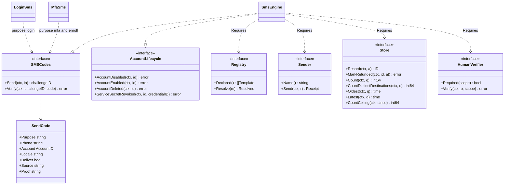
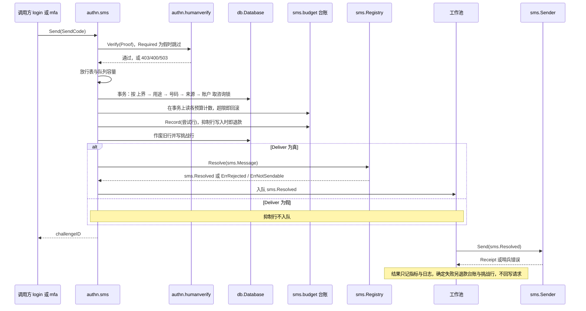
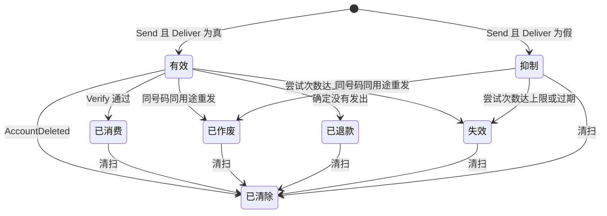
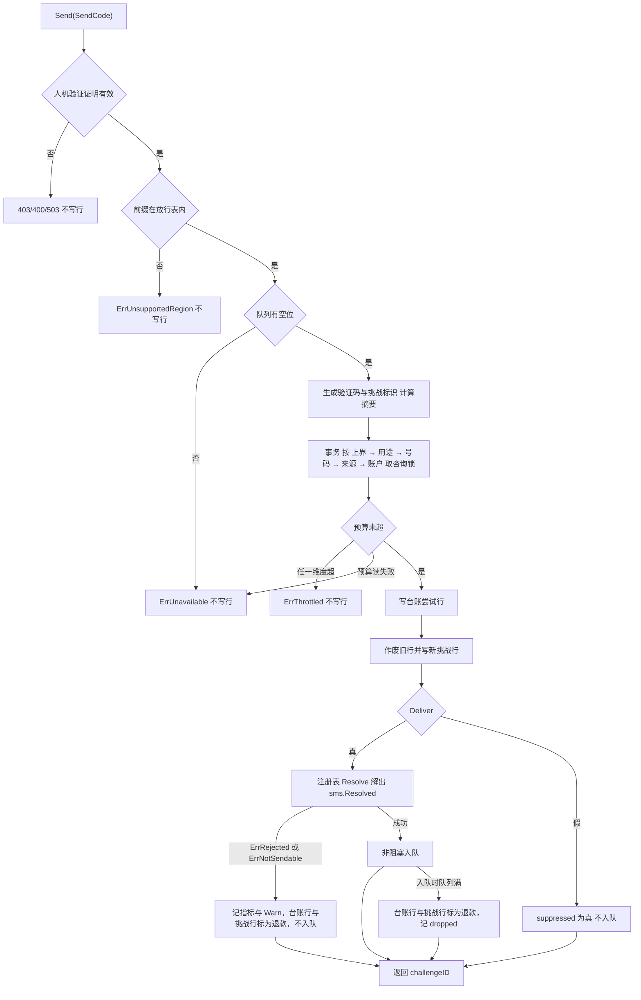

# authn/sms

## 职责

本模块持有短信验证码的**全部状态机**：写挑战行、尝试次数、消费、入队与发送，以及按共享台账核对发送预算。短信验证码按用途区分，用途是封闭集：`login`（作第一因素）、`mfa`（作第二因素）、`enroll`（登记手机或短信因素时证明号码归属）、`reset`（匿名口令重置时证明号码归属）。各用途对挑战的要求相同：一次性消费、尝试次数上限、发送预算，所以挑战状态只有一处持有，使用方是 `authn.login.sms`（用途 `login`）、`authn.mfa.sms`（用途 `mfa`）、登录引擎的手机号验证路由（用途 `enroll`）与登录模块的匿名口令重置路由（用途 `reset`），它们不持有挑战状态（[ADR-authn-sms](../../../adr/adr-authn-sms.md)）。

本功能包括下列部分：

- **`SMSCodes`**：由 `authn.sms` 排他交付，挑战状态机的唯一入口。验证码明文从不离开本模块：不写库、不写日志、不进事件与指标，只存在于入队项与交给发送方的调用参数里。
- **发送**：经顶层发送能力 `pkg/sms` 的 `Registry` 与 `Sender` 把每条挑战发出去。本模块不认识厂商，只按自己所需的模板键构造一条 `sms.Message` 交给注册表解出 `sms.Resolved`，再把解出的结构交给载体；模板声明、厂商编号与参数次序归 `pkg/sms`（[design-sms](../design-sms.md)、[ADR-sms-capability](../../../adr/adr-sms-capability.md)）。
- **发送预算**：每条发送在放行表、队列容量与全部预算通过之后，往共享台账写一行尝试；预算的计数由 `sms.budget` 交付的 `budget.Store` 回答，本模块只读这些计数并与自己的设置比较。台账与跨渠道上界归 [design-sms](../design-sms.md) 的台账模块，本模块不持有那张表。
- **账户清理**：`authn.sms` 实现 `AccountLifecycle`，账户删除之后抹除该账户的挑战行，并按周期清扫已过有效期并超过清扫余量的挑战行。

### 非职责

- **不挂路由，不写 HTTP。** 短信登录与短信因素的路由、请求与响应结构归登录引擎与 MFA 编排（见 [design-authn-login](design-authn-login.md)、[design-authn-mfa](design-authn-mfa.md)）。本模块只回答「这条挑战发出去了没有、这个码对不对」。
- **不判定号码是否已登记，不解析账户。** `SendCode.Deliver` 由调用方依据号码的登记状态与注册开关决定；本模块对 `Deliver` 为假的请求写抑制行与抑制的台账行，不探知为什么为假。手机标识的写入（`verified_via = sms-code`）归 `authn.account`（见 [design-authn-account](design-authn-account.md)）。
- **不持有失败退避。** 退避状态在 `authn.account` 交付的 `Throttle` 里，由使用方在答复阶段施加，施加的方式见「失败退避的施加」；本模块不依赖 `Throttle`，只管每条挑战自己的尝试次数。
- **不持有流程记录，不核对每流程的发送上限。** 流程记录的 `sends` 在 kv 里，由登录引擎在调用 `Send` 之前核对（见 [design-authn-login](design-authn-login.md)）。
- **不定保障等级。** 单凭短信码只算一个因素，等级只在 `authn.mfa` 一处合成。
- **不规范化号码。** `SendCode.Phone` 由调用方规范化为 E.164（[REF-itu-t-e164](../../../references.md)）；`BlindIndex` 对输入原样计算，不规范化（见 [design-db](../design-db.md)）。
- **不托管厂商侧验证码，不重试厂商调用。** 生成、校验、重放与失败计数的规则全在本模块；适配器从不自行重发。
- **不持有台账，不决定预算的取值。** 台账的表、迁移、计数查询与跨渠道上界的声明归 `sms.budget`；各维度的上限是本模块声明并读取的设置，本模块只把计数与上限比较。
- **不承载邮件或其他渠道。** 本模块经 `pkg/sms` 的 `Sender` 发送，那个接口是短信专用的；邮件通道是与它对称的另一个接口（根包 `EmailCodeSender`，`pkg/authn/email.go`），属登录模块的自助件，不在本模块之内。通知投递的短信是同一张台账的另一个渠道，不经过本模块。
- **不认识租户。** 账户全局，`authn` 的任何子包都不 import `pkg/tenant`；认证侧的台账行不带租户，租户列是空串。

## 术语表

下列术语的含义限于本文档、[design-sms](../design-sms.md) 与 [ADR-authn-sms](../../../adr/adr-authn-sms.md)，以及它所指向的认证主题决策记录。

| 术语 | 英文 | 适用范围 | 定义 |
|---|---|---|---|
| 挑战 | challenge | 本文档与 ADR-authn-sms | 一次短信验证码的发放记录，落在表 `authn_challenges` 的一行：号码与验证码都只以带密钥摘要留存，附尝试次数与期限。它与校验后端在拒绝响应里发出的质询（`WWW-Authenticate`、`Challenger`）无关。 |
| 抑制行 | suppressed row | 本文档与 ADR-authn-sms | 调用方传 `Deliver = false` 时写入的挑战行与台账行：号码未登记且注册关闭时写入，不入队、不发送，但与真实行走同一条计数路径，计入号码、来源与账户维度，不计入全局、尝试与跨渠道上界，对外应答与「已发送」一致。 |
| 预算台账 | budget ledger | 本文档、design-sms 与 ADR-authn-sms | `sms.budget` 持有的 `sms_budget_events` 表，一行是一次短信尝试，认证与通知两个渠道都往这里写，全部预算与跨渠道上界都由它的行数回答。 |
| 确定失败 | certain failure | 本文档与 ADR-authn-sms | 能证明消息没有离开本模块或没有进入厂商管线的失败：载体答 `ErrThrottled`、`ErrRejected` 或 `ErrUnroutable`，注册表拒绝构建消息，或入队失败。确定失败的台账行标为退款，发送预算不再计它，尝试预算计它。 |

## 外部接口契约

### 登记单元与名字

| 包 | 模块名 | 交付 | 排他 | 构造期依赖 | 其余取用（缺席合法） | 表 |
|---|---|---|---|---|---|---|
| `pkg/authn/sms` | `authn.sms` | `SMSCodes`；`AccountLifecycle` | `SMSCodes` 排他 | `db.Database`、`sms.Registry`、`sms.Sender`、`budget.Store`、`authn.HumanVerifier` | `settings.Store`、`event.Bus`、`audit.Audit`、`log.Logger`、`observability.MeterProvider` | `authn_challenges` |

`SMSCodes` 的接口定义在 `pkg/authn` 根包，根包自身不登记模块。`sms.Registry` 与 `sms.Sender` 的接口定义在 `pkg/sms` 根包（结构见 [design-sms](../design-sms.md)）；`budget.Store` 定义在 `pkg/sms/budget`。每个登记模块的包导出 `ModuleName`，配置命名空间取同一个取值。模板注册表与发送方各由顶层发送能力的一个登记模块交付，本模块经 `sms.Registry` 与 `sms.Sender` 取用。发送能力可以同时编入多个载体，`sms.carrier` 在运行期选定一个；两个载体同时显式启用才在消解阶段以排他冲突失败。

### 发送方的取用：经 sms.Registry 与 sms.Sender

模板注册表与发送接口各是顶层发送能力 `pkg/sms` 的一个扩展点（结构见 [design-sms](../design-sms.md)）。本模块把两者都当作排他的构造期依赖取用（`Requires` 记 `(*sms.Registry)(nil)` 与 `(*sms.Sender)(nil)`）；载体由 `sms.carrier` 选定，选择项为 `none` 时本模块在 `Prepare` 里读同一个选择项并自行关闭，短信登录方法与短信第二因素随之关闭；选择项为空且 `sms.registry.templates` 未声明任何模板时，部署没有配置短信，本模块经 `sms.OffByMissingTemplates` 以同一原因自行关闭，登录方法与第二因素作同样的判断。本模块先取注册表，因为覆盖核对读的是注册表的声明、发送时解出的结构也来自注册表，再取载体。本模块不 import 任何厂商适配叶子包。

本模块把每条挑战构造成一条 `sms.Message`，交给注册表的 `Resolve` 解出 `sms.Resolved`，再把解出的结构交给载体：

```go
func message(in SendCode, challengeID, code, ttlMinutes string) sms.Message {
	return sms.Message{
		To:       in.Phone,                    // 已规范化的 E.164
		Template: purposeTemplate(in.Purpose), // authn.code.login / mfa / enroll / reset
		Params:   map[string]string{"code": code, "ttl_minutes": ttlMinutes},
		Locale:   resolveLocale(in.Locale, defaultLocale, declared), // 解析到注册表声明的语言，缺省落配置的默认语言
		DedupeID: challengeID,
	}
}
```

模板键是 `authn.code.login`、`authn.code.mfa`、`authn.code.enroll` 与 `authn.code.reset`，按用途映射；参数名固定为 `code` 与 `ttl_minutes`。`authn.code.login`、`authn.code.mfa` 与 `authn.code.enroll` 是启动的必需项：点名了载体或声明了任一模板后，注册表持有的 `templates` 里必须写这几个模板名、恰好这两个参数，每个模板至少一种语言，且每个模板覆盖配置的默认语言——多声明一个本模块不发送的参数，该模板就没有任何消息能满足。选择项为空且一个模板也没有时是「没有配置短信」，本模块在 `Prepare` 里关闭，不走这条启动必需项核对。`authn.code.reset` 是可选模板：声明了它，短信重置渠道可用，本模块按同一套参数、语言与默认语言规则核对它；没有声明，短信重置渠道不发布，其余用途照常启动。**一条消息的语言集是它所属模板声明的语言集**：本模块不声明任何语言表，一条消息能发出去的语言是它用途映射到的那个模板声明的语言；不同用途的模板可以声明不同的语言集，每个模板各自覆盖配置的默认语言。**模板的语言集是有效语言集（厂商编号与本地正文的并集），所以这些模板在按编号发送的载体与按正文发送的载体上都能用**：按正文发送的载体由配置里的 `bodies` 提供正文，本模块不写任何载体特有的文案。

**覆盖由本模块在 `New` 核对。** `pkg/sms` 只让注册表报告自己持有什么，覆盖哪些组合由使用方核对，所以本模块在 `newProduct` 取到 `sms.Registry` 后立即调 `registry.Declared()`，逐项核对自己所需的（模板，参数）契约——每个必需模板的名字都要在、每个模板至少声明一种语言、每个模板都要覆盖配置的默认语言、参数名表须恰为本模块所发的两个（少一个或多一个都是 `ErrInvalidConfig` 并点名那个参数）；`New` 返回错误同样终止启动，早于服务。`Prepare` 早于 `New`、拿不到实例，核对因此落在 `New`。配置的默认语言用 `reader.Decode(i18n.ConfigNamespace, &cfg)` 读，`cfg` 的字段带 `config:"default-locale"` 且预置为 `en-US`，因而一个没有纳入 i18n 引擎、也就没有该命名空间的装配，读到的仍是英文，与那个引擎自己会读的默认一致。

`sms.Registry.Resolve` 把 `sms.Message` 解成载体直接可用于构造请求的结构；一条注册表解不出的消息以 `ErrRejected` 拒绝，一条模板被禁用或审核未过的消息以 `ErrNotSendable` 拒绝，两者都在请求路径上记指标与日志、不外露，并把已写的台账行与挑战行标为退款：消息从未离开本模块。`sms.Sender.Send` 返回的错误取自封闭集 `sms.ErrThrottled`、`sms.ErrRejected`、`sms.ErrUnroutable`、`sms.ErrUncertain`；本模块的工作池归类它们、只记指标与日志，确定失败时另写退款，不外露（见「发送工作池与失败归类」）。空 `Locale` 或注册表里没有的（模板，语言）组合在 `pkg/sms` 一侧以 `ErrRejected` 拒绝、不调厂商。

### SMSCodes：挑战状态机

```go
type SendCode struct {
	Purpose string    // login、mfa、enroll、reset
	Phone   string    // E.164，已规范化
	Account AccountID // mfa、enroll 必填；login 与 reset 不填，也不按它计数
	Locale  string    // 调用方填入的请求语言；空视为配置的默认语言，非空时解析到注册表声明的语言
	Deliver bool      // 为假：只写抑制行与抑制的台账行，不入队不发送
	Source  string    // 请求的来源地址；为空表示调用方没有可信来源，来源维度因此不施加
	Proof   string    // 人机验证的证明；空表示请求没有出示证明
}

type SMSCodes interface {
	// 校验人机验证证明、放行表与全部预算，写台账行与挑战行，把发送交给有界工作池，
	// 立即返回；响应时间与厂商延迟无关。
	// 错误取自 ErrUnsupportedRegion、ErrThrottled（带 RetryAfter）、ErrUnavailable，
	// 以及人机验证门槛的 ErrHumanVerificationRequired 与 ErrHumanProofTooLong。
	Send(ctx context.Context, in SendCode) (challengeID string, err error)
	// 先对挑战行做条件的尝试次数加一，再比对带密钥摘要，通过则条件更新消费时间；
	// 一切不通过的情形统一返回 ErrInvalidCredentials。
	Verify(ctx context.Context, challengeID, code string) error
}
```

契约的内容如下：

- **`Send` 的调用方责任。** `Purpose` 取自封闭集，`Phone` 已规范化，`mfa` 与 `enroll` 的 `Account` 非空；`login` 与 `reset` 不要求 `Account`。违反即调用方缺陷，`Send` 返回普通错误，不属于哨兵集。每流程发送上限由调用方在 `Send` 之前核对。`Proof` 由调用方原样交出，本模块负责校验并消费一次；调用方不自行校验，一次性证明被两个部件各校验一次时，第二次必然被拒。
- **证明先于一切发送状态。** `Send` 以手机号面在放行表、队列容量与任何预算之前核对人机验证证明：本模块的每次发送都落地到手机号，所以它问的是 `phone` 面，其余面的机制与它无关。部署在手机号面把闸关闭（机制为 `off`）时整步跳过；闸是构造期依赖，缺席时本模块的构造失败，装配不会走到发送。证明过长以 `ErrHumanProofTooLong` 拒绝；缺失、无效、过期或重放以 `ErrHumanVerificationRequired` 拒绝；提供方或其存储不可用以 `ErrUnavailable` 拒绝。三者都发生在任何行写入之前，因此不写台账、不写挑战行、不占任何预算。
- **用途的可用性经可选接口报告。** 本模块可以实现可选接口 `PurposeSupport` 的 `SupportsPurpose(purpose string) bool`：对 `login`、`mfa`、`enroll` 恒为真，对 `reset` 当且仅当模板注册表声明了 `authn.code.reset` 模板时为真。调用方以它决定是否提供短信重置渠道；不实现该接口的实现在调用方看来不支持 `reset`。这条接口不改变 `SMSCodes` 的方法集。
- **`Source` 为空即不施加来源维度。** `Source` 是调用方从请求上取得的来源地址。非空时本模块先经 `netip.ParseAddr` 规范成地址的规范文本，再经 `BlindIndex` 算摘要，只把摘要写进台账行、只按摘要计数；明文地址不写表、不写日志。为空表示调用方没有可信来源：不取来源锁、不核对来源预算，这条发送不计入任何来源的窗口，台账行的来源列写 NULL（fail-open）。判据是不把「解析不了来源」与「同一个来源」混为一谈——把全部无名来源压到一把键上，会让一个没配置可信代理的部署把全站算作一个来源。
- **`Send` 对 `Deliver` 为真与为假的调用走同一条路径。** 应答只有 `challengeID` 一种结构，调用方无法从返回值、状态码或错误形态区分抑制行与真实行（耗时见「非保证」）。
- **`Locale` 的来源与取值。** 本模块不声明任何语言表：它的受支持语言集是注册表声明的语言集（`registry.Declared()`），按用途模板逐条持有、由本模块在 `New` 派生一次，一条消息的可用语言是它 `Template` 指向的那个模板声明的语言，不是各模板的并集（[ADR-i18n-language-set](../../../adr/adr-i18n-language-set.md)）。`pkg/sms` 不声明语言闭集，把语言当作不透明串（[design-sms](../design-sms.md)）。本模块不读 HTTP，也不解析 `Accept-Language`：那次解析由登录引擎在发起流程的请求上做（优先取 i18n 协商结果，取不到时为空串），存入流程记录，经方法与因素的入参交给调用方，调用方原样填入 `SendCode.Locale`；解析本身归 [design-authn-login](design-authn-login.md)。**请求语言由本模块解析到该用途模板声明的语言**：`SendCode.Locale` 为空时视为配置的默认语言；非空时取该模板声明的语言中主子标签与它相等的那一个（比较不分大小写）；没有相等的则落到配置的默认语言。**一个不受支持的请求语言因此不是被拒，而是落到默认语言**——语言是调用方的偏好，该模板声明的集合才是这条消息实际能发出去的语言。这与直接调用 `sms.Registry.Resolve` 不同：那时空 `Locale` 与编号表里没有的语言都被 `pkg/sms` 视为调用方缺陷、以 `ErrRejected` 拒绝、不调厂商（[design-sms](../design-sms.md)）。本模块构造的 `sms.Message.Locale` 取 `resolveLocale(SendCode.Locale, 配置的默认语言, 该用途模板声明的语言)`。
- **`Verify` 不回传号码与账户。** 通过只证明持有该挑战标识的调用方出示了正确的码；码发往哪个号码，由调用方在自己的流程记录里保存，以发起时的号码为准。
- **`Verify` 对抑制行恒返回 `ErrInvalidCredentials`**，照样计数并做一次诱饵比对。
- **方法名核对。** 同一模块交付的各能力接口方法名两两不相交的规则见 [design-authn](design-authn.md#扩展点)。`authn.sms` 交付的 `SMSCodes` 的方法（`Send`、`Verify`）与 `AccountLifecycle` 的方法（`AccountDisabled`、`AccountEnabled`、`AccountDeleted`、`ServiceSecretRevoked`）互不重名；`sms.Sender` 的 `Send` 与 `SMSCodes` 的 `Send` 同名异签，二者由不同模块交付（`sms.Sender` 由 `pkg/sms` 的载体叶子，`SMSCodes` 由 `authn.sms`），不会落在同一个类型上。

### 输入项的语义

输入项的完整表（取值、缺省、范围、敏感标记）只在 [design-authn-config](design-authn-config.md) 给出，本节写语义。分界判据是该值是否在数据库可用之前就需要，或塑造启动结构、改变要重启（[ADR-authn-settings-and-secrets](../../../adr/adr-authn-settings-and-secrets.md)）。

| 归属 | 项 | 语义 |
|---|---|---|
| 配置，`authn.sms` | `workers`、`queue-size` | 异步发送工作池的协程数与队列容量，构造时分配 |
| 设置，`authn.sms` | `allowed-prefixes` | 放行表：允许发送的 E.164 号码前缀；缺省为空，空即一律拒绝 |
| 设置，`authn.sms` | `code-length`、`code-ttl`、`code-attempts` | 验证码位数、有效期、每码尝试上限 |
| 设置，`authn.sms` | `resend-interval`、`per-phone-hourly`、`per-phone-daily` | 同号码的重发间隔与每小时、每日发放上限 |
| 设置，`authn.sms` | `per-source-hourly`、`per-source-daily` | 同一来源地址每小时的发放上限与滚动一日的上限；`Source` 为空时不施加 |
| 设置，`authn.sms` | `per-source-distinct-hourly`、`per-source-distinct-daily` | 同一来源地址每小时、每日可发往的不同号码数；`Source` 为空时不施加 |
| 设置，`authn.sms` | `per-source-attempt-hourly` | 同一来源地址每小时确定失败的发送数；`Source` 为空时不施加 |
| 设置，`authn.sms` | `global-hourly-login`、`global-hourly-mfa`、`global-hourly-enroll`、`global-hourly-reset` | 按用途分设的全局每小时上限，只计未抑制的行 |
| 设置，`authn.sms` | `global-attempt-hourly-login`、`-mfa`、`-enroll`、`-reset` | 按用途分设的全局每小时确定失败数，只计未抑制的行 |
| 设置，`authn.sms` | `per-flow-sends`、`per-account-hourly` | 每流程发送上限（由调用方核对）与每账户每小时上限（只对 `mfa`、`enroll` 计；`login` 与 `reset` 不计） |
| 设置，`sms`（台账模块声明） | `ceiling-hourly` | 部署的跨渠道小时上界，认证与通知共读同一个键，先于本模块其余每一项 |
| 设置，`authn.humanverify.pow` | `difficulty`、`challenge-ttl`、`global-issue-limit` | 工作量证明的难度、挑战有效期，以及全部来源合计在一分钟窗口内的签发上限（缺省 600，取值域 1 到 1000000）；只在 `pow` 模式读取 |

本模块不声明语言闭集：`SendCode.Locale` 的取值由该用途模板声明的语言集与配置的默认语言共同给出，请求语言按主子标签解析到前者、落不到时用后者。`pkg/sms` 不声明语言闭集，把语言当作不透明字符串（[design-sms](../design-sms.md)）。配置的默认语言来自 i18n 能力目录的 `i18n.default-locale` 项，与那个引擎读的是同一个，一处声明服务两个能力目录。

这些键由本模块声明，`sms.ceiling-hourly` 由台账模块声明。除 `per-flow-sends` 与 `ceiling-hourly` 外，各键由本模块读；`code-ttl` 与 `resend-interval` 另由登录模块的手机号自助路由读（构成记录的有效期与应答里的 `resend_after`，见 [design-authn-login](design-authn-login.md) 的「手机号验证」），`per-flow-sends` 由登录引擎读（构成交给方法与因素的 `SendsLeft`）。各键经设置存储从全局层读，读取出错或取值越出取值域时取声明的缺省；`ceiling-hourly` 的缺省由台账模块的同一处常量给出，本模块读同一个缺省。`per-flow-sends` 的声明模块不在装配里时（没有装配 `authn.sms`），登录引擎按设置的缺席规则取声明缺省，不记 `Error`；声明在场而读取失败或取值越出取值域才记 `Error`（[design-authn-config](design-authn-config.md) 的「设置缺席与读取出错」）。

`allowed-prefixes` 与预算项是设置，改到更宽松的取值时，本模块写一行 `Warn` 并经审计接口记一条尽力档记录，事前不拦（[ADR-authn-settings-and-secrets](../../../adr/adr-authn-settings-and-secrets.md)）。`sms.ceiling-hourly` 的放宽同样被本模块监视。

### 对外接口

- `SMSCodes`、`SendCode` 的字段与方法集，以及用途与模板键这两个封闭集，是本模块对使用方的接口。`SendCode.Locale` 的取值不是封闭集：它是一个 BCP 47（[REF-bcp47](../../../references.md)）标签，由本模块解析到该消息所用模板声明的语言；`SendCode.Source` 是来源地址的原文，不是封闭集，其空值有「不施加来源维度」的语义，是本模块与使用方的契约。模板键（`authn.code.login`、`authn.code.mfa`、`authn.code.enroll`、`authn.code.reset`）是配置文件里出现的取值，是本模块与载体的配置接口。增删封闭集的成员会同时改变使用方与载体看到的接口，两者一并复核。`authn.code.reset` 是可选成员：它的缺席只关闭短信重置渠道，不使启动失败。
- **`SendCode` 的宿主可见变化。** `authn.SendCode` 是 `pkg/authn/internal/model` 的导出结构体 `SendCode` 的别名，所以 `SendCode` 的字段集属于导出接口；`Proof` 是新增字段，加入它改变的是导出的 `model.SendCode`，实现或消费 `SendCode` 的宿主必须携带证明，空值视为「请求没有出示证明」。
- 挑战表的列与索引是本模块私有的存储结构，不在对外接口内：其他模块不读 `authn_challenges`，只经 `SMSCodes` 与 `AccountLifecycle` 交互。台账的表归 `sms.budget`，本模块只经 `budget.Store` 写入与计数。
- 单个载体叶子包可替换、可撤掉，不改变 `SMSCodes` 的行为。

## 依赖

| 依赖 | 方式 | 用途 | 缺席时 |
|---|---|---|---|
| `db.Database` | `Requires` | 挑战表的读写；`BlindIndex` 计算带密钥摘要；迁移集 | 构造失败 |
| `sms.Registry` | `Requires`（排他功能） | 取得模板注册表；核对模板覆盖、解出可发送的结构；没有已启用的载体、或同一接口的两个实现同时启用时启动失败 | 构造失败 |
| `sms.Sender` | `Requires`（排他功能） | 取得发送方；没有已启用的载体、或同一接口的两个实现同时启用时启动失败 | 构造失败 |
| `budget.Store` | `Requires` | 写台账行、读各预算的计数、读跨渠道上界 | 构造失败；没有台账就无法核对任何预算 |
| `authn.HumanVerifier` | `Requires` | 在发送前核对并消费人机验证证明 | 构造失败；闸关闭（`off`）时校验整步跳过，发送照常 |
| `settings.Store` | 取用，缺席合法 | 放行表、预算与验证码参数 | 各项取声明的缺省值；放行表缺省为空，所以没有设置模块的装配里短信一律不发 |
| `event.Bus` | 取用，缺席合法 | 订阅 `authn.account.deleted` 与 `settings.changed` | 只剩同步钩子，没有事件补偿；不影响正确性底线 |
| `audit.Audit` | 取用，缺席合法 | 放宽设置的尽力档审计 | 只写 `Warn` |
| `log.Logger` | 取用，缺席合法 | 脱敏规则登记、日志 | 无日志 |
| `observability.MeterProvider` | 取用，缺席合法 | 发送结果计数器与预算利用率仪表 | 静默跳过上报 |

厂商适配住在顶层 `pkg/sms` 下（`pkg/sms/aliyun`、`pkg/sms/tencent`），只绑定各自的厂商 SDK，所以 SDK 只进 import 了该叶子包的宿主的依赖闭包（[ADR-authn-packaging](../../../adr/adr-authn-packaging.md)、[ADR-sms-capability](../../../adr/adr-sms-capability.md)）。两家 SDK 的封边与固定版本由 `pkg/sms/deps_test.go` 的守卫守住，版本与阿里云 SDK（[REF-alibabacloud-dysmsapi-go](../../../references.md)）的 genproto（[REF-genproto](../../../references.md)）备注见 [design-sms](../design-sms.md)。本模块只经 `sms.Registry` 与 `sms.Sender` 取用模板与发送方，不 import 任何载体叶子包；台账只经 `budget.Store` 取用，不 import 台账的 SQL 实现。

依赖方向满足架构不变量：

- `Requires` 只写排他功能，并立功能一律经 `ResolveAll` 取用（[ADR-authn-wiring](../../../adr/adr-authn-wiring.md)）。`AccountLifecycle` 是并立功能，`authn.account` 在 `Init` 里 `ResolveAll[AccountLifecycle]` 取到本模块的实例；`authn.account` 在运行期调用本模块，编译期与构造期都不 import 它，所以不构成环。
- `authn.login.sms`、`authn.mfa.sms` 依赖 `SMSCodes`，本模块不依赖它们。失败退避由使用方经 `Throttle` 施加（「失败退避的施加」一节），所以 `authn.login.sms` 另依赖 `Throttle`，本模块不依赖。
- 本模块不用 kv 持有挑战或预算：挑战行的丢失会放宽尝试上限，预算行的丢失会放宽发送上限，状态放置的判据要求进 db（[ADR-authn-state-placement](../../../adr/adr-authn-state-placement.md)）。证明的已用记录归提供方，`pow` 自己用 kv，不是本模块的状态。
- 构造阶段（`New`）不读写自己的表，首次启动时表尚未建立；需要读表的初始化与清扫协程放在 `Start`。

## UML 图

### 结构

类图固定能力与使用方的关系：`SmsEngine` 是 `authn.sms` 的产物，同时实现 `SMSCodes` 与 `AccountLifecycle`，并以构造期依赖持有顶层发送能力的 `Registry`、`Sender` 与共享台账的 `Store`（图中各记作 `Registry`、`Sender` 与 `Store`，其实现是 `pkg/sms` 下的注册表模块、载体模块与 `sms.budget`，见 [design-sms](../design-sms.md)）；使用方只认 `SMSCodes`。



### 发送的交互

时序图固定一次发送涉及的模块与同步边界：证明校验、写台账行、写挑战行、经注册表解出可发送的结构与应答都在请求内完成，厂商调用在工作池里异步完成，应答不等它。



### 挑战行的生命周期

状态图固定挑战行的去向。状态由列推出：消费、作废与退款在存储上同样表现为 `consumed_at` 非空；退款另有 `refunded_at` 非空，是 `consumed_at` 非空的第三种情形；用尽与过期不改行，由尝试次数与 `expires_at` 推出。台账行的退款是同一个时刻写下的另一行，图中不另画。



## 核心数据结构

### authn_challenges

表由 `authn.sms` 拥有，迁移集随模块，`postgres/` 与 `sqlite/` 各一份同名文件。`db_migrations` 的记录键是模块加文件名，编号只决定同一模块内的应用顺序：编号在 `0005` 之后留空 `0006`，这一处编号留空是有意的，不复用，也不补成连续编号。在旧文件名 `0006_authn_challenges_budget_event.sql` 仍在时建过的数据库，记录的是旧文件名，与当前迁移集不一致，必须重建，不能在其上继续迁移：PostgreSQL 的 `ADD COLUMN IF NOT EXISTS` 在列已存在时不重复加列，SQLite 的普通 `ADD COLUMN` 在列已存在时报错。表之间与对其他模块的表都不建外键，不嵌入 `tenant.Model`；时间一律经 `internal/clock` 取、一律 `.UTC()`，SQLite 把时间存成文本并按字符串比较，非 UTC 的值会使窗口统计判错。

| 列 | 类型 | 含义 |
|---|---|---|
| `id` | 文本，主键 | 挑战标识，随机、不可推测；也是 `sms.Message.DedupeID` |
| `purpose` | 文本 | `login`、`mfa`、`enroll`、`reset` |
| `phone_mac` | 文本 | 规范化号码的带密钥摘要，用于关联；号码本身不在表里留存 |
| `source_mac` | 文本，可空 | 请求来源地址的带密钥摘要；地址本身不在表里留存。`Source` 为空时为 NULL：历史行不补写，NULL 不是来源 |
| `account_id` | 文本，可空 | `mfa`、`enroll` 用途填，账户删除的清理凭它；`login` 与 `reset` 不填 |
| `suppressed` | 布尔，缺省假 | 抑制行标记 |
| `code_mac` | 文本 | 带密钥摘要，覆盖挑战标识与验证码 |
| `attempts` | 整数，缺省 0 | 已计数的比对次数 |
| `max_attempts` | 整数 | 写入时取设置的每码尝试上限 |
| `created_at` | 时间戳 | 发放时刻 |
| `expires_at` | 时间戳 | 写入时取设置的有效期 |
| `consumed_at` | 时间戳，可空 | 消费、作废或退款的时刻；校验对非空值恒失败 |
| `refunded_at` | 时间戳，可空 | 退款时刻：确定没有发出时写入——厂商答复消息没有进入处理管线，或请求路径上注册表拒绝构建消息、入队失败。该行不能通过校验，并在同一条语句里置 `consumed_at`，所以从未送达的验证码不能通过校验。历史行为 NULL，不补写 |
| `budget_event_id` | 整数，可空 | 这次挑战在共享台账里的尝试行；退款路径凭它找到台账行。历史行为 NULL，退款只改挑战行 |

索引：`(phone_mac, created_at)` 服务于号码维度的关联与重发间隔所在的台账查询之外的历史读；`(source_mac, created_at)` 与 `(account_id, created_at)`、`(purpose, suppressed, created_at)` 服务于账户清理与清扫；`expires_at` 上的索引服务于清扫。**预算计数不读这张表**：所有窗口计数都由 `sms_budget_events` 回答，见「预算维度」。

**摘要。** 验证码空间只有百万量级，不带密钥的摘要等于明文，所以 `code_mac`、`phone_mac` 与 `source_mac` 都经 `db.Database.BlindIndex`（HMAC-SHA256，密钥由 db 根密钥派生）计算：`code_mac` 的输入是 `<挑战标识>|<验证码>`，`phone_mac` 的输入是规范化后的 E.164 号码，`source_mac` 的输入是先经 `netip.ParseAddr` 规范化、再取 `Addr.String()` 的来源地址文本；解析不了的文本按原样参与摘要，因为读不出来源的发送仍要计数。`BlindIndex` 在没有根密钥时 panic，所以 `Start` 里做一次包 `recover` 的自检，缺根密钥即以 `ErrNoEncryptionKey` 终止启动，不降级为无密钥摘要。

**验证码。** 取自 `crypto/rand` 的均匀十进制数字，位数、有效期、每码尝试上限取设置；`sms.Message.Params` 的键集固定为 `code` 与 `ttl_minutes`。

### 台账里属于认证的一行

台账表 `sms_budget_events` 归 `sms.budget`（结构与迁移见 [design-sms](../design-sms.md)）。认证写入的行取下列值：

| 列 | 认证侧取值 |
|---|---|
| `channel` | `authn` |
| `purpose` | 用途之一：`login`、`mfa`、`enroll`、`reset` |
| `source_mac` | 来源地址的带密钥摘要；`Source` 为空时 NULL，不计来源维度 |
| `destination_mac` | 号码的带密钥摘要，与挑战行的 `phone_mac` 同值 |
| `tenant_id` | 空串：认证侧的尝试不属于任何租户，租户维度不匹配它 |
| `account_id` | `mfa` 与 `enroll` 填，`login` 与 `reset` 为 NULL |
| `attempted_at` | 预算被占用的时刻，UTC |
| `outcome` | 写入时为 `pending`，工作池的确定失败另经退款表达；本模块不改写它 |
| `refunded_at` | 确定没有发出时写入；抑制行在写入时即带退款时刻 |
| `suppressed` | `Deliver` 为假时为真 |

### 入队项

发送工作池的队列元素是一条已解出的 `sms.Resolved`，其 `Params` 与 `Ordered` 带验证码明文。队列在进程内，容量有界，元素不落库；这是明文唯一的停留处，进程退出即丢失。

## 核心算法与流程

### 发送

下列判定按顺序执行，同一请求落在多项上时只报第一项。已登记与未登记的号码、`Deliver` 为真与为假的请求，走的是同一条路径，只在入队这一步分开。



1. **人机验证证明。** 部署要求证明时，先核对其有效性与一次性；被拒绝的请求不写台账、不写挑战行、不占预算、不发送。判据与三档离场见「`Send` 的调用方责任」。
2. **放行表。** 规范化后的号码前缀不在放行表内，返回 `ErrUnsupportedRegion`，不写行。判定只看前缀，与号码是否登记无关；放行表缺省为空，不明确放行就不发。
3. **队列容量。** 队列已满，返回 `ErrUnavailable`，不写行、不作废旧行。这一步对真实行与抑制行同样执行，使「队列满」不成为区分已登记与未登记号码的观察点。
4. **生成。** 生成验证码与挑战标识，计算 `phone_mac`、`source_mac` 与 `code_mac`。各预算的限额在打开写事务之前一次读出，持锁期间不读设置。
5. **事务：取锁、核对预算、写台账与挑战行。** 在同一个事务里先取部署的跨渠道锁，再按 **用途 → 号码 → 来源 → 账户** 的固定顺序取咨询锁，取齐之后用建立在同一事务上的台账核对各预算；未超限时写台账尝试行、把同（`phone_mac`，用途）下尚未消费且未过期的旧行作废（条件更新 `consumed_at`）、写新挑战行，`suppressed` 取 `Deliver` 的反。任一项超限即回滚，台账行与挑战行都不写。
6. **解出可发送的结构。** `Deliver` 为真时，把构造的 `sms.Message` 交给注册表的 `Resolve` 解出 `sms.Resolved`；注册表以 `ErrRejected`（消息结构）或 `ErrNotSendable`（模板被禁用或审核未过）拒绝时，记指标与 `Warn`、不入队，把已写的台账行与挑战行标为退款并置为已消费（消息从未离开本模块），`Send` 仍返回 `challengeID`，用户走重发。`Deliver` 为假时不解出。
7. **入队。** 解出成功后非阻塞入队；`Deliver` 为假时不入队。事务提交与入队之间队列恰被填满时，该发送被丢弃并计入 `dropped`（见「结果与指标」），已写的台账行与挑战行标为退款并置为已消费，`Send` 仍返回 `challengeID`，用户走重发且这次不占发送预算。

### 预算维度

预算全由共享台账 `sms_budget_events` 的行数得出，维度是封闭集；窗口自 `attempted_at` 起算。一个维度的已有行数达到上限时，再发即超限，所以窗口内至多占用上限次。

| 维度 | 设置键 | 缺省 | 窗口 | 计数口径 | 适用 | 锁 |
|---|---|---|---|---|---|---|
| 跨渠道上界 | `sms.ceiling-hourly` | `5000` | 1 小时 | 两个渠道未退款、未抑制的行 | 全部 | 上界锁 `sms.budget:lock:ceiling` |
| 重发间隔 | `authn.sms.resend-interval` | `30s` | 同号码最近一行 | 退款行与抑制行都看得见 | 全部 | 号码锁 |
| 每号码每小时 | `authn.sms.per-phone-hourly` | `10` | 1 小时 | 发送预算，计抑制行 | 全部 | 号码锁 |
| 每号码每日 | `authn.sms.per-phone-daily` | `25` | 24 小时 | 发送预算，计抑制行 | 全部 | 号码锁 |
| 每来源每小时 | `authn.sms.per-source-hourly` | `300` | 1 小时 | 发送预算，计抑制行，跨用途 | `Source` 非空 | 来源锁 |
| 每来源每日 | `authn.sms.per-source-daily` | `1000` | 24 小时 | 发送预算，计抑制行，跨用途 | `Source` 非空 | 来源锁 |
| 每来源不同号码每小时 | `authn.sms.per-source-distinct-hourly` | `20` | 1 小时 | 发送预算的不同目的地数，计抑制行 | `Source` 非空 | 来源锁 |
| 每来源不同号码每日 | `authn.sms.per-source-distinct-daily` | `60` | 24 小时 | 发送预算的不同目的地数，计抑制行 | `Source` 非空 | 来源锁 |
| 每来源确定失败每小时 | `authn.sms.per-source-attempt-hourly` | `60` | 1 小时 | 只计事后退款的行，不计抑制行 | `Source` 非空 | 来源锁 |
| 全局每小时，按用途 | `authn.sms.global-hourly-login` 等 | 登录 `500`、`mfa` `300`、`enroll` `100`、`reset` `200` | 1 小时 | 发送预算，不计抑制行 | 各自的用途 | 用途锁 |
| 全局确定失败每小时，按用途 | `authn.sms.global-attempt-hourly-login` 等 | 登录 `750`、`mfa` `450`、`enroll` `150`、`reset` `300` | 1 小时 | 只计事后退款的行，不计抑制行 | 各自的用途 | 用途锁 |
| 每账户每小时 | `authn.sms.per-account-hourly` | `20` | 1 小时 | 发送预算，计抑制行 | 只对 `mfa`、`enroll` 计 | 账户锁 |
| 每流程发送数 | `authn.sms.per-flow-sends` | `5` | 流程记录 | 流程记录的 `sends` | 全部 | 无，由调用方核对 |

**计数的判据。** 台账查询的开关相互独立：是否计入抑制行，以及退款状态。由此得到下列计数：

- **发送预算**取未退款的行。带抑制开关时，抑制行按一次占用计入它瞄向的维度——它在写入时已退款，单靠退款条件会把它排除，而号码、来源与账户维度必须看见它，否则已登记与未登记号码达到超限的次数不同。
- **尝试预算**只取事后退款的行，默认排除抑制行；一次成功到达或结局不确定的发送不计入它，一次确定失败计一次。这是认证侧的取法（`OnlyRefunded`）；「尝试预算」是认证与通知共用的设置名，通知渠道的同名预算取 `IncludeRefunded`，计每一次尝试，同一个名字不是一个判据（[design-sms](../design-sms.md)）。
- **跨渠道上界**取两个渠道未退款、未抑制的行；抑制行与确定失败都不占它。
- **重发间隔**取该号码最新一行，两个开关都打开：退款行与抑制行都算一次「请求过」，间隔不能因号码未登记而不同。

**顺序。** 跨渠道上界之后、各维度之前，先核对重发间隔；它不是预算维度，但读的是同一张台账。各维度按表中的次序核对，任一超限即停止，其后的维度不再读。

约束的理由如下：

- **跨渠道上界先于一切。** 认证与通知花同一份部署容量，部署要的是两者之和的上界；把它放在第一位，才使其余维度都是在此之下的细分。上界锁由两个渠道共用，认证内部各维度共用其余锁。
- **全局预算按用途分设。** 匿名流量耗尽 `login` 的预算，不挤占已通过口令的第二因素与登记的发送。
- **全局与尝试维度不计抑制行，号码、来源与账户维度计抑制行。** 抑制行是给未登记号码写的行，不发出任何消息；若它也消耗全局或尝试预算，匿名请求不花成本就能耗尽部署的发送量。号码、来源与账户维度若只计真实行，未登记号码达到超限所需的次数与已登记号码不同，耗尽速度即成号码枚举的观测点；两个方向的取舍取后者，全局省下的额度以其余维度仍计抑制行为代价。
- **账户维度只对 `mfa` 与 `enroll` 计。** 判据是账户不得由手机号推出：这两种用途的账户由第一因素或会话确定；`login` 与 `reset` 用途若按账户计，已登记号码有账户可计、未登记号码没有，应答随之不同。
- **号码维度跨用途累计。** 同一号码换一个用途不能绕开另一个用途的重发间隔与小时、日上限。
- **来源维度只对 `Source` 非空的发送计，且跨用途累计。** 一个来源换号码或换用途不能绕开来源的窗口；不同目的地数与确定失败数是来源维度的另外两面，分别约束轮换号码与反复打必然失败的目的地。
- **确定失败的发送退还发送预算，但计一次尝试。** 载体以 `ErrRejected`、`ErrUnroutable` 或 `ErrThrottled` 答复，说明消息没有进入厂商的处理管线，台账行标为退款，发送维度不再统计它，用户以同一号码在同一窗口内重发即可通过，且这条从未送达的验证码不能通过校验。请求路径上还有两条确定没发出的同步路径——注册表拒绝构建消息、行已写入但入队失败——同样退款。`ErrUncertain`（以及闭集之外的错误）不退款，该次仍计入发送预算——消息可能已经送达时，按已发送处理是唯一不会造成伤害的方向。退款不使这次尝试从尝试预算中消失，所以一个反复打必然失败目的地的来源会耗尽自己的失败额度。
- **抑制行从不入队，写入时即退款。** 它的计数口径不受退款规则影响，见「抑制行与应答一致」。

### 硬上限、锁序与多副本

预算在这里是硬上限。每次发送在自己的写事务里先取跨渠道锁，再按 **用途 → 号码 → 来源 → 账户** 的固定顺序取咨询锁，取齐之后再统计各维度，未超才写台账行、作废旧行并写新挑战行；两个并发请求只要共享任一维度，就在同一把锁上串行，后一个读到前一个已提交的行。锁键为 `sms.budget:lock:ceiling`、`authn.sms:lock:global:<用途>`、`authn.sms:lock:phone:<phone_mac>`、`authn.sms:lock:source:<source_mac>` 与 `authn.sms:lock:account:<account_id>`，由数据库以 `hashtextextended` 计算，随事务提交或回滚释放；`login` 用途没有账户，不取账户锁；`Source` 为空时没有来源摘要，不取来源锁也不统计来源维度。各维度把限额在打开事务之前读出，持锁期间不读设置。这些锁是 PostgreSQL 专有的；SQLite 在数据库层串行化写者，重叠的第二个写者自行等待，没有咨询锁可拿。

**多副本的一致性由「一张表、只插入」给出。** 每一个计数都是对已提交行的查询，每一次写入都是一次插入，没有可丢更新的共享计数器；两个副本并发写同一次发送，各自插一行，两个都被计到。一个必须成为硬上限的预算，由调用方把计数与写入放进同一个事务，并在该事务上建立台账（`budget.New(tx)`），自己串行化维度；跨副本时，这个串行化就是上面那把事务级咨询锁。不共享事务的两个调用方之间是软上限：两者在计数与插入之间看不到对方未提交的行。

**跨渠道锁只有一把，代价是短信写入的吞吐。** 认证与通知的每次发送都在同一个键 `sms.budget:lock:ceiling` 上取锁，所以两个渠道的写入彼此串行，一个渠道的发送高峰会让另一个渠道的发送排队；这把锁也是两个渠道都必须在写行之前取到的第一把锁。这是跨渠道上界必须精确的代价，换来的是一次通知派发与一次认证发送不会同时读到上界以下、再各写一行（[design-sms](../design-sms.md)）。

### 抑制行与应答一致

号码未登记且注册关闭时，调用方传 `Deliver = false`。本模块照常通过人机验证、放行表、队列容量与除全局、尝试、跨渠道上界以外的全部维度，照常生成验证码、计算摘要、写一行 `suppressed` 为真的台账行与挑战行，只是不入队；台账行在写入时即带退款时刻，所以它不占发送预算与跨渠道上界，也不计入尝试预算，但号码、来源与账户维度看得见它，重发间隔也看得见它。随后的 `Verify` 对该行照样条件计数并做一次比对，恒返回 `ErrInvalidCredentials`。判据是：真实发送与否是已登记与未登记号码之间唯一的差别，且不可从应答观察到；全局、尝试与跨渠道上界不计抑制行，其余维度仍计抑制行，超限出现的次数在两种号码上一致（[ADR-authn-sms](../../../adr/adr-authn-sms.md)，枚举防护的总体规则见 [ADR-authn-throttling](../../../adr/adr-authn-throttling.md)）。

### 重发与作废

重发即再调一次 `Send`：写新挑战行、写新的台账行并作废同（`phone_mac`，用途）下尚有效的旧行。作废表现为把旧行的 `consumed_at` 置为当前时刻（条件为该列仍空），校验对 `consumed_at` 非空的行恒失败，所以作废与消费在校验看来是同一状态。**重发不清零失败计数**：失败计数落在 `Throttle` 里的退避键上（`login`、`enroll` 用途是 `ScopePhone` 键，`mfa` 用途是 `ScopeFactor` 键，见「失败退避的施加」），它不随挑战行而变，重发写新行并不触及它；每行自己的 `attempts` 随新行从零起算，上界由退避键与预算共同给出。重发间隔从台账里该号码最新的一行量起，退款行与抑制行都算，所以一次确定失败的重发不会立刻获得一个新的间隔。

### 校验

`Verify` 的步骤如下，每一步失败都返回 `ErrInvalidCredentials`，不区分成因；对不存在的行、已过期或已消费的行，同样做一次诱饵比对，使耗时形态不随成因而变。

1. 条件更新 `attempts = attempts + 1`，条件是该行存在、`consumed_at` 为空、未过期、`attempts < max_attempts`；受影响行数为零即失败。**先计数再比对**，并发提交因此无法绕过上限。
2. 比对 `BlindIndex(<挑战标识>|<验证码>)` 与 `code_mac`，常量时间比较；`suppressed` 为真的行恒不通过。
3. 条件更新 `consumed_at`，条件是它仍为空；受影响行数为一才算消费成功，并发的第二次提交败于此处。

### 失败退避的施加

退避的算法与表归 `authn.account`（见 [design-authn-account](design-authn-account.md)），本模块不依赖它。`Verify` 只数每条挑战自己的尝试，跨挑战的失败累计由使用方在调用 `Verify` 前后施加，所以这是对使用方的约束，约束的主体是 `SMSCodes` 的每个使用方：

| 用途 | 使用方 | 退避范围与键 | 判据 |
|---|---|---|---|
| `login` | `authn.login.sms` | `ScopePhone`，键为规范化 E.164 号码的 SHA-256 十六进制 | 登录时没有账户也没有因素标识，号码是唯一稳定的键 |
| `enroll` | 登录引擎的手机号验证路由 | `ScopePhone`，键同上 | 登记时因素尚未存在，同样只有号码可作键 |
| `mfa` | `authn.mfa.sms` | `ScopeFactor`，键为因素标识，由 `authn.mfa` 的统一收口施加 | 因素标识在发码前已确定；不另计 `ScopePhone`，使登录一侧对号码的错误提交不锁住已通过第一因素的第二因素 |
| `reset` | 登录模块的匿名口令重置路由 | 不施加跨挑战退避；每码尝试上限由挑战行与重置记录各计一次 | 重置是匿名路径，按号码的退避会让攻击者用错误码锁住受害者；发送预算与每码上限共同约束 |

施加的次序是：`Verify` 之前 `Throttle.Check`，退避中不调用 `Verify`；`Verify` 返回 `ErrInvalidCredentials` 时 `Throttle.Fail`，返回 `nil` 时 `Throttle.Succeed`。对 `Deliver` 为假的挑战同样施加：使用方不区分行的真假，所以未登记号码与已登记号码的退避累计路径一致。`Verify` 返回 `ErrUnavailable` 时既不 `Fail` 也不 `Succeed`。

### 发送工作池与失败归类

工作池在 `Start` 起固定个数的协程，从有界队列取 `sms.Resolved` 调 `sms.Sender.Send`。`Send` 立即返回，响应时间与厂商延迟无关。厂商调用的结果只记指标与日志，不回写请求；确定失败时另把该挑战行与台账行标为退款，未确定时不动它们：

| 结果 | 处置 |
|---|---|
| 成功 | 记指标 |
| `sms.ErrUncertain` | 当作已发送，不盲目重发；用户走重发，该次计入发送预算、不退款；记 `Warn` 与指标 |
| `sms.ErrThrottled`、`sms.ErrRejected`、`sms.ErrUnroutable` | 当作未送达，不重发；把台账行与挑战行标为退款并置为已消费，发送维度不再统计它，这条验证码也不能通过校验；尝试预算仍计它；用户收不到码，重新请求时再发；记 `Warn` 与指标 |
| 闭集之外的错误 | 当作 `sms.ErrUncertain`，不退款 |

挑战行与台账行凭挑战标识关联：工作池用 `sms.Resolved` 的 `DedupeID`，发送路径把挑战标识作为它交给注册表、注册表原样保留；请求路径上的两条同步路径直接用它写出的标识。退款先读挑战行的 `budget_event_id` 找到台账行，再在一条语句里把挑战行标为退款并置为已消费，随后把台账行标为退款。退款写失败时该行仍计入发送预算、验证码仍有效，发送结果已定，所以只另记一行 `Warn`，不改结局。

`Stop` 以自带的 5 秒为界排空队列（`Stop` 收到的上下文已去掉取消）；超出的发送被丢弃，进程在入队之后、发送之前退出同样丢失队列里的发送，这些情形下用户都只能重发。

### 结果与指标

指标 `authn.sms.sends` 的属性 `outcome` 取值的全表在 [design-authn-events](design-authn-events.md)；本节写本模块的每种结果记哪个取值。每次 `Send` 调用至多记一次：被拒绝、丢弃与注册表拒绝解出的在调用内记，入队成功的由工作池在厂商调用返回后记。

| 结果 | `outcome` | 说明 |
|---|---|---|
| 人机验证证明被拒或过长 | 不记 | 不写行、不占预算；由登录路由写出 403 或 400 |
| 号码前缀不在放行表 | `unsupported-region` | `ErrUnsupportedRegion`，不写行 |
| 队列已满（`Send` 起始处的预检） | `dropped` | `ErrUnavailable`，不写行 |
| 任一预算耗尽（含跨渠道上界） | `budget-exhausted` | `ErrThrottled`，不写行 |
| 预算计数读失败 | 不记 | `ErrUnavailable`；这是故障，不是预算耗尽 |
| `Deliver` 为假，写抑制行 | `suppressed` | 返回 `challengeID`，不入队 |
| 注册表解不出消息（`ErrRejected`） | `rejected` | 返回 `challengeID`，行已写、随即标为退款，不入队 |
| 注册表拒发（`ErrNotSendable`） | `not-sendable` | 返回 `challengeID`，行已写、随即标为退款，不入队 |
| 事务提交与入队之间队列被填满 | `dropped` | 返回 `challengeID`，行已写、随即标为退款，发送被丢弃 |
| 厂商调用成功 | `sent` | 工作池记 |
| `sms.ErrUncertain` | `uncertain` | 工作池记；不退款，仍计入发送预算 |
| `sms.ErrThrottled` | `throttled` | 工作池记；台账行与挑战行标为退款 |
| `sms.ErrRejected` | `rejected` | 工作池记；台账行与挑战行标为退款 |
| `sms.ErrUnroutable` | `unroutable` | 工作池记；台账行与挑战行标为退款 |

**预算利用率仪表。** 每次比较一个预算之前，本模块把「已用 / 上限」记到仪表 `authn.sms.budget.utilization`，属性 `channel` 取 `authn`，`purpose` 取该用途、跨渠道上界取 `shared`，`dimension` 取该预算的名字（`ceiling`、`phone`、`source`、`source-distinct`、`source-attempt`、`global`、`global-attempt`、`account`）。上限为零或负不记；没有指标能力是合法装配，记什么都不做。跨渠道上界的这一个数据点与通知投递的同名仪表共用名字，靠 `channel` 区分两个发送能力。属性集在 [design-authn-events](design-authn-events.md) 登记。

`dropped` 只表示本进程的队列没有容量，不分预检与提交之后：提交之后的那条已写行随即退款，预检那条没有行可退；`throttled` 只表示厂商的答复，`rejected` 表示发送侧不接受这条消息（厂商拒绝，或注册表解不出），`unroutable` 表示当前部署无法把这条消息送到这个目的地（缺权限、资源不存在、配额不足，或身份覆盖不了目的地国家）——它是确定失败，与 `rejected` 一样不被视为未知结局，区别只在消息本身没有缺陷；号码、来源、账户、全局与跨渠道上界的超限都归 `budget-exhausted`；`not-sendable` 表示模板被禁用或审核未过，与这条消息无关。`Stop` 排空超时丢弃的与进程退出时丢失的发送不记指标，进程已无法记录。

### 厂商适配

厂商适配是顶层发送能力的一部分，住在 `pkg/sms` 下（`sms.aliyun`、`sms.tencent`）；其 SDK、请求结构、错误码归类与接入点配置见 [design-sms](../design-sms.md)。本模块只经 `sms.Sender` 取用发送方，不感知厂商。

### 账户生命周期与清扫

- **`AccountDisabled`**：不动挑战行，返回 `nil`；账户重新启用后挑战行仍属于账户。
- **`AccountEnabled`**：不动挑战行，返回 `nil`；停用期间留下的挑战行照自己的有效期过期。
- **`AccountDeleted`**：删除该账户的挑战行（`account_id` 非空的 `mfa`、`enroll` 行）；`login` 行不带账户，由清扫回收，号码本身不在表里留存。台账行不按账户删除：它是计数的历史，不承载可用来认证的状态；账户删除不使一次已经发生的发送从窗口里消失。幂等：没有行可删时返回 `nil`。
- **`ServiceSecretRevoked`**：与短信无关，返回 `nil`。
- **事件补偿。** `event.Bus` 在场时，本模块在 `Init` 里订阅 `authn.account.deleted`，按 `Event.ID` 去重，处理函数幂等，重做 `AccountDeleted` 的清理。钩子失败计入 `authn.cleanup.failures`（`hook` 取 `sms`）。钩子是同步的清理，事件是补偿，两者都不是正确性的底线：校验后端每次建立身份时另行核对账户状态与 `valid_after`，残留的挑战行不能单独换出身份（[ADR-authn-account-lifecycle](../../../adr/adr-authn-account-lifecycle.md)）。
- **挑战行清扫。** 本模块是 `authn_challenges` 的持有者，在 `Start` 起一个有界协程，每 10 分钟一轮，删除 `expires_at` 早于当前时刻 25 小时的行，即过期超过清扫余量的行。挑战行只承载校验状态：预算计数不读这张表，全部窗口由共享台账 `sms_budget_events` 回答，所以保留期按有效期加余量给出，不跟随任何预算窗口。清扫走 `expires_at` 上的索引。一轮以一批至多 1000 行为单位连续删到不足一批为止；每个副本都跑，条件删除互不冲突；`Stop` 以自带的 5 秒为界等它退出。全部清扫表见 [design-authn-account](design-authn-account.md)。
- **台账清扫不由本模块承担。** `sms.budget` 持有那张表，也在自己的 `Start` 起、`Stop` 停的保留清扫里调用 `PruneBefore`，按最长预算窗口加余量的保留窗口删除旧行（见 [design-sms](../design-sms.md)）。本模块不清自己写入的那些行，它们与通知渠道的行在同一个保留窗口里。

## 错误与失败语义

### 哨兵

下表只列本模块产生或归类的哨兵；全部哨兵的判据与状态码在 [design-authn-failure](design-authn-failure.md)。

| 哨兵 | 产生处 | 含义 | 对外 |
|---|---|---|---|
| `ErrUnsupportedRegion` | `Send` | 号码前缀不在放行表 | 400 `unsupported-region` |
| `ErrHumanVerificationRequired` | `Send` | 部署要求人机验证而证明缺失、无效、过期或重放 | 403 `human-verification-required` |
| `ErrHumanProofTooLong` | `Send` | 人机验证证明超过字段上限 | 400 `bad-request` |
| `ErrThrottled`（`ThrottledError` 带 `RetryAfter`） | `Send` | 重发间隔、号码、来源、不同目的地、失败数、账户、全局或跨渠道上界之一超限 | 429 与 `Retry-After` |
| `ErrUnavailable` | `Send`、`Verify` | 队列已满、预算读失败、台账不可用、db 不可用、人机验证提供方或其存储不可用 | 503 |
| `ErrInvalidCredentials` | `Verify` | 码不对、已过期、已消费、已作废、尝试次数用尽、抑制行；不区分成因 | 统一 `login-failed` |
| `sms.ErrThrottled` | `sms.Sender.Send` | 发送方限流 | 不外露，只记指标与日志；退还发送预算并使验证码失效 |
| `sms.ErrRejected` | `sms.Registry.Resolve`、`sms.Sender.Send` | 注册表解不出消息，或模板、签名、号码被厂商拒绝 | 不外露，只记指标与日志；退还发送预算并使验证码失效 |
| `sms.ErrUnroutable` | `sms.Sender.Send` | 当前部署无法把这条消息送到这个目的地：缺权限、资源不存在、配额不足，或身份覆盖不了目的地国家；确定失败，不是未知结局 | 不外露，只记指标与日志；退还发送预算并使验证码失效 |
| `sms.ErrNotSendable` | `sms.Registry.Resolve` | 模板被禁用或厂商审核未过，消息不得发出 | 不外露，只记指标与日志；退还发送预算并使验证码失效 |
| `sms.ErrUncertain` | `sms.Sender.Send` | 发送后超时，不知是否送达；不得盲目重发 | 视为已发送；保留发送预算 |
| `ErrInvalidConfig` | 构造 | 注册表未声明某个必需模板、某个模板没有任何语言、某个模板未覆盖配置的默认语言，或参数名表与所发不等 | 启动失败，点名缺的那一项 |
| `ErrNoEncryptionKey` | `Start` | db 没有根密钥 | 启动失败 |

`sms.ErrThrottled`、`sms.ErrRejected`、`sms.ErrUnroutable`、`sms.ErrUncertain` 是 `sms.Sender` 可返回错误的封闭集，`sms.ErrRejected` 与 `sms.ErrNotSendable` 是 `sms.Registry.Resolve` 可返回错误的封闭集。厂商的错误在工作池里已脱离请求，所以它们不会改变触发这次发送的那个请求的应答；注册表的拒绝在请求内记指标与日志、退还已写的行，同样不外露。

### 失败方向

- **依赖不可用时拒绝。** db 或台账不可用时，`Send` 与 `Verify` 返回 `ErrUnavailable`，不发送、不放行，也不以 401 应答；一个读不出计数的预算不能让发送通过。
- **发送侧不可用或拒发。** 工作池记 `Warn` 与指标，用户收不到码；注册表拒绝解出时在请求内记 `Warn` 与指标；入队时队列满则 `Send` 返回 `ErrUnavailable`。
- **人机验证侧不可用时拒绝。** 提供方或其存储不可用时，`Send` 返回 `ErrUnavailable`，不降级为放行。
- **缺省拒绝。** 放行表为空时一律拒绝，缺根密钥时启动失败。

### 幂等

`Send` 不是幂等的：每次成功调用写一行台账、写一行挑战、占用预算（确定失败时退还发送预算），发放一条短信。`Verify` 对同一挑战至多一次通过，之后的调用败于消费；每次调用都使 `attempts` 加一。钩子与清扫幂等。

### 非保证

下列是不保证的事项，按判据例举，不是封闭集；判据是该情形由本模块的取舍或外部系统的性质造成、本模块不为它设防，符合判据的新情形归入非保证，不为此修订列举。各项的代价与取舍见 [ADR-authn-sms](../../../adr/adr-authn-sms.md)：

- **统一应答隐藏失败。** 号码未登记、厂商故障、发送丢失时用户看不到失败，只能重试。
- **号码维度的预算可被用来拒绝服务。** 对任一已知号码连续请求即可使它在窗口内得到 429，并使该号码在途的验证码作废；对该号码的错误提交同样触发 `ScopePhone` 键的退避，退避期内该号码的短信登录与登记被拒。受害者可改用口令、社交、SSO 或通行密钥登录。
- **全局预算耗尽即拒绝该用途的合法请求。** 分设使各用途互不挤占，不使各自的耗尽消失；全局维度只计真实发送，匿名请求写抑制行不消耗它，代价是抑制行的写放大只由号码、来源与账户维度约束。
- **跨渠道上界把认证与通知绑在一起。** 一次通知投递的爆发可以耗尽部署的小时上界，使同一小时内的认证短信一并得 429。
- **确定失败的发送不耗发送预算，但耗尝试预算。** 攻击者可以对必然失败的目的地重复触发，直到来源或用途的失败额度耗尽；在此之前，每次尝试只受每号码重发间隔约束。
- **来源维度按地址计，不按人计。** 同一个出口地址之后的所有用户共用一个来源窗口：共享 NAT、公司出口或运营商级 NAT 之下，一个人可以把其他人的来源额度用掉；未配置可信代理时入口报告的是对端的直接地址，语义同此。
- **`Source` 为空的发送不施加来源维度。** 调用方没有可信来源时来源窗口对它不设任何上界，这是 fail-open 的代价；此时受限的仍有号码维度、全局维度、尝试维度、跨渠道上界与适用的账户维度。
- **升级后的窗口从空台账计起。** 台账首次启用时没有历史行，号码、来源、账户、全局与尝试维度在各自的第一个窗口里从零开始；旧挑战表里的行不再参与预算。
- **抑制行把写放大交给匿名请求。** 未登记号码也写一行，行数上界由号码、来源与账户维度给出，不由全局、尝试与跨渠道上界给出。
- **注册开放时未知号码也真实发送。** 此时没有可隐藏的差别，成本由预算承担。
- **根密钥轮换使在途挑战失效，也使 `phone_mac` 与旧值不再相等。** 轮换之后至多一日的窗口内，号码维度的预算按新摘要从空窗口计起，旧行在清扫之前仍占表。
- **耗时只能证否，不能证真。** 抑制行与真实行的耗时差由统一路径压到最小，对照不出差别不构成证明。
- **短信是受限认证器（[REF-nist-sp-800-63b](../../../references.md)）。** SIM 劫持与号码携转使短信弱于 TOTP（[REF-rfc6238](../../../references.md)）与通行密钥，号码被回收后新持有者可用短信登录旧账户；发送前的风险信号检查不做（[design-authn-threats](design-authn-threats.md)）。

### 假设与守住它们的测试

以下行为未经运行核实。依赖它们的断言写作假设，对应的测试失败即视为该断言的前提不成立。厂商错误码归类与编译兼容的假设在 [design-sms](../design-sms.md)：

- **应答一致。** 假设已登记号码与「未登记且注册关闭」的号码，其 `Send` 在返回值、错误以及号码、来源与账户维度的计数增量上相同；全局、尝试与跨渠道上界不因抑制行增加。契约测试对已登记号码与抑制号码各发一轮，断言应答一致、台账计数符合这组判据。
- **时区无关。** 假设台账的窗口统计在非 UTC 的 `time.Time` 写入下结果仍正确。SQLite 夹具在 `TZ=America/New_York` 下断言预算统计的条件。
- **锁序不产生死锁。** 假设所有发送方按同一顺序取锁时，共享任一维度的事务不互相等待成环。PostgreSQL 集成用例并发发送共享来源、号码与账户的请求，断言没有死锁且每个计数达到上限。
- **跨渠道上界是一把锁。** 通知投递与认证取同一个锁键，断言两者的并发发送不会同时读到上界以下。

## 并发与事务边界

- **挑战行、台账行与预算核对走同一个事务，并持有有序的咨询锁。** 预算核对、写台账行、作废与写新行在一个事务里，事务先取跨渠道锁，再按 用途 → 号码 → 来源 → 账户 的固定顺序取咨询锁，锁随提交或回滚释放；`Verify` 的条件更新是带竞争语义的单语句更新。它们不产生语句级审计行，也不被租户插件触及。
- **计数读建立在发送的事务上。** 各预算的计数经 `budget.New(tx)` 读同一个事务里的行，事务提交前别的发送看不到这次写入，写入也只在这个事务仍持锁时发生；这使计数与写入成为一次决定，而不是两次独立的语句。
- **一次性消费靠条件更新。** 并发提交同一个正确的码，只有 `consumed_at` 仍为空的那条更新受影响一行；败者得到 `ErrInvalidCredentials`。
- **不跨模块传递事务。** `pkg/db` 没有跨模块的事务通道，本模块只在自己的事务里写自己的表与台账；对账户事务不可见，账户的停用与删除经 `AccountLifecycle` 钩子与事件触达这里。台账是两个渠道共用的表，但每个渠道只在自己的事务里写自己的行。
- **时钟。** 窗口统计与期限都用写入副本的时钟记 `attempted_at`、`created_at` 与 `expires_at`，读取副本比较；期限在副本之间偏移同样的偏差，偏差应远小于有效期。台账的每次时间都归一到 UTC 再写入。
- **多副本。** 挑战行与台账行在 db，所有副本共享预算；队列在进程内，各副本各有一份，排空与丢失按进程计；清扫每个副本都跑。
- **协程的生命周期。** 工作池与清扫协程在 `Start` 起，退出各自带时限（`Stop` 与 `Close` 的上下文已去掉取消）；对 db、台账与发送方的每个调用都带请求上下文并受预算约束。

## 扩展点

- **新增厂商不是本模块的扩展点。** 它归 [design-sms](../design-sms.md)：新增一个载体叶子包，注册一个排他交付 `sms.Sender` 的模块；本模块与使用方不改动。
- **新增用途与新增渠道不是扩展点。** 用途是封闭集（`login`、`mfa`、`enroll`、`reset`），增加即修改契约；邮件通道是与 `sms.Sender` 对称的另一个接口（根包 `EmailCodeSender` 与可选的 `EmailResetCodeSender`，`pkg/authn/email.go`）与另一套使用方，不改本模块。
- **新增一个预算维度**要同时改台账的计数结构（可能需要一个索引）、本模块的设置与 `budget.Query` 的用法；它是本模块与台账模块的共同变更，不是配置层能加的。新增一个只换上限的维度不需要改台账。

## 实现状态

`pkg/authn/sms` 交付验证码状态机、队列、台账驱动的预算、指标与生命周期；模板注册表、发送接口与两个厂商适配在顶层 `pkg/sms`（见 [design-sms](../design-sms.md)），共享台账在 `pkg/sms/budget`。

| 能力 | 状态 | 代码 |
|---|---|---|
| 根包接口：`SMSCodes`、`SendCode`（含 `Proof`）与短信哨兵 | 已实现 | `pkg/authn/sms.go` `SMSCodes`；`pkg/authn/internal/model/sms.go` `SendCode`；`pkg/authn/errors.go` `ErrUnsupportedRegion` |
| 模板覆盖核对：模板键到用途的映射，启动期经 `registry.Declared()` 核对必需模板（`authn.code.login`、`mfa`、`enroll`、`reset`）的参数与配置的默认语言；请求语言解析到该用途模板声明的语言 | 已实现 | `pkg/authn/sms/templates.go` `templateLocales`、`resolveLocale`、`checkSender`；`pkg/authn/sms/config.go` `readDefaultLocale`；`pkg/authn/sms/module.go` `newProduct` |
| `reset` 用途、可选模板 `authn.code.reset`、`global-hourly-reset` 与 `global-attempt-hourly-reset` 预算、`PurposeSupport` 可用性查询 | 已实现 | `pkg/authn/sms.go` `SMSPurposeReset`、`PurposeSupport`；`pkg/authn/sms/code.go` `purposeReset`、`(*product).SupportsPurpose`；`pkg/authn/sms/templates.go` `templateReset`；`pkg/authn/sms/settings.go` `globalResetKey`、`globalAttemptResetKey`、`(*reader).globalHourly`、`globalAttemptHourly`；`pkg/authn/sms/module.go` `resetSupported`；迁移 `pkg/authn/sms/migrations/postgres/0005_authn_challenges_reset_purpose.sql`、`sqlite/0005_authn_challenges_reset_purpose.sql`；`pkg/authn/sms/reset_test.go` |
| `authn.sms` 引擎：挑战状态机、共享台账行、抑制行、预算核对（含跨渠道上界） | 已实现 | `pkg/authn/sms/send.go` `Send`、`checkProof`、`checkBudgets`、`throttleCeiling`、`throttleOver`；`pkg/authn/sms/register.go` `insert`、`lock`；`pkg/authn/sms/verify.go`、`config.go`、`module.go` |
| 来源维度：`source_mac` 的规范化与摘要、每来源小时与日预算、每来源不同目的地预算、每来源确定失败预算、来源锁、`Source` 为空的 fail-open | 已实现 | `pkg/authn/sms/send.go` `sourceMAC`、`checkBudgets`；`pkg/authn/sms/register.go` `lock`；`pkg/authn/sms/settings.go` `perSourceHourly`、`perSourceDaily`、`perSourceDistinctHourly`、`perSourceDistinctDaily`、`perSourceAttemptHourly`；`pkg/authn/sms/budget_ledger_dimensions_test.go` |
| 尝试预算：按来源与按用途的 `OnlyRefunded` 计数，确定失败计一次、成功与抑制不计 | 已实现 | `pkg/authn/sms/send.go` `checkBudgets`；`pkg/authn/sms/settings.go` `perSourceAttemptHourly`、`globalAttemptHourly`；`pkg/authn/sms/budget_abuse_test.go` |
| `authn_challenges` 迁移集（含 `budget_event_id`） | 已实现 | `pkg/authn/sms/migrations/postgres/0001_authn_challenges.sql` … `0007_authn_challenges_budget_event.sql`；`migrations/sqlite/` 同名文件 |
| 发送工作池与确定失败退款：台账行与挑战行在同一次退款里标为退款，退款同时使验证码失效 | 已实现 | `pkg/authn/sms/pool.go` `deliverOne`、`refundChallenge`；`pkg/authn/sms/send.go`；`pkg/authn/sms/register.go` `refund`；`pkg/authn/sms/refund_test.go` |
| 人机验证证明在 `Send` 内校验并消费，先于放行表、队列与预算 | 已实现 | `pkg/authn/sms/send.go` `checkProof`；`pkg/authn/sms/module.go` 取用 `authn.HumanVerifier`；`pkg/authn/sms/human_test.go` |
| 预算利用率仪表 `authn.sms.budget.utilization` | 已实现 | `pkg/authn/sms/meters.go` `budget`、`dimensionCeiling`、`dimensionPhone`、`dimensionSource`、`dimensionSourceDistinct`、`dimensionSourceAttempt`、`dimensionGlobal`、`dimensionGlobalAttempt`、`dimensionAccount` |
| `AccountLifecycle` 钩子与事件补偿 | 已实现 | `pkg/authn/sms/lifecycle.go`、`subscribe.go`；`pkg/authn/sms/lifecycle_test.go` |
| `authn_challenges` 清扫 | 已实现 | `pkg/authn/sms/sweep.go` |
