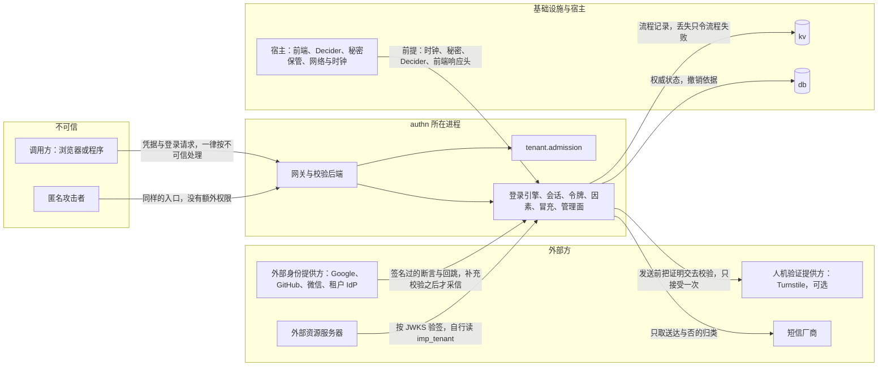
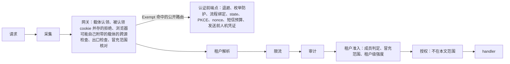

# authn 威胁模型

## 职责

本文承载 `pkg/authn` 功能目录的威胁模型，范围含租户准入层 `tenant.admission` 对跨租户访问的拦截：按类别列出威胁、对策与残余风险，写出对策成立所依赖的部署层前提，并列出没有覆盖的威胁。功能目录整体的职责、模块清单、身份与判决的形状见 [design-authn](design-authn.md)。

- **按类别的威胁、对策与残余风险。** 每条威胁对应一组对策与一栏残余风险；对策指向承载它的设计文档，本文不复述被指向文档的表、判定顺序与配置键。
- **对策的分层。** 协议层是库做的，装配层是 authn 自己的代码与装配补的，部署层只能写成对宿主的前提（见[术语表](#术语表)）。
- **部署层前提。** 对策依赖而 authn 无法自行保证的条件，是对宿主的要求。
- **没有覆盖的威胁。** 明确不在本功能目录防护范围内的威胁与它们的归属。
- **未核实的假设。** 依赖未核实行为的断言与守住它们的测试。

威胁类别按攻击面划分。下文的类别是例举，不是封闭集：新威胁归入最近的一类，没有相近的类别时增设一类。

各项对策背后的取舍与被否决的方案，记在各方面对应的决策记录里，索引见[依赖](#依赖)。

### 非职责

- **不承载对策本身的形状。** 退避、会话、令牌、因素、SSO、冒充、管理面、配置、事件的表、判定顺序与配置键由各自的设计文档承载；配置键只在 [design-authn-config](design-authn-config.md) 给全。本文的每个对策单元格只写机制的名字与它防的事。
- **不承载哨兵表与依赖不可用时每条路径的方向。** 它们由 [design-authn-failure](design-authn-failure.md) 承载；本文只写这些方向在威胁上的含义。
- **不承载设计取舍。** 为什么选这个对策、否决了哪些替代、接受了什么代价的论证，在决策记录里。
- **不防护[未覆盖的威胁](#未覆盖的威胁)里列出的威胁。**
- **不做以下防护措施。** 下列各项是例举，凡不在模块清单里的防护同样不提供：行为风控；会话绑定来源地址或 User-Agent；定期强制改口令；以「检测到可疑行为」为条件的封号；全局统一的威胁等级开关；泄露口令库比对；持有人证明（DPoP、mTLS，[REF-rfc9449](../../../references.md)、[REF-rfc8705](../../../references.md)）；自适应风险评分。
- **不判定一条对策是否已经实现。** 实现与否以[实现状态](#实现状态)和各模块文档的实现状态为准。

## 术语表

以下术语的含义限于本文档。

| 术语 | 范围 | 定义 |
|---|---|---|
| 协议层对策 | 本文 | 协议或库本身提供的防护，例如 WebAuthn（[REF-webauthn](../../../references.md)）把凭据绑定到 RP ID 与来源。库没做的校验不属于这一层。 |
| 装配层对策 | 本文 | authn 自己的代码与装配补上的防护：对库的补充校验、状态放置、统一应答、默认拒绝。表中没有标注层次的对策属于这一层。 |
| 部署层前提 | 本文 | 对策成立所依赖、只有宿主能提供的条件，例如时钟同步、秘密的保管、前端的安全响应头。前提不成立时，依赖它的对策失效，失效的范围写在[部署层前提](#部署层前提)里。 |
| 残余风险 | 本文 | 全部对策生效之后仍然存在的风险；不是对策自身的缺陷清单。 |
| 接受 | 本文 | 残余风险栏里的标记，表示这一项风险是明说接受的代价；取舍与理由由[依赖](#依赖)一节「决策记录」栏列出的决策记录承载，本文不汇总。 |
| 无已知剩余项 | 本文 | 残余风险栏的取值，表示没有已知的剩余风险；它不声称风险已经消除，库的新缺陷与未核实的假设仍记在[依赖未核实行为的假设](#依赖未核实行为的假设)与依赖里。 |

## 外部接口契约

本节陈述威胁模型：每类威胁的对策与残余风险、宿主必须提供的前提、没有覆盖的威胁。

### 威胁、对策与残余风险

表的读法：「对策」栏是已设计的机制，「落点」栏是承载它的设计文档，「残余风险」栏是对策之后仍存在的风险。对策栏里写出的配置键与设置键只作机制的名字，取值与缺省值由 [design-authn-config](design-authn-config.md) 与落点文档承载。

#### 账户接管

| 威胁 | 对策 | 落点 | 残余风险 |
|---|---|---|---|
| 口令猜测、撞库、喷洒 | 按提交标识的失败退避：自由尝试用尽后指数退避并设上限，退避期内不派生、不比对；账户级静默退避；口令表的进程内退避在检查时预占一次尝试、成功不清零，并发的猜测互相计数，穿插一次合法请求也清不掉失败计数；口令用 Argon2id（[REF-rfc9106](../../../references.md)）；口令派生有并发上限；`Passwords.Verify` 统一应答并对未知标识做诱饵派生 | [design-authn-account](design-authn-account.md)、[design-authn-login](design-authn-login.md) | 用户的口令在别处泄露且攻击者对每个账户只试一两次时，退避挡不住，靠第二因素；不做泄露口令库比对；登录尝试不经人机验证（验证闸的是发送，见[短信、枚举与时序](#短信枚举与时序)）。**接受** |
| 暴力破解一次性码（TOTP、短信，[REF-rfc6238](../../../references.md)） | 以因素与手机号为键的退避；每个短信码尝试次数用尽即作废；TOTP 计数器只进不退；重发不清零失败计数 | [design-authn-mfa](design-authn-mfa.md)、[design-authn-sms](design-authn-sms.md) | 对单个因素的在线猜测被限到每天百次量级；每天 100 次猜测对 6 位码（10^6 个取值）的命中概率上界是 10^-4，同时有效的码有 k 个时按 k 倍计 |
| 退避被用来锁住受害者 | 退避只针对口令方式，其他方式照常；上限与窗口是设置；标识级与账户级退避并存；运维主体（口令表）另有进程内退避 | [design-authn-login](design-authn-login.md)、[design-authn-account](design-authn-account.md) | 匿名攻击者对任一已知标识连续失败，可使其口令登录在 `throttle-max-delay` 之内不可用；换标识拼写不是缓解，账户级静默计数按账户计；受害者可改用短信、社交、SSO 与通行密钥登录。**接受** |
| SIM 劫持与号码携转 | 短信是受限认证器（[REF-nist-sp-800-63b](../../../references.md)）：不计入管理面动作的强认证；冒充发起与重置他人因素、口令不接受仅短信 | [design-authn-mfa](design-authn-mfa.md)、[design-authn-impersonation](design-authn-impersonation.md) | 以短信作登录或第二因素的普通账户仍受影响，短信登录与短信因素是本功能目录提供的方式；发送前的风险信号检查不做；号码被回收后，新持有者可用短信登录旧账户。**接受** |
| 预占抢注：先用受害者的邮箱建号，等受害者经 SSO 或社交登录时被并入该账户 | 提供方声明的地址只用于判定需先绑定，以及与企业预置账户的邮箱标识比对；它不关联提供方，不进入其他既有账户，也不写进新账户。命中现有账户已登记的邮箱时报告 `link-required`，不进入该账户也不另开账户，当事人以自己的登录方式登录后显式绑定该提供方；企业预置的账户由 IdP 断言同一已验证邮箱直接进入，这是租户预先开户的合同，不是按地址关联既有账户 | [design-authn-account](design-authn-account.md)、[design-authn-login](design-authn-login.md) | 预置账户的匹配采信管理员断言的邮箱，管理员写错邮箱即错配；迁移导入的邮箱不经验证，由导入方负责标成 `import-unverified`。**接受** |
| 社交与 SSO 的账户关联接管 | 键永远是（提供方，主体）；提供方声明的地址不参与识别，也不写进新账户，只用于判定需先绑定与企业预置的匹配；邮箱变化不更新账户；关联与解绑要求新鲜的本地多因素；`link-required` 只对提供方已证明邮箱或其域的调用者给出 | [design-authn-account](design-authn-account.md)、[design-authn-login](design-authn-login.md) | 提供方的「已验证」只在断言那一刻成立：Google Workspace（[REF-google-workspace-change-user-email](../../../references.md)）管理员可改邮箱，邮箱地址可被回收；它改变不了账户归属，但当事人显式绑定时采信的是那一刻的断言。**接受** |
| 租户 IdP 对跨租户的全局账户的权限边界 | 企业 SSO 的 JIT 从不并入现有账户，`merge_existing` 的取值不打开并入；`preprovisioned` 只匹配管理员为该租户预建、带该邮箱标识的账户，匹配不上即拒绝；成员关系只在建绑定的同一事务里新建，已有绑定的登录不读不写成员关系，被暂停或移除的成员不会被复活；IdP 声明的多因素只在该提供方所属租户内算数，账户安全类操作不采信；IdP 行的变更是强制审计的管理动作 | [design-authn-sso](design-authn-sso.md)、[design-authn-account](design-authn-account.md) | 租户的 IdP 管理员对自己租户新建的账户有登录控制权，这是企业 SSO 的本质；预置账户的邮箱由管理员断言，写错即错配；该 IdP 对预置账户有永久的登录能力，直到绑定被解除。**接受** |
| 租户 A 的 IdP 声明的多因素被租户 B 的 `require-mfa` 采信，或覆盖账户自己的因素 | `idp_assured` 记在会话上，只在该提供方所属的租户内算数；账户有因素时 IdP 的声明盖不过；账户安全类操作与冒充发起不采信 | [design-authn-mfa](design-authn-mfa.md)、[design-authn-sso](design-authn-sso.md) | 租户 A 的 IdP 管理员对自己租户内请求的 MFA 判定有话语权，这是企业 SSO 的信任边界。**接受** |
| 首次登记的因素被抢先：持口令者先于真用户登记自己的因素 | 登录期间登记的因素不计入本次保障等级；账户安全类操作要求本地验证过的因素；冒充发起与管理员重置要求启用已满规定时长的因素（`MFA.Seasoned`） | [design-authn-mfa](design-authn-mfa.md) | 账户尚无因素时，持口令者与真用户不可区分：抢先登记者得到一个普通的多因素会话，真用户被锁在外，要靠管理员重置；首次登记没有带外证明（本模块不以邮箱验证码作因素证明）。**接受** |
| 恶意租户管理员用自己的 IdP 断言别家的邮箱 | 企业 SSO 的邮箱域必须属于该租户已验证的域；已验证的域全局唯一 | [design-authn-sso](design-authn-sso.md)、[design-authn-account](design-authn-account.md) | 域名所有权后来转手、旧租户的 IdP 仍可断言，直到管理者移除 |
| 钓鱼与实时代理 | 协议层：WebAuthn 与通行密钥绑定 RP ID 与来源，对钓鱼免疫；装配层：`__Host-`（[REF-rfc6265bis](../../../references.md)） cookie；`return_to` 校验 | [design-authn-mfa](design-authn-mfa.md)、[design-authn-session](design-authn-session.md) | TOTP、短信、口令对实时代理不免疫；启动校验只要求 `rp-id` 等于基址主机或其父域，不核对父域是否为公共后缀（[REF-public-suffix-list](../../../references.md)），取公共后缀时凭据的作用域覆盖该后缀下的全部站点，见 [design-authn-mfa](design-authn-mfa.md)。**接受** |
| 找回路径绕过 MFA | 匿名口令重置只写口令、不触碰因素，不产生会话；经短信、社交、SSO 登录后同样过第二因素；管理员重置不绕过第一因素 | [design-authn-mfa](design-authn-mfa.md)、[design-authn-login](design-authn-login.md) | 邮箱或短信被接管者可改口令；没有第二因素的账户因此等于被接管，有第二因素的账户仍进不去。只有一个因素又无管理员的账户丢失因素后没有自助找回；管理员重置依赖宿主的核验流程，社会工程是风险。**接受** |
| 匿名口令重置的账户枚举与跨账户绑定 | 合格与不合格目标得到同一个 202、同一组响应头与同一枚重置 cookie；不合格目标写诱饵记录（邮箱为随机摘要，短信为 `Deliver=false` 的抑制挑战行），验证步走同一比较与计数；发送预算超限一律抑制发送并仍答 202；只有同一 cookie 的重发间隔与登录的 `ip-limit` 答 429；记录以重置令牌的 SHA-256 为键，绑定账户与标识行，客户端不能指定账户；验证码与口令不进日志、审计与事件 | [design-authn-login](design-authn-login.md)、[design-authn-config](design-authn-config.md) | 收到消息本身证明该地址或号码属于某账户，这是任何找回流程都有的披露，且持有该渠道的人本就能接收；合格路径比抑制路径多一次账户读与一次真实发送，发送已异步化，残余的本地时延差不可从响应稳定观测，写成接受的残余；知道受害者地址或号码的人可以在预算窗口内耗尽该地址或号码的发送预算，使受害者的重置被抑制，受害者可换渠道或等窗口。**接受** |
| 匿名口令重置的验证码猜解与重放 | 六位码、每码尝试上限、码有效期、重发间隔与按地址/号码、来源、全局的预算；验证码通过时以比较并交换消费记录，写口令前再以 `verified→processing` 的比较并交换保证一次生效；并发与重放败者答 `flow-invalid` | [design-authn-login](design-authn-login.md)、[design-authn-sms](design-authn-sms.md) | 攻击者在预算内仍可在线猜测，命中概率受尝试上限与码空间约束；没有跨挑战的标识退避，攻击者可按发送预算重复取得新码并各试数次；受害者可换渠道或走管理员。**接受** |
| 匿名口令重置的发送轰炸与审计缺失 | 每次发送先过人机验证门槛（缺省为工作量证明；短信路径在 `SMSCodes.Send` 内、邮箱路径在重置路由上，均在任何预算之前），再受按地址或号码、按来源、按来源不同目的地、按来源确定失败、按用途、跨渠道上界与全局预算约束；邮箱发送在有界工作池里；匿名口令重置在写口令之前写强制档 `authn.password.reset` 的 `attempted` 行，写不成即 503 且不写口令，成功或拒绝在其后补行；审计或渠道缺失时发现面不发布该能力 | [design-authn-login](design-authn-login.md)、[design-authn-events](design-authn-events.md)、[ADR-authn-human-verification](../../../adr/adr-authn-human-verification.md) | 显式把模式写成 `off` 时，轰炸仍只受预算约束；全局或跨渠道上界耗尽会抑制所有目标的发送，合法用户也收不到码；进程在 `attempted` 行与结局行之间崩溃会留下一条没有结局的行，不误报成功。**接受** |
| 特权写入伪造 `verified_via` | 匿名口令重置的资格只读 `email-code` 与 `sms-code`；`email-code` 与 `sms-code` 由自助验证码兑现路径写入。持有 `AccountAdmin` 的宿主命令与管理面也能写同一标签，但它们本就能直接重置口令，不构成新的提权 | [design-authn-account](design-authn-account.md)、[design-authn-login](design-authn-login.md) | 有管理权限的调用方可以绕过验证码把一条标识标成已证明；这是管理权限的既有能力，不是匿名调用方可达的路径。**接受** |
| 匿名口令重置与冒充的交互 | 重置推进目标账户的 `valid_after`；cookie 冒充会话属于发起者，继续有效；目标账户的 bearer（[REF-rfc6750](../../../references.md)）冒充令牌按 `valid_after` 失效 | [design-authn-token](design-authn-token.md)、[design-authn-impersonation](design-authn-impersonation.md) | 同一次重置对 bearer 冒充令牌与 cookie 冒充会话的结果不同；这是 `valid_after` 判定的直接结果，事故处置需按令牌种类区分。**接受** |
| 账户停用后仍可用 | 状态与 `valid_after` 在 `authn.account` 的事务里写；`Sessions.Status` 把账户启用与 `CreatedAt` 不早于 `valid_after` 写进有效性，所有调用 `Sessions.Status` 的校验路径共用；校验后端再查账户快照；清理由钩子同步调用、事件补偿 | [design-authn-account](design-authn-account.md)、[design-authn-session](design-authn-session.md) | 缓存内的校验至 `check-ttl`；`check-session=false` 下至令牌到期；钩子失败时残留行不能用于认证，但抹除不保证 |
| 账户枚举 | 统一应答与等时；失败退避按提交内容计；账户级退避静默；短信对已登记与未登记的号码走共享台账的同一条计数路径与同形应答（未登记且注册关闭时写抑制行）；发现只看域不看本地部分；因素清单只在首因素通过后给；`link-required` 在社交路径上只在 `EmailVerified` 为真时给，企业 JIT 路径以邮箱域属于该提供方所属租户已验证的域为前提 | [design-authn-login](design-authn-login.md)、[design-authn-sms](design-authn-sms.md)、[design-authn-sso](design-authn-sso.md) | `link-required` 对已被提供方证明拥有该邮箱或其域的调用者暴露其账户存在，接受；口令表的用户名因快速拒绝而可被枚举，接受；开户开放时，未知号码也会真的发送；设置变更之后到账户升级哈希之前，已知与未知标识的口令派生耗时有差别。**接受** |

#### 注册与邮件

| 威胁 | 对策 | 落点 | 残余风险 |
|---|---|---|---|
| 用户名冒充系统路径或运营方 | 内置保留用户名清单与部署追加集合（`authn.account.reserved-usernames`）在每条写用户名的路径上拒绝；用户名字符集限定 `[a-z0-9._-]`，同形字在规范化阶段即被拒 | [design-authn-account](design-authn-account.md)、[design-authn-config](design-authn-config.md) | 清单是字面集合，不做同形字折叠；部署只能追加、不能移除内置项；清单之外的仿冒名不被拦。**接受** |
| 用户名枚举 | 注册先做用户名唯一性检查，冲突答 409 `username-taken`；邮箱冲突答 409 `email-taken`：注册在同一事务里插入联系方式预留，`(kind, value)` 唯一索引是地址的唯一仲裁点，自助添加邮箱在过人机验证之后、发码之前读标识与未证明预留；来源预算、全局小时预算与按用户名的退避限定单位时间内的探测次数 | [design-authn-login](design-authn-login.md)、[design-authn-config](design-authn-config.md) | 匿名者可以确认某个用户名或邮箱地址已被占用，这是显式取舍；预算只给探测次数一个上界，不隐藏占用事实。**接受** |
| 批量注册 | 按来源地址的分钟预算（`authn.account.signup-ip-limit`）、全局小时预算与 `ratelimit` 的地址盾（按来源地址限制单位时间内的请求数，不数消息）；注册派生有独立的并发名额；注册不发送任何邮件，不为批量提交附带发送成本 | [design-authn-config](design-authn-config.md)、[design-authn-login](design-authn-login.md)、[design-ratelimit](../design-ratelimit.md) | 预算额度之内仍可批量建号；注册不发送消息，因此不经人机验证；不做行为风控与一次性邮箱识别（见[未覆盖的威胁](#未覆盖的威胁)）。**接受** |
| 注册的口令派生（Argon2id）耗尽 CPU 与内存 | 注册使用独立的派生并发上限，耗尽答 503，不挤占口令登录的派生容量；先做用户名唯一性检查，再做派生 | [design-authn-account](design-authn-account.md)、[design-authn-config](design-authn-config.md) | 独立容量之内的占用仍可拖慢注册；注册关闭的部署没有这条路径 |
| 未验证账户越过能力边界 | 读作未验证（`SignupPending`：有邮箱而没有一条已证明的）的账户在 REQ-signup-025 列明的封闭动作上一律 403 `contact-required`，REQ-signup-024 列明的动作照常放行；判定与账户来源无关（REQ-signup-027）；服务账户与没有任何邮箱的账户（`SignupNone`）豁免；门控在身份确定之后、授权与强度判定之前，只收紧不放行，读状态失败答 503，不按放行处理。平台强制的门控限于这些身份与运营面；`objectstore`、`notification`、`jobs` 一类业务写面的门控由宿主决定，平台不统一拦截 | [design-authn-admin](design-authn-admin.md)、[design-authn-config](design-authn-config.md)、[design-authn](design-authn.md) | 允许的面（登录、本人资料读写、改口令、登记多因素与通行密钥、添加并验证邮箱或手机、退出与撤销本人其他会话、接受邀请、读特性文档）仍是攻击面；未验证账户可以消耗发送预算与允许面内的资源。删除最后一个已证明邮箱会让账户不再有邮箱，判定落到 `SignupNone` 而不再受限，这是「没有邮箱不拦截」的直接结果。**接受** |
| 未验证邮箱与 pre-hijacking（[REF-pre-hijacked-accounts](../../../references.md)）：先用受害者的地址注册 | 联系方式预留 `(kind, value)` 全局唯一，注册插入预留即原子仲裁，未证明预留被接受为占用；预留只由证明、删除标识或未验证账户的清理释放；未证明预留不进 `authn_identifiers`，`Lookup`、口令登录名与提供方登录都看不到它；只有邮箱被证明（`email-code`，或邀请接受命中同一预留）才写入标识并解除限制 | [design-authn-account](design-authn-account.md)、[design-authn-login](design-authn-login.md) | 受害者地址被一个未验证账户预占时，受害者自己的注册得到 409 `email-taken`，只能等预占账户被删除或经 `unverified-ttl` 清理，或由管理员处理；没有所有者凭证明接管的路径。该账户的持有人登录后可以为这个地址请求验证码，使受害者收到邮件，见下一条。**接受** |
| 认证后的邮件轰炸 | 注册本身不发送任何邮件；发码发生在已认证账户的自助验证与匿名口令重置，按地址（小时与 UTC 日）、按账户（小时与 UTC 日）、按请求来源（小时与 UTC 日）与全局小时预算限；重置按用途使用独立计数键，任何发送预算超限都抑制发送并仍答 202；按地址的重发窗口跨会话与账户共享，同一收件箱的 `+` 后缀、Gmail（[REF-gmail-dots](../../../references.md)）局部部分的点与 `googlemail.com` 归一后共用地址预算与重发窗口，来源为空时来源维度 fail-open；地址已被其他账户预留或持有时答 409 `email-taken`，不发信、不占重发窗口、不花预算；能证明未发出的失败退还本次占用的预算，结果不确定的失败保留；验证码六位、五次尝试、十分钟有效、常量时间比较、原子计数，且不进日志、事件与指标 | [design-authn-login](design-authn-login.md)、[design-authn-config](design-authn-config.md) | 已登录的账户仍可向任意未占用地址发码，逐个地址试探即在预算内对第三方轰炸；按地址的预算只约束单个收件箱，全局预算只给总量一个上界；来源维度按地址不按人，共享出口之后的用户共用一个来源窗口，调用方没有可信来源时该维度不设上界；地址占用在发码前即可读出，匿名注册与自助添加都能确认一个地址是否已被占用。匿名口令重置的邮箱发送受同一组数值预算与人机门槛约束，不合格目标走抑制路径、不投递。**接受** |
| 清理误删未验证账户 | 自动清理只删 `signup_state=1`、`signup_verified_at` 为空、没有已验证邮箱且长期未登录的自助注册账户；`signup_state=0` 与 `signup_state=2` 的账户永不清理；期限与清扫间隔是设置 | [design-authn-account](design-authn-account.md)、[design-authn-config](design-authn-config.md) | 长期不登录的合法用户会在期限之后被删除，删除是破坏性动作；账户标识留墓碑，但账户资料与联系方式预留不恢复。**接受** |

#### 会话与 CSRF

| 威胁 | 对策 | 落点 | 残余风险 |
|---|---|---|---|
| 会话固定 | 令牌只由服务端生成（scs 对未知令牌新建会话，不沿用客户端给的令牌，[REF-scs](../../../references.md)）；没有登录前的匿名会话；登录、提权、冒充开始时换令牌；登录时撤销请求带来的旧会话；`__Host-` cookie 阻止子域预置 | [design-authn-session](design-authn-session.md) | 无已知剩余项 |
| cookie 被盗 | `HttpOnly`、`Secure`（不可关）、`__Host-`；库里只存哈希；空闲与绝对超时；可撤销、可列出；会话期 cookie | [design-authn-session](design-authn-session.md) | 窃取者在会话有效期内可用，没有设备绑定（NAT 与移动网络下绑定会误杀）；缓解是缩短期限与 `strict`。**接受** |
| cookie 投放与子域接管 | `__Host-` 前缀；同名 cookie 出现多次即 401 | [design-authn-session](design-authn-session.md)、[design-authn-gate](design-authn-gate.md) | 设了共享域（`__Secure-`）或开发时关闭 `__Host-`，即失去这一层；开启时写 Warn |
| CSRF（浏览器可能自己附带的凭据） | `SameSite=Lax`；网关对这些载体来源的非安全方法做 `CrossOriginProtection`，失败答 401、不清 cookie、凭据不交给后端；哪些载体算在内的判据只在 [design-authn-gate](design-authn-gate.md) 的请求期判定 | [design-authn-session](design-authn-session.md)、[design-authn-gate](design-authn-gate.md) | 既无 `Sec-Fetch-Site` 又无 `Origin` 的请求被放行（极旧的浏览器与非浏览器客户端）；`same-site` 的兄弟子域按跨源处理，除非列入 `trusted-origins`；同源 XSS 能借浏览器发请求，XSS 是宿主前端的责任 |
| 登录 CSRF：把受害者登入攻击者的账户 | 流程绑定 cookie 加 `seq`；回跳必须与发起流程的浏览器绑定；登录与流程路由的非安全方法过跨源检查 | [design-authn-login](design-authn-login.md) | IdP 发起的 SAML（[REF-saml2](../../../references.md)）登录无从绑定：缺省关闭，开启时写警告；绑定 cookie 是 `SameSite=None`，会随任何跨站请求发往该主机，只是不透明值，对其他端点没有权限 |
| 撤销不及时 | 单个与全部撤销、`valid_after`、停用时同步清理；缓存滞后至多 `check-ttl` | [design-authn-session](design-authn-session.md) | 滞后窗口内的请求仍被放行；`check-ttl` 设 0 即严格 |
| 点击劫持、响应被中间缓存 | authn 的端点只返回 JSON、没有界面，界面的 `frame-ancestors` 由宿主加；authn 的全部响应带 `Cache-Control: no-store` | [design-authn-session](design-authn-session.md)、[design-authn-gate](design-authn-gate.md) | 仓库没有安全响应头策略；宿主界面的响应头是宿主的责任 |

#### 令牌的窃取与重放

| 威胁 | 对策 | 落点 | 残余风险 |
|---|---|---|---|
| 访问令牌被盗与重放 | 访问令牌寿命短；撤销经会话；`sid` 核对；`valid_after`；令牌不进 URL 与日志 | [design-authn-token](design-authn-token.md) | 寿命内可重放；没有持有人证明；服务账户的令牌无法逐枚撤销。**接受** |
| 刷新令牌被盗 | 每次使用即轮换，重用即撤销整族；只存哈希；空闲与绝对期限；缺省不设宽限；出示任意不存在的秘密不触发撤销，只有出示真实存在的已用旧令牌才判重用 | [design-authn-token](design-authn-token.md) | 窃取者先于合法客户端使用时，合法客户端被踢下线，窃取者持有新令牌直到下次重用被发现；开宽限则多一个窗口 |
| 算法混淆（`none`、RS256 当作 HS256，[REF-rfc7518](../../../references.md)） | 不支持对称算法；白名单等于已配置密钥里的算法；每把密钥一个算法并核对 | [design-authn-token](design-authn-token.md) | 无已知剩余项 |
| `kid`、`jku`、`x5u`、`jwk`、`x5c`（[REF-rfc7515](../../../references.md)）注入 | `kid` 只在本地密钥集里比对；不识别也不抓取其余几个头；不对 `kid` 拼任何查询 | [design-authn-token](design-authn-token.md) | 无已知剩余项 |
| 令牌类型混淆、库默认放行（缺 `exp`） | `typ` 必须是 `at+jwt`（[REF-rfc9068](../../../references.md)）；`iss`、`aud` 必校；显式要求 `exp`、`iat`、`jti`、`sub`、`sid`；`exp - iat` 有上界 | [design-authn-token](design-authn-token.md) | 无已知剩余项 |
| 畸形令牌的拒绝服务（go-jose 的 panic 类缺陷，[REF-go-jose](../../../references.md)） | 先限长；`pkg/go.mod` 对 go-jose 设版本下限（数值见 [design-authn-token](design-authn-token.md) 的依赖）；校验在 `recover` 之内 | [design-authn-token](design-authn-token.md) | 库将来的新缺陷：go-jose 已有高危公告 |
| 签名密钥泄露 | 私钥在文件里，不在库的转储里；双钥轮换；应急撤销（从配置删去并滚动重启） | [design-authn-token](design-authn-token.md)、[design-authn-config](design-authn-config.md) | 文件与部署的秘密管理同时失守，即全部令牌可伪造；没有 KMS 接缝，列为扩展方向。**接受** |
| JWKS（[REF-rfc7517](../../../references.md)）缓存陈旧，致撤销的密钥仍被外部校验方接受 | JWKS 的缓存期有界；认证核心不依赖外部校验方的缓存 | [design-authn-token](design-authn-token.md) | 外部校验方的缓存时间之内 |
| 访问令牌带角色而无法撤销 | 默认不带角色；`ClaimsContributor` 由宿主显式选择 | [design-authn-token](design-authn-token.md) | 宿主选了就承担 |

#### 冒充滥用

| 威胁 | 对策 | 落点 | 残余风险 |
|---|---|---|---|
| 管理员账户被攻破后冒充他人；内部人滥用 | `Decider` 默认全拒；发起者要有新鲜的本地多因素、非短信，且名下有启用已满规定时长的非短信因素；限定一个租户，目标须是该租户的成员；有时限；理由必填；强制审计（事务之外先写）；不可链式；`protected` 账户不可冒充 | [design-authn-impersonation](design-authn-impersonation.md)、[design-authn-admin](design-authn-admin.md) | 有权限的发起者在授权范围内的滥用，靠审计事后发现；`Decider` 写得过宽时，管理员账户被攻破即等于可冒充；被冒充者不被通知。**接受** |
| 冒充身份越过租户范围：访问不带租户解析的端，或带着 cookie 与令牌去别处 | 网关对冒充身份只放进准入层所守的端与 `Impersonable` 路由，其余答 401；`authn.impersonation` 把 `ScopeGuard` 当必需依赖；准入层对无租户上下文与范围不符的冒充身份答 404；冒充令牌带 `imp_tenant`，使外部校验方读到范围 | [design-authn-gate](design-authn-gate.md)、[design-tenant-admission](../tenant/design-tenant-admission.md)、[design-authn-impersonation](design-authn-impersonation.md) | 准入层所守的端上、租户解析豁免的业务路由没有租户上下文，非冒充请求照常放行；`ScopeGuard.Covers` 只说准入层守哪些端，不核对宿主有没有在那些端上开解析豁免；外部资源服务器若不读 `imp_tenant`，则不受范围约束。**接受** |
| 冒充期间改变目标的认证事实、借冒充接管目标账户 | 冒充限一个租户、有硬性期限、不可续期；发起者须有本地验证过的新鲜非短信多因素且因素成熟；被冒充的账户不持平台域权限；每个动作的审计记为发起者并带被冒充账户 | [design-authn-impersonation](design-authn-impersonation.md)、[design-authn-mfa](design-authn-mfa.md) | 期限之内可以改目标的凭据并接管其账户，只能靠审计事后发现。**接受** |
| 无记录的冒充、冒充令牌被续期 | 审计落点是必需依赖，开始前先写审计，写失败即不开始；不发刷新令牌；`exp` 不晚于记录到期；撤销级联 | [design-authn-impersonation](design-authn-impersonation.md)、[design-authn-events](design-authn-events.md) | 动作失败时，审计里是一条 `granted` 加一条补写的 `failed`（以 `grant_id` 关联）；令牌在有效期内可重放 |
| 冒充绕过租户的 MFA 与 SSO 要求 | 发起者的强认证在开始时核验；冒充限定租户 | [design-authn-impersonation](design-authn-impersonation.md) | 该租户的 SSO 与 MFA 要求，在冒充期间对被冒充者本人不起作用 |

#### SSO 断言攻击

| 威胁 | 对策 | 落点 | 残余风险 |
|---|---|---|---|
| XML 签名（[REF-xmldsig-core](../../../references.md)）包装 | 单次解析，使用验过签后返回的元素；要求恰一条断言；核对 `SignatureValidated`；`pkg/go.mod` 对 goxmldsig（[REF-goxmldsig](../../../references.md)）设版本下限（数值见 [design-authn-sso](design-authn-sso.md) 的依赖） | [design-authn-sso](design-authn-sso.md) | 库将来的新缺陷：gosaml2（[REF-gosaml2](../../../references.md)）与 goxmldsig 都有过高危公告，这一类缺陷在 SAML 库与 goxmldsig 的历史上反复出现；每个补充校验都要有负向测试 |
| 断言重放 | `authn_saml_assertions` 的唯一约束（db，不是 kv）；断言新鲜度有上界；一次性流程 | [design-authn-sso](design-authn-sso.md) | 无已知剩余项 |
| `InResponseTo` 缺失与跨会话投放；IdP 发起 | 响应与断言两级核对流程记录里的请求标识；IdP 发起缺省关闭 | [design-authn-sso](design-authn-sso.md)、[design-authn-login](design-authn-login.md) | IdP 发起开启时，登录 CSRF 无解 |
| `Destination`、`Audience`、`Recipient`、颁发者混淆 | 库对空值跳过的几处（`IdentityProviderIssuer`、`Destination`、无 `AudienceRestriction`），由 authn 要求非空并复核 | [design-authn-sso](design-authn-sso.md) | 无已知剩余项 |
| 弱算法（SHA-1） | 调用库之前，预扫描解码后的 XML 里的全部 `Algorithm` 属性，出现 SHA-1 即拒绝，除非该 IdP 设了 `allow_sha1` | [design-authn-sso](design-authn-sso.md) | 预扫描按 `Algorithm` 属性的取值判定，出现 SHA-1 取值即拒绝，不区分该属性是否属于已采信的签名，含 SHA-1 取值而未用于验签的文档同样被拒；个别遗留 IdP 要求 SHA-1，开启即接受降级；靠 SHA-1 样本的负向测试守住 |
| XML 实体、压缩炸弹、过大的文档 | 请求体有大小上限；`MaximumDecompressedBodySize` 与 `MaximumXMLTokens` 显式设值；Go 标准库的 `encoding/xml` 不展开外部实体 | [design-authn-sso](design-authn-sso.md) | `xml-roundtrip-validator`（[REF-xml-roundtrip-validator](../../../references.md)）已停止维护。**接受** |
| NameID 碰撞与注释截断 | `transient` 拒绝；邮箱格式的 NameID 须配专门属性；键含 IdP 命名空间；含注释的 NameID 有负向测试 | [design-authn-sso](design-authn-sso.md) | gosaml2 对注释截断的处理未核实（见[依赖未核实行为的假设](#依赖未核实行为的假设)）；IdP 自身重新分配 NameID |
| 属性注入 | `idp.` 前缀只由映射写入，`authn.` 前缀保留，账户属性不得使用 `idp.` 与 `authn.` 前缀，均靠写属性的一方保证，网关在盖章处不判；类型化事实不进属性集 | [design-authn](design-authn.md)、[design-authn-sso](design-authn-sso.md) | 授权若盲信 `idp.*`，即信任 IdP；宿主自写的后端能交出任意 `idp.*` 键，网关拦不住，信任这些键就是信任该后端 |
| 域名声明劫持、跨租户的 IdP 断言 | 域名所有权经 DNS TXT 证明，已验证的域全局唯一；提供方行属于一个租户，成员关系只在该租户内建立 | [design-authn-sso](design-authn-sso.md) | DNS 没有 DNSSEC 校验；域名转手 |
| IdP 元数据或证书被替换；服务端请求伪造 | 元数据 URL 走受限客户端并限大小；证书变更要经管理面（强制审计）；连接时检查实际对端地址（只放行全局单播（IPv6 须在 `2000::/3` 内）且不在特殊用途段的地址，NAT64 与 6to4 抽出内嵌的 IPv4 再判，Teredo 拒绝，[REF-rfc6052](../../../references.md)、[REF-rfc3056](../../../references.md)、[REF-rfc4380](../../../references.md)）；不跟随重定向；不用代理 | [design-authn-sso](design-authn-sso.md)、[design-authn-admin](design-authn-admin.md) | 需要经出站代理的网络里要放弃该检查；受限客户端是自写的安全部件，特殊用途段表与 IANA 登记表（[REF-iana-ipv4-special-registry](../../../references.md)、[REF-iana-ipv6-special-registry](../../../references.md)）一致是假设，见[依赖未核实行为的假设](#依赖未核实行为的假设) |

#### 短信、枚举与时序

| 威胁 | 对策 | 落点 | 残余风险 |
|---|---|---|---|
| 短信轰炸与流量泵 | 缺省拒绝所有号码前缀（`allowed-prefixes` 为空）；认证与通知的每条短信尝试写同一张共享台账 `sms_budget_events`，全部预算与跨渠道上界由它的行数得出，已登记与未登记的号码走同一条计数路径；部署的跨渠道小时上界 `sms.ceiling-hourly` 先于其余每一项，只计两个渠道未退款、未抑制的行；号码未登记且注册关闭时写抑制的台账行与挑战行，不入队、不发送，抑制行计号码、来源与账户维度，不计全局、尝试与跨渠道上界；重发间隔、每号码每小时与每日的上限由台账行数得出；按来源地址的每小时与滚动一日上限（`per-source-hourly`、`per-source-daily`）、按来源的不同目的地数（`per-source-distinct-hourly`、`-daily`）与按来源的确定失败数（`per-source-attempt-hourly`）由同一来源摘要的台账行数得出，跨用途累计，`SendCode.Source` 为空时 fail-open 不施加；全局发送预算与全局失败预算按用途分设（登录、第二因素、登记与口令重置），一个用途被耗尽不挤占其余用途，匿名请求写抑制行也不消耗全局额度；尝试预算只计事后退款的确定失败，成功与抑制行不计；每流程至多 `per-flow-sends` 条；每账户每小时的上限只对 `mfa` 与 `enroll` 计，`login` 与 `reset` 不计；运行期开关 `disabled-methods` 可立刻关掉 `sms`，含 `sms` 时短信重置渠道同时撤下；`sms.ErrUncertain` 不盲目重发；厂商确定没有收下消息的发送（`ErrThrottled`、`ErrRejected`、`ErrUnroutable`）退还发送预算，请求路径上确定没发出的发送（注册表拒绝构建消息、行已写入但入队失败）同样退还，退还时在同一条语句里使验证码失效，发送预算因此只约束可能送达的发送，失败尝试则计入尝试预算；指标 `authn.sms.sends` 的 `budget-exhausted` 取值与 `authn.sms.budget.utilization` 仪表供告警；发送前人机验证缺省为自托管的工作量证明，每次发送——短信登录、第二因素、手机登记、匿名短信重置——由 `authn.sms.Send` 在放行表、队列与任何预算之前核对并消费一份有效、一次性的证明，自助添加邮箱与匿名口令重置的邮箱分支由各自的路由核对；缺失、无效、过期或重放答 403 `human-verification-required`，提供方或它的存储不可用答 503 且不发送，过长的证明答 400；评审装配与端到端装配显式写 `off` | [design-authn-sms](design-authn-sms.md)、[design-authn-login](design-authn-login.md)、[design-authn-config](design-authn-config.md)、[design-sms](../design-sms.md) | 注册开放且前缀放行时，攻击者可对任意允许前缀的号码触发发送，上界是来源、号码、账户、各用途全局预算与跨渠道上界的最小者，但发送维度的上界只对未被证明未送达的发送成立；确定失败的发送退还发送预算却计一次尝试，攻击者可对必然失败的目的地重复触发发送、重复调用厂商，直到来源或用途的失败额度耗尽，之后该来源或用途被拒；某用途的预算耗尽即拒绝该用途的合法用户，登录、第二因素、登记各有预算，互不挤占；跨渠道上界使一次通知投递的爆发可以耗尽同一小时的认证短信额度；全局维度只由真实发送消耗，抑制行仍计号码、来源与账户维度，所以超限出现的次数不因号码是否登记而不同；来源维度按地址不按人，共享出口之后的用户共用一个来源窗口，一个发送者可以耗尽同一出口其他人的来源额度；调用方没有可信来源时来源维度不设上界，此时只剩号码、账户、全局与跨渠道上界；人机验证缺省开启为工作量证明，重复触发需逐次取得证明，提供方不可用时发送一并失败而不是放行；显式写 `off` 时上述残余风险原样成立。**接受** |
| 验证码重用、重放与暴力 | 每码的尝试次数用尽即作废；单次消费（条件更新）；有效期有界；摘要带密钥 | [design-authn-sms](design-authn-sms.md) | 6 位数字的摘要抗不了离线穷举（库被读走时），只防短期暴露 |
| 计时侧信道 | 口令诱饵派生（按当前设置懒生成，设置变更时重建）；常量时间比较（口令哈希、验证码摘要、流程令牌、`state`）；匿名口令重置把发送交给工作池，响应路径不等待载体 | [design-authn-account](design-authn-account.md)、[design-authn-login](design-authn-login.md) | 常量时间比较与诱饵派生只使服务端处理时间相等，网络与调度抖动造成的差别不在保证内；设置变更之后到账户下次登录升级哈希之前，已知与未知标识的派生耗时有差；口令表的未知用户名因快速拒绝而快（已接受）。匿名口令重置只保证合格与抑制目标的应答形状、状态码与响应头一致，合格分支多出的账户读与投递入队不作时延上界。**接受** |
| 口令派生耗尽 CPU 与内存 | 并发信号量，满则 503；Argon2 的取值域与解析上限有界，另有按字节计的内存预算，每个口令后端各持一份；解析条目有界限；口令长度有上限 | [design-authn-account](design-authn-account.md)、[design-authn-gate](design-authn-gate.md) | 并发与内存预算以内的占用，各口令后端的预算互相独立，整个进程的上界是各份之和；已知有效用户名的口令表主体仍可被用来消耗派生，受退避约束；并发内存峰值在目标部署规格之内是假设，见[依赖未核实行为的假设](#依赖未核实行为的假设) |

#### OAuth 与 OIDC 回调

| 威胁 | 对策 | 落点 | 残余风险 |
|---|---|---|---|
| `state` 缺失、可预测、可由发起方指定（goth 的缺陷，[REF-goth](../../../references.md)） | 32 字节随机数，存摘要，回跳时常量时间比较；自己生成，不接受外部指定；与流程绑定一同校验 | [design-authn-login](design-authn-login.md) | 无已知剩余项 |
| PKCE（[REF-rfc7636](../../../references.md)）缺失或降级、授权码截获 | Google（[REF-google-openid-connect](../../../references.md)）、GitHub（[REF-github-oauth-apps](../../../references.md)）、企业 OIDC（[REF-openid-connect-core](../../../references.md)）一律 S256；校验串存流程记录 | [design-authn-login](design-authn-login.md) | 微信（[REF-wechat-website-login](../../../references.md)、[REF-wechat-oa-web-auth](../../../references.md)）协议不支持 PKCE；Google 是否强制 PKCE 未核实 |
| 授权码重放与注入、登录 CSRF | 回跳时对流程记录比较并交换，置为「正在交换」，授权码至多换一次；流程绑定 | [design-authn-login](design-authn-login.md) | 无已知剩余项 |
| 开放重定向（`return_to`、`redirect_uri`） | `redirect_uri` 由配置的 `public-url` 拼出；`return_to` 只接受相对路径或可信来源，开始时校验并存服务端，回跳时只用记录里的值 | [design-authn-login](design-authn-login.md) | `trusted-origins` 配宽了即开放；宿主前端若把任意 `return_to` 里的路径当重定向目标，要自己校验 |
| 混淆攻击：把 A 提供方的回跳投给 B | 每个提供方的回跳路径不同；流程里记提供方；回跳带 `iss` 时仍比对 | [design-authn-login](design-authn-login.md) | 无已知剩余项 |
| ID 令牌重放、`nonce` 缺失、`sub` 不一致 | 自己发 `nonce`、自己比对；校验 `aud`、`azp`、`iss`；不调 userinfo | [design-authn-login](design-authn-login.md) | 无已知剩余项 |
| 微信无 PKCE、无 `nonce`、无 ID 令牌，`secret` 在查询串里 | `state`（64 个十六进制字符）加流程绑定；不信任昵称与头像；不合成邮箱；库错误剥去 URL，不记 URL，`app-secret` 登记字面量脱敏 | [design-authn-login](design-authn-login.md) | CSRF 防线比其他提供方少一层；漏净化一处即泄露。**接受** |

#### 基础设施与服务端

| 威胁 | 对策 | 落点 | 残余风险 |
|---|---|---|---|
| 秘密进入日志、事件、审计、指标 | 脱敏按键名、值形状与字面量登记；事件与审计明细只放标识；指标属性是闭集；永不记录请求体与表单 | [design-authn-gate](design-authn-gate.md)、[design-authn-events](design-authn-events.md)、[design-log](../design-log.md) | 日志模块只管登记之后的记录；宿主自己的 handler 若记录请求体，authn 管不到；漏净化一处 |
| 数据库转储 | 口令用 Argon2id；令牌只存哈希；TOTP 种子与 IdP 密钥用加密列；短信码存带密钥的摘要；签名私钥不在库里 | [design-authn-account](design-authn-account.md)、[design-authn-config](design-authn-config.md)、[design-db](../design-db.md) | 邮箱、手机、显示名是明文；加密列依赖 db 根密钥，根密钥与库一起失守则全失 |
| `Host` 头注入与对外基址 | 基址只来自配置；从不用 `Host` 或转发头拼回跳地址、`iss`、ACS | [design-authn-config](design-authn-config.md)、[design-authn-login](design-authn-login.md) | 无已知剩余项 |
| 跨租户访问：持合法凭据的调用方指名另一个租户 | `tenant.admission` 默认拒绝，非成员的应答与不存在的租户同形（404） | [design-tenant-admission](../tenant/design-tenant-admission.md) | 准入层的拒绝落在审计与限流之内：准入层在授权阶段，该阶段在记录与限流之内；装配后的真实次序未经运行核对（见[依赖未核实行为的假设](#依赖未核实行为的假设)） |
| 端点漏守、配置错误 | 默认守全部端，漏写的端同样被守；启动诊断列出展开后的清单与被开出的口子；放宽项各写一行 Warn；缺省值取最严 | [design-authn-gate](design-authn-gate.md)、[design-authn-config](design-authn-config.md) | 链上仍可有层绕过认证（非保证）：声明在鉴别阶段之外各阶段的层、阶段内被 `After`、`Before` 或 `Order` 排到网关之外的层，以及入口模块内建的请求上下文、访问日志与兜底层，都在网关之前；宿主仍可显式放宽 |
| 管理面被远程滥用 | 默认不可用：`authn.admin` 要宿主纳入并交付 `Decider` 与审计；强制审计 | [design-authn-admin](design-authn-admin.md) | 宿主交付的 `Decider` 有缺陷，则管理面有缺陷 |
| 设置写权限被滥用来放宽安全项 | 放宽方向的开关（`signup`、`password-signup`、`check-session`）是设置项，与其余可在运行期修改的安全项走同一控制：经 `settings.admin` 管理面写全局层时由平台域 `settings.write` 判定，管理面在每次写之前落强制档审计；宿主自建的写入口由宿主鉴权；authn 订阅 `settings.changed`，改到更宽松的取值时写 Warn 并记一条尽力档审计；`pkg/authn/AGENTS.md` 写明「`authn.*` 与 `tenant.admission.*` 设置不得对租户或普通管理员开放写权限」 | [design-authn-config](design-authn-config.md)、[design-settings-admin](../settings/design-settings-admin.md) | 事后可见、不能事前阻止；设置没有按键的写控制，拿到全局写权限的主体仍能把放宽开关、`throttle-*` 与短信预算调松。**接受** |
| 预认证请求使表无界增长 | 每张会增长的表有持有者与清扫协程；kv 的流程记录与重置记录靠键的生存期过期，没有另设清扫协程；`authn_throttles` 的行数上界是失败请求速率乘 `throttle-decay` | [design-authn-account](design-authn-account.md)、[design-authn-login](design-authn-login.md) | 匿名洪泛期间表会变大；缓解是 `ratelimit` 的地址盾（按来源地址限制单位时间内的请求数）。登录路径的前置减负按发出的验证消息计数，不按流程开始计数，不给这一项上界。一次被人机验证拒绝的登录第一步仍写一条流程记录（停在 `first`、没有方法步、不写流程 cookie，随 `authn.login.flow-ttl` 到期），且因没有报告发送不占来源前置减负的桶；这类请求按来源的上界只由地址盾给出，宿主须让它覆盖登录路由所在的端（见[部署层前提](#部署层前提)）。**接受** |
| 供应链：依赖库的漏洞 | 固定版本；go-jose 与 goxmldsig 设版本下限；每个库隔在叶子包；升级走专门的变更 | [design-authn-token](design-authn-token.md)、[design-authn-sso](design-authn-sso.md) | 新漏洞出现到升级之间的窗口 |
| 时钟偏差 | 容差有界且可调；撤销不依赖时钟 | [design-authn-failure](design-authn-failure.md) | 偏差超过容差时零星拒绝 |

### 部署层前提

下表是对策依赖、而 authn 无法自行保证的条件。下表是例举，不是封闭集：凡对策成立所依赖、只有宿主才能提供的条件，同属部署层前提，并在引入它的对策旁写明。

| 前提 | 依赖它的对策 | 前提不成立时 |
|---|---|---|
| `public-url` 是宿主实际对外的 https 基址 | 回跳地址、`iss`、ACS 只来自配置；`Secure` 与 `__Host-` cookie | 非 https 基址在启动期以 `ErrInsecureConfig` 失败，除非显式开启 `allow-insecure`（仅限开发）；基址写错则回跳失败 |
| 命令树把 `authn.gate` 纳入每条提供服务的命令 | 网关默认守全部端 | 链上没有认证层，该端全部路由无认证放行；这是放行方向的失败，不产生本功能目录自己的信号（见 [design-authn](design-authn.md) 的非保证） |
| 宿主前端自行设置 `frame-ancestors`，防护 XSS，并校验自己用作重定向目标的 `return_to` | 点击劫持、CSRF 的同源残余、开放重定向 | 这些防护缺席；authn 的端点只返回 JSON，不提供界面 |
| 宿主自己的 handler 与中间件不记录请求体与表单 | 秘密不进日志 | authn 管不到宿主自己写出的记录 |
| 签名私钥文件的权限与部署的秘密管理由宿主负责；db 根密钥与数据库分开保管 | 令牌的签名私钥不在库里；加密列 | 文件与部署的秘密管理失守即全部令牌可伪造；根密钥与库一起失守则加密列全失 |
| 各副本使用 NTP 或等价的时间同步 | 期限类判断；撤销以账户状态与 `valid_after` 为准，不依赖时钟 | 期限类判断偏移，偏差超过容差时零星拒绝；撤销不受影响 |
| 宿主交付的 `Decider` 对授权范围的判断正确 | 管理面与冒充的判定接缝 | `Decider` 过宽则管理面与冒充过宽；缺席时他人账户与租户级资源的管理面动作、冒充一律拒绝 |
| `authn.*` 与 `tenant.admission.*` 设置不对租户或普通管理员开放写权限 | 放宽方向的开关是设置项，其变更与其余安全项一样由订阅 `settings.changed` 写 Warn 与审计；经 `settings.admin` 管理面写全局层时另由平台域判定并留强制档审计，宿主自建的写入口由宿主鉴权 | 拿到全局写权限的主体可把放宽开关、`throttle-*` 与短信预算调松；变更事后可见、不能事前阻止 |
| 管理员重置因素与口令之前，宿主有自己的核验流程 | 找回路径不绕过 MFA | 重置依赖宿主流程的质量，社会工程是风险 |
| 迁移导入的邮箱由导入方标成 `import-unverified` | 预占抢注的对策 | 未标记的导入邮箱被当作已验证标识，可成为口令登录名与默认联系地址 |
| 外部资源服务器读 `imp_tenant`，并按 JWKS 的缓存期刷新密钥 | 冒充范围对外部校验方成立；密钥撤销对外部校验方生效 | 外部资源服务器不受冒充范围约束；撤销的密钥在其缓存期内仍被接受 |
| 元数据抓取必须经出站代理的网络，由宿主以网络层隔离代替对端地址检查 | 对 IdP 元数据抓取的服务端请求伪造防护 | 对端地址检查被放弃，防护只剩网络层隔离 |
| 来源地址的前置减负与 `ratelimit` 的地址盾由宿主装配，且地址盾覆盖登录与匿名口令重置路由所在的端 | 预认证请求使表无界增长的缓解；被证明拒绝的登录第一步按来源的请求数上界 | 地址盾按来源地址限制单位时间内的请求数，发送预算按收件人、来源与账户限制消息数，两者不互相替代；地址盾不覆盖该端时，被拒绝的第一步没有按来源的请求数上界。两者都不在场时，匿名洪泛期间 `authn_throttles` 表变大，行数上界仍是失败请求速率乘 `throttle-decay`。本仓库的默认文档把这些路由所在的 `account` 端列入 `address-endpoints`，审查装配只放宽地址盾的阈值而不撤下该层（见 [design-starters](../design-starters.md)） |
| 接入真实的邮件投递通道之后才把 `authn.account.password-signup` 设为 `open` | 邮箱的验证与未验证账户的限制解除 | 没有邮件通道时，注册建出的账户与管理员预置、导入的账户都无法证明邮箱，停在受限状态；缺省 `closed` 使注册路径不出现，但预置与导入的账户仍需要投递能力才能解除 |

### 未覆盖的威胁

下列威胁不在本功能目录的防护范围内。列表是例举，不是封闭集：判据是防护需要的信息或能力不在本功能目录手里。

| 威胁 | 归属或处置 |
|---|---|
| 宿主前端的 XSS、点击劫持防护 | 宿主责任 |
| 依赖投毒 | 宿主的构建与供应链责任；authn 只固定已知受影响库的版本下限 |
| 针对 kv、db、事件总线本身的攻击 | 基础设施责任 |
| 机密计算与密钥托管（KMS、HSM） | 没有接缝，列为扩展方向 |
| 设备绑定与持有人证明（DPoP、mTLS） | 不做 |
| 行为风控 | 不做 |
| 一次性邮箱与一次性号码的识别 | 不做：需要外部数据源与判定，注册只按格式与长度校验地址与用户名；批量注册的上界由预算给出 |
| 口令泄露库比对 | 不做：需要出站调用，并有隐私上的权衡 |
| 自适应风险评分 | 不做：没有可用的信号来源，且未配置可信代理时代理之后的对端地址不可靠 |
| 公共后缀表对 WebAuthn `rp-id` 的核对 | 不做；残余风险写在[账户接管](#账户接管)的「钓鱼与实时代理」一行 |

### 对外接口面

- **已写入的对策不得削弱而不同时更新本文与对应的决策记录。** 对策是一条威胁所依赖的性质，削弱它等于改变残余风险。
- **残余风险栏的「接受」项增减是对接受的代价的变更**，同时更新对应的决策记录。
- **部署层前提的增减是对宿主可见面的变更**，同时更新[部署层前提](#部署层前提)。
- 类别与行的措辞不在对外接口面内：威胁的归类可以调整，对策与落点的指向不可以与被指向文档不一致。

## 依赖

本文是叶子文档：被 [design-authn](design-authn.md) 与设计文档索引引用，没有任何代码与文档依赖本文，因此不引入依赖方向问题。本文对其余文档的依赖是引用，不是构建依赖。

对策的落点与取舍记录按类别列出，类别与[威胁、对策与残余风险](#威胁对策与残余风险)的小节一致；「落点」栏列出该类别的对策所在的设计文档，「决策记录」栏列出对应的取舍。

| 类别 | 落点 | 决策记录 |
|---|---|---|
| 账户接管 | [design-authn-account](design-authn-account.md)、[design-authn-login](design-authn-login.md)、[design-authn-mfa](design-authn-mfa.md)、[design-authn-sso](design-authn-sso.md) | [ADR-authn-throttling](../../../adr/adr-authn-throttling.md)、[ADR-authn-external-binding](../../../adr/adr-authn-external-binding.md)、[ADR-authn-accounts](../../../adr/adr-authn-accounts.md)、[ADR-authn-account-lifecycle](../../../adr/adr-authn-account-lifecycle.md)、[ADR-authn-mfa](../../../adr/adr-authn-mfa.md)、[ADR-authn-mfa-recovery](../../../adr/adr-authn-mfa-recovery.md)、[ADR-authn-password-hash](../../../adr/adr-authn-password-hash.md)、[ADR-authn-contact-and-login-ways](../../../adr/adr-authn-contact-and-login-ways.md) |
| 会话与 CSRF | [design-authn-session](design-authn-session.md)、[design-authn-gate](design-authn-gate.md) | [ADR-authn-session](../../../adr/adr-authn-session.md)、[ADR-authn-credential-dispatch](../../../adr/adr-authn-credential-dispatch.md) |
| 令牌的窃取与重放 | [design-authn-token](design-authn-token.md) | [ADR-authn-token](../../../adr/adr-authn-token.md) |
| 冒充滥用 | [design-authn-impersonation](design-authn-impersonation.md)、[design-authn-admin](design-authn-admin.md)、[design-tenant-admission](../tenant/design-tenant-admission.md) | [ADR-authn-impersonation](../../../adr/adr-authn-impersonation.md)、[ADR-authn-decision-seam](../../../adr/adr-authn-decision-seam.md)、[ADR-tenant-admission](../../../adr/adr-tenant-admission.md) |
| SSO 断言攻击 | [design-authn-sso](design-authn-sso.md) | [ADR-authn-sso](../../../adr/adr-authn-sso.md) |
| 短信、枚举与时序 | [design-authn-sms](design-authn-sms.md)、[design-authn-login](design-authn-login.md) | [ADR-authn-sms](../../../adr/adr-authn-sms.md)、[ADR-authn-throttling](../../../adr/adr-authn-throttling.md)、[ADR-authn-human-verification](../../../adr/adr-authn-human-verification.md) |
| OAuth（[REF-rfc6749](../../../references.md)）与 OIDC 回调 | [design-authn-login](design-authn-login.md) | [ADR-authn-oauth-flow](../../../adr/adr-authn-oauth-flow.md)、[ADR-authn-wechat](../../../adr/adr-authn-wechat.md) |
| 注册与邮件 | [design-authn-account](design-authn-account.md)、[design-authn-login](design-authn-login.md)、[design-authn-config](design-authn-config.md)、[design-authn-admin](design-authn-admin.md) | [ADR-authn-signup](../../../adr/adr-authn-signup.md)、[ADR-authn-human-verification](../../../adr/adr-authn-human-verification.md)、[ADR-authn-contact-and-login-ways](../../../adr/adr-authn-contact-and-login-ways.md) |
| 基础设施与服务端 | [design-authn-config](design-authn-config.md)、[design-authn-events](design-authn-events.md)、[design-authn-failure](design-authn-failure.md)、[design-authn-gate](design-authn-gate.md) | [ADR-authn-settings-and-secrets](../../../adr/adr-authn-settings-and-secrets.md)、[ADR-authn-events-and-audit](../../../adr/adr-authn-events-and-audit.md)、[ADR-authn-failure](../../../adr/adr-authn-failure.md)、[ADR-authn-guarantees](../../../adr/adr-authn-guarantees.md)、[ADR-authn-state-placement](../../../adr/adr-authn-state-placement.md) |

对策依赖的其他模块与库的性质如下，列表是例举，不是封闭集。「失守时」栏写依赖的性质不成立时受影响的对策。

| 依赖 | 依赖的性质 | 失守时 |
|---|---|---|
| `pkg/log`（[design-log](../design-log.md)） | 脱敏规则登记之后的记录按键名、值形状与字面量遮蔽 | 日志模块不在参与集里，规则登记不上，脱敏层为空；登记之前绑定的属性不受约束 |
| `pkg/db`（[design-db](../design-db.md)） | 加密列与根密钥；唯一约束与条件更新作原子仲裁 | 根密钥与库一起失守，加密列全失；仲裁失效则一次性凭据可被重复消费 |
| `pkg/kv`（[design-kv](../design-kv.md)） | `CompareAndSwap` 只在当前值等于旧值时写入 | 流程记录的比较并交换失效，授权码可能被换多次；工作量证明的一次性消费失效，同一证明可被重复提交 |
| `pkg/ratelimit`（[design-ratelimit](../design-ratelimit.md)） | 入口层限流按责任键计 | 预认证洪泛的前置减负缺席 |
| `pkg/audit`（[design-audit](../audit/design-audit.md)） | 强制档审计由调用方在事务之外、动作之前写；尽力档写失败不令动作失败 | 强制档缺席则冒充与管理面动作不开始；尽力档缺失只丢审计行 |
| `pkg/settings`（[design-settings](../settings/design-settings.md)） | 变更事件 `settings.changed` 可订阅 | 放宽的设置变更没有 Warn 与审计 |
| `pkg/http`（[design-http](../http/design-http.md)） | `Router.Endpoints()` 与保留端名 `*`；中间件链按阶段与阶段内的 `After`、`Before`、`Order` 组装 | 默认守全部端无从展开；链上次序不成立则准入层与限流的次序保证不成立 |
| `pkg/tenant` 的 `tenant.admission`（[design-tenant-admission](../tenant/design-tenant-admission.md)） | 非成员与范围不符的冒充身份得 404 | 跨租户访问与冒充越界的拦截缺席 |
| go-jose/v4 | `pkg/go.mod` 的版本下限，对应畸形令牌触发 panic 的缺陷；数值见 [design-authn-token](design-authn-token.md) | 删去该要求会使依赖图把版本带回受影响的版本 |
| goxmldsig | `pkg/go.mod` 的版本下限，对应签名绕过缺陷；数值见 [design-authn-sso](design-authn-sso.md) | 同上 |
| scs | 对库里没有的令牌新建会话，不沿用客户端给的令牌 | 会话固定对策失效 |
| Turnstile（[REF-cloudflare-turnstile](../../../references.md)）的 siteverify | 同一 token 的第二次提交答 `success` 为假；`hostname` 与 `action` 如实报告 | 重放的证明可能被再次接受，来源与用途的核对失去意义 |

## UML 图

### 信任边界

下图固定各方在威胁模型里的信任位置：箭头方向是请求或数据的流向，边上的文字是 authn 在这条边上信任什么或要求什么。

- 调用方与攻击者在同一侧：所有凭据按不可信处理，校验后端交出事实，网关复核后才盖章（见 [design-authn-gate](design-authn-gate.md)）。
- 外部身份提供方的信任有范围：IdP 声明的多因素只在该提供方所属租户内算数；邮箱验证声明不用于解析账户或关联提供方，只用于判定需先绑定，以及与该租户预置账户的邮箱标识比对；租户 IdP 管理员只对自己租户新建的账户有登录控制权。
- 外部资源服务器是令牌的校验方，不是 authn 的一部分：冒充范围与密钥撤销能否对它生效，取决于它读不读 `imp_tenant` 与何时刷新 JWKS（见[部署层前提](#部署层前提)）。
- 人机验证提供方只在部署打开该机制时在场：Turnstile 由进程经受限出站客户端调用，自托管的工作量证明不经外部方；证明的有效性与一次性由提供方或它自己的存储保证，校验失败时发送不发生（见 [design-authn-login](design-authn-login.md)、[design-authn-config](design-authn-config.md)）。
- db 持有权威状态，丢失会放宽校验的状态都在 db；kv 只持有丢失只会让流程失败的状态（[ADR-authn-state-placement](../../../adr/adr-authn-state-placement.md)）。
- 宿主是前提的提供方：本图里 authn 不信任它之外的任何东西，却依赖宿主提供的前提。

### 拦截位置

下图按请求在链上的先后，标出各类威胁被拦截的位置。链上次序由各层声明的阶段与阶段内的 `After`、`Before`、`Order` 排出，次序与锚点见 [design-authn](design-authn.md)；认证前的公开端点是被登记为免认证的 authn 自己的路由，它们经过网关，但不由网关认证。

网关之前只有采集：排在认证之外的层自答的请求没有经过认证，这是[链上不保证没有能绕过认证的层](design-authn.md#非保证)的直接后果。准入层在授权阶段，该阶段在记录与限流之内，所以准入层的拒绝要进审计、要计入限流。授权在准入之内，认证只为它留接缝（见 [design-authn-admin](design-authn-admin.md)）。发送前人机验证在公开端点的处理器里、在任何发送预算之前生效，部署关闭该机制时这一步不存在。

## 核心算法与流程

### 威胁在请求路径上的拦截位置

下表是威胁类别与拦截者的对应，列出的位置是例举的主要拦截点，不是每条威胁的全部拦截点。请求期判定的顺序由 [design-authn-gate](design-authn-gate.md) 承载，本表不重复它。

| 位置 | 拦截的威胁 | 拦截者 |
|---|---|---|
| 认证前的公开端点 | 口令猜测与枚举、登录 CSRF、授权码重放、开放重定向、短信轰炸（人机验证打开时每次发送先验证明）、SAML 断言重放与 `InResponseTo` 核对 | [design-authn-login](design-authn-login.md)、[design-authn-sms](design-authn-sms.md)、[design-authn-sso](design-authn-sso.md)、[design-authn-token](design-authn-token.md) 的路由处理器；证明由 `authn.humanverify` 校验 |
| 匿名注册路由 | 用户名枚举、批量注册、注册的口令派生耗尽 | [design-authn-login](design-authn-login.md) 的注册处理器；`authn.account` 的 `Signups.Register` |
| 网关取凭据与分派 | cookie 投放、同名与不同名的被认领 cookie 并存、cookie 与 `Basic` 头来源的 CSRF、载体撞车 | [design-authn-gate](design-authn-gate.md) |
| 校验后端 | 令牌类型与算法混淆、畸形令牌、会话固定、撤销与账户停用后仍可用 | [design-authn-session](design-authn-session.md)、[design-authn-token](design-authn-token.md) |
| 网关出口检查与冒充范围核对 | 后端越权盖章、冒充身份越过范围 | [design-authn-gate](design-authn-gate.md) |
| 租户准入 | 跨租户访问、无租户上下文或范围不符的冒充身份 | [design-tenant-admission](../tenant/design-tenant-admission.md) |
| authn 自己的敏感端点 | 账户安全类操作缺新鲜因素、冒充中改变认证事实、管理面滥用 | [design-authn-mfa](design-authn-mfa.md)、[design-authn-admin](design-authn-admin.md)、[design-authn-impersonation](design-authn-impersonation.md) |
| 授权与 handler | 资源级越权、业务路由上冒充身份的敏感操作 | 授权模块与宿主，不在本文范围 |

### 贯穿各类别的机制

下列机制各自抵御多类威胁，每条的机制本体由右栏的文档承载。列表是例举，不是封闭集。

| 机制 | 抵御的威胁 | 载体 |
|---|---|---|
| 统一应答与等时、诱饵派生 | 账户枚举、计时侧信道 | [design-authn-account](design-authn-account.md)、[design-authn-login](design-authn-login.md) |
| 一次性凭据与流程的消费靠原子的条件写 | 断言重放、授权码重放、验证码重用、刷新令牌重用 | [design-authn](design-authn.md) 的设计原则；各模块文档 |
| 发送前的一次性人机证明 | 短信与邮件轰炸 | [design-authn-login](design-authn-login.md)、[design-authn-config](design-authn-config.md) |
| 默认拒绝 | 端点漏守、管理面滥用、冒充、跨租户访问 | [design-authn-gate](design-authn-gate.md)、[design-authn-admin](design-authn-admin.md)、[design-tenant-admission](../tenant/design-tenant-admission.md) |
| 放宽项各是显式开关、缺省取最严、启动诊断各占一行 Warn | 配置错误、设置写权限滥用 | [design-authn-config](design-authn-config.md) |
| 状态按丢失的方向放置 | 缓存或 kv 丢失导致校验被放宽 | [ADR-authn-state-placement](../../../adr/adr-authn-state-placement.md) |
| 凭据与秘密不以明文落地：哈希、摘要、加密列、脱敏 | 数据库转储、秘密进入日志与事件 | [design-authn-account](design-authn-account.md)、[design-authn-events](design-authn-events.md) |
| 对库没做的校验由 authn 补，补充校验失败一律按失败 | XML 签名包装、SAML 空值跳过、JWT（[REF-rfc7519](../../../references.md)）缺 `exp` | [design-authn-sso](design-authn-sso.md)、[design-authn-token](design-authn-token.md) |
| 撤销以账户状态与 `valid_after` 为准，不依赖时钟 | 撤销不及时、时钟偏差 | [design-authn-account](design-authn-account.md)、[design-authn-session](design-authn-session.md) |
| 宁可重复校验也不省略 | 单点校验被绕过 | [design-authn](design-authn.md) 的设计原则 |
| 注册验证状态的门控 | 未验证账户越过能力边界 | [design-authn-admin](design-authn-admin.md)、[design-authn](design-authn.md) |

## 错误与失败语义

### 失败的方向

依赖不可用时的方向是拒绝：db、kv、签名密钥、短信发送方与 IdP 不可用时，对应路径答 503，不答 200，也不答 401。有界的放宽是封闭集，各自带设置与上界，集合与上界由 [design-authn](design-authn.md) 与 [design-authn-failure](design-authn-failure.md) 承载；上文表中的缓存滞后、`check-session=false` 下的令牌存续、设置变更的传播延迟与证书陈旧窗口是同一批。本文的表不新增放宽项：表中出现的放宽方向的风险，要么属于那个封闭集，要么写在[部署层前提](#部署层前提)的「前提不成立时」一栏里。

### 依赖未核实行为的假设

下表是本文的断言所依赖、尚未核实的行为，是封闭集。每一项以所列测试守住，测试失败即视为对应断言的前提不成立，须回到相关决策记录重判。

| 假设 | 守住它的测试 |
|---|---|
| 链上次序成立：准入层在审计与限流之内、授权之外，网关在租户解析与审计之外；本文的拦截位置图与跨租户访问的对策依赖它 | 该假设与它的装配测试由 [design-authn](design-authn.md#链上次序) 的「链上次序」一节承载，本文不另设测试 |
| gosaml2：校验后能取得 `types.Response`；响应与断言都未签名时拒绝；NameID 中的 XML 注释不被截断，或被补充校验拒绝 | 签名包装向量与「全未签名」向量的表驱动测试，含注释 NameID 的负向用例 |
| goxmldsig 没有另外的拒绝 SHA-1 的途径，预扫描足以拦住 SHA-1 | SHA-1 签名向量的负向测试 |
| go-jose：每把密钥只配一种算法，并在运算时检查，由 authn 自己查令牌头里的算法完成；已解析令牌的 `typ` 头可取 | `alg` 在白名单之外、`typ` 不符、缺 `exp` 的令牌各被拒；依赖测试断言 `pkg/go.mod` 对 go-jose 的版本下限不低于 [design-authn-token](design-authn-token.md) 的依赖写明的版本 |
| scs 对库里没有的令牌新建空会话，不沿用客户端给的令牌；存储键的哈希与 authn 自己轮换时算出的一致 | 提交一个预置令牌，断言判为无此会话；断言两处算出的存储键相等 |
| `CrossOriginProtection` 的旁路模式能覆盖 gin（[REF-gin](../../../references.md)）的路径参数，且只旁路回跳路由 | 对回跳路由的跨站 POST 用例，同时断言其他流程路由的跨源请求仍被拒 |
| Google 的授权端点接受带 `code_challenge`（S256）的请求 | 用测试客户端对授权端点发带 `code_challenge` 的请求 |
| 受限出站客户端的特殊用途地址段表与 IANA 登记表一致；NAT64（RFC 6052）与 6to4（RFC 3056）内嵌 IPv4 的位置与掩码正确 | 对照登记表与 RFC 原文的向量测试；它守住的是核对那一天的状态，复核时机见下 |
| 口令派生在并发上限与内存预算下的并发内存峰值在目标部署规格之内 | 对并发上限下的 Argon2id 派生做压测，记录峰值 |
| 审计的语句级明细不带含加密列的值 | 经模型路径写入含加密列的模型，断言审计行里不出现任何秘密字节 |
| 外部身份的绑定键只含（提供方，主体），邮箱变化不影响账户归属 | 提供方返回的邮箱变化之后，用同一（提供方，主体）登录仍落到同一账户 |

**特殊用途地址段表的复核时机与承担方。** 登记表会新增整块，包内不保留它的副本，所以向量测试不会因登记表更新而失败，表与登记表的一致只靠复核维持。复核在下列时点重做：每次发布之前；IANA 的 IPv4 或 IPv6 特殊用途地址登记表出现新增或变更条目时；Go 工具链升级时，因为 `netip.Addr.IsGlobalUnicast` 一类判定的行为随标准库变化，而表只补它没有拦住的部分。复核逐条对照登记表，新增整块补进表与向量，并更新受限出站客户端一节写明的核对版本（见 [design-authn-sso](design-authn-sso.md)）。**复核由负责本次发布的一方承担**：本模块不持有登记表的副本，也没有察觉它更新的接缝，因而给不出到期提醒；表的一致性因此是发布流程里的一步，不是模块能维持的性质。

### 本文不作的保证

- **本文是设计层的威胁分析，不是渗透测试或形式化证明的结果。** 残余风险栏的「无已知剩余项」只说没有已知的剩余风险。
- **库的未知缺陷不在表里。** 表只写已知的公告与版本下限。
- **对策的存在以实现状态为准。** 表描述设计；对应模块尚未实现时，该对策不存在，见[实现状态](#实现状态)。
- **部署层前提不由 authn 校验。** 启动诊断能让一部分前提的缺席被察觉，不能让它们成立。

## 扩展点

新增校验后端、登录方式、因素、IdP 协议、发送方、路由或会增长的表时，对威胁模型的复核判据如下，判据是例举，不是封闭集。复核的结果是在本文对应类别里增补威胁、对策与残余风险，或写明新增项归入既有的哪一行。

- **新增的路由**经 `mount.Mounter` 登记访问级别；登记为公开的路由，复核它是否有失败退避、枚举防护、流程或重置绑定与跨源检查。匿名口令重置的各条路由按这条规则复核，绑定是它自己的 `__Host-authn-reset`。
- **新增的凭据载体**由一个校验后端整条认领，账户命名空间与能力声明在出口检查里核对。
- **新增的状态**按丢失的方向放置：丢失会放宽校验的进 db，丢失只会让流程失败的进 kv。
- **新增的秘密**同时登记脱敏（键名、值形状或字面量），并以哈希、带密钥的摘要或加密列存放。
- **新增的一次性凭据或流程**以原子的条件写消费，败者一律拒绝。
- **新增的放宽项**是设置项，缺省取最严，运行期改动到放宽方向时写 Warn 与审计，启动时已是放宽值也写一行 Warn。
- **新增的出站请求**走受限客户端，或写明为什么不需要。
- **新增的会增长的表**有持有者与清扫协程，行数上界可由已有速率与衰减窗口得出。
- **新增的响应**对已登记与未登记的标识同形等时，带 `Cache-Control: no-store`。
- **新增的库**隔在叶子包里，固定版本，下限取已知公告修复之后的版本。

## 实现状态

下表是威胁模型所依赖的各项对策的实现状态，以代码为准。账户、会话、令牌、登录、多因素、短信、SSO、冒充与管理面各自的细粒度状态由对应的设计文档承载，本表只给每项对策的汇总。

| 能力 | 状态 | 代码 |
|---|---|---|
| 网关默认守全部端、出口检查、浏览器可能自己附带的载体的跨源检查与冒充范围核对 | 已实现 | `pkg/http/router.go` `(*router).Endpoints`；`pkg/authn/gate/gate.go` `expandGuarded`；`pkg/authn/gate/serve.go` `admit`、`identify`、`impersonationAdmitted`；`pkg/authn/gate/exitcheck.go` `checkPrincipal`；`pkg/authn/gate/dispatch.go` `inNamespace` |
| 后端不可用时拒绝：503 而非匿名、预算、在飞闸门、`recover` | 已实现 | `pkg/authn/gate/serve.go` `enter`、`verify` |
| 判决不可字面构造、零值读作没答 | 已实现 | `pkg/authn/internal/verdict/verdict.go` `Verdict`、`OutcomeOf` |
| 免认证登记按已匹配的路由逐字比对 | 已实现 | `pkg/authn/gate/exempt.go` `Exempt`、`Optional`、`Impersonable`、`seal`、`accessOf` |
| 启动诊断列出展开后的受守端、被开出的口子与放宽项 | 已实现 | `pkg/authn/gate/gate.go` `diagnose`、`freeze` |
| 凭据的日志脱敏规则 | 已实现 | `pkg/authn/gate/redact.go` `registerNewRules`、`registerValueRule`、`shapeMatcher`、`credentialMatcher` |
| 口令表的口令保护 | 已实现 | `pkg/authn/static/hash.go` `Hash`、`ParseHash`；`pkg/authn/static/static.go` `Verify`；`pkg/authn/internal/password` `FuzzParse`、`TestDerivationsOfLargeEntriesNeverHoldMoreThanTheBudget` |
| 加密列与根密钥 | 已实现 | `pkg/db/crypto.go` `newKeyRing`、`(*keyRing).encrypt` |
| 日志脱敏的登记面 | 已实现 | `pkg/log/log.go` `Redaction` |
| 标识级与账户级失败退避、`valid_after`、账户停用的跨模块清理 | 已实现 | `pkg/authn/account/throttle.go`；`pkg/authn/account/lifecycle.go`；`pkg/authn/session/lifecycle.go`；`pkg/authn/mfa/manage.go` |
| 登录会话、cookie 与 CSRF 的对策 | 已实现 | `pkg/authn/session/sessions.go`、`pkg/authn/session/verify.go`；`pkg/authn/session/config.go`；`pkg/authn/internal/mount/wrap.go` `Wrap` |
| 访问令牌、刷新令牌轮换与重用检测、签名密钥轮换 | 已实现 | `pkg/authn/token/verify.go` `Verify`、`Accepts`；`pkg/authn/token/refresh.go` `Refresh`、`rotate`、`revokeFamily`；`pkg/authn/token/keys.go` `loadKeySet`、`GenerateKey`；`pkg/authn/token/jwks.go` `JWKS` |
| 登录流程绑定、`state`、PKCE、`nonce`、`return_to` 校验 | 已实现 | `pkg/authn/login/flow.go`、`pkg/authn/login/engine.go`、`pkg/authn/login/callback.go`；`pkg/authn/login/google/method.go` 与 `pkg/authn/login/github/github.go` 各自的 state 与 PKCE 编解码；`pkg/authn/login/internal/wechat`、`pkg/authn/sso/oidc` 各自的 `state.go` |
| 多因素的保障等级合成与账户安全类操作的因素门槛 | 已实现 | `pkg/authn/mfa/policy.go` `Assurance`、`Require`；`pkg/authn/mfa/routes.go`；`pkg/authn/mfa/totp`、`pkg/authn/mfa/sms`、`pkg/authn/mfa/webauthn`；`pkg/authn/guard/guard.go` |
| 短信的共享台账预算（号码、来源、来源不同目的地、来源确定失败、全局发送与失败、跨渠道上界）、抑制行与号码前缀白名单 | 已实现 | `pkg/authn/sms/send.go`、`verify.go`、`register.go`；`pkg/authn/sms/settings.go`；`pkg/sms/budget/store.go`、`budget.go`、`module.go`；`pkg/authn/sms/budget_ledger_dimensions_test.go`、`budget_abuse_test.go`、`budget_integration_test.go` |
| 发送前人机验证：证明在 `authn.sms.Send` 内校验并消费，缺省为工作量证明；自助添加邮箱与匿名口令重置的邮箱分支由各自的路由校验 | 已实现 | `pkg/authn/humanverify/module.go` `Module`；`pkg/authn/humanverify/config.go` `configDefaults`；`pkg/authn/humanverify/provider.go` `newProvider`；`pkg/authn/humanverify/pow/pow.go` `(*Provider).Verify`；`pkg/authn/humanverify/turnstile/turnstile.go` `(*Provider).Verify`；`pkg/authn/sms/send.go` `checkProof`；`pkg/authn/login/human.go` `(*routes).checkHumanProof`；`pkg/authn/login/reset.go` `passwordResetStart`；`pkg/authn/login/internal/selfservice/human.go` `(*routes).checkHumanProof`；`pkg/authn/login/internal/selfservice/addidentifier.go` `(*routes).addEmail` |
| 企业 SSO 的断言补充校验、SHA-1 预扫描与受限出站客户端 | 已实现 | `pkg/authn/sso/saml/assertion.go`、`pkg/authn/sso/saml/sha1.go`；`pkg/authn/internal/egress/egress.go` `New` |
| 冒充的结构性限制、租户范围与审计先于动作 | 已实现 | `pkg/authn/impersonation/routes.go` `handleStart`、`handleStatus`、`handleEnd`；`active.go`、`end.go`、`store.go`、`settings.go` |
| 判定接缝 `Decider` 与管理面的强制审计 | 已实现 | `pkg/authn/decide.go` `Decider`；`pkg/authn/admin/audit.go` `mandatory`、`newActionID`；`pkg/authn/admin/admin.go` |
| 租户准入层 `tenant.admission` | 已实现 | `pkg/tenant/admission/admission.go` `Module`；`pkg/tenant/admission/decide.go` `decide`；`pkg/tenant/capabilities.go` `Admission` |
| 放宽方向的设置变更订阅与 `authn.*` 设置写权限的硬要求 | 已实现 | `pkg/authn/account/relax.go`；`pkg/authn/{sms,session,token,static,login,mfa,sso,impersonation}/relax.go`；`pkg/tenant/admission/relax.go`；`pkg/authn/AGENTS.md` |
| `pkg/go.mod` 对 go-jose 与 goxmldsig 的版本下限 | 已实现 | `pkg/go.mod` `github.com/go-jose/go-jose/v4` v4.1.5、`github.com/russellhaering/goxmldsig` v1.6.1；`pkg/authn/deps_test.go` `goJoseFloor`、`goxmldsigFloor` |
| 链上次序的装配测试 | 已实现 | `pkg/tenant/admission/assembly_test.go`；`pkg/tenant/admission/live_test.go` |
| 匿名注册路由、用户名与邮箱的冲突处置、注册预算与独立的派生容量 | 已实现 | `pkg/authn/login/register.go` `(*routes).register`、`signupSourceAllow`、`signupGlobalAllow`、`failRegister`；`pkg/authn/account/signup.go` `(*product).Register`；`pkg/authn/account/config.go` `password-signup`、`signup-ip-limit`、`signup-global-hourly`、`signup-concurrency`、`signupIPLimitInDomain`、`signupHourlyInDomain`；`pkg/authn/login/config.go` `passwordSignupPath`、`signupIPLimitPath`、`signupGlobalHourlyPath`、`(*reader).passwordSignup`、`signupIPLimit`、`signupGlobalHourly`；`pkg/authn/account/account.go` `newProduct`（`signupGov`） |
| 注册验证状态的门控与未验证账户的清理 | 已实现 | `pkg/authn/login/start.go` `startAuthenticated`；`pkg/authn/invite/pipeline.go` `gateSignup`；`pkg/authn/admin/pipeline.go` `gateSignup`；`pkg/authn/impersonation/start.go` `checkSignup`；`pkg/authn/account/sweep.go` `sweepUnverified` |
| 邮箱验证码的按地址、按账户、按来源与全局预算，收件箱别名归一，以及发送失败时的预算退还 | 已实现 | `pkg/authn/login/internal/selfservice/addidentifier.go` `(*routes).addEmail`、`reserveEmailBudgets`、`refundEmailBudgets`、`refundEmailBudget`、`emailCertifiesNotSent`、`untilNextEmailBucket`、`emailTakenByAnother`；`pkg/authn/internal/budgetalias` `Canonical`；`pkg/authn/emailcode` `(*product).SendCode`、`publishUncertain`、`(*product).CertifiesNotSent`；`pkg/authn/email.go` `ErrEmailUncertain`；`pkg/authn/login/internal/selfservice/settings.go` `(*counts).get`；`pkg/authn/login/config.go` `settingsSchema`、`emailPerAddressHourlyInDomain`、`emailPerAddressDailyInDomain`、`emailPerAccountHourlyInDomain`、`emailPerAccountDailyInDomain`、`emailPerSourceHourlyInDomain`、`emailPerSourceDailyInDomain`、`emailGlobalHourlyInDomain`；`pkg/authn/login/internal/selfservice/emailbudget_test.go`、`emailabuse_test.go`、`settings_test.go`；`pkg/authn/internal/budgetalias/budgetalias_test.go` |
| 匿名口令重置的资格判定、同形应答、抑制记录、独立绑定与强制审计 | 已实现 | `pkg/authn/login/reset.go` `(*routes).resetEligible`、`resetRecordEligible`、`resetOpen`、`resetChannelReady`、`resetChannelAvailable`、`passwordResetStart`、`passwordResetVerify`、`passwordResetComplete`、`resetCookieName`、`setResetCookie`；`pkg/authn/login/reset_test.go` |
