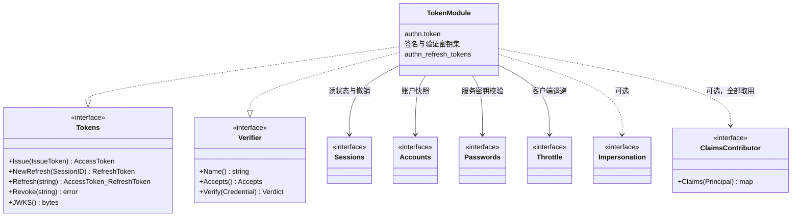
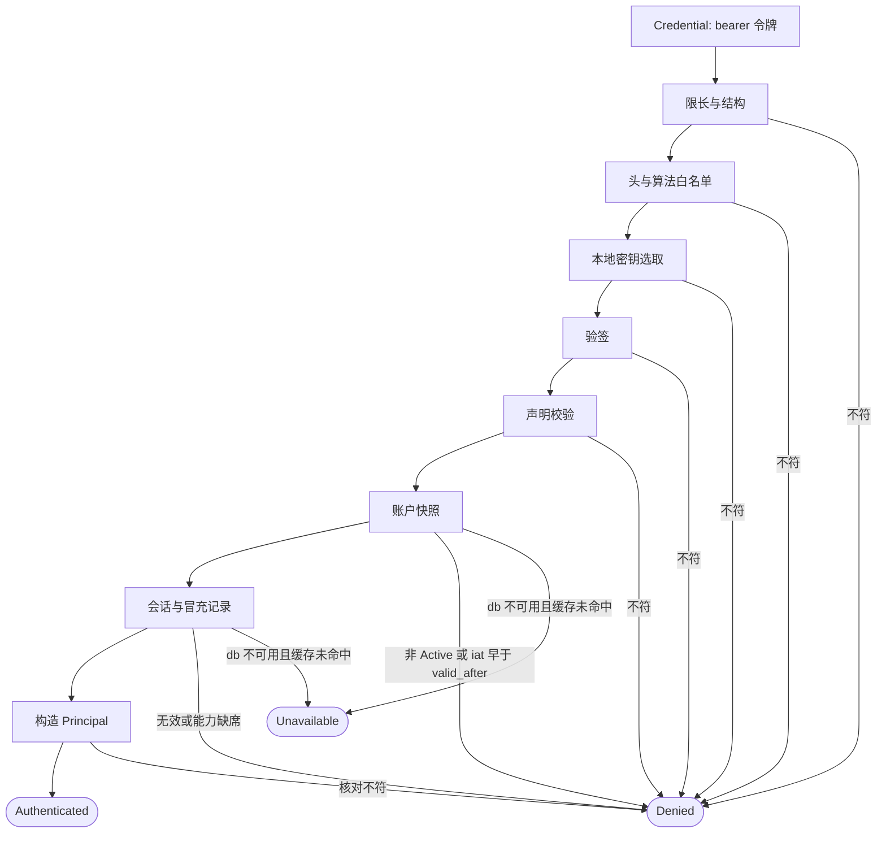
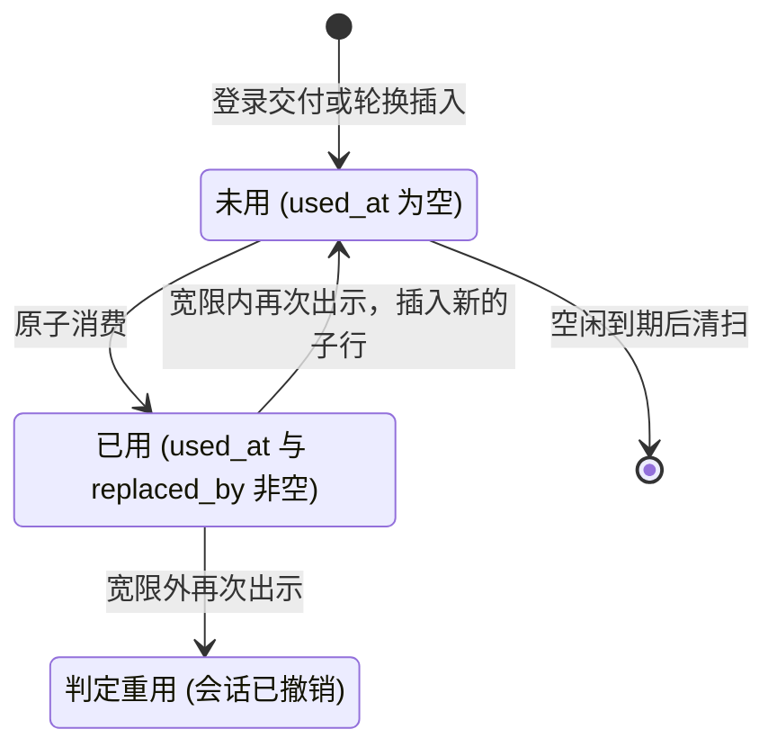
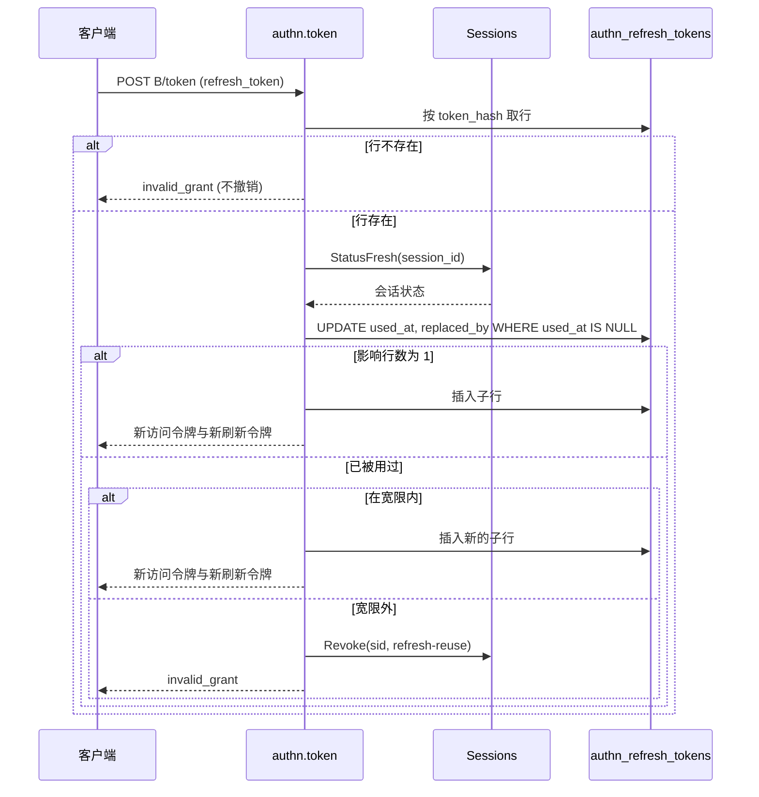

# 令牌与服务账户

## 职责

`pkg/authn/token` 是 authn 功能目录里交付令牌的子包，登记一个模块 `authn.token`。本文档承载它的接口、校验次序、签名密钥与刷新令牌的全部细节；authn 的整体划分见 [design-authn](design-authn.md)，决策依据见 [ADR-authn-token](../../../adr/adr-authn-token.md)。

- 签发访问令牌：短寿命的 JWT，声明集固定，签名算法与密钥由配置给出。
- 签发、轮换与撤销刷新令牌：不透明的随机串，库里只存哈希，每次使用即轮换，重用即撤销整个令牌族。
- 作为校验后端认领 `Authorization` 的 `bearer` 方案：把访问令牌校验成 `Principal`，交给网关盖章（[design-authn-gate](design-authn-gate.md)）。
- 受理令牌端点：`client_credentials` 与 `refresh_token` 两个 grant（封闭集），以及 RFC 7009 的撤销。
- 发布 JWKS，持有启动时装入的签名与验证密钥集。
- 持有 `authn_refresh_tokens` 表与它的清扫。
- 定义宿主向访问令牌追加声明的接缝 `ClaimsContributor`，并在签发时调用它。

### 非职责

- **不是 OIDC 的 OP。** 不提供授权端点，不实现授权码授权，不提供自省端点；支持的 grant 是封闭集：`client_credentials` 与 `refresh_token`。不提供个人访问令牌：长期凭据由服务账户承担（[ADR-authn-token](../../../adr/adr-authn-token.md)）。
- **不在令牌里携带授权。** 声明集不含角色、租户、权限与范围；[authz](../design-authz.md) 实时查询并自行缓存。宿主经 `ClaimsContributor` 追加声明是宿主的选择，追加的声明在令牌有效期内无法撤销（[design-authn-admin](design-authn-admin.md)）。
- **不携带注册验证状态。** 账户是否已验证邮箱不进访问令牌、刷新令牌或它们的校验：声明集是封闭集，不因这个状态增减；状态由 `GET B/me` 与 `SignupVerification.SignupStateOf` 在请求期活读，门控在请求期按当前值判定（[design-authn](design-authn.md)）。
- **不持有登录会话。** 会话行、撤销标记与期限判定归 `authn.session`，本模块经 `Sessions` 接缝读取与撤销（[design-authn-session](design-authn-session.md)）；清扫的批量删除条件直接 JOIN `authn_sessions`，是本模块唯一直接读会话表的地方（见[清扫](#清扫)）。
- **不持有账户与服务密钥。** 账户、`valid_after`、`authn_service_secrets` 归 `authn.account`；本模块经 `Accounts`、`Passwords` 与 `Throttle` 取用（[design-authn-account](design-authn-account.md)）。
- **不持有冒充记录。** 记录的开始、结束与有效性归 `authn.impersonation`；本模块只读 `Impersonation.Active`，并在撤销冒充令牌时结束对应记录（[design-authn-impersonation](design-authn-impersonation.md)）。
- **不做授权判定，不写 403。** 令牌端点与撤销端点答 OAuth 的错误形状，校验后端只交回 `Authenticated`、`Denied` 或 `Unavailable`。
- **不维护按 `jti` 的撤销清单。** 撤销面只有会话，令牌侧没有第二份撤销状态；`jti` 只用于日志与关联。
- **不自动生成与轮换签名密钥，不提供 KMS 或 HSM 的签名接缝。** 密钥来自配置给出的文件，轮换由运维按流程执行。
- **不提供发送方约束**（DPoP、mTLS）与 OAuth 范围、按资源的 `aud`。令牌的权能等于主体的权能。
- **不把令牌放进 cookie。** 令牌发给 API 客户端，cookie 会话发给浏览器，各自载体有各自的防线。
- **不约束外部资源服务器。** 外部方用 JWKS 离线校验时自行承担校验与「读不到撤销」的后果，该义务写在[外部资源服务器的义务](#外部资源服务器的义务)。

## 术语表

下列术语的含义限于本文档与令牌主题的决策记录。

| 术语 | 适用范围 | 定义 |
|---|---|---|
| 令牌族 | 刷新令牌 | 同一个登录会话下相继签发的全部刷新令牌。族与会话一一对应，撤销会话即令牌族整体失效，没有独立于会话的族标识。 |
| 重用 | 刷新令牌 | 出示一个库里存在、`used_at` 非空、且不在 `authn.token.refresh-grace` 之内的刷新令牌。出示库里不存在的字符串不是重用。 |
| 普通令牌 | 访问令牌 | 既不是冒充令牌、也不是 service 种令牌的访问令牌：由登录会话换来，`sub` 是登录的账户。 |
| 冒充令牌 | 访问令牌 | 声明里带 `imp` 的访问令牌，为一次冒充记录签发，没有刷新令牌。 |
| service 种令牌 | 访问令牌 | 经 `client_credentials` 签发、`sid` 指向 `service` 种会话行的访问令牌，没有刷新令牌。 |

## 外部接口契约

### 登记单元与名字

| 项 | 取值 |
|---|---|
| 子包 | `pkg/authn/token`，导出 `ModuleName`，取值 `authn.token`，配置命名空间取同一个取值 |
| 交付 | `Tokens`（排他）；`Verifier`（非排他，认领 `bearer`） |
| 表 | `authn_refresh_tokens` |
| 路由 | `POST B/token`、`POST B/token/revoke`、`GET B/jwks.json`，`B` 是挂载基路径；两个 `POST` 经 `mount.Mounter` 的 `Callback` 登记，`GET` 经 `Public` 登记，三者都是 Open |

交付声明写作 `Provides: []core.Provision{{Token: (*Tokens)(nil), Exclusive: true}, {Token: (*Verifier)(nil)}}`。`Verifier` 的 `Exclusive` 一律留空（见 [design-authn-gate](design-authn-gate.md)）。`Tokens` 排他，宿主可以换上交付同一接口的等价模块；取用 `Tokens` 的模块（`authn.login` 是其一）取用的是接口，不是本模块。

### 令牌接缝

接口声明在 `pkg/authn` 根包；数据类型定义在 `pkg/authn/internal/model`，由根包以别名再导出。根包不登记模块。

```go
type IssueToken struct {
    Account         AccountID
    Actor           AccountID     // 冒充时的操作者
    Session         SessionID
    Methods         []Method
    Assurance       Assurance
    AuthTime        time.Time
    ImpersonationID string        // 冒充令牌
    Scope           string        // 冒充令牌：冒充记录的租户，写进声明 imp_tenant
    ClientID        string        // 服务账户的客户端标识；会话换来的令牌取配置 authn.token.client-id
    TTL             time.Duration // 零表示取 access-ttl；取值规则见「声明集」的 exp 行
}

type AccessToken struct{ Value string; ExpiresAt time.Time }
type RefreshToken struct{ Value string; ExpiresAt time.Time } // ExpiresAt 是空闲到期

// Tokens 由 authn.token 排他交付。
type Tokens interface {
    Issue(ctx context.Context, in IssueToken) (AccessToken, error) // ErrNoSigningKey
    NewRefresh(ctx context.Context, session SessionID) (RefreshToken, error) // 只对 token 种会话；browser 与 service 种返回 ErrInvalidGrant
    Refresh(ctx context.Context, presented string) (AccessToken, RefreshToken, error) // ErrInvalidGrant、ErrRefreshReuse
    // Revoke 是 RFC 7009，按出示的令牌的种类处理，见「撤销」；令牌有效、无效或不存在都答 200，依赖不可用答 ErrUnavailable（端点收口 503）。
    Revoke(ctx context.Context, presented string) error
    JWKS(ctx context.Context) ([]byte, error)
}
```

约束：

- `Issue` 不依赖请求上下文里的身份：签发的全部事实由 `IssueToken` 携带。有效期按[声明集](#声明集)的 `exp` 行取值。
- 没有配置签名私钥时 `Issue` 返回 `ErrNoSigningKey`，签发路径上的调用方据此答 503。
- `NewRefresh` 只接受 `token` 种会话；`browser` 与 `service` 种会话返回 `ErrInvalidGrant`。冒充会话与客户端凭据不签发刷新令牌。
- `RefreshToken.ExpiresAt` 是刷新令牌行的空闲到期时刻，不是会话的绝对期限。
- `Revoke` 在令牌有效、无效或不存在时一律返回成功，使出示者无从借撤销端点探测令牌的状态；依赖答不出来时返回 `ErrUnavailable`，撤销端点据此答 503，而不是报一个会话并不背书的成功。按令牌种类的处理见[撤销](#撤销)。

### 追加声明的接缝

```go
// ClaimsContributor 在签发访问令牌时追加声明；非排他，全部 ResolveAll，缺席即令牌不带任何额外声明。
// 返回保留名（iss sub aud exp nbf iat jti sid amr acr auth_time act imp imp_tenant client_id typ）以 ErrReservedClaim 拒绝。
// 宿主若选择把角色放进令牌，它们在令牌的有效期内无法撤销，这是宿主选择的后果。
type ClaimsContributor interface {
    Claims(ctx context.Context, p Principal) (map[string]any, error)
}
```

保留名集合是封闭集，规范的一份写在根包接口 `ClaimsContributor` 的注释里（本模块的[对外接口面](#对外接口面)一节把它列入接口面）；`authn.token` 是另一个包、读不到那段注释，所以签发路径自持一份同值的字面清单用于逐项比对，两边由一条交叉测试保持相等。任何一个 `ClaimsContributor` 返回保留名即整次签发失败，不签出缺少该实现声明的令牌；返回 error 同样使签发失败（503），不带着半份声明放行。

### 校验后端

`authn.token` 登记为 `Verifier`：

| 项 | 取值 |
|---|---|
| `Name()` | `token` |
| `Accepts` | `{Schemes: ["bearer"], Accounts: 库命名空间, Impersonation: true, SSO: true}` |
| 可选接口 | `Challenger`：凭据被判拒绝时在 401 里加 `error="invalid_token"`（RFC 6750、RFC 9068） |

`Accepts` 的各字段、网关盖章前的出口检查与认领冲突的判定由 [design-authn-gate](design-authn-gate.md) 承载。库命名空间的标识不得落在任何别的后端声明的非空前缀之下；`static.` 前缀只属于口令表后端，本模块交出的 `Account` 与 `Actor` 都不会以它起头。校验次序见[校验次序](#校验次序)。

### 令牌端点

下列路由的访问级别都是 Open，客户端认证由端点自己承担。

| 方法与路径 | 请求 | 成功 | 说明 |
|---|---|---|---|
| `POST B/token` | 表单 `application/x-www-form-urlencoded`，体上限 8 KiB；`grant_type` 取 `client_credentials` 或 `refresh_token` | 200，`{access_token, token_type:"Bearer", expires_in, refresh_token?}`，带 `Cache-Control: no-store` 与 `Pragma: no-cache`（RFC 6749 §5.1） | `refresh_token` 只在 `refresh_token` grant 的应答里出现，`client_credentials` 不带 |
| `POST B/token/revoke` | 表单字段 `token`、`token_type_hint` | 出示的令牌有效、无效或不存在都答 200 空体；依赖答不出来答 `temporarily_unavailable`（503） | RFC 7009；持有即授权，不要求客户端认证 |
| `GET B/jwks.json` | 无 | 200，`Content-Type: application/jwk-set+json`，`Cache-Control: public, max-age=300` | 内容是全部已配置密钥的公钥 JWK，含 `kid`、`alg`、`use=sig`，不含任何私钥字段 |

两个 `POST` 端点经 `Callback` 登记，不做跨源检查：端点不读 cookie 与其他环境凭据，客户端认证在 `Authorization: Basic` 或表单字段里，撤销以持有令牌为授权，跨源检查所防的伪造请求在这里借不到任何凭据。跨源的单页应用因此能直接调用这两个端点，浏览器的跨源读取许可由宿主的 CORS 层给出（[design-authn-session](design-authn-session.md)）。

`GET B/jwks.json` 的 `Cache-Control` 是 authn 响应一律带 `no-store` 的唯一例外：处理函数自行写出该头，覆盖 `Mounter` 的缺省值。内容只随启动时装入的密钥集变化且不含秘密，公开缓存没有代价；缓存时长是密钥轮换等待时间的依据。

令牌端点的失败应答**不走入口模块 `Fail` 的缺省形状**，而是 RFC 6749 §5.2 的 JSON：OAuth 客户端库按 `error` 字段解析，读不懂 `problem+json`。这是对「拒绝经 `Fail` 写出」的有意例外，范围只限 `POST B/token` 与 `POST B/token/revoke`。

`error` 的取值是封闭集，应答不带 `error_description`，成因只进日志：

| `error` | 状态 | 出现的条件 |
|---|---|---|
| `invalid_request` | 400 | 请求本身不合形 |
| `invalid_client` | 401，带 `WWW-Authenticate: Basic realm="authn-token"`；退避中另带 `Retry-After` | 客户端认证失败，或客户端标识正处于退避 |
| `invalid_grant` | 400 | 刷新令牌不存在、已过空闲期限、会话无效，或判定重用 |
| `unsupported_grant_type` | 400 | `grant_type` 不是 `client_credentials` 与 `refresh_token` 之一 |
| `temporarily_unavailable` | 503 | db 不可用，或没有签名私钥而要签发 |

db 不可用时答 `temporarily_unavailable`，**不答 `invalid_grant`**：客户端据此保留刷新令牌重试，而不是把它当作已作废的凭据丢弃。

### 声明集

访问令牌的头是 `{"alg":"ES256","typ":"at+jwt","kid":"<密钥的 RFC 7638 指纹>"}`，`typ` 经 `SignerOptions.WithType` 写入，`alg` 取签名密钥登记的算法。声明如下，「校验」列是校验后端对该声明的判据。

| 声明 | 取值 | 校验 |
|---|---|---|
| `iss` | `authn.token.issuer`，缺省取 `public-url` | 逐字相等 |
| `sub` | 生效账户标识（冒充时是被冒充者）；服务账户令牌里也是该账户标识，不是 `client_id`，避免客户端自选 `sub` 的混淆（RFC 9068 §5） | 合法 `AccountID` |
| `aud` | `authn.token.audience`；缺省为空时取 `[iss]`，显式写成空列表也等同未设置 | 与配置集合有交集 |
| `exp`、`iat`、`nbf` | `iat + TTL`、签发时刻、签发时刻；`TTL` 为零取 `authn.token.access-ttl`，冒充令牌取 `min(access-ttl, 冒充记录剩余时限)`，使 `exp` 不晚于记录到期；任何取值都不得使 `exp - iat` 超过 1 小时 | `exp` 与 `iat` 必须存在；容差 `leeway`；`exp - iat` 不得超过 1 小时 |
| `jti` | UUIDv7 文本 | 必须存在；只用于日志与关联 |
| `sid` | `SessionID`；冒充令牌指向发起者的会话；service 种令牌指向该密钥那一行 service 会话 | 必须存在；对应会话有效 |
| `amr`、`acr`、`auth_time` | `Methods` 数组、`"1"` 或 `"2"`、认证时刻（秒）；冒充令牌取发起者会话的同名值 | **不与会话行比较，也不因不一致而拒绝** |
| `act` | `{"sub": "<操作者>"}`，仅冒充（RFC 8693 §4.1） | 与会话账户一致 |
| `imp` | 冒充记录标识，仅冒充 | `Impersonation.Active(imp)` 有效，其目标等于 `sub`、操作者等于 `act.sub` |
| `imp_tenant` | 冒充记录的租户标识，仅冒充 | 只供外部校验方读到冒充的范围；本进程校验时范围取自冒充记录，不取这个声明 |
| `client_id` | RFC 9068 必备：服务账户令牌取账户标识，会话换来的令牌取 `authn.token.client-id`，缺省 `speed` | 非空 |

`amr`、`acr`、`auth_time` 只为让外部资源服务器不必再查会话。本进程校验时身份的这几项取自会话行（`check-session` 关闭时取自令牌，见[校验次序](#校验次序)），所以加强认证之前签发、仍在有效期内的访问令牌继续有效，它的 `acr` 偏低是保守的一侧。冒充令牌的 `amr`、`acr` 与 `auth_time` 取自发起的会话，与发起者本人的令牌同源：冒充期间身份的认证事实取自发起者。签发的 `amr` 与 `acr` 取自 `Method` 与 `Assurance` 的闭集（[ADR-authn-mfa](../../../adr/adr-authn-mfa.md)）；校验不对这三个声明的取值设拒绝条件。

### 外部资源服务器的义务

外部资源服务器用 JWKS 离线校验访问令牌时，必须校验 `iss`、`aud`、`typ`、`exp` 与签名，并接受它读不到撤销这一事实；外部资源服务器接受这一点是假设，其失效条件见 [ADR-authn-token](../../../adr/adr-authn-token.md)。冒充令牌的租户范围读 `imp_tenant`。JWKS 的缓存时长决定了撤销一把密钥后外部校验方仍可能接受它的窗口；本进程的校验只用本地密钥集，不依赖外部缓存。

### 对外接口面

下列名字（封闭集）被模块之外的程序读取，更名或改义对读取它们的一方是不兼容变更：声明名与保留名集合、`typ` 取值、`spd_rt_` 与 `spd_cs_` 前缀、令牌端点与 JWKS 的路径、`error` 取值、JWKS 的内容类型。`Tokens` 与 `ClaimsContributor` 是宿主可以预置或实现的接口：`Tokens` 排他交付、宿主可预置，也是仓库内其余模块取用的接缝（`authn.login` 取用它换取令牌对）；`ClaimsContributor` 由宿主实现，只由本模块在签发时取用。两者的方法集属于对外接口面：加方法与改签名对已实现或已取用它们的一侧是不兼容变更。

## 依赖

| 依赖 | 形态 | 用途 |
|---|---|---|
| `db.Database` | `Requires` | `authn_refresh_tokens` 的读写与清扫 |
| `mount.Mounter` | `Requires` | 经 `Public` 登记 Open 路由（[design-authn-gate](design-authn-gate.md)） |
| `Accounts` | `Requires` | 账户快照：状态与 `valid_after` |
| `Sessions` | `Requires` | `Status`、`StatusFresh`、`Revoke`、`ForCredential` |
| `Passwords` | `Requires` | `VerifyServiceSecret` |
| `Throttle` | `Requires` | 客户端标识的失败退避 |
| `Impersonation` | 可选 | `Active`；撤销冒充令牌时结束记录；缺席而令牌带 `imp` 则 `Denied` |
| `ClaimsContributor` | 可选，`ResolveAll` | 签发时追加声明；缺席即不追加 |
| `settings.Store` | 可选 | 运行期读取 `authn.token.*` 设置；缺席取声明的默认值 |
| `observability.MeterProvider`、`event.Bus`、`audit.Audit` | 可选 | 指标、`authn.token.reuse-detected` 事件与 `authn.token.refresh-reuse` 审计；缺席合法 |
| `go-jose/go-jose/v4`（`jose`、`jwt`） | 库 | JOSE 的唯一桥；`pkg/go.mod` 对它的下限是 v4.1.5，且由 `pkg/go.mod` 自己声明，不靠传递依赖带入；选型理由见 [ADR-authn-token](../../../adr/adr-authn-token.md) |

`Requires` 里没有任何非排他功能：`Verifier` 与 `ClaimsContributor` 一律 `ResolveAll`（[ADR-authn-wiring](../../../adr/adr-authn-wiring.md)）。`Impersonation` 是可选取用，因为令牌后端在没有冒充能力的装配里仍要工作；令牌带 `imp` 而能力缺席是 `Denied`，不是放行。`authn.token` 依赖的全是 authn 目录内的根包接口与基础设施功能，不 import `pkg/tenant`，方向满足自底向上的依赖不变量（[architecture](../../architecture.md)）。冒充令牌的租户范围由网关与准入层在请求期执行（[design-tenant-admission](../tenant/design-tenant-admission.md)），本模块只负责把范围放进 `Principal.Scope`。

## UML 图

### 模块与接缝



图固定的是方向：`authn.token` 只依赖根包接口，不依赖 `authn.session`、`authn.account` 或 `authn.impersonation` 的实现包；`Sessions` 与 `Impersonation` 之外没有任何模块写会话行与冒充记录。实线是 `Requires`，虚线是可选取用。

### 校验流程图



按图中次序依次执行，任一步骤不符即停止，不进入后续步骤；`Principal` 只在全部通过之后才构造。次序的判据是先界限与结构、再签名、再声明、再账户快照、最后读会话与冒充记录。越靠前的步骤越不依赖外部状态，未经认证的任意字节在读 db 之前，先经过限长、头、密钥与签名的拒绝。各步骤的判据见[校验次序](#校验次序)。

### 刷新令牌行的状态



状态只描述一行的 `used_at` 与 `replaced_by`。「判定重用」不是行的状态，而是触发会话撤销的结论：该分支调用 `Sessions.Revoke`，不改写刷新令牌表。宽限内再次出示得到的子行是新的未用行，`parent_id` 指向同一条已用行，与首个子行并存。

### 刷新轮换的时序



时序固定的先后关系是：会话状态在消费之前强制新读；重用判定只发生在「行存在且已被用过」的分支。完整判据与失败方向见[刷新令牌的轮换](#刷新令牌的轮换)。

## 核心数据结构

### 刷新令牌表

`authn_refresh_tokens` 归 `authn.token`，没有外键，时间一律 UTC。

```sql
CREATE TABLE authn_refresh_tokens (
    id              TEXT        NOT NULL PRIMARY KEY,
    session_id      TEXT        NOT NULL,                    -- 族 ＝ 会话
    token_hash      TEXT        NOT NULL UNIQUE,
    parent_id       TEXT        NULL,
    issued_at       TIMESTAMPTZ NOT NULL,
    idle_expires_at TIMESTAMPTZ NOT NULL,
    used_at         TIMESTAMPTZ NULL,
    replaced_by     TEXT        NULL
);
CREATE INDEX authn_refresh_tokens_session ON authn_refresh_tokens (session_id);
CREATE INDEX authn_refresh_tokens_expiry  ON authn_refresh_tokens (idle_expires_at);
```

- 刷新令牌的格式是 `spd_rt_` 加 32 字节随机数的 base64url。前缀使密钥扫描工具与日志脱敏的匹配器能识别它；库里只存 SHA-256，不存明文。
- `session_id` 把行挂到会话上：「族」就是会话。绝对期限属于会话（`authn.session.token-absolute-timeout`），行上只有空闲期限。
- `used_at` 与 `replaced_by` 记录「已被消费」这一事实，重用检测依赖它；它们属于撤销与放宽之间的安全状态，所以权威存放在 db，不放 kv（[ADR-authn-state-placement](../../../adr/adr-authn-state-placement.md)）。
- 表由 `authn.token` 独占读写。写入走原生 SQL 的条件更新，判胜负靠影响行数，不依赖 `RETURNING`。

### 密钥集

启动时从文件装入、此后只读的内存结构：每把密钥持有标准库的公钥（`crypto.PublicKey`），签名钥另持带私钥的 `crypto.Signer`；对外的 JWK 形态（带 `kid`、`alg` 与 `use=sig`）由 JOSE 桥从它算出，`kid` 取 RFC 7638 指纹（`Thumbprint(crypto.SHA256)` 的 base64url），不取配置里的名字。至多一把是签名钥（带私钥、来自 `signing-key-file`），其余只用于验签与发布。验证白名单是 `authn.token.algorithm` 给出的那一个算法：启动校验要求每把密钥的算法都等于它，所以白名单恒为单元素集合；新旧钥算法不同的轮换不支持，切换算法要同时换全部密钥。

### 访问令牌声明

声明集见[声明集](#声明集)。声明以 `jwt` 子包的声明结构承载，保留名集合与 `ClaimsContributor` 追加的映射在签发时合并，保留名冲突在合并之前拒绝。

## 核心算法与流程

### 校验次序

校验后端对每条 `bearer` 凭据按下表的次序执行，每步失败判 `Denied`，成因只进日志；校验在网关的 `recover` 之内运行，输入是未经认证的任意字节。步骤的次序是下表的行次序，下文按名字引用。

| 步骤 | 校验 | 说明 |
|---|---|---|
| 限长与结构 | 令牌总长不超过 8192 字节，恰有三段 | 先限长再解析：`go-jose` 已披露的畸形输入触发 panic 的公告（GHSA-6mp9-8xrw-74r4、CVE-2026-34986）由限长与网关的 `recover` 收口。假设限长加 `recover` 足以收口，守住它的测试见 [ADR-authn-token](../../../adr/adr-authn-token.md) 的失效条件 |
| 头与算法白名单 | 经 JOSE 桥以已配置密钥里的算法为白名单解析（底层的 `jwt.ParseSigned`），且恰有一个签名；头里有 `kid`；`typ` 必须是 `at+jwt` 或 `application/at+jwt`，大小写不敏感，其余一律拒绝；头里有 `crit` 即拒绝；`jku`、`x5u`、`jwk`、`x5c` 一律不采用、不抓取 | `typ` 由桥从 `Headers[0].ExtraHeaders[jose.HeaderType]` 读出。假设读取 `typ` 头的接口与签发时设置 `typ` 的 `WithType` 选项，在 `pkg/go.mod` 要求的 `go-jose` 版本上按此处所述工作，守住它的测试见 [ADR-authn-token](../../../adr/adr-authn-token.md) 的失效条件 |
| 本地密钥选取 | 用 `kid` 在本地密钥集里取公钥，取不到即拒绝；该密钥登记的算法必须等于头里的 `alg` | 不对 `kid` 拼任何查询，不识别也不抓取头里指向的地址。假设 `go-jose` 不在运算时核对每把密钥只配一种算法，所以由本步骤自己核对 |
| 验签 | 经 JOSE 桥以该公钥验签并解出声明（底层的 `token.Claims`） | `UnsafeClaimsWithoutVerification` 不得出现在非测试代码里，由 `deps_test` 或静态检查守住 |
| 声明校验 | 验签与库自带的声明校验由 JOSE 桥执行：`iss` 逐字相等、`aud` 需与配置集合有非空交集、`exp`/`nbf`/`iat` 以 `leeway` 为容差比较；桥返回成功后，本模块再显式核对 `exp`、`iat`、`jti`、`sub`、`sid`、`client_id` 都存在、`exp - iat` 不超过 1 小时，其余声明按[声明集](#声明集)的「校验」列 | 桥把验签与声明校验分成两步，库对缺 `exp` 放行；库返回成功而本模块的补充校验失败时，一律按失败，记 Error 日志，说明库的默认放行被补上。校验的文件不 import JOSE 库，标准声明的比较只经桥，桥不向外暴露库的类型与规则 |
| 账户快照 | 账户非 `Active`，或 `iat` 早于账户 `valid_after`（按秒比较），判 `Denied` | 缓存有效期取 `authn.session.check-ttl`；读取遵循与会话步骤相同的缓存与失败方向 |
| 会话与冒充记录 | 见下文 | 见下文 |
| 构造 `Principal` | 见下文 | 见下文 |

**会话与冒充记录。**

- `check-session` 为真（缺省）：`Sessions.Status(sid)` 必须有效，该判据已含各种类的期限条件与账户、`valid_after` 的核对（[design-authn-session](design-authn-session.md)）；会话的账户必须等于 `act.sub`（冒充令牌）或 `sub`（其余）；service 种令牌的 `sid` 必须指向 `service` 种的行。
- `imp` 非空时，**一律**读 `Impersonation.Active(imp)`，不论 `check-session`。`Active` 本身核对：记录未结束且未到期、所绑管理员会话仍活、管理员与目标仍启用、目标仍是该租户的有效成员。
- 令牌带 `sid` 或 `imp`，而对应的会话或冒充能力缺席，判 `Denied`。
- db 不可用时：缓存命中按缓存，未命中判 `Unavailable`（网关收口 503），**不放行**。

**构造 `Principal`。** `Principal` 在全部步骤通过之后构造，字段按令牌种类取值：

| 令牌种类 | `Account` | `Actor` | `Session` | `Methods`、`Assurance`、`AuthTime` | `IDPAssured` | `Scope` |
|---|---|---|---|---|---|---|
| 普通令牌 | `sub` | 零值 | `sid` | 取自会话行 | 取自会话行 | 空 |
| service 种令牌 | `sub` | 零值 | `sid` | `Methods` 为 `[client-secret]`，`Assurance` 为 `AssuranceSingle`，`AuthTime` 取令牌的 `iat`；会话行里的认证时刻只在创建时写，不随每次换令牌更新 | 假 | 空 |
| 冒充令牌 | `sub` | `act.sub` | `sid` | 方式集、等级与认证时刻取自会话行，不封顶（`check-session` 为假时取自令牌） | 取自会话行（`check-session` 为假时为假） | 取自冒充记录 `grant.Tenant`，不取令牌的 `imp_tenant` |

普通令牌的 `Provider` 取自会话行，`Attributes` 取账户快照并上会话载荷里的 `idp.*`；冒充令牌的 `Provider` 同普通令牌，`check-session` 为假时为空。冒充令牌与会话端的规则对称（[design-authn-impersonation](design-authn-impersonation.md)）：取 `grant := Impersonation.Active(imp)`，核对 `grant.Actor == act.sub`、`grant.Target == sub`、管理员会话的账户等于 `act.sub`，任一不符判 `Denied`。

**`check-session` 放宽开关。** `authn.token.check-session` 是设置项，缺省为真，在每次令牌校验、会话步骤之前读取当前值。设为假时关闭整个会话步骤：不再读 `Sessions.Status`，也随之跳过 service 种令牌的 `sid` 须指向 `service` 种行这一核对。成为「对普通令牌无状态」的模式：撤销最晚到令牌 `exp` 才生效；此时普通令牌的方式集、等级与认证时刻取自令牌自己的 `amr`、`acr`、`auth_time`（这几个值是本模块自己签的），`Provider` 为空、`IDPAssured` 为假（令牌不携带这两项）；冒充令牌的方式集、等级与认证时刻同样取自令牌的 `amr`、`acr` 与 `auth_time`；`IDPAssured` 为假、提供方为空。**不受开关影响、永远执行的**：账户快照步骤（账户状态与 `valid_after`）；`imp` 非空时的 `Impersonation.Active(imp)`，使冒充的结束、管理员或目标被停用、成员关系被移除、记录被管理面撤销照常即时生效，冒充令牌不因该开关而无法撤销（该性质是假设，守住它的测试见 [ADR-authn-token](../../../adr/adr-authn-token.md) 的失效条件）；「能力缺席而令牌带 `imp` 判 `Denied`」。这是显式的放宽开关：缺省不开；运行期设为假时写一行 `Warn` 并记 `authn.settings.relaxed`，启动时已是假时写同一行 `Warn`。开关是设置的理由见 [ADR-authn-settings-and-secrets](../../../adr/adr-authn-settings-and-secrets.md)，开关与别的设置项的取值域见 [design-authn-config](design-authn-config.md)。

### 签发

`Tokens.Issue` 按下列次序执行：

1. 没有签名私钥则返回 `ErrNoSigningKey`。
2. 确定有效期：取值规则见[声明集](#声明集)的 `exp` 行；取值不大于 0 或使 `exp - iat` 超过 1 小时，以 `authn.ErrInvalidArgument` 拒绝——这是调用方传错了 TTL，不是请求的错误。
3. 调用全部 `ClaimsContributor`，每个交回的映射含保留名即以 `ErrReservedClaim` 拒绝整次签发；交回 error 同样拒绝。
4. 按[声明集](#声明集)构造声明，冒充令牌另带该表里仅冒充的声明；`acr` 取 `Assurance` 的十进制文本。
5. 以签名密钥签名，头带 `kid` 与 `typ: at+jwt`。

声明集里没有角色、租户、权限与范围，也没有注册验证状态：账户事实新增一项时不自动成为声明，进声明集要有单独的改动。`ErrReservedClaim` 是宿主实现的缺陷，不是请求的问题。

### 刷新令牌的轮换

`grant_type=refresh_token` 的处理全部在一个事务里，步骤名与顺序如下：

| 步骤 | 动作 |
|---|---|
| 查行 | 按 `token_hash` 取行；没有则 `invalid_grant`。**不区分原因，也不触发撤销**：`sid` 是公开标识，若见到任意字符串就撤销，任何人都能把受害者踢下线。只有出示一个真实存在、已被用过的旧令牌才判重用 |
| 核对会话 | `Sessions.StatusFresh(sid)` **强制新读，不走缓存**：会话必须有效（`token` 种的 `expires_at`、账户启用、`CreatedAt` 不早于 `valid_after` 都包含在内），且刷新令牌行自己的 `idle_expires_at > now`，因为会话行没有空闲期限 |
| 原子消费 | `UPDATE authn_refresh_tokens SET used_at = ?, replaced_by = ? WHERE id = ? AND used_at IS NULL`；影响行数为 1 则插入新行（`parent_id` 指旧行，`idle_expires_at = now + refresh-idle-ttl`）、签发新访问令牌、返回新刷新令牌 |
| 已被用过 | 影响行数为 0：`authn.token.refresh-grace` 大于 0 且 `now - used_at` 不超过它，视为客户端重试，再签发一个新的子令牌；grace 为 0（缺省）时不判重试，一律按重用处理 |
| 重用 | `Sessions.Revoke(sid, "refresh-reuse")`，整族失效；发 `authn.token.reuse-detected`，写审计 `authn.token.refresh-reuse`（结果 `detected`，尽力档），应答 `invalid_grant` |
| 保障等级 | 刷新不抬高保障等级：新访问令牌的 `acr` 与 `auth_time` 取自会话行 |

- 合法客户端与窃取者必有一方出示已作废的令牌，服务端分不清是谁，所以重用时撤销当前有效的整族，代价是合法客户端要重新登录（RFC 9700 §4.14.2）。
- 影响行数决定胜负，**不依赖 `RETURNING`**。假设该条件更新能在 db 模块支持的各方言下仲裁并发刷新，守住它的测试是对同一刷新令牌的并发出示恰有一个成功，其余按宽限或重用处理（[ADR-authn-token](../../../adr/adr-authn-token.md) 的失效条件）。
- 签发或插入新行失败使事务回滚，旧令牌保持未用，客户端可以重试同一个令牌。
- 绝对期限是会话的 `expires_at`（`authn.session.token-absolute-timeout`；`Provider` 非空的会话与 `authn.session.sso-absolute-timeout` 取较小者）；空闲期限在刷新令牌行上，每次轮换重置为 `refresh-idle-ttl`。`token` 种会话不受浏览器会话的空闲期限约束。
- 改口令、停用账户、会话被撤销都使整族失效，因为每次刷新都核对会话行；本模块不级联写刷新令牌表。
- 冒充会话与客户端凭据不签发刷新令牌，`NewRefresh` 对它们不适用。

### 撤销

`Tokens.Revoke` 与 `POST B/token/revoke` 共用同一处理：出示的令牌有效、无效或不存在都答 200 空体，使出示者无从探测令牌的状态；依赖不可用时 `Revoke` 返回 `ErrUnavailable`，撤销端点答 503，不报一个没有发生的撤销。按出示的令牌的种类处理，下表点名的种类之外一律归「其余」：

| 出示的令牌 | 动作 |
|---|---|
| 刷新令牌 | 撤销它所属的会话（`Sessions.Revoke`），整族失效 |
| 普通访问令牌，验签通过 | 撤销其 `sid` 对应的会话 |
| 冒充令牌 | 以 `Impersonation.Revoke`（原因 `revoked`）结束它的 `imp` 记录；无状态撤销没有可用的调用方身份，`by Identity` 传零值；管理员的会话不撤销 |
| service 种访问令牌 | 无操作；只经撤销服务密钥终结（`AccountLifecycle.ServiceSecretRevoked` 撤销该密钥的会话行），或前移账户的 `valid_after` |
| 其余（无法识别、验签失败、库里不存在） | 无操作 |

service 种访问令牌的撤销是无操作：该会话行由同一密钥签出的全部令牌共享，按令牌撤销会连带终结其余令牌，也使持有一枚短命令牌的人能废掉服务客户端的会话。

撤销幂等。撤销一个 `sid` 会同时使该会话换来的其余访问令牌在会话步骤上失效（`check-session` 为真时）。

### 服务账户与 `client_credentials`

服务账户（`kind=service`）由管理面创建，`Decider` 动作是 `authn.client.manage`（[design-authn-admin](design-authn-admin.md)）。服务密钥的创建与撤销是管理面路由：发起者读作未验证（`SignupPending`：有邮箱而没有一条已证明的）时，管理面的注册验证状态门控答 403 `contact-required`，判定与豁免在 [design-authn-admin](design-authn-admin.md)，本模块不读注册验证状态；只读的密钥列表不受限。创建时发放一个密钥：`spd_cs_` 加 32 字节随机数的 base64url，**只在创建应答里出现一次**，库里只存 SHA-256（[design-authn-account](design-authn-account.md)）。一个账户可同时持有多个有效密钥，新增、给旧密钥设 `expires_at` 或撤销，使客户端无停机切换。

`grant_type=client_credentials` 的处理：

1. 取客户端认证：客户端标识是账户标识，密钥放 `Authorization: Basic` 或表单字段。
2. `Throttle.Check(ScopeClient, client_id)`：**退避键是出示的 `client_id` 字符串，与该账户是否存在无关**；退避中不做校验，应答 `invalid_client` 并带 `Retry-After`。
3. `Passwords.VerifyServiceSecret(ctx, clientID, secret)`：按 `SHA-256(secret)` 取未撤销未过期的行，行里的账户标识与出示的 `clientID` 常量时间相等，账户为启用的 `service`；交回账户标识、密钥标识与密钥的到期时刻。失败计 `Throttle.Fail`，应答统一为 `invalid_client`，不区分未知客户端与错密钥；成功 `Throttle.Succeed` 清零。
4. `Sessions.ForCredential(account, secretID, 到期时刻)` 取或建该密钥那一行 `service` 种会话；会话的有效性随密钥，没有固定的期限。遇到已撤销的行返回 `ErrSessionRevoked`，拒绝换令牌。
5. 签发只有访问令牌：`Methods` 为 `[client-secret]`、`AssuranceSingle`、`AuthTime` 取签发时刻，`sid` 指向该行，没有刷新令牌。

服务账户不经 `Basic` 校验后端：`Basic` 由口令表后端认领，与本模块无关。服务账户的访问令牌不能逐枚撤销（见[撤销](#撤销)）。

### 签名密钥、轮换与 JWKS

**密钥来自配置给出的文件**，是启动必须项，不落库、不进设置。键与取值域由 [design-authn-config](design-authn-config.md) 承载，语义如下：`authn.token.signing-key-file` 承载当前签名私钥，不填时本模块只验证、不签发；`authn.token.verify-key-files` 承载另外只用来验签与发布的密钥；`authn.token.algorithm` 给出签名算法。不支持对称算法与 `none`。每把密钥只配一种算法。

**启动校验是封闭集**，任何一项不符都以 `ErrInvalidKey` 终止启动并点名文件：文件可读且解析成功；类型与算法一致且与 `authn.token.algorithm` 一致；RSA 模数不小于 2048 位；全部 `kid` 互不相同；至少有一把密钥。私钥文件对其他用户可读时写 `Warn`，不终止启动。`kid` 重复的判据是指纹，不是配置里的名字。验证用的是启动时已装入内存的密钥集，运行期不读文件。

模块导出密钥生成辅助 `token.GenerateKey(alg string) ([]byte, error)`，供宿主的命令与测试生成密钥，与 `static.Hash` 同位；算法不是 `ES256` 或 `RS256` 时返回包住 `authn.ErrInvalidKey` 的错误。

**分相轮换。** JWKS 缓存与进行中的令牌使轮换不能一步切换；全程只需滚动重启，不需要停机，凡改密钥文件配置的步骤都以滚动重启生效：

| 步骤 | 动作 | 前提 |
|---|---|---|
| 预发布 | 把新钥加进全部副本的 `verify-key-files` 并滚动重启 | 此后 JWKS 已发布新钥、各副本都认它签的令牌，但没有任何副本用它签 |
| 等待 | 等待至少一个 JWKS 缓存时长（[令牌端点](#令牌端点)的 `max-age`）加客户端自己的缓存余量 | 外部校验方的缓存已含新钥 |
| 切换 | 把 `signing-key-file` 切到新钥、旧钥移进 `verify-key-files`，滚动重启 | 等待已完成 |
| 退役 | 旧钥签出的最后一枚令牌的有效期（`access-ttl`）、容差（`leeway`）与一个 JWKS 缓存时长之和过后，从 `verify-key-files` 里去掉旧钥 | 旧钥签出的令牌已全部过期，且任何 JWKS 缓存都不再持有它 |

刷新令牌是不透明的，不受轮换影响。**应急撤销一把泄露的密钥**：从全部副本的配置里删去它并滚动重启，用它签的令牌随之被拒；会话仍有效，用户用刷新令牌换新令牌。人工轮换与应急撤销的运维成本可接受是假设；该假设不成立时的处理见 [ADR-authn-token](../../../adr/adr-authn-token.md) 的失效条件。

**JWKS** 的内容只取决于启动时装入的密钥集，不随请求变化，不含任何私钥字段。

### 可观测

令牌操作经计数器 `authn.token.operations` 报出；重用检测发 `authn.token.reuse-detected` 并写审计 `authn.token.refresh-reuse`。属性、载荷与档位由 [design-authn-events](design-authn-events.md) 承载。`MeterProvider` 缺席合法，缺提供者时静默跳过。

### 清扫

`authn_refresh_tokens` 是会无界增长的表，持有者是本模块：`Start` 起一个有界协程，每个副本都跑，周期 1 小时，批量删除（`DELETE ... WHERE id IN (SELECT id ... LIMIT 1000)`，各方言通用）。删除条件是封闭集：所属会话已不存在、已撤销、已过绝对期限，或 `idle_expires_at < now`。前三个条件用一条 `JOIN authn_sessions` 的批量语句表达，所以清扫直接读会话模块的表——这是本模块唯一直接读 `authn_sessions` 的地方，校验与会话判定一律经 `Sessions` 接缝（[ADR-authn-token](../../../adr/adr-authn-token.md)）。条件删除互不冲突，多副本同时清扫不需要协调。`Stop` 以自带的 5 秒为界等协程退出（`Stop` 的 context 去掉了取消）。`New` 不读写自己的表（首次启动表还没建），需要读表的自检与清扫协程放 `Start`。

### 必须由测试守住的性质

令牌模块的测试必须覆盖下列性质（封闭集），每一条在错误实现下观察结果不同：

- 缺 `exp`、缺 `typ`、`typ` 取值不符、`alg` 在白名单之外、头带 `crit`、`kid` 不在本地密钥集里的令牌各被拒。
- `kid` 重复的密钥集启动失败，错误点名文件。
- 出示库里不存在的刷新令牌只得 `invalid_grant`，不撤销任何会话；出示已用且在宽限之外的旧令牌撤销整个会话并发出 `authn.token.reuse-detected`。
- `token` 种会话在 `authn.session.idle-timeout` 之后仍能用访问令牌与刷新令牌；`Provider` 非空且 `delivery=token` 的刷新令牌在超过 `sso-absolute-timeout` 之后得到 `invalid_grant`。
- 改口令、停用账户、撤销会话之后，刷新得到 `invalid_grant`。
- `Revoke` 对 service 种访问令牌无操作，对冒充令牌只结束记录；两者都仍答 200。
- `ClaimsContributor` 返回保留名使签发失败。
- 服务账户的退避键取出示的 `client_id`，未知客户端与错密钥的应答相同。
- 依赖测试断言非测试代码里没有 `UnsafeClaimsWithoutVerification`，`pkg/go.mod` 对 `go-jose` 的要求不低于[依赖](#依赖)一节给出的下限。

## 错误与失败语义

### 启动期

启动期的失败一律终止启动，错误点名缺的那一项而不带秘密。本模块涉及的哨兵：

| 哨兵 | 触发条件 |
|---|---|
| `ErrInvalidKey` | 密钥文件校验失败，条件见[签名密钥、轮换与 JWKS](#签名密钥轮换与-jwks) |
| `ErrInvalidConfig` | `issuer` 解析后为空（`issuer` 与 `authn.gate.mount.public-url` 都没给出；`audience` 为空时也靠 `issuer` 取默认值）、`algorithm` 不是 `ES256` 或 `RS256`、`client-id` 为空 |
| `ErrNotMigrated` | `Start` 探测不到 `authn_refresh_tokens` |
| `core` 的 `ErrMissingProvider` | `Requires` 的功能没有提供者 |

完整的启动期哨兵表与修复动作见 [design-authn-failure](design-authn-failure.md)。

### 请求期

本模块返回或映射的运行期哨兵，含义与其余映射见 [design-authn-failure](design-authn-failure.md)：

| 哨兵 | 出处 | 令牌端点与校验后端上的形态 |
|---|---|---|
| `ErrNoSigningKey` | `Tokens.Issue` | 签发路径 503；令牌端点 `temporarily_unavailable` |
| `ErrInvalidGrant` | `Tokens.NewRefresh`、`Tokens.Refresh` | 令牌端点 `invalid_grant` |
| `ErrRefreshReuse` | `Tokens.Refresh` 判定重用 | 令牌端点 `invalid_grant`，整族已撤销 |
| `ErrTokenInvalid` | 校验次序里的拒绝 | 校验后端交回 `Denied`，网关收口 401，成因只进日志 |
| `ErrReservedClaim` | `ClaimsContributor` 返回保留名 | 整次签发失败，是宿主实现的缺陷 |
| `ErrSessionRevoked` | `Sessions.ForCredential` | 令牌端点 `invalid_grant`（会话无效） |
| `ErrThrottled` | `Throttle` | 令牌端点 `invalid_client` 并带 `Retry-After` |
| `ErrUnavailable` | db 不可用 | 令牌端点 `temporarily_unavailable`；校验后端交回 `Unavailable` |

### 失败方向

默认方向是依赖不可用时拒绝，答 503，不答 200，也不答 401：401 会让客户端把令牌当作无效而丢弃。应答为 503，不区分是哪个依赖不可用，成因只进日志。下表的「放」只在有界例外里出现。

| 不可用的依赖 | 路径 | 行为 | 方向与上界 |
|---|---|---|---|
| db | 访问令牌校验，`check-session` 为真 | 缓存命中按缓存放行，至 `authn.session.check-ttl`；未命中判 `Unavailable` | 有界放：`check-ttl` |
| db | 访问令牌校验，`check-session` 为假 | 会话不读；账户快照与冒充记录的读取仍按缓存，未命中判 `Unavailable` | 显式放宽：撤销最晚到令牌 `exp` |
| db | 刷新令牌、客户端凭据、退避 | 不校验，503 | 拒 |
| db | 撤销（刷新令牌所属的会话、普通访问令牌的会话、冒充记录） | 不撤销，503 | 拒 |
| 签名密钥 | 签发 | 没有签名私钥则 503；验证用启动时已装入内存的密钥集，不依赖运行期读文件 | 拒 |
| `ClaimsContributor` 返回 error | 签发 | 503，不带着半份声明放行 | 拒 |
| kv | 全部令牌路径 | 不受影响，本模块不使用 kv | — |
| settings | 读取 `authn.token.*` | 内存快照，读不出取声明的默认值并记 Error | — |
| event、audit | 重用检测的事件与审计 | 事件记 Warn，审计尽力档记 Error 与计数，业务继续 | 事件是提示；审计缺失是明说的放宽 |

「没答」与「答了拒绝」不混：校验后端永不交回零值判决。令牌带 `sid` 或 `imp` 而能力缺席是 `Denied`，是失败时拒绝。凭据存在而 db 答不了是 `Unavailable`，不是匿名，可选认证的路由上也一样。

日志级别按「谁有事要做」定：令牌过期、签名不符、算法不在白名单、`typ` 不符、客户端退避是调用方的事，记 Info；刷新宽限命中、db 不可用、放宽开关在用是要运维去查的，记 Warn；库返回成功而补充校验失败、零值判决、`ClaimsContributor` 返回保留名是缺陷，记 Error。令牌、刷新令牌与服务密钥永不入日志；`spd_rt_` 与 `spd_cs_` 前缀使日志脱敏的匹配器能识别它们。

### 时钟与幂等

- 访问令牌的 `exp`、`nbf`、`iat` 经 `ValidateWithLeeway` 以 `authn.token.leeway` 为容差：一个副本签发、另一个副本校验时，时钟偏差超过容差则出现零星的 401。部署要求各副本时钟同步。
- 撤销不依赖时钟：撤销以会话行的 `revoked_at` 为准，账户级 `valid_after` 的比较发生在同一库的时间戳之间。
- `Tokens.Revoke` 与 `POST B/token/revoke` 幂等。刷新轮换靠条件更新保证同一个令牌只被消费一次。

### 非保证

- **访问令牌被盗后在有效期内可重放。** 令牌没有持有人证明。服务账户的访问令牌无法逐枚撤销：要立即失效只能撤销密钥（连带其会话）或前移账户 `valid_after`。
- **`check-session` 关闭时普通令牌的撤销最晚到 `exp` 才生效。** 冒充令牌不受影响。
- **外部资源服务器读不到撤销。** 离线验签只看签名与声明。
- **刷新宽限若开，窃取者在宽限窗口内有一次不被识破的机会；缺省严格时，多个标签页并发刷新，后到的一方被当作重用，合法客户端要重新登录。**
- **JWT 载荷只编码不加密。** 账户标识、认证方式与会话标识对持有者可读。
- **签名密钥文件的权限只能 `Warn`，不能强制。** 文件与部署的秘密管理同时失守时，全部令牌可被伪造。
- **令牌端点的错误形状与 authn 其余端点的 `problem+json` 不一致。**

本节各条非保证的取舍理由与失效条件见 [ADR-authn-token](../../../adr/adr-authn-token.md)，威胁面的整体划分见 [design-authn-threats](design-authn-threats.md)。

## 并发与事务边界

- **密钥集只读。** 启动时装入后不变，校验与签发的并发读取不加锁。
- **刷新轮换在一个事务里**：查行、核对会话、原子消费、插入子行、签发。并发出示同一个刷新令牌时，条件更新的影响行数决定胜负，败者按宽限或重用处理。重用分支不写刷新令牌表，所以没有需要回滚的本模块写入；`Sessions.Revoke` 是对另一模块接缝的调用，它的写入不属于本模块的事务。
- **会话核对强制新读**：刷新不经 `Sessions.Status` 的缓存，使刚被撤销的会话不会因缓存而换到新令牌。
- **校验路径无写入。** 账户快照与冒充记录各有进程内缓存，有效期上界是 `authn.session.check-ttl`；会话状态不另缓存，由 `Sessions.Status` 自己缓存，本模块经该接缝读。本模块订阅 `authn.session.revoked`、`authn.account.status-changed`、`authn.account.deleted` 与 `authn.impersonation.ended`，听到即清对应缓存，所以同副本的撤销、停用与冒充结束即时生效，错过事件的副本最多晚 `check-ttl`；会话撤销只清账户快照（会话状态缓存归 `authn.session` 自己的订阅），代价是一次重读，是保守的一侧。
- **清扫协程**每个副本都跑，条件删除互不冲突，`Stop` 以 5 秒为界等待。
- **幂等**：`Tokens.Revoke` 与 `POST B/token/revoke` 幂等，重复出示同一个令牌得到同样的结果。

## 扩展点

- **`ClaimsContributor`**：宿主或 [authz](../design-authz.md) 实现，在签发时追加声明。追加的名字不得与保留名集合冲突；宿主把角色放进令牌，是在选择「角色在令牌有效期内无法撤销」。
- **替换令牌模块**：`Tokens` 排他，宿主可以换上交付同一接口、并登记为 `Verifier` 的等价模块；换上的模块声明自己的账户命名空间，由网关核对。
- **JOSE 桥**：`authn/token` 是唯一使用 JOSE 库的包，且包内只有 `jose.go` 一个文件 import 它；其余文件经这个门面读写令牌（解析与验签、签名、JWK 与 JWKS 的编组），签名与校验路径上不出现库的类型。换用的桥必须强制传算法白名单、要求 `exp`、校验 `iss` 与 `aud`，并让密钥选取只返回带类型的公钥。
- **签名密钥来源**：签名密钥只来自文件，不提供 KMS 或 HSM 的签名接缝。

## 实现状态

| 能力 | 状态 | 代码 |
|---|---|---|
| 令牌接缝与数据类型：`Tokens`、`IssueToken`、`AccessToken`、`RefreshToken`、`ClaimsContributor` 与令牌类哨兵 | 已实现 | `pkg/authn/token.go` `Tokens`；`pkg/authn/claims.go` `ClaimsContributor`；`pkg/authn/internal/model/token.go` `IssueToken`、`AccessToken`、`RefreshToken`；`pkg/authn/errors.go` `ErrNoSigningKey`、`ErrInvalidGrant`、`ErrRefreshReuse`、`ErrTokenInvalid`、`ErrReservedClaim`、`ErrInvalidKey` |
| 模块 `authn.token` 的登记与交付 | 已实现 | `pkg/authn/token/module.go`、`pkg/authn/token/product.go`；`Tokens` 与 `Verifier` 均已交付，`Requires`、`Provides`、配置与设置 schema、迁移、JWKS 路由与令牌端点都已交付 |
| 访问令牌签发与声明集 | 部分实现 | `pkg/authn/token/issue.go`（`Issue`、`signAccess`、`contributorClaims`） |
| 校验后端与校验次序（含冒充令牌与 `check-session`） | 部分实现 | `pkg/authn/token/verify.go`（`Name`、`Accepts`、`Verify`、`checkRequiredClaims`、`authenticate`） |
| `check-session` 放宽开关与启动诊断 | 已实现 | `pkg/authn/token/settings.go`（`settingsSchema`）、`pkg/authn/token/relax.go`、`pkg/authn/token/product.go`（`diagnose`） |
| 签名与验证密钥集的装入、启动校验与 `token.GenerateKey` | 已实现 | `pkg/authn/token/keys.go`（`loadKeySet`、`GenerateKey`） |
| JWKS 发布 | 已实现 | `pkg/authn/token/jwks.go`（`JWKS`、`mountJWKS`） |
| 令牌端点 `POST B/token` 与 OAuth 错误形状 | 已实现 | `pkg/authn/token/routes.go`（`mountTokenRoutes`、`handleToken`、`oauthError`、`classifyGrantError`） |
| 刷新令牌表、轮换与重用检测 | 已实现 | `pkg/authn/token/refresh.go`（`NewRefresh`、`Refresh`、`rotate`、`revokeFamily`）；`pkg/authn/token/migrations/{postgres,sqlite}/0001_authn_refresh_tokens.sql` 建 `authn_refresh_tokens` |
| 撤销 `Tokens.Revoke` 与 `POST B/token/revoke` | 已实现 | `pkg/authn/token/revoke.go`（`Revoke`）、`pkg/authn/token/routes.go`（`handleRevoke`） |
| 服务账户的 `client_credentials` | 已实现 | `pkg/authn/token/client.go`（`clientCredentials`），经 `Passwords.VerifyServiceSecret`、`Sessions.ForCredential`、`Throttle` 的 `ScopeClient` |
| 刷新令牌表的清扫协程 | 已实现 | `pkg/authn/token/sweep.go`（`startSweep`、`sweepOnce`） |
| 指标 `authn.token.operations`、事件 `authn.token.reuse-detected`、审计 `authn.token.refresh-reuse` | 已实现 | `pkg/authn/token/product.go`（`takeMeter`）、`pkg/authn/token/issue.go`（`recordOperation`）、`pkg/authn/token/refresh.go`（`revokeFamily` 发 `authn.token.reuse-detected`、写审计 `authn.token.refresh-reuse`） |
| `pkg/go.mod` 对 `go-jose` 的下限要求与 `UnsafeClaimsWithoutVerification` 的静态检查 | 已实现 | `pkg/go.mod`（`github.com/go-jose/go-jose/v4` v4.1.5）；`pkg/authn/deps_test.go`（`TestTheTokenBridgeIsTheOnlyGoJoseUserAndTheFloorIsHeld`） |
| operation 声明与 OpenAPI 片段生成 | 已实现 | `pkg/authn/token/operations.go`；`pkg/authn/token/openapi_generated_test.go`；片段 `pkg/authn/token/openapi/token.json` |

指标、事件与审计的名字、属性与档位由 [design-authn-events](design-authn-events.md) 承载；配置键与设置键的取值域由 [design-authn-config](design-authn-config.md) 承载。
