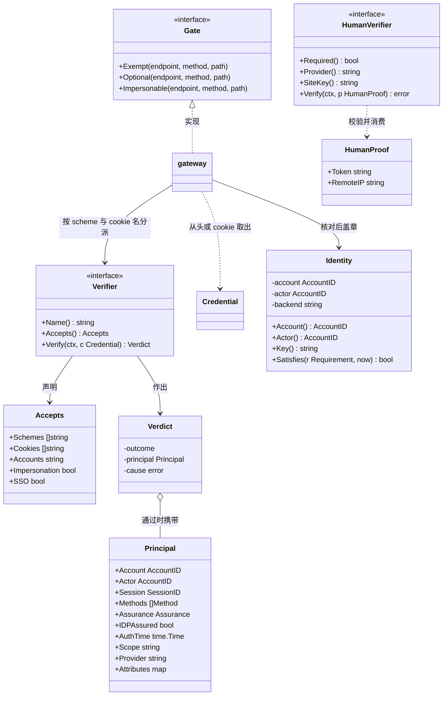
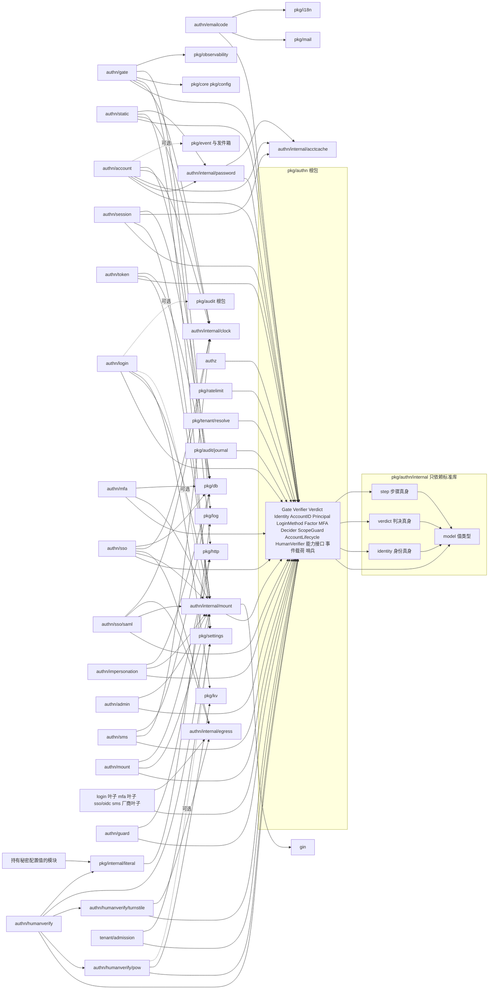

# authn

## 职责

`pkg/authn` 交付身份系统：认定每个请求的调用方是谁，并提供使这个认定成立的注册、登录、会话、令牌、多因素、企业 SSO、冒充与账户存储。授权另立（[authz](../design-authz.md)），本功能目录只为它留接缝（[ADR-authn-scope](../../../adr/adr-authn-scope.md)）。

归属本功能目录的判据是判定所需的输入：只需要凭据、账户、标识、会话、令牌、因素、IdP 配置与冒充记录这类认证事实的，归本功能目录；还需要资源、动作与策略的，归授权。下列各项按这条判据例举，不是封闭集：

- **网关**：在端点的中间件链上认定每个请求的调用方：取出凭据，交给整条认领它的校验后端，把回答收口成放行，或经入口模块的错误响应入口写出的一次拒绝响应；放行时把盖章后的身份与访问级别写进请求上下文，供链上其余各层与 handler 取用。
- **校验后端的接缝与身份的形状**：凭据的形状、判决的形状、后端声明自己认领的载体与可交出的账户命名空间的途径，以及身份的类型化字段。
- **路由访问级别的登记面**：豁免、可选认证与可冒充的登记，与请求期的命中判定。
- **账户存储**：账户、已验证标识、联系方式预留、外部身份绑定、成员关系、口令凭据、服务密钥与失败退避。
- **自助注册**：匿名的用户名加口令注册路由一次写入账户、用户名标识、口令凭据与邮箱未证明预留；预留的插入以 `(kind, value)` 唯一索引仲裁地址占用；注册后的登录与邮箱验证时机、未验证账户的能力限制见 REQ-signup-024 与 REQ-signup-025。未验证的判定对管理员预置与导入写出的账户同样成立，判定与创建路径无关。
- **登录**：多种登录方式共用的多步引擎，终态是登录会话或令牌。
- **登录会话、访问令牌与刷新令牌**：签发、校验、轮换与撤销。
- **多因素、企业 SSO 与短信验证码**。
- **冒充**：发起、记录、期限与结构性限制。
- **对授权的接缝与可选的管理面**：判定接缝、成员关系的只读面、账户生命周期钩子与变更事件。

本功能目录由接口包与子包组成。`pkg/authn` 根包定义功能接口与数据类型，**自身不注册模块，也不导出模块名常量**；每个独立交付的功能住在自己的子包，注册一个模块（[ADR-authn-packaging](../../../adr/adr-authn-packaging.md)、[ADR-module-layout](../../../adr/adr-module-layout.md)）。模块的全集见[依赖](#依赖)。租户准入层 `tenant.admission` 在 tenant 目录，见 [design-tenant-admission](../tenant/design-tenant-admission.md)。下文的“网关”指网关子包所注册的那个模块的产物。

**根包不导出模块名常量**，判据是导出它没有对应的登记：命令树按名字纳入模块（见 [config](../design-config.md)），宿主拿一个无人登记的名字去纳入，得到的是一个不在可用集里的名字，而命令树对未登记名字的处置在 `config` 的哨兵表里没有对应项。

本功能目录的文档按方面分开，下表是它们的全集，每份只承载自己方面的形状、表、判定顺序与配置键：

| 文档 | 承载的方面 |
|---|---|
| [design-authn-gate](design-authn-gate.md) | 网关、校验后端接缝、路由登记（豁免、可选认证、可冒充）、挂路由口、口令表后端、请求期判定顺序与收口 |
| [design-authn-account](design-authn-account.md) | 账户、标识、外部绑定、成员关系、口令凭据、账户生命周期 |
| [design-authn-login](design-authn-login.md) | 登录引擎、登录方式接缝、流程记录与状态机、失败退避与枚举防护 |
| [design-authn-sms](design-authn-sms.md) | 短信验证码 |
| [design-authn-mfa](design-authn-mfa.md) | 因素、多因素编排、保障等级的合成、加强认证、找回 |
| [design-authn-session](design-authn-session.md) | 登录会话、期限、cookie 与跨源检查、撤销 |
| [design-authn-token](design-authn-token.md) | 访问令牌、刷新令牌、签名密钥、服务账户 |
| [design-authn-sso](design-authn-sso.md) | 企业 SSO 的提供方、域、SAML 与企业 OIDC |
| [design-authn-impersonation](design-authn-impersonation.md) | 冒充的记录、限制、承载与审计顺序 |
| [design-authn-admin](design-authn-admin.md) | 对授权的承诺、判定接缝、管理面 |
| [design-authn-config](design-authn-config.md) | 配置、设置与秘密 |
| [design-authn-events](design-authn-events.md) | 事件、审计、日志与指标 |
| [design-authn-failure](design-authn-failure.md) | 哨兵表、依赖不可用时每条路径的方向、时钟与部署前提 |
| [design-authn-threats](design-authn-threats.md) | 威胁、对策与残余风险 |

本文承载总览：职责与非职责、术语、模块清单与依赖方向、身份与判决的形状、状态放置、链上次序、非保证与实现状态。

### 设计原则

以下原则是封闭集，约束本功能目录的全部设计，各方面文档的取舍以它们为准。

- **根包只放接口与数据类型，只依赖标准库**，外加同样只依赖标准库的内部包 `internal/model`、`internal/identity`、`internal/verdict`、`internal/step`；库类型、gin、gorm 不出现在根包签名里（[ADR-authn-packaging](../../../adr/adr-authn-packaging.md)）。
- **请求链上的身份只由网关盖章。** 校验后端交出事实，网关校验形状与账户命名空间后盖章；登录会话与令牌只在 authn 树内创建（[ADR-authn-verdict](../../../adr/adr-authn-verdict.md)）。
- **默认拒绝。** 网关默认守入口模块的全部端；判定接缝缺席时他人账户与租户级资源的管理面动作、冒充一律拒绝；依赖不可用时答 401 或 503，不答 200（[design-authn-failure](design-authn-failure.md)）。
- **状态按丢失的方向放置**：丢失会放宽校验的进 db，丢失只会让流程失败的进 kv（[ADR-authn-state-placement](../../../adr/adr-authn-state-placement.md)）。
- **一次性就是一次性。** 一次性凭据与流程的消费靠原子的条件写：db 的唯一约束与条件更新、kv 的比较并交换；败者一律拒绝。
- **库没做的校验由 authn 补，库做了的不重做**；库返回成功之后 authn 的补充校验不得省略，补充校验失败按失败处理并记 Error。
- **每个放宽都是显式开关**，缺省取最严，并在启动诊断里各占一行 Warn。
- **宁可重复校验也不省略**：网关的出口检查与后端自检并存，会话行的撤销检查与账户状态检查并存，令牌验签与会话状态并存。
- **每个模块只在自己的事务里写自己的表。** 跨模块的清理走钩子与幂等订阅，至少一次、非原子；正确性的底线由账户级 `valid_after` 与账户状态检查承担，不靠清理做完（见[并发与事务边界](#并发与事务边界)）。

### 非职责

下列各条例举本功能目录不承担的事，归属的判据见上文。

- **不做授权判定；做认定的中间件层，即网关，从不写 403。** 本功能目录回答“调用方是谁”，“这个调用方能不能做这件事”归授权（[authz.guard](../design-authz.md)），它另立，以中间件或 handler 内的判定接入，取用写进上下文的身份。authn 自己的路由处理器作为它自己资源的所有者，只在转述认证之外的策略的拒绝时写 403，集合封闭：`forbidden`（判定接缝的拒绝）、`method-disabled`（被全局设置关闭的登录方式）、`account-unavailable`（外部登录路径上账户不可用）、`impersonation-restricted`（冒充发起的限制，以及管理面在冒充身份上的兜底）、`factor-not-seasoned`（冒充发起与管理员重置时，发起者名下没有启用已满规定时长的非短信因素）、`contact-required`（未验证账户的人类写与冒充发起）、`human-verification-required`（部署要求人机验证而发送缺少有效的一次性证明）。其余认证强度不足，即重新认证能解的，都是 401 加强认证挑战（[ADR-authn-scope](../../../adr/adr-authn-scope.md)、[design-authn-failure](design-authn-failure.md)）。
- **不判定请求期的租户成员资格。** 成员关系的事实归本功能目录，请求期的判定在 tenant 目录的 `tenant.admission`（[ADR-tenant-admission](../../../adr/adr-tenant-admission.md)）。authn 的任何子包都不 import `pkg/tenant`。
- **不为身份附加角色、权限与租户。** 身份只回答“谁”；角色按（账户，租户）绑定，归 `authz.policy`（冒充限定的租户范围是唯一例外，它限定的是一次冒充）。
- **网关不实现、不解释任何凭据。** 口令表、登录会话、访问令牌与服务密钥各是一个校验后端，住在自己的子包里；网关取凭据的原文交给整条认领它的后端，连 `Basic` 也由认领它的后端自己解码；根包不认识其中任何一种。
- **网关只从 `Authorization` 头与被某个校验后端认领的 cookie 取凭据。** 请求体、查询串与其他请求头不是凭据来源：中间件读一次请求体就把它耗掉了，handler 里的请求体绑定随后读到的是一具已耗尽的请求体，而调用方送出的请求体是完整的。登录与令牌端点的处理器读取自己的请求体，不在这条约束之内。
- **不定义响应体的形状。** 本功能目录决定拒绝的状态码与必要的响应头，拒绝响应经入口模块的 `Fail` 写出，形状由入口模块的默认形状或交付 `ErrorResponder` 的模块决定（见 [http](../http/design-http.md)）。
- **不提供配置式的豁免、可选认证与可冒充清单。** 这些登记只来自代码：一条命令行参数不该能改变哪些路径不需要认证、哪些路径可以匿名、哪些路径放行冒充身份（[ADR-authn-exemption](../../../adr/adr-authn-exemption.md)）。
- **不把认证 scheme 名与 cookie 名做成输入项。** 它们由各校验后端在代码里自报；输入项清单按完整集合判冲突，而载体的撞车落不进那份清单的任何一条判据，装配期以 `ErrClaimConflict` 点名双方。
- **网关不读入口模块的路由表，读它的端名。** 端名经入口模块的 `Router.Endpoints()` 与保留端名 `*` 取得，用来展开 `endpoints` 并校验登记所在的端；登记面不提供路由的枚举，网关无从核对一条登记是否对应一条已登记的路由，请求期只拿 gin 为本次请求报出的 `c.FullPath()` 与登记的方法、路径逐字比对（见 [http](../http/design-http.md)）。
- **不实现邮件的传输、冒充与异常登录的邮件通知与邮件链接登录。** 邮箱标识除经 IdP 或管理员的断言成为已验证标识外，还可由本人经登录自助面发码到地址、兑现码后写入；匿名口令重置经同一类投递接缝发送重置验证码，流程归 [design-authn-login](design-authn-login.md)。投递接缝是根包的 `EmailCodeSender` 与可选的 `EmailResetCodeSender`，传输由顶层能力的 `mail.Sender` 承担（[design-mail](../design-mail.md)）：仓库提供一个可选的适配模块 `authn.emailcode`，把验证码渲染成邮件并经 `mail.Sender` 发出；不装配它时，宿主可以自己实现 `EmailCodeSender` 与 `EmailResetCodeSender`，否则邮箱验证与邮箱重置不可用。
- **不做 SAML 单点登出与 OIDC 背向通道登出，不在后台自动刷新 IdP 元数据，不提供每租户的 SP 密钥。** IdP 侧的登出不终止登录会话，会话受自己的空闲期限与绝对期限约束（见 [design-authn-sso](design-authn-sso.md)）。
- **不提供个人访问令牌与“记住此设备”。** 用户名加口令的自助注册由独立的匿名路由一次建号；注册的必填项、注册后的登录与验证时机、验证前的能力限制见 REQ-signup-004、REQ-signup-024 与 REQ-signup-025（[ADR-authn-signup](../../../adr/adr-authn-signup.md)）。注册时收集的邮箱先写成一条未证明预留，不是标识，也不是登录名；邮箱被证明之后才写入标识。注册开关 `authn.account.password-signup` 与首登开户开关 `authn.account.signup` 相互独立，缺省都关闭。
- **不承载宿主的资料字段。** 账户表不留自由字段，宿主扩展用户字段的途径见[扩展点](#扩展点)。
- **不做租户解析、请求级审计与限流。** 它们是别的模块的层，本功能目录只与它们的链上锚点有关（见[链上次序](#链上次序)）。
- **不代替宿主决定哪条命令纳入认证。** 每个模块的 `Prepare` 只表态 `StateEnabled`，永不 `StateAuto`：是否运行是命令树上的决定，不是配置能推断的结论；这条约束没有任何机制强制，违反它的后果与接受的代价见 [ADR-authn-packaging](../../../adr/adr-authn-packaging.md)。

## 术语表

以下术语的含义限于 authn 模块的设计文档（本文档与各 `design-authn-*` 文档），以及引用这些事实的 web 与 starters 设计文档；它们不进项目术语表。术语「授权」不属此列：它在项目范围内含义一致，定义见[项目术语表](../../../glossary.md)，本表不重复。

| 术语 | 英文 | 定义 |
|---|---|---|
| 账户 | account | 全局的认证主体，由不可变、不复用的账户标识 `AccountID` 指称；可属于多个租户。口令表中的主体取形如 `static.<名>` 的账户标识，没有账户记录，也没有成员关系。 |
| 成员关系 | membership | 账户与租户之间的一行关系，带状态，状态的零值是暂停。它回答“这个账户是不是这个租户的成员”，不含角色；角色归 `authz.policy`。 |
| 登录会话 | login session | 数据库里的服务端记录，加 cookie 或令牌作载体，是唯一的撤销面。始终带“登录”二字，与 GORM 的数据库会话分开。 |
| 访问令牌 | access token | 携带身份事实、短期有效的 JWT。与 `core.Token` 区分：`core.Token` 在本功能目录的文档里一律写作功能标识。 |
| 刷新令牌 | refresh token | 不透明、挂在登录会话上、只用于换新访问令牌的凭据。 |
| 认证方式 | method | 一次认证用到的方式，取值是封闭集 `Method`。 |
| 保障等级 | assurance | 由已证明的因素种类得出的有序等级 `Assurance`，只在多因素编排一处合成。 |
| 因素 | factor | 第二因素：一个种类的二次验证实现，由多因素编排统一调度。第一因素由登录方式承担。 |
| 登录方式 | login method | 第一因素的一种实现，多步，状态在流程记录里。 |
| 校验后端 | verification backend | 交付 `Verifier` 的一个模块：把一条凭据变成判决，按 `Authorization` scheme 或 cookie 名整条认领，并声明自己可交出的账户命名空间。 |
| 实际操作者 | actor | 身份上真正动手的账户：不冒充时与生效账户相同，冒充时是发起冒充的管理员。与 db、settings 文档里泛指“执行变更的一方”的“操作者”不是同一个词义。 |
| 责任键 | accountability key | `Identity.Key()` 的取值，恒为 `string(Actor())`；限流、审计与设置的 `actor` 参数按它归责。授权不取它：判定主体是生效账户 `Identity.Account()`。 |
| 冒充 | impersonation | 管理员在限定的租户内、有期限、被审计地以另一个账户的身份行事；身份上 `Actor()` 不等于 `Account()`。 |
| 访问级别 | access | 网关对一次请求命中的路由登记的归类：`Open`、`Optional`、`Required`，以及网关没有作过决定的 `Unknown`。 |
| 注册验证状态 | signup state | 账户的邮箱验证状态，二值：持有至少一条已证明归属的邮箱标识即已验证，持有邮箱而没有一条已证明的即未验证，没有邮箱则不适用本规则。`SignupVerification.SignupStateOf` 从标识与联系方式预留现算，与账户的创建路径无关；`signup_state` 列只记账户怎么来（`0` 非自助注册、`1` 自助注册、`2` 曾证明过），不参与判定。它是账户上的独立事实，与账户状态是两件事，不进入会话、身份或访问令牌。 |
| 联系方式预留 | contact claim | `authn_pending_contacts` 的一行：账户对一个邮箱地址的预留，`(kind, value)` 全局唯一。`verified_at` 为空是注册写下的未证明预留，非空是账户已持有的联系方式。注册以插入预留原子仲裁占用；它不是登录名，也不参与任何账户查找。 |
| 未验证账户 | unverified account | 持有邮箱而没有已证明邮箱的账户，即 `SignupStateOf` 读作 `SignupPending` 的账户；管理员预置、导入与自助注册写出的账户都按同一判据算。它可以登录，但依赖已验证邮箱的能力被拒；邮箱被证明之后不再是未验证账户。没有邮箱的账户不是未验证账户，不受这条限制。 |
| 判定接缝 | decision seam | 根包接口 `Decider`：回答某个发起者能否做认证范围内的某件事；缺席即全拒，由宿主或 `authz.guard` 实现。 |

## 外部接口契约

### 登记单元与名字

| 登记单元 | 模块名 | 交付 |
|---|---|---|
| 每个功能子包 | `authn.<功能>`，嵌套子包取 `authn.<功能>.<实现>` | 按[模块清单](#模块清单)：排他或非排他地交付根包定义的能力接口 |
| 根包 | 不登记 | 只有接口与数据类型 |

每个带表的子包与 `tenant/admission` 各带一份 `AGENTS.md`，写它的边界与怎么跑，在该包落地的同一批改动里提供。

每个登记模块的包导出自己的 `ModuleName` 常量，配置与设置的命名空间取同一个取值（形态见 [db](../design-db.md) 的实现子包）。名字的每一段只用小写字母、数字与短横线：`Namespace` 按 `.` 切段后适用配置键的字符集规则，违反它会从环境变量名那一头破坏分层（见 [config](../design-config.md)）。

**命名空间之间的约束。** 两个模块不得声明同一个输入项路径，也不得一个路径是某模块的叶子而另一个模块的内部节点。判据的推论是：一个模块自己的输入项名不得与以它的模块名为前缀的另一个模块的下一段同名。例如 `authn.login` 的叶子不得叫 `password`、`sms`、`google`、`github`、`wechat-web`、`wechat-mp`，`authn.mfa` 的叶子不得叫 `totp`、`sms`、`webauthn`，`authn.sso` 的叶子不得叫 `saml`、`oidc`，`authn.humanverify` 的叶子不得叫 `pow`（例举，判据是上述推论）；`authn` 本身不得是任何模块的叶子。`authn.mount` 不声明输入项：路由挂载的键与跨源检查的受信来源归 `authn.gate` 声明，`authn.mount` 与需要对外基址的模块在自己的 `Prepare` 里读这几个键，这是已有的跨模块读法，不是重复声明（键表见 [design-authn-config](design-authn-config.md)）。

### 身份

```go
// 以下是别名类型 Identity 的方法集：方法在 internal/identity 里定义，根包以
// type Identity = identity.Identity 转出，不字面声明它们。
type Identity = identity.Identity

func (Identity) Account() AccountID
func (Identity) Actor() AccountID
func (Identity) Impersonating() bool              // Actor() != Account()
func (Identity) Key() string                      // 责任键，恒等于 string(Actor())
func (Identity) Session() SessionID
func (Identity) Methods() []Method                // 副本
func (Identity) Assurance() Assurance
func (Identity) AssuranceFromIDP() bool           // 多因素等级是否来自 IdP 的声明
func (Identity) AuthTime() time.Time
func (Identity) Backend() string                  // 取自 Verifier.Name()，网关盖章
func (Identity) Challenge() string                // 重新认证时 WWW-Authenticate 用的方案名
func (Identity) Scope() (string, bool)            // 冒充限定的租户
func (Identity) Provider() string                 // SSO 提供方标识，没有则空
func (Identity) Attribute(key string) (string, bool)
func (Identity) Attributes() map[string]string    // 副本
func (Identity) Satisfies(r Requirement, now time.Time) bool

func FromContext(ctx context.Context) (Identity, bool) // 无回落
```

**身份以账户为中心，不带归属。** 身份的字段集是封闭的：账户、实际操作者、会话、方式集、保障等级、`AssuranceFromIDP`、认证时刻、后端名、挑战方案名、提供方、冒充范围与属性集；后端名与挑战方案名由网关按校验后端与凭据载体盖章，不取自后端交出的任何值（[ADR-authn-identity](../../../adr/adr-authn-identity.md)）。没有角色，没有租户；属性集对每个校验后端都是可选的，承载宿主与 IdP 映射出的业务属性，不承载上述任何类型化事实，所以租户仍取自请求面、不从身份派生，成员关系是表而不是属性。注册验证状态也不在字段集里：它不是认证事实，请求期由 `SignupVerification.SignupStateOf` 与 `GET B/me` 活读，不复制进身份、会话或访问令牌。

**`Account()` 与生效主体是同一个值，不设两个字段**：它是授权与审计把这次请求当作“谁的请求”的账户，冒充时就是被冒充者。`Actor()` 是实际操作者，不冒充时与 `Account()` 相同。身份是单一的，没有第二份“被冒充者身份”：下游每一层读哪一个账户由方法名显式给出。

**责任键 `Key()` 的取值恒为 `string(Actor())`，这条定义只写在这里。** 限流按真正动手的人计数，冒充不占用被冒充者的额度，也借不到许多个账户的许多个桶；审计的行动者列记真正动手的人，归责不落到被冒充者头上。下游（`ratelimit`、`audit/journal`、`settings` 的 `actor` 参数）不透明地使用它，不重复这条定义、也不解析它的内部结构：值不含 `/`，零值身份的责任键是空串。`Subject()` 与 `Owner()` 不存在：后端主体空间里的名字不是身份的一部分。

**`FromContext` 无回落，注入口不导出，写入方是一份封闭名单。** 这一对约定与 [log](../design-log.md) 的形态反着来（[ADR-log-context](../../../adr/adr-log-context.md)、[ADR-authn-identity](../../../adr/adr-authn-identity.md)）。

**写入方名单。** `internal/identity` 的 `With` 与 `WithAccess` 是仅有的注入口，非测试文件里 import `internal/identity` 的包限于下列几个，名单是封闭的：根包只转出读取面，不转出注入口；`authn/gate` 是请求链上唯一的写入方，写之前先过出口检查；`authn/login` 为登录审计行派生一个携带新认定身份的上下文，只交给那一次 `Audit.Record`，不交给任何处理器或流程的下一步，所以它不进请求链、不被授权读取，也不经出口检查（`pkg/authn/login/identity.go` 的派生点，`pkg/authn/login/engine_test.go` `TestTheLoginAuditIsWrittenUnderADerivedIdentity` 守住它只交给那次 `Record`）；`authn/authntest` 是测试构造口，非测试代码不得 import 它（见下）。`pkg/authn/deps_test.go` 对 `pkg` 模块里每个包断言这份名单：名单之外的包在非测试文件里 import `internal/identity` 即失败，并有一棵违反它的树作反例，名单里已存在的包都要确有 import（`identityWriters`、`TestTheListOfWritersIsHeldToTheCodeBehindIt`）。编译器只拦得住 `pkg/authn` 之外的包，树内的校验后端、会话与登录方法各包由这条断言拦。名单只约束 `internal/identity` 的注入口：`internal/verdict` 与 `internal/step` 的读取函数（`OutcomeOf`、`PrincipalOf`、`CauseOf`，以及 `Step` 的读取函数）不限定 importer，`pkg/authn` 之下的包都可以用，因为它们只读，读取者做不出构造器做不出的判决与步骤；判决与步骤的不可字面构造靠字段不导出与构造器，不靠名单。

下游必须自己处理第二个返回值为假的那一档。以下是它为假的全部情形：请求命中 `Exempt` 登记的路由；命中 `Optional` 登记的路由且没有凭据；请求所在的端不在网关所守的集合内；进程里没有网关；预置的网关不是网关模块的产物。`AccessFromContext` 让消费者区分这几种成因，不靠 `FromContext` 的真假去猜：

```go
// Access 是网关对本次请求命中的路由登记的访问级别。零值 AccessUnknown 表示网关没有对这次请求作过决定。
type Access uint8

const (
    AccessUnknown  Access = iota // 未守的端、网关缺席、预置了非网关模块产物的网关
    AccessOpen                   // 命中 Exempt
    AccessOptional               // 命中 Optional
    AccessRequired               // 受守且无登记
)

func AccessFromContext(ctx context.Context) Access // 无回落；零值读作 AccessUnknown
```

**对授权的约定用法**：`AccessOpen` 放行；`AccessOptional` 且无身份按授权自己的匿名规则判；`AccessRequired` 而无身份、或 `AccessUnknown`，说明该端不在网关所守之列或网关缺席，授权拒绝：认证缺席时的失败方向是拒绝。

**测试构造口。** `pkg/authn/authntest` 的 `Context(t testing.TB, ctx context.Context, opts ...Option)` 返回携带一个真实 `Identity` 与访问级别的上下文，等价于网关盖章的结果，选项覆盖身份的每个类型化字段与 `Access`：重新认证的挑战方案名由 `WithChallenge` 设，取值是网关写法的方案名（`Cookie`、`Basic`、`Bearer` 一类），缺省 `Bearer`。`Context` 拒绝 `AccessOpen` 与 `AccessUnknown` 配身份，因为网关不产出这样的配对；`Anonymous(t, ctx, access)` 返回只带访问级别、不带身份的上下文，只接受 `AccessOpen` 与 `AccessOptional`，对应豁免路由与无凭据的可选路由。同一个包还导出 `ConfigReader` 与 `ConfigReaderAll`，在真实的配置加载器上，以 JSON 主配置源构造被测模块读取的 `config.Reader`；读取器不是替身，因为必填项被拒绝这类行为出自声明本身。`Context` 复述网关出口检查对形状与界限的要求，所以用它造出的身份是网关盖得出的那一种；这些形状与界限是出口检查那一份的第二份拷贝，两处的数值必须一致，属性集的界限表只在 [design-authn-gate](design-authn-gate.md#出口检查) 写一份，两份拷贝是否分叉由网关包里的对拍测试断言。出口检查里需要网关时钟或后端声明才判得了的几项，它不复述：认证时刻相对网关时钟的 120 秒偏移、`static.` 以外的账户命名空间、`Accepts` 里声明的能力、保留的属性前缀。签名里的 `testing.TB` 不是屏障：非测试代码同样可以传入一个实现了该接口的值，类型层面没有防线，防线只有依赖测试。它位于 `pkg/authn/**` 之下，所以能 import `internal/identity` 与 `internal/model`；编译器拦不住生产代码 import 它，所以 `pkg/authn/deps_test.go` 对 `pkg` 模块里每个包断言：任何非测试代码 import `authntest` 即失败。宿主是 `go.work` 里的独立模块，不在那条断言的范围内。

### 判决与证明

```go
// Principal 是校验后端在“通过”时交出的全部事实。字段是后端的声明，不是身份：网关逐项校验后才盖章。
type Principal struct {
    Account    AccountID
    Actor      AccountID         // 零值表示与 Account 相同；非零时必须不等于 Account，且 Session 与 Scope 非空
    Session    SessionID         // 不用库里登录会话的后端（口令表、宿主自写的后端）留空
    Methods    []Method          // 非空，每项在闭集内，无重复，至多 8 项
    Assurance  Assurance
    IDPAssured bool              // 多因素等级来自企业 IdP 的声明而不是本地验证过的因素；为真时 Assurance 必为 AssuranceMulti、Provider 必非空
    AuthTime   time.Time         // 最近一次交互式认证的时刻；口令表凭据每个请求都是一次认证，取此刻
    Scope      string            // 冒充限定的租户标识；其余为空
    Provider   string            // 企业 SSO 提供方标识（UUID 文本）；其余为空
    Attributes map[string]string // 界限见属性集的界限
}

// Verdict 的字段不导出，只能由构造器产生；零值读作没答。
func Authenticated(p Principal) Verdict
func Denied(cause error) Verdict
func Unavailable(cause error) Verdict
```

**`Session` 只指库里的登录会话**，值是 UUIDv7 文本。宿主自写、不用库会话的后端把它留空：库的登出路由只结束库里的登录会话，结束宿主自己那种会话是宿主按自己的凭据处理的事，网关没有义务代它识别。冒充身份恒带会话：出口检查要求 `Actor` 非零时 `Session` 非空。

**判决不可字面构造**，判据是零值必须有确定的读法：本形状下零值读作“没答”，网关收口 401 并单独计一次缺陷（桶名 `unspoken`），与拒绝不混桶——故障那一桶要能拿来告警，缺陷那一桶要能拿来发现后端写错。被否决的其他形状与各自的否决理由见 [ADR-authn-verdict](../../../adr/adr-authn-verdict.md)。`Verdict` 与 `Identity` 内部字段的读取函数（`OutcomeOf`、`PrincipalOf`、`CauseOf`）是包级函数而不是方法：方法会随别名带到任何包，包级函数才留得住“只有 authn 树内能读内部字段”这一边界。`Step` 的读取函数同样是包级函数，见 [design-authn-login](design-authn-login.md)。

**证明是声明，盖章才是认定。** 通过的判决交出的 `Principal` 只是后端自报的事实；`Backend()` 取自 `Verifier.Name()` 而不经任何后端写的东西，其余字段经 [design-authn-gate](design-authn-gate.md#出口检查) 的出口检查逐项核对后写入身份。网关收口的判定顺序、401、503 与 500 的划分、调用预算、在飞闸门与计数，由 [design-authn-gate](design-authn-gate.md) 承载。

**认证方式、保障等级与强度要求的取值。**

```go
// Method 是一次认证用到的方式，闭集。pwd、sms、otp 取自 RFC 8176 的 amr 取值，其余是 authn 自定。
type Method string

const (
    MethodPassword     Method = "pwd"
    MethodSMS          Method = "sms"
    MethodTOTP         Method = "otp"
    MethodWebAuthn     Method = "webauthn"
    MethodOAuth        Method = "oauth" // 社交登录
    MethodOIDC         Method = "oidc"  // 企业 OIDC
    MethodSAML         Method = "saml"
    MethodStatic       Method = "static"
    MethodClientSecret Method = "client-secret"
)

// Assurance 是认证达到的保障等级，由“已证明的因素种类数”得出。零值读作未陈述，网关盖章时按单因素处理。
type Assurance uint8

const (
    AssuranceNone   Assurance = iota
    AssuranceSingle           // 一个因素
    AssuranceMulti            // 两个种类不同的因素，或带用户验证的通行密钥
)

// Requirement 是一条路由对认证强度的最低要求。MaxAge 为零表示不要求新鲜。
type Requirement struct {
    Assurance Assurance
    MaxAge    time.Duration // 距 AuthTime 的上限
    Local     bool          // 为真时不采信 IdP 声明的多因素：AssuranceFromIDP() 为真即不满足
}
```

`Identity.Satisfies(r, now)` 在下列条件同时成立时为真：`Assurance` 不低于要求；`MaxAge` 为零，或 `now` 与 `AuthTime` 之差不超过它；`r.Local` 为真时 `AssuranceFromIDP()` 为假。失败方向是拒绝：零值身份对任何要求都为假；`MaxAge` 为负时任何身份都不满足；`MaxAge` 非零而 `now` 为零值（时钟没有设置）或 `AuthTime` 为零值（视作无限久以前）不满足；`AuthTime` 晚于 `now` 时差为负，读作不过期：网关盖章只放过不晚于它自己的时钟加 120 秒的认证时刻，容忍的是这一段时钟偏差，`Satisfies` 不再另判。`Local` 用于账户安全类操作与冒充发起（见 [design-authn-mfa](design-authn-mfa.md)）。令牌里的 `acr` 取保障等级数字的十进制文本。

`Assurance` 由校验后端自报，网关只做形状、界限与账户命名空间的校验，不能独立证明“确实用了两个因素”：信任边界是进程内的代码，宿主选择哪些校验后端就是在选择信任谁来自报（见[错误与失败语义](#错误与失败语义)的非保证）。本功能目录自带的后端都经同一个 `MFA` 能力得出等级，会话与令牌后端读会话行里已记录的等级（[ADR-authn-mfa](../../../adr/adr-authn-mfa.md)）。

### 对宿主的要求

以下各条是宿主在命令树上要做的全部动作。**本功能目录既不能把它们声明出来，也没有检查它们的位置**，漏写不报错。

- **每条需要认证的命令逐个写出所需模块的 `ModuleName`。** 宿主只能精确列举本次要跑的模块：列了它，就必须把它配好——缺配置是启动失败，不是一次静默的缺席。排他功能（网关、账户、会话等）漏点名是在任何实例构造之前报 `core.ErrMissingProvider`，早于迁移。
- **不要把任何 authn 模块放进根命令。** 根命令纳入的模块对每条子命令都有效（见 [config](../design-config.md)）：该模块因此进了施加迁移那条命令的参与集，而那条命令的深度止于 `Migrate`；模块的全部输入项升格为全局参数，出现在每条命令的帮助输出里；带必填项的模块在打印版本这类命令下也要配齐，缺一项就是那条命令启动失败。宿主想表达“凡有 HTTP 入口的命令都该有认证”时，照 `config` 里那份命令树示例把网关放进根命令是能写出的形式，也是要避免的形式。
- **不要对纳入 authn 的命令用 `IncludeAll()`。** 它让参与集重新成为 import 图的函数，其中可能含有宿主并不知情的模块（[ADR-command-tree](../../../adr/adr-command-tree.md)）；在认证这条路径上，那意味着一个宿主没有列举过的登录方式可以发出身份。
- **施加迁移的命令必须静态级纳入全部带表的 authn 模块（`IncludeAllDeclarations`），它们的配置在那条命令下也必须齐备。** 迁移集按声明集取材（见 [db](../design-db.md)）：带表模块不在那条命令的声明集里，它的表不建，漏写不报错，表现为带表模块 `Start` 里的存在性探测以 `ErrNotMigrated` 终止启动；带表模块若被那条命令运行级纳入而缺配置，那条命令启动失败，迁移连同表的建立都无从发生。
- **对外提供服务的装配不为网关预置外来的实例。** 要预置就预置网关模块的 `New` 造出的实例，并核对组装出的链上有代表认证功能的那一层（见[错误与失败语义](#错误与失败语义)的非保证）。

**典型装配**（例举，不是穷举；每行另加入口模块、`kv`、`db`、`settings`、`event` 的实现）：

| 场景 | 点名的 authn 模块 |
|---|---|
| 只有运营口令表与 Basic | `authn.gate`、`authn.static`（不需要 db、kv、settings） |
| 浏览器应用：口令加 TOTP | `authn.gate`、`authn.mount`、`authn.account`、`authn.session`、`authn.login`、`authn.login.password`、`authn.mfa`、`authn.mfa.totp`，另加 `tenant.resolve` 与 `tenant.admission` |
| 加 API 令牌与服务账户 | 再加 `authn.token` |
| 企业 SSO | 再加 `authn.sso` 与 `authn.sso.oidc` 或 `authn.sso.saml` |
| 短信登录与短信因素 | 再加 `authn.sms`、`sms.aliyun`（或 `sms.tencent`）、`authn.login.sms`、`authn.mfa.sms` |
| 社交登录、通行密钥 | 再加 `authn.login.google` 等、`authn.mfa.webauthn` |
| 冒充与管理面 | 再加 `authn.impersonation`、`authn.admin`；宿主交付 `Decider` 与审计的实现；`tenant.admission` 是 `authn.impersonation` 的必需依赖，`authn.mfa` 也必须在场 |

### 对外接口面

以下是本文承载的、本功能目录与其他模块和宿主之间的接口面，改动它们改变每一个消费者：

- 根包的 `Gate`、`Verifier`、`Accepts`、`Credential`、`Challenger`、`CookieClearer`、`ScopeGuard`、`Verdict` 的构造器、`Principal`、`Identity` 的方法集与 `Access` 的取值；`Key()` 的取值（责任键恒为实际操作者）。
- 网关层在链上代表的功能标识：中间件的 `Provides` 与描述符里的交付声明同为 `(*Gate)(nil)`，别的模块据它排序，取值与它所属的阶段属于对外接口面，改动它是破坏性变更。
- 判定接缝、成员关系的只读面、账户生命周期钩子与事件名，这些是授权功能目录依赖的面（[authz.guard](../design-authz.md) 与 `authz.policy`；见 [design-authn-admin](design-authn-admin.md)、[design-authn-events](design-authn-events.md)）。
- 下列根包接缝接口的方法集属于对外接口面，加方法与改签名对取用它们的模块、实现了它们的宿主即是不兼容变更：`Tokens` 与 `ClaimsContributor`（[design-authn-token](design-authn-token.md)）、`SMSCodes`（[design-authn-sms](design-authn-sms.md)）、`SSOProviders`（[design-authn-sso](design-authn-sso.md)）、`Impersonation`（[design-authn-impersonation](design-authn-impersonation.md)）、`Decider`（[design-authn-admin](design-authn-admin.md)）、`HumanVerifier`（[design-authn-config](design-authn-config.md)）、`Signups`、`SignupVerification`（[design-authn-account](design-authn-account.md)）与 `EmailCodeSender`；各自的字段、取值集合与取用方式由各自的模块文档承载。

`Gate` 与 `Verifier` 是宿主可以预置自己实现的接口：对它们加方法或改签名，对预置了自己实现的宿主是不兼容变更。`Key()` 的签名不变而取值随责任键的定义而定，编译通过的调用方因此在取值变化时静默得到新值，变化必须带破坏性变更的标注。

## 依赖

### 模块清单

下表是本功能目录登记的全部模块。“Requires”列写必需的排他功能与 `db.Database`，网关一行另写它对 `log.Logger` 的 `Optional` 声明；“取用”列是 `Init` 里 `core.Resolve` 或 `core.ResolveAll` 的对象，标 ○ 的取用缺席合法，缺席时对应的子功能不启用，并在启动诊断里写一行，不是到 `Init` 才报缺失。日志功能与指标功能的可选取用除网关一行外不在表里逐行列出：持有秘密配置值的模块为在 `New` 里登记字面量脱敏而对 `log.Logger` 写 `Optional`（例举：`authn.sso` 与两个协议模块、两个微信登录方式、`authn.humanverify`，这些行的“Requires”列因此不是完整的声明），产生指标的模块在 `Init` 里取 `observability.MeterProvider`，逐项见各模块文档的依赖表；“表”列写该模块拥有的表，表归声明它的模块。`authn.mount` 与挂路由的模块经内部接口 `mount.Mounter` 协作，它在 `pkg/authn/internal/mount`，只在 authn 树内可见。

| 包 | 模块名 | 交付 | 排他 | Requires | 取用 | 表 |
|---|---|---|---|---|---|---|
| `authn/gate` | `authn.gate` | `Gate` | 是 | 无；`log.Logger`（○，使脱敏规则在 `New` 里登记） | `http.Router`、全部 `Verifier`、`ScopeGuard` ○、`observability.MeterProvider` ○ | 无 |
| `authn/mount` | `authn.mount` | 内部 `mount.Mounter` | 是 | `Gate` | `http.Router`；读 `authn.gate` 的路由挂载键 | 无 |
| `authn/static` | `authn.static` | `Verifier`（认领 `basic`） | 否 | 无 | `settings.Store` ○；失败退避恒在进程内，不取 db 的 `Throttle` | 无 |
| `authn/account` | `authn.account` | `Accounts`、`AccountAdmin`、`Passwords`、`Memberships`、`Throttle`、`Signups`、`SignupVerification` | 各自是 | `db.Database` | `settings.Store` ○、`event.Bus` ○、`outbox.Outbox` ○、`audit.Audit` ○、全部 `AccountLifecycle` | `authn_accounts`、`authn_identifiers`、`authn_pending_contacts`、`authn_external_identities`、`authn_memberships`、`authn_password_credentials`、`authn_service_secrets`、`authn_throttles` |
| `authn/emailcode` | `authn.emailcode` | `EmailCodeSender`、`EmailResetCodeSender` | 是 | `mail.Sender` | `i18n.Localizer` | 无 |
| `authn/session` | `authn.session` | `Sessions`；`Verifier`（认领会话 cookie）；`AccountLifecycle` | `Sessions` 是 | `db.Database`、`mount.Mounter`、`Accounts` | `Impersonation` ○、`settings.Store` ○、`event.Bus` ○ | `authn_sessions` |
| `authn/token` | `authn.token` | `Tokens`；`Verifier`（认领 `bearer`） | `Tokens` 是 | `db.Database`、`mount.Mounter`、`Accounts`、`Sessions`、`Passwords`、`Throttle` | `Impersonation` ○、全部 `ClaimsContributor`、`settings.Store` ○、`event.Bus` ○、`audit.Audit` ○ | `authn_refresh_tokens` |
| `authn/login` | `authn.login` | 无（流程引擎与路由） | — | `mount.Mounter`、`kv.KV`、`Accounts`、`AccountAdmin`、`Passwords`、`Memberships`、`Throttle`、`Sessions`、`MFA`、`Signups`、`SignupVerification` | 全部 `LoginMethod`、`Tokens` ○、`SMSCodes` ○、`EmailCodeSender` ○、`EmailResetCodeSender` ○、`SSOProviders` ○、`Provisioner` ○、`settings.Store` ○、`audit.Audit` ○、`event.Bus` ○ | 无 |
| `authn/login/password` | `authn.login.password` | `LoginMethod` | 否 | `Passwords`、`Throttle` | 无 | 无 |
| `authn/login/sms` | `authn.login.sms` | `LoginMethod` | 否 | `SMSCodes`、`Accounts` | 无 | 无 |
| `authn/login/google`、`authn/login/github` | `authn.login.google`、`authn.login.github` | `LoginMethod` | 否 | 无 | 无 | 无 |
| `authn/login/wechatweb` | `authn.login.wechat-web` | `LoginMethod`（名 `wechat.web`） | 否 | 无 | 无 | 无 |
| `authn/login/wechatmp` | `authn.login.wechat-mp` | `LoginMethod`（名 `wechat.mp`） | 否 | 无 | 无 | 无 |
| `authn/humanverify` | `authn.humanverify` | `HumanVerifier` | 是 | 无 | `kv.KV` ○（`pow` 的挑战与一次性消费）、`settings.Store` ○（`pow` 的两项设置）、`mount.Mounter` ○（`pow` 的挑战路由）、`log.Logger` ○（登记 Turnstile 密钥的字面量脱敏规则） | 无 |
| `authn/mfa` | `authn.mfa` | `MFA`；`AccountLifecycle` | 是 | `db.Database`、`mount.Mounter`、`Accounts`、`AccountAdmin`、`Throttle` | 全部 `Factor`、`Sessions` ○（重置时撤销会话；缺席则只停因素）、`settings.Store` ○、`audit.Audit` ○、`event.Bus` ○ | `authn_factors` |
| `authn/mfa/totp` | `authn.mfa.totp` | `Factor` | 否 | `db.Database`、`MFA` | 无 | `authn_totp_secrets` |
| `authn/mfa/sms` | `authn.mfa.sms` | `Factor` | 否 | `SMSCodes`、`Accounts` | 无 | 无 |
| `authn/mfa/webauthn` | `authn.mfa.webauthn` | `Factor`、`LoginMethod`（通行密钥） | 否 | `db.Database`、`MFA`、`Accounts` | 无 | `authn_webauthn_users`、`authn_webauthn_credentials` |
| `authn/sms` | `authn.sms` | `SMSCodes`；`AccountLifecycle` | 是 | `db.Database`、`sms.Registry`、`sms.Sender` | `settings.Store` ○、`event.Bus` ○、`audit.Audit` ○ | `authn_challenges` |
| `authn/sso` | `authn.sso` | `SSOProviders` | 是 | `db.Database`、`mount.Mounter` | `settings.Store` ○、`event.Bus` ○ | `authn_idps`、`authn_idp_domains`、`authn_saml_assertions` |
| `authn/sso/saml` | `authn.sso.saml` | `LoginMethod`、`SSOMetadataRefresher` | 否 | `SSOProviders`、`mount.Mounter` | `settings.Store` ○、`event.Bus` ○、`audit.Audit` ○ | 无 |
| `authn/sso/oidc` | `authn.sso.oidc` | `LoginMethod` | 否 | `SSOProviders` | `settings.Store` ○、`event.Bus` ○、`audit.Audit` ○ | 无 |
| `authn/impersonation` | `authn.impersonation` | `Impersonation` | 是 | `db.Database`、`mount.Mounter`、`Sessions`、`Accounts`、`Memberships`、`MFA`、`audit.Audit`、`ScopeGuard`、`SignupVerification` | `Decider` ○（缺席即全拒）、`Tokens` ○、`settings.Store` ○、`event.Bus` ○ | `authn_impersonations` |
| `authn/admin` | `authn.admin` | 无（只挂 `/api/v1/system/auth/*`、`/api/v1/system/tenants/*` 下的冒充记录与 `/api/v1/tenants/*` 下的路由） | — | `mount.Mounter`、`Accounts`、`AccountAdmin`、`Memberships`、`SignupVerification`、`audit.Audit` | `Sessions` ○、`MFA` ○、`SSOProviders` ○、全部 `SSOMetadataRefresher`、`Impersonation` ○、`Tokens` ○、`Decider` ○（缺席即全拒）；每组路由随对应能力在场才挂 | 无 |
| `authn/profile` | `authn.profile` | 无（只挂 `B/me` 的两条路由） | — | `mount.Mounter`、`Accounts`、`AccountAdmin`、`MFA`、`SignupVerification` | `settings.Store` ○、`audit.Audit` ○ | 无 |
| `authn/invite` | `authn.invite` | `Invites` | 是 | `db.Database`、`mount.Mounter`、`Accounts`、`AccountAdmin`、`Memberships`、`audit.Audit`、`SignupVerification` | `Decider` ○（缺席即全拒）、`Throttle` ○、`settings.Store` ○、`event.Bus` ○、`outbox.Outbox` ○ | `authn_invitations` |

**注册、账户存储与验证回路的职责分工。** 匿名注册路由与登录方式的发现面归 `authn.login`：路由只做预算、参数校验与调用，不经过登录流程引擎；`purpose=link` 的门控也由它在开始流程时执行，因为流程路由归它。账户、用户名标识、口令凭据、注册验证状态与联系方式预留归 `authn.account`：`Signups.Register` 以 `RegisterAccount` 为输入，一次事务写入全部事实；`SignupVerification.SignupStateOf` 回答当前状态（从标识与预留现算，管理员预置与导入的账户同样读得出未验证），`SignupVerification.PendingAccountByContact` 只服务 `authn.invite` 接受时按已证明控制权的地址反查未证明预留。邮箱的验证回路由 `authn.login` 的账户自助面完成；写已证明标识经 `AccountAdmin.AddIdentifier`，同一事务把该地址的预留置为已持有、写首次证明时刻、把自助注册账户的 `signup_state` 置 `2`（账户已持有同值未证明标识时就地提升该行）是 `authn.account` 的副作用。短信验证手机只写已验证的手机标识，不改变注册验证状态。

`authn/guard` 与 `authn/authntest` 不登记模块：`guard.Require` 返回加强认证的 gin 处理器，`authntest` 是测试构造口。

**人机验证闸是排他的发送前接缝。** `authn.humanverify` 排他交付根包的 `HumanVerifier`：`Required` 回答本部署是否要求证明，`Provider` 与 `SiteKey` 回答机制与前端控件需要的公开标识，`Verify` 校验并消费一份证明。机制取封闭集 `off`、`pow`、`turnstile`，`off` 是缺省：关闭时 `Required` 为假、`Verify` 接受任何证明，一次发送都不多问。`pow` 由模块自带，经 `mount.Mounter` 在挂载基址下公开挂出挑战路由（缺省基址是 `POST /api/v1/auth/human/challenge`），挑战存 `kv` 并以比较并交换一次性消费；`turnstile` 把证明交 Cloudflare 的 siteverify，只接受主机名与（配置了时）action 相符的答案；站点校验以成功为假拒绝时按其错误码分档，证明本身缺失、无效、过期或已用读作无效证明，提供方自身的内部故障、部署的密钥或控件配置错误以及本包不认识的码读作提供方不可用。发送方在花费任何发送预算之前问这道闸：登录短信、短信第二因素、添加手机与自助添加邮箱的发送路径各自检查，缺证明、无效、过期、重放答 403 `human-verification-required`，过长的证明答 400，提供方或它的存储不可用答 503 且不发送。闸不持有发送状态、不发送消息，也不消耗任何预算；注册不发送消息，因此不问它。部署换用别的机制时自行交付 `authn.HumanVerifier` 并把本模块从命令树上撤下。键表见 [design-authn-config](design-authn-config.md)，发送路径的判定见 [design-authn-login](design-authn-login.md)，取舍见 [ADR-authn-human-verification](../../../adr/adr-authn-human-verification.md)。

租户准入层不在本表：它是 `pkg/tenant` 下的模块 `tenant.admission`，排他交付定序锚点 `tenant.Admission` 与根包的 `ScopeGuard`，方向是它 import 本功能目录的根包（[design-tenant-admission](../tenant/design-tenant-admission.md)）。登录引擎把两块内容放在 `pkg/authn/login/internal` 下：`resolve` 把 `Proof` 解析成账户（开户、绑定、并入外部身份），`selfservice` 挂账户凭据自助路由；两者不登记模块，只被登录引擎构造与调用（[design-authn-login](design-authn-login.md)）。

**排他与并立。** 排他的是“必须恰有一个”的功能；并立的是可以有零个到多个、由消费方在 `Init` 里 `ResolveAll` 取用的功能。并立功能的集合是封闭的：`Verifier`、`LoginMethod`、`Factor`、`SSOMetadataRefresher`、`AccountLifecycle`、`ClaimsContributor`，各自一个模块，一律不排他、不局部违反；其余功能都排他，包括租户准入层交付的 `ScopeGuard` 与人机验证闸交付的 `HumanVerifier`。判定接缝 `Decider`（排他）与首登开户钩子 `Provisioner`（非排他）由宿主或 `authz.guard` 交付，取用方一律以可选取用对待。

**`Requires` 只写排他功能与 `db.Database`，从不写非排他功能**（[ADR-authn-wiring](../../../adr/adr-authn-wiring.md)）。排他功能不被依赖闭包展开，宿主漏点名即在任何实例构造之前报 `core.ErrMissingProvider`，早于迁移；非排他功能写进 `Requires` 会让闭包替宿主纳入并强制启动它们，命令树上的逐个列举因此失效。取日志、设置、事件、审计的需求写 `Optional: true`：缺席合法，在场时仍参与构造排序，使脱敏规则能在 `New` 里先于任何 logger 绑定登记。网关的 `Requires` 只有 `log.Logger` 的可选声明；网关不依赖 db，不挂业务路由。

**下列必需依赖让缺席成为启动失败，而不是运行期才发现**：

- `authn.impersonation` 与 `authn.admin` 把 `audit.Audit` 当必需：装配里没有审计即启动失败。强制档审计在动作之前写，写不成功则动作不执行（[design-authn-events](design-authn-events.md)）。
- `authn.impersonation` 把 `ScopeGuard` 与 `MFA` 当必需：没有租户准入层的装配里冒充无法限定在一个租户内，没有因素编排的装配里没有任何账户满足发起者的强认证要求。
- `authn.login` 把 `MFA` 当必需：库里有账户已登记因素、装配里却没有 `MFA` 模块，登录会无声跳过第二因素。

`authn.admin` 取用的能力缺席时对应那一组路由不挂，启动诊断写出挂了哪几组：没有 SSO 模块就没有 `sso` 路由。一个永远拒绝的路由只是白增攻击面，所以不做成“缺接缝时挂出但全拒”。

### 依赖方向

- **根包**只 import 标准库（含 `net/http` 里的 `*http.Cookie`、`http.ResponseWriter`、`*http.Request`，不含 gin）与 `pkg/authn/internal/{model,identity,verdict,step}`；这些内部包同样只依赖标准库，`identity`、`verdict`、`step` 各自 import `model`，彼此不 import。根包被 `tenant/resolve`、`audit/journal`、`ratelimit` 与 `tenant/admission` import，根包新增的任何 import 会进它们的闭包，所以 `pkg/authn/deps_test.go` 守住：根包的非测试 import 只许标准库与上述内部包，并断言这些内部包只依赖标准库。
- **库类型只出现在叶子包里**：`go-jose`、`go-oidc`、`x/oauth2`、`gosaml2`、`go-webauthn`、`scs` 各落在使用它的叶子子包，只有 import 该子包的宿主才背负（[ADR-module-layout](../../../adr/adr-module-layout.md)）。短信厂商 SDK 不在此列：随发送能力住在顶层 `pkg/sms` 的载体叶子包下（[ADR-sms-capability](../../../adr/adr-sms-capability.md)）。
- **接口包不依赖 `pkg/db`，这是本功能目录的自我约束而不是架构的要求**（架构对跨功能目录依赖的要求是一律指向对方的接口包，见 [architecture](../../architecture.md)，指向 `pkg/db` 的接口包并不违反它）。带表的子包把 `db` 依赖、迁移集与模型留在自己的子包里；其他 authn 子包与授权功能目录只经根包的能力接口读写，拿不到 `*gorm.DB`。
- **authn 的任何子包都不 import `pkg/tenant`。** 方向是 tenant 指向 authn：`tenant/resolve` 排在网关之后，`tenant/admission` 读身份与租户上下文，`tenant/resolve` 与 `tenant/admission` 都 import 根包，准入层经根包的 `ScopeGuard` 向网关说出它守哪些端；授权功能目录位于本功能目录之上（[authz](../design-authz.md)）：`authz.guard` 交付 `Decider`，`authz.policy` 交付 `AccountLifecycle`，两者都 import 根包；本功能目录不认识它（[ADR-authn-scope](../../../adr/adr-authn-scope.md)）。
- **网关与别的模块的关系只经链上锚点**：网关交付 `(*authn.Gate)(nil)`，不 import `tenant`、`audit`、`ratelimit` 的任何包（见[链上次序](#链上次序)）。`tenant/admission` 声明授权阶段，该阶段本身就在记录与限流之内，位置由阶段给出；它不为定序 import `pkg/ratelimit` 或 `pkg/audit` 的锚点包。
- **指标功能不构成依赖，日志功能是 `Optional` 依赖。** 网关在 `Init` 里取 `observability.MeterProvider`，缺席即本次装配没有对应功能，认证行为不变，取用得到缺提供者以外的错误则终止启动；日志功能写 `Optional`：声明它使脱敏规则能在 `New` 里先于任何 logger 绑定登记，缺席合法，规则无处登记（细节见 [design-authn-gate](design-authn-gate.md)）。

方向满足架构不变量（见 [architecture](../../architecture.md)）：本功能目录位于 `core`、`config`、`log`、`http`、`observability`、`db`、`kv` 之上，不被其中任何一个 import。

## UML 图

下图给出根包上的接缝类型与它们的关系。图中画不出的约束是：判决与身份之间的那条边只在判决为通过、且 `Principal` 通过出口检查时成立；请求链上的身份只由网关写入，注入口只在写入方名单内的包里可达（见身份一节）；`Verdict` 与 `Identity` 的字段不导出，读取经包级函数。人机验证闸不在请求的认证路径上：发送路径在花费任何发送预算之前取用 `HumanVerifier`，把 `HumanProof` 交给它校验并消费。



`gateway` 未导出，它持有各类登记表、按 scheme 与 cookie 名的分派表与在飞闸门（见 [design-authn-gate](design-authn-gate.md)）。

下图给出包之间的依赖方向。箭头从依赖方指向被依赖方，虚线是可选依赖。根包只依赖标准库与 `internal/model`、`internal/identity`、`internal/verdict`、`internal/step`，这些内部包只依赖标准库；其余内部包是实现侧共用的部件，不被根包 import，可以依赖根包、`pkg/log` 与第三方库（`internal/mount` 依赖根包与 gin，`internal/password` 依赖根包、Argon2 与信号量库）；库类型只出现在叶子包里；`pkg/internal/literal` 是共享单元，被两个短信载体与四个登录叶子共用；authn 的任何子包都不 import `pkg/tenant`，tenant 目录与授权功能目录经根包的接口依赖本功能目录。`authn/emailcode` 是可选的邮件适配模块：它交付 `EmailCodeSender` 与 `EmailResetCodeSender`，经 `mail.Sender` 投递、经 `i18n.Localizer` 渲染模板，不装配它的宿主不因此把邮件能力带进闭包。



除上文只依赖标准库的 `internal/model`、`internal/identity`、`internal/verdict`、`internal/step` 外，`pkg/authn/internal` 下还有下列包，它们与上述内部包合起来是内部包的封闭名册：`internal/password` 放 PHC 编解码、派生、校验缓存、进程内退避与并发和内存预算，`internal/egress` 放受限的出站 `http.Client`，`internal/mount` 放 `Mounter` 接口、路由登记选项与挂路由模块共用的路由部件（问题码与 `Fail` 一族、请求体解码 `Decode`、每条登记都经过的 `Wrap`、回跳旁路 `AllowCallback`，以及挂载端与可信来源规则 `Endpoint`、`TrustedOrigins`、`CrossOrigin`），`internal/mount/mounttest` 放测试用的 `Mounter`，`internal/acctcache` 放按键有界、带有效期的进程内缓存（值类型是参数，账户快照与口令校验缓存各自取用），`internal/clock` 放写入数据库或绑定为查询参数的时间的来源（一律 UTC），`internal/budgetalias` 放邮箱验证码预算键与重发键的收件箱别名归一（只依赖标准库）；`pkg/internal/literal` 不在此列：它是共享单元，被两个短信载体、四个登录叶子与人机验证模块共用，持有秘密配置值的模块在自己的 `New` 里调用它；只做进程内时长比较的计时（口令校验缓存、失败退避、账户快照缓存的默认时钟）可以直接取单调时钟，并允许测试注入。没有 `internal/configreader`：读取器的构造由 `authntest` 的 `ConfigReader` 承担。内部包名册里的各包都只能被 `pkg/authn` 之下的包 import。

## 核心数据结构

### 值类型的落点

值类型连同它们的方法与构造函数，真身都在 `internal/model`，它不 import 任何一个 authn 包，只依赖标准库；不可字面构造的类型各占一个内部包，`Identity`、`Verdict`、`Step` 的真身分别在 `internal/identity`、`internal/verdict`、`internal/step`，它们 import `internal/model`，所以签名里能引用值类型。判据：被 `Identity`、`Verdict`、`Step` 中不止一个引用的值类型必须落在 `internal/model`，因为各真身包彼此不 import；只被一个引用或不被引用的值类型同样落在 `internal/model`，值类型只有一个落点；带不可字面构造性质的类型落在各自的真身包（[ADR-authn-identity](../../../adr/adr-authn-identity.md)）。账户与成员关系的值类型不被 `Identity`、`Verdict` 与 `Step` 引用，仍按这条落在 `internal/model`；`AccountStatus` 的零值读作停用，这个读法随类型钉在 `internal/model` 的测试里。

根包用类型别名（`type AccountID = model.AccountID`）转出类型，用 `const`、`var` 与薄包装函数转出常量、哨兵与构造函数。别名类型的方法在真身包里定义：在根包里为别名转出的类型声明方法，编译报 `cannot define new methods on non-local type`，所以根包的文档与签名里列出的 `func (Identity) Account() AccountID` 一类写法是别名类型的方法集，不是根包里的函数声明。包外拿不到内部包的 import 权，所以身份与判决不可字面构造、注入口只在 authn 树内可见。

`internal/model` 承载的类型按判据归位，下表例举，不在表里的新类型按判据落位：

| 组 | 类型 | 形状所在 |
|---|---|---|
| 账户与会话标识 | `AccountID`、`SessionID` | 本文 |
| 认证事实 | `Method`、`Assurance`、`Access`、`Requirement`、`Principal` | 本文 |
| 登录步骤 | `Proof`、`Pass`、`Field` | [design-authn-login](design-authn-login.md) |
| 因素 | `FactorKind`、`FactorStatus`、`FactorRecord` | [design-authn-mfa](design-authn-mfa.md) |
| 标识与外部绑定 | `IdentifierKind`、`Identifier`、`External`、`ExternalLink` | [design-authn-account](design-authn-account.md) |
| 账户与成员关系 | `AccountKind`、`AccountStatus`、`Account`、`CreateAccount`、`Verification`、`AccountQuery`、`ExternalBinding`、`ServiceSecretInfo`、`Membership`、`Page` | [design-authn-account](design-authn-account.md) |

这些值类型上有两类随类型转出的方法。`Method.Valid` 判一个方式是否在方式闭集之内，网关的出口检查与测试构造口用它。`Principal`、`Proof`、`Pass`、`External` 各有 `Clone`，返回与原值不共享切片、映射与指针的拷贝，持有它们的一方在交出或保存之前用它隔离调用方后续的改动。

```go
// AccountID 不透明、不可变、永不复用，1 到 64 字节，字符集 [A-Za-z0-9._-]，大小写敏感。
type AccountID string

func ParseAccountID(s string) (AccountID, error) // 违反格式返回 ErrInvalidAccountID
func (id AccountID) String() string
func (id AccountID) IsStatic() bool // 以 "static." 起头

type SessionID string // 登录会话的公开标识（UUIDv7 文本），不是凭据
```

库里的账户标识是 UUIDv7 文本；口令表主体的标识取 `static.` 加主体名；宿主导入既有用户时可带入自己的标识，须满足上述格式且不以 `static.` 起头。账户标识对授权的性质要求见 [design-authn-account](design-authn-account.md)。口令表主体不是账户：`Account().IsStatic()` 为真的身份读不到任何成员关系。

### 属性集的界限

属性集是身份上独立的袋子，键不得与类型化字段竞争：认证方式、会话标识等类型化事实不进袋子，授权与网关按类型取它们，不靠保留键防伪造。键形状、值、条数与总量的界限、拷贝由网关在盖章处检查，任一项不符按后端缺陷处置；保留前缀 `idp.` 与 `authn.` 不在盖章处判，由写属性的一方保证，授权读到的 `idp.*` 是否出自 IdP 映射，取决于交出身份的后端；界限表只在 [design-authn-gate](design-authn-gate.md#出口检查) 里写一份。宿主在账户一侧写属性的途径见 [design-authn-account](design-authn-account.md#宿主扩展用户字段)。

### 状态放置

**判据只有一条：这份状态丢失之后，校验会不会比没有它时变宽。** 丢失会放宽校验的状态进 db；丢失只会让流程失败的状态进 kv，并带有界的有效期；丢失只让一次计算或一次读取重做的状态进进程内存，只作缓存、不作依据；方向无法判定的按会放宽处理，进 db。下表是判据的应用结果，名单是例举，不在名单里的状态按判据归位（[ADR-authn-state-placement](../../../adr/adr-authn-state-placement.md)）。

| 状态 | 存放 | 丢失的后果 |
|---|---|---|
| 账户、标识、外部绑定、成员关系、口令凭据、服务密钥、因素及其种子与计数 | db | 不会丢，是权威 |
| 注册验证状态与联系方式预留 | db | 不会丢；未验证账户的门控、邮箱验证的目标与地址占用以它为准 |
| 登录会话、刷新令牌、冒充记录 | db | 不会丢；撤销必须可靠，且要按账户列出与批量撤销 |
| 失败退避计数（标识、账户、因素、号码、客户端） | db（`authn_throttles`） | 计数归零等于放宽暴力破解的上限 |
| 短信验证码、尝试次数、发送预算 | db（`authn_challenges`） | 同上 |
| SAML 断言标识去重集 | db（唯一约束） | 丢了就能在有效期内重放断言 |
| IdP 配置、域声明 | db（密钥列加密） | 权威配置 |
| 登录流程记录（OAuth 的 `state`、PKCE 校验串、`nonce`；SAML 的请求标识；WebAuthn 仪式数据） | kv，有界有效期 | 流程失败，用户重来；方向是拒绝 |
| 按来源地址的粗粒度洪泛计数（缺省关闭） | kv | 计数归零，放宽；权威退避在 db，所以放宽有界 |
| 口令校验缓存（仅 `authn.static` 的逐请求 `Basic`）、账户快照缓存、会话校验缓存 | 进程内存 | 丢了只是多算一次或多读一次 |
| 跨模块的账户清理（账户停用与删除之后的会话、因素、短信挑战） | 钩子同步调用，发件箱事件为补偿，钩子与补偿都幂等 | 清理没做完：残留的行不能用于认证（`valid_after` 与账户状态兜底），抹除要靠重试或事件补偿 |

登录会话的权威存放在 db 而不在 kv：刷新令牌与冒充记录挂在会话上，撤销会话即撤销它们；撤销以会话行的撤销标记为准，不比较时间（[design-authn-session](design-authn-session.md)）。kv 只承载登录流程记录与洪泛计数（[design-authn-login](design-authn-login.md)）。只有口令表的部署（`authn.gate` 加 `authn.static`）不需要 db 与 kv：失败退避与校验缓存都在进程内。

## 核心算法与流程

请求期的判定顺序——端是否受守、`Exempt` 命中、取凭据、分派、占闸门调用、收口——与通过的判决在盖章前的出口检查，由 [design-authn-gate](design-authn-gate.md) 承载。被检查的对象在本文：`Principal` 的字段形状见[判决与证明](#判决与证明)，属性集的界限见[属性集的界限](#属性集的界限)，账户标识的格式见[值类型的落点](#值类型的落点)。本节承载与链位置有关的判定：网关在链上的次序，以及注册验证状态的门控落在何处。

### 注册验证状态的门控

要求已验证邮箱的能力在请求期按 `SignupVerification.SignupStateOf` 活读账户的注册验证状态，读作未验证（`SignupPending`：持有邮箱而没有一条已证明的）时答 403 `contact-required`。判据与账户怎么创建无关：自助注册、管理员预置、导入、首登开户与企业 SSO 写出的用户账户一视同仁。门控在身份确定之后、授权与强度判定之前执行；它只收紧不放行，因此不构成越权。判定接缝缺席时按既有语义先拒绝，门控不改变该结果。读状态失败答 503，不按放行处理；服务账户与读作 `SignupNone`（没有任何邮箱）的账户不受门控约束。状态不进身份、会话与访问令牌，所以每次判定都当场读取。

**平台强制门控的是身份与运营面，集合封闭，见 REQ-signup-025**。各条的判定、豁免与门控所在模块由承载它的文档给出（[design-authn-admin](design-authn-admin.md)、[design-authn-impersonation](design-authn-impersonation.md)、[design-authn-login](design-authn-login.md)、[design-authn-invite](design-authn-invite.md)，以及[授权](../design-authz.md)、[设置](../settings/design-settings.md)、[租户](../tenant/design-tenant.md)的设计文档）。**业务写面不在平台门控之内**：`objectstore`、`notification`、`jobs` 一类能力的写是否要求已验证邮箱，由宿主决定，authn 不为它们统一拦截。

### 链上次序

每一层在链上的位置由它声明的阶段给出，阶段内的先后由 `After`、`Before` 与 `Order` 决定（见 [http](../http/design-http.md)）；`After` 与 `Before` 只在同一阶段内建约束，与阶段次序同向的跨阶段约束不建边。网关层声明鉴别阶段。下表是网关与它相邻各层的次序，每层所属的阶段由各自的文档承载。

| 层 | 所属阶段 | 锚点（`Provides`） | 阶段内的 `After` | 承载文档 |
|---|---|---|---|---|
| observability.otel | 观测 | 它自己的功能标识 | 无 | [observability](../design-observability.md) |
| `authn.gate` | 鉴别 | `(*authn.Gate)(nil)` | 无 | 本文 |
| `tenant.resolve` | 鉴别 | `(*tenant.Resolution)(nil)` | `(*authn.Gate)(nil)` | [tenant](../tenant/design-tenant.md) |
| `ratelimit` | 限流 | `(*ratelimit.Limiter)(nil)` | 无 | [ratelimit](../design-ratelimit.md) |
| `audit.journal` | 记录 | `(*audit.Audit)(nil)` | 无 | [audit](../audit/design-audit.md) |
| `tenant.admission` | 授权 | `(*tenant.Admission)(nil)`、`(*authn.ScopeGuard)(nil)` | 无 | [design-tenant-admission](../tenant/design-tenant-admission.md) |
| `authz.guard` | 授权 | `(*authz.Gate)(nil)` | `(*tenant.Admission)(nil)` | [design-authz](../design-authz.md) |


由外到内：采集（观测阶段）、网关与租户解析（鉴别阶段）、限流（限流阶段）、审计（记录阶段）、租户准入（`tenant.admission`）与授权层（`authz.guard`）（授权阶段）、handler。`(*authn.Gate)(nil)` 是鉴别阶段内别的层把自己排在认证之内或之外的唯一锚点，取值与阶段属于对外接口面，改动它是破坏性变更。准入层声明授权阶段，不写任何 `After`：记录阶段与限流阶段都在它之外，拒绝因而必然进审计、必然计入限流，非成员的请求被限流计数是阶段次序的硬结果，不靠偏好。约束指向的功能在该端无人代表时被丢弃（`pkg/http` 的既有规则，见 [http](../http/design-http.md)），所以没装 `tenant.admission` 的装配里，`authz.guard` 的 `After` 指向它不产生任何影响。

网关反方向的位置声明不了：兜住 handler panic 的那一层由 `pkg/http` 内建、不在登记面上，没有可指向它的标识；网关因此自备 recover，它接住的是后端调用点上的同步 panic。

**假设**：上表的次序由 `orderLayers` 的算法从各层声明的阶段与阶段内的 `After` 推得，装配后的真实次序没有跑装配读过。假设成立时，装配后的启动诊断里 `chain=` 一行把准入层排在限流与审计之内、`authz.guard` 之外，网关排在租户解析与审计之外。守住它的测试：装配测试用真实注册表组装入口模块与各层，读 `chain=` 那一行，逐项断言上述次序。

## 错误与失败语义

启动期的失败一律终止启动，错误点名缺的那一项，不带秘密。哨兵表对本功能目录自己判定出的失败是封闭的：新判定出一类确定失败，要么并入既有哨兵，要么补一条；调用方以 `errors.Is` 判别，包裹一律用 `%w`；经本功能目录返回的外部库错误不在此列。哨兵表、依赖不可用时每条路径的方向与时钟前提由 [design-authn-failure](design-authn-failure.md) 承载，本文不另列。本节承载贯穿各方面的方向：

- **请求期默认依赖不可用时拒绝。** db、kv、签名密钥、短信发送方与 IdP 不可用时，对应路径答 503，不答 200，也不答 401：401 会让客户端把令牌与会话当作无效而丢弃。应答不区分是哪个依赖不可用，成因只进日志。
- **唯一有界的放宽是下列封闭集，各自带设置与上界**：会话与成员关系的校验缓存、`check-session` 的显式放宽、设置变更的传播延迟、IdP 元数据的证书陈旧窗口。
- **“没答”与“答了拒绝”不混。** 校验后端的零值判决收口 401 并另计 `unspoken`、记 Error；凭据存在而后端答不了是 503，不是匿名，可选认证的路由上也一样：把“服务故障”读成“没有凭据”会让攻击者靠制造故障绕开认证。
- **库返回成功而 authn 的补充校验失败，一律按失败**，记 Error，说明库的某条默认放行被补上了。
- **会话与 kv 解耦。** 会话与撤销在 db 里，kv 不可用时已登录的用户照常使用，只是不能开始新的登录流程；db 不可用时，缓存未命中的 cookie 与令牌认证，以及口令表之外的一切，都答 503，口令表不受影响。
- **403 只出现在 authn 自己的处理器里**，集合见[非职责](#非职责)；网关与 `tenant.admission` 不写 403。

### 非保证

以下各类性质本功能目录声明为不保证。落在这一侧的判据（[ADR-authn-guarantees](../../../adr/adr-authn-guarantees.md)）：认证在启动期自己判得出来的确定失败，配哨兵与修复动作，不写成非保证；成立与否取决于本次装配里还有哪些层、它们各自怎么写的性质，写成非保证，每条写清可观察到什么、哪一层不报错。下列条目按判据例举，不是封闭集；符合判据的新情形归入非保证，不为此修订一份列举。补偿手段是启动诊断：网关的实例是网关模块的产物时，成功路径上无条件写出展开后的受守端、冻结后的各类登记、冒充身份可到达的端、实际接上的校验后端名单与放宽项，不是时都不写出（见下文）。它们让这些情形可被人察觉，不让它们被拦住。

**推进到 `StageServe`、网关在参与集里时：**

- **显式收窄的 `endpoints` 清单之外的端上没有任何认证层。** `endpoints` 缺省守入口模块声明的全部端，漏写一个端只会多拒，不会放行；写成显式清单收窄时，清单外的端上全部路由无认证放行，启动期不失败。网关核对清单里的名字存在，比对只报得出差集，分不出漏写与有意收窄（[ADR-http-enumeration](../../../adr/adr-http-enumeration.md)）。察觉靠启动诊断里展开后的受守端名清单，以及入口模块组装时逐端的链清单里有没有代表认证功能的那一层。
- **链上不保证没有能绕过认证的层。** 网关登记的是一层普通中间件，位置由它声明的阶段与阶段内的约束排出。落在网关之外的阶段（观测、防护）的层排在认证之外，它自答的请求从未经过认证；兜底层落在观测阶段之内、其后的各阶段之外，防护阶段及以内的层崩溃时由它写出那一次响应，同样不经过认证；一个层还可以在自己的 `Provides` 里声称代表认证功能，而入口模块不校验这条声称与登记方描述符的一致性。排他交付保证的只是“交付认证功能的模块唯一”，管不到中间件登记面。
- **登记只按逐字比对生效，不保证命中写它的人想要的那条路由。** `Exempt`、`Optional`、`Impersonable` 的命中判据都是（请求方法，`c.FullPath()`）与登记的（方法，路径）逐字相同；`FullPath` 为空串，即没有匹配的路由时，不命中任何一条。与路由登记时的（方法，路径）逐字不同的登记永不命中，写错不报错，没有一行诊断指向它；方向是拒绝：写错的 `Exempt` 使那条路由照常要求凭据，写错的 `Optional` 使无凭据的请求得 401，写错的 `Impersonable` 使冒充身份在那条路由上被拒。带路径参数或通配的路由，登记写成与路由登记时相同的写法，如 `GET /accounts/:id`、`GET /public/*path`；同一位置上写法不同的另一条路由，其 `FullPath` 是它自己的写法，不被命中。
- **登记不保证由路由的登记者声明。** 任何模块都能登记任何（方法，路径），包括别人挂的那些路由，登记面拿不到调用方的身份：“谁登记的”这个问题在登记面的形状下答不出来。启动诊断里登记的行因此写什么见 [design-authn-gate](design-authn-gate.md)。
- **悬空的登记不报错。** 网关读不到路由表，无从核对一条登记是否对应一条挂过的路由；没有对应路由的登记不会失败，任何模块在该端上后挂出方法与路径逐字相同的路由时，那条路由开始按登记的级别处理。
- **装配里有哪些校验后端，对未认证者可见。** 每个受守端的 401 带的挑战头列出各后端认领的 scheme（见 [design-authn-gate](design-authn-gate.md) 的 `WWW-Authenticate`）；带被后端判否的 cookie 的请求，得到认领该 cookie 的后端写出的清除头。两者都随校验后端的装配变化，不随请求的路由变化，从任何一个受守端的 401 都读得出。入口模块对未认证应答的保证不覆盖这类对端上每个请求都起作用的模块（[design-http](../http/design-http.md) 的分派 handler）。
- **以 `Exempt` 或 `Optional` 登记的路由，其所属模块在不在场可经这些路由本身探出。** 这些路由对未认证请求作答，所属模块不运行时，同一请求得到所在端在没有这条路由时的应答，受守端上是网关的 401；例如邀请落点 `B/invitations/:token`、SSO 发现 `POST B/sso/discover`、令牌端点与密钥集、不带凭据时的 `GET B/session`（`B` 是路由基路径）。经这些路由探出的在场对匿名者是公开的，不在入口模块对未认证应答的保证之内（[ADR-http-dispatch](../../../adr/adr-http-dispatch.md)）。
- **凭据不保证不向内泄漏。** 网关不改写请求：`Authorization` 头与 `Cookie` 头原样传给链内每一层与 handler，会话 cookie、访问令牌（JWT）与头里携带的其他凭据因此对链内各层可见。
- **缓存不保证不串身份。** 排在认证之内的缓存层或合并层若以路径为键缓存应答，一个主体的应答会被返给另一个主体；身份在上下文里，缓存层不去读它就看不见它。这类层的键必须含账户与会话。
- **凭据不保证不进日志。** 脱敏规则由持有秘密的模块各自在 `New` 里登记；网关的键名规则与不依赖 scheme 的值形状规则也在 `New` 里登记，只有按 scheme 生成的那一条要到 `Init` 才知道各后端认领了哪些 scheme，在 `Init` 登记，在它之前绑定的属性不受它约束，各模块的 `New` 里不往 logger 绑任何敏感属性。日志模块不在这条命令的参与集里就登记不上，失效形态是脱敏层在而规则为空（见 [architecture](../../architecture.md) 的安全边界）。登记上了，值形状规则也只遮蔽已识别的形状：以 auth-param 列表写出的凭据、取值跨了几个词的凭据、不带 scheme 名写出的凭据，都有部分或全部留在明文里（规则见 [design-authn-gate](design-authn-gate.md)）。
- **入口排空超时之后不保证还能认证。** 网关与各校验后端都不声明 `Serve`，都在每个入口排空结束之后才收到 `Stop`，任何模块又都在全部 `Stop` 之后才收到 `Close`（见 [core](../design-core.md)），入口在排空时限之内走完的请求因而照常得到认证。排空时限到期之后仍在途、此后才走到认证层的请求，面对的是已停止接受后端调用的网关，一律收口 503，不因为进程正在关闭而放行。
- **同一份凭据不保证在同一个二进制的每条命令下都可用。** 到场的校验后端由这条命令纳入了谁、宿主为谁预置了实例决定（见 [config](../design-config.md)、[core](../design-core.md)），宿主可以在不同命令下列举不同的后端。同一份凭据因此可能在一条命令下认证得上，在另一条命令下落到无人认领并收口 401，两条路径的代码完全相同。
- **保障等级不保证被独立证明。** `Assurance` 由校验后端自报，网关只做形状、界限与账户命名空间的校验：宿主选择哪些校验后端，就是在选择信任谁来自报。缓解只在本功能目录自己的后端上成立：它们都经同一个 `MFA` 能力得出等级。
- **身份的属性集是快照。** 登录会话里记下的 `idp.*` 是该次登录的快照，账户属性经账户快照缓存读取；宿主改了账户属性，要等缓存过期才进身份。
- **准入层覆盖面之外的冒充拦截不由网关保证。** 准入层所守的端上、被租户解析豁免的路由没有租户上下文：非冒充身份照常放行，冒充身份得 404，这个拒绝完全落在准入层对“无租户上下文”的判定上；网关与 `ScopeGuard` 都不核对宿主有没有在那些端上开解析豁免（[design-tenant-admission](../tenant/design-tenant-admission.md)）。
- **口令表后端自有的非保证**（失败退避在多副本下的总量）由 [design-authn-gate](design-authn-gate.md) 的本机制不作的保证承载，不在本节重复。
- **链上各层的真实次序未经运行核对**，见[链上次序](#链上次序)的假设。

**驱动深度浅于 `StageServe` 时：** 本节上述各条不适用——没有请求经过本功能目录。但网关与各模块仍被构造、仍连上各自的依赖、仍在驱动结束时被关闭，不是什么都没发生。**`StagePrepare` 是 `Stage` 的零值**：一条忘了写深度的服务命令会“成功”跑完表态就退出，退出码为零，而认证层从未存在过。

**网关未被纳入这条命令、也没有预置实例时：** 链上没有认证层，该端全部路由无认证放行。这是 fail-open，不是 fail-closed：登记随网关一同缺席，不产生任何残留的登记项，但“没有残留”描述的只是登记这一侧，门本身根本不存在。网关不在场时登记方 `core.Resolve[authn.Gate](reg)` 取不到登记面，怎么处置由登记方自己决定，“取不到就跳过”这个默认写法落在全开那一侧。这种情形不产生本功能目录自己的信号：[architecture](../../architecture.md) 的可观测性一节写明，诊断不覆盖未被纳入、也没有预置实例的模块，理由是它们起于宿主写在命令树上的决定、不是意外。注册表的启用结果查询与参与结果查询答得出它不在，但要宿主主动去问；中间件约束那一侧只在本端有别的层点名过认证功能时留下一行“该功能在本端无人代表”，分不出成因，本端没有任何层点名过认证功能时一行都不会打印。

**宿主为网关预置的实例不是网关模块的产物时：** 链上同样没有认证层，该端全部路由无认证放行；网关的回调对这样的实例从 `Migrate` 到 `Close` 都不做事，登记表与后端名单也不写出，`mount.endpoints` 的各端是否属于受守的端、各作用域是否与租户两层对齐，以及冒充身份的范围核对，都随之缺席，由预置它的宿主自己负责；脱敏规则同样不登记：键名规则与不依赖 scheme 的值形状规则在网关的 `New` 里登记，依赖 scheme 的值形状规则在 `Init` 里登记，预置的实例两者都没有经过，规则全集一条都不在，所以「凭据不保证不进日志」这一条在这样的装配里即使日志模块在场也成立。与未被纳入不同，这时注册表答网关在场：预置了实例的模块在参与集里、表态固定为启用，宿主去问也问不出认证层的缺席。本功能目录认得出实例不是自己的产物，认不出宿主为什么顶替它、链上由谁承担认证，这取决于顶替者与装配里的其余层，因而归入非保证，不配哨兵。宿主自己要做的见[对宿主的要求](#对宿主的要求)。

## 并发与事务边界

**每个模块只在自己的事务里写自己的表。** `pkg/db` 没有跨模块传递事务句柄的通道，别的模块的表也可能因模块未纳入而不存在；账户停用与删除之后各模块的清理因此不写进账户的事务，走根包的 `AccountLifecycle` 钩子（同步调用）与发件箱事件（补偿），钩子与事件都幂等，整体至少一次、非原子。清理没做完时，残留的行不能用于认证：正确性的底线由账户级 `valid_after` 与账户状态检查承担，不靠清理做完（[ADR-authn-account-lifecycle](../../../adr/adr-authn-account-lifecycle.md)）。事务内只暂存发件箱事件，不调 `audit.Record` 与 `Bus.Publish`。

**一次性凭据与流程的消费靠原子的条件写**，败者一律拒绝：db 的唯一约束与条件更新，kv 的比较并交换。进程内缓存只作缓存，不作校验依据；撤销以数据库行的撤销标记为准，不比较时间，所以时钟偏差不会让撤销失效。

网关的登记窗口、冻结之后的只读快照、在飞闸门与调用预算由 [design-authn-gate](design-authn-gate.md) 承载。网关不开启任何事务。

## 扩展点

**可插拔的形态是封闭集，集合在 `init` 期固定**：

- 每种方式一个模块，非排他地交付根包定义的能力接口，由消费方在 `Init` 里 `core.ResolveAll` 取用，不写进 `Requires`；校验后端、登录方式、因素、令牌声明贡献者、SSO 元数据刷新方、账户生命周期钩子属于这一形态。
- 单个模块内、写入窗口里的登记面：`Exempt`、`Optional`、`Impersonable`。

**按租户配置的 IdP 是数据，不是模块**，进 `authn_idps` 表（[design-authn-sso](design-authn-sso.md)）。

**新增模块与能力接口的准入条件**：

- 每个模块的 `Prepare` 只表态 `StateEnabled`，永不 `StateAuto`。
- **同一模块交付的各能力接口，方法名两两不相交。** 一个模块只有一个实例，`core.Resolve[T]` 对它做 `v.(T)`，构造期 `assertDelivered` 逐个核对 `Provides` 里声明的接口，缺一个即 `ErrUndeliveredCapability`；同名而签名不同的方法让一个类型无法同时实现两个接口。每个模块在包内加编译期断言 `var _ authn.X = (*product)(nil)`，并在 `assembly_test` 里用真实注册表跑一遍 `assertDelivered`；新增能力接口时先对同一模块的其他接口查重名。同名同签名的方法一个即可满足两个接口。
- **一个模块、一个实例、一个登录方式名。** `LoginMethod.Name()` 返回单个全局唯一的字符串，重名即 `ErrMethodConflict`；需要两个入口名的提供方拆成两个模块，每个模块一份配置与必填校验。`Factor` 同理，一个模块一个 `Kind()`，同种即 `ErrFactorConflict`。
- 挂路由的模块一律经 `authn.mount` 交付的内部接口 `mount.Mounter` 挂路由，它经网关的公开登记面成对登记路由与访问级别（[ADR-authn-exemption](../../../adr/adr-authn-exemption.md)、[design-authn-gate](design-authn-gate.md)）。
- 校验后端的准入条件由 [design-authn-gate](design-authn-gate.md) 承载。

**宿主扩展用户字段的途径按判据例举，不是封闭集；判据是不改动 authn 的表结构**。各途径的界限与取舍见 [design-authn-account](design-authn-account.md#宿主扩展用户字段)：

- **账户属性集** `Account.Attributes`：字符串到字符串，界限见[属性集的界限](#属性集的界限)；宿主经 `AccountAdmin.SetAttributes` 写，经 `Identity.Attribute` 只读到达所有层。适合授权需要读、想随身份走的少量标志。
- **宿主自有表，以 `AccountID` 为键**：不建指向 `authn_accounts` 的外键，跨模块外键让迁移先后成为隐含契约；账户删除时宿主订阅 `authn.account.deleted` 清理。适合强类型、较多的资料字段。
- **首登开户钩子 `Provisioner`**：根包接口，非排他、可选，联合登录或短信首登开户之前调用。
- **生命周期事件**：`authn.account.created` 等带账户标识，宿主订阅后建画像行、做同步（见 [design-authn-events](design-authn-events.md)）。

```go
// Provisioner 在首登开户之前被调用。返回 error 一律拒绝开户；返回的 CreateAccount 只可改 DisplayName 与 Attributes。
type Provisioner interface {
    Provision(ctx context.Context, p CreateAccount, via string) (CreateAccount, error)
}
```

**邮件投递的接缝与可选的适配模块。** 根包声明 `EmailCodeSender` 与可选的 `EmailResetCodeSender`（`pkg/authn/email.go`），只做把验证码投递到地址这一件事，与顶层发送能力 `sms.Sender` 对称。`authn.emailcode` 是仓库提供的适配模块，把验证码渲染成 `authn.email.verify.*` 与 `authn.email.reset.*` 模板（zh-CN 与 en-US）并经 `mail.Sender` 发出；装配它才把邮件能力带进闭包，不装配它时宿主可以自己实现 `EmailCodeSender` 与 `EmailResetCodeSender`。`EmailResetCodeSender` 的方法集是 `SendResetCode(ctx, to, code, ttl, locale) error`，与 `EmailCodeSender.SendCode` 同形；实现可以另发布 `CertifiesNotSent(err) bool`，语义与 `EmailCodeSender` 的同一可选方法相同，`ErrEmailUncertain` 仍表示投递结果不确定。重置模板的叶子键是 `authn.email.reset.subject`、`body_text`、`body_html`，每种语言各一份，占位符为 `code` 与 `ttl_minutes`；`authn.emailcode` 在 `Module()` 注册期读内置 catalog，三个叶子在每个语言都齐备才把 `EmailResetCodeSender` 放进 `Provides`，缺了只交付 `EmailCodeSender`，启动照常。宿主自带的实现若没有重置模板，就不实现该接缝，邮箱重置渠道随之不发布，邮箱验证不受影响。验证码的产生、记录与比对落在登录模块的自助件里，不另立 `LoginMethod` 或 `Factor`（见 [design-authn-login](design-authn-login.md)）。

## 实现状态

| 能力 | 状态 | 代码 |
|---|---|---|
| 网关与校验后端接缝（含路由登记、出口检查、挂路由口、内置口令表后端） | 已实现 | `pkg/authn/gate/gate.go` `Module` |
| 判决不可字面构造与零值读作没答 | 已实现 | `pkg/authn/internal/verdict/verdict.go` `Verdict`、`OutcomeOf`；`pkg/authn/verdict.go` |
| 判决携带 `Principal` | 已实现 | `pkg/authn/verdict.go` `Authenticated`；`pkg/authn/internal/verdict/verdict.go` `NewAuthenticated`、`PrincipalOf`；`pkg/authn/internal/model/principal.go` `Principal` |
| 值类型的落点与根包别名：`AccountID`、`SessionID`、`Method`、`Assurance`、`Access`、`Requirement`、`Principal`，以及登录、因素、标识、外部绑定、账户、成员关系、会话、令牌、冒充、短信与 SSO 提供方的值类型 | 已实现 | `pkg/authn/internal/model`；`pkg/authn/ids.go` |
| 接缝的根包声明：`Accounts`、`AccountAdmin`、`Passwords`、`Memberships`、`AccountLifecycle`、`Provisioner`、`EmailCodeSender`、`EmailResetCodeSender`、`Sessions`、`LoginMethod`、`Factor`、`MFA`、`Decider`、`Impersonation`、`Tokens`、`ClaimsContributor`、`SMSCodes`、`SSOProviders`、`SSOMetadataRefresher`、`HumanVerifier`，`HumanProof` 值类型，事件类型与载荷，哨兵 | 部分实现 | `pkg/authn/account.go`；`pkg/authn/membership.go`；`pkg/authn/lifecycle.go`；`pkg/authn/provision.go`；`pkg/authn/email.go`；`pkg/authn/session.go`；`pkg/authn/login.go`；`pkg/authn/factor.go`；`pkg/authn/decide.go`；`pkg/authn/impersonation.go`；`pkg/authn/token.go`；`pkg/authn/claims.go`；`pkg/authn/sms.go`；`pkg/authn/sso.go`；`pkg/authn/human.go`；`pkg/authn/events.go`；`pkg/authn/errors.go`；`pkg/authn/surface_test.go` `exportedSurface` |
| 属性集的分项上限与检查，账户与会话载荷各一份上限，合计低于盖章处的总上限 | 已实现 | `pkg/authn/internal/model/bounds.go` `CheckAccountAttributes`、`CheckIDPAttributes`、`TruncateUTF8`；`pkg/authn/gate/attribute_bounds_test.go` |
| 路由共用部件：问题码与 `Fail` 一族、`Decode`、`Wrap`、`AllowCallback`，与测试用的 `Mounter` | 已实现 | `pkg/authn/internal/mount/problem.go`；`pkg/authn/internal/mount/decode.go`；`pkg/authn/internal/mount/wrap.go`；`pkg/authn/internal/mount/mounttest/mounttest.go` |
| 身份的类型化字段与责任键 | 已实现 | `pkg/authn/internal/identity/identity.go` `Identity`、`New`、`Key`、`Satisfies`；`pkg/authn/identity.go` `Identity` |
| 身份的上下文承载：无回落、注入口不导出 | 已实现 | `pkg/authn/internal/identity/identity.go` `With`、`From`；`pkg/authn/identity.go` `FromContext` |
| 访问级别 `Access` 的承载与 `AccessFromContext` | 已实现 | `pkg/authn/internal/identity/identity.go` `WithAccess`、`AccessFrom`；`pkg/authn/identity.go` `AccessFromContext`；`pkg/authn/gate/serve.go` `admit` |
| 根包依赖守卫 `deps_test.go` | 已实现 | `pkg/authn/deps_test.go`；`pkg/authn/internal/model/deps_test.go` |
| 根包导出面清单 | 已实现 | `pkg/authn/surface_test.go` `exportedSurface`、`TestExportedSurfaceIsPinned`、`TestTheSurfaceHoldsNoNameOfTheOwnershipModel` |
| 测试构造口 `authntest` | 已实现 | `pkg/authn/authntest`；`pkg/authn/deps_test.go`；`pkg/authn/gate/exitcheck_parity_test.go` `TestAuthntestAndTheExitCheckAgreeOnEveryShapeAndBound` |
| 挂路由口 `authn.mount` 与 `mount.Mounter` | 已实现 | `pkg/authn/mount/mount.go` `Module`；`pkg/authn/internal/mount/mount.go` `Mounter`；`pkg/authn/internal/mount/mounttest/mounttest.go` |
| 账户存储 `authn.account` | 部分实现 | `pkg/authn/account/account.go` `Module` |
| 登录会话 `authn.session` | 已实现 | `pkg/authn/session/session.go` `Module` |
| 访问令牌、刷新令牌与服务账户 `authn.token` | 已实现 | `pkg/authn/token` 的 `Module`；配置、迁移、路由、清扫与事件订阅俱在 |
| 登录引擎 `authn.login` 与全部登录方式 | 部分实现 | `pkg/authn/login/login.go` `Module`；`pkg/authn/login/password/password.go`、`pkg/authn/login/sms/sms.go`、`pkg/authn/login/google/google.go`、`pkg/authn/login/github/github.go`、`pkg/authn/login/wechatweb/wechatweb.go`、`pkg/authn/login/wechatmp/wechatmp.go` 各自的 `Module` |
| 多因素编排 `authn.mfa` 与全部因素 | 部分实现 | `pkg/authn/mfa/mfa.go` `Module`；`pkg/authn/mfa/totp`、`pkg/authn/mfa/sms`、`pkg/authn/mfa/webauthn` |
| 短信验证码 `authn.sms` | 部分实现 | `pkg/authn/sms` 的 `Module` |
| 人机验证 `authn.humanverify` 与 `pow`、`turnstile` 两个机制 | 已实现 | `pkg/authn/humanverify/module.go` `Module`；`pkg/authn/humanverify/provider.go` `newProvider`；`pkg/authn/humanverify/pow/pow.go` `(*Provider).Issue`、`Verify`；`pkg/authn/humanverify/turnstile/turnstile.go` `(*Provider).Verify` |
| 企业 SSO `authn.sso` 与 SAML、企业 OIDC | 已实现 | `pkg/authn/sso/module.go` `Module`；`pkg/authn/sso/saml/saml.go`、`pkg/authn/sso/oidc/oidc.go` 各自的 `Module` |
| 冒充 `authn.impersonation` | 已实现 | `pkg/authn/impersonation/impersonation.go` `Module` |
| 判定接缝与管理面 `authn.admin` | 已实现 | `pkg/authn/decide.go` `Decider`、`Decision`、`Action`；`pkg/authn/admin/admin.go` `Module` |
| 加强认证处理器 `authn/guard` | 已实现 | `pkg/authn/guard/guard.go` `Require` |
| 租户准入层 `tenant.admission` | 已实现 | `pkg/tenant/admission/admission.go` `Module`；`pkg/tenant/capabilities.go` `Admission` |
| 链上次序的装配测试 | 已实现 | `pkg/tenant/admission/assembly_test.go`；`pkg/tenant/admission/live_test.go` |
| 匿名注册 `Signups.Register`、注册验证状态 `SignupVerification` 与未验证账户的门控 | 已实现 | `pkg/authn/account/signup.go` `(*product).Register`、`SignupStateOf`、`PendingAccountByContact`；`pkg/authn/profile/read.go` `handleGetMe`；`pkg/authn/login/start.go` `startAuthenticated`；`pkg/authn/invite/pipeline.go` `gateSignup`；`pkg/authn/admin/pipeline.go` `gateSignup`；`pkg/authn/impersonation/start.go` `checkSignup` |
| 可选的邮件适配模块 `authn.emailcode` | 部分实现 | `pkg/authn/emailcode/emailcode.go` `Module`、`(*product).SendCode`、`(*product).render`；`pkg/authn/emailcode/messages.go` `messageCatalog`、`catalogLocales`；消息 `pkg/authn/emailcode/locales/zh-CN.json`、`en-US.json`（`authn.email.verify.subject`、`body_text`、`body_html`）；`pkg/authn/emailcode/AGENTS.md` |
| `EmailResetCodeSender` 与 `authn.email.reset.subject`、`body_text`、`body_html` 模板 | 已实现 | `pkg/authn/email.go` `EmailResetCodeSender`；`pkg/authn/emailcode/emailcode.go` `Module`、`provisions`、`(*product).SendResetCode`、`newProduct`、`catalogCarriesReset`；`pkg/authn/emailcode/messages.go` `messageCatalog`；消息 `pkg/authn/emailcode/locales/zh-CN.json`、`en-US.json`（`authn.email.reset.subject`、`body_text`、`body_html`）；`pkg/authn/emailcode/AGENTS.md`、`pkg/authn/emailcode/emailcode_test.go` |
