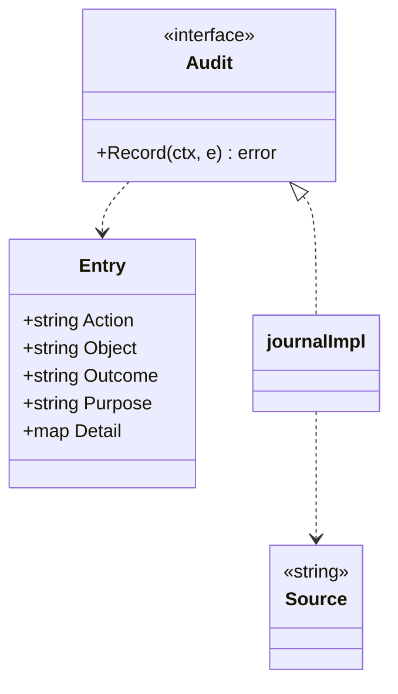
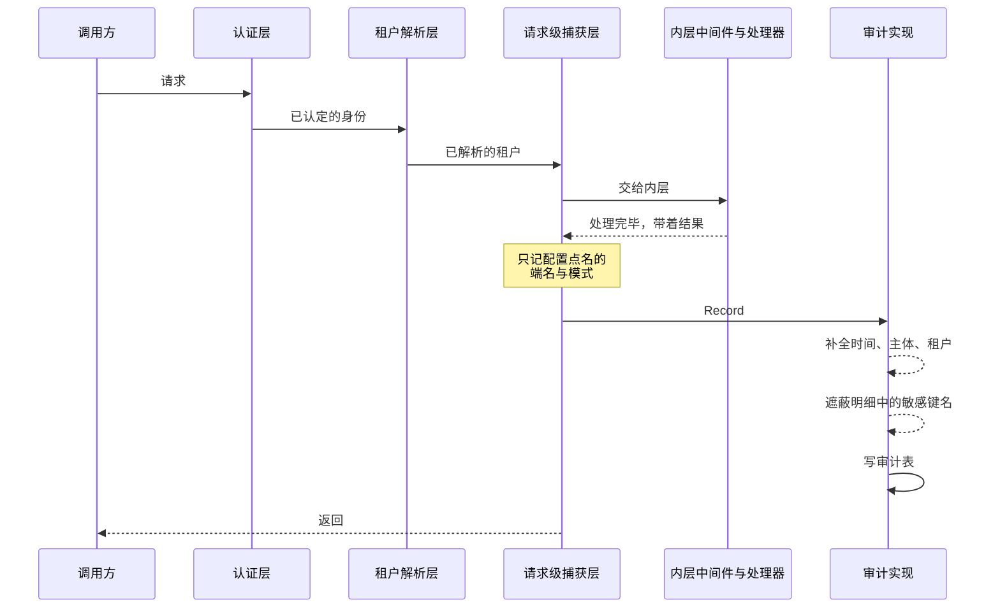

# audit

## 职责

本模块交付**审计**：把「谁在何时对什么做了什么」记下来，写进它自己的一张表。它是横切能力，不要求任何业务模块认识它，它也不认识任何业务模块。

事实经**捕获通路**进入本模块：语句级（经数据库模块的插件扩展点）、事件级（订阅事件总线）、请求级（入口模块的一层中间件）、接缝级（别的模块调用记录接缝）。划分的依据见 [ADR-audit-capture-2026-09-21](../../adr/adr-audit-capture-2026-09-21.md)。

**排他交付**：同一个进程里恰好一个实现生效。

### 非职责

- **不提供查询面。** 按条件的检索与导出要先回答「谁可以查谁」，那是授权判定，归属权限模型（[ADR-audit-scope-2026-09-21](../../adr/adr-audit-scope-2026-09-21.md)）。
- **不自证。** 记录的不丢失与不可篡改是一个部署形态与一份存储的性质，本模块不对自己作这个断言。
- **不做归责判定。** 请求级记录写的是请求事实；「谁该为这次拒答负责」由认证模块写在日志里，本模块不复制那份归责（见 [authn](design-authn.md) 的错误与失败语义）。
- **不判定租户，也不读名册。** 租户标识在本模块是字符串，读取发生在实现子包里。语句级捕获不判定一个租户是否存在或停用，它只按上下文里的标识记录——与租户隔离插件同形（见 [tenant](design-tenant.md)）。
- **不做轮转与归档。** 审计表的容量与留存是宿主的运维面。
- **不捕获原生 SQL 的写语句。** 语句级捕获只作用于经模型发出的写操作，判据见语句级捕获。宿主与迁移发出的原生写语句不产生审计行；这一条写在非保证里，没有别的补救。
- **不保证覆盖面。** 覆盖面随装配与配置变化，见错误与失败语义里的非保证。
- **不定义动作与对象的词表。** 写进审计行的是什么动词、对象如何拼写，由调用点与将来的检索方约定；本模块只要求它是可比的字符串。语句级通路没有调用点可约定，它按自己的判据填（见语句级捕获）。

## 术语表

以下术语的含义限于本模块与审计主题的决策记录；别的模块的文档描述本模块的产物时，也用这里的含义。

| 术语 | 英文 | 定义 |
|---|---|---|
| 审计行 | entry | 本模块记录的最小单位：时间、主体、租户、来源通路、动作、对象、结果、用途与明细。 |
| 捕获通路 | capture path | 事实进入本模块的一条途径。划分见 [ADR-audit-capture-2026-09-21](../../adr/adr-audit-capture-2026-09-21.md)。 |
| 记录接缝 | record seam | 别的模块主动交出审计行的入口，即 `Audit.Record`。 |
| 来源通路 | source | 一条审计行由哪条捕获通路产生。 |

## 外部接口契约

### 登记单元与名字

| 登记单元 | 模块名 | 交付 | 构造期依赖 |
|---|---|---|---|
| 接口包 | 不登记 | 只有接口与数据类型 | — |
| 实现子包 `pkg/audit/journal` | `audit.journal` | 排他地交付审计功能 | `(*db.Database)(nil)`、`(*log.Logger)(nil)` |

配置命名空间取 `audit.journal`。名字的每一段只用小写字母、数字与短横线：配置键的字符集规则按 `.` 切段适用（见 [config](design-config.md)）。

**两条构造期依赖都是必需的。** 表要建在数据库模块交付的句柄上，明细的脱敏键名要登记进日志模块的规则集；两者缺席时本模块无法成立，走 `core` 的缺提供者失败，不是静默缺一条通路。事件总线与入口模块**不写进构造期依赖**：它们在 `Init` 取用，在场时早已构造，没有要排的序（判据同认证网关的豁免登记面，见 [authn](design-authn.md)）。**认证与租户连取用都不发生**：主体与租户经各自的 `FromContext` 从上下文读出，读不到即为空——缺席是一种合法配置，不是一个要在这里判定的错误。

**本模块的表态只能是 `StateEnabled`，永不 `StateAuto`。** 排他加 `StateAuto` 正是消解要禁用的那一格，而本模块的启用是宿主在命令树上的决定，不是一个可以由配置推断的结论。表态不表达跑不跑：本模块没有「未被指向任何东西」这一档，各输入项全空时它照常工作，语句级与接缝级仍然生效，被纳入即能启动。`StateDisabled` 不是模块可作的表态，它只由消解给出。

### 交付的功能

功能标识的元素类型必须是接口，取用写作 `core.Resolve[audit.Audit](reg)`：

```go
// Audit 是审计交付的功能，同时是中间件在链上代表的功能标识。
type Audit interface {
	// Record 记下 e，补全时间、主体、租户与来源通路之后写入审计表。
	// 返回 nil 表示已受理。
	// 本模块自己登记的捕获通路不据返回值阻塞业务；调用方可以据它终止自己的操作。
	Record(ctx context.Context, e Entry) error
}

// Entry 是一条审计行里由调用方给出的部分。
type Entry struct {
	// Action 是动作，一个动词。
	Action string
	// Object 是对象的类型与标识。
	Object string
	// Outcome 是结果。
	Outcome string
	// Purpose 是用途或理由；跨租户这类需要说明的操作在此给出。
	Purpose string
	// Detail 是明细的键值。键名决定它是否被遮蔽，见"脱敏"。
	Detail map[string]string
}

// Source 是一条审计行的来源通路。
type Source string

const (
	// SourceStatement 是语句级通路。
	SourceStatement Source = "statement"
	// SourceEvent 是事件级通路。
	SourceEvent Source = "event"
	// SourceRequest 是请求级通路。
	SourceRequest Source = "request"
	// SourceSeam 是记录接缝。
	SourceSeam Source = "seam"
)
```

交付声明写作 `Provides: []core.Provision{{Token: (*Audit)(nil), Exclusive: true}}`。

### 审计行的补全

`Entry` 只承载调用方给出的那一半。其余字段由本模块在受理时补全：

| 字段 | 来源 |
|---|---|
| 时间 | 受理时取 |
| 主体 | 上下文里的认证身份，取它的字符串形式；上下文里没有身份时为空 |
| 租户 | 上下文里的租户标识，取字符串形式；上下文里没有租户时为空。落在跨租户标记下的语句没有租户，其审计行同样为空，不记成发起它的那个请求的租户（见 [tenant](design-tenant.md) 的跨租户）。事件级通路另有一处上文，见事件级捕获 |
| 来源通路 | 产出这条审计行的通路，取 `Source` 的一个取值 |

**主体与租户都取字符串，不引用交付它们的模块的类型。** 判据与事件总线相同：让一个模块的标识类型进入接口面，接口面所在的包就要 import 定义它的那个包。代价不是一份第三方依赖，而是本模块的接口面对认证与租户这两个具体功能的接口面的依赖（见 [event](design-event.md)）。读取它们因此发生在实现子包里。

**一条审计行不因为主体或租户为空而被拒绝。** 系统级操作与豁免路由上没有这两者，而它们同样是要留痕的那一类。

### 脱敏

**本模块遮蔽明细中键名落在下面这一组里的值。这一组是闭集**：`password`、`secret`、`token`、`credential`、`authorization`。键名逐字比较，不含分组路径，因此一个含点的键名不命中。

这一组由本模块固定，两处生效：

- 实现子包在构造时把它们登记进日志模块的脱敏规则集，使本模块自己写出的日志受同一份规则约束；
- 写审计表之前，本模块按同一组键名遮蔽明细中对应的值。

**日志模块规则集里由别的模块登记的形状匹配与键名，不作用于审计表。** 判据与代价见 [ADR-audit-redaction-2026-09-21](../../adr/adr-audit-redaction-2026-09-21.md)。

**明细里其余键名不被遮蔽。** 写入审计表的键名由调用点自选，本模块只覆盖上面这一组；这一条写在非保证里。

### 中间件在链上代表的功能

请求级通路登记的那一层以 `(*Audit)(nil)` 作为自己的 `Provides`，与描述符里那条交付声明取同一个标识。**这是别的层把自己排在审计之内或之外的唯一锚点**，因而是本模块对外的稳定契约面。锚定它的写法与代价见 [ADR-audit-anchor-2026-09-21](../../adr/adr-audit-anchor-2026-09-21.md)。

该层用 `After` 指向 `(*authn.Gate)(nil)` 与 `(*tenant.Resolution)(nil)`：它要取主体与租户。**这两条 `After` 只在被指的那一层在场时才有边**——入口模块在指着的那一层缺席时丢弃该边并把它列进启动诊断，不构成失败（见 [http](design-http.md)）。因而它们不是位置保证：认证或租户不在场时，本层落在哪里由 `Order` 决定，写出的审计行主体与租户为空。

### 配置

实现子包的输入项挂在 `audit.journal` 下：

| 输入项 | 含义 |
|---|---|
| `endpoints` | 本模块在哪些监听端上登记请求级捕获层 |
| `requests` | 要记录的请求，形如 `GET /things`；空即不记 |
| `events` | 要订阅的事件类型名；空即不订阅 |

**`requests` 里的每一项在每个受审计监听端上都生效**，它与端名之间没有配对关系；要区分端，写在模式里。

**请求模式由本模块自持的匹配器解释，语义与入口模块引擎相同**——与认证模块的豁免同形（见 [authn](design-authn.md)）。本模块不为模式另造一套语法，也**不在启动期校验一个模式是否对应某条已登记的路由**：登记面拿不到「这条请求会派发给哪条路由」的查询，判据只有模式本身能否被匹配器解释，不能被解释的模式即启动失败。

**端名清单只能是本模块自己的输入项**：入口模块的登记面只有按名取端一个方法，枚举不出来（判据同认证网关与租户解析，见 [authn](design-authn.md)）。

**配置列出了一个类型名或一个端名，而对应的模块在本次运行中取不到时，启动失败。** 取不到包括它没被装配、被禁用，以及在场却没被启用三种情形——判据是 `Resolve` 取不到已构造的实例，取「登记」的一侧会让一个被禁用的提供者通过检查，而那正是本条要拦下的「以为有保护而实际没有」（[ADR-audit-reach-2026-09-21](../../adr/adr-audit-reach-2026-09-21.md)）。什么都不列时本模块照常运行。

本模块不声明敏感输入项：端名、请求模式与事件类型名都不是要保密的值。

### 对宿主的要求

- **请求级与事件级要生效，配置里要写出端名、请求模式与事件类型名。** 三者默认空，空即不捕获，而空与「配了但没生效」在审计面看不出区别。
- **每个受审计的监听端要写在 `endpoints` 里。** 漏写的监听端上没有任何请求级捕获，不报错。
- **跨租户操作要留痕时，用途由调用点给出。** 记录接缝的 `Purpose` 是它唯一的承载处；不调用接缝的跨租户操作不留痕，本模块不从上下文推断理由（[ADR-tenant-scoping-2026-09-21](../../adr/adr-tenant-scoping-2026-09-21.md)）。
- **不要用宿主的 `AllResources` 覆盖让本模块只以声明进入一次运行。** 那种装配下插件照装而本模块从未构造：语句级捕获会按下面所述的判据自行写入，而脱敏规则没有被登记，失败的信号也没有接出来（覆盖的语义见 [db](design-db.md)）。

### 稳定性承诺

`Audit`、`Entry` 与 `Source` 是本模块与其他模块之间的契约。中间件在链上代表的那个功能标识与描述符里的交付标识同为 `(*Audit)(nil)`，别的模块据它排序，取值不变。**审计表的表名与上面那一组脱敏键名同为契约的一部分**：表名与语句级捕获的自指判据共用一个常量，改名要一起改；脱敏键名的增删改变每一条审计行的内容。

## 依赖

| 依赖 | 用途 | 声明方式 |
|---|---|---|
| `pkg/core` | 注册描述符、交付功能、取用别的模块 | 接口引用 |
| `pkg/config` | 声明本模块的输入项 | 接口引用 |
| `pkg/db` | 建审计表、安装语句级捕获插件 | 构造期依赖，必需 |
| `pkg/log` | 登记明细的脱敏键名 | 构造期依赖，必需 |
| `pkg/event` | 订阅配置点名的类型 | `Init` 取用，不声明 |
| `pkg/http` | 在受审计监听端登记请求级捕获层 | `Init` 取用，不声明 |
| `pkg/authn` | 经 `FromContext` 读出主体 | 无构造期依赖 |
| `pkg/tenant` | 经 `FromContext` 读出租户标识 | 无构造期依赖 |

**这些依赖都在实现子包里，接口包只依赖标准库。** 锚定 `(*Audit)(nil)` 的模块 import 接口包，实现子包绑定的那些库不进宿主的 `go.mod`，宿主的 `go.sum` 与实际下载则会经被 import 包的测试闭包带上它们，只有读整图的操作会看到全部实现所绑的库（[ADR-audit-anchor-2026-09-21](../../adr/adr-audit-anchor-2026-09-21.md)）。

**本模块不依赖任何业务模块。** 业务模块经事件总线或记录接缝交出事实，两条途径都不要求它认识本模块。取用记录接缝的模块在构造期声明对本模块的依赖，是否声明为可选由它自己决定；本模块要求不了它终止启动，而「取不到就跳过记录」这个默认写法落在全开那一侧，这一条列在非保证里（与认证网关的豁免登记面同形，见 [authn](design-authn.md)）。

## UML 图

图里是接口、数据类型与它们的实现关系。图看不出的约束：各条捕获通路都经同一个实现写入同一张表；记录接缝是唯一由别的模块主动调用的通路；接口包不登记模块。



一次请求在请求级通路上的记录路径，其分支由配置决定：



## 核心数据结构

| 概念 | 类型 | 说明 |
|---|---|---|
| 审计行 | `Entry` | 调用方给出的那一半；时间、主体、租户、来源由本模块补全 |
| 来源通路 | `Source` | 这条审计行由哪条捕获通路产生 |
| 审计表的一行 | 表结构 | 审计行的补全结果：补全后的各字段，加一个可空的租户列，明细以键值形式存放 |
| 表名 | 常量 | 语句级捕获的自指判据与它共用同一个取值 |
| 脱敏键名 | 常量组 | 闭集，登记进日志模块的规则集，同时用于写表前的遮蔽 |

**审计表不内嵌租户模块的受约束模型约定。** 它自己带一个可空的租户列：跨租户操作与系统级操作没有当前租户，内嵌约定会让隔离插件加条件、在插入时填列，而那时值不存在，非空约束会让审计行写不进去。免过滤的判据是模型没有声明（见 [tenant](design-tenant.md)），代价见 [ADR-audit-sink-2026-09-21](../../adr/adr-audit-sink-2026-09-21.md)。

**`Entry` 是值类型，但 `Detail` 是映射。** 本模块在受理时复制它，此后调用方改动自己那份不影响已受理的审计行。

## 核心算法与流程

### 本模块的阶段行为

| 阶段 | 行为 |
|---|---|
| `Prepare` | 解出自己那份配置，读出端名、请求模式与事件类型名 |
| `New` | 取日志模块的脱敏登记面并登记键名；建立写入面 |
| `Migrate` | 无动作：迁移由数据库模块在这一阶段应用，本模块只声明 |
| `Init` | 在每个受审计监听端登记请求级捕获层；订阅配置点名的类型；校验请求模式。事件实现的订阅表在它自己的 `Start` 里冻结，晚于本模块的 `Init` |
| `Start` | 开始受理请求级、事件级与接缝级的记录。**语句级不受这个闸门约束**：它的开关是插件装没装，见语句级捕获 |
| `Serve` | 无动作：受理在 `Start` 之后持续进行 |
| `Stop` | 停止受理上述三条通路的新记录 |
| `Close` | 无动作：写入面属于数据库模块，本模块不持有连接 |

端名不存在、入口模块本身取不到、请求模式解释不了与事件总线取不到，都在 `Init` 判定：入口模块的登记面与事件总线都到那时才可取得（`Resolve` 只返回已构造的实例）。**本模块不为这几档自造类别**：涉及缺席提供者的几档原样外传 `core` 的缺提供者哨兵，端名那一档原样外传入口模块的哨兵，模式那一档是本模块自己的判定；每一档都在错误文本里点出是哪个配置项要求的。

### 迁移的方言划分

审计表经 `db.Migrations` 声明。迁移由数据库模块在 `Migrate` 阶段施加，整体早于 `Init`。**迁移集按方言分子目录，一个方言一个子目录**，目录名取该方言的取值（见 [db](design-db.md)）。

**漏掉一个方言的子目录不是错误，而是那个方言下零迁移。** 表现是表不建，此后**每一条被捕获的写语句都失败**——语句级那条通路的失败不静默。这一格写进非保证。

### 语句级捕获

本模块声明一条 `db.Plugin` 资源。**插件实例不持有任何状态**：它随描述符在 `init` 期冻结，并被同一个进程里的多个注册表共用（判据见 [tenant](design-tenant.md) 的插件在语句上的作用点）。回调不需要它持有任何东西——GORM 把每条语句自己的会话交给回调——所以这里没有随句柄而变的东西可放错，第二个句柄也就没有要当心的地方。

回调以**具名锚点**注册在**提交那一步之前**（`Create`、`Update`、`Delete` 各一处），取的是最终语句与其结果。锚点落在语句自己的那一步上是不够的：GORM 注册提交步时不带锚点，而它的排序把挂在已排序步骤**之后**的回调一律追加到链尾——挂在 `gorm:create` 之后的回调因而落在提交**之后**，那时连接已经交还连接池，「写在与语句同一个会话上」这条只对调用方自开的事务成立。挂在提交之前，回调跑在事务仍开着的时候。

租户过滤插件注册在同一批处理器上、位置在它们自己的步骤**之前**；两侧的位置都由锚点定下，与插件的安装次序无关：注册到同一处理器的多个插件在没有依赖声明时本无次序保证（见 [db](design-db.md)），本模块因此不声明对名册功能的构造期依赖。

**写入走这条语句自己的会话**，不另开一条连接。两处后果是这条选择的理由：记录与它所记录的那次写入同生共死——调用方自开的事务随后回滚，那条审计行跟着一起没了，不会留下一条说「发生过」而其实没发生的行；而全程只有一条连接，一个只允许单写者的引擎（本仓为其提供迁移的那个）没有可争的东西。

**代价是这条通路的失败是抛上去的，不是报出去的**：写入失败会让那条业务语句失败，因为在同一条连接上记录与写入是一件工作。三条自驱通路的失败处置与此相反，见错误与失败语义。插件因此不持有任何句柄，连「哪一次 `Initialize` 的句柄」都不必记。

**自指由目标表判定。** 回调比较语句的目标表与表名常量，相等即跳过。**原生 SQL 那条路上不会有递归，因为 `Exec` 与 `Raw` 根本不进钩子；模型路径上的递归靠的就是这条比较。** 判据的前提是写入语句解析出来的表名等于那个常量——`Table(...)` 传一个带前缀或别名的名字会让两者分家，跳过随之失效，那条写入自己又产生一条审计行，递归在这里发生，而它一次就栈溢出。

**只捕获经模型发出的写操作。** 回调注册在 `Create`、`Update`、`Delete` 三个处理器上，因而 `Exec` 与 `Raw` 发出的写语句不产生审计行——迁移语句、宿主自己的清理与脚本都在此列。这条写在非保证里。

**语句级的开关是插件装没装，不是本模块的 `Start`。** 它在数据库模块的构造期就装好了，此后每一条被捕获的写语句都进审计表，包括其余模块在 `Init` 里发出的模型写操作。请求级、事件级与接缝级三条则要等 `Start`。

**动作与对象由本模块按判据填**：动作取语句的操作类型，对象取目标表；受影响行数进明细。主键在一对多的写语句里不可得，本模块不逐行记录（[ADR-audit-capture-2026-09-21](../../adr/adr-audit-capture-2026-09-21.md)）。

**失败的语句不留行。** GORM 逐个执行一个处理器上的回调，不因前面的步骤失败而停下，所以被别的插件拒绝的语句（租户过滤拒绝一条上下文里没有租户的受约束语句即是一例）、被 GORM 自己拒绝的语句（缺少条件的整表更新与删除）与被引擎拒绝的语句（主键冲突）都会走到本模块的回调。它们什么也没改，没有写入可记；它们所在的那件工作正要回滚，行写进去也会跟着消失，而 PostgreSQL 在一条语句失败之后拒绝同一事务里的一切语句，行连写都写不进去。本模块因而跳过已经失败的语句：调用方拿到的是那条语句自己的错误，不带 `ErrWriteFailed`。语句级审计行的结果一列因此恒为成功值，改了多少由明细里的受影响行数给出。

### 请求级捕获

在每个受审计监听端登记一层中间件。层上取请求的方法与路径，交给本模块自持的匹配器与 `requests` 比对，命中则**先把请求交给内层，内层返回之后再写出一条审计行**。

**记录点在内层返回之后，因为结果只有到那时才存在。** 该层写出的是请求事实：端名、模式、主体、租户、内层给出的结果。写在放行之前就只能填一个恒定占位值，那种审计行的结果一列没有任何信息。

**这一行不随请求的上下文一起取消。** 客户端在处理器返回之前断开时，`net/http` 取消请求的上下文，而处理器做的事那时已经做了——删除已经提交，导出已经读完。写入沿用上下文里的值（主体与租户从那里读出），不沿用它的取消；沿用取消会让这一行因为一件与审计表无关的事丢失，还会让失败信号把一张正常的表报成失败。代价是这次写入的时限只剩数据库自己的超时，见非保证。

**内层 panic 时同样写一行，结果一列填常量 `panic`，随后把 panic 原样抛出。** 状态码从未到达，填任何状态码都是猜测；这一行与正常返回那一行共用同一个记录点，只在结果一列的取值上不同。捕获 panic 不是本层的职责——入口模块的兜底层接住它（见 [http](design-http.md)），本层只是把这次请求记下来。

**这一档包含被有意放弃的连接。** handler 用 `net/http` 的 `ErrAbortHandler` 放弃连接时，本层读不出它与缺陷的区别，同样填 `panic`；而入口模块的兜底层认得那个值、原样抛出、不写响应（见 [http](design-http.md) 的兜底层），调用方因而什么也没收到，却留下一条结果列为 `panic` 的审计行。本层要记的是「发生过什么」，连接是不是被有意丢掉不在它能读到的信息里。

**中间件在路由引擎之外**，`net/http` 的那条记录里没有「这次请求会派发给哪条模式」这一项，匹配因此只能由本模块自己做，也不能在启动期与已登记的路由对照。

**动作与对象由端名、方法与模式填**：动作取方法，对象取模式。端名进明细——它不在 `Entry` 的字段里，而中间件确实知道自己落在哪个端上。

**结果取内层写出的最终状态码**，内层从未写状态时为 200。在它之前发出的信息性响应（1xx，例如提前提示）不是结果：`net/http` 允许处理器先发任意个这类响应再发最终状态。切换协议（101）是例外，连接随之交给另一种协议，其后不再有状态码，它本身就是结果。

**该层不做归责判定。** 一次拒答出自哪一层不由它回答。

**该层不改变请求的处理结果。** 请求已经处理完毕，记录失败不回改它；失败按 fail-open 处置。

### 事件级捕获

在 `Init` 里对配置列出的每个类型名登记一次订阅。载荷以结构化方式读取（见 [event](design-event.md)），读不出时丢弃这条事件并记录——订阅方没有可上报的对象。

**动作与对象取自事件本身**：动作取类型名，对象与其余字段从载荷里按字段名读出，读不出即留空。

**租户取自事件携带的那个标识。** 总线在事件上带它，正是为了让横切能力不必自己重建，而订阅回调通常没有请求上下文可读；上下文里有租户时以它为准，那是这件事被做时所处的租户。

**写入同样不随回调的上下文一起取消。** 进程内总线在发布方自己的上下文上调用订阅方，而事件在发布那一刻已经发生；判据与请求级相同。

### 接缝级捕获

调用方构造 `Entry` 并调用 `Record`。时间、主体、租户与来源通路由本模块补全，明细按键名遮蔽后写入。

**接缝沿用调用方上下文的取消。** 要这一行的是调用方，它放弃了自己的操作，`Record` 就返回写入失败，由它决定怎么处置；这与两条自驱通路不同，那两条没有可以告知的调用方。

## 错误与失败语义

### 启动期

以下各条终止启动：

| 情形 | 表现 |
|---|---|
| 数据库模块或日志模块缺席、被禁用 | 缺提供者失败，点名本模块与那条构造期依赖 |
| 配置点名了端名，而入口模块本身缺席、被禁用 | 缺提供者失败，点名本模块与那个配置项 |
| `endpoints` 里的端名在入口模块上不存在 | 原样外传入口模块的错误 |
| `requests` 里的模式本模块的匹配器解释不了 | 点名端名、模式与那条配置项 |
| 配置列出了事件类型，而本次运行取不到事件总线 | 缺提供者失败，点名那个配置项 |
| 本模块与另一个审计实现同时表态启用 | 排他冲突，消解阶段报出双方 |

**表不存在不在此列**：表由数据库模块在 `Migrate` 阶段应用迁移时建立，整体早于 `Init`，而本模块从 `Init` 起才读写。迁移集漏了某个方言的子目录是这条成立的例外，见迁移的方言划分。

### 运行期

请求级与事件级按 fail-open 处置：写失败不进业务路径的返回值，业务照常完成。语句级不在此列——它的记录与那条语句是一件工作，见语句级捕获。判据与代价见 [ADR-audit-failure-2026-09-21](../../adr/adr-audit-failure-2026-09-21.md)。

**失败的信号不进日志链。** 第一次写失败与随后的恢复各写一行到标准错误，不经日志模块——理由与日志模块报告自身失败时相同：报告链自身缺席或出问题时仍然可用（见 [log](design-log.md) 的写入失败的上报）。此后的失败只计数不写行，避免一次故障刷满输出；计数在进程内，不对外暴露。

| 情形 | 表现 |
|---|---|
| 写审计表失败（语句级） | 抛在那条语句上，**那条语句失败**，错误包着 `ErrWriteFailed`——记录与写入是一件工作 |
| 语句自身失败（语句级） | 不写审计行；那条语句返回它自己的错误，不带 `ErrWriteFailed` |
| 写审计表失败（请求级、事件级） | 首次与恢复各写一行标准错误，业务照常完成 |
| 写审计表失败（接缝级） | `Record` 返回错误；调用方决定是否终止自己的操作 |
| 明细里的敏感键名命中 | 值被替换为遮蔽文本，其余明细照常写入 |
| 事件载荷读不出 | 丢弃这条事件并记录（这条记录写进日志链，链可被整条关掉） |
| 上下文里没有主体或租户 | 该字段留空，审计行照常写入 |
| 记录接缝返回值被调用方忽略 | 该次记录失败只进那一行标准错误，调用方自己的操作照常 |

### 非保证

- **存在与否是装配的结果。** 本模块未被纳入时，对应的通路不存在，没有任何一层会拦下（[ADR-audit-guarantees-2026-09-21](../../adr/adr-audit-guarantees-2026-09-21.md)）。
- **覆盖面由配置决定。** 语句级与接缝级随装配生效；事件级与请求级只覆盖配置点名的类型与模式。
- **原生 SQL 的写语句不被捕获。** 迁移语句、宿主自己的清理与脚本、`Exec` 与 `Raw` 发出的写操作都不产生审计行。
- **失败的写语句不留痕。** 被租户过滤拒绝的语句、主键冲突与缺少条件的整表写都只出现在调用方拿到的错误里；要把一次被拒绝的尝试记下来，调用点经记录接缝交出它。
- **迁移集漏掉一个方言的子目录时，那个方言下零迁移且不报错。** 表现是表不建、写入失败、审计全丢。
- **请求级与事件级的记录不保证完整。** 那两条通路的写失败被 fail-open 吞掉，与「那件事没有被采集到」在审计面上不可区分；察觉途径是那行标准错误。语句级不在此列——它的失败令那条语句失败，而那条语句的调用方看得见。
- **被有意放弃的连接留下一条结果列为 `panic` 的审计行。** handler 抛 `net/http` 的 `ErrAbortHandler` 时本层读不出它与缺陷的区别，而入口模块的兜底层认得那个值、原样抛出，调用方什么也没收到；这一行因而与真正的缺陷在审计面上不可区分。
- **明细里只有闭集内的键名被遮蔽。** 其余键名、由形状识别的秘密，以及别的模块登记进日志规则集的键名，在审计表里一律原样落库。
- **认证或租户不在场时，请求级审计行的主体与租户为空。** 那两条 `After` 按条丢弃，本层的位置由还在场的那条边决定；启动诊断里的一行「未落到任何一层的约束」是唯一的提示，而它看不出审计行是否缺了主体或租户。
- **匹配器答的是命中哪条配置模式，引擎答的是派发到哪条路由。** 两者可以不一致，本模块不检验——本层在引擎之外，读不到派发结果。这条分叉与认证模块的豁免同源（见 [authn](design-authn.md)）。
- **漏写的监听端不报错。** `endpoints` 里没写的监听端上没有任何请求级捕获，启动期不失败，也不产生诊断；察觉它靠入口模块组装时逐端的链清单里没有代表审计功能的那一层（见 [http](design-http.md)）。
- **不调用记录接缝的跨租户操作不留痕。** 用途与操作一起由调用点交给接缝；没有调用点就没有痕，本模块无从知道哪个调用点该调用。
- **记录接缝取不到时，取用方跳过记录。** 业务模块在构造期声明对本模块的依赖、并把它标为可选时，取不到就按它自己的默认行为跳过，落在全开那一侧；本模块要求不了它终止启动。
- **事件载荷读不出的那条记录写进日志链。** 输出列表为空是合法配置，链被整条关掉时，一次采集缺口没有任何痕迹。
- **配置里的类型名与发布方的字符串之间没有编译期联系。** 发布方改名，订阅静默断开，两处都不报错。
- **明细的值被包了一层时两处都漏。** 遮蔽按键名比对，一个塞进包装值或不具名映射里的敏感值，在日志与审计表里都留原值。
- **宿主用 `AllResources` 覆盖让本模块只以声明进入一次运行时，插件照装而本模块从未构造。** 语句级捕获照常写入——它不依赖本模块被构造——而脱敏规则没有被登记。
- **插件也装在第二条连接上，那里没有本模块的表。** 数据库模块经 `Open` 建第二条连接时装的是同一份插件声明；宿主在第二条连接上写模型时，这一条通路要么写不进去（那个库没有这张表，于是每条这样的语句都失败），要么写进那个库的同名表。
- **请求级与事件级的写入没有本模块给的时限。** 两条通路都不随上下文取消，写入的时限只有数据库自己的超时（驱动参数与定位符里的语句超时）。请求级那一行在请求协程上、内层返回之后写出，响应里还没冲刷出去的部分要等它；进程内总线上发布方要等订阅方写完。审计表慢或被锁住时，每个命中的请求与每次被订阅的发布都跟着慢，fail-open 只覆盖失败，不覆盖等待。
- **请求级那一层包住了响应写出者，因而会隐藏它携带的可选接口。** 冲刷与接管是显式转发的，其余的可选接口要靠 `Unwrap` 拿到；一个直接对写出者做类型断言的处理器在受审计的端点上会静默失效（见 [http](design-http.md)）。
- **事件通路认的字段拼写是本模块自己定的一份。** 载荷按几个候选名读出对象与结果,读不出即留空；发布方用别的拼写时没有任何信号。
- **通路之间没有全局次序。** 同一件事经两条通路留下的两行之间没有关联标识，先后也不代表因果。
- **表结构不进稳定性承诺。** 表名与脱敏键名是契约，其余列的形状不是；检索方若直接读表，本模块不为它承诺稳定性，改表因此是跨模块的改动（[ADR-audit-scope-2026-09-21](../../adr/adr-audit-scope-2026-09-21.md)）。

## 并发与事务边界

- 订阅表由事件实现在它自己的 `Start` 里冻结，而驱动到达那一阶段时每个模块的 `Init` 都已执行完毕；本模块订阅发生在 `Init`，因而落在冻结之前。冻结之后到达的订阅有两条去路，取哪一条是实现自己的承诺（见 [event](design-event.md)）：在调用点被拒绝，或者登记成功而漏掉冻结之前发布的全部事件。
- 请求级与接缝级在请求协程上写审计表，同一时刻有多条写入在途。
- **语句级捕获在发出该语句的协程上执行，写入走那条语句自己的会话**：审计行与该语句在同一件工作里——写入失败令该语句失败，该语句回滚也把那行一起带走。其余三条通路与任何业务事务无关。
- **请求级、事件级与接缝级三条通路不开事务，也不与调用方的事务绑定**；语句级捕获不在此列，它就在那条语句自己的工作里（见上）。

## 扩展点

**新增一条捕获通路是改本模块，不是新增模块。** 各条通路同属一个登记单元（[ADR-audit-packaging-2026-09-21](../../adr/adr-audit-packaging-2026-09-21.md)）。新增一条通路要满足以下判据，其余细节随实现而定：

- 它取到的事实在现有通路上取不到，否则它带来的是重复而不是覆盖。
- 它有一条明确的失败去向：要么跟着它挂上去的那件工作成败，要么接进上面那条信号，二者之一要写清楚。
- 它的覆盖面由配置或调用点显式给出，不靠推断。
- 它与现有通路共用同一份记录形状与同一张表，不另造写入面。
- 它有自己的 `Source` 取值。

## 实现状态

| 能力 | 状态 | 代码 |
|---|---|---|
| 接口与数据类型 | 已实现 | `pkg/audit/audit.go` `Audit`、`Entry`、`Source` |
| 审计表与迁移 | 已实现 | `pkg/audit/journal/entry.go` `row`；`pkg/audit/journal/migrations/<方言>/0001_audit_entries.sql` |
| 语句级捕获 | 已实现 | `pkg/audit/journal/capture.go` `capture`、`captureOne` |
| 请求级捕获 | 已实现 | `pkg/audit/journal/request.go` `middlewareFor`；`pkg/audit/journal/matcher.go` `newMatcher` |
| 事件级捕获 | 已实现 | `pkg/audit/journal/event.go` `subscribe`、`handlerFor` |
| 记录接缝 | 已实现 | `pkg/audit/journal/entry.go` `Record` |
| 明细脱敏 | 已实现 | `pkg/audit/journal/redact.go` `maskedKeySet`、`maskDetail` |
| 失败信号 | 已实现 | `pkg/audit/journal/signal.go` `signal`、`report` |
| 配置 | 已实现 | `pkg/audit/journal/config.go` `schema`、`readSettings` |
| 模块登记 | 已实现 | `pkg/audit/journal/journal.go` `Module`、`ModuleName` |
