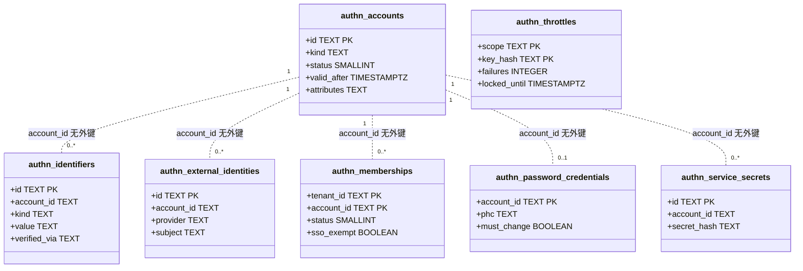
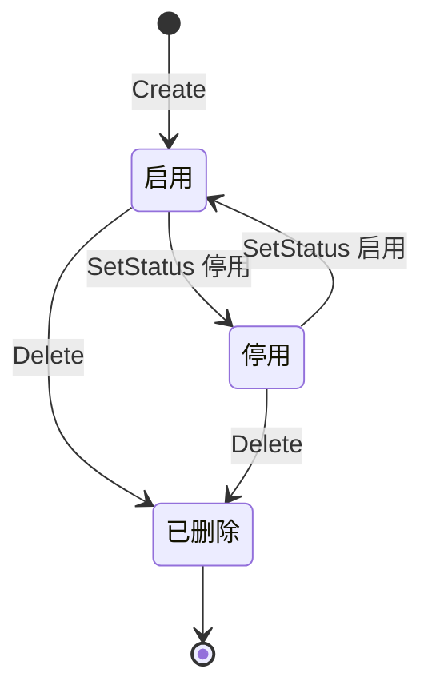
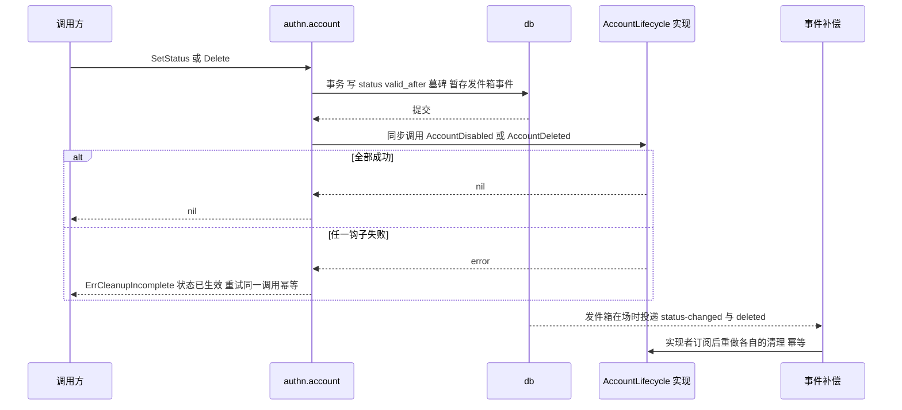
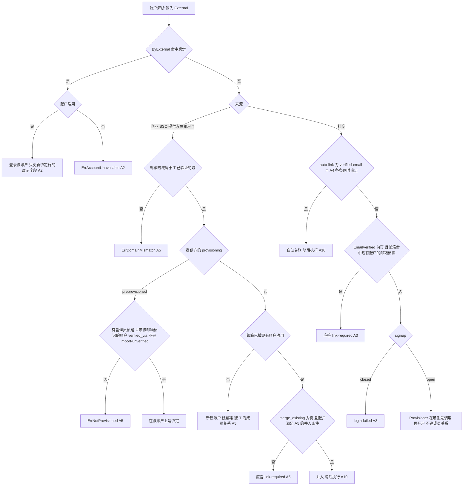

# authn-account

## 职责

`authn.account` 是 authn 的账户存储模块，包 `pkg/authn/account`，登记名 `authn.account`。

- 持有账户、标识、外部身份绑定、成员关系、口令凭据、服务密钥与失败退避的表及其迁移集，经 `pkg/db` 读写；表结构见[核心数据结构](#核心数据结构)。
- 排他交付 `Accounts`、`AccountAdmin`、`Passwords`、`Memberships`、`Throttle` 这些根包能力接口，每个接口各自是一个排他功能。
- 生成账户标识 `AccountID`（库里是 UUIDv7 文本），保证它不可变、不复用。
- 规范化标识：用户名、邮箱、手机在写入与查询两侧经同一个函数规范化。
- 持有口令类凭据的全部校验细节：口令规范化、查找、PHC 编解码与界限、诱饵派生、再哈希、服务密钥的摘要比对。
- 执行账户状态的迁移：停用、启用、删除在本模块的事务里写自己的表，提交之后同步调用全部 `AccountLifecycle`。
- 持有失败退避的算法与表，以及 `authn_throttles`、`authn_service_secrets` 的清扫协程。
- 承载外部身份绑定、自动关联、首登开户与 JIT 并入的规则。规则约束的是本模块的数据（绑定、标识、成员关系）与账户的会话和口令，执行者是 `authn.login` 的账户解析步（[design-authn-login](design-authn-login.md)）。

选型与取舍见 [ADR-authn-accounts-2026-10-10](../../adr/adr-authn-accounts-2026-10-10.md)、[ADR-authn-account-lifecycle-2026-10-10](../../adr/adr-authn-account-lifecycle-2026-10-10.md)、[ADR-authn-external-binding-2026-10-10](../../adr/adr-authn-external-binding-2026-10-10.md)、[ADR-authn-password-hash-2026-10-10](../../adr/adr-authn-password-hash-2026-10-10.md)、[ADR-authn-throttling-2026-10-10](../../adr/adr-authn-throttling-2026-10-10.md)；模块在 authn 里的位置与依赖图见 [design-authn](design-authn.md)。

### 非职责

- **不建立登录会话，不签发令牌。** 会话归 `authn.session`，令牌归 `authn.token`；本模块只在账户状态迁移之后调用它们实现的 `AccountLifecycle`（[design-authn-session](design-authn-session.md)、[design-authn-token](design-authn-token.md)）。
- **不做授权。** 本模块的成员关系只回答「账户是否属于某租户」；角色按（账户，租户）绑定，归授权模块，授权经 `Memberships` 读成员关系，不读 `authn_memberships` 表。
- **不 import `pkg/tenant`。** 租户标识在本模块里是字符串；成员关系的请求期判定归 `tenant.admission`，它在 tenant 目录里经 `Memberships` 读取（[design-tenant-admission](design-tenant-admission.md)）。
- **不写别的模块的表。** 会话、因素、短信挑战各归 `authn.session`、`authn.mfa`、`authn.sms`；跨模块的清理走 `AccountLifecycle` 与事件，不进账户事务。
- **不挂路由，不实现登录方式。** 登录路由与账户解析归 `authn.login`，自助与管理路由归 `authn.login`、`authn.session`、`authn.mfa`、`authn.admin` 各自的处理器；本模块只交付它们调用的接口。
- **不提供用户名加口令的自助注册。** 没有验证渠道的自助注册只能产生没有可验证标识的账户；口令账户由管理面或宿主代码创建，或在社交与短信首登之后于账户设置里设口令。
- **不解析手机号，不做口令泄露库比对，不折叠邮箱别名。** 手机号只接受 E.164，转换由客户端做。
- **不替宿主保存资料字段。** 账户表不留自由字段，宿主扩展字段的途径见[扩展点](#扩展点)。
- **不拥有口令表（`authn.static.subjects`）的退避与缓存。** 口令表与本模块共用 `pkg/authn/internal/password` 里的 PHC 编解码与派生，但不依赖本模块、不读 db（[design-authn-gate](design-authn-gate.md)）。

## 术语表

| 术语 | 适用范围 | 定义 |
|---|---|---|
| 标识 | 本文 | `Identifier`：账户名下的一条登录名或联系方式（用户名、邮箱、手机），带验证时刻与验证渠道；与账户标识不是一回事。 |
| 登录名 | 本文 | 口令登录接受的标识：用户名或邮箱；手机号不作口令登录名。 |
| 真实证明 | 本文 | 验证渠道 `sms-code` 与 `idp:<提供方标识>`：短信验证码证明了手机，提供方声明了已验证邮箱。 |
| 未证明渠道 | 本文 | 验证渠道 `admin` 与 `import-unverified`：只记录事实，不是邮箱所有权的证明，不得作为自动关联与企业 JIT 并入的依据。 |
| 墓碑 | 本文 | 账户被删除后保留的一行：只含 `id`、`kind`、`status`、`created_at`、`deleted_at`，个人数据已抹除。 |

## 外部接口契约

### 交付的功能

`authn.account` 在 `Provides` 里声明下列根包接口，每个都是排他功能：宿主漏点名账户模块，依赖它的模块在任何实例构造之前报 `core.ErrMissingProvider`。模块的 `Prepare` 只表态 `StateEnabled`，不表态 `StateAuto`：是否运行是命令树上的决定。

| 功能 | 面 | 主要调用方 |
|---|---|---|
| `Accounts` | 只读 | 授权、宿主、`authn.session`、`authn.token`、`authn.login`、`authn.admin` |
| `AccountAdmin` | 写 | `authn.login`、`authn.admin`、宿主的命令行 |
| `Passwords` | 口令与服务密钥的校验与写入 | `authn.login.password`、`authn.token`、`authn.login` |
| `Memberships` | 成员关系的读写 | `tenant.admission`、`authn.login`、`authn.impersonation`、`authn.admin`、授权 |
| `Throttle` | 失败退避的存取 | `authn.login`、`authn.login.password`、`authn.mfa`、`authn.token` |

调用方列表是例举，不是封闭集；判据是调用方在 `Requires` 或 `Init` 里取用了对应接口。

本模块交付的接口受同一模块各能力接口方法名两两不相交的规则约束，规则与理由见 [design-authn](design-authn.md#扩展点)。本模块的具体核对结果：`Memberships` 的读单条叫 `Membership`、写叫 `Put`，不叫 `Get`、`Set`，避免与 `Accounts.Get`、`Passwords.Set` 相撞。

### Accounts

```go
type Accounts interface {
	Get(ctx context.Context, id AccountID) (Account, error)
	Lookup(ctx context.Context, kind IdentifierKind, value string) (AccountID, error)
	ByExternal(ctx context.Context, provider, subject string) (AccountID, error)
	Identifiers(ctx context.Context, id AccountID) ([]Identifier, error)
	Externals(ctx context.Context, id AccountID) ([]ExternalBinding, error)
	List(ctx context.Context, q AccountQuery) ([]Account, string, error)
	ListServiceSecrets(ctx context.Context, id AccountID) ([]ServiceSecretInfo, error)
}
```

| 方法 | 承诺 |
|---|---|
| 全部 | 账户不存在（含墓碑）返回 `ErrAccountNotFound`。 |
| `Lookup` | `value` 先规范化；规范化失败返回 `ErrInvalidIdentifier`；按 `authn_identifiers` 的 `(kind, value)` 唯一索引查找。 |
| `ByExternal` | 以（提供方，主体）为键，不以邮箱为键。 |
| `List` | 返回下一页游标，空串表示没有下一页。墓碑默认不返回，要看须显式给 `StatusDeleted`。无标识过滤时 `WHERE id > ? ORDER BY id LIMIT n`，走 `authn_accounts` 主键，次序近似创建次序；有标识过滤时先在 `authn_identifiers` 的 `(kind, value)` 唯一索引上取 `value >= 前缀 AND value < 前缀的上界`（范围比较，PostgreSQL 与 SQLite 通用，不用 `LIKE`），再回表按 `id` 排序分页。标识前缀已规范化、至少 3 个字符，防止全表扫描；`Limit` 缺省 100、上限 1000。 |
| `ListServiceSecrets` | 只交回标识、标签、期限与撤销状态，从不含密钥。 |

`Accounts` 没有批量读：按一组标识取多个账户要逐个 `Get`。需要一次取多个账户的展示信息（成员页、联系人属主）的调用方自己组织这些读取，本接口不提供 `GetMany` 一类方法。

### AccountAdmin

```go
type AccountAdmin interface {
	Create(ctx context.Context, in CreateAccount) (Account, error)
	SetStatus(ctx context.Context, id AccountID, s AccountStatus, reason string) error
	Delete(ctx context.Context, id AccountID, reason string) error
	SetDisplayName(ctx context.Context, id AccountID, name string) error
	SetAttributes(ctx context.Context, id AccountID, attrs map[string]string) error
	SetProtected(ctx context.Context, id AccountID, protected bool) error
	SetMFARequired(ctx context.Context, id AccountID, required bool) error
	AddIdentifier(ctx context.Context, id AccountID, kind IdentifierKind, value string, via Verification) error
	RemoveIdentifier(ctx context.Context, id AccountID, identifierID string) error
	LinkExternal(ctx context.Context, id AccountID, l ExternalLink) error
	UnlinkExternal(ctx context.Context, id AccountID, externalID string) error
	CreateServiceSecret(ctx context.Context, id AccountID, label string, expires *time.Time) (secretID, secret string, err error)
	RevokeServiceSecret(ctx context.Context, id AccountID, secretID string) error
	Touch(ctx context.Context, id AccountID, at time.Time) error
}
```

`AccountAdmin` 是写面，调用方是 authn 自己的模块与宿主的命令行；管理路由在它之上，先过 `Decider`（[design-authn-admin](design-authn-admin.md)）。

| 方法 | 承诺 |
|---|---|
| `Create` | 写入启用状态的账户。邮箱与手机须已被验证，验证渠道分别由 `EmailVerifiedVia` 与 `PhoneVerifiedVia` 给出（短信首登开户取 `sms-code`），没有「待验证」的行；`Password` 与 `PasswordHash` 二选一，`Password` 经口令策略校验，`PasswordHash` 是 PHC 或遗留格式、供导入用；`ID` 留空则生成，仅导入用，管理面路由不暴露；`Via` 取 `admin`、`jit`、`signup`、`import`，写进事件载荷。标识、登录名或绑定违反唯一约束返回 `ErrAccountExists`。 |
| `SetStatus`、`Delete` | 在本模块事务里写 `status`、`valid_after`、墓碑与暂存的发件箱事件；事务提交之后同步调用全部 `AccountLifecycle`，清理失败返回 `ErrCleanupIncomplete`：状态已生效，重试同一调用幂等地补完清理。迁移表见[账户状态与生命周期](#账户状态与生命周期)。两者的 `reason` 形参取自 [authn-events](design-authn-events.md) 的 `ReasonClass` 闭集；签名是 `string`，没有类型约束，靠调用方与 `ValidReasonClass` 保证，它随 `authn.account.status-changed` 以 `reason_class` 写入载荷。`Sessions.Revoke` 的 `reason` 同此。 |
| `SetDisplayName` | 至多 100 个字符。 |
| `SetAttributes` | 受[属性集的限制](#扩展点)约束；经 `Identity.Attribute` 只读到达所有层。 |
| `SetProtected` | 为真的账户不得被冒充，不依赖 `Decider`（[design-authn-impersonation](design-authn-impersonation.md)）。 |
| `AddIdentifier`、`RemoveIdentifier` | 标识先规范化；`via` 取值是 `sms-code`、`idp:<提供方标识>`、`admin`、`import-unverified` 这一封闭集合的形态，其余拒绝。`idp:` 后的提供方标识是 1 到 64 字节、字符集 `[A-Za-z0-9._-]`（与 `AccountID` 同一字符集），越出即 `ErrInvalidArgument`。 |
| `LinkExternal` | 该（提供方，主体）已被别的账户占用返回 `ErrBindingConflict`。 |
| `UnlinkExternal` | 解绑之后账户至少还剩一种可用登录方式，否则返回 `ErrLastLoginMethod`。 |
| `CreateServiceSecret` | 密钥是 256 位随机数，前缀 `spd_cs_`，库里只存 SHA-256；明文只在返回值里出现一次。 |
| `RevokeServiceSecret` | 写 `revoked_at`；提交之后调 `AccountLifecycle.ServiceSecretRevoked`，失败同样返回 `ErrCleanupIncomplete`。 |
| `Touch` | 写 `last_login_at`，走原生 SQL，不产生审计行。 |

### Passwords

```go
type Passwords interface {
	Verify(ctx context.Context, identifier, password string) (AccountID, VerifyResult, error)
	Set(ctx context.Context, id AccountID, password string, opt SetPasswordOptions) error
	Clear(ctx context.Context, id AccountID) error
	ImportHash(ctx context.Context, id AccountID, encoded string, mustChange bool) error
	VerifyServiceSecret(ctx context.Context, clientID, secret string) (account AccountID, secretID string, expires time.Time, err error)
}

type VerifyResult struct{ MustChange bool }

type SetPasswordOptions struct {
	Current    string // 自助改口令时的当前口令
	MustChange bool   // 置 must_change；管理员重置缺省真
}
```

| 方法 | 承诺 |
|---|---|
| `Verify` | `identifier` 先规范化：含 `@` 按邮箱，否则按用户名；手机号不作口令登录名。对未知标识、停用账户、无口令账户，先做一次与当前参数等成本的诱饵派生，再统一返回 `ErrInvalidCredentials`。已知账户上的账户级失败退避在此静默计数，到阈值后照常派生并返回 `ErrInvalidCredentials`，不返回 429（[失败退避](#失败退避)）。成功时 `VerifyResult.MustChange` 为真表示凭据带 `must_change`，口令方法据此要求先设新口令。 |
| `Set` | 经口令策略校验，违反返回 `ErrPasswordPolicy`；新口令不得与当前口令相同。`Set` 不撤销任何会话：撤销其余会话是调用方（改口令的处理器）在 `Set` 成功之后调 `Sessions.RevokeAccount(except)` 的事，所以本接口不依赖会话模块。 |
| `Clear` | 删除该账户的口令凭据，使账户没有口令、须重设。幂等：没有凭据返回 nil。登录引擎在自动并入（规则 A10）成功之后调用它。 |
| `ImportHash` | 把 PHC 或遗留条目写成账户的口令凭据；遗留条目无损转成 PHC（盐与密钥的字节相同，只改外壳）。 |
| `VerifyServiceSecret` | 按 `SHA-256(secret)` 取未撤销、未过期的行；行里的账户标识与出示的 `clientID` 常量时间相等，且账户是启用的 `service`。返回账户标识、密钥标识与到期时刻（零值表示不过期）。 |

### Memberships

```go
type Memberships interface {
	IsMember(ctx context.Context, id AccountID, tenant string) (bool, error)
	Membership(ctx context.Context, tenant string, id AccountID) (Membership, bool, error)
	Tenants(ctx context.Context, id AccountID) ([]Membership, error)
	Members(ctx context.Context, tenant string, page Page) ([]Membership, error)
	Put(ctx context.Context, m Membership) error
	Remove(ctx context.Context, id AccountID, tenant string) error
}
```

| 方法 | 承诺 |
|---|---|
| 读法 | 查不到与已暂停都读作非成员（`Active` 的零值是暂停）。口令表主体没有成员关系行，`IsMember` 对它恒为假。 |
| `Tenants` | 跨租户列出账户的全部成员关系；按 `authn_memberships_account` 索引走。 |
| `Members` | 按租户分页，`Limit` 缺省 100、上限 1000。 |
| `Put` | 幂等：新增、暂停、恢复。账户不存在（含墓碑）返回 `ErrAccountNotFound`：表间没有外键，由本方法核对。 |
| `Remove` | 删除一条成员关系。 |
| 实现 | 每条语句显式写 `tenant_id`；`authn_memberships` 由 `Memberships` 的实现独占，授权与准入层经接口读，不直接读表。 |

### Throttle

```go
type ThrottleScope string

const (
	ScopeIdentifier ThrottleScope = "identifier"
	ScopeAccount    ThrottleScope = "account"
	ScopeFactor     ThrottleScope = "factor"
	ScopePhone      ThrottleScope = "phone"
	ScopeClient     ThrottleScope = "client"
)

type Throttle interface {
	Check(ctx context.Context, scope ThrottleScope, key string) (retryAfter time.Duration, err error)
	Fail(ctx context.Context, scope ThrottleScope, key string) (engaged bool, err error)
	Succeed(ctx context.Context, scope ThrottleScope, key string) error
}

type ThrottledError struct{ RetryAfter time.Duration }
```

`ThrottledError` 的 `Error()` 返回 `authn: throttled`，`Is(target)` 在 `target == ErrThrottled` 时为真；调用方用 `errors.As` 取 `RetryAfter`。范围集合是封闭的。db 实现由本模块交付；进程内实现在 `pkg/authn/internal/password`，供没有 db 的 `authn.static` 使用，db 实现与进程内实现的键空间互不相交。算法见[失败退避](#失败退避)。`Fail` 返回的 `engaged` 为真表示这一次失败使退避开始。

### AccountLifecycle（本模块取用的钩子）

```go
type AccountLifecycle interface {
	AccountDisabled(ctx context.Context, id AccountID) error
	AccountDeleted(ctx context.Context, id AccountID) error
	ServiceSecretRevoked(ctx context.Context, id AccountID, credentialID string) error
}
```

根包定义，持有以账户为键的数据的模块实现（`authn.session`、`authn.mfa`、`authn.sms` 是实现者；判据是持有以账户为键的数据，这份名单是例举而非封闭集）。实现并立、不排他，本模块在 `Init` 里经 `core.ResolveAll` 取用，不写进 `Requires`。每个方法幂等：账户已停用、已删除、数据已清时返回 nil。调用发生在账户事务提交之后，实现不得读账户行（墓碑之外的内容已抹除）。

| 方法 | 实现者的义务 |
|---|---|
| `AccountDisabled` | 撤销该账户的 browser 与 token 种登录会话并清缓存；service 种会话靠 `valid_after` 与账户状态失效，重新启用后经 `Sessions.ForCredential` 恢复；因素与短信挑战不动，重新启用后仍属于账户。 |
| `AccountDeleted` | 抹除本模块持有的该账户数据：会话行、因素与其子表数据、短信挑战行。 |
| `ServiceSecretRevoked` | 撤销该密钥对应的 service 种会话。 |

### 稳定性

上述接口的方法集、哨兵与表名是宿主可见面：增删方法、改签名与改表名都是破坏性变更。根包只放这些接口与数据类型，实现与 `*gorm.DB` 留在本模块内；其他 authn 子包与授权模块拿不到数据库句柄。

## 依赖

| 依赖 | 性质 | 用途 |
|---|---|---|
| `pkg/authn` 根包 | 必需 | 能力接口、数据类型、哨兵、事件载荷；根包只依赖标准库与 authn 自己的内部包。 |
| `db.Database` | `Requires`，排他功能 | 全部表与迁移；没有 db 的装配里本模块不可用。 |
| `settings.Store` | 可选 | 口令策略与退避参数的运行期取值；缺席时取声明的默认值。 |
| `event.Bus`、`outbox.Outbox` | 可选 | 发布账户与成员关系事件；发件箱在场时在写入的同一事务里暂存。 |
| `audit.Audit` | 可选 | 在场时经模型路径的写留下语句级审计行。 |
| 全部 `AccountLifecycle` | 非排他，`ResolveAll` | 账户状态迁移之后的清理。 |
| `pkg/authn/internal/password` | 内部 | PHC 编解码、派生、校验、进程内退避、并发与内存预算。 |
| `pkg/authn/internal/acctcache` | 内部 | 账户快照的进程内缓存，校验后端读它；它按有效期过期，并在订阅到 `authn.account.status-changed` 与 `authn.account.deleted` 时清除。 |
| `pkg/authn/internal/clock` | 内部 | 写入数据库与绑定为查询参数的时间的来源，一律 UTC。 |
| `github.com/google/uuid`、`golang.org/x/text/unicode/norm`、`github.com/alexedwards/argon2id`、`golang.org/x/crypto/argon2`、标准库 `crypto/pbkdf2` | 库 | 账户标识生成（`NewV7`）、用户名与口令的 NFKC、Argon2id 的 PHC 编码与派生、PBKDF2 派生。 |

方向满足架构不变量：`authn.account` 只依赖根包、`pkg/db` 与可选的设置、事件、审计，不 import `pkg/tenant`，也不 import `authn.session`、`authn.mfa`、`authn.sms`；这些模块与 `authn.token`、`authn.login`、`authn.impersonation`、`authn.admin` 依赖本模块，反向依赖会成环。`authn.account` 取用 `AccountLifecycle` 经的是根包接口，不经具体模块。装配里不纳入 `authn.session`、`authn.mfa`、`authn.sms` 时，对应钩子不存在，本模块照常运行。选择与取舍见 [ADR-authn-packaging-2026-10-10](../../adr/adr-authn-packaging-2026-10-10.md)、[ADR-authn-wiring-2026-10-10](../../adr/adr-authn-wiring-2026-10-10.md)。

带表模块的迁移由施加迁移的命令静态级纳入（`IncludeAllDeclarations`）；本模块的 `Start` 探测自己的表是否存在，缺失即以 `ErrNotMigrated` 终止启动。`New` 里不读写自己的表（首次启动时表尚未建立）。

## UML 图

### 表之间的关系

下图固定的是：所有指向账户的列都只是列，表之间没有外键；完整性由写入方在自己的事务里显式清理保证，跨模块靠钩子与事件补偿。`authn_memberships` 以字符串租户标识为主键的一半，不引用租户模块的表。口令表主体不进库，不在图里。



`authn_throttles` 的键是提交内容的摘要，不指向账户行，所以图中没有它的关系线。

### 账户状态

状态零值是停用：没有被显式启用的账户不能认证。已删除是终态，标识保留、不复用。启用与停用之间可往返，停用与删除都把 `valid_after` 前移，启用时 `valid_after` 不回退，旧会话不恢复。



### 停用与删除的两段式清理

事务只写本模块的表；会话、因素、短信挑战归别的模块，那些模块可能没被纳入。提交之后同步调用钩子；钩子失败或进程崩在提交与钩子之间时，由事件补偿。迁移的完整内容见[账户状态与生命周期](#账户状态与生命周期)，判据见 [ADR-authn-account-lifecycle-2026-10-10](../../adr/adr-authn-account-lifecycle-2026-10-10.md)。



## 核心数据结构

### 值类型

类型的真身在 `pkg/authn/internal/model`，根包以类型别名转出；下面按形状列出，别名类型的方法在真身包里定义。

```go
type AccountKind string

const (
	KindUser    AccountKind = "user"
	KindService AccountKind = "service" // 非交互的 API 客户端
)

type AccountStatus uint8

const (
	StatusDisabled AccountStatus = iota // 零值：停用
	StatusActive
	StatusDeleted // 终态：已抹除，标识保留
)

type IdentifierKind string

const (
	IdentifierUsername IdentifierKind = "username"
	IdentifierEmail    IdentifierKind = "email"
	IdentifierPhone    IdentifierKind = "phone"
)

type Account struct {
	ID          AccountID
	Kind        AccountKind
	Status      AccountStatus
	DisplayName string
	MFARequired bool              // 账户级强制登记因素
	Protected   bool              // 为真则不得被冒充，不依赖 Decider
	PasswordSet bool
	Attributes  map[string]string
	ValidAfter  time.Time         // 此刻之前签发的会话与令牌一律失效
	CreatedAt   time.Time
}

type Identifier struct {
	ID          string
	Kind        IdentifierKind
	Value       string    // 已规范化
	VerifiedAt  time.Time // 非零
	VerifiedVia string    // sms-code、idp:<提供方标识>、admin、import-unverified
}

// External 是登录方式向引擎交出的外部身份输入。
type External struct {
	Provider      string // google、github、wechat、wechat-openid:<appid>、oidc:<IdP 标识>、saml:<IdP 标识>
	Subject       string // 该命名空间内的稳定标识
	Email         string // 已规范化；可空；仅作线索
	EmailVerified bool   // 提供方声称已验证；是否采信由账户解析按来源判
	DisplayName   string
	Tenant        string // 企业 IdP 所属租户；社交登录为空
	Attributes    map[string]string // 按 IdP 属性映射得到，键带 idp. 前缀
}

type ExternalLink struct{ Provider, Subject, Email string; EmailVerified bool }

// ExternalBinding 是库里一条外部身份绑定；自助与管理面用它的 ID 列出与解绑。与 External 不混用。
type ExternalBinding struct {
	ID            string
	Provider      string
	Subject       string
	Email         string // 最近一次声明的邮箱，仅作展示，不参与任何判定
	EmailVerified bool
	CreatedAt     time.Time
	LastLoginAt   time.Time // 零值表示从未
}

type CreateAccount struct {
	ID                 AccountID // 仅导入用，留空则生成
	Kind               AccountKind
	DisplayName        string
	Username           string
	Email              string       // 须已被验证
	EmailVerifiedVia   Verification
	Phone              string       // 须已被验证
	PhoneVerifiedVia   Verification
	Password           string       // 与 PasswordHash 二选一
	PasswordHash       string       // PHC 或遗留格式；导入用
	MustChangePassword bool
	MFARequired        bool
	Attributes         map[string]string
	Via                string       // admin、jit、signup、import
}

type Verification struct{ Via string } // 写进 verified_via

type AccountQuery struct {
	Status           *AccountStatus // 空表示不过滤
	Kind             AccountKind    // 空表示不过滤
	IdentifierKind   IdentifierKind // 与 IdentifierPrefix 同时给出时按标识前缀过滤
	IdentifierPrefix string
	After            string // 上一页返回的 next
	Limit            int    // 缺省 100，上限 1000
}

type ServiceSecretInfo struct {
	ID         string
	Label      string
	CreatedAt  time.Time
	ExpiresAt  time.Time // 零值表示不过期
	RevokedAt  time.Time // 零值表示未撤销
	LastUsedAt time.Time // 零值表示从未
}

type Membership struct {
	Account   AccountID
	Tenant    string // tenant.ID 的字符串形式
	Active    bool   // 零值（暂停）读作非成员
	Source    string // admin、jit:<提供方标识>、invite、import
	SSOExempt bool   // 租户强制 SSO 时的应急放行
	CreatedAt time.Time
}

type Page struct {
	After string
	Limit int // 缺省 100，上限 1000
}
```

`AccountID` 不透明、不可变、不复用，1 到 64 字节，字符集 `[A-Za-z0-9._-]`，大小写敏感，`ParseAccountID` 判定形态，违反返回 `ErrInvalidAccountID`。库里的账户用 UUIDv7 文本；口令表主体取 `static.` 加主体名，`AccountID.IsStatic()` 对它为真；宿主导入既有用户时可带入自己的标识，须满足这一形态且不以 `static.` 起头。库里生成的标识不含 `static.` 前缀，库里的标识与口令表主体的标识不会相撞。

`AccountQuery` 与 `Page` 的 `Limit` 经 `EffectiveLimit` 取有效值：非正取缺省 100，超过上限截断到 1000，不因超限拒绝。`EffectiveLimit` 是值类型上的方法，列表接口据此取实际条数。

### 表

全部在 `authn.account` 的一份迁移集里，`migrations/postgres/` 与 `migrations/sqlite/` 各一份同名文件，序号自 `0001_` 起。下面写 PostgreSQL 的形态；SQLite 的差别只有类型（`TIMESTAMPTZ` 写 `TIMESTAMP`、`BOOLEAN` 写 `INTEGER`）与部分索引的写法。

**所有 authn 表之间、以及对其他模块的表，都不建外键**；各表只留索引。**所有表都不嵌入 `tenant.Model`**，成员关系与 IdP 的租户列由 authn 的代码显式过滤。

```sql
CREATE TABLE authn_accounts (
    id            TEXT        NOT NULL PRIMARY KEY,           -- AccountID，永不复用
    kind          TEXT        NOT NULL CHECK (kind IN ('user', 'service')),
    status        SMALLINT    NOT NULL DEFAULT 0 CHECK (status IN (0, 1, 2)),  -- 0 停用（零值）、1 启用、2 已删除
    display_name  TEXT        NOT NULL DEFAULT '' CHECK (length(display_name) <= 100),
    attributes    TEXT        NOT NULL DEFAULT '{}',          -- JSON，至多 4 KiB
    mfa_required  BOOLEAN     NOT NULL DEFAULT FALSE,
    protected     BOOLEAN     NOT NULL DEFAULT FALSE,
    valid_after   TIMESTAMPTZ NOT NULL,
    created_at    TIMESTAMPTZ NOT NULL,
    updated_at    TIMESTAMPTZ NOT NULL,
    last_login_at TIMESTAMPTZ NULL,
    disabled_at   TIMESTAMPTZ NULL,
    deleted_at    TIMESTAMPTZ NULL
);

CREATE TABLE authn_identifiers (
    id           TEXT        NOT NULL PRIMARY KEY,
    account_id   TEXT        NOT NULL,
    kind         TEXT        NOT NULL CHECK (kind IN ('username', 'email', 'phone')),
    value        TEXT        NOT NULL,                        -- 已规范化
    verified_at  TIMESTAMPTZ NOT NULL,                        -- 没有未验证行
    verified_via TEXT        NOT NULL,                        -- sms-code、idp:<提供方标识>（真实证明）；admin、import-unverified（未证明渠道）
    created_at   TIMESTAMPTZ NOT NULL,
    UNIQUE (kind, value)
);
CREATE INDEX authn_identifiers_account ON authn_identifiers (account_id);
CREATE UNIQUE INDEX authn_identifiers_one_phone    ON authn_identifiers (account_id) WHERE kind = 'phone';
CREATE UNIQUE INDEX authn_identifiers_one_username ON authn_identifiers (account_id) WHERE kind = 'username';

CREATE TABLE authn_external_identities (
    id             TEXT        NOT NULL PRIMARY KEY,
    account_id     TEXT        NOT NULL,
    provider       TEXT        NOT NULL,
    subject        TEXT        NOT NULL,
    email          TEXT        NOT NULL DEFAULT '',           -- 最近一次声明的邮箱，仅作展示，不参与任何判定
    email_verified BOOLEAN     NOT NULL DEFAULT FALSE,
    created_at     TIMESTAMPTZ NOT NULL,
    last_login_at  TIMESTAMPTZ NULL,
    UNIQUE (provider, subject)                                -- 全局唯一：一个外部身份只属于一个账户
);
CREATE INDEX authn_external_identities_account ON authn_external_identities (account_id);

CREATE TABLE authn_memberships (
    tenant_id  TEXT        NOT NULL CHECK (tenant_id <> ''),
    account_id TEXT        NOT NULL,
    status     SMALLINT    NOT NULL DEFAULT 0 CHECK (status IN (0, 1)),   -- 0 暂停（零值，读作非成员）
    source     TEXT        NOT NULL DEFAULT '',
    sso_exempt BOOLEAN     NOT NULL DEFAULT FALSE,
    created_at TIMESTAMPTZ NOT NULL,
    updated_at TIMESTAMPTZ NOT NULL,
    PRIMARY KEY (tenant_id, account_id)
);
CREATE INDEX authn_memberships_account ON authn_memberships (account_id, tenant_id); -- 服务「某账户属于哪些租户」

CREATE TABLE authn_password_credentials (
    account_id  TEXT        NOT NULL PRIMARY KEY,
    phc         TEXT        NOT NULL,
    changed_at  TIMESTAMPTZ NOT NULL,
    must_change BOOLEAN     NOT NULL DEFAULT FALSE
);

CREATE TABLE authn_service_secrets (
    id           TEXT        NOT NULL PRIMARY KEY,
    account_id   TEXT        NOT NULL,
    secret_hash  TEXT        NOT NULL UNIQUE,                 -- SHA-256 十六进制；密钥本身是 256 位随机数（前缀 spd_cs_）
    label        TEXT        NOT NULL DEFAULT '',
    created_at   TIMESTAMPTZ NOT NULL,
    expires_at   TIMESTAMPTZ NULL,
    revoked_at   TIMESTAMPTZ NULL,
    last_used_at TIMESTAMPTZ NULL
);
CREATE INDEX authn_service_secrets_account ON authn_service_secrets (account_id);

CREATE TABLE authn_throttles (
    scope            TEXT        NOT NULL,                    -- identifier、account、factor、phone、client
    key_hash         TEXT        NOT NULL,                    -- 键的规范化形式的 SHA-256 十六进制
    failures         INTEGER     NOT NULL,
    first_failure_at TIMESTAMPTZ NOT NULL,
    last_failure_at  TIMESTAMPTZ NOT NULL,
    locked_until     TIMESTAMPTZ NULL,
    PRIMARY KEY (scope, key_hash)
);
CREATE INDEX authn_throttles_decay ON authn_throttles (last_failure_at);   -- 清扫按它删
```

几处约束承担的不变式：

- `UNIQUE (kind, value)` 使一个邮箱或手机只属于一个账户；部分唯一索引使一个账户至多一个手机标识、至多一个用户名，邮箱不限数量。
- `authn_identifiers` 没有「待验证」的行：`verified_at` 非空，`verified_via` 非空；证明强度由 `verified_via` 决定，读取标识的路径据此区分真实证明与未证明渠道。
- `UNIQUE (provider, subject)` 使一个外部身份只属于一个账户，并发首登靠它仲裁（A9）。
- `authn_memberships` 的主键是（租户，账户），次级索引以账户打头，服务按账户跨租户列出；租户列由 `Memberships` 的实现在每条语句里显式带上。
- `authn_service_secrets.secret_hash` 唯一，按摘要取行。

属性集 `authn_accounts.attributes` 的键与值受[扩展点](#扩展点)里的限制约束；显示名至多 100 个字符，不当作任何判定依据。

## 核心算法与流程

### 标识的规范化

规范化发生在写入与查询两侧、同一个函数里（`NormalizeIdentifier`，在 `pkg/authn/account` 内部）：`pkg/db` 的盲索引不替调用方规范化，一侧没规范化就查不到，且不报错。规范化失败一律返回 `ErrInvalidIdentifier`。

| 标识 | 规则 |
|---|---|
| 用户名 | 先 NFKC，再转小写；匹配 `^[a-z0-9][a-z0-9._-]{2,63}$`，不含 `@`，因此与邮箱不相交；不得以 `static.` 起头；不得是合法 UUID 形状。 |
| 邮箱 | 去首尾空白，整体转小写；只接受 ASCII，含非 ASCII 字符一律拒绝：不做 IDN 转换，也就没有同形字钓鱼；恰有一个 `@`，至多 254 字节；不做别名折叠，`+` 子地址与点号原样保留。 |
| 手机 | 严格 E.164：`^\+[1-9][0-9]{6,14}$`；不接受国内写法、空格、横线；转换由客户端做，服务端不解析号码。 |

### 外部身份绑定与自动关联的规则

登录引擎的账户解析一步按下面的流程图执行。分支的次序只在流程图里写；规则表按编号写每条规则独有的判据与理由，不重述次序。选型与取舍见 [ADR-authn-external-binding-2026-10-10](../../adr/adr-authn-external-binding-2026-10-10.md)。



账户确定之后，账户非启用则解析失败；其余路径不读不写成员关系，除非是上图里新建账户并建 T 的成员关系的那一支。

| 编号 | 规则 |
|---|---|
| A1 | 外部身份的键是（提供方，主体），绝不用邮箱。各提供方的主体：Google 的 `sub`；GitHub 的数字 `id`（`login` 会变，只作展示）；企业 OIDC 的 `sub`，SAML 的 `NameID` 或映射指定的属性，命名空间是 `oidc:<IdP 标识>`、`saml:<IdP 标识>`；微信取 `unionid`，没有则 `wechat-openid:<appid>` 加 `openid`。 |
| A2 | 已有绑定：直接登录那个账户。账户非启用则失败：口令与短信路径与密码错误同形，外部登录路径因调用方已在 IdP 处认证过而报 403 `account-unavailable`。提供方声明的邮箱变化不更新账户的邮箱标识，只更新绑定行里仅作展示的字段。 |
| A3 | 无绑定、来源是社交、`authn.account.auto-link` 未开启自动关联：不关联。仅当 `External.EmailVerified` 为真且该邮箱命中现有账户的邮箱标识时应答 `link-required`（请先用原有方式登录，再在账户设置里关联）；提供方自称未验证的邮箱（Google 在某些账号上给 `email_verified=false`）不触发它，按「无邮箱线索」处理，走首登开户或统一的 `login-failed`。所以 `link-required` 只在调用者已被提供方证明拥有该邮箱时才给，不构成对陌生人的枚举预言机。 |
| A4 | `authn.account.auto-link` 取 `verified-email`（放宽开关，仅取主配置源，必须显式开启，只有全局一档）时，仅在下列各条同时满足才自动关联：提供方声明邮箱已验证（Google 的 `email_verified` 为真；GitHub 取 `/user/emails` 里 `primary` 且 `verified` 的一条，不用 `/user` 返回的邮箱）；现有账户持有该邮箱的标识，且标识的 `verified_via` 是真实证明（`idp:*`；`admin` 与 `import-unverified` 不算）；现有账户状态为启用；该邮箱域不属于任何已启用提供方、由租户验证过的 SSO 域，否则社交登录会绕开租户的强制 SSO。域的判定经 `SSOProviders.Discover`，它只返回已验证且提供方已启用的域；某租户为已停用提供方验证过的域无从经该接口枚举，因此不拦住自动关联，这是该接口契约的直接结果。微信无邮箱，永不适用。关联只改变第一因素，账户已登记的因素照常要求，不因关联降低任何要求。不满足任一条时按 A3 处理。成功并入的副作用见 A10。 |
| A5 | 企业 SSO（提供方属租户 T）无绑定时：提供方声明的邮箱，其域必须属于 T 已验证的域，否则 `ErrDomainMismatch`，防止恶意租户管理员用自己配置的 IdP 声明别家用户的邮箱。`provisioning` 为 `preprovisioned` 的提供方只匹配管理员预先建好、且带该邮箱标识的账户（标识的验证渠道合法且不是 `import-unverified`，即 `admin` 或 `idp:*`；`admin` 的断言在这里算数，预置账户就是管理员为这个人建的），匹配不上即 `ErrNotProvisioned`；`jit` 才可新建账户并建 T 的成员关系（`source = jit:<提供方标识>`），缺省只新建、不并入：邮箱已被现有账户占用时应答 `link-required`，域匹配已由 IdP 的域证明替代 A3 的 `EmailVerified` 前提，用户先用原方式登录再在设置里关联。提供方行的 `merge_existing`（缺省假，创建提供方时显式选）为真时才可并入，且只并入「邮箱标识是真实证明、全部成员关系 ⊆ {T}、没有口令、手机、其他绑定与因素」的账户；账户可属多个租户或有别的登录方式时一律不并入，因为账户是全局的，并入会让 T 的 IdP 管理员（或前雇主）永久登录这个人在别的租户里的账户。成员关系只在建绑定的开户这一次里新建：已有绑定的后续登录不读不写成员关系（A2），所以管理员暂停或移除的成员不会被 JIT 复活或重建；下线人员要么暂停成员关系，要么在 IdP 侧停用。 |
| A6 | 解绑与关联要新鲜的本地多因素认证（账户有因素时，`Requirement.Local`，IdP 声明的多因素不算）；解绑后账户至少还剩一种可用登录方式（口令、手机、另一条绑定、任一因素），否则 `ErrLastLoginMethod`；解绑与关联成功后处理器调 `Sessions.RevokeAccount(except = 当前会话)` 撤销其余登录会话，并发 `authn.binding.changed`。 |
| A7 | 手机的变更与添加经短信验证（新号码的验证码，`verified_via = sms-code`）；邮箱只经 IdP 声明（首登开户时写入）或管理员登记成为标识，没有自助添加邮箱的路由（无邮件通道）；用户名只由管理员添加。变更要求新鲜的本地多因素；成功后处理器调 `Sessions.RevokeAccount(except = 当前会话)`。 |
| A8 | 微信后来收到 `unionid` 时，若没有账户占用该 `unionid`，给同一账户补一条以 `unionid` 为键的绑定；若已被别的账户占用，报 `ErrBindingConflict`，不自动合并。 |
| A9 | 同一个（提供方，主体）并发首登：唯一约束让败者回读绑定后继续，幂等。 |
| A10 | 自动并入（A4 的自动关联、A5 `merge_existing` 的并入）成功时：撤销该账户全部既有登录会话（并入前的会话不是由本次证明建立的，不能随账户交给新到场的登录者，本次登录建立的新会话在撤销之后创建），并删除该账户的口令凭据（经 `Passwords.Clear`），要求用户重设。显式关联（A6，已登录并通过新鲜多因素）不触发。 |

### 首登开户

社交与短信登录是否开户，由 `authn.account.signup` 决定（放宽开关，仅取主配置源，默认不开户），取值是封闭集 `closed` 与 `open`。

- `closed`：无绑定又无关联可走时，统一应答 `login-failed`。
- `open`：建 `kind = user`、启用的账户，写绑定或手机标识，**不建任何成员关系**：账户能登录，访问任何租户资源得 404，成员关系要管理员或邀请授予。
- 邮箱标识：提供方声明了已验证邮箱（Google 的 `email_verified` 为真；GitHub 取 `/user/emails` 里 `primary` 且 `verified` 的一条），且没有别的账户占用该（邮箱，值）时，同时写成邮箱标识（`verified_via = idp:<提供方标识>`），否则不写；微信与短信开户没有邮箱。
- 显示名取提供方给的名字，截断到 100 个字符，不当作任何判定依据。
- 企业 SSO 按提供方的 `provisioning` 开户（A5）。
- `Provisioner` 在场则先调用，宿主可改写拟创建的账户或拒绝开户（[扩展点](#扩展点)）。
- 没有可作登录名的标识的账户（没有用户名、也没有已验证邮箱，典型是只绑了微信或手机的账户）设口令得到 409 `login-identifier-required`：口令登录要有登录名，登录名是用户名或邮箱标识，用户名只能由管理员经管理面添加。

不提供用户名加口令的自助注册，理由见[非职责](#非职责)。

### 账户状态与生命周期

迁移表里「账户事务内」只写本模块的表。完整的判据与被否决的替代见 [ADR-authn-account-lifecycle-2026-10-10](../../adr/adr-authn-account-lifecycle-2026-10-10.md)。

| 迁移 | 账户事务内（本模块的表） | 提交之后 |
|---|---|---|
| 创建 | 插入账户与标识 | `authn.account.created` |
| 启用 → 停用 | `status = 0`；`valid_after` 前移到当前时刻向上取整到下一秒；暂存 `authn.account.status-changed`（发件箱） | 同步调用全部 `AccountLifecycle.AccountDisabled`；失败返回 `ErrCleanupIncomplete`，状态已生效，重试同一调用幂等地补完 |
| 停用 → 启用 | `status = 1`；`valid_after` 不回退，旧会话不恢复；暂存事件 | 发事件 |
| 任一 → 已删除（终态） | 抹除：`display_name` 清空、`attributes` 置 `{}`；删除标识、外部绑定、口令凭据、服务密钥、成员关系；保留墓碑行（`id`、`kind`、`status = 2`、`created_at`、`deleted_at`）；`valid_after` 前移；暂存 `authn.account.deleted` 与逐租户的 `authn.membership.changed`（`removed`）（发件箱） | 同步调用全部 `AccountLifecycle.AccountDeleted`：`authn.session` 撤销并删除会话行，`authn.mfa` 对每个因素调 `Factor.Remove`（TOTP 种子、通行密钥公钥）再删因素行与 `authn_webauthn_users` 的行，`authn.sms` 删挑战行；失败返回 `ErrCleanupIncomplete` |
| 删除服务密钥 | `authn_service_secrets.revoked_at` | 调 `AccountLifecycle.ServiceSecretRevoked`（`authn.session` 撤销该密钥那一行 service 种会话） |
| 改口令、删因素、解绑 | 无，不是账户的迁移 | 由调用方的处理器在操作成功之后调 `Sessions.RevokeAccount(except = 当前会话)`；`Passwords.Set` 不替它撤销，使 `Passwords` 不依赖会话模块 |

事件的载荷与是否经发件箱见 [design-authn-events](design-authn-events.md)。「发件箱」在场时事件在写入的同一事务里暂存，至少一次、同一个 `Event.ID`；缺席则提交之后 `Bus.Publish`；发件箱与 `Bus` 都没有则不发，启动诊断写一行 Warn。

**正确性的底线不靠清理做完。** 校验后端每次建立身份时，除了检查登录会话行，还检查账户状态与 `valid_after`（在账户快照缓存内）。`Sessions.Status` 本身把「账户启用、会话 `CreatedAt` 不早于账户 `valid_after`」写进有效性，cookie、访问令牌、刷新令牌各条路径共用同一判据；刷新令牌在轮换时经 `StatusFresh` 读，不走缓存（[design-authn-session](design-authn-session.md)、[design-authn-token](design-authn-token.md)）。所以钩子没做完也不放行：残留的会话行与刷新令牌不能换出一个有效身份，账户之后被重新启用也不会复活它们。

**补偿。** `authn.session`、`authn.mfa`、`authn.sms` 订阅 `authn.account.status-changed` 与 `authn.account.deleted`（发件箱在场时至少一次，按 `Event.ID` 去重），重做各自的清理，处理函数幂等。没有发件箱的装配里，崩溃窗口内的残留行不能用于认证，但抹除不保证，启动诊断写一行 Warn 说明。

**删除的保留面。** 软删除用墓碑行：行内的个人数据被抹除，并记录删除者（[ADR-authn-accounts-2026-10-10](../../adr/adr-authn-accounts-2026-10-10.md)）。宿主表里引用账户标识的行不由 authn 清理，宿主订阅 `authn.account.deleted`。同一邮箱此后再注册得到新账户、新标识；审计行与授权的角色绑定里残留的是不指向任何个人数据的旧标识。`authn_impersonations` 的记录按「谁冒充过谁」保留，只含标识与冒充理由，保留期是宿主的合规策略；冒充理由是管理员写的自由文本，可能含个人信息，是已知残留。法规要求连标识都不得留存时，本设计不满足。

### 口令凭据（PHC）

`authn_password_credentials.phc` 与口令表（`authn.static.subjects`）里的条目用同一套写法；分派靠首字符与第一段：以 `$` 起头按第一段分派，否则按遗留条目读。选型与被否决的替代见 [ADR-authn-password-hash-2026-10-10](../../adr/adr-authn-password-hash-2026-10-10.md)。

| 写法 | 例子 | 编解码 |
|---|---|---|
| Argon2id（新条目缺省） | `$argon2id$v=19$m=19456,t=2,p=1$<盐>$<哈希>` | `alexedwards/argon2id` 的 `CreateHash` 写出、`DecodeHash` 取出参数与盐；PHC 规范完整定义了它的编码。校验不经 `CheckHash`：先用 `DecodeHash` 取出参数核对界限，通过之后直接调 `x/crypto/argon2` 的派生并比较，先界定参数再派生，派生才能计入并发与内存预算。 |
| PBKDF2-SHA256 | `$pbkdf2-sha256$i=600000,l=32$<盐>$<哈希>` | 自写，取 RustCrypto 方言；盐与哈希用 B64（标准字母表、无填充，与现行条目的字母表一致），并显式写出输出长度；派生用标准库 `crypto/pbkdf2`，在 FIPS 140 模式下有效，保留「本进程能否派生」的探测。 |
| 遗留（只读，仅口令表） | `pbkdf2-sha256$600000$<盐>$<密钥>`（无前导 `$`） | 只在 `authn.static.subjects` 里读；启动时每条记一行 Warn，提示用 `static.Hash` 重写；库里的哈希从不是这种写法；`ImportHash` 把遗留条目无损转成 PHC（盐与密钥字节相同，只改外壳）。 |

分派、界限核对与 PBKDF2 条目的编解码在 authn 内实现，取舍见 [ADR-authn-password-hash-2026-10-10](../../adr/adr-authn-password-hash-2026-10-10.md)。

**解析的界限。** 库里或导入的条目不得让校验去分配几个 GiB，所以每个条目在调用任何派生之前先解析并核对界限（Argon2id 用 `DecodeHash` 取出参数核对）：

| 算法 | 参数 | 界限 |
|---|---|---|
| Argon2id | `m`（KiB） | `m ≤ 262144`（256 MiB） |
| | `t` | `t ≤ 10` |
| | `p` | `p ≤ 16` |
| | 盐 | 8 到 64 字节 |
| | 哈希 | 16 到 64 字节 |
| PBKDF2-SHA256 | `i` | `i ≤ 10000000` |
| | `l` | 16 到 64 |
| | 盐 | 8 到 64 字节 |

解析一律严格：拒绝未知参数、重复参数、填充、空白。越界视为条目损坏：校验答「错误」，并记一行 Error，不带条目内容。

**强度下限只对 authn 自己写出的哈希强制。** `Passwords.Set` 拒绝低于 OWASP 最低组合的串；下表是封闭集，满足任一行即合格：

| 算法 | 合格组合 |
|---|---|
| Argon2id | `m≥47104,t≥1`；或 `m≥19456,t≥2`；或 `m≥12288,t≥3`；或 `m≥9216,t≥4`；或 `m≥7168,t≥5`；均要求 `p≥1` |
| PBKDF2-SHA256 | `i≥600000` |

口令表里读到的条目不设下界（读侧不设下界，测试要用小迭代次数），但低于下限的条目启动时逐条点名 `Warn`，把「静默的弱条目」变成「有记录的弱条目」。经 `ImportHash` 与 `CreateAccount.PasswordHash` 导入的 PHC 也不判强度：它们是在别处写下的，照原样收下并转成 PHC；所以更便宜的 PBKDF2 条目可经导入进入，而经 `Passwords.Set`（明文）写出则受下限。要放行更便宜的明文派生只能改用 Argon2id 并调低 `m`、`t`；`authn.account.password-pbkdf2-iterations` 的取值域同以 600000 起，部署无从把 PBKDF2 降得更便宜。

**再哈希。** 校验成功后，若库里条目的算法或参数弱于当前设置，用当前设置重写：写入是对旧哈希的比较并替换，失败只记日志，不影响本次登录。口令表条目无法由 authn 重写，只记 `Warn`。

**口令的规范化与长度。** 库里账户的口令先做 NFKC 再哈希，最短长度取设置，最长 128 字节，不得与本人任一标识相同。口令表条目不做 NFKC，原样按字节哈希：已写下的条目照原样读是现行契约。不做口令泄露库比对，因为那需要出站调用与隐私权衡。口令、验证码、令牌从不进事件、日志、审计、指标。

**参数组合的回落与内存预算。** Argon2id 的各项设置各自只能在单项取值域内判，而 OWASP 下限按（m, t, p）的组合判：设置各自合法而组合低于下限时，`Passwords.Set` 与建账户改用默认组合（`m=19456, t=2, p=1`）并记一行 Error，启动诊断也逐项核对当前组合。Argon2id 一次分配 `m` KiB，所以并发信号量（`authn.account.password-concurrency`）之外另有按字节计的内存预算（`authn.account.password-memory-budget-mib`，启动时分配、不可运行期调）。预算归账户后端所有，不是进程里唯一的一份：口令表后端另持自己的一份（缺省 512 MiB，不设键），所以进程里口令派生占用内存的上界是各后端预算之和，容量规划按这个和算。这个形态保留：两份预算合成一份，要让两个后端共用同一个预算实例，而两者之间没有别的往来（口令表后端不 import 任何 authn 兄弟包），为它新开一条跨模块取用面换不来什么。一份预算的用法是：一次派生先占 `m` KiB 的份额，占不到的最多等 1 秒，仍无则 `ErrBusy`（503，`Retry-After: 1`）；PBKDF2 不占内存份额，只占并发名额。`m` 的取值域与解析上限都有上界，使单次派生只占预算的一小部分；预算相对该上界的下限由启动自检保证，不满足时启动以 `ErrInvalidConfig` 终止。设置被误改或导入条目的 `m` 很大时，每个登录请求吃掉的内存仍有界。**假设：** 默认预算与取值域上限下，并发口令派生的内存峰值落在预算的量级内；该峰值未实测，守住它的测试是在缺省预算与取值域上限下的并发压测。设置键、取值域、默认值与启动校验见 [design-authn-config](design-authn-config.md)。

**服务密钥。** 客户端密钥是 256 位随机数，熵足以使字典猜测不成立，库里只存 SHA-256 摘要，校验不经口令派生，因而没有派生成本与派生拒绝服务；`VerifyServiceSecret` 按摘要取行，再常量时间比对出示的 `clientID` 与行里的账户标识。

### 失败退避

`Throttle` 的 db 实现，键是提交内容规范化形式的 SHA-256，与账户是否存在无关：未知标识与已知标识走同一条计数路径。判据见 [ADR-authn-throttling-2026-10-10](../../adr/adr-authn-throttling-2026-10-10.md)。标识级退避的键由调用方（口令方法）按它自己的规则算出：去首尾空白并折小写，再取 SHA-256；账户的 `NormalizeIdentifier` 由账户包导出，但口令方法不 import `pkg/authn/account`，所以它按自己的规则算键，两者对某些拼写（NFKC、邮箱域名规则）不一致。这种不一致只让标识级计数更分散，不放过攻击者：账户级退避与标识拼写无关，把同一账户的不同拼写合在一起计数。

- **算法。** 窗口自最近一次失败起 `throttle-decay` 内无新失败，且这些失败赚得的等待（`locked_until`）已经走完，计数才归零，所以 `throttle-max-delay` 大于 `throttle-decay` 时窗口也不会在锁定期结束之前清掉计数；前 `throttle-free-attempts` 次失败不退避，之后每多一次失败退避 `min(throttle-max-delay, 2^(n-free) 秒)`；成功清零。成功清零只适用于这里的 `Throttle`：口令表后端的进程内退避面对逐请求出示的口令，成功不清零，写法见 [design-authn-gate](design-authn-gate.md)。这些参数都是 `authn.account.*` 的设置，对 `Throttle` 的全部范围同用一套（缺省与取值域见 [design-authn-config](design-authn-config.md)）。
- **状态与原子性。** 状态在 `authn_throttles`，递增是一条原子语句，并发的失败不丢计数。
- **退避期内不校验。** 退避期内的尝试不派生、不比对，直接以 429 带 `Retry-After` 拒绝。
- **账户级退避静默。** 已知账户上累计失败（不论用了几种标识拼写）到同样阈值后，`Passwords.Verify` 照常诱饵派生并返回 `ErrInvalidCredentials`，不返回 429：返回 429，换标识拼写的攻击者就能分辨账户存在与否。标识级退避（键是提交的字符串）对调用方可见，返回 429。
- **自我拒绝服务。** 匿名攻击者对任一已知标识连续失败，就能使该账户的口令登录最长 `throttle-max-delay` 不可用，有界，不是永久锁定。换标识拼写不能绕开账户级那一层，所以换拼写不是缓解；受害者仍可用短信、社交、SSO、通行密钥登录。

**枚举防护。** 口令不成立，以及账户不存在、无口令、已停用，统一返回 `ErrInvalidCredentials`。标识不存在时对一条诱饵 PHC 做一次等价派生；诱饵按当前设置的参数懒生成并缓存，设置变更事件触发重建，不在进程启动时固定一次：运行期改了 Argon2 或 PBKDF2 参数之后，已知账户按新参数派生、诱饵停在旧参数，耗时差会逐渐暴露账户存在。短信与外部登录路径上的同形措施见 [design-authn-login](design-authn-login.md)、[design-authn-sms](design-authn-sms.md)。

### 访问路径与时间

**访问路径。** 低频、希望被审计的写（建账户、改状态、删除、绑定与解绑、改成员关系）走模型路径，审计在场时每条写语句留一行语句级审计行，只记表、动作、受影响行数，不记值。高频或带竞争语义的写走原生 SQL，不产生审计行、不被租户插件触及：`Touch`、`last_used_at`、`authn_throttles` 的原子递增、口令哈希的升级重写（`UPDATE … SET phc = ? WHERE account_id = ? AND phc = <旧值>`）。口令与服务密钥的哈希是不加密列，写入走原生 SQL。**假设：** 语句级审计行不带列值；守住它的测试：模型路径的写之后，审计行里不得出现任何秘密字节。

**时间一律 UTC。** 所有写入的时间与作为参数绑定的时间一律经 `pkg/authn/internal/clock` 取、一律 `.UTC()`；只在进程内比较时长、不写库也不绑定的计时（口令校验缓存、失败退避、账户快照缓存）可以直接取单调时钟，不受这条约束；模型路径的 `CreatedAt`、`UpdatedAt` 显式赋值，不靠 GORM 的 `NowFunc`，它默认取本地时间，`pkg/db` 没有覆盖它。SQLite 驱动把 `time.Time` 按其所在时区存成文本、比较是字符串比较，非 UTC 的值让 `idle_expires_at`、`locked_until`、`valid_after` 一类的比较判错；PostgreSQL 的 `TIMESTAMPTZ` 不受影响，同一规则统一适用。**假设：** 上述 SQLite 驱动行为（`glebarez/go-sqlite` v1.21.2：写入 `07:00-05:00`，即 12:00Z，之后 `WHERE at > 11:00Z` 命中 0 行）与 `pkg/db` 不覆盖 `NowFunc`，见 [ADR-authn-accounts-2026-10-10](../../adr/adr-authn-accounts-2026-10-10.md) 的失效条件。守住它的测试：SQLite 夹具在 `TZ=America/New_York` 下用非 UTC 的 `time.Time` 写入，断言每个带时间比较的条件（会话有效性、退避锁定、刷新令牌空闲、断言去重清扫、挑战预算统计）结果仍然正确。

### 清扫

每张会无界增长的表有一个持有者。清扫都是持有模块在 `Start` 里起的有界协程（`DELETE … WHERE id IN (SELECT id … LIMIT 1000)`，PostgreSQL 与 SQLite 通用），每个副本都跑、条件删除互不冲突，`Stop` 里以自带的 5 秒为界等它退出（`Stop` 的 context 去掉了取消）。下表是封闭集：列出有清扫协程的表与它的持有者，持有者在自己的设计文档里承载执行细节。

| 表 | 持有模块 | 删什么 | 周期 |
|---|---|---|---|
| `authn_throttles` | `authn.account` | `last_failure_at < now - throttle-decay` 且（`locked_until` 为空或已过） | 10 分钟 |
| `authn_service_secrets` | `authn.account` | `expires_at` 或 `revoked_at` 早于 `now - secret-retention` | 1 小时 |
| `authn_idp_domains`（未验证的声明） | `authn.sso` | `verified_at` 为空且 `created_at` 早于 7 天 | 1 小时 |
| `authn_saml_assertions` | `authn.sso` | `not_on_or_after < now` | 10 分钟 |
| `authn_challenges` | `authn.sms` | `created_at < now - 25 小时`（预算统计窗口最长一天，留一小时余量） | 10 分钟 |
| `authn_refresh_tokens` | `authn.token` | 所属会话已不存在、已撤销、已过绝对期限，或 `idle_expires_at < now` | 1 小时 |
| `authn_sessions` | `authn.session` | 到期并过保留期 | 10 分钟 |
| `authn_factors`（待确认行） | `authn.mfa` | `status = 0` 且超过 `pending-ttl` | 1 小时 |

`authn_throttles` 的键是提交内容的摘要、与账户是否存在无关（枚举防护要求未知标识与已知标识走同一条计数路径），所以匿名攻击者用随机用户名能让它每个失败请求多一行：行数上界是失败请求速率乘 `throttle-decay`，写成非保证（[错误与失败语义](#非保证)）。缓解是来源地址层的前置减负（缺省关，[design-authn-login](design-authn-login.md)）、入口层限流与上表的清扫。**测试：** 随机标识洪泛之后，清扫能把表回收到洪泛前的量级。

## 错误与失败语义

### 哨兵

下表是本模块的接口与账户解析规则返回的哨兵的封闭集；包裹一律 `%w`，调用方用 `errors.Is` 判别。全部哨兵与启动期哨兵见 [design-authn-failure](design-authn-failure.md)。「对外」一列是对调用方的形状，成因不进响应体；403 只出现在 authn 自己的处理器里，网关与准入层不写 403。

| 哨兵 | 含义 | 对外 |
|---|---|---|
| `ErrInvalidAccountID` | 账户标识格式不合法 | 400 |
| `ErrAccountNotFound` | 账户不存在（含墓碑） | 并入 `login-failed`，或 404 |
| `ErrAccountExists` | 标识、登录名或绑定违反唯一约束（`gorm.ErrDuplicatedKey`，PostgreSQL 与 SQLite 同判） | 409 |
| `ErrInvalidCredentials` | 未知标识、错口令、停用、无口令，一律此哨兵 | 401 `login-failed` |
| `ErrPasswordPolicy` | 口令不合策略：过短、超长、等于本人标识、低于 OWASP 下限、与当前口令相同 | 400 `bad-request` |
| `ErrInvalidIdentifier` | 标识规范化失败：用户名、邮箱、手机格式不合 | 400 `bad-request` |
| `ErrInvalidArgument` | 写入的值越过调用允许的域：属性集越界（条目数、键值形状、总字节）、显示名过长、`via` 不在接受的形式内、`reason` 不在 `ReasonClass` 闭集 | 管理路由 400 `bad-request`；也会在会话载荷的 `idp.*` 越界处出现，那时是写载荷一方的缺陷，503 |
| `ErrIdentifierRequired` | 账户没有可作登录名的标识而要设口令 | 409 `login-identifier-required` |
| `ErrCleanupIncomplete` | 账户状态或服务密钥状态已生效，而某个 `AccountLifecycle` 钩子失败；重试同一调用幂等地补完 | 503 |
| `ErrThrottled`（经 `*ThrottledError` 与 `errors.As` 取 `RetryAfter`） | 标识级退避中 | 429 `throttled`，带 `Retry-After` |
| `ErrBindingConflict` | 外部身份已被别的账户占用 | 409 |
| `ErrLastLoginMethod` | 解绑最后一种登录方式 | 409 |
| `ErrAccountUnavailable` | 外部登录路径上账户停用 | 403 `account-unavailable` |
| `ErrLinkRequired` | 社交登录无绑定而邮箱命中现有账户；或 JIT 开户遇到已被占用的邮箱 | 401 `link-required` |
| `ErrNotProvisioned`、`ErrSignupClosed`、`ErrDomainMismatch`、`ErrProvisionRefused` | 企业 SSO 未预开户；注册关闭；企业 SSO 邮箱的域不属于该租户已验证的域；宿主拒绝开户 | 一律 401 `login-failed`，成因进日志 |
| `ErrBusy` | 口令派生的并发上限或内存预算已满 | 503，`Retry-After: 1` |
| `ErrUnavailable` | db 不可用（外部库错误包它） | 503 |

启动期：`ErrNotMigrated`（`Start` 探测不到自己的表，点名施加迁移的命令，把本模块静态级纳入它）；`ErrInvalidConfig`（口令内存预算不满足启动自检的下限，或其他取值跑不起来的配置；判定见 [design-authn-config](design-authn-config.md)）。

### 依赖不可用时的方向

请求期的默认方向是依赖不可用时拒绝：答 503，不答 200，也不答 401（客户端会把令牌与会话当作无效而丢弃）；对外不区分是哪个依赖不可用，成因只进日志。

| 不可用的依赖或异常 | 路径 | 行为 | 方向 |
|---|---|---|---|
| db | `Passwords`、`AccountAdmin`、`Memberships`、`Throttle` 的全部方法 | `ErrUnavailable`，503，不校验 | 拒 |
| db | 失败退避的读写 | 登录路径 503，不校验：退避状态读不到就不能放行校验 | 拒 |
| 账户生命周期钩子 | 停用、删除、撤销服务密钥之后的清理 | 账户状态已在本模块事务里生效，钩子失败返回 `ErrCleanupIncomplete`（503），重试幂等；发件箱在场时事件补偿；`valid_after` 与账户状态检查兜底 | 拒：状态已生效，清理待补 |
| `event.Bus` | 事件发布 | 记 Warn，不令业务操作失败 | 事件是提示 |
| `outbox.Outbox` | 发件箱事件的暂存 | `Stage` 失败令该动作失败 | 强 |
| `settings.Store` | 口令策略与退避参数的读取 | 读的是内存快照，不会失败；调参类读不出时取声明的默认值并记 Error | — |
| `audit.Audit` | 模型路径的语句级审计行 | 尽力：写失败只记 Error 与计数，不令写失败；强制档审计由调用方（管理面处理器）在事务之外、动作之前写 | 放（审计缺失），明说 |
| 并发上限或内存预算已满 | 口令派生 | `ErrBusy`，503，不校验 | 拒 |
| `Provisioner` | 首登开户 | 返回 `ErrProvisionRefused`：拒绝开户，401 `login-failed`；返回其他 error：503，不带着半份结果放行 | 拒 |
| 越界或损坏的 PHC 条目 | 口令校验 | 答「错误」，记一行不带条目的 Error，不分配派生所需内存 | 拒 |

库返回成功而本模块的补充校验失败（例如 `DecodeHash` 成功而参数越界），一律按失败，并记 Error。

### 幂等

- `SetStatus`、`Delete`、`RevokeServiceSecret` 在 `ErrCleanupIncomplete` 之后重试同一调用，幂等地补完清理。
- 全部 `AccountLifecycle` 方法幂等；订阅事件的补偿处理函数幂等，按 `Event.ID` 去重。
- `Memberships.Put` 幂等：新增、暂停、恢复由同一个调用按 `Membership` 的取值表达，重复调用不改变结果。
- 管理面写入靠唯一约束与条件更新保证幂等与互斥，不靠先读后写。
- 同一（提供方，主体）并发首登靠 `UNIQUE (provider, subject)` 仲裁，败者回读绑定后继续（A9）。

### 非保证

下列性质明说不保证，每项写出上界或前提；它们不是缺陷，也不为它们改动别的模块（[ADR-authn-guarantees-2026-10-10](../../adr/adr-authn-guarantees-2026-10-10.md)）。

- **跨模块的抹除是至少一次、非原子的。** 崩溃窗口内的残留行不能用于认证，但抹除本身不保证；没有发件箱的装配里，崩溃窗口没有补偿，启动诊断写一行 Warn。
- **`authn_throttles` 的行数上界。** 键与账户是否存在无关，匿名攻击者用随机用户名可使每个失败请求多一行；上界是失败请求速率乘 `throttle-decay`。缓解是来源地址层的前置减负、入口层限流与清扫。
- **已知账户的口令登录可被有界地拒绝服务。** 匿名攻击者对已知标识连续失败，使该账户的口令登录最长 `throttle-max-delay` 不可用；受害者仍可用不经口令的方式登录。
- **哈希参数变更后的计时差。** 已知账户的哈希参数弱于当前设置、尚未随登录升级时，派生比诱饵快；这一差别存在于设置变更之后到该账户下次登录之前，上界是新旧参数之差。改参数是受控变更。
- **预置账户匹配信任管理员登记的邮箱。** `preprovisioned` 的匹配里 `admin` 来源的邮箱被采信，管理员写错邮箱即错配；迁移导入的邮箱不经验证，由导入方负责标成 `import-unverified`。
- **邮箱、手机号、显示名在库里是明文**（规范化后），库转储即泄露；机密不是明文：口令哈希是 PHC，服务密钥只存摘要，因素种子与 IdP 密钥走加密列。
- **没有外键。** 孤儿行靠写入方在自己的事务里清理、跨模块靠钩子与事件补偿避免，数据库不替它兜底。
- **没有邮件通道，没有「忘记口令」流程。** 找回口令的路径是经短信、社交或 SSO 登录后在账户设置里改口令，登录时同样过第二因素；管理员也可重置口令。
- **自动关联缺省关闭。** 先用别的方式注册过的用户，第一次社交登录会被当作新用户或被开户策略拒绝，要用绑定流程手工关联。
- **遗留写法的解析要一直维护。** 口令表里的遗留条目与 PHC 条目并存读取；自写的 PBKDF2 PHC 方言与 passlib 一派不能互读，用 Python 工具写表的运维改用 `static.Hash`。
- **口令派生的并发内存峰值未实测**，见[口令凭据](#口令凭据phc)里的假设。

### 守住性质的测试

下列测试是对应规则的失效探测，是最低集合而不是全部。

- 删除账户之后，各模块的表里没有该账户的行，含 TOTP 种子与通行密钥公钥。
- 钩子失败时，`Sessions.Status` 仍判无效；账户停用后重新启用，旧会话仍无效。
- 账户级退避阈值触发之后，另一种标识拼写加正确口令的结果仍是被拒。
- 随机标识洪泛之后，清扫把 `authn_throttles` 回收到洪泛前的量级。
- SQLite 夹具在 `TZ=America/New_York` 下用非 UTC 的 `time.Time` 写入，每个带时间比较的条件结果仍然正确。
- 模型路径的写之后，审计行里不出现任何秘密字节。
- 口令表里已写下的遗留写法字面量照原样读，读取兼容由这些字面量守住。
- 用真实注册表跑一遍构造期对 `Provides` 的逐项核对，本模块交付的每个接口都被实现。

## 并发与事务边界

- **每个模块只在自己的事务里写自己的表。** `pkg/db` 没有跨模块传递事务句柄的通道，别的模块的表可能因模块未纳入而不存在。账户事务只写本模块的表与暂存的发件箱事件；会话、因素、短信挑战的清理在提交之后经钩子与事件完成。
- **钩子在事务之外。** 钩子在账户事务提交之后同步调用，不在事务里；实现不得读账户行。
- **审计接缝不在账户事务里调用。** 接缝级审计写入另占一条连接，在调用方事务里调用它在 SQLite 上会等锁失败；强制档审计由调用方在事务之外、动作之前写。
- **并发的仲裁靠唯一约束与条件更新。** `UNIQUE (kind, value)`、`UNIQUE (provider, subject)`、`secret_hash` 的唯一约束、成员关系的主键、部分唯一索引都是仲裁点；口令哈希的再哈希是对旧哈希的比较并替换。
- **高频与带竞争语义的写走原生 SQL。** `authn_throttles` 的递增是单语句原子更新；`Touch` 与 `last_used_at` 不进事务。
- **清扫协程。** 本模块的 `Start` 起 `authn_throttles` 与 `authn_service_secrets` 的有界清扫协程，每个副本都跑，条件删除互不冲突；`Stop` 里以自带的 5 秒为界等它退出。
- **口令派生的资源。** 派生受进程内并发信号量与按字节计的内存预算约束（[口令凭据](#口令凭据phc)）；预算启动时分配，运行期不可调。
- **启动顺序。** `New` 里不读写自己的表；表存在性探测与清扫协程放 `Start`。
- **时间。** 期限类的字段以写入副本的时钟记、读取副本比较；撤销不依赖时钟：撤销以账户状态与 `valid_after` 为准，它们的比较发生在同一库的时间戳之间，所以时钟偏差不会让撤销失效，只会让期限类判断偏移。部署要求各副本使用 NTP 或等价的时间同步。

## 扩展点

### 宿主扩展用户字段

账户表不留自由字段。下列途径由轻到重，都不改 authn 的表；名单是例举，不是封闭集，判据是不改动 authn 的表结构。

1. **账户属性集 `Account.Attributes`。** 字符串到字符串，至多 24 项；键匹配 `^[a-z0-9][a-z0-9._-]{0,63}$`，保留前缀 `idp.` 与 `authn.` 不可用；值为合法 UTF-8 且无控制字符，至多 256 字节；键与值合计至多 2 KiB。存 `authn_accounts.attributes`（JSON，列至多 4 KiB），宿主经 `AccountAdmin.SetAttributes` 写，经 `Identity.Attribute` 只读到达所有层。适合授权需要读、想随身份走的少量标志（`region`、`tier`）。账户属性与会话载荷里的 `idp.*`（另至多 8 项）合并之后受身份盖章处的总上限约束，各分项上限的和不超过它，见 [design-authn](design-authn.md)。属性集经账户快照读，宿主改了属性要等快照缓存过期才进身份。
2. **宿主自有表，以 `AccountID` 为键。** 不建指向 `authn_accounts` 的外键；账户删除时宿主订阅 `authn.account.deleted` 清理。适合强类型、较多的资料字段。
3. **首登开户钩子 `Provisioner`。** 根包接口，非排他、可选，联合登录或短信首登开户之前调用。
4. **生命周期事件。** `authn.account.created` 等带账户标识，宿主订阅后建画像行、做同步。

```go
// Provisioner 在首登开户之前被调用。返回 ErrProvisionRefused 拒绝开户；返回其他 error 是接缝故障；返回的 CreateAccount 只可改 DisplayName 与 Attributes。
type Provisioner interface {
	Provision(ctx context.Context, p CreateAccount, via string) (CreateAccount, error)
}
```

`Provisioner` 返回 `ErrProvisionRefused` 表示宿主拒绝开户，对外 401 `login-failed`；返回其他 error 视为接缝故障，对外 503。上述情形的方向都是拒绝：不带着半份结果放行。

### 持有账户相关数据的模块

持有以账户为键的数据的模块实现 `AccountLifecycle`，并立、不排他；本模块经 `ResolveAll` 取用，新增实现者不需要改本模块。

## 实现状态

| 能力 | 状态 | 代码 |
|---|---|---|
| 账户、标识、外部绑定、成员关系、口令凭据、服务密钥、退避的表与迁移集 | 已实现 | `pkg/authn/account/rows.go` `tables`；`pkg/authn/account/migrations/postgres`、`pkg/authn/account/migrations/sqlite` |
| `Accounts`、`AccountAdmin`、`Passwords`、`Memberships`、`Throttle` 的根包接口与排他交付 | 已实现 | `pkg/authn/account/account.go` `Module`、`(*product)` 的编译期断言与五个 `Exclusive` 交付；`pkg/authn/account.go` `Accounts`、`AccountAdmin`、`Passwords`；`pkg/authn/membership.go` `Memberships`；`pkg/authn/throttle.go` `Throttle`、`ThrottleScope`、`ErrThrottled`、`ThrottledError` |
| 值类型 `AccountID`、`Account`、`Identifier`、`External`、`Membership` 与哨兵 | 已实现 — 含 `Verification`、`CreateAccount`、`AccountQuery`、`Page` 的读取上限 `EffectiveLimit`、`ExternalBinding`、`ServiceSecretInfo`、`VerifyResult`、`SetPasswordOptions` | `pkg/authn/internal/model/account.go` `AccountID`、`ParseAccountID`；`pkg/authn/internal/model/directory.go` `Account`、`Membership`、`Verification`、`CreateAccount`、`AccountQuery`、`Page`；`pkg/authn/internal/model/identifier.go` `Identifier`；`pkg/authn/internal/model/login.go` `External`；`pkg/authn/ids.go`；`pkg/authn/errors.go` `ErrAccountNotFound`、`ErrAccountExists`、`ErrInvalidArgument` |
| 标识规范化 `NormalizeIdentifier` | 已实现 | `pkg/authn/account/normalize.go` `NormalizeIdentifier`、`normalizePrefix` |
| 账户快照的进程内缓存 `internal/acctcache`：有效期、容量上限、按键与整体清除 | 已实现 | `pkg/authn/internal/acctcache/acctcache.go` `Cache`、`New`、`Invalidate`、`Purge` |
| 写入数据库与绑定为查询参数的时间取自 `internal/clock` | 已实现 — 只做进程内时长比较的计时（口令校验缓存、失败退避、账户快照缓存）以单调时钟为默认并允许注入，不经 `clock` | `pkg/authn/internal/clock/clock.go` `Now`、`UTC`、`Source` |
| 账户状态迁移、墓碑抹除与 `AccountLifecycle` 钩子调用、事件暂存 | 已实现 | `pkg/authn/account/lifecycle.go` `SetStatus`、`Delete`、`RevokeServiceSecret`；`pkg/authn/account/events.go`；`pkg/authn/account/sweep.go` |
| 外部身份绑定与自动关联的规则、首登开户（执行在 `authn.login` 的账户解析步） | 已实现 — 账户侧的绑定面与首登开户的账户创建在本模块；自动关联与首登开户的规则由 [authn-login](design-authn-login.md) 的 `login/internal/resolve` 执行 | `pkg/authn/account/admin.go` `LinkExternal`、`UnlinkExternal`、`AddIdentifier`、`RemoveIdentifier`；`pkg/authn/account/accounts.go` `ByExternal`；`pkg/authn/account/admin.go` `Create`；`pkg/authn/login/internal/resolve` |
| 口令凭据的 PHC 编解码、解析界限、强度下限、再哈希、内存预算 | 已实现 | `pkg/authn/account/password.go` `Verify`；`pkg/authn/account/credentials.go` `Set`、`Clear`、`ImportHash`；`pkg/authn/internal/password` `Parse`、`Params`、`Governor`、`Decoy` |
| 口令凭据的删除（规则 A10） | 已实现 — 幂等，无凭据返回 nil | `pkg/authn/account/credentials.go` `Clear`；`pkg/authn/account.go` `Passwords.Clear` |
| 口令表遗留写法 `pbkdf2-sha256$<迭代>$<盐>$<密钥>` 的解析与比对 | 已实现 — 只读，启动时逐条记 `Warn` | `pkg/authn/internal/password/phc.go` `Parse`；`pkg/authn/static/hash.go` `ParseHash`；`pkg/authn/static/static.go` `wire` |
| 失败退避的 db 实现与进程内实现 | 已实现 — db 实现供账户用，进程内实现供口令表用 | `pkg/authn/account/throttle.go`；`pkg/authn/internal/password/throttle.go` `Throttle` |
| `authn_throttles` 与 `authn_service_secrets` 的清扫 | 已实现 | `pkg/authn/account/sweep.go` |
| 服务密钥的创建、校验与撤销 | 已实现 | `pkg/authn/account/admin.go` `CreateServiceSecret`；`pkg/authn/account/credentials.go` `VerifyServiceSecret`；`pkg/authn/account/lifecycle.go` `RevokeServiceSecret` |
| `Provisioner` 钩子与账户属性集 | 已实现 — 接缝与属性集在本模块；`Provisioner` 由首登开户的调用方（[authn-login](design-authn-login.md)）取用 | `pkg/authn/account/admin.go` `SetAttributes`；`pkg/authn/provision.go` `Provisioner`；`pkg/authn/internal/model/bounds.go` `CheckAccountAttributes`、`AccountAttributesMax` |
| 账户与口令的配置项、设置声明与启动自检 | 已实现 — `signup`、`auto-link` 仅取主配置源；口令参数与失败退避参数是设置，读取即判取值域 | `pkg/authn/account/config.go` `schema`、`settingsSchema`；`pkg/authn/account/params.go`；`pkg/authn/account/relax.go` |
