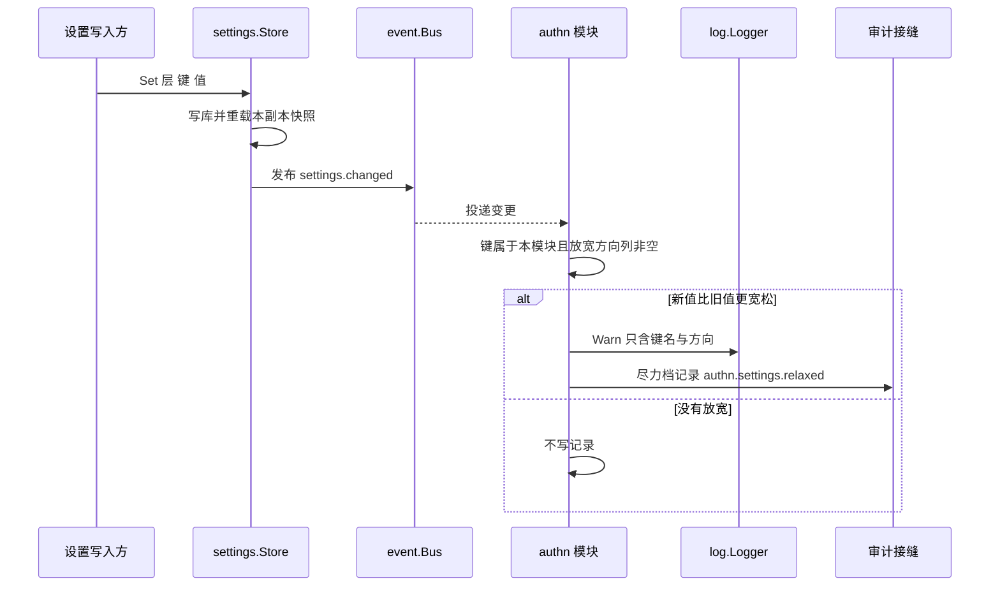
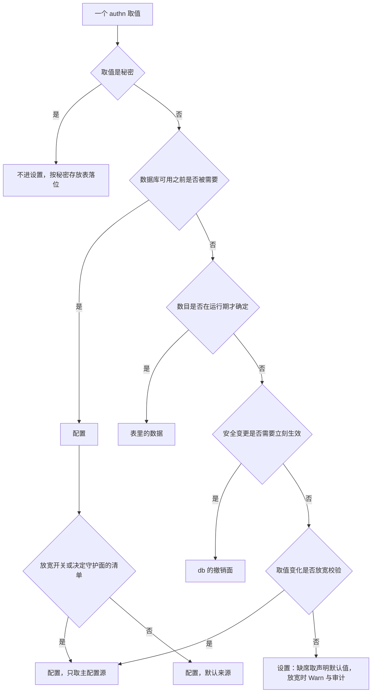
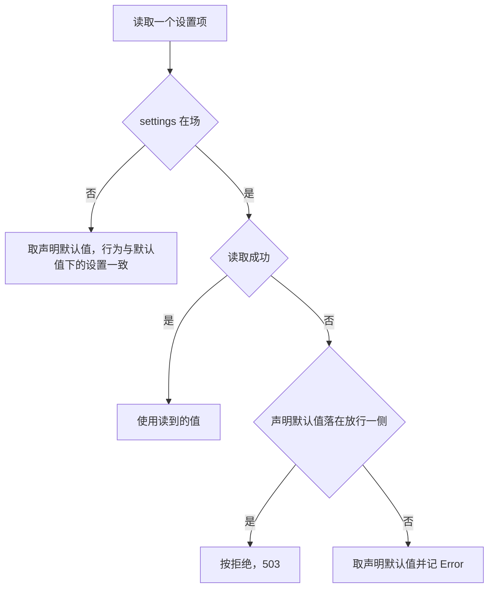

# authn 配置、设置与秘密

## 职责

本文是 `pkg/authn` 与 `tenant.admission` 全部输入项的唯一载体：配置键、设置键、秘密的存放，以及启动期自检与启动诊断。各模块的文档只写自己持有的键的语义并链接到本文，不复述键表。总览见 [design-authn](design-authn.md)，取舍见 [ADR-authn-settings-and-secrets-2026-10-10](../../adr/adr-authn-settings-and-secrets-2026-10-10.md)。

本文承载下列事项（封闭集合，不在其内的事项归非职责一节点名的文档）：

- **划界**：一个取值落在配置、设置、表里的数据之中的哪一处，判据与判定顺序。
- **配置键表**：每个键的类型、缺省值、来源、敏感与必填标记。
- **设置键表**：每个键的类型、缺省值、取值域、是否按租户回落、放宽方向。
- **放宽开关**：集合、来源限制与启动诊断。
- **设置的读取**：对 authn 各模块的可选依赖、缺席时的降级、读取出错的方向、放宽变更的监视。
- **秘密的存放**：材料、存放形态、轮换、暴露面与处置。
- **启动期自检与启动诊断**。

本文用「放宽开关」指取值变化即放宽校验的开关：取放宽值时，一次校验比取缺省值时更容易通过，或发送面更大。这是判据，不是名单；名单见[放宽开关](#放宽开关)一节。

### 非职责

- **不承载取舍理由。** 为什么分界取这条判据、为什么放宽开关不进设置、为什么签名私钥不进数据库，以及被否决的选项与接受的代价，归 [ADR-authn-settings-and-secrets-2026-10-10](../../adr/adr-authn-settings-and-secrets-2026-10-10.md)。
- **不承载键的行为语义。** 键表的「说明」列只写一句话；键起什么作用、与哪些流程相关，归持有它的文档：[design-authn-gate](design-authn-gate.md)、[design-authn-account](design-authn-account.md)、[design-authn-session](design-authn-session.md)、[design-authn-token](design-authn-token.md)、[design-authn-login](design-authn-login.md)、[design-authn-mfa](design-authn-mfa.md)、[design-authn-sms](design-authn-sms.md)、[design-authn-sso](design-authn-sso.md)、[design-authn-impersonation](design-authn-impersonation.md)、[design-tenant-admission](design-tenant-admission.md)。
- **不承载哨兵表全集与依赖不可用时每条路径的方向。** 自检表只列「这一项失败时报哪个哨兵」；哨兵的含义与修复动作、运行期的失败方向归 [design-authn-failure](design-authn-failure.md)。
- **不承载 `authn.settings.relaxed` 的审计与事件契约。** 记录的档位、字段与名字归 [design-authn-events](design-authn-events.md)；本文只写何时记、记什么不记什么。
- **不承载每租户的 IdP 清单。** 数目在运行期才确定的实体是表里的数据，IdP 在 `authn_idps` 表（[design-authn-sso](design-authn-sso.md)），不是配置，也不是设置。
- **不提供设置写入面的访问控制。** 设置的写入面不判权限，访问控制归宿主（[ADR-settings-scope-2026-09-21](../../adr/adr-settings-scope-2026-09-21.md)、[design-settings](design-settings.md)）；authn 只在放宽方向上提供事后可见。
- **不配置数据库的根密钥。** `encryption-key` 与 `encryption-retired-keys` 归 `db` 模块（[design-db](design-db.md)）；本文只写 authn 在启动时如何发现它缺失。
- **不提供命令行来源的秘密。** 秘密类配置项的来源不含命令行。
- **不提供配置式的豁免、可选认证与可冒充清单。** 这些登记只来自代码，理由见 [design-authn](design-authn.md) 的非职责。

## 外部接口契约

本节是 authn 对宿主的承诺：键的名字、类型、缺省值、来源与取值域，设置缺席与读取出错时的行为，放宽变更的可见性，秘密的存放形态。宿主写配置文件、在管理面写设置、读启动日志，依据的都是本节。

### 命名空间

`config.Schema` 的命名空间与模块名同值，设置键的路径是命名空间加键名。下表是 authn 与 `tenant.admission` 声明输入项的命名空间的全集（封闭集合）；不在表内的 authn 模块不声明输入项。`authn.mount` 需要的挂载键由 `authn.gate` 声明，`authn.mount` 与需要对外基址的模块在自己的 `Prepare` 里读取这几个键，这是已有的跨模块读法，不是重复声明。

| 命名空间 | 持有它的文档 | 声明的输入项 |
|---|---|---|
| `authn.gate` | [design-authn-gate](design-authn-gate.md) | 配置 |
| `authn.static` | [design-authn-gate](design-authn-gate.md) | 配置与设置 |
| `authn.account` | [design-authn-account](design-authn-account.md) | 配置与设置 |
| `authn.session` | [design-authn-session](design-authn-session.md) | 配置与设置 |
| `authn.token` | [design-authn-token](design-authn-token.md) | 配置与设置 |
| `authn.login` | [design-authn-login](design-authn-login.md) | 设置 |
| `authn.login.google`、`authn.login.github`、`authn.login.wechat-web`、`authn.login.wechat-mp` | [design-authn-login](design-authn-login.md) | 配置 |
| `authn.mfa` | [design-authn-mfa](design-authn-mfa.md) | 设置 |
| `authn.mfa.totp`、`authn.mfa.webauthn` | [design-authn-mfa](design-authn-mfa.md) | 配置 |
| `authn.sms` | [design-authn-sms](design-authn-sms.md) | 配置与设置 |
| `authn.sms.aliyun`、`authn.sms.tencent` | [design-authn-sms](design-authn-sms.md) | 配置 |
| `authn.sso` | [design-authn-sso](design-authn-sso.md) | 配置与设置 |
| `authn.sso.saml` | [design-authn-sso](design-authn-sso.md) | 配置 |
| `authn.impersonation` | [design-authn-impersonation](design-authn-impersonation.md) | 设置 |
| `tenant.admission` | [design-tenant-admission](design-tenant-admission.md) | 配置与设置 |

命名空间之间的冲突按全部已登记模块判：两个模块不得声明同一路径，也不得一个路径是某模块的叶子、另一个模块的内部节点。因此 `authn` 本身不得是任何模块的叶子，也不能让所有 authn 模块共用一个 `authn.*` 平铺命名空间；叶子名与同前缀模块的下一段同名的限制见 [design-authn](design-authn.md) 的外部接口契约。

### 配置项

配置项是启动必须项：在数据库可用之前就被需要的值，加构造时分配的大小。键表的约定：

- **来源**列：「主」是仅取主配置源，环境变量与命令行都改不了；「默认」是 `Origins` 的零值，即主配置源加环境变量，不含命令行。
- **标记**列：「敏」是 `Sensitive: true`，必带 `Description`；「必填」是 `Required: true`。必填项只对这次运行级纳入的模块判定，缺项时 `Decode` 失败，错误点名缺的那一项且不带秘密（[design-config](design-config.md)）。
- 容器叶子（映射与结构体列表）只能取主配置源，所以 `subjects` 与 `templates` 的来源是「主」，不是出于放宽的考虑。
- 表里写着缺省值取另一个键的，是该键解析后的值。

下表是网关与口令表后端的配置项（封闭集合）。

| 键 | 类型 | 缺省 | 来源 | 标记 | 说明 |
|---|---|---|---|---|---|
| `authn.gate.endpoints` | 字符串列表 | `["*"]` | 主 | | 网关所守的入口端；`*` 即入口模块声明的每一个端 |
| `authn.gate.call-budget` | `time.Duration` | `5s` | 默认 | | 一次进入校验后端的调用的期限；须为正 |
| `authn.gate.in-flight` | 整数 | `64` | 默认 | | 同时进行的后端调用数上限，满时请求收口 503；须为正 |
| `authn.gate.mount.endpoint` | 字符串 | 空 | 默认 | | authn 自己的路由所挂的入口端 |
| `authn.gate.mount.base-path` | 字符串 | `/auth` | 默认 | | 路由基路径；以 `/` 起头、不以 `/` 结尾、无通配，是 gin 规整后的写法 |
| `authn.gate.mount.public-url` | 字符串 | 空 | 默认 | | 对外基址，只含来源不含路径 |
| `authn.gate.mount.allow-insecure` | 布尔 | `false` | 主 | | 放宽开关，仅开发：放行 http 基址，cookie 去掉 `__Host-` 前缀与 `Secure` |
| `authn.gate.trusted-origins` | 字符串列表 | 空 | 主 | | 跨源检查与 `return_to` 额外信任的来源，每项 `scheme://host[:port]`，先规范成浏览器发送的形式再匹配（规则见 [design-authn-gate](design-authn-gate.md#可信来源的规范形式)）；`public-url` 的来源恒可信 |
| `authn.static.subjects` | 主体名到 PHC 条目的映射 | 无 | 主 | 必填、敏 | 口令表；键是主体名，值是 PHC 条目，遗留写法只读并告警 |
| `authn.static.cache-size` | 整数 | `1024` | 默认 | | 口令校验缓存的容量，取值 1 到 1000000，0 被拒绝（要关闭缓存，把设置 `authn.static.cache-ttl` 设为 0），构造时分配 |
| `authn.static.concurrency` | 整数 | `min(GOMAXPROCS,8)` | 默认 | | 口令派生的并发上限，取值 1 到 256，构造时分配 |

口令表后端的失败退避表另有一个不是输入项的界限：固定键之外至多记 16384 个键，常量 `MaxThrottleKeys` 在 `internal/password`。它是内存上界而不是调参旋钮，所以不设键；口令表里每个主体的键是固定键，不占这些名额，也不会被挤出，机制见 [design-authn-gate](design-authn-gate.md)。

下表是账户、会话与令牌的配置项（封闭集合）。

| 键 | 类型 | 缺省 | 来源 | 标记 | 说明 |
|---|---|---|---|---|---|
| `authn.account.password-algorithm` | 字符串 | `argon2id` | 默认 | | `argon2id` 或 `pbkdf2-sha256`；要求 FIPS 140 的部署取后者 |
| `authn.account.password-concurrency` | 整数 | `min(GOMAXPROCS,8)` | 默认 | | 口令派生的并发上限 |
| `authn.account.password-memory-budget-mib` | 整数 | `512` | 默认 | | 账户后端的口令派生内存预算，启动时分配（口令表后端另持自己的一份缺省预算，不设键）；至少是 `authn.account.password-argon2-memory-kib` 取值域上限的两倍，否则 `ErrInvalidConfig` |
| `authn.account.signup` | 字符串 | `closed` | 主 | | 放宽开关；放宽值 `open` |
| `authn.account.auto-link` | 字符串 | `never` | 主 | | 放宽开关；放宽值 `verified-email` |
| `authn.session.cookie-domain` | 字符串 | 空 | 默认 | | 非空则 cookie 名改为 `__Secure-sid` 并写出 `Domain` 属性 |
| `authn.session.same-site` | 字符串 | `lax` | 默认 | | `lax` 或 `strict`；`none` 被拒绝 |
| `authn.token.issuer` | 字符串 | `authn.gate.mount.public-url` | 默认 | | 访问令牌的 `iss` |
| `authn.token.audience` | 字符串列表 | `[issuer]` | 默认 | | 访问令牌的 `aud`；缺省为空时取 `[issuer]` |
| `authn.token.client-id` | 字符串 | `speed` | 默认 | | 会话换来的令牌的 `client_id` 声明 |
| `authn.token.algorithm` | 字符串 | `ES256` | 默认 | | 签名算法，`ES256` 或 `RS256` |
| `authn.token.signing-key-file` | 字符串，文件路径 | 无 | 默认 | 敏 | 当前签名私钥，PKCS#8 PEM；不填则本模块只验证、不签发 |
| `authn.token.verify-key-files` | 字符串列表，文件路径 | 空 | 默认 | | 只用来验签与发布的密钥文件 |
| `authn.token.check-session` | 布尔 | `true` | 主 | | 放宽开关；放宽值 `false`，关闭整个会话步骤（含 service 种令牌的 `sid` 种类核对） |

下表是登录方式与多因素的配置项（封闭集合）。提供方的客户端标识与密钥是启动必须项：纳入该模块即必填，缺项即启动失败。

| 键 | 类型 | 缺省 | 来源 | 标记 | 说明 |
|---|---|---|---|---|---|
| `authn.login.google.client-id` | 字符串 | 无 | 默认 | 必填 | 提供方的客户端标识 |
| `authn.login.google.client-secret` | 字符串 | 无 | 默认 | 必填、敏 | 提供方的客户端密钥 |
| `authn.login.google.hosted-domain` | 字符串 | 空 | 默认 | | 非空时要求 ID 令牌的 `hd` 声明相等 |
| `authn.login.github.client-id` | 字符串 | 无 | 默认 | 必填 | 提供方的客户端标识 |
| `authn.login.github.client-secret` | 字符串 | 无 | 默认 | 必填、敏 | 提供方的客户端密钥 |
| `authn.login.wechat-web.app-id` | 字符串 | 无 | 默认 | 必填 | 网站应用扫码登录的应用标识；纳入即必填，缺则 `ErrInvalidConfig` |
| `authn.login.wechat-web.app-secret` | 字符串 | 无 | 默认 | 必填、敏 | 同上的应用密钥 |
| `authn.login.wechat-mp.app-id` | 字符串 | 无 | 默认 | 必填 | 公众号网页授权登录的应用标识；与网站应用各自一份配置，没有联合判定 |
| `authn.login.wechat-mp.app-secret` | 字符串 | 无 | 默认 | 必填、敏 | 同上的应用密钥 |
| `authn.mfa.totp.issuer` | 字符串 | `authn.gate.mount.public-url` 的主机名 | 默认 | | 写进 `otpauth://` 地址的发行者名 |
| `authn.mfa.webauthn.rp-id` | 字符串 | `authn.gate.mount.public-url` 的主机名 | 默认 | | 依赖方标识；须等于基址主机或其父域 |
| `authn.mfa.webauthn.rp-name` | 字符串 | `speed` | 默认 | | 依赖方的显示名 |
| `authn.mfa.webauthn.origins` | 字符串列表 | `authn.gate.mount.public-url` 的来源 | 默认 | | 依赖方接受的来源 |

`authn.mfa.webauthn` 的 `Timeouts.*.Enforce` 固定为真，不做成配置项。

下表是短信、企业 SSO 与租户准入的配置项（封闭集合）。

| 键 | 类型 | 缺省 | 来源 | 标记 | 说明 |
|---|---|---|---|---|---|
| `authn.sms.workers` | 整数 | `4` | 默认 | | 异步发送的有界工作池的协程数 |
| `authn.sms.queue-size` | 整数 | `1024` | 默认 | | 异步发送队列的容量 |
| `authn.sms.aliyun.access-key-id` | 字符串 | 无 | 默认 | 必填 | 厂商访问标识 |
| `authn.sms.aliyun.access-key-secret` | 字符串 | 无 | 默认 | 必填、敏 | 厂商访问密钥 |
| `authn.sms.aliyun.endpoint` | 字符串 | `dysmsapi.aliyuncs.com` | 默认 | | 厂商接入点 |
| `authn.sms.aliyun.sign-name` | 字符串 | 无 | 默认 | 必填 | 短信签名 |
| `authn.sms.aliyun.templates` | （用途，语言）到模板编号的映射 | 无 | 主 | 必填 | 键写 `用途/语言`，用途取 `login`、`mfa`、`enroll`，语言取 `zh-CN`、`en-US`，如 `login/zh-CN`；缺任何一个组合即 `ErrInvalidConfig` |
| `authn.sms.tencent.secret-id` | 字符串 | 无 | 默认 | 必填 | 厂商访问标识 |
| `authn.sms.tencent.secret-key` | 字符串 | 无 | 默认 | 必填、敏 | 厂商访问密钥 |
| `authn.sms.tencent.sdk-app-id` | 字符串 | 无 | 默认 | 必填 | 厂商应用标识 |
| `authn.sms.tencent.region` | 字符串 | 无 | 默认 | 必填 | 厂商地域 |
| `authn.sms.tencent.sign-name` | 字符串 | 无 | 默认 | 必填 | 短信签名 |
| `authn.sms.tencent.templates` | 同 `authn.sms.aliyun.templates` | 无 | 主 | 必填 | 同 `authn.sms.aliyun.templates` |
| `authn.sso.allow-private-egress` | 布尔 | `false` | 主 | | 放宽开关，仅开发：放开出站调用对回环地址的拒绝 |
| `authn.sso.saml.sp-key-file` | 字符串，文件路径 | 无 | 默认 | 敏 | 服务提供方私钥；只在 IdP 配了 `sign_requests` 或要加密断言时需要，缺则 `Validate` 拒绝 |
| `authn.sso.saml.sp-cert-file` | 字符串，文件路径 | 无 | 默认 | | 服务提供方证书，条件同上 |
| `authn.sso.saml.sp-next-cert-file` | 字符串，文件路径 | 无 | 默认 | | 先发布的下一张证书，轮换时用 |
| `tenant.admission.endpoints` | 字符串列表 | 无 | 主 | 必填 | 准入层所守的端；与 `tenant.resolve.endpoints` 同形，一般相同；空是 `ErrInvalidConfig`，不接受 `*`，不得含 authn 的挂载端 |

`authn.sms.aliyun` 与 `authn.sms.tencent` 是排他的 `SMSSender`：只能纳入其中一个，同时纳入在消解阶段失败。必填判定只对运行级纳入的模块做，没有被纳入的厂商模块的必填项不参与判定。

### 设置项

设置项是运行期可变的值。键表的约定：

- 类型取 settings 的封闭集：字符串、布尔、整数、浮点、`time.Duration`；列表用 JSON 文本的字符串项（[design-settings](design-settings.md)）。
- **租**列：「是」表示按租户回落，取值依次取租户行、全局行、声明默认值；空白表示只读全局层。
- **取值域**由 `Item.Domain` 声明，写入时判，读取不判；每项带 `Description`。设置声明的默认值必须在自己的取值域内。
- **放宽方向**列给出该键取值朝哪个方向改动即放宽校验或扩大发送面；空白表示该键的改动不放宽校验，不被监视。判据与监视见[放宽变更的监视](#放宽变更的监视)。
- 数字缺省值是起点，不是对规范条文的引用。NIST SP 800-63B-4 与 ASVS 5.0 给的是上界与定性要求：验证码长度至少 6、有效期至多 10 分钟、单次有效、重发不清零失败计数、尝试次数上界 100；规范没有给出重发频率与发送预算的数字。这些条文的条号未逐条核对，缺省值不构成合规声明。

下表是会话与令牌的设置项（封闭集合）。

| 键 | 类型 | 缺省 | 取值域 | 租 | 放宽方向 |
|---|---|---|---|---|---|
| `authn.session.idle-timeout` | `time.Duration` | `30m` | 1m 到 24h | | 增大 |
| `authn.session.absolute-timeout` | `time.Duration` | `12h` | 10m 到 30d | | 增大 |
| `authn.session.token-absolute-timeout` | `time.Duration` | `720h` | 1h 到 8760h | | 增大 |
| `authn.session.sso-absolute-timeout` | `time.Duration` | `8h` | 10m 到 30d | | 增大 |
| `authn.session.touch-interval` | `time.Duration` | `60s` | 5s 到 10m | | |
| `authn.session.check-ttl` | `time.Duration` | `5s` | 0 到 60s | | 增大 |
| `authn.session.max-per-account` | 整数 | `20` | 1 到 1000 | | |
| `authn.session.retention` | `time.Duration` | `168h` | 1h 到 8760h | | |
| `authn.token.access-ttl` | `time.Duration` | `10m` | 1m 到 1h | | 增大 |
| `authn.token.leeway` | `time.Duration` | `30s` | 0 到 120s | | 增大 |
| `authn.token.refresh-idle-ttl` | `time.Duration` | `168h` | 1h 到 2160h | | 增大 |
| `authn.token.refresh-grace` | `time.Duration` | `0` | 0 到 60s | | 增大 |

下表是口令表与账户的设置项（封闭集合）。口令表的进程内退避与校验缓存的参数是设置，`settings` 缺席时取缺省值；缓存容量与并发是配置（见上）。

| 键 | 类型 | 缺省 | 取值域 | 租 | 放宽方向 |
|---|---|---|---|---|---|
| `authn.static.free-attempts` | 整数 | `5` | 1 到 20 | | 增大 |
| `authn.static.fail-window` | `time.Duration` | `15m` | 1m 到 24h | | 减小 |
| `authn.static.max-backoff` | `time.Duration` | `15m` | 10s 到 24h | | 减小 |
| `authn.static.cache-ttl` | `time.Duration` | `60s` | 0 到 5m；0 关闭缓存 | | |
| `authn.account.password-min-length` | 整数 | `12` | 8 到 64 | | 减小 |
| `authn.account.password-argon2-memory-kib` | 整数 | `19456` | 正整数，至多 262144 | | 减小 |
| `authn.account.password-argon2-iterations` | 整数 | `2` | 正整数，至多 10 | | 减小 |
| `authn.account.password-argon2-parallelism` | 整数 | `1` | 正整数，至多 16 | | |
| `authn.account.password-pbkdf2-iterations` | 整数 | `600000` | 600000 到 10000000 | | 减小 |
| `authn.account.throttle-free-attempts` | 整数 | `5` | 1 到 10 | | 增大 |
| `authn.account.throttle-max-delay` | `time.Duration` | `15m` | 10s 到 24h | | 减小 |
| `authn.account.throttle-decay` | `time.Duration` | `1h` | 1m 到 24h | | 减小 |
| `authn.account.secret-retention` | `time.Duration` | `720h` | 1h 到 8760h | | |

`cache-ttl` 是绝对期限：自一次真实派生通过起算，命中不续期，0 关闭缓存。`fail-window` 与 `max-backoff` 的取值域各自独立，所以 `max-backoff` 大于 `fail-window` 的组合合法。失败计数在窗口已过、且这些失败赚得的等待也已走完之后才归零，窗口不会在锁定期结束之前把计数清掉；缺省值下两者相等，行为与按窗口归零相同。账户的 `throttle-decay` 与 `throttle-max-delay` 同判（[design-authn-account](design-authn-account.md)）。

Argon2id 的 `memory-kib`、`iterations`、`parallelism` 各自只能在单项取值域内判，而 OWASP 最低组合按（m, t, p）的组合判：各自合法而组合低于下限时，写入不被拒绝，使用处回落到默认组合并记 `Error`（回落与内存预算的口径见 [design-authn-account](design-authn-account.md)）。`secret-retention` 是服务密钥到期或撤销之后行的保留期。

下表是登录、短信与多因素的设置项（封闭集合）。

| 键 | 类型 | 缺省 | 取值域 | 租 | 放宽方向 |
|---|---|---|---|---|---|
| `authn.login.flow-ttl` | `time.Duration` | `10m` | 1m 到 30m | | 增大 |
| `authn.login.call-budget` | `time.Duration` | `10s` | 1s 到 60s | | |
| `authn.login.default-return-to` | 字符串 | `/` | 按 `return_to` 的规则校验 | | |
| `authn.login.disabled-methods` | 字符串，JSON 数组 | `[]` | 登录方式名的数组 | | 移除成员 |
| `authn.login.delivery-modes` | 字符串，JSON 数组 | `["session","token"]` | 缺省集合的子集 | | 加入成员 |
| `authn.login.ip-limit` | 整数 | `0`，关闭 | 0 到 10000，每分钟 | | 改为 0，或增大 |
| `authn.sms.allowed-prefixes` | 字符串，JSON 数组 | `[]`，空即一律拒绝发送 | E.164 前缀的数组 | | 加入成员 |
| `authn.sms.code-length` | 整数 | `6` | 6 到 8 | | 减小 |
| `authn.sms.code-ttl` | `time.Duration` | `5m` | 1m 到 10m | | 增大 |
| `authn.sms.code-attempts` | 整数 | `5` | 1 到 10 | | 增大 |
| `authn.sms.resend-interval` | `time.Duration` | `60s` | 30s 到 10m | | 减小 |
| `authn.sms.per-phone-hourly` | 整数 | `5` | 1 到 60 | | 增大 |
| `authn.sms.per-phone-daily` | 整数 | `10` | 1 到 200 | | 增大 |
| `authn.sms.global-hourly-login` | 整数 | `300` | 1 到 1000000 | | 增大 |
| `authn.sms.global-hourly-mfa` | 整数 | `300` | 1 到 1000000 | | 增大 |
| `authn.sms.global-hourly-enroll` | 整数 | `100` | 1 到 1000000 | | 增大 |
| `authn.sms.per-flow-sends` | 整数 | `3` | 1 到 10 | | 增大 |
| `authn.sms.per-account-hourly` | 整数 | `10` | 1 到 60 | | 增大 |
| `authn.mfa.global-required` | 布尔 | `false` | 布尔 | | 由 `true` 改为 `false` |
| `authn.mfa.recent-window` | `time.Duration` | `10m` | 1m 到 1h | | 增大 |
| `authn.mfa.max-per-kind` | 整数 | `5` | 1 到 20 | | |
| `authn.mfa.pending-ttl` | `time.Duration` | `1h` | 5m 到 24h | | |
| `authn.mfa.sensitive-min-age` | `time.Duration` | `24h` | 1h 到 720h | | 减小 |

补充：

- `authn.login.disabled-methods` 在运行期关闭一个登录方式，例如遭遇短信轰炸时关 `sms`；`authn.login.ip-limit` 缺省关闭的理由见 [design-authn-login](design-authn-login.md)。
- `authn.sms.global-hourly-*` 按用途分设：登录的预算耗尽不挤占已通过口令的第二因素与因素登记。
- `authn.sms.per-account-hourly` 只对 `mfa` 与 `enroll` 用途计数。
- `authn.mfa.sensitive-min-age` 是冒充发起与管理员重置因素所要求的因素启用年龄。

下表是企业 SSO、冒充与租户准入的设置项（封闭集合）。

| 键 | 类型 | 缺省 | 取值域 | 租 | 放宽方向 |
|---|---|---|---|---|---|
| `authn.sso.assertion-max-age` | `time.Duration` | `5m` | 1m 到 30m | | 增大 |
| `authn.sso.provider-cache-ttl` | `time.Duration` | `60s` | 5s 到 1h | | |
| `authn.sso.egress-timeout` | `time.Duration` | `10s` | 1s 到 60s | | |
| `authn.impersonation.max-ttl` | `time.Duration` | `30m` | 1m 到 1h | | 增大 |
| `authn.impersonation.max-auth-age` | `time.Duration` | `5m` | 1m 到 30m | | 增大 |
| `tenant.admission.require-mfa` | 布尔 | `false` | 布尔 | 是 | 由 `true` 改为 `false` |
| `tenant.admission.require-sso` | 布尔 | `false` | 布尔 | 是 | 由 `true` 改为 `false` |
| `tenant.admission.check-ttl` | `time.Duration` | `5s` | 0 到 60s | | 增大 |

`authn.sso.egress-timeout` 是出站调用的期限，请求期读取，`http.Client` 不设总 `Timeout`。

### 设置缺席与读取出错

- **设置对 authn 的各模块是可选依赖。** `settings.Store` 缺席时，各模块对每个设置项取声明的默认值，行为与默认值下的设置完全一致，只是不可调整。只使用口令表的宿主因此不必为几个退避参数运行数据库与事件总线（`settings` 模块自己要求 `db` 与 `event.Bus`）。这是 [ADR-config-scope-2026-09-13](../../adr/adr-config-scope-2026-09-13.md) 接受的降级，不是配置。
- **在自己的 `Init` 里读设置的模块，对设置写 `Optional` 的依赖声明**；不写则读取报 `ErrNotLoaded`（快照在设置模块的 `Init` 装载）。请求路径上的读取不受此限。
- **读设置出错的方向由设置项的类别定**：强制类开关读不出来时按拒绝，应答 503；其余取值读不出来时取声明默认值并记 `Error`。类别的定义与流程见[读取设置的方向](#读取设置的方向)。
- **安全参数的缺省取最严的取值，并声明取值域**：写入时判下限，使宿主无法经设置把口令哈希参数配到最低要求之下。
- **读取走内存快照**，不发起 IO、不收上下文；变更经 `settings.changed` 事件与周期刷新传播，最坏延迟是刷新间隔（缺省 5 分钟）。凡安全上需要立刻生效的变更（撤销）不走设置，走 db 的撤销面。

### 放宽开关

放宽开关的 `Origins` 只取主配置源：环境变量与命令行都改不了，也不放进设置。决定守护面的清单（`authn.gate.endpoints`、`authn.gate.trusted-origins`、`tenant.admission.endpoints`）同样只取主配置源。下表列出当前归入的放宽开关，是判据的例举，不是封闭集；按判据新增的同类开关一并归入，并补一行启动诊断。

| 开关 | 放宽值 | 缺省 |
|---|---|---|
| `authn.gate.mount.allow-insecure` | `true` | `false` |
| `authn.sso.allow-private-egress` | `true` | `false` |
| `authn.account.signup` | `open` | `closed` |
| `authn.account.auto-link` | `verified-email` | `never` |
| `authn.token.check-session` | `false` | `true` |

放宽开关不进设置的原因是设置的写入面没有访问控制：持有设置写权限的主体能在运行期放宽它们，而启动诊断的 `Warn` 只在启动时写（[ADR-authn-settings-and-secrets-2026-10-10](../../adr/adr-authn-settings-and-secrets-2026-10-10.md)）。

### 放宽变更的监视

设置的写入面没有访问控制，也没有按键的写入钩子，所以 authn 不阻止设置被改到更宽松的取值，只保证事后可见。

- **监视的对象由判据定：** 放宽方向列非空的设置项。判据是该键的取值朝某个方向改动使校验更容易通过或发送面更大；表里的方向是按键的语义给出的，新增设置项时按同一判据补列。
- **authn 订阅 `settings.changed`。** 变更命中放宽方向时，写一行 `Warn`，并经审计接缝记一条尽力档记录 `authn.settings.relaxed`。**记录与日志只含键名与方向，不含值。**
- 记录的档位、字段名与失败时的计数归 [design-authn-events](design-authn-events.md)。
- `AGENTS.md` 写入硬要求：`authn.*` 与 `tenant.admission.*` 的设置不得对租户或普通管理员开放写权限。authn 无法检查宿主是否遵守。

### 秘密的存放

下表是 authn 处理的秘密与密钥材料（封闭集合）；新增的秘密类材料要归入下表已有的存放形态之一，不得新增形态。

| 材料 | 存放 | 轮换 | 暴露面与处置 |
|---|---|---|---|
| 账户口令哈希 | db，PHC 字符串 | 用户改口令；参数升级在下次登录时重算 | 库转储可离线猜解，靠 Argon2id 的成本抵御；不进审计明细（原生写） |
| 口令表条目 | 配置 `authn.static.subjects`，PHC 字符串 | 运维重写条目 | 配置文件的访问控制 |
| 会话令牌、刷新令牌、服务密钥 | 客户端持有；库里只存 SHA-256 | 会话在登录与提权时换；刷新令牌每次使用即换；服务密钥多把并存，旧的过期或撤销 | 库转储得不到可用凭据 |
| 短信验证码 | db，带密钥摘要（`BlindIndex`） | 每次发送新码 | 密钥是 db 根密钥派生的子密钥；根密钥轮换使在途挑战失效 |
| TOTP 种子 | `authn_totp_secrets.secret` 加密列 | 用户删除并重新登记 | db 根密钥；只在登记应答里出现一次；应用被攻破即种子泄露 |
| WebAuthn 公钥 | 明文列 | 用户删除并重新登记 | 非秘密 |
| JWT 签名私钥 | 配置里的文件路径，PKCS#8 PEM | 两相轮换与应急撤销，步骤见 [design-authn-token](design-authn-token.md) | 文件权限只能 `Warn`、不能强制；Kubernetes 密钥挂载是自然的承载 |
| 企业 OIDC 客户端密钥 | `authn_idps.client_secret` 加密列 | 管理面 `PUT` 带新密钥，`version` 加一，各副本按版本重建缓存 | 读取接口从不交出它，应答里只有「是否已设置」 |
| SAML 的 SP 私钥 | 配置里的文件路径 | `authn.sso.saml.sp-next-cert-file` 先发布新证书，IdP 侧更新后换位 | 同 JWT 签名私钥 |
| IdP 的签名证书 | `config.idp_certs`，公钥证书 | 管理员更新，可同时放当前与下一张 | 非秘密，但变更要经管理面，强制审计 |
| 社交登录、微信、短信厂商的密钥 | 配置的敏感项 | 运维改配置并滚动重启；提供方允许新旧并存的，先加新、再换、再删旧 | 另登记为日志的字面量匹配器 |
| 校验缓存的 HMAC 密钥 | 进程内存，启动时随机 | 重启即换 | 不落盘 |

存放的规则：

- **authn 自己持有的机密只以下列形态存放（封闭集合）：** 哈希（口令、令牌、验证码、服务密钥）、数据库加密列（因素种子、IdP 客户端密钥）、文件（JWT 签名私钥、SAML 私钥）。提供方发给宿主的客户端密钥与厂商密钥是启动必须项，存在配置的敏感项里；配置里的敏感项只放这类启动必须项。
- **秘密不进命令行。** 秘密类配置项取 `Origins` 的零值，标 `Sensitive` 并带 `Description`，因为命令行参数会进入命令行历史与进程列表。
- **秘密不进设置。** 设置的值明文存库，`Sensitive` 只遮蔽变更事件的载荷与 `Declared` 的默认值，`Get` 与 `List` 照常交出值。
- **`Sensitive` 不向日志登记脱敏。** 它只约束错误文本不复述值、帮助输出不回显默认值、必须带说明。每个持有秘密配置值的模块在自己的 `New` 里把该值另登记为日志的字面量匹配器；日志模块不在这次运行的参与集里时登记不上。
- **`db` 根密钥是加密列这一半的单点。** 缺它不是 `db` 的启动失败，到第一条触及加密列的语句才失败（[design-db](design-db.md)）。带加密列的模块（`authn.mfa.totp`、`authn.sso`）因此在 `Start` 里各做一次加密列往返自检，见[加密列往返自检](#加密列往返自检)。
- **根密钥轮换时，`db` 的退役密钥只解不写**，加密列在下次写入时换到新钥；authn 不提供批量重加密。
- **authn 不对手机号与邮箱使用盲索引**：换根密钥会使每个摘要失效。短信验证码的带密钥摘要只在有效期内有意义，轮换的影响只是在途挑战失效。
- **签名私钥不放 db**，使根密钥这个单点不连带令牌的签名。
- **加密列只能经模型路径读写**（序列化器的要求），因此受审计的语句级捕获；明细是否带列值是一项假设，见[外部行为假设与守住它们的测试](#外部行为假设与守住它们的测试)。

### 稳定性承诺

- 键的路径（命名空间加键名）、类型、缺省值、来源与取值域，以及放宽开关的集合与它们的来源限制，是 authn 与宿主之间的契约。改键名、命名空间或类型使旧写法成为主配置源里的未知键，宿主随之启动失败；收窄取值域使以前写得进去的值被拒绝；改变缺省值改变没有显式配置的宿主的行为。上述变更都是宿主可见的变更。
- 放宽开关的缺省值恒取严的一端。
- 放宽方向列、`authn.settings.relaxed` 的名字与「只含键名与方向」是可观察面契约的一部分：运维的告警规则读的是它们。

## 依赖

| 依赖 | 方式 | 用途 | 缺席时 |
|---|---|---|---|
| `config.Reader` | 取用 | 各模块在 `Prepare` 里 `Decode` 自己的命名空间 | 取不到则把 `core.ErrMissingProvider` 原样外传，终止启动 |
| `settings.Store` | `Optional` | 读取全部设置项；在自己的 `Init` 里读的模块写 `Optional` | 各项取声明的默认值，行为与默认值下的设置完全一致 |
| `event.Bus` | 取用，缺席合法 | 订阅 `settings.changed`，监视放宽变更 | 无监视；设置缺席时本就没有变更 |
| `audit` | 取用，缺席合法 | 放宽变更的尽力档记录 | 只写 `Warn` |
| `log.Logger` | 取用，缺席合法 | 启动诊断、放宽变更的 `Warn`、字面量匹配器的登记 | 无日志；字面量匹配器登记不上 |
| `db.Database` | `Requires`，由带表与加密列的模块声明 | 加密列往返自检、迁移探测 | 构造失败 |
| `core.Registry.Participating` | 调用 | `authn.sso` 与 `authn.mfa` 在 `Start` 里判 `tenant.admission` 是否在参与集 | 判为不在，写 `Warn` |

方向满足架构不变量：authn 位于 `config`、`settings`、`log`、`db`、`event` 之上，不被其中任何一个 import；`tenant.admission` 对 authn 根包的依赖方向见 [design-tenant-admission](design-tenant-admission.md)。设置对 authn 是可选依赖，使最小装配（只有口令表）不被迫引入设置及其下层。

## UML 图

放宽变更的监视是 authn 与 settings、事件总线、日志、审计之间的一次跨模块交互，下图固定它的次序。图画不出的约束：监视只对放宽方向列非空的键起作用；记录与日志只含键名与方向；事件的投递语义由事件实现决定，所以一次变更留下的痕迹条数不由 authn 保证。

## 核心数据结构

本文没有运行期的数据结构；键的声明形状如下，它们是本文各表的列所对应的声明字段。

**配置项的声明**（`config.Schema` 的 `Items`）：

- `Origins`：缺省取零值；放宽开关、决定守护面的清单与容器叶子取仅主配置源。
- `Sensitive`：秘密类配置项为真，且必带 `Description`；为真的项不向命令行库交出默认值。
- `Required`：运行级纳入的模块的启动必须项为真；判定发生在模块自己 `Decode` 的时刻。
- 命名空间取模块名，键名只含小写字母、数字与短横线。

**设置项的声明**（`settings.Schema` 的 `Items`）：

- 声明类型取 settings 的封闭集；列表是 JSON 文本的字符串项。
- `Default`：数字缺省值是起点；安全参数的缺省取最严的取值。
- `Domain`：由 `DomainOf` 构造，写入时判、读取不判；默认值必须在域内。
- `Description`：每项必带。
- `Sensitive`：authn 的设置项不设；秘密不进设置。

## 核心算法与流程

### 落位判定

一个 authn 取值按下图的次序判定落点，首个命中的问题决定落点。秘密的问题排在最前，因为秘密一旦进设置就随 `Get`、`List` 与库转储明文流出。

- **数据库可用之前就被需要**的值是配置：网关的参数、口令表的表本身与构造时分配的大小（缓存容量、并发信号量、口令内存预算）、凭据提供方的客户端标识与密钥、签名密钥与 SAML 私钥的文件、对外基址、依赖方标识、短信厂商密钥、cookie 的域与 `SameSite`。这份名单是判据的例举，不是封闭集。
- **按租户或按运行时场景取不同值**的值落在设置一侧，这是「数据库可用之前就被需要」这条判据的推论：会话时长、令牌时长、口令策略与退避（含口令表的缓存时长与退避参数）、短信的位数与有效期与节流、多因素的策略、冒充的时限、SSO 的出站超时、租户的强制策略。这份名单同样是例举。
- **数目在运行期才确定的实体**既不是配置也不是设置，是表里的数据：每租户的 IdP、账户、会话、签名之外的密钥。
- **分界在值本身，不在模块。** 同一个模块里，构造时分配的缓存容量是配置，缓存时长是设置。
- 需要立刻生效的安全变更（撤销）不走设置，因为设置的最坏传播延迟是刷新间隔。

### 读取设置的方向

强制类开关读不出来按拒绝：它们的声明默认值是「不强制」「不关闭」，回落到默认值就等于放行。强制类开关是封闭集合：`tenant.admission.require-mfa`、`tenant.admission.require-sso`、`authn.login.disabled-methods`、`authn.mfa.global-required`。其余设置项属调参类，读不出来取声明默认值并记 `Error`：超时、预算与次数类（含缺省为 0 即关闭的 `authn.login.ip-limit`）回落到默认值只是用了起点。请求期的读取走内存快照，读取出错只在编程错误时出现，所以 `Error` 日志指向代码缺陷，不指向运维。

设置缺席是合法的装配，不是读取出错：缺席时全部取声明默认值，不记 `Error`，也不按拒绝。

### 启动期自检

任一失败即终止启动，错误点名缺的那一项，且不带秘密：`trusted-origins` 的项只以序号点名，`public-url` 与 `base-path` 至多回显去掉用户信息、查询与片段之后的值。下表是配置与秘密相关自检的全集（封闭集合）。网关装配自检（无入口模块、无校验后端、载体撞车）归 [design-authn-gate](design-authn-gate.md)。

| 自检 | 失败的哨兵 |
|---|---|
| `authn.gate.endpoints` 非空、无空名、无重名，`*` 不与具体端名混写；`authn.gate.call-budget` 与 `authn.gate.in-flight` 为正；`authn.token.issuer` 解析后非空（`issuer` 与 `authn.gate.mount.public-url` 都没给出即失败，此时空的 `audience` 也无从取默认值）、`authn.token.algorithm` 取 `ES256` 或 `RS256`、`authn.token.client-id` 非空 | `ErrInvalidConfig` |
| `tenant.admission.endpoints` 非空，且不含 `*` | `ErrInvalidConfig` |
| `authn.gate.endpoints` 里的端名存在于入口模块 | `ErrUnknownEndpoint` |
| `authn.gate.mount.public-url` 非空（由需要它的模块判）；`authn.gate.mount.public-url` 不是带主机的 http 或 https URL，或带用户信息、路径、查询、片段、空端口、越界端口、通配，或主机不是 ASCII（国际化域名写 punycode） | `ErrInvalidConfig` |
| `authn.gate.mount.base-path` 不以 `/` 起头、以 `/` 结尾、含通配或路径参数（`*`、`:`）、`?` 或 `#`，或不是 `path.Clean` 之后的写法 | `ErrInvalidConfig` |
| `authn.gate.trusted-origins` 的某一项不是 `scheme://host[:port]`：scheme 不是 http 或 https，带用户信息、路径、查询、片段、空端口、通配，端口不在 1 到 65535，或主机不是 ASCII（国际化域名写 punycode）；每项先规范成浏览器发送的形式，规范后相同的项并作一项 | `ErrInvalidConfig` |
| `authn.static.cache-size` 不在 1 到 1000000（0 被拒绝）；`authn.static.concurrency` 不在 1 到 256 | `ErrInvalidConfig` |
| `authn.gate.mount.public-url` 是 https（回环主机与 `allow-insecure` 为真时除外）；`authn.session.same-site` 不取 `none` | `ErrInsecureConfig` |
| `authn.gate.mount.endpoint` 存在于入口模块 | `ErrUnknownEndpoint` |
| `authn.gate.mount.endpoint` 被网关所守；`authn.mount` 在 `authn.gate.mount.endpoint` 为空且入口声明的端不是恰好一个时失败，网关在 `Start` 对同一规则再判一次 | `ErrRoutesUnguarded`、`ErrRoutesUnconfigured` |
| `authn.gate.mount.endpoint` 不被 `ScopeGuard` 所守；不在 `tenant.resolve.endpoints` 里（核不了则 `Warn`） | `ErrInvalidConfig` |
| 加密列往返（`db` 根密钥在）；`BlindIndex` 自检（包 `recover`） | `ErrNoEncryptionKey` |
| 签名与验证密钥文件可读、解析成功、算法一致、RSA 至少 2048 位、`kid` 不重复 | `ErrInvalidKey` |
| 每个口令表条目可解析且主体名合法；表非空 | `ErrInvalidClaim`；条目读不了时同时包住 `static.ErrMalformedHash` |
| `authn.login.wechat-web` 与 `authn.login.wechat-mp` 各自的必填项齐备；`authn.mfa.webauthn.rp-id` 等于基址主机或其父域；短信 `templates` 覆盖（用途，语言）的全部组合；SAML 的 `sign_requests` 有 SP 密钥；`authn.account.password-memory-budget-mib` 不低于 `m` 取值域上限的两倍 | `ErrInvalidConfig` |
| 纳入 `authn.login` 而没有任何 `LoginMethod`；纳入 `authn.mfa` 而没有任何 `Factor`，却设了 `global-required` 或库里已有账户登记了某个种类而该种类没有实现 | `ErrNoLoginMethod`、`ErrNoFactor` |
| 带表模块的迁移已施加（`Start` 里探测自己的表） | `ErrNotMigrated` |
| `Requires` 里的排他功能齐备（在构造之前） | `core.ErrMissingProvider` |

阶段：`authn.gate.mount.public-url` 与 `authn.gate.mount.base-path` 由需要它们的模块在自己的 `Prepare` 里判；`mount.endpoint` 是否被网关所守与是否被 `ScopeGuard` 所守由网关在 `Start` 里核对；加密列往返与迁移探测在 `Start` 里做，因为 `New` 里表还没建。

### 加密列往返自检

`db` 的根密钥缺失不是 `db` 的启动失败，带加密列的模块在 `Start` 里各做一次往返自检：经 `db` 的加密列序列化路径对一个值加密再解密，比较结果与原值相等；探测值不含任何真实秘密。失败即以 `ErrNoEncryptionKey` 终止启动，使根密钥缺失在启动时报出，不拖到第一条触及加密列的语句。使用 `BlindIndex` 的模块（短信验证码）另做一次包 `recover` 的 `BlindIndex` 自检，因为 `BlindIndex` 在没有根密钥时 panic，不降级为无密钥摘要。

### 启动诊断

诊断是成功路径上的日志，每行以 `authn: ` 起头，由持有对应项的模块写出。

**常规行**写出当前装配的事实：启用的校验后端与载体、登录方式与因素种类、每个端上被 `Exempt`、`Optional`、`Impersonable` 开出的路由、`authn.admin` 挂了哪几组路由。

**放宽项一律单独一行 `Warn`**，使它们在日志里可检索。下列是例举，判据是放宽开关的定义与「每个放宽都是显式开关」：

- `authn.gate.mount.allow-insecure` 为真。
- `authn.token.check-session` 为假。
- `authn.login.ip-limit` 为 0。
- 任一 IdP 的 `allow_idp_initiated`、`allow_sha1` 或 `merge_existing`。
- `authn.account.auto-link` 为 `verified-email`。
- `authn.account.signup` 为 `open`。
- `authn.sso.allow-private-egress` 为真。
- 口令表里低于策略下限的条目与遗留写法的条目。
- `authn.session.cookie-domain` 非空：`__Host-` 前缀所保证的「子域不可写」随之失去。
- 签名私钥与 SAML 私钥的文件对其他用户可读。

**其余 `Warn`：**

- 没有发件箱的装配里账户抹除不保证完成（[design-authn-account](design-authn-account.md)）。
- 网关装配里某个校验后端认领的 cookie 名不带 `__Host-` 前缀：每个这样的名字一行。兄弟子域的页面可以种下该名字的 cookie，网关只能拒绝带着两份同名 cookie 的请求，只带被种下的那一份的请求与诚实的请求分不开（[design-authn-gate](design-authn-gate.md)）。
- 口令表里只在大小写上不同、共用一个退避键的主体名：每一组一行，点名这组主体。
- `authn.sso` 与 `authn.mfa` 在 `Start` 里若 `core.Registry.Participating("tenant.admission")` 为假，各写一行：租户级强制 SSO 与强制多因素无人执行。

### 外部行为假设与守住它们的测试

下列行为未经运行核实，依赖它们的断言按假设处理；测试失败即视为前提不成立。

| 假设 | 依赖它的断言 | 守住它的测试 |
|---|---|---|
| 审计的语句级明细不带加密列的列值 | 秘密存放中数据库加密列这一形态成立：含加密列的模型经模型路径写入，值不会经审计明细泄露 | 审计行里不得出现秘密字节 |
| `settings.changed` 事件载荷足以让订阅方判定「改到更宽松」的方向，不必另读旧值 | 放宽变更的监视只靠事件载荷判方向 | 对放宽方向列里的每个键写入放宽方向的值，断言 `Warn` 与审计记录出现；不成立则订阅方要自己维护上一份取值 |

## 错误与失败语义

### 启动期

启动期的失败一律终止启动，错误点名缺的那一项，不带秘密；缺项是启动失败，不是静默缺席。自检与对应哨兵见[启动期自检](#启动期自检)；哨兵表对 authn 自己判定出的失败是封闭的，调用方以 `errors.Is` 判别（[design-authn-failure](design-authn-failure.md)）。`Sensitive` 的配置项在值转换失败时，错误文本只点名该项与它要的类型，不复述值（[design-config](design-config.md)）。

### 运行期

| 情形 | 方向 | 对外 |
|---|---|---|
| `settings.Store` 缺席 | 各设置项取声明默认值 | 无；行为与默认值下的设置一致 |
| 强制类开关读设置出错 | 拒绝 | 503 |
| 调参类设置读出错 | 取声明默认值，记 `Error` | 无；`Error` 指向编程错误 |
| 放宽变更的尽力档审计记录写入失败 | 业务继续，记 `Error` 与 `authn.audit.write-failures` 计数 | 无 |
| 加密列读写时 `db` 根密钥不可用 | 拒绝 | 503；启动时即缺失的情形已被启动期自检拦下 |

设置变更在副本之间最终一致：最坏延迟是刷新间隔；放宽变更的监视依赖事件，事件未投递到的副本由周期刷新使新值生效，但那个副本上不出现 `Warn` 与审计记录。

### 非保证

下列各项是本文所述机制不保证的性质，判据与总览一致（[ADR-authn-guarantees-2026-10-10](../../adr/adr-authn-guarantees-2026-10-10.md)）：成立与否取决于宿主的装配或其他模块的写法，因此写成非保证并写清可观察到什么。下列条目按判据例举，不是封闭集。

- **设置写入面不保证被访问控制。** 持有写权限的主体可以把退避、预算、前缀名单与会话期限改到更宽松；authn 只提供 `Warn` 与审计的事后可见，不提供阻止。阻止依赖宿主的管理面与 `AGENTS.md` 的硬要求，authn 不检查宿主是否遵守。
- **不保证一次放宽变更恰好留下一份痕迹。** 痕迹条数取决于事件实现的投递语义：广播到每个副本则每个副本各一份，消费者组式的则一份；事件丢失的副本没有痕迹。
- **设置变更不保证在副本之间同时生效。** 租户刚开启强制多因素或强制 SSO 后，最长数分钟内个别副本仍放行。
- **写非「租」键的租户层不起作用且不报错。** settings 没有「该键只许全局」的声明；authn 只在全局层读这些键。
- **设置快照在每个副本的内存里含全部租户的全部行**，这是 settings 的既有性质。
- **密钥文件的权限不保证被强制。** 签名私钥与 SAML 私钥的文件对其他用户可读时，只写 `Warn`。
- **日志脱敏不保证覆盖每个秘密配置值。** 登记由持有值的模块各自做，漏登记不报错，遮蔽与否取决于登记；日志模块不在参与集里时规则为空。
- **单一的 `db` 根密钥保护全部加密列。** 根密钥的事故同时是全部加密列的事故；authn 不提供批量重加密，退役密钥只解不写，加密列在下次写入时换到新钥。
- **放宽开关、客户端密钥、口令表与签名密钥文件的改动要重启才生效。** 无重启轮换要求放进设置，那意味着明文存库或放宽路径向写入面敞开，均不提供。
- **口令表的失败退避在多副本下每副本各算一份。**

## 扩展点

新增一个 authn 模块或新增一个键时，下列条件是准入条件：

- 新取值按[落位判定](#落位判定)的次序落点；命名空间取模块名，键名只含小写字母、数字与短横线，不得与同前缀模块的下一段同名。
- 秘密类取值只能归入[秘密的存放](#秘密的存放)里已有的存放形态，不得新增；秘密类配置项标 `Sensitive`、带 `Description`、取 `Origins` 的零值，持有它的模块在 `New` 里登记日志的字面量匹配器。
- 新的放宽开关取仅主配置源，缺省取严的一端，在启动诊断里占单独一行 `Warn`，并并入[放宽开关](#放宽开关)一节。
- 新的设置项声明取值域与默认值，安全参数的默认值取最严的取值；按判据判定放宽方向并补列；声明默认值落在放行一侧的开关，读不出来按拒绝。
- 带加密列的模块在 `Start` 里做加密列往返自检。
- 在自己的 `Init` 里读设置的模块对设置写 `Optional` 的依赖声明。

## 实现状态

| 能力 | 状态 | 代码 |
|---|---|---|
| 网关的配置项 | 已实现 — `endpoints` 缺省 `["*"]`、空清单与混写是 `ErrInvalidConfig`；`mount.*`、`trusted-origins`、`call-budget` 与 `in-flight` 及其判定 | `pkg/authn/gate/config.go` `schema`、`moduleConfig`、`(moduleConfig).resolve` |
| 口令表后端的配置项与设置 | 已实现 — `subjects`（必填、敏感、仅主配置源、PHC 与遗留写法）、`cache-size`、`concurrency`，设置 `cache-ttl`、`free-attempts`、`fail-window`、`max-backoff` 及其取值域；`name` 键已删除 | `pkg/authn/static/config.go` `schema`、`settingsSchema`、`(moduleConfig).resolve` |
| 账户、会话、令牌、登录方式、多因素、短信、SSO 与租户准入的配置项 | 部分实现 — 账户（`authn.account`，含 `signup`、`auto-link` 与口令参数）、会话（`authn.session`）、令牌（`authn.token`，`issuer`、`audience`、`client-id`、`algorithm`、`signing-key-file`、`verify-key-files`、`check-session`）、多因素（`authn.mfa`，五项设置）、登录（`authn.login`，含 `disabled-methods`、`delivery-modes`、`flow-ttl`、`call-budget`）、挂载（`authn.mount`）与租户准入（`tenant.admission`，`endpoints` 必填）的键已声明；缺短信、SSO | `pkg/authn/account/config.go` `schema`、`settingsSchema`；`pkg/authn/session/config.go`；`pkg/authn/token/config.go` `schema`、`(moduleConfig).resolve`；`pkg/authn/mfa/settings.go` `settingsSchema`；`pkg/authn/login/config.go`；`pkg/authn/mount/config.go`；`pkg/tenant/admission/config.go` |
| 全部设置项的声明与取值域 | 部分实现 — 账户（口令与失败退避参数）、会话（`idle-timeout`、`absolute-timeout`、`token-absolute-timeout`、`sso-absolute-timeout`、`touch-interval`、`check-ttl`、`max-per-account`、`retention`；`cookie-domain` 与 `same-site` 是配置项，见配置项表）、令牌（`access-ttl`、`leeway`、`refresh-idle-ttl`、`refresh-grace`）、多因素（`global-required`、`recent-window`、`max-per-kind`、`pending-ttl`、`sensitive-min-age`）、登录（`flow-ttl`、`call-budget`、`default-return-to`、`disabled-methods`、`delivery-modes`、`ip-limit`）、准入（`require-mfa`、`require-sso`、`check-ttl`）与口令表后端的设置项已声明；缺短信、SSO 的设置项 | `pkg/authn/account/config.go` `settingsSchema`；`pkg/authn/session/settings.go`；`pkg/authn/token/settings.go` `settingsSchema`；`pkg/authn/mfa/settings.go`；`pkg/authn/login/config.go`；`pkg/tenant/admission/config.go`；`pkg/authn/static/config.go` `settingsSchema` |
| 设置缺席的降级与读取出错的方向 | 部分实现 — 账户、会话、令牌、多因素、登录与口令表后端已实现：调整类设置缺席取声明的默认值，读取出错或取值越出取值域时取默认值并按故障只记一次；强制开关（`authn.mfa.global-required`、`authn.login.disabled-methods`、`tenant.admission` 的两项）读不到是拒绝；缺短信与 SSO | `pkg/authn/account/relax.go`、`pkg/authn/account/params.go`；`pkg/authn/session/settings.go`；`pkg/authn/token/settings.go` `settingReader`、`readSetting`；`pkg/authn/mfa/settings.go`；`pkg/tenant/admission/config.go` |
| 放宽开关与决定守护面的清单只取主配置源 | 部分实现 — 网关的 `endpoints`、`trusted-origins` 与 `mount.allow-insecure`，账户的 `signup` 与 `auto-link`，令牌的 `check-session`，以及 `tenant.admission.endpoints` 已仅取主配置源 | `pkg/authn/gate/config.go` `schema`；`pkg/authn/account/config.go` `schema`；`pkg/authn/token/config.go` `schema`；`pkg/tenant/admission/config.go` |
| 放宽变更的监视与 `authn.settings.relaxed` | 未实现 | — |
| 日志字面量匹配器的登记 | 部分实现 — 缺各模块持有的秘密配置值的字面量，共用的构造 `literal.Register` 已在、尚无模块调用；键名、值形状与按 scheme 的值形状规则已在 | `pkg/authn/gate/redact.go` `registerNewRules`、`registerValueRule`；`pkg/authn/internal/literal/literal.go` `Register` |
| 启动期自检 | 部分实现 — 网关的 `endpoints`、`call-budget`、`in-flight`、`mount.*` 与 `trusted-origins` 判定、`Start` 对挂载端的核对，账户与口令的取值域、会话的 cookie 与期限域、多因素的取值域、准入的 `endpoints` 必填，口令表条目的解析与 `cache-size`、`concurrency` 的取值域，令牌的 `issuer`、`algorithm`、`client-id` 的判定（`audience` 为空时取 `issuer` 的默认值）、签名与验证密钥文件的装入校验（`ErrInvalidKey`）与 `Start` 对 `authn_refresh_tokens` 的探测（`ErrNotMigrated`）已在；缺短信与 SSO 的自检 | `pkg/authn/gate/config.go` `(moduleConfig).resolve`；`pkg/authn/account/config.go` `(moduleConfig).resolve`；`pkg/authn/session/config.go`；`pkg/authn/token/config.go` `(moduleConfig).resolve`、`pkg/authn/token/keys.go` `loadKeySet`、`pkg/authn/token/module.go`（探测表）；`pkg/authn/mfa/settings.go`；`pkg/tenant/admission/config.go`；`pkg/authn/static/config.go` `(moduleConfig).resolve`；`pkg/authn/errors.go` |
| 加密列往返自检 | 未实现 | — |
| 启动诊断 | 部分实现 — 缺其余常规行；网关的到场后端与其认领、展开后的受守端、各类登记开出的路由、冒充可达的端与放宽项的 `Warn` 行，账户、会话、多因素、登录与准入各自写出模块名与受守/挂了哪些路由的行，令牌写出密钥文件权限与 `check-session` 的 `Warn` 行、无签名钥/无冒充能力/无设置/无总线的 `Info` 行，不带 `__Host-` 前缀的 cookie 名的 `Warn` 行，口令表里弱条目、遗留写法条目与大小写共用退避的 `Warn` 行已在 | `pkg/authn/gate/gate.go` `diagnose`、`freeze`；`pkg/authn/mount/mount.go`；`pkg/authn/token/product.go` `diagnose`；`pkg/tenant/admission/admission.go`；`pkg/authn/mfa/mfa.go` |
| 秘密的存放 | 部分实现 — 口令表的 PHC 条目与遗留写法、JWT 签名私钥文件的装入与权限 `Warn` 已在；缺加密列与 SAML 私钥文件 | `pkg/authn/static/hash.go` `Hash`、`HashPBKDF2`、`ParseHash`；`pkg/authn/internal/password/phc.go` `Parse`；`pkg/authn/token/keys.go` `loadKeySet` |
| `AGENTS.md` 对设置写权限的硬要求 | 已实现 — `pkg/authn/AGENTS.md` 写明 `authn.*` 与 `tenant.admission.*` 的设置不得对租户或普通管理员开放写权限；authn 不检查宿主是否遵守 | `pkg/authn/AGENTS.md` |
