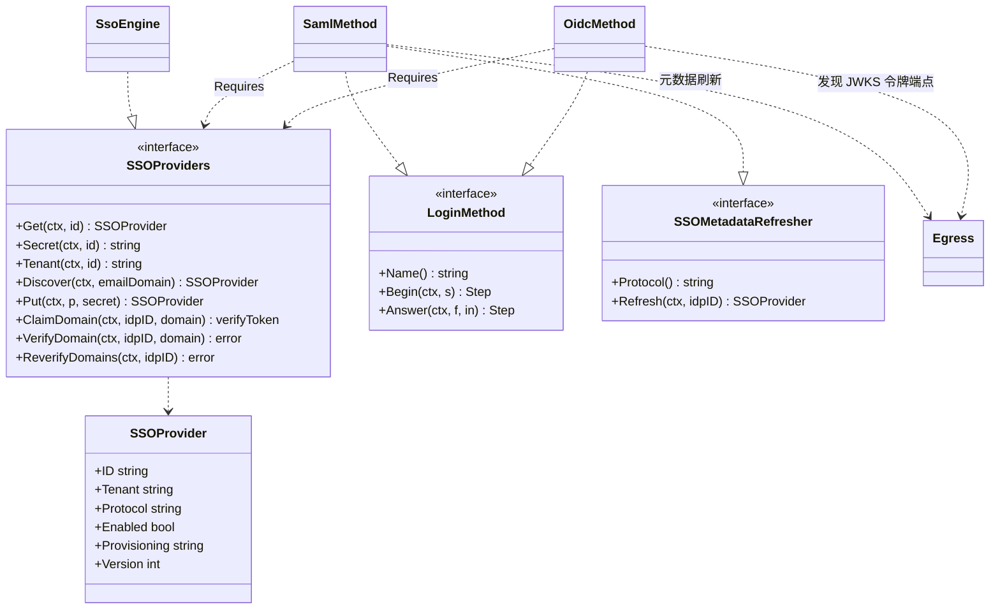
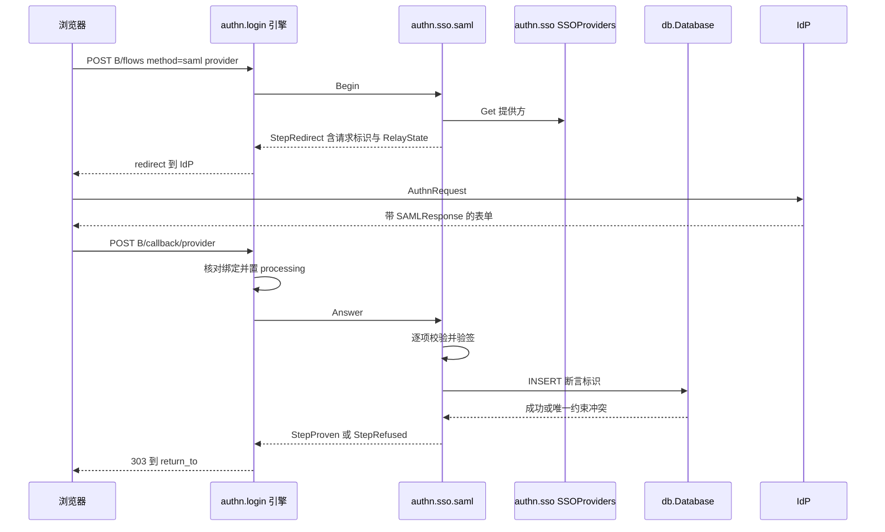
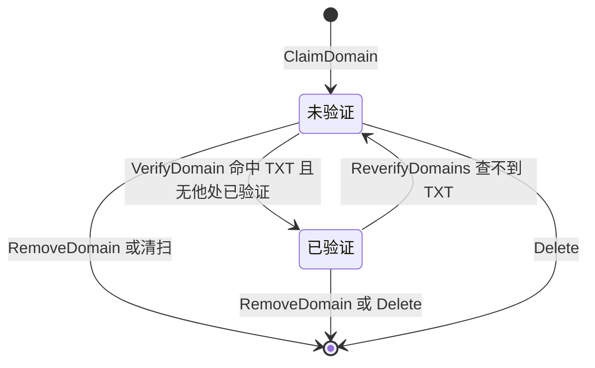

# authn-sso

## 职责

企业单点登录由下列登记单元承担：`authn.sso`（包 `pkg/authn/sso`）、`authn.sso.saml`（包 `pkg/authn/sso/saml`）与 `authn.sso.oidc`（包 `pkg/authn/sso/oidc`）。它们持有租户自有身份提供方（IdP）的登记、邮箱域的所有权证明与发现、SAML 断言与企业 OIDC 的 ID 令牌的校验，以及这些校验用到的受限出站客户端。取舍见 [ADR-authn-sso-2026-10-10](../../adr/adr-authn-sso-2026-10-10.md)，包与模块的划分见 [ADR-authn-packaging-2026-10-10](../../adr/adr-authn-packaging-2026-10-10.md)。

本功能包括下列部分（封闭集合，不在其内的事项归非职责一节点名的模块）：

- **提供方登记。** `SSOProviders` 由 `authn.sso` 排他交付，读写 `authn_idps`。提供方是表里的数据，不是模块，不进设置也不进配置：运行期才出现、数量不定、带秘密的配置是数据（[ADR-authn-sso-2026-10-10](../../adr/adr-authn-sso-2026-10-10.md)）。`client_secret` 在加密列里，读取接口不交出它。
- **域所有权与发现。** 租户为提供方声明邮箱域，经 DNS TXT 证明所有权；已验证的域全局唯一；`POST B/sso/discover` 按已验证的域返回入口列表。数据在 `authn_idp_domains`。
- **SAML 登录方式。** `authn.sso.saml` 交付 `LoginMethod`（名 `saml`）：发起、SP 元数据、断言消费与逐项补充校验。断言标识的去重表 `authn_saml_assertions` 由 `authn.sso` 持有。
- **企业 OIDC 登录方式。** `authn.sso.oidc` 交付 `LoginMethod`（名 `oidc`），与社交登录的 Google 走同一条校验代码路径，差别只在配置来源。
- **元数据刷新。** `authn.sso.saml` 交付 `SSOMetadataRefresher`，由管理员或宿主触发，不在后台自动运行。
- **受限出站客户端。** `pkg/authn/internal/egress` 提供发现文档、JWKS、元数据与 userinfo 一类出站请求共用的 `http.Client`，因为这些 URL 来自租户管理员的输入。
- **清扫。** `authn.sso` 在 `Start` 起有界协程，清扫已过期的断言标识与久未验证的域声明。

### 非职责

- **不运行登录流程。** 流程记录、状态机迁移、比较并交换、账户解析、会话与令牌的发放归登录引擎（[design-authn-login](design-authn-login.md)）；方法只回答「这次回跳证明了什么」，交出 `Proof`。
- **不决定账户。** 外部身份的绑定键、自动关联、首登开户、预置账户匹配与 JIT 并入的判据归 `authn.account`（[design-authn-account](design-authn-account.md)）。本模块只提供其输入：提供方的 `provisioning`、`merge_existing`、所属租户与邮箱域的验证状态。
- **不合成保障等级。** 方法只报 `Proof.IDPAsserted` 这一事实，是否采信、等级是多少只在 `authn.mfa` 一处合成（[design-authn-mfa](design-authn-mfa.md)）。
- **不执行租户级强制 SSO。** `tenant.admission.require-sso` 在请求期由租户准入层执行（[design-tenant-admission](design-tenant-admission.md)）；本模块只回答「这个提供方属于哪个租户」。
- **不写管理面路由，不做判定。** 提供方、域与元数据刷新的 HTTP 路由、`Decider` 的判定与强制审计归 `authn.admin`（[design-authn-admin](design-authn-admin.md)）。
- **不创建会话，不计算会话期限。** `Provider` 非空的会话的期限规则由 `authn.session` 统一计算（[design-authn-session](design-authn-session.md)）。
- **不映射角色与组。** IdP 的组声明不转成任何角色或属性，角色归授权。`attr.<名>` 只是给宿主读的只读属性。
- **不做单点登出，不做元数据的后台自动刷新，不做每租户的 SP 密钥，不支持经出站代理访问 IdP，不支持按租户子域名的回调。** 对应的否决理由见 ADR。
- **不认识租户上下文。** 提供方行带 `tenant_id` 字符串，但 `authn` 的任何子包都不 import `pkg/tenant`，这些表都不嵌入 `tenant.Model`，所以租户插件不触及它们。回调路径上的租户由提供方行得出，不由请求面得出。
- **不承载社交登录。** Google、GitHub 与微信的方法归 [design-authn-login](design-authn-login.md)；企业 OIDC 与它们共用的 OAuth 与 OIDC 共同事务也写在那里，本文只写企业 IdP 特有的部分。

## 外部接口契约

### 登记单元与名字

| 包 | 模块名 | 交付 | 排他 | 构造期依赖 | 其余取用（缺席合法） | 表 |
|---|---|---|---|---|---|---|
| `pkg/authn/sso` | `authn.sso` | `SSOProviders` | 是 | `db.Database`、`mount.Mounter` | `settings.Store`、`event.Bus`、`log.Logger` | `authn_idps`、`authn_idp_domains`、`authn_saml_assertions` |
| `pkg/authn/sso/saml` | `authn.sso.saml` | `LoginMethod`（名 `saml`）、`SSOMetadataRefresher` | 否 | `SSOProviders`、`Accounts`、`mount.Mounter` | `settings.Store`、`event.Bus`、`audit.Audit`、`observability.MeterProvider`、`log.Logger` | 无 |
| `pkg/authn/sso/oidc` | `authn.sso.oidc` | `LoginMethod`（名 `oidc`） | 否 | `SSOProviders`、`Accounts` | `settings.Store`、`event.Bus`、`audit.Audit`、`observability.MeterProvider`、`log.Logger` | 无 |

`SSOProviders`、`SSOMetadataRefresher` 与 `LoginMethod` 的接口定义在 `pkg/authn` 根包，根包自身不登记模块。每个登记模块的包导出 `ModuleName`，配置命名空间取同一个取值。这些模块的 `Prepare` 只表态 `StateEnabled`，从不表态 `StateAuto`：是否运行是命令树上的决定。

- **排他与并立。** `SSOProviders` 排他：宿主点名 `authn.sso.saml` 或 `authn.sso.oidc` 而漏点名 `authn.sso`，在 `Requires` 消解阶段以 `core.ErrMissingProvider` 失败。`LoginMethod` 与 `SSOMetadataRefresher` 并立，由消费方 `ResolveAll` 取用，从不写进 `Requires`（[ADR-authn-wiring-2026-10-10](../../adr/adr-authn-wiring-2026-10-10.md)）。
- **一个模块一个方法名。** `authn.sso.saml` 的 `LoginMethod.Name()` 恒为 `saml`，`authn.sso.oidc` 的恒为 `oidc`；全局重名即 `ErrMethodConflict`。
- **方法名两两不相交。** `authn.sso.saml` 交付的接口方法名为 `Name`、`Begin`、`Answer` 与 `Protocol`、`Refresh`，互不相交；包内为每个交付的接口加 `var _ authn.X = (*product)(nil)` 编译期断言。
- **库只在叶子包里。** gosaml2 与 goxmldsig 只被 `authn.sso.saml` import，go-oidc 与 x/oauth2 只被 `authn.sso.oidc` import；`authn.sso` 不 import 任何协议库，宿主只纳入 `authn.sso.oidc` 时 gosaml2 不进它的依赖闭包。
- **命名空间约束。** `authn.sso` 的配置与设置叶子不得叫 `saml`、`oidc`，否则与协议模块的命名空间相撞（[design-authn-config](design-authn-config.md)）。

### SSOProvider 与 SSOProviders

```go
type SSOProvider struct {
	ID                string
	Tenant            string
	Protocol          string // oidc、saml
	Name              string
	Enabled           bool   // 零值读作停用
	Provisioning      string // jit、preprovisioned
	TrustIDPMFA       bool
	AllowIDPInitiated bool
	AllowSHA1         bool
	MergeExisting     bool   // JIT 是否可并入现有账户；缺省假
	Config            json.RawMessage // 读出时不含密钥
	Version           int
}

type SSOProviders interface {
	Get(ctx context.Context, id string) (SSOProvider, error)
	Secret(ctx context.Context, id string) (string, error)
	List(ctx context.Context, tenant string) ([]SSOProvider, error)
	Tenant(ctx context.Context, id string) (string, error)
	Discover(ctx context.Context, emailDomain string) ([]SSOProvider, error)
	Put(ctx context.Context, p SSOProvider, secret *string) (SSOProvider, error)
	Delete(ctx context.Context, id string) error
	ClaimDomain(ctx context.Context, idpID, domain string) (verifyToken string, err error)
	VerifyDomain(ctx context.Context, idpID, domain string) error
	RemoveDomain(ctx context.Context, idpID, domain string) error
	ReverifyDomains(ctx context.Context, idpID string) error
}
```

`SSOProviders` 由 `authn.sso` 排他交付。各方法的契约：

| 方法 | 契约 |
|---|---|
| `Get`、`List`、`Tenant` | 读提供方行。读出的 `SSOProvider` 不含 `client_secret`，`Config` 里也没有任何秘密；应答里只有「是否已设置」。`List` 按租户列出，含停用的行。`Tenant` 只回答所属租户，供租户准入层核对会话的提供方是否属于请求所在的租户。 |
| `Secret` | 单独取 `client_secret`，只给协议模块用。取用者是 `authn.sso.oidc`；管理面、日志、审计、事件与指标都不经它。OIDC 以外的提供方没有秘密。 |
| `Discover` | 只在「已验证的域且提供方已启用」的行里找，规范化与失败形状见「域所有权与发现」一节。 |
| `Put` | 新建或更新。`secret` 为 `nil` 表示保持原值，非 `nil` 表示写入该值。校验 `Config`（写入时校验，未知键拒绝）；更新时 `Tenant` 不可变，与已存的不同即 `ErrInvalidConfig`；创建时 `Tenant` 取调用方给的值，管理面要求它与路径里的租户一致。`Provisioning` 无默认值，取值不在 `jit`、`preprovisioned` 之内即 `ErrInvalidConfig`。每次写入使 `version` 加一。 |
| `Delete` | 删除提供方行及其域声明，在同一个事务里完成。 |
| `ClaimDomain` | 为提供方声明一个邮箱域，写入一行未验证的声明并返回 `verifyToken`；该域已被另一个提供方验证时返回 `ErrDomainClaimed`。未验证的声明可以并存。 |
| `VerifyDomain` | 查 `_speed-authn.<域>` 的 TXT 记录，内容为 `speed-authn=<token>`；命中则置 `verified_at`。该域已被另一个提供方验证，或并发验证败于唯一约束，返回 `ErrDomainClaimed`。失败不改状态。 |
| `RemoveDomain` | 移除一条域声明，已验证或未验证的都可以。 |
| `ReverifyDomains` | 对该提供方全部已验证的域重查 TXT，查不到的域撤回验证（`verified_at` 置空）并发 `authn.idp.changed`，`change` 取 `domain-unverified`。不自动运行，由宿主调度或经管理面触发。 |

`Put`、`Delete`、`ClaimDomain`、`VerifyDomain`、`RemoveDomain`、`ReverifyDomains` 是写面，只经 `authn.admin` 由 `Decider` 放行后暴露为 HTTP 路由（动作 `authn.idp.manage`，强制审计，见 [design-authn-admin](design-authn-admin.md)）；本模块自己不判定调用者有无权限。

### SSOMetadataRefresher

```go
type SSOMetadataRefresher interface {
	Protocol() string // saml
	Refresh(ctx context.Context, idpID string) (SSOProvider, error)
}
```

`SSOMetadataRefresher` 非排他，由消费方 `ResolveAll` 取用，按 `Protocol` 分派，由 `authn.sso.saml` 交付，`authn.sso.oidc` 不交付；企业 OIDC 的发现文档由 go-oidc 按需取，没有刷新动作。`Refresh` 取该提供方 `metadata_url`（经受限出站客户端、限大小），解析出 `idp_certs`、`idp_sso_url`、`idp_entity_id`，经 `SSOProviders.Put` 写回，使 `version` 加一。解析或校验失败时保留旧配置、记 `Warn`、返回错误；成功返回新的提供方。`metadata_url` 为空的提供方不能刷新。

### 路由

下表是本功能登记的路由（封闭集合）。「访问」一列是 `Mounter` 登记路由时同时声明的访问级别，`B` 是路由基路径（缺省 `/auth`）。

| 方法 路径 | 访问 | 模块 | 说明 |
|---|---|---|---|
| `POST B/sso/discover` | Open | `authn.sso` | 邮箱域发现，应答同形同时，只回答与域有关的公开信息 |
| `GET B/sso/saml/:provider/metadata` | Open | `authn.sso.saml` | 该提供方的 SP 元数据，`entityID` 即本地址 |
| `GET\|POST B/callback/:provider` | Open | 引擎处理，分发给 `authn.sso.saml` 或 `authn.sso.oidc` | `:provider` 是提供方标识；POST 是 SAML 的 ACS，体上限 512 KiB，登记跨源检查旁路 |

提供方、域与元数据刷新的管理路由挂在 `authn.admin` 名下，路径与附加要求写在 [design-authn-admin](design-authn-admin.md)。`authn.sso` 挂路由时经 `mount.Mounter` 成对登记路由与访问级别；`authn.sso.saml` 的元数据路由同理，所以 gosaml2 的类型只在叶子包里，基础包只挂发现路由。

### 输入项的语义

输入项的键、类型、缺省值、取值范围与来源限制只在 [design-authn-config](design-authn-config.md) 给全，本节只写语义，所列的是与本功能有关的输入项，不是全部输入项的清单。

- **`authn.sso.allow-private-egress`**：放开受限出站客户端对回环地址的拒绝，只用于开发。只取主配置源，环境变量与命令行都改不了；开启时启动诊断写一行 `Warn`。
- **`authn.sso.saml.sp-key-file`、`sp-cert-file`、`sp-next-cert-file`**：整个部署共用的 SP 私钥、当前证书与下一张证书的文件路径，可缺省。私钥只在提供方要求签名 AuthnRequest（`sign_requests` 为真）或 IdP 要加密断言时用到；该条件成立而私钥未配置，以 `ErrInvalidConfig` 拒绝。
- **`authn.sso.assertion-max-age`**：SAML 断言的 `IssueInstant` 允许早于当前时刻的最大间隔。设置，请求期读。
- **`authn.sso.provider-cache-ttl`**：进程内缓存的 `*oidc.Provider`、`*oauth2.Config` 与 SAML `ServiceProvider` 的有效期。设置，请求期读。
- **`authn.sso.egress-timeout`**：出站调用的期限。设置，请求期读；`http.Client` 不设总 `Timeout`，每次调用用 `context` 的期限。
- **`authn.session.sso-absolute-timeout`**：`Provider` 非空的会话的绝对期限上限，归 `authn.session`，语义见「会话期限」一节。

### 稳定性承诺

- `SSOProvider` 的字段、`SSOProviders` 与 `SSOMetadataRefresher` 的方法集、`Protocol` 的取值（`oidc`、`saml`，封闭集）是接口的一部分，增删字段或方法是不兼容变更。
- 提供方标识是不透明的 UUID 文本，调用方不解析、不构造、不比较格式。
- 回调路径 `B/callback/<提供方标识>` 与元数据路径 `B/sso/saml/<提供方标识>/metadata` 的形状，以及据它们派生的 ACS 地址、`redirect_uri` 与 `entityID`，已登记在租户的 IdP 一侧，改动会使全部已登记的 IdP 失效，因此不改。
- 外部身份的绑定键形状 `oidc:<提供方标识>`、`saml:<提供方标识>` 不改：改动使已有绑定全部失配。
- `POST B/sso/discover` 的应答形状 `{"providers":[{id, name, protocol}]}` 不改，无匹配时恒为空数组。
- `authn_idps` 的 `config` 对未知键拒绝；`claims` 的目标集是封闭集，增加目标是契约变更。
- 指标 `authn.sso.assertions` 与审计动作 `authn.sso.reject` 的属性取值是闭集，名字与取值一经看板引用即冻结，取值表归 [design-authn-events](design-authn-events.md)。
- `authn_idps`、`authn_idp_domains`、`authn_saml_assertions` 的表结构只经迁移集演进，宿主不直接读写。

## 依赖

| 依赖 | 方式 | 用途 | 缺席时 |
|---|---|---|---|
| `db.Database` | `authn.sso` 的 `Requires` | 本模块的表的读写、加密列、迁移集 | 构造失败 |
| `mount.Mounter` | `authn.sso`、`authn.sso.saml` 的 `Requires` | 成对登记路由与访问级别 | 构造失败 |
| `SSOProviders` | `authn.sso.saml`、`authn.sso.oidc` 的 `Requires`（排他功能） | 读提供方行、取 `client_secret`、校验域的验证状态 | 构造失败 |
| `Accounts` | `authn.sso.saml`、`authn.sso.oidc` 的 `Requires`（排他功能） | 账户读取面 | 构造失败 |
| `settings.Store` | 取用，缺席合法 | `assertion-max-age`、`provider-cache-ttl`、`egress-timeout` | 取声明的缺省值 |
| `event.Bus` | 取用，缺席合法 | `authn.sso` 发布 `authn.idp.changed`；协议模块订阅它以丢弃本地缓存 | 不发布、不订阅；缓存只靠 `version` 与有效期失效 |
| `audit.Audit` | 取用，缺席合法 | 协议模块记尽力档的 `authn.sso.reject` | 只写日志与指标 |
| `observability.MeterProvider` | 取用，缺席合法 | `authn.sso.assertions` | 静默跳过 |
| `log.Logger` | 取用，缺席合法 | 脱敏规则在 `New` 里先于任何 logger 绑定登记；日志 | 无日志 |

非模块的依赖（封闭集合）：

- `pkg/authn/internal/egress`：受限出站客户端，`authn.sso`、协议模块与登录方式叶子包共用。
- `pkg/authn/internal/clock`：写入数据库与绑定为查询参数的时间的来源，一律 UTC。
- 第三方库：gosaml2 与 goxmldsig（`authn.sso.saml`，goxmldsig 不低于 v1.6.1，版本要求写在 `pkg/go.mod`）；go-oidc 与 x/oauth2（`authn.sso.oidc`）。

依赖方向满足架构不变量：

- `Requires` 只写排他功能与 `db.Database`；`LoginMethod`、`SSOMetadataRefresher` 并立，由消费方 `ResolveAll`（[ADR-authn-wiring-2026-10-10](../../adr/adr-authn-wiring-2026-10-10.md)）。`authn.login` 与 `authn.admin` 是本功能的消费方，本功能不依赖它们。
- `authn.sso.saml` 与 `authn.sso.oidc` 依赖 `SSOProviders`，反向不成立；`authn.sso` 不 import 任何协议库。
- 本模块不用 kv：断言标识去重与域所有权丢失会放宽校验，进 db；流程记录归登录引擎（[ADR-authn-state-placement-2026-10-10](../../adr/adr-authn-state-placement-2026-10-10.md)）。
- 不 import `pkg/tenant`。回调处理器不依赖租户解析：校验后端在租户解析之前运行、看不到租户，是平台的既有约束，提供方标识放进回调路径绕开了它，所以 [ADR-tenant-ordering-2026-09-21](../../adr/adr-tenant-ordering-2026-09-21.md) 的失效条件不被触发。
- 构造阶段（`New`）不读写自己的表；加密列探针、表存在性探测与清扫协程放在 `Start`。

## UML 图

### 结构

类图固定模块与能力的对应：`SsoEngine` 是 `authn.sso` 的产物，只实现 `SSOProviders`；`SamlMethod` 同时实现 `LoginMethod` 与 `SSOMetadataRefresher`；`OidcMethod` 只实现 `LoginMethod`；协议模块经构造期依赖取 `SSOProviders`，经 `internal/egress` 出站。



域所有权的验证走 DNS 解析，不是 HTTP 出站，所以 `SsoEngine` 不经 `Egress`。

### SAML 登录的交互

时序图固定一次 SAML 登录涉及的模块与同步边界：断言的一次性由引擎在调用 `Answer` 之前先交换记录保证，重放的最后防线是 db 的唯一约束，方法自己不写流程记录。



### 域声明的状态

状态图固定一条域声明的去向。已验证的域全局唯一，由 `authn_idp_domains` 上对已验证行的唯一索引保证；未验证的声明可以并存。



`ReverifyDomains` 撤回验证只置空 `verified_at`，行保留，`created_at` 不变；清扫按 `created_at` 计，所以声明早于 7 天的行在撤回验证后的下一轮清扫即被删除。

## 核心数据结构

### 表

本模块的表由 `authn.sso` 的一份迁移集声明，带各方言的 `migrations/<方言>/*.sql`。所有写入的时间一律经 `internal/clock` 取、一律 `.UTC()`。

```sql
-- authn.sso
CREATE TABLE authn_idps (
    id                  TEXT        NOT NULL PRIMARY KEY,   -- UUIDv7 文本，出现在回调路径里
    tenant_id           TEXT        NOT NULL CHECK (tenant_id <> ''),   -- 没有租户模块的部署用任意固定字符串
    protocol            TEXT        NOT NULL CHECK (protocol IN ('oidc', 'saml')),
    name                TEXT        NOT NULL CHECK (length(name) BETWEEN 1 AND 64),
    status              SMALLINT    NOT NULL DEFAULT 0 CHECK (status IN (0, 1)),   -- 0 停用（零值）
    provisioning        TEXT        NOT NULL CHECK (provisioning IN ('jit', 'preprovisioned')),   -- 无默认值
    trust_idp_mfa       BOOLEAN     NOT NULL DEFAULT FALSE,
    merge_existing      BOOLEAN     NOT NULL DEFAULT FALSE, -- JIT 是否可并入现有账户；开启即接受跨租户并入的风险
    allow_idp_initiated BOOLEAN     NOT NULL DEFAULT FALSE,
    allow_sha1          BOOLEAN     NOT NULL DEFAULT FALSE, -- 个别遗留 IdP 要求 SHA-1；开启即接受降级
    config              TEXT        NOT NULL CHECK (length(config) <= 65536),   -- JSON，写入时校验，未知键拒绝
    client_secret       TEXT        NULL,                   -- 加密列，仅 OIDC
    version             INTEGER     NOT NULL DEFAULT 1,     -- 变更使各副本缓存的 Provider 与 ServiceProvider 失效
    created_at          TIMESTAMPTZ NOT NULL,
    updated_at          TIMESTAMPTZ NOT NULL
);
CREATE INDEX authn_idps_tenant ON authn_idps (tenant_id);

CREATE TABLE authn_idp_domains (
    domain       TEXT        NOT NULL,                      -- 小写 ASCII（punycode 形式）
    idp_id       TEXT        NOT NULL,
    tenant_id    TEXT        NOT NULL CHECK (tenant_id <> ''),
    verify_token TEXT        NOT NULL,                      -- 随机，放进 DNS TXT 记录
    verified_at  TIMESTAMPTZ NULL,
    created_at   TIMESTAMPTZ NOT NULL,
    PRIMARY KEY (domain, idp_id)
);
-- 已验证的域全局唯一；未验证的声明可并存，使抢注占不了名额
CREATE UNIQUE INDEX authn_idp_domains_verified ON authn_idp_domains (domain) WHERE verified_at IS NOT NULL;

CREATE TABLE authn_saml_assertions (                        -- 断言标识去重集，唯一约束即重放防线
    idp_id          TEXT        NOT NULL,
    assertion_id    TEXT        NOT NULL CHECK (length(assertion_id) <= 256),
    not_on_or_after TIMESTAMPTZ NOT NULL,
    seen_at         TIMESTAMPTZ NOT NULL,
    PRIMARY KEY (idp_id, assertion_id)
);
CREATE INDEX authn_saml_assertions_expiry ON authn_saml_assertions (not_on_or_after);
```

- 表之间没有外键：跨表的一致由 `Delete` 的事务与应用层维护，迁移顺序因此不成为隐含契约。
- `status` 的零值是停用：一行被构造而没有显式启用，读作停用。
- `authn_idps` 不嵌入 `tenant.Model`：域名发现与回调路由没有租户上下文，租户插件对「没有租户上下文的受约束语句」直接拒绝；取舍理由见 [ADR-authn-sso-2026-10-10](../../adr/adr-authn-sso-2026-10-10.md)；该表的读写不依赖租户上下文。
- `client_secret` 与 `authn_idps` 的其他列同表，读取接口不选它；它是加密列，必须走模型路径写入，序列化器只对模型字段起作用。审计的语句级明细是否带列值未经核实，见「假设与守住它们的测试」。
- `authn_idp_domains.tenant_id` 记录声明所属提供方的租户；邮箱「已验证」的判定按它取该租户的已验证域。

### config 的 JSON 形状

`config` 在写入时校验，未知键拒绝，总长不超过 65536 字符。

| 协议 | 键 | 含义与校验 |
|---|---|---|
| oidc | `issuer`、`client_id`、`scopes`、`algs` | `issuer` 必须是具体的 `https` issuer，与发现文档的 `issuer` 逐字相等（含末尾斜杠，go-oidc 的要求），拒绝 `common`、`organizations` 这类聚合地址，所以不用库注释自称不安全的 `InsecureIssuerURLContext`；`algs` 缺省 `["RS256","ES256"]`，不得含 `none` 与 `HS*` |
| oidc、saml | `claims` | 声明名到目标的映射，目标只许 `email`、`display_name`、`subject`（缺省 OIDC 取 `sub`、SAML 取 `NameID`）与至多 8 个 `attr.<名>`（写入属性集时加 `idp.` 前缀） |
| oidc、saml | `mfa_acr_values` | `trust_idp_mfa` 为真时，哪些 `acr` 或 `AuthnContextClassRef` 取值算多因素；空表即不信任任何取值 |
| saml | `idp_entity_id`、`idp_sso_url`、`idp_certs` | 以下键必填：`idp_entity_id` 为空时库跳过颁发者校验；`idp_sso_url` 为 https 且无用户信息；`idp_certs` 是 IdP 签名证书的 PEM 列表，1 到 4 个，任一可验签（证书轮换时当前与下一张并存），证书是公钥，不加密 |
| saml | `metadata_url`、`name_id_format`、`subject_attribute`、`sign_requests` | `metadata_url` 可空，只在刷新时取一次；`name_id_format` 缺省 `persistent`，`transient` 一律拒绝（没有稳定标识），`emailAddress` 格式不稳定、须配置 `subject_attribute` 改取别的属性；`sign_requests` 为真时必须配了 SP 密钥 |

`claims` 的目标集是封闭集（`email`、`display_name`、`subject`、`attr.<名>`）。`attr.<名>` 里的名字与 `idp.` 前缀拼成的键须满足会话载荷里 `idp.*` 的分项上限（键含前缀至多 32 字节，所以名字至多 28 字节；界限只在 [design-authn-gate](design-authn-gate.md#出口检查) 写一份），名字超出的映射在 `config` 校验时按 `ErrInvalidConfig` 拒绝；`idp.` 与 `authn.` 是保留前缀，账户属性不得使用，`idp.` 只能由本映射写入。

### 属性映射的使用规则

- `subject` 是绑定键的主体，绑定键永远是（提供方，主体）：`oidc:<提供方标识>` 或 `saml:<提供方标识>` 加主体，不用邮箱。
- `email` 只在首登开户或匹配预置账户时使用，之后不更新账户；映射缺邮箱不是错误，只是没有关联线索。
- `display_name` 只在首登开户时写入。
- `attr.<名>` 经根包的界限校验后写进该次登录会话的载荷，键加 `idp.` 前缀，值在 UTF-8 字符边界截断到 128 字节（分项上限，见 [design-authn-gate](design-authn-gate.md#出口检查)）；随该会话终结，不写入账户。
- `provisioning` 为 `jit` 时，开户所需的映射缺失（开户必需 `email`）按首登失败处理，返回 `ErrNotProvisioned`，不使用空值开户。

### 进程内缓存

| 缓存 | 键 | 有效期 | 失效 |
|---|---|---|---|
| OIDC 的 `*oidc.Provider` 与 `*oauth2.Config` | （提供方标识，`version`） | `authn.sso.provider-cache-ttl` | `version` 变化即不同键；收到 `authn.idp.changed` 丢弃该提供方的条目 |
| SAML 的 `ServiceProvider` | （提供方标识，`version`） | `authn.sso.provider-cache-ttl` | 同上 |

`oidc.NewProvider` 每次都发一次发现请求且库不缓存，所以缓存是必须的。构造失败只让这一个提供方答 503，不影响其他提供方，也不终止启动。缓存是进程内的、每个副本各一份，租户很多时内存随之增长。

## 核心算法与流程

### 提供方行的写入

`Put` 在一个事务里完成，走模型路径（加密列的序列化器只对模型字段起作用），顺序如下：

1. 校验：`name` 长度；`protocol` 在封闭集内；`provisioning` 显式给出；更新时 `Tenant` 与已存相同；`config` 按上一节的形状逐项校验，OIDC 以外的协议带非空 `secret` 一律拒绝；失败即 `ErrInvalidConfig`，点名不合法之处。
2. 写入，`version` 创建时为 1、更新时加一；`secret` 为 `nil` 时不动 `client_secret`。
3. 提交之后发布 `authn.idp.changed`，使各副本的协议模块丢弃缓存；发布失败只记 `Warn`，从不令写入失败（事件是提示，不是权威）。

`allow_idp_initiated`、`allow_sha1` 或 `merge_existing` 为真的行，`Put` 写 `Warn`，启动诊断也各写一行 `Warn`；管理面应答里的警告归 [design-authn-admin](design-authn-admin.md)。

### 域所有权与发现

**域的规范化。** 邮箱的域取小写 ASCII 的 punycode 形式，规范化规则与标识的规范化同一套（[design-authn-account](design-authn-account.md)）；含非 ASCII 字符而无法规范化的域，发现请求以 400 `bad-request` 拒绝，声明写入同样拒绝。

**声明与验证。** `ClaimDomain` 写一行未验证声明，生成随机 `verify_token`，由租户管理员写进 `_speed-authn.<域>` 的 TXT 记录，内容为 `speed-authn=<token>`。`VerifyDomain` 经 `net.Resolver.LookupTXT` 查该记录，超时 5 秒，命中则置 `verified_at`。验证不要求 DNSSEC，解析器被投毒时验证可被骗过，写进非保证；验证失败不改状态。

**已验证的域全局唯一**，由 `authn_idp_domains_verified` 唯一索引保证，所以并发地为同一个域验证两个提供方，败者得到 `ErrDomainClaimed`。未验证的声明可以并存，抢注占不了名额，久未验证的声明由清扫回收。

**复验。** 已验证的域不做周期性复验：域名易主后旧认领继续有效，直到管理者移除或重验失败。`ReverifyDomains` 是重验的入口，对该提供方全部已验证的域重查 TXT；解析成功而没有匹配记录的域撤回验证，解析本身失败（超时、服务端错误）的域状态不变，调用以错误返回。它默认不自动运行，由宿主按需调度，或经管理面的 `reverify-domains` 路由触发，避免 `authn` 在后台无界地发 DNS 请求。

**发现。** `POST B/sso/discover {email}`（Open）取邮箱的域，在 `authn_idp_domains` 里只查已验证、且所属提供方已启用的行；邮箱的本地部分不被查询，所以不泄露账户存在性。应答恒为 `{"providers":[{id, name, protocol}]}`，无匹配时为空数组，匹配与否的应答同形同时。发现只返回「有哪些入口」，不决定登录。

### SAML：SP 元数据与发起

**SP 元数据** `GET B/sso/saml/:provider/metadata`（Open）由 `authn.sso.saml` 挂载：

- `entityID` 即该元数据地址（`public-url + B/sso/saml/<id>/metadata`），每个提供方独立，IdP 一侧因此是不同的 SP。
- ACS 为 `public-url + B/callback/<id>`，HTTP-POST 绑定。
- `WantAssertionsSigned="true"`；`AuthnRequestsSigned` 取 `sign_requests`。
- 有 SP 证书时写入当前与下一张（`sp-cert-file`、`sp-next-cert-file`）：轮换时先把新证书放进 `sp-next-cert-file` 发布到元数据，IdP 一侧更新后换位。
- 全部由配置的 `public-url` 派生，不从 `Host` 或 `X-Forwarded-*` 推。

gosaml2 没有元数据解析助手，`authn.sso.saml` 用标准库 `encoding/xml` 解进 `gosaml2/types.EntityDescriptor`，供 `Refresh` 使用。

**发起** `POST B/flows {method:"saml", input:{provider:"<id>"}}`。`Begin` 要求提供方行存在、已启用、协议为 `saml`，构造 AuthnRequest（库的 `BuildAuthURL`），把请求标识与 `RelayState`（16 字节随机数的十六进制）与提供方标识存入 `method_state`，返回 `StepRedirect`；流程 cookie 由引擎设立。

### SAML：断言消费

`POST B/callback/:provider` 的表单带 `SAMLResponse` 与 `RelayState`，体上限 512 KiB。**方法不能直接调用 gosaml2 的 `RetrieveAssertionInfo`**：它只用第一条断言、不查 `InResponseTo`、对空的颁发者与目的地跳过校验。校验按下表自上而下的顺序进行，顺序是契约；每一项在失败时都拒绝，对外统一为 `login-failed`，成因只进日志与指标 `authn.sso.assertions`，审计动作 `authn.sso.reject` 记同一取值。「指标取值」是失败落入的 `outcome`，取自 `authn.sso.assertions` 的闭集。

| 校验项 | 判据 | 来源与理由 | 指标取值 |
|---|---|---|---|
| 流程与提供方 | 流程绑定匹配；流程存在、处于 `processing`（引擎已在调用本方法前置好）、方法为 `saml`；路径里的提供方标识等于流程记录里的 | 登录 CSRF 的防线；提供方取自流程而非表单 | `other` |
| SP 的构造 | 提供方行已启用；构造 SP 时 `IdentityProviderIssuer`、`AssertionConsumerServiceURL`、`AudienceURI` 均非空；`MaximumDecompressedBodySize` 取 1 MiB、`MaximumXMLTokens` 取 50000；`SkipSignatureValidation` 为假 | gosaml2 对 `IdentityProviderIssuer` 为空时跳过颁发者比较、对 `Destination` 为空时跳过比较 | `other` |
| SHA-1 预检 | 调用库验签之前，扫描解码后的 XML 里全部 `Algorithm` 属性，出现 `rsa-sha1`、`ecdsa-sha1`、`#sha1` 即拒绝，除非该提供方 `allow_sha1` 为真；以误拒为代价 | goxmldsig 的 `ValidationContext` 只有 `CertificateStore`、`IdAttribute`、`Clock` 字段，没有拒绝算法的开关，验签面接受 SHA-1 | `signature` |
| 单次解析并验签 | `ValidateEncodedResponse` 得到验过签的 `types.Response`，不对同一字节做第二次解析；要求响应或断言至少一个 `SignatureValidated` | 签名包装类攻击的根源是被验的元素与被用的元素不是同一个；gosaml2 用验过签返回的元素解码 | `signature` |
| 目的地 | `Response.Destination` 非空且等于 ACS 地址 | 库只在非空时比较 | `destination` |
| 请求标识 | `Response.InResponseTo` 与每个断言的 `SubjectConfirmationData.InResponseTo` 等于流程记录里的请求标识；IdP 发起（两者都空）仅当该提供方 `allow_idp_initiated` 为真 | 库对 `InResponseTo` 完全不检查 | `in-response-to` |
| 断言个数 | `len(Response.Assertions) == 1` 且没有残留的 `EncryptedAssertions` | `RetrieveAssertionInfo` 只用第一条，多断言是 CVE-2022-41912（crewjam/saml）一类的入口 | `other` |
| 断言条件 | `VerifyAssertionConditions` 的 `WarningInfo` 里 `InvalidTime` 或 `NotInAudience` 任一为真即拒；`ProxyRestriction` 非空即拒；`Conditions` 里至少一个 `AudienceRestriction` 且含本 SP 的 `entityID` | 库不报错只置位，没有受众限制的断言库放行；时间条件取严格判、不设容差，`SubjectConfirmationData.NotOnOrAfter` 同样严格 | 时间不符为 `time`，其余为 `audience` |
| 颁发者与确认 | 断言的 `Issuer` 等于 `idp_entity_id`；`Status` 为 Success；`SubjectConfirmation` 方法为 bearer；`Recipient` 等于 ACS 地址；`IssueInstant` 不早于当前减 `authn.sso.assertion-max-age`（只比较过去方向，未来方向由「断言条件」对 `NotBefore` 的严格判断承担）；`NotOnOrAfter` 距 `IssueInstant` 不超过 10 分钟 | 对库的复核；限制断言可被重放的窗口 | 颁发者与状态不符为 `issuer`，接收者不符为 `destination`，时刻不符为 `time`，其余为 `other` |
| 断言标识去重 | `INSERT INTO authn_saml_assertions (idp_id, assertion_id, not_on_or_after, seen_at)`，撞唯一约束（`gorm.ErrDuplicatedKey`）即重放，返回 `ErrAssertionReplay`；`not_on_or_after` 取断言与 `SubjectConfirmationData` 里较小的那个 | 库不做；用 db 而不是 kv，因为 kv 丢键则重放窗口重开 | `replay` |
| 主体与属性的提取 | 见下文 | | `other` |

**时间条件不设容差。** 库的时间比较没有容差字段，另造一个带容差的版本会绕过库已做的校验，所以部署要求各副本与 IdP 时间同步（[design-authn-failure](design-authn-failure.md)）；没有 `authn.sso.clock-skew` 设置。

**一次性。** 引擎在调用 `Answer` 之前已把记录交换成 `processing`，并发的第二个 POST 败于那一步；处理完引擎置 `done`，被拒置 `failed`。方法自己不写流程记录。断言标识去重是纵深：即便引擎的一次性被绕过，同一断言也不能第二次通过。

**主体与属性的提取。** 校验全部通过之后：

- 主体取 `NameID`（格式为 `persistent` 或 `unspecified`）或 `subject_attribute` 指定的属性；`transient` 与邮箱格式的 `NameID` 不作主体。
- 属性按 `claims` 取，值与条数设界。
- 邮箱「已验证」的含义是：其域在该提供方所属租户的已验证域之内。SAML 本身没有这个概念，由 `authn_idp_domains` 判定。
- `trust_idp_mfa` 为真，且 `AuthnContextClassRef` 在 `mfa_acr_values` 里时，置 `Proof.IDPAsserted`，否则不置；等级由 `MFA.Assurance` 合成。
- 交出 `Proof`：`External` 的 `Provider` 为 `saml:<提供方标识>`、`Subject` 为主体、`Tenant` 为提供方所属租户、`Attributes` 为带 `idp.` 前缀的映射结果；`Methods` 为 `MethodSAML`；`Provider` 为提供方标识。

NameID 里夹带 XML 注释会被截断是一类已知的 SAML 攻击，gosaml2 对它的处理未经核实，见「假设与守住它们的测试」。

### SAML：IdP 发起登录

`allow_idp_initiated` 为真时，`POST B/callback/:provider` 可以没有流程 cookie：引擎当场新建一条 `purpose=login`、`delivery=session` 的流程记录并置 `processing`（[design-authn-login](design-authn-login.md)），方法随后按「断言消费」校验，其中「请求标识」一项允许 `InResponseTo` 为空。没有流程就没有可比对的绑定，所以这一路径防不了登录 CSRF（攻击者把自己的断言投给受害者的浏览器）；能做的是：断言必须新鲜（`IssueInstant` 在 2 分钟内）、标识唯一、受众与接收者精确、已签名。该路径没有可比对的绑定，登录 CSRF 防线不成立，所以该开关缺省关闭，开启时在管理应答里作为警告、在启动诊断里写一行 `Warn`。

### 企业 OIDC

通用事务（`state`、PKCE、`nonce`、授权码交换、ID 令牌校验）写在 [design-authn-login](design-authn-login.md) 的「社交登录与企业 OIDC 的共同事务」一节，本节只写企业 IdP 特有的部分：

- 每个提供方一份缓存的 `*oidc.Provider` 与 `*oauth2.Config`，见「进程内缓存」；`client_secret` 由 `SSOProviders.Secret` 取。
- 回调地址 `public-url + B/callback/<提供方标识>`；每个提供方的路径不同，把 A 的回跳投给 B 因路径不同而不可能。
- `iss` 必须逐字等于 `config.issuer`；`aud` 含 `client_id`；多受众时 `azp` 等于 `client_id`；`nonce`、`state`、PKCE 都发都校验；`sub` 非空。
- 不调 userinfo，只取 ID 令牌里的声明；邮箱的 `EmailVerified` 取 `email_verified` 为布尔真。
- `trust_idp_mfa` 为真时，断言的 `acr` 落在 `mfa_acr_values` 才置 `Proof.IDPAsserted`，`amr` 不参与比对；`auth_time` 只在步进里核对新鲜度。
- `Proof` 的 `External.Provider` 为 `oidc:<提供方标识>`，`Methods` 为 `MethodOIDC`。
- 所有出站调用经 `oidc.ClientContext(ctx, client)` 注入受限客户端，`oidc.NewProvider` 的 `ctx` 也要带它：go-oidc 未注入时用无超时的 `http.DefaultClient`，未经注入的出站调用本身是缺陷。

Google 与企业 OIDC 走同一条代码路径，差别只在配置来源：Google 来自配置，是启动必须项；企业 IdP 来自表。

### 受限出站客户端

`internal/egress` 提供的 `http.Client` 用于全部由租户输入决定 URL 的出站请求，下表是它的规则：

| 项 | 做法 |
|---|---|
| 目的地址 | `net.Dialer.Control` 在**实际连接的地址**上判，每次连接尝试都判，所以 DNS 重绑定与多记录无从绕过。白名单思路：只放行 `netip.Addr.IsGlobalUnicast()` 为真、且不落在下列特殊用途段的地址，IPv6 地址另须落在已分配给全球单播的 `2000::/3` 内；IPv4 映射的 IPv6 先还原再判；NAT64 的 `64:ff9b::/96` 与 6to4 的 `2002::/16` 抽出内嵌的 IPv4 再按 IPv4 判（IPv6-only 网络里经 DNS64 合成的真实公网地址因此仍可达）；Teredo 的 `2001::/32` 与 `64:ff9b:1::/48` 一律拒绝 |
| 方案与重定向 | 只许 `https`，其他方案在建立连接之前失败；不跟随重定向，3xx 应答原样返回，发现文档不应重定向 |
| 超时与大小 | 总期限取 `authn.sso.egress-timeout`，每次调用用 `context` 的期限，调用方必须带期限：不带期限的调用只受握手超时与对端约束。名称解析与每次连接尝试随调用的期限与取消而结束，每次尝试分得剩余期限的均分份额，第一个不可达的地址耗不尽后面的地址要用的时间；连接按地址逐个尝试，不做并行回退。响应体上限 1 MiB，超出的读失败，不静默截断；响应头上限 64 KiB |
| TLS 与代理 | 系统根证书，从不关闭校验，TLS 1.2 为下限；`Proxy` 置空：经代理时 `Control` 看到的是代理地址，目的地判断失效，所以不支持经出站代理访问 IdP |
| 观测 | 追踪头由调用方在客户端的 `Transport` 外自行套 `observability.Transport` 注入，包内不提供这层包装；微信客户端不套，它的 URL 里有 `secret` |
| 开发开关 | `authn.sso.allow-private-egress`（仅主配置源，缺省假）放开回环 |

**特殊用途段**（封闭集，取自 IANA 特殊用途地址登记表，与登记表的一致是假设，见「假设与守住它们的测试」）：

- IPv4：`0.0.0.0/8`、`10.0.0.0/8`、`100.64.0.0/10`、`127.0.0.0/8`、`169.254.0.0/16`、`172.16.0.0/12`、`192.0.0.0/24`、`192.0.2.0/24`、`192.88.99.0/24`、`192.168.0.0/16`、`198.18.0.0/15`、`198.51.100.0/24`、`203.0.113.0/24`、`224.0.0.0/4`、`240.0.0.0/4`。
- IPv6：`::/128`、`::1/128`、`100::/64`、`2001::/23`、`2001:2::/48`、`2001:db8::/32`、`3fff::/20`、`fc00::/7`、`fe80::/10`、`ff00::/8`。`2001::/23` 是登记表里整块不可全局到达的 IETF 协议分配段，含 Teredo 与基准测试段，其中登记为可全局到达的任播与覆盖网前缀没有 IdP 在那里，随整块拒绝；`3fff::/20` 是文档段（RFC 9637）。`2000::/3` 之外的整块（`::/128`、`::1/128`、`100::/64`、`fc00::/7`、`fe80::/10`、`ff00::/8`）同时被 `2000::/3` 的要求拒绝，仍照登记表列出；登记表里的 `100:0:0:1::/64`（RFC 9780）与 `5f00::/16`（RFC 9602）也在 `2000::/3` 之外，只由这条要求拒绝，不在表里；`2001::/32`（Teredo）与 `64:ff9b:1::/48` 在查表之前即被拒绝。IPv4 的 `192.0.0.0/24` 里登记为可全局到达的 `192.0.0.9`、`192.0.0.10` 随父块一起拒绝，是保守的读法。

表与 IANA 的 IPv4 与 IPv6 特殊用途地址登记表逐条核对，一致的版本是 2026-10-11 取得的那一份，含 RFC 9637、RFC 9780、RFC 9602 的新增项；表按登记表的整块列，登记表新增整块时表随之增补。`internal/egress` 不保留登记表的副本，向量测试是每一整块核对过什么的记录；复核的时机见 [design-authn-threats](design-authn-threats.md)。

只靠 `IsGlobalUnicast()` 不够：它对 `64:ff9b::a9fe:a9fe`（内嵌 `169.254.169.254`）、`2002:a9fe:a9fe::1`、Teredo 地址、`198.18.0.1`、`240.0.0.1`、`192.0.0.1`、`100.64.0.1` 都返回真，所以只拒私网、回环与链路本地不足以挡住服务端请求伪造。负向测试向量覆盖这些写法，以及十六进制、八进制与十进制写法的 IPv4 字面量。

该客户端是标准库加一张地址表，不桥接现成的出站防护库；地址表是自写的安全部件，守住它的测试见「假设与守住它们的测试」。

### 租户强制 SSO 的承接

租户级强制 SSO 只在请求期由 `tenant.admission` 执行（[design-tenant-admission](design-tenant-admission.md)）：租户设置 `require-sso` 为真时，要求该租户内请求所用会话是经**这个租户**的某个提供方登录的。判据是会话上的提供方标识（`Identity.Provider()`），再经 `SSOProviders.Tenant` 核对其租户；不看 `Methods`，因为加强认证会把方式集换成新那次事件的方式集，而提供方标识不随之丢失。不满足则 `401 insufficient_user_authentication`，`acr_values` 取 `sso`。

账户全局，强制只作用于该租户内的请求，账户仍可用口令登录并访问别的租户。`authn_memberships.sso_exempt` 为真的成员可以不经 SSO，该开关的设置、审计与残余风险归 [design-authn-account](design-authn-account.md) 与 [design-authn-admin](design-authn-admin.md)。`authn.sso` 在 `Start` 里若 `core.Registry.Participating("tenant.admission")` 为假，写一行 `Warn`：租户级强制 SSO 无人执行。

### 会话期限

SSO 不做单点登出：IdP 一侧的登出与停用都不终止 speed 的会话。上界由会话自己的期限给出：凡 `Provider` 非空的会话，不论种类（含 `delivery=token` 的会话及其刷新令牌），绝对期限取该种会话的缺省与 `authn.session.sso-absolute-timeout` 中的较小者，由会话创建统一计算（[design-authn-session](design-authn-session.md)）。所以员工在 IdP 被停用后，其访问令牌与刷新令牌至多再存活该设置给出的期限。

### 清扫与启动检查

`authn.sso` 是 `authn_idp_domains` 与 `authn_saml_assertions` 的持有者，下表是它清扫的全部表（封闭集合）；它在 `Start` 起有界协程，每个副本都跑，条件删除互不冲突；一轮以一批至多 1000 行为单位（各方言通用的子查询加 `LIMIT` 写法）连续删到不足一批为止；`Stop` 以自带的 5 秒为界等它退出。

| 表 | 删什么 | 周期 |
|---|---|---|
| `authn_idp_domains`（未验证的声明） | `verified_at` 为空且 `created_at` 早于 7 天 | 1 小时 |
| `authn_saml_assertions` | `not_on_or_after < now` | 10 分钟 |

`Start` 的检查（封闭集合），任一失败即终止启动：

- 表存在性探测，探测不到以 `ErrNotMigrated` 失败，点名施加迁移的命令；
- 加密列的写读往返（事务内回滚），`db` 缺根密钥以 `ErrNoEncryptionKey` 失败，因为缺根密钥不是 db 的启动失败，到第一条触及加密列的语句才失败。

## 错误与失败语义

### 哨兵

下表是本功能产生、或其交出的事实所触发的哨兵（封闭集合）；全部哨兵的判据与状态码在 [design-authn-failure](design-authn-failure.md)。

| 哨兵 | 产生处 | 含义 | 对外 |
|---|---|---|---|
| `ErrInvalidConfig` | `Put`、构造 | `config` 形状不合法、含未知键、`provisioning` 缺失、更新时 `Tenant` 与已存的不同、`sign_requests` 为真而没有 SP 密钥 | 管理面 400，点名不合法之处；启动期启动失败 |
| `ErrDomainClaimed` | `ClaimDomain`、`VerifyDomain` | 该域已被另一个提供方验证过 | 409 |
| `ErrAssertionReplay` | SAML 断言消费 | 断言标识已见过 | 登录失败，统一 `login-failed`；记 `Warn` 与指标 |
| `ErrNotProvisioned` | 引擎的账户解析，取自本模块交出的提供方与映射 | `preprovisioned` 的提供方没有预置账户；`jit` 开户所需的映射缺失 | 401 `login-failed`，成因进日志 |
| `ErrDomainMismatch` | 引擎的账户解析 | 断言邮箱的域不属于该提供方所属租户的已验证域 | 401 `login-failed`，成因进日志 |
| `ErrUnavailable` | 构造提供方、发现与 JWKS 取回、元数据刷新、db | IdP 不可用，或 db 不可用 | 503；对外不区分是哪个依赖 |
| `ErrNoEncryptionKey` | `Start` | `db` 没有根密钥 | 启动失败 |
| `ErrNotMigrated` | `Start` | 探测不到自己的表 | 启动失败，点名施加迁移的命令 |

提供方行不存在、已停用、协议与路径不符，在回调与发起路径上一律并入「方法不可用」或 `login-failed`，不区分成因；在管理面路径上按行不存在应答。SAML 断言与 OIDC ID 令牌的每一项校验失败，对外都是 `login-failed`，成因只进日志、指标与审计。

### 失败方向

- **依赖不可用时拒绝。** db 不可用时发现、域验证、断言去重与提供方读取都返回 `ErrUnavailable`，不放行；断言去重写不进去就不放行断言。
- **IdP 不可用时只拒这一个提供方。** OIDC 的发现、JWKS 或令牌端点不可达，其他提供方不受影响。回跳阶段不可达，该提供方的登录答 503，流程作废，用户重新开始（授权码已用，见 [design-authn-login](design-authn-login.md) 的迁移表）；开始阶段（`Begin` 的发现失败）答 503，流程仍处 `first`。
- **元数据刷新失败时保留旧配置。** 解析或校验失败保留旧的 `idp_certs`、`idp_sso_url`、`idp_entity_id`，记 `Warn`，返回错误。这是有界的放宽：被 IdP 撤销的旧证书继续被接受，直到管理员更新；放宽的上界是「管理员触发刷新或手工更新」，不自动刷新。
- **证书轮换没有跟上时拒绝。** IdP 换了证书而管理员没有更新，该提供方的登录全部失败。
- **缺省拒绝。** IdP 发起登录缺省关；`provisioning` 无默认值；`merge_existing` 缺省假，JIT 缺省只新建；未验证的域不参与发现；邮箱域不匹配时不并入账户；SHA-1 签名缺省拒绝；`transient` 的 `NameID` 一律拒绝。
- **出站拒绝非公网地址。** 受限出站客户端拒绝的连接（目的地不是公网地址、方案不是 `https`、响应体超出上限，各有一个哨兵，见 [design-authn-failure](design-authn-failure.md)）按 IdP 不可用处理：该提供方的登录答 503，成因只进日志。

### 幂等

`Put` 每次调用使 `version` 加一，不是幂等的。`ClaimDomain` 对已被另一个提供方验证的域返回 `ErrDomainClaimed`，不改变状态。`ReverifyDomains` 与清扫幂等。SAML 断言至多通过一次：引擎的 `processing` 交换与 `authn_saml_assertions` 的唯一约束各自独立地拦住重复。

### 非保证

下列是不保证的事项，列表是封闭集，各项的代价与取舍见 [ADR-authn-sso-2026-10-10](../../adr/adr-authn-sso-2026-10-10.md)，威胁与对应的缓解见 [design-authn-threats](design-authn-threats.md)：

- **IdP 一侧停用不立即生效。** 员工在 IdP 被停用后，其会话要到空闲或绝对期限才失效；`sso-absolute-timeout` 给出上限，只是缓解，不是消除。
- **IdP 发起登录无法防登录 CSRF。** 开启后攻击者可把自己的断言投给受害者的浏览器；缓解只有断言新鲜度、标识唯一、受众与接收者精确、已签名。
- **JIT 缺省不并入现有账户。** 已有账户的员工第一次企业 SSO 登录得到 `link-required`，要先用原方式登录再关联。`merge_existing` 开启即接受跨租户并入的风险：并入后该 IdP 对该账户有永久的登录能力，直到绑定被解除。
- **租户的 IdP 管理员对自己租户新建的账户有登录控制权。** 这是企业 SSO 的信任边界；IdP 声明的多因素只在该提供方所属租户内算数。
- **域所有权转手后有窗口。** 旧认领继续有效，直到管理者移除或重验失败；DNS TXT 验证不要求 DNSSEC，解析器被投毒时验证可被骗过。
- **证书轮换靠管理员。** 手工更新或触发元数据刷新；刷新失败期间旧证书继续被接受。
- **时间条件不设容差。** 副本与 IdP 的时钟偏差超过几秒就会零星拒掉合法断言，部署必须保证时间同步。
- **整个部署共用一组 SP 密钥对。** 租户的 IdP 要登记统一 `public-url` 下的 ACS 与 `redirect_uri`；不支持按租户子域名的回调，不支持经出站代理访问 IdP。
- **补充校验的每一项都是 speed 自写的安全部件。** 漏一项就是静默放行，所以每一项都要有负向测试；库的新缺陷在发现到升级之间有窗口，版本固定，升级走专门变更。
- **受限出站客户端是自写的安全部件。** 特殊用途段表与登记表的一致要靠核对与测试；连接按地址逐个尝试，不做并行回退，多地址主机的首个地址不可达时多花一份期限；每个提供方在进程内缓存一份库实例，租户很多时内存随之增长。
- **SHA-1 预检可能误拒。** 预检扫描 XML 文本，保守的判断会拒掉不含 SHA-1 签名的少数文档，靠测试向量守住边界。
- **发现的耗时只能证否，不能证真。** 应答同形同时由统一路径压到最小，对照不出差别不构成证明。

### 假设与守住它们的测试

以下行为未经运行核实。依赖它们的断言写作假设，对应的测试失败即视为该断言的前提不成立：

- **goxmldsig 没有别的途径拒绝 SHA-1 签名。** 测试：用 SHA-1 签名的样本做负向测试，预检必须拒绝。若库提供按算法拒绝的开关，预检与库的开关择一保留，不并存。
- **gosaml2 的 `ValidateEncodedResponse` 返回验过签的响应，且不要求对同一字节再解析。** 测试：对固定版本 v0.12.0 的签名与返回类型做编译期断言，并以单元测试断言验过签的响应可直接用于后续校验；断言失败即「单次解析并验签」的前提不成立。
- **gosaml2 对 NameID 中夹带 XML 注释的截断攻击已有防护。** 测试：构造含注释的 NameID，断言取得的主体不被截断。
- **gosaml2 的 `SPKeyStore` 不同时接受两把解密密钥。** 在这个假设下，SP 证书的轮换要在 IdP 元数据刷新的重叠期内完成。
- **特殊用途地址段的清单与 IANA 登记表一致。** 测试：向量测试对登记表的每一整块断言边缘地址的判定，覆盖 NAT64、6to4、Teredo 的嵌入写法，以及十六进制、八进制与十进制写法的 IPv4 字面量。包内没有登记表的机器可读副本，所以这条断言守住的是核对那一天的状态，随登记表的更新而漂移，复核的时机见 [design-authn-threats](design-authn-threats.md)。
- **审计的语句级明细不带加密列的值。** 测试：写入 `client_secret` 之后，审计行里不得出现任何秘密字节。
- **时区无关。** 假设 `not_on_or_after` 与 `verified_at` 等时间列在非 UTC 的 `time.Time` 写入下比较结果仍正确。SQLite 夹具在 `TZ=America/New_York` 下断言清扫与重放判定的条件。

## 并发与事务边界

- **提供方行与域声明的写走模型路径。** 加密列的序列化器只对模型字段起作用；写入在本模块自己的事务里，对账户事务不可见。`pkg/db` 没有跨模块传递事务句柄的通道，本模块只写自己的表。
- **断言标识去重是单语句插入。** 并发提交同一个断言，只有一条插入成功，败者撞唯一约束得到 `ErrAssertionReplay`；这条插入在其余校验通过之后、主体提取之前执行。
- **域的全局唯一由唯一索引裁决。** `VerifyDomain` 的并发败者得到 `ErrDomainClaimed`，不靠应用层的先读后写。
- **多副本。** 本模块的表在 db，所有副本共享；协议模块的缓存在进程内，每个副本各一份，靠 `version`、有效期与 `authn.idp.changed` 失效；事件不保证次序与次数，订阅处理函数幂等，只做丢弃本地缓存。清扫每个副本都跑。
- **时钟。** 所有时间经 `internal/clock` 取、一律 UTC，作为参数绑定的时间同样；SAML 的时间条件取严格判，依赖各副本与 IdP 的时间同步。
- **协程的生命周期。** 清扫协程在 `Start` 起，`Stop` 以自带的 5 秒为界等它退出；对 db、DNS 与 IdP 的每个调用都带请求上下文并受预算约束，登录方式的单次调用另受引擎的 `call-budget` 约束。
- **方法的 panic 由引擎 `recover`。** 按该方法故障收口 503，记 `Error` 与调用栈。

## 扩展点

- **`SSOMetadataRefresher` 是并立功能。** 某一协议的元数据刷新由交付它的模块提供，消费方 `ResolveAll` 后按 `Protocol` 分派；由 `authn.sso.saml` 交付，`authn.sso.oidc` 不交付。
- **协议集不是扩展点。** `authn_idps.protocol` 的 `CHECK` 约束、`config` 的校验与 `Protocol` 的取值是封闭集，增加协议是修改契约与迁移集。
- **单点登出、每租户的 SP 密钥、按租户子域名的回调、后台自动刷新不是扩展点。** 它们在 ADR 中被否决，要引入须先有新的决策记录。

## 实现状态

`pkg/authn` 下没有 `sso` 目录，根包没有 `SSOMetadataRefresher`，`pkg/go.mod` 里没有 gosaml2、goxmldsig、go-oidc 与 x/oauth2。

| 能力 | 状态 | 代码 |
|---|---|---|
| 根包接口：`SSOProvider`、`SSOProviders`、`SSOMetadataRefresher` 与对应哨兵、`authn.idp.changed` 事件类型 | 部分实现 — 缺 `SSOMetadataRefresher`；其余已在 | `pkg/authn/sso.go` `SSOProviders`；`pkg/authn/internal/model/sso.go` `SSOProvider`；`pkg/authn/errors.go` `ErrDomainClaimed`、`ErrAssertionReplay`；`pkg/authn/events.go` `EventIDPChanged`、`IDPChanged` |
| `authn.sso` 提供方登记：`Put`、`Get`、`List`、`Secret`、`Tenant`、`Delete`、`config` 校验、`version` | 未实现 | — |
| `authn_idps`、`authn_idp_domains`、`authn_saml_assertions` 迁移集 | 未实现 | — |
| 域所有权：`ClaimDomain`、`VerifyDomain`、`RemoveDomain`、`ReverifyDomains` | 未实现 | — |
| 发现：`Discover` 与 `POST B/sso/discover` | 未实现 | — |
| 清扫：未验证的域声明与过期的断言标识 | 未实现 | — |
| `Start` 的表存在性探测与加密列探针 | 未实现 | — |
| 租户准入层缺席时的 `Warn` | 未实现 | — |
| `internal/egress` 受限出站客户端与特殊用途地址表 | 已实现 — 追踪头的注入留给调用方，包内没有 `observability.Transport` 的包装 | `pkg/authn/internal/egress/egress.go` `New`、`Options`；`pkg/authn/internal/egress/address.go` `Permitted` |
| `authn.sso.saml`：SP 元数据路由与 SP 构造 | 未实现 | — |
| `authn.sso.saml`：`LoginMethod` 的发起与断言消费（SHA-1 预检、单次解析验签、逐项补充校验、断言标识去重、主体与属性提取） | 未实现 | — |
| `authn.sso.saml`：IdP 发起登录的方法侧校验 | 未实现 | — |
| `authn.sso.saml`：`SSOMetadataRefresher.Refresh` 与元数据解析 | 未实现 | — |
| `authn.sso.oidc`：`LoginMethod` 与提供方缓存 | 未实现 | — |
| `authn.idp.changed` 的发布与缓存失效订阅 | 未实现 | — |
| 指标 `authn.sso.assertions` 与审计动作 `authn.sso.reject` 的写入点 | 未实现 | — |
| goxmldsig 版本下限与依赖的 `pkg/go.mod` 条目 | 未实现 | — |
