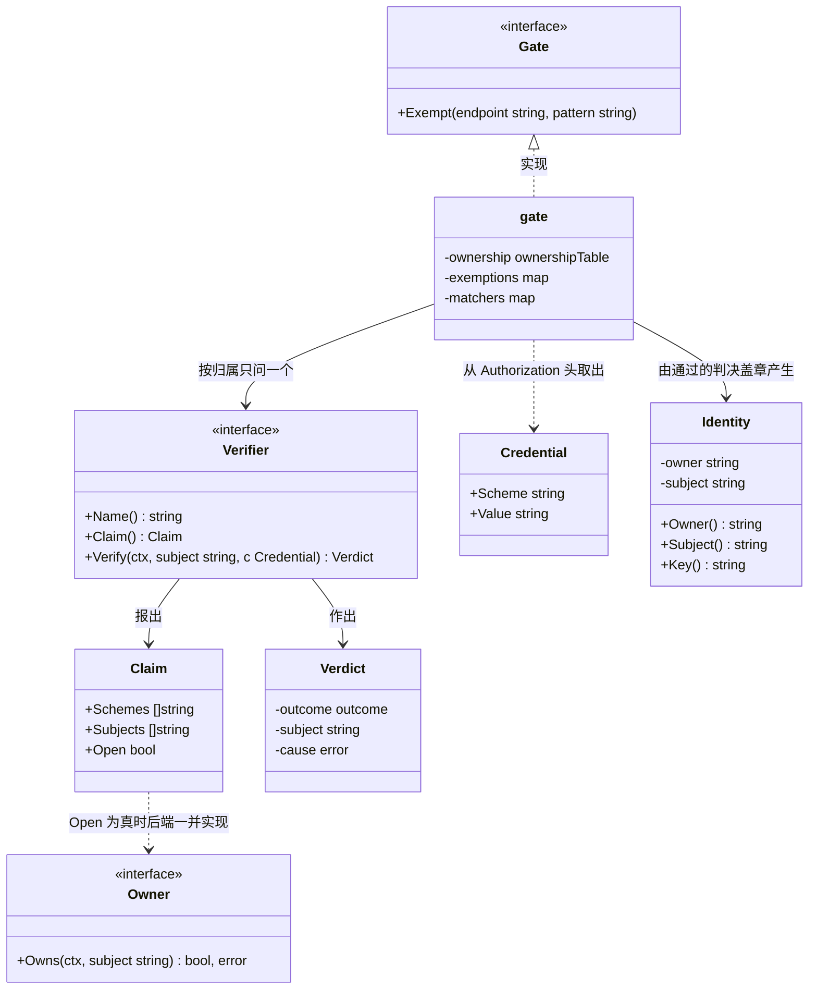
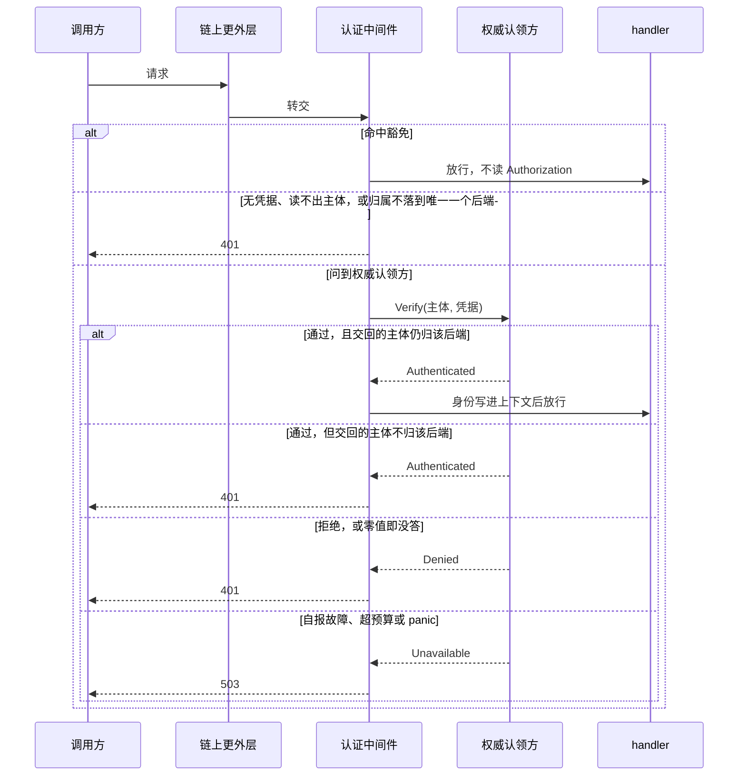

# authn

## 职责

- 在监听端的中间件链上认定每个请求的调用方是谁：取出凭据、交给权威认领该主体的校验后端、把回答收口成放行或一个状态码。
- 维护主体与校验后端之间的归属，并在装配期检出归属重叠。
- 受理免认证路由的登记，并在请求期判定本次请求是否命中豁免。
- 把认定出的身份写进请求上下文，供链上其余各层与 handler 取用。
- 定义校验后端的接缝：凭据的形状、判决的形状，以及后端自报身份与归属的途径。

本发布单元由接口包与子包组成。`pkg/authn` 根包定义功能接口与数据类型，**自身不注册模块，也不导出模块名常量**；网关住在自己的子包并注册一个模块，每个校验后端各住一个子包、各注册一个模块（[ADR-authn-packaging-2026-09-20](../../adr/adr-authn-packaging-2026-09-20.md)、[ADR-module-packaging-2026-09-14](../../adr/adr-module-packaging-2026-09-14.md)）。下文的“网关”指网关子包所注册的那个模块的产物。

认证与路由豁免同属本发布单元，权限模型另立（[ADR-authn-scope-2026-09-20](../../adr/adr-authn-scope-2026-09-20.md)）。

**根包不导出模块名常量**，判据是导出它没有对应的登记：命令树按名字纳入模块（见 [config](design-config.md)），宿主拿一个无人登记的名字去纳入，得到的是一个不在可用集里的名字，而命令树对未登记名字的处置在 `config` 的哨兵表里没有对应项。

### 非职责

- **不做权限判定，从不写 403。** 本模块回答“调用方是谁”，“这个调用方能不能做这件事”归权限模型，它另立，以中间件或 handler 内的判定接入，取用本模块写进上下文的身份（[ADR-authn-scope-2026-09-20](../../adr/adr-authn-scope-2026-09-20.md)）。
- **不定义响应体的形状。** 本模块写状态码与必要的响应头，响应体的约定属于提供该 API 的模块（见 [http](design-http.md)）。
- **不实现任何具体的凭据校验。** 目录、凭据表、令牌签发方各是一个校验后端，住在自己的子包里；根包不认识其中任何一种。
- **不从请求体取凭据。** 凭据只从 `Authorization` 头取。中间件读一次请求体就把它耗掉了，handler 里的 `Decode` 随后拿到的是一具空体，这个请求被映射成 400，而调用方送出的请求体是完整的。
- **不从 cookie 取凭据。** 浏览器会话的签发、续期与失效是另一套机制，本模块不实现它，`Cookie` 头因而不是凭据来源。
- **不提供配置式豁免清单。** 豁免只来自代码中的登记：一条命令行参数不该能改变哪些路径不需要认证（[ADR-authn-scope-2026-09-20](../../adr/adr-authn-scope-2026-09-20.md)）。
- **不把认证 scheme 名做成输入项。** scheme 由各后端在代码里自报，与豁免同一条理由，另有一条：输入项清单按完整集合判冲突，而 scheme 的撞车落不进那份清单的任何一条判据。
- **不读入口模块的路由表。** 登记面不提供枚举，也不提供“这条请求会派发给哪条模式”的查询（见 [http](design-http.md)），豁免的匹配因而由本模块自持的匹配器完成。
- **不代替宿主决定哪条命令纳入认证。** 模块不声明、也无从知道自己出现在哪条命令下（[ADR-command-tree-2026-09-20](../../adr/adr-command-tree-2026-09-20.md)），本模块既不能声明“凡有 HTTP 入口的命令都该有我”，也没有检查它的位置。
- **不承载运行期可变的参数。** 判据是该值是否在数据库可用之前就被需要；本网关守哪些监听端在其列，某个主体是否被停用不在（[ADR-config-scope-2026-09-13](../../adr/adr-config-scope-2026-09-13.md)）。

## 术语表

以下术语的含义限于本模块，以及认证主题的决策记录。

| 术语 | 英文 | 定义 |
|---|---|---|
| 主体 | subject | 调用方在某个校验后端的主体空间里的名字。裸字符串，自身不含归属信息，不含分隔符 `/`。 |
| 凭据 | credential | 请求为证明自己是某个主体而出示的东西：`Authorization` 头里的认证 scheme 与其后的取值。 |
| 判决 | verdict | 一个校验后端对一条凭据给出的回答，取值是通过、拒绝、故障三者之一，另有一个表示“没答”的零值。 |
| 豁免 | exemption | 一条免于认证的路由，以监听端名加路由模式登记。命中它的请求不取凭据，也不问任何后端。 |
| 校验后端 | verification backend | 交付校验功能的一个模块：它持有某一片主体空间的凭据事实，并对落在其中的主体作出判决。 |
| 归属 | ownership | 主体与校验后端之间的权威关系：一个主体只由一个后端权威认领，问它即只问那一个，它不在时无人接管。 |

## 外部接口契约

### 登记单元与名字

| 登记单元 | 模块名 | 交付 |
|---|---|---|
| 网关子包 | `authn.gate` | 排他地交付网关功能 |
| 每个校验后端子包 | `authn.<后端>` | 非排他地交付校验功能 |
| 根包 | 不登记 | 只有接口与数据类型 |

每个登记模块的包导出自己的 `ModuleName` 常量，配置命名空间取同一个取值（形态见 [db](design-db.md) 的实现子包）。名字的每一段只用小写字母、数字与短横线：`Namespace` 按 `.` 切段后适用配置键的字符集规则，违反它会从环境变量名那一头破坏分层（见 [config](design-config.md)）。

### 网关交付的功能

功能标识的元素类型必须是接口，取用写作 `core.Resolve[authn.Gate](reg)`：

```go
// Gate 是认证层交付的功能，同时是豁免的登记面。
type Gate interface {
    // Exempt 登记一条免认证路由。pattern 是登记方传给 Endpoint.Route 的那个原串。
    Exempt(endpoint, pattern string)
}
```

交付声明写作 `Provides: []core.Provision{{Token: (*Gate)(nil), Exclusive: true}}`。

**网关的表态只能是 `StateEnabled` 或 `StateDisabled`，永不 `StateAuto`**（[ADR-authn-packaging-2026-09-20](../../adr/adr-authn-packaging-2026-09-20.md)；这条约束没有任何机制强制，违反它的后果与接受的代价见同一记录）。配置给出了要守的监听端即表态启用，一个都没有给出即表态禁用并给出理由，那一行启动诊断是操作者唯一的线索。

### 校验后端的接缝

```go
// Credential 是一条待校验的凭据。
type Credential struct {
    Scheme string // Authorization 头里的认证 scheme
    Value  string // scheme 之后的取值，原样
}

// Verifier 是一个校验后端。非排他：多个后端并立在同一个网关之后。
type Verifier interface {
    // Name 报出本后端的身份。约定取值等于该子包的 ModuleName。
    Name() string
    // Claim 报出本后端权威认领的主体空间。
    Claim() Claim
    // Verify 对一个落在本后端归属内的主体校验一条凭据。
    Verify(ctx context.Context, subject string, c Credential) Verdict
}

// Claim 是一个校验后端权威认领的主体空间。
type Claim struct {
    Schemes  []string // 整条认领的认证 scheme：带这些 scheme 的凭据一律问本后端
    Subjects []string // 逐个列举的主体
    Open     bool     // 未被任何列举认领的主体，由本后端自己回答是否归它
}

// Owner 由 Claim.Open 为真的后端一并实现。
type Owner interface {
    // Owns 回答一个主体是否归本后端。不看凭据，不消耗任何尝试预算。
    Owns(ctx context.Context, subject string) (bool, error)
}
```

交付声明写作 `Provides: []core.Provision{{Token: (*Verifier)(nil)}}`，**`Exclusive` 一律留空，这条不可局部违反**。任何一个后端写成排他：同侪表态 `StateAuto` 时整组启动失败于 `ErrExclusiveViolated`；同侪显式启用时它自己被传播静默踢掉，不产生任何失败（[ADR-module-enablement-2026-09-13](../../adr/adr-module-enablement-2026-09-13.md)）。

**`Name` 存在是因为 `ResolveAll` 返回的实例不带模块名**：需要按名字路由时，那个名字是领域概念，由功能接口自己提供，这是该机制的正常用法（见 [core](design-core.md)）。**`Name()` 与该子包 `ModuleName` 的一致只靠约定，机制不校验**——本模块拿不到实例的模块名，因而无从比对。一个后端可以报出一个与它的模块名毫不相干的名字，归属表、启动诊断与身份的字符串形式都会照它报的那个写。这一处与 `http` 不校验中间件的 `Provides` 与登记方描述符的一致性同形、同因（见 [http](design-http.md)）。

### 判决

```go
// Verdict 是一个后端对一条凭据的回答。字段不导出，只能由构造器产生。
type Verdict struct{ /* 字段不导出 */ }

// Authenticated 交回本后端归属内的主体。
func Authenticated(subject string) Verdict
// Denied 是终局拒绝，cause 只进日志，改不了结论。
func Denied(cause error) Verdict
// Unavailable 表示本后端此刻答不了。
func Unavailable(cause error) Verdict
```

**判决不可字面构造**，判据是零值必须有确定的读法：**本形状下零值读作“没答”，收口 401 并单独计一次缺陷**，与拒绝不混桶——故障那一桶要能拿来告警，缺陷那一桶要能拿来发现后端写错。被否决的其他形状与各自的否决理由见 [ADR-authn-verdict-2026-09-20](../../adr/adr-authn-verdict-2026-09-20.md)。

`Denied` 携带的成因改不了结论：一个后端在拒绝里塞进任何错误值，网关仍然收口 401。抬成故障的只有一种成因——网关自己塞进调用 context 的超时错误值。不这么限定，一个后端就能顺手把“口令不对”变成 503。

### 身份与请求上下文

```go
// Identity 是认定出的调用方身份。字段不导出。
type Identity struct{ /* 字段不导出 */ }

func (Identity) Subject() string // 主体
func (Identity) Owner() string   // 权威认领它的那个后端报出的名字
func (Identity) Key() string     // Owner() + Separator + Subject()

const Separator = "/"

// FromContext 取出本次请求的身份。没有身份时第二个返回值为假。
func FromContext(ctx context.Context) (Identity, bool)
```

**注入口不导出，`FromContext` 不回落。** 这一对约定与 [log](design-log.md) 的形态反着来：那里 `WithLogger` 是导出的注入口，`FromContext` 在上下文里没有 logger 时回落到进程根 logger（[ADR-log-context-2026-09-13](../../adr/adr-log-context-2026-09-13.md)）。反过来的理由是两者要承载的东西不同：logger 有默认值而身份没有，回落等于把一个匿名请求读成某个主体；导出注入口等于让链上任何一层改写身份，而认证的全部意义就是这件事只发生一次、只由一个地方决定。

代价是下游必须自己处理第二个返回值为假的那一档：豁免路由上没有身份，本模块未被纳入或未启用的进程里 `FromContext` 恒为假。

**身份的字符串形式一律带归属限定**，单后端部署也一样。这是为了不让 `bob` 与 `local/bob` 同时存在；代价是从既有系统迁移时，按主体写死的策略串要整体改写。主体自身不含 `/`：自然标识符带斜杠的后端必须自己映射，否则它交回的主体在出口绑定处被拒。

### 豁免的登记面

`Exempt` 登记的是一个监听端名加一条路由模式，模式就是登记方传给 `Endpoint.Route` 的那个原串，含方法。本模块不为豁免另造一套语法，登记的就是那个原串；解释它的是本模块自持的匹配器，其语义与标准库的 `ServeMux` 相同，入口模块的引擎接受而匹配器解析不了的模式因此装不进去，这是 `ErrUnmatchablePattern`（见错误与失败语义）。

**登记只在 `Init` 阶段成立**，此外的写入一律 panic，与 `http` 登记面同类：写不上的只有调用点的编程错误。闸门借用 `Migrate` 与 `Start` 两个阶段位，理由与 `http` 的同一条——它要框住的是全局的 `Init` 窗口，而不是本模块自己的 `Init` 回调（见 [http](design-http.md)）。

**豁免不走资源通道**，时机与越权各自是一条独立成立的理由。时机：资源在 `init` 期随描述符冻结（见 [core](design-core.md)），而端名出自配置、模式出自 `Init` 期的登记方，两者那时都还不存在。越权：`core.Resources` 遍历全部已注册模块，不看纳入也不看启用，一个表态禁用、`Init` 从未执行的模块，它声明的豁免仍会被收上来并生效——这是安全关键路径上的 fail-open。登记面天然没有这个洞：没启用就没有 `Init`，就没有 `Exempt` 调用。**本模块因此不另设静态豁免的资源通道**，否则两种登记途径并存，而资源那一条不受闸门约束。

登记方在自己的 `Init` 里 `core.Resolve[authn.Gate](reg)` 取得登记面，**不在 `Requires` 中声明它**，判据与网关自己不声明依赖的那一条同源：取用发生在 `Init`，网关若在场那时早已构造，没有要排的序；声明了反而让依赖闭包把网关拖进宿主并没有列举它的那些命令。取不到登记面时登记方怎么处置由它自己决定——本模块要求不了它终止启动，而"取不到就跳过"这个默认写法落在全开那一侧，这一条列在非保证里。

条件挂载的正面做法是 `Route` 与 `Exempt` 写在同一个条件分支里、共用同一个模式常量。

### 中间件在链上代表的功能

网关登记的中间件以 `(*Gate)(nil)` 作为自己的 `Provides`，与描述符里那条交付声明取同一个标识。**这是别的层把自己排在认证之内或之外的唯一锚点**，因而是本模块对外的稳定契约面：按主体限流、租户解析这类层用 `After` 指向它，落在认证之内。

反方向本模块声明不了：`After` 收的是功能标识，而本仓没有任何模块交付恢复功能——[http](design-http.md) 的中间件示例里用到的那个标识，在本仓找不到交付它的模块，指向它等于要求每个宿主自带一个；`http` 又明写不接住 handler 的 panic。网关因此自备 recover。

### 配置

网关的输入项挂在 `authn.gate` 下，其中 `endpoints` 给出本网关守哪些监听端。**端名清单只能是本模块自己的输入项**：登记面只有按名取端一个方法，枚举不出来；而去 `Decode` 入口模块的命名空间来自动跟随端的集合，会把本模块的配置面耦合到别人的配置形状上。

每个校验后端各挂 `authn.<后端>` 专属命名空间。清单的收集覆盖全部已注册模块，与本次选中哪条命令无关（见 [config](design-config.md)），两个后端只要都被 import，落在同一路径上的输入项就是 `ErrConfigConflict`，与它们是否会同时运行无关。

以下各条是后端声明输入项时的全部约束：标为 `Sensitive` 的项必须带 `Description`，否则 `ErrInvalidSchema`；原则上不申请命令行短名，短名处于全局命名空间且一个字符一格；**必填输入项不得只从命令行取**，判据是命令行参数按参与集分层而主配置源与环境变量各命令共用：一个只从命令行取值的必填项，在没有写这个参数的命令下取不到值，同一个后端因而在两条命令下得出不同的启用结论——而在施加迁移的那条命令下得出的若是禁用，它的凭据表就建不出来（后果见对宿主的要求）。

### 对宿主的要求

以下各条是宿主在命令树上要做的全部动作。**本模块既不能把它们声明出来，也没有检查它们的位置**，漏写不报错。

- **每条需要认证的命令逐个写出网关与所选后端的 `ModuleName`。** 纳入只给予表态的资格，不决定启用。
- **不要把本模块放进根命令。** 根命令纳入的模块对每条子命令都有效（见 [config](design-config.md)），而宿主想表达“凡有 HTTP 入口的命令都该有认证”时，照 `config` 里那份命令树示例把网关放进根命令即可写出。后果：本模块进了施加迁移那条命令的参与集，而那条命令的深度止于 `Migrate`，正好落在豁免闸门打开而无人关上的那一格；本模块的全部输入项升格为全局参数，出现在每条命令的帮助输出里；带必填项的后端在打印版本这类命令下也要表态；而自带凭据表的后端一旦因此进了 `migrate` 的参与集又在那里表态禁用，它的凭据表反而建不出来——迁移集按声明集取材，挡住建表的恰恰是这一次表态（见 [db](design-db.md)）。
- **不要对纳入本模块的命令用 `IncludeAll()`。** 它让参与集重新成为 import 图的函数，其中可能含有宿主并不知情的模块（[ADR-command-tree-2026-09-20](../../adr/adr-command-tree-2026-09-20.md)）；在认证这条路径上，那意味着一个宿主没有列举过的校验后端可以发出身份；它还会把本模块的后端拉进参与集，配置不齐的那个因此表态禁用，其凭据表在这条命令下不再被建（见 [db](design-db.md)）。权威对此既未允许也未禁止，这是本模块自己的立场。
- **自带凭据表的后端必须进入施加迁移那条命令的声明集，而且不能在那条命令下表态禁用。** 迁移集按声明集取材（见 [db](design-db.md)），两侧各有一种漏法。其一，后端**不在**那条命令的声明集里——它既没被运行级纳入，也没被静态级纳入——凭据表不建；`IncludeAllDeclarations` 使这一侧不必逐个列举，逐个列举则漏一个不报错。其二，后端被那条命令**运行级**纳入（最常见的成因是它被写进了根命令，见上一条），而那条命令下没有给出它启用所需的配置，它在那里表态禁用，表同样不建。两种漏法都不报错，都表现为提供服务时的运行期查询失败。可写的形态因此是：让它静态级进入那条命令的声明集，或者运行级纳入并在那条命令下也配齐。

### 稳定性承诺

`Gate`、`Verifier`、`Owner`、`Claim`、`Credential`、`Verdict` 与 `Identity` 是本模块与其他模块之间的契约。中间件在链上代表的那个功能标识与描述符里的交付标识同为 `(*Gate)(nil)`，别的模块据它排序，取值不变。判决的构造器是后端交出答案的全部途径，增减它们会改变每一个后端。

## 依赖

`pkg/authn` 根包 import `pkg/core` 与 `pkg/config`：`core` 提供功能标识与查询，`config` 用于声明输入项。接口面上只出现标准库与本包自己的类型。

**接口包不依赖 `pkg/db`，这是本模块的自我约束而不是架构的要求**（架构对跨发布单元依赖的要求是一律指向对方的接口包，见 [architecture](../architecture.md) 的概览，指向 `pkg/db` 的接口包并不违反它；本条见 [ADR-authn-packaging-2026-09-20](../../adr/adr-authn-packaging-2026-09-20.md)）。理由是凭据事实的存放形态是后端自己的事：自带凭据表的后端把 `db` 依赖、迁移集与模型全部留在它自己的子包里，其余后端不因此承受数据库依赖。

网关子包 import 根包、`pkg/core`、`pkg/config` 与 `pkg/http`。校验后端子包 import 根包，以及它自己那个凭据来源所需的东西。

**网关的 `Requires` 为空**（[ADR-authn-wiring-2026-09-20](../../adr/adr-authn-wiring-2026-09-20.md)）。它不声明对路由功能的依赖，也不声明对校验功能的依赖，判据是不存在要排的序：`New` 里两者都用不着，路由功能要到 `Init` 里调用登记面时才用得上，校验后端要到应答请求时才用得上，而 `Init` 整体跑在全部 `New` 之后。声明了只剩副作用——纳入一个模块即一并纳入它构造期依赖的提供者（见 [config](design-config.md)），宿主在命令树上对入口实现与校验后端的显式列举就此被架空：只纳入网关与只纳入网关加某个后端，得出的参与集一字不差。

**`Requires` 里也不放 `Optional` 声明**，否决这个写法的理由见 [ADR-authn-wiring-2026-09-20](../../adr/adr-authn-wiring-2026-09-20.md)。路由功能与校验功能都在 `Init` 里取用，取不到即启动失败，各有本模块自己的哨兵（见错误与失败语义）。

**日志功能不构成依赖。** 主体作为关联字段绑上去用的是 `log.WithAttrs`，包级函数，不经注册表；只有脱敏规则的登记要 `Logger` 这个功能的实例，网关在 `Init` 里取它，取不到即本次装配没有日志模块，规则无处登记。登记不改变任何认证行为，缺席也不改变，因而不为它声明依赖。

方向满足架构不变量：本发布单元位于 `core`、`config`、`log`、`http` 与 `db` 之上，不被其中任何一个 import。权限模型位于本模块之上，它取用身份而本模块不认识它。

## UML 图

下图给出接缝上的各个类型与它们的关系。图中画不出的约束是时机与唯一性：归属表在 `Init` 建立并在此后只读，一个主体在表里只有一个权威认领方，而判决与身份之间的那条边只在判决为通过时成立。



`gate` 未导出，它持有归属表、按端分列的豁免表与各端的匹配器。`Identity` 上的归属不由后端给出：它取自权威认领该主体的那个后端所报的名字，由网关盖章，后端在判决里没有任何字段能写它。

下图给出请求期的路径，各类失败各走一条分支。它要固定的是定序：豁免的判定发生在读取 `Authorization` 之前，因而豁免路由上任何一个后端都不会被调用；归属的判定发生在校验之前，因而一条凭据只到达权威认领它的那一个后端。



网关自身 panic 时由它自己 recover 并收口 500，这条路径不经过任何后端，图中不画。

## 核心数据结构

**归属表**在 `Init` 建立，此后只读。它由以下各类认领拼成，这是全部：整条认证 scheme 的认领、逐个列举的主体、开放认领。scheme 认领与列举认领是精确键；开放认领没有键，它在请求期由后端自己回答。

表里的每一项都带着报出它的那个后端的名字，归属重叠的报错因而点得到双方。名字取自 `Verifier.Name()`，不取自模块名：`ResolveAll` 返回的实例不带模块名（见 [core](design-core.md)）。

**豁免表**按监听端分列，一端一张，内容是模式的集合。`Start` 时校验并冻结成只读快照，请求期读的就是这一份。

**匹配器**每端一台，只装该端的豁免模式，语义与标准库的 `ServeMux` 相同。它不认识该端实际挂了哪些路由——本模块读不到路由表——因而它回答的是“本次请求命中了哪一条豁免模式”，不是“本次请求会派发到哪条路由”。两者的分叉写在非保证一节。

**收口计数**分桶：`authenticated`、`denied`、`unspoken`、`unavailable`。这是穷尽的一组，请求期每一次收口恰好落进其中一个桶；桶名一旦被看板引用就改不动，因而在此定死。503 的各种成因——后端自报故障、超出预算、后端 panic——由日志行区分，不由桶区分。归因同样不分桶：网关自产的拒绝与后端交回的拒绝同落 `denied`，记在谁名下只见于日志。网关自身 panic 那一档不进这组：它是本模块自己的缺陷，不是对一条凭据的判决。

## 核心算法与流程

### 阶段行为

| 阶段 | 行为 |
|---|---|
| `Prepare` | 取配置读取面并 `Decode` 自己那份配置，据此表态。 |
| `New` | 构造。不取任何模块的产物。 |
| `Migrate` | 打开豁免登记的写入闸门。网关不迁移任何东西，自带凭据表的后端在此没有动作——表由它声明的迁移集建立，由数据库模块统一施加。 |
| `Init` | 取路由功能，在配置列举的每个端上登记认证中间件；`ResolveAll` 取全部校验后端并建立归属表；取日志功能并登记凭据的脱敏规则。 |
| `Start` | 关闭写入闸门，校验豁免表并冻结，按端建立匹配器。 |
| `Serve` | 无动作。 |
| `Stop` | 停止接受新的后端调用。 |
| `Close` | 等待在飞的后端调用结束，以调用预算为界。 |

**未被推进到的阶段其回调不执行**（[ADR-lifecycle-drive-2026-09-20](../../adr/adr-lifecycle-drive-2026-09-20.md)），本模块的每一条启动期判定因此都随它所在的阶段一起被跳过。深度浅于 `Init` 的驱动不建归属表，归属重叠因而检不出来；深度浅于 `Start` 的驱动不冻结豁免表，也不建匹配器，`Start` 上的那些校验——端名、守备与模式——因而一条都不发生；深度止于 `Migrate` 的驱动打开闸门而无人关上，闸门一直敞到进程结束。回避办法与代价都与入口模块的那一条相同（见 [http](design-http.md)）：以施加迁移为目的的命令不纳入本模块，而这个耦合不体现在任何一方的声明里，没有一处可供检查。

**`Prepare` 里有两条互斥的读法，混起来会开一个静默的洞。** 取配置读取面得到 `ErrMissingProvider`，说明宿主漏了把它交进注册表，此时返回错误终止启动；`Decode` 得到 `ErrMissingRequired`，才是正当的退让，表态禁用并给出理由。把 `ErrMissingProvider` 也读成“没配”，一个漏了预置的宿主会静默地少掉整层认证，与零值判决被读成通过是同一条防线的两端。

### 豁免的登记与匹配

登记阶段只记录端名与模式，不做判定：闸门开着的那段时间里，登记方按依赖序逐个执行 `Init`，登记是否齐备要到窗口关上才谈得上。

`Start` 关闸后逐条校验，全部失败都终止启动并走正常回滚：端名经 `Router.Endpoint` 核对，不存在即哨兵；该端不在本网关所守的清单里，同样是哨兵——否则那条豁免被静默吞掉，方向虽然是 fail-closed，却没有任何信号。

校验通过的模式装进该端的匹配器，装不进去的是 `ErrUnmatchablePattern`，同样终止启动并走正常回滚。引擎与匹配器是两套解析：引擎认可的模式在登记时不 panic，它是否为匹配器的语义所接受要到 `Start` 建匹配器时才知道，换一个语法比 `ServeMux` 宽的引擎会让这一格成为常态。请求期先问匹配器，**命中即放行，完全不读 `Authorization`，也不问任何后端**。

模式就是路由登记时的那个原串，因而带路径参数的路由与子树挂载的路由都可以豁免，方法也天然是模式的一部分：只豁免 `GET /both` 时，`POST /both` 照常要凭据。

复杂度是每请求一次匹配，规模是该端豁免模式的条数。这是在入口模块自己那次路由分发之外多出来的一次匹配。

### 归属的建立与判定

归属的形态与它的取舍见 [ADR-authn-ownership-2026-09-20](../../adr/adr-authn-ownership-2026-09-20.md)。

`Init` 里 `ResolveAll` 取全部已构造的校验后端，逐个取它的 `Claim` 建表。归属表的建立不能更早：`Prepare` 之间不保证顺序，那时也取不到任何模块的产物（见 [core](design-core.md)）。

建表时检出的重叠是精确键上的重叠：两个后端认领同一条认证 scheme，或列举了同一个主体。这两类一律启动失败并点名双方。**两个开放认领之间的重叠在建表时检不出来**——开放认领没有键——它留到请求期，表现为一次 401。遍历与点名的次序依据是 `ResolveAll` 的模块名字典序，它只用来让报错在各次构建之间稳定，**不作为领域优先级**。

请求期按以下次序定出归属，这个序列是全部：

1. 凭据的 scheme 被某个后端整条认领，即问它，主体由该后端从凭据里读出。带这类凭据的请求到此为止。无人整条认领的 scheme 下主体由网关从凭据里读出，读不出主体的请求到此为止，收口 401 并记在网关名下。**网关自己只读得出 `Basic` 一种**——它是唯一由标准把主体固定在凭据某处的 scheme（RFC 7617）。其余无人认领的 scheme 在网关眼里是不透明的，一律落进「读不出主体」这一档；补法不是让网关认识更多 scheme，而是由该 scheme 的后端把它整条认领下来。
2. 主体串含 `/` 时，按第一个 `/` 切出归属名并精确查表，**再由查到的那个后端确认它确实认领余下的裸主体**——裸主体落在它逐个列举的认领里即成立，它是开放认领则问一次 `Owns`，两者皆不成立即收口 401 并记在网关名下。这是调用方在多后端下限定自己归属的写法：**限定只说问谁，不说该不该问**。少了后一道确认，限定写法就从消歧变成了升权——一个裸名下收口 401 的主体，只要前缀一个猜得到的后端名就能被送到某个后端去校验，而出口绑定在这条路上恒不触发（交回的主体就是问它的那个），拦不住。它同时也会破掉本节末「归属不由主体串派生，由认领方自己回答」那一条：只按名查表的限定路，恰恰是纯粹从主体串派生出归属。
3. 主体落在某个后端逐个列举的认领里，即问它。
4. 其余是裸名，并发问全部开放认领的后端。恰好一个回答归它，即问它；零个，收口 401；多于一个，收口 401 并在日志里点名冲突的各方，同时给出限定写法。任何一个开放认领在回答时出错或 panic，一律收口 503。

**归属不由主体串派生，由认领方自己回答**，否决从主体串解析的理由见 [ADR-authn-ownership-2026-09-20](../../adr/adr-authn-ownership-2026-09-20.md)。裸用户名因此必须能用，而它带不出任何归属信息。

**出口绑定**：通过的判决交回的主体必须仍落在该后端的认领里，不落在其中即一次网关自产的拒绝——收口 401，记在网关名下，不记到任何后端头上。

「仍落在该后端的认领里」按把该后端选出来的那一类认领判，因为那一类就是它的认领：

- 三条一律不成立，与经哪一步到达无关：交回空主体、交回的主体含 `/`、交回的主体是**另一个**后端逐个列举的主体。最后一条是整条认领 scheme 的后端唯一受到的约束——scheme 认领认的是 scheme 不是主体，别处没有东西能约束它从凭据里读出什么；没有这一条，任何一个认领了某条 scheme 的插件都能铸出管理员的身份。
- 限定、逐个列举与开放认领三路另外要求交回的主体仍由该后端认领。与问它时的那个主体相同即已成立——选中它的那一步已经判过那个主体的归属，限定路上的第 2 步也判过；不同则按同样的两类认领重新判一次，开放认领为此多问一次 `Owns`。这道判定发生在后端作答之后，作出它的仍是网关：越界与否由归属表判定，而归属表是网关建的。没有这一道，一个只认领某一小片主体空间的后端可以交回任何主体，越过归属表铸出别人的身份。

**后端不在时它权威的主体无人接管**。一个被禁用或未纳入的后端，它列举认领的主体不进归属表，落在那里的请求按无人认领收口 401；一个在场但答不了的后端，它的主体收口 503。两档不同，判据是归属表里有没有这一项。

### 判决的收口与请求上下文

每次后端调用带一个预算与一个在飞闸门，recover 跟着调用走：后端的同步 panic 在调用点被接住，收口 503 并记在该后端名下，进程存活，同一进程里其余归属随后照常应答。**网关必须自己 recover**——入口模块明写不接住 handler 的 panic（见 [http](design-http.md)），不 recover 的实际形态不是 500，而是连接被丢掉、调用方拿不到任何状态码，按状态码统计的监控什么都看不到。

收口成功时，网关把身份写进请求上下文，并经 `log.WithAttrs` 把主体绑上去作为关联字段。关联字段由产生它的模块在自己的注入点绑定，而 HTTP 中间件正是 [ADR-log-context-2026-09-13](../../adr/adr-log-context-2026-09-13.md) 点名的注入点；主体这项字段除了本模块没有别人产得出，不绑上去，请求路径上的日志就无法归因到调用方。

凭据的脱敏规则在 `Init` 里向 `log.Redaction()` 登记，不在 `New` 里：`New` 里拿到 `Logger` 的实例要么把日志功能写进 `Requires`，要么赌构造序，而网关的 `Requires` 为空（[ADR-authn-wiring-2026-09-20](../../adr/adr-authn-wiring-2026-09-20.md)）。

**登记只对此后的判定生效**，而经 `With` 绑定的属性在绑定时就判定完毕（见 [log](design-log.md)）：任何一个在本模块登记之前就取得并绑好属性的 logger，它的绑定属性不受这条规则约束，哪怕记录写在登记之后。[log](design-log.md) 给模块的那条时机是在自己的 `New` 里、取得 logger 之前登记，它保证的是自己的规则早于自己的绑定；本模块的登记落在全部 `New` 之后，连这一条都给不出，比那条时机再弱一档，跨模块的覆盖更没有时机可言。

## 错误与失败语义

启动期的失败一律终止启动。本模块为自己判定出的每一类失败提供哨兵错误，调用方以 `errors.Is` 判别，包裹一律用 `%w`。哨兵表对本模块自己产生的失败是封闭的：新判定出一类确定失败，要么并入既有哨兵，要么补一条。经由本模块返回的其他失败不在此列——后端自己的错误由它自己定义，本模块不为它们发明名字。

| 哨兵错误 | 触发条件 | 修复动作 |
|---|---|---|
| `ErrNoRouter` | `Init` 里取不到路由功能 | 错误文本点明“纳入了认证却没纳入任何 HTTP 入口”；把入口实现子包的模块名写进这条命令 |
| `ErrNoVerifier` | `Init` 里 `ResolveAll` 取到零个校验后端 | 错误文本点明“一个校验后端都没纳入”；把所选后端子包的模块名写进这条命令，或查它表态禁用的原因 |
| `ErrClaimConflict` | 两个后端认领同一条认证 scheme，或列举了同一个主体 | 点名双方报出的名字与撞上的那一项；改掉其中一方的认领 |
| `ErrInvalidClaim` | 认领自身的形状不合法：主体为空或只含空白、主体含 `/`、`Open` 为真却没有实现 `Owner`、报出的名字为空 | 点名该后端与不合法之处；改那个后端的认领 |
| `ErrUnknownEndpoint` | 豁免登记的端名在入口模块的配置里不存在 | 点名该端名与登记的模式；改端名，或在入口模块的配置里声明这个端 |
| `ErrExemptionUnguarded` | 豁免登记到本网关不守的端上 | 点名该端名与本网关所守的端；把该端写进本模块的 `endpoints`，或把豁免挪走 |
| `ErrUnmatchablePattern` | `Start` 建匹配器时，一条豁免模式不为匹配器的语义所接受 | 点名该端名、该模式与匹配器给出的原因；改成匹配器也认的写法，或改挂一条覆盖同一批请求的模式 |

取不到配置读取面时，本模块把 `core` 的 `ErrMissingProvider` 原样外传，不另立哨兵：补救动作是宿主在驱动开始之前把读取面交进注册表（见 [core](design-core.md)），与本模块自己判定出的缺陷不同类。

本模块写出的启动诊断每行以 `authn: ` 起头，与诊断有多个写者这条约定一致（见 [core](design-core.md)）。成功路径上无条件写出冻结后的豁免表，以及实际到场的校验后端名单。后端名单是“宿主 import 了某个后端却没在命令树上列举它”这种情形的唯一察觉途径。

### 请求期的三档收口

**以下三档只在推进到 `StageServe` 的命令下发生。** 更浅的驱动下入口模块不绑定任何地址、不接受任何请求，认证中间件一次都不被调用，本节描述的路径整段不执行。三档的划分见 [ADR-authn-verdict-2026-09-20](../../adr/adr-authn-verdict-2026-09-20.md)。

| 状态码 | 判据 | 归入其中的情形 | 归因 |
|---|---|---|---|
| 401 | 这条请求没有出示一条成立的凭据 | 没有 `Authorization` 头；无人整条认领的 scheme 下读不出主体；无人权威认领该主体；通过的判决交回了不归它的主体；多于一个开放认领同时认领；判决为拒绝；判决为零值即“没答”，另计一次缺陷 | 网关自产的拒绝记在网关名下，不记到任何后端头上：没有 `Authorization` 头、读不出主体、无人权威认领该主体、通过的判决交回了不归它的主体。多于一个开放认领同时认领时同样记在网关名下——判定出自网关自己建的归属表——日志另点名冲突的各方。判决为拒绝与判决为零值记在作答的那个后端名下 |
| 503 | 本模块此刻答不了，而不是这条凭据不成立 | 后端自报故障；调用超出预算；后端 panic；开放认领在回答归属时出错或 panic；**网关已停止接受后端调用**；**在飞闸门已满** | 后端答不出来的那些记在被问到的那个后端名下。**末两项记在网关名下**：那两种情形下后端一次都没被问到，把它们算到后端头上会把操作者送去查一个完全正常的凭据来源。判据是成因出自哪一侧，不是状态码 |
| 500 | 本模块自身的缺陷 | 网关自己的 panic，由它自己 recover 后收口 | 网关 |

出口绑定是其中唯一发生在后端作答之后的网关自产拒绝：判定由归属表作出，归属表是网关建的。

本模块不写响应体，只写状态码与必要的响应头。归因因而只进日志：记在网关名下的那些写网关自己，点得到后端的那些靠 `Verifier.Name()` 报出的名字。

**401 必带 `WWW-Authenticate`。** 本模块不写响应体，这个头因而是调用方判断该出示哪种凭据的唯一依据；不带它的 401 只说了「你需要凭据」而没说哪一种，RFC 7235 也不允许。列出的 scheme 是各后端整条认领的那些，加上网关自己读得出的 `Basic`——恰好就是一条凭据能到达某个后端的全部途径。**realm 取该监听端的端名**：`Basic` 要求 realm（RFC 7617），而 realm 指的是一片保护域，监听端正是本模块划分保护域的粒度；凭空造一个词，会被按 realm 存凭据的客户端当作有意义的名字存下来。端名来自配置，因而写进 realm 之前要转义引号与反斜线、丢弃换行，否则配置里的一个引号就能在挑战里多带出几个参数、一个换行就能多带出一个响应头。

### 接受的代价

- **归属本身带来的代价记在 [ADR-authn-ownership-2026-09-20](../../adr/adr-authn-ownership-2026-09-20.md)**：权威后端不可用的那段窗口收口 503 而非 401、归属判定构成一台可枚举用户名的存在性预言机、归属名与子包模块名的一致只靠约定。它们出自归属的裁定本身，被否的替代做法与各自的理由记在那份记录里。
- **开放认领的后端病了会拖慢全部裸名。** 裸名是日常路径，而它要问遍全部开放认领。预算与在飞闸门给出的是本模块这一侧协程与延迟的上界，不含后端自己攥着的连接。
- **越界的豁免登记以 panic 拒绝，而注册表从不接 panic。** 一个登记方从自己的协程里迟到写一次，跑着的进程当场崩。这与入口模块的登记闸门是同一类代价。
- **未认证的调用方分不清路径写错与没带凭据。** 未命中豁免的请求一律 401，404 与 405 都到不了它。探活与诊断路由要靠豁免显式开出来。
- **豁免路由上没有身份。** 带着正确凭据访问一条豁免路由，`FromContext` 仍然返回假。“登录可选”的页面走不了豁免这条路。
- **每请求多一次匹配，每条豁免模式在启动期多一次校验。** 每请求那一次匹配是本模块自持匹配器的直接开销，每条模式那一次校验是启动期一次性的。

### 非保证

以下各类性质本模块声明为不保证，落在这一侧的判据见 [ADR-authn-guarantees-2026-09-20](../../adr/adr-authn-guarantees-2026-09-20.md)。它们都是装配级的事实：成立与否取决于这次运行纳入了什么、链上还有谁，而本模块既不持有那些信息，也没有能观察它们的接缝。补偿手段是成功路径上无条件写出的冻结豁免表与到场后端名单，它让这些情形可被人察觉，不让它们被拦住。

**推进到 `StageServe`、本模块已纳入且已启用时：**

- **链上不保证没有能绕过认证的层。** 本模块登记的是一层普通中间件，位置由 `After`、`Before` 与 `Order` 排出（见 [http](design-http.md)）。一个取更小 `Order` 的层排在认证之外，它自答的请求从未经过认证；一个层还可以在自己的 `Provides` 里声称代表认证功能，而入口模块不校验这条声称与登记方描述符的一致性。排他交付保证的只是“交付认证功能的模块唯一”，它管不到中间件登记面。
- **豁免与真实路由不保证同义。** 本模块的匹配器只装豁免模式，它答的是“命中了哪条豁免”，引擎答的是“派发到哪条路由”，两者在宽模式上分叉：豁免一条子树模式，该子树下所有没有更具体豁免模式接住的请求都会被放行，包括另一个模块后来挂在那里的私有路由；豁免一条带路径参数的模式，同一位置上更具体的私有路由同样被放行。这一类分叉在本仓自带的路由引擎下就成立，换一个引擎还会多出它自己的语义差异，而本模块察觉不到也报不出来。
- **豁免不保证由路由的登记者声明。** 任何模块都能豁免任何模式，包括别人挂的那些，登记面拿不到调用方的身份。豁免的审计行因此只写端名与模式，绝不写自报的模块名——“谁豁免的”这个问题在当前形状下答不出来。
- **悬空的豁免不报错。** 本模块读不到路由表，无从核对一条豁免模式是否真的挂过路由；一条指向不存在路由的豁免不会失败，而它会在将来某人把路由挂上去的那一刻开始放行。
- **凭据不保证不向内泄漏。** 认证中间件不改写请求，`Authorization` 头原样传给链内每一层与 handler。
- **缓存不保证不串身份。** 排在认证之内的缓存层若以路径为键缓存响应，一个主体的响应会被返给另一个主体；身份在上下文里，缓存层不去读它就看不见它。
- **凭据不保证不进日志。** 脱敏规则要在本模块的 `Init` 里向日志功能登记，日志模块不在这条命令的参与集里就登记不上，失效形态是脱敏层在而规则为空（见 [architecture](../architecture.md) 的安全边界）。
- **停机排空期间不保证还能认证。** `Stop` 与 `Close` 按逆依赖序推进，后端可能已经关闭而入口仍在排空在途请求；这段时间内答不了的一律收口 503，不因为进程正在关闭而放行。
- **同一份凭据不保证在同一个二进制的每条命令下都可用。** 到场的校验后端由这条命令纳入了谁、各自表态如何决定（见 [config](design-config.md)），而宿主可以在两条命令下列举不同的后端。同一份凭据因此可能在一条命令下认证得上，在另一条命令下落到无人认领并收口 401，两条路径的代码完全相同。

**驱动深度浅于 `StageServe` 时：**上面整段不适用——没有请求经过本模块。但本模块仍被构造、仍连上凭据来源、仍在驱动结束时被关闭，不是什么都没发生。**`StagePrepare` 是 `Stage` 的零值**：一条忘了写深度的服务命令会“成功”跑完表态就退出，退出码为零，而认证层从未存在过。

**本模块已被纳入而表态禁用时：**配置一个监听端都没有给出即表态禁用，`New` 与 `Init` 都不执行（见 [core](design-core.md)），中间件没有登记，归属表没有建立，`ErrNoRouter` 与 `ErrNoVerifier` 都不触发——它们判定于 `Init`。链上没有认证层，入口模块绑定的每个端上全部路由无认证放行，这一档与本模块未被纳入同在放行这一侧。表态禁用与未被纳入的差别只在信号：表态禁用的模块进启动诊断并带上它给出的理由（见 [architecture](../architecture.md) 的可观测性），未被纳入的没有这一行。网关不在场时登记方 `core.Resolve[authn.Gate](reg)` 取不到登记面，怎么处置由登记方自己决定，而“取不到就跳过”这个默认写法落在全开那一侧；表态禁用与未被纳入都属于网关不在场。

**本模块未被纳入这条命令时：**链上没有认证层，该端全部路由无认证放行。这是 fail-open，不是 fail-closed——豁免登记随网关一同缺席，不产生任何残留的豁免项，但“没有残留”描述的只是豁免这一侧，门本身根本不存在。这种情形不产生本模块自己的信号，别处也接不住。[architecture](../architecture.md) 的可观测性一节明确写明诊断不覆盖未被纳入与只被静态级纳入这两种，理由是它们起于宿主写在命令树上的决定、不是意外；纳入只给予表态的资格，未被纳入的模块连表态都没有，诊断要写的那个原因——表态禁用，或消解落选——在它身上无从写起。启用结果查询对它给出禁用，原因写明它不在这条命令的参与集里，注册表另有参与结果查询单独回答它在不在参与集内（见 [core](design-core.md)）——**这两个查询答得出，但要宿主主动去问**。于是“宿主 import 了某个后端却没在命令树上列举它”这一种，注册表不会自己说：自检的判据是有的，只是没人替宿主跑。中间件约束那一侧也不能指望：未落到任何一层的约束确实会进启动诊断（见 [http](design-http.md)），但那条诊断的主语是约束不是功能——本端若有别的层声明过指向认证功能的边，会有一行诊断，而它说的是“该功能在本端无人代表”，分不出未纳入、未启用与在场却漏写 `Provides` 三种成因；本端没有任何层点名过认证功能时，一行都不会打印，而漏配恰恰常发生在这一侧。

## 并发与事务边界

归属表在 `Init` 写入、豁免表与匹配器在 `Start` 冻结，此后都只读。写发生在生命周期驱动的单协程中，读发生在其后创建的请求协程中，顺序关系由协程的创建建立。

**快照是唯一的屏障，而机制不强制声明方只在构造期写。** 后端在 `Claim` 里交出的是自己持有的数据，它在启动之后继续改写那份数据，与网关在建表时的读构成竞争。设计要求是声明只在 `New` 之前写定、此后只读；越过它不会被任何一处拦下。

后端调用发生在请求协程里，每次调用带自己的预算与 recover。在飞闸门约束的是本模块这一侧同时进行的调用数；它约束不了后端自己攥着的连接，也约束不了一个已经被判超预算、却仍在后台跑着的调用所产生的副作用。跨协程的 panic 不在 recover 的范围内：一个后端在自己起的协程里 panic，整个进程崩溃，本模块堵不住。

本模块不开启任何事务。自带凭据表的后端自己的事务边界归它，凭据表的迁移由数据库模块统一施加（见 [db](design-db.md)）。

## 扩展点

**校验后端**。新增一种凭据来源即新增一个子包，交付校验功能，非排他。以下各条是准入条件的全部，其中与登记形态有关的那些出自 [ADR-authn-packaging-2026-09-20](../../adr/adr-authn-packaging-2026-09-20.md)：

- 必须声明 `Prepare`，并在其中 `Decode` 自己那份配置；拿到 `ErrMissingRequired` 即表态禁用。未声明 `Prepare` 的模块到 `New` 才首次 `Decode`，那时没有表态可退，缺配置就是启动失败而不是安静退让（见 [config](design-config.md)）。
- 表态禁用必须给出理由，且理由要能认出是哪个后端缺了什么：多后端装配下，那一行诊断是操作者唯一的线索。
- 必须挂在 `authn.<后端>` 专属的配置命名空间下。
- `Exclusive` 必须留空。
- 必须报出一个非空的名字，并报出一份非空的认领——不认领任何主体空间的后端谁也认证不了。
- **报出的名字不得含 `/`**。名字是每个身份的另一半，而两半按第一个 `/` 切分：名叫 `corp/ldap` 的后端认证 `alice` 写出的是 `corp/ldap/alice`，读回来成了归属 `corp` 名下的主体 `ldap/alice`；调用方按规矩写的限定形式也查不到这个后端，网关会说「本命令里没有后端报出这个名字」，而它就在场。
- **整条认领的 scheme 必须是一个 token**（RFC 9110 的字符集）。它不止用于匹配：每个 401 的挑战头里都写着它，因而会离开本进程。含别的字符的 scheme 到调用方手里是一个解析不了的挑战，含换行的则是一个该后端从未声明过的响应头。
- `Claim.Open` 为真时必须实现 `Owner`。
- 宕机时必须答故障，不得把“我此刻连不上凭据来源”答成拒绝。这一条是本模块判不出来的：两者在接口上都是一个合法的判决值。
- **必须响应传入的 `context`**，在它到点时尽快返回。预算是交给后端的一个 deadline 信号，不是网关掐断等待的闸刀：调用是同步的，不理会 deadline 的后端会一直占着它那条请求协程与一格在飞闸门，直到自己返回为止。网关在这一侧能做的只有两件——**作废迟到的答案**（超预算之后才说通过的，一律收口 503），以及**用在飞闸门卡住协程数**。放弃等待不是可选项：继续攥着格子等于什么都没变，放掉格子则让挂死的协程无界增长。

自带凭据表的后端另外要声明自己的迁移集并 `Requires` 数据库功能，两者都留在它自己的子包里。

**豁免的登记面**。挂路由的模块经它把自己的公开路由开出来，不改本模块的任何代码。

## 实现状态

| 能力 | 状态 | 代码 |
|---|---|---|
| 网关模块与排他交付 | 已实现 | `pkg/authn/gate/gate.go` `Module` |
| 认证中间件的登记与链上位置声明 | 已实现 | `pkg/authn/gate/serve.go` `middlewareFor` |
| 凭据的取出与判决的收口 | 已实现 | `pkg/authn/gate/serve.go` `admit`、`identify` |
| 归属表的建立、重叠检出与请求期判定 | 已实现 | `pkg/authn/gate/claims.go`；`serve.go` `resolveOwner` |
| 出口绑定 | 已实现 | `pkg/authn/gate/serve.go` `exitBound` |
| 判决的构造器与零值语义 | 已实现 | `pkg/authn/internal/verdict/verdict.go`；`pkg/authn/verdict.go` |
| 身份的上下文承载 | 已实现 | `pkg/authn/internal/identity/identity.go`；`pkg/authn/identity.go` |
| 豁免的三态闸门与登记面 | 已实现 | `pkg/authn/gate/exempt.go` `Exempt`、`open` |
| 豁免的启动期校验与匹配器 | 已实现 | `pkg/authn/gate/exempt.go` `seal`、`newMatcher` |
| 后端调用的预算、在飞闸门与 recover | 已实现 | `pkg/authn/gate/serve.go` `enter`、`verify`、`owns` |
| 脱敏规则的登记与主体的关联字段绑定 | 已实现 | `pkg/authn/gate/redact.go`；`serve.go` `admit` |
| 启动诊断：豁免表与到场后端名单 | 已实现 | `pkg/authn/gate/gate.go` `wire`、`freeze` |
| 哨兵错误 | 已实现 | `pkg/authn/errors.go` |
| 校验后端子包 | 已实现 | `pkg/authn/static/` |

装配级的性质在 `examples/authenticated-host` 的 `e2e_test.go` 里从进程外守住：中间件的登记是否发生，在网关自己的包里观察不到。
