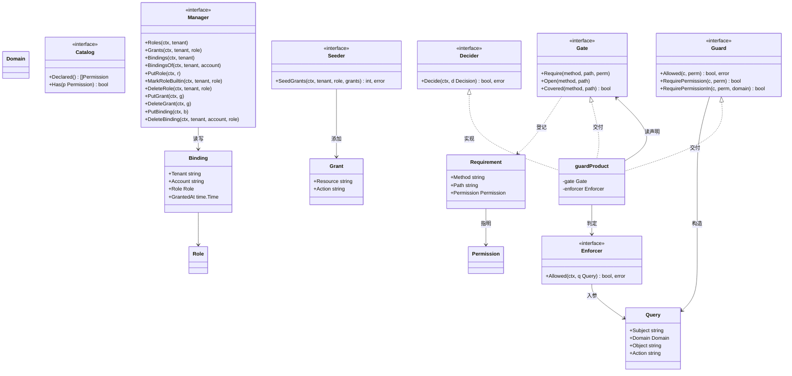
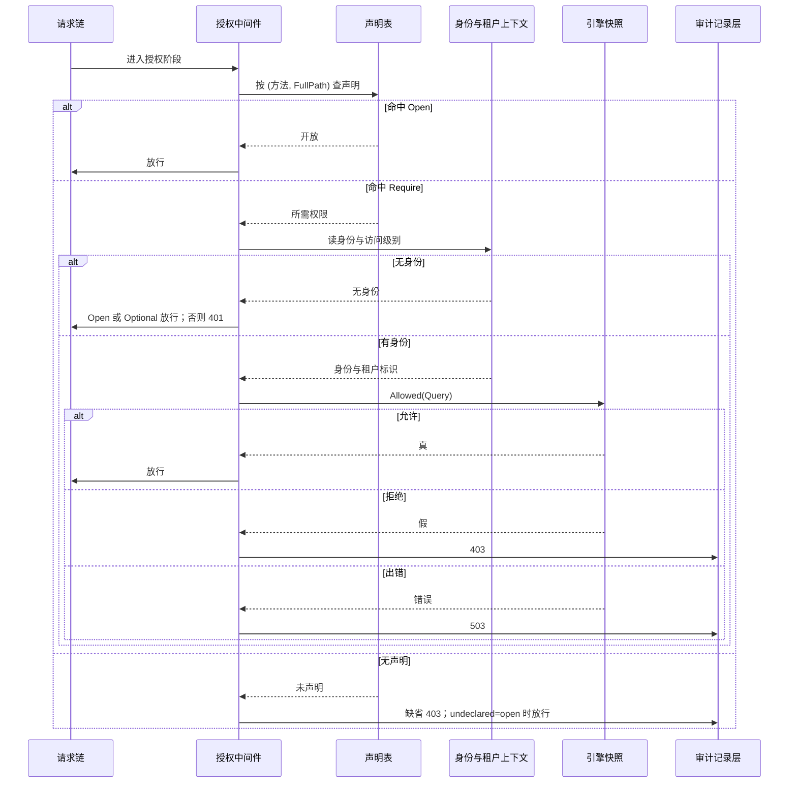
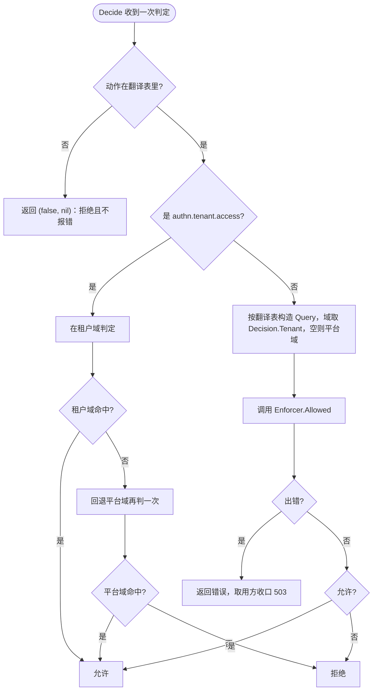

# authz

## 职责

`pkg/authz` 交付**授权**：在已认定的身份与已解析的租户之上，判定这个身份能否对某个资源做某个动作。模型是经典 RBAC——角色到权限，权限按（资源，动作）声明，**一个租户是一个策略域**（[ADR-authz-model-2026-10-12](../../adr/adr-authz-model-2026-10-12.md)）。引擎桥接 `github.com/casbin/casbin/v3`，策略持久化经 `pkg/db` 由本模块自写的一个薄 adapter 落到自己的表（[ADR-authz-engine-2026-10-12](../../adr/adr-authz-engine-2026-10-12.md)、[ADR-authz-store-2026-10-12](../../adr/adr-authz-store-2026-10-12.md)）。

归属本模块的判据是判定所需的输入：还需要资源、动作与策略，而认证事实（凭据、账户、标识、会话、令牌、因素、IdP 配置、冒充记录）不足以单独裁决的，归本模块；只需认证事实即可裁决的归认证。本模块的回答是：这个身份对（域，资源，动作）有没有匹配的策略行。

本功能目录由接口包与子包组成，判据同时是依赖闭包（[ADR-authz-packaging-2026-10-12](../../adr/adr-authz-packaging-2026-10-12.md)）：

- **根包 `pkg/authz`** 定义接口、数据类型、权限常量、Casbin 模型文本与哨兵；**自身不登记模块**。根包被每一个使用方 import，把第三方库留在根包里会把它带进每一个使用方的闭包，所以根包只依赖标准库。
- **`pkg/authz/policy`（模块 `authz.policy`）** 交付策略表与迁移、薄 adapter、Casbin 引擎、权限目录、`Manager` 与账户生命周期清理。它取用 `pkg/db`，因此把库依赖限制在需要策略存储的装配里。
- **`pkg/authz/guard`（模块 `authz.guard`）** 交付中间件、路由声明登记面、handler 内判定 API，并**实现 `authn.Decider`**。中间件与 `Decider` 共用同一份声明表与同一处租户读取，拆成两个模块要为它们另立接口。
- **`pkg/authz/admin`（模块 `authz.admin`）** 挂 `/authz/admin/*` 下的管理面路由，不交付功能；它取用 `policy` 的 `Manager`，把管理面的依赖与业务判定的依赖分开。
- **`pkg/authz/internal/persist`、`pkg/authz/internal/policy` 与 `pkg/authz/authztest`** 不登记模块：两个 `internal` 包是库包，`authztest` 是测试构造夹具。

本模块承接设计中划归授权的各权限点（[ADR-authn-decision-seam-2026-10-10](../../adr/adr-authn-decision-seam-2026-10-10.md)）：审计的检索与导出、设置的写入面、口令表主体（`static.*`）的角色、以及谁有权冒充谁。它们各自的形状见[承接的权限点](#承接的权限点)。

### 非职责

下列各条例举本模块不承担的事，归属的判据见[职责](#职责)。

- **不做认证，不认定身份。** 谁是调用方由认证的网关认定，本模块只读网关写进上下文的身份；它不读凭据，不解释 `Authorization` 头，也不产生身份。
- **不管理成员关系。** 「账户是不是租户的成员」是认证的表 `authn_memberships` 的事实，归 `authn.account`；本模块只按（账户，租户）绑定角色，不读、不写成员关系，也不核对它。
- **不做租户解析，不读租户名册解释请求面的租户。** 请求属于哪个租户由 `tenant.resolve` 认定，本模块读 `tenant.FromContext` 的标识（[tenant](tenant/design-tenant.md)）。平台域的保留值只用于策略裁决，不构成一次租户解析。
- **不把角色放进令牌，也不把它们放进任何凭据。** 访问令牌不带角色（[authn-token](authn/design-authn-token.md)）；角色在请求期由本模块按生效账户实时查自己的绑定，令牌有效期内改绑定即时生效的方向与认证的取态一致。
- **不做审计的存储与脱敏。** 判定与拒绝路径经请求级捕获进入审计，审计行的补全、脱敏与存放归 [audit](audit/design-audit.md)；这些路径不调 `Audit.Record`，不写审计表，也不决定明细里遮蔽哪些键。**管理面是唯一例外**：`authz.admin` 的每次写在动作之前经强制档审计调用一次 `Audit.Record`（见[管理面](#管理面)），它只落这一笔强制行、失败时另补一行 `failed`；遮蔽哪些键仍归 audit。
- **不定义响应体的形状。** 本模块决定拒绝的状态码、`Problem.Type` 与必要的响应头；响应体经入口模块的 `Fail` 写出，形状由入口模块的默认形状或交付 `ErrorResponder` 的模块决定（[http](http/design-http.md)）。
- **写出缺身份时的 401，且它与准入层的无身份 401 同形。** 这条不推翻「不做认证」：它是「路由需要认证而没有身份」的拒绝，与准入层写出的那个 401 是同一个判定，形状也保持相同——同为 `Problem{Status: 401}`（不带 `Type`），头按准入层无身份 401 的同一规则组装（[authn-gate](authn/design-authn-gate.md)）。它出现在这里，因为授权阶段也在网关之内：网关缺席或没守这个端时，授权层是链上唯一还能拒绝匿名请求的层，而准入层只在它自己所守的端上运行；两处写出同一个形状，调用方就不必按「谁拒的」分辨它们的读法（[tenant-admission](tenant/design-tenant-admission.md)、[authn](authn/design-authn.md)）。
- **不实现管理面的访问控制之外的任何业务动作。** `authz.admin` 只把权限目录、角色、权限授予与角色绑定的读写暴露成 HTTP 路由，动作本身是 `policy` 的表操作。
- **不决定哪条命令纳入本模块。** 每个模块的 `Prepare` 只表态 `StateEnabled`，永不 `StateAuto`；是否运行是命令树上的决定（[ADR-command-tree-2026-09-20](../../adr/adr-command-tree-2026-09-20.md)）。

## 术语表

以下术语的含义限于本文档与授权主题的决策记录；它们不进项目术语表。

| 术语 | 英文 | 定义 |
|---|---|---|
| 权限 | permission | `Permission` 的取值，一个字符串；判定时经[动作到查询的翻译](#动作到查询的翻译)映射到一对（资源，动作）。角色是一组权限的集合。 |
| 角色 | role | 一个策略域内的权限集合的名字，`Role` 的取值；把一组权限授予一个账户要先经角色间接表达。 |
| 策略域 | domain | 策略行的归属范围，`Domain` 的取值；一个租户是一个策略域。角色绑定与权限授予都带域。 |
| 平台域 | platform domain | 保留域 `"system"`，承载平台运营的角色、权限授予与绑定。名册里不得有同名租户，启动期核对。 |
| 权限授予 | grant | 一行 `p` 策略：某个域里的某个角色拥有某个权限。落在 `authz_grants` 表。 |
| 角色绑定 | binding | 一行 `g` 策略：某个域里的某个账户具有某个角色。落在 `authz_bindings` 表。 |
| 查询 | query | 一次判定请求 `Query{Subject, Domain, Object, Action}`，交给引擎做匹配。 |
| 条件 | requirement | 一条路由对权限的要求 `Requirement{Method, Path, Permission}`。 |
| 目录 | catalog | 已登记模块声明权限清单的并集，与 `authn.Action` 的词表对齐；能力自己携带的权限与模块自有的业务权限都在其中（见[动作到查询的翻译](#动作到查询的翻译)）。 |
| 快照 | snapshot | 进程内一份不可变的全量策略，请求期只读它，不查库。 |

## 外部接口契约

### 登记单元与名字

| 登记单元 | 模块名 | 交付 | 排他 |
|---|---|---|---|
| `pkg/authz`（根包） | 不登记 | 接口、类型、权限常量、`ModelText`、哨兵 | — |
| `pkg/authz/policy` | `authz.policy` | 表与迁移、薄 adapter、Casbin 引擎、权限目录、`Manager`、`AccountLifecycle` | 是 |
| `pkg/authz/guard` | `authz.guard` | 中间件、路由声明登记面、handler 内 API、实现 `authn.Decider` | 是 |
| `pkg/authz/admin` | `authz.admin` | 管理面 HTTP 路由（不交付功能） | — |
| `pkg/authz/internal/{persist,policy}`、`pkg/authz/authztest` | 不登记 | 库包与夹具 | — |

每个登记模块的包导出自己的 `ModuleName` 常量，配置与设置的命名空间取同一个取值。名字的每一段只用小写字母、数字与短横线。`policy` 与 `guard` 各带一份 `AGENTS.md`，写它的边界与怎么跑，在该包落地的同一批改动里提供。

**命名空间之间的约束。** 两个模块不得声明同一个输入项路径，也不得一个路径是某模块的叶子而另一个模块的内部节点。`authz` 本身不得是任何模块的叶子。

### 类型与接口

```go
// Permission、Role、Domain 都是字符串类型；Domain 的取值是一个租户标识或平台域。
type Permission string
type Role string
type Domain string

// PlatformDomain 是平台运营的保留域。启动时核对名册里没有同名租户，否则终止启动。
const PlatformDomain Domain = "system"

// PermissionSpec 是一个模块对自己声明的权限的形状：清单，以及每个权限的说明文案的 i18n 键。
type PermissionSpec struct {
    Permissions     []Permission
    DescriptionKeys map[Permission]string
}

// Translation 是一条权限到（资源，动作）的翻译行。
type Translation struct {
    Object string
    Action string
}

// TranslationSpec 是一个模块对自有权限的翻译声明：每条权限一个（资源，动作）行。
type TranslationSpec struct {
    Rows map[Permission]Translation
}

// Query 是一次判定请求。Subject 取 Identity.Key()。
type Query struct {
    Subject string
    Domain  Domain
    Object  string
    Action  string
}

// Enforcer 回答一次判定。排他；出错表示引擎或存储不可用，调用方收口 503。
type Enforcer interface {
    Allowed(ctx context.Context, q Query) (bool, error)
}

// Catalog 是本模块声明的全部权限。排他。
type Catalog interface {
    Declared() []Permission
    Has(p Permission) bool
}

// Requirement 是一条路由对权限的要求。
type Requirement struct {
    Method     string
    Path       string
    Permission Permission
}

// Gate 是路由声明登记面：为一条（方法，路径）登记所需权限或登记为开放。写入窗口是 Init。
type Gate interface {
    Require(method, path string, perm Permission)
    Open(method, path string)
    Covered(method, path string) bool
}

// Binding 是一行角色绑定的读取形状。
type Binding struct {
    Tenant    string
    Account   string
    Role      Role
    GrantedAt time.Time
}

// RoleRecord 是一行角色（authz_roles）的读写形状。
type RoleRecord struct {
    Tenant         string
    Role           Role
    Builtin        bool
    DescriptionKey string
    CreatedAt      time.Time
}

// GrantRecord 是一行权限授予（authz_grants）的读写形状。
type GrantRecord struct {
    Tenant    string
    Role      Role
    Resource  string
    Action    string
    CreatedAt time.Time
}

// Grant 是种入步骤添加给角色的一条权限授予的（资源，动作）对；
// 租户与角色由 SeedGrants 对整组点名。
type Grant struct {
    Resource string
    Action   string
}

// Manager 是策略数据的读写面，由 authz.policy 交付、authz.admin 取用。
type Manager interface {
    Roles(ctx context.Context, tenant string) ([]RoleRecord, error)
    Grants(ctx context.Context, tenant string, role Role) ([]GrantRecord, error)
    Bindings(ctx context.Context, tenant string) ([]Binding, error)
    BindingsOf(ctx context.Context, tenant, account string) ([]Binding, error)
    PutRole(ctx context.Context, r RoleRecord) error
    MarkRoleBuiltin(ctx context.Context, tenant string, role Role) error
    DeleteRole(ctx context.Context, tenant string, role Role) error
    PutGrant(ctx context.Context, g GrantRecord) error
    DeleteGrant(ctx context.Context, g GrantRecord) error
    PutBinding(ctx context.Context, b Binding) error
    DeleteBinding(ctx context.Context, tenant, account string, role Role) error
}

// Seeder 是宿主的种入面：它添加角色被声明持有的授权，也是唯一能写
// builtin 角色授权集的入口。由 authz.policy 排他交付，不在 Manager 上。
type Seeder interface {
    SeedGrants(ctx context.Context, tenant string, role Role, grants []Grant) (int, error)
}
```

上列接口与类型都在根包。根包只依赖标准库，因此它不声明取 `*gin.Context` 的接口：handler 内判定 API `Guard` 由此不在根包，而由 `authz.guard` 随中间件一并交付。

接口在根包的对外接口面是签名与方法集：加方法与改签名对取用它们的模块、实现了它们的宿主即是不兼容变更。

### 权限常量

权限常量与 `authn.Action` 的字符串**逐一相同**，零翻译：动作的名字就是权限的名字。这条对齐是本模块与认证之间的契约面，由[词表对齐守卫](#词表对齐守卫)守住。

```go
// 与 authn.Action 逐一相同：authn.account.read … authn.tenant.access，此处只列其形状。
const (
    PermissionAccountRead      Permission = "authn.account.read"
    PermissionAccountCreate    Permission = "authn.account.create"
    PermissionAccountUpdate    Permission = "authn.account.update"
    PermissionAccountDisable   Permission = "authn.account.disable"
    PermissionAccountDelete    Permission = "authn.account.delete"
    PermissionMembershipManage Permission = "authn.membership.manage"
    PermissionSessionRead      Permission = "authn.session.read"
    PermissionSessionRevoke    Permission = "authn.session.revoke"
    PermissionMFAReset         Permission = "authn.mfa.reset"
    PermissionClientManage     Permission = "authn.client.manage"
    PermissionIDPManage        Permission = "authn.idp.manage"
    PermissionImpersonateStart Permission = "authn.impersonation.start"
    PermissionImpersonationRead Permission = "authn.impersonation.read"
    PermissionImpersonationRevoke Permission = "authn.impersonation.revoke"
    PermissionTenantAccess     Permission = "authn.tenant.access"
)

// 本模块自己的管理面权限。
const (
    PermissionRoleRead   Permission = "authz.role.read"
    PermissionRoleManage Permission = "authz.role.manage"
)

// 承接面：审计与设置。
const (
    PermissionAuditRead     Permission = "audit.read"
    PermissionAuditExport   Permission = "audit.export"
    PermissionSettingsRead  Permission = "settings.read"
    PermissionSettingsWrite Permission = "settings.write"
)
```

上列常量是本能力自己携带的权限。一个模块若拥有本能力未声明的业务权限，以自己的 `PermissionSpec` 声明这份清单、以自己的 `TranslationSpec` 声明每个权限的（资源，动作）行；两者随该模块的资源登记进注册表，`authz.policy` 把清单并入目录，行则并入 `authz.policy` 与 `authz.guard` 各自的 `Init` 所解析的进程翻译（见[动作到查询的翻译](#动作到查询的翻译)与[扩展点](#扩展点)）。**说明文案由声明权限的那个模块自己承载**：它以一份消息目录（`i18n.Catalog` 资源）给出每个权限的 `DescriptionKeys` 条目连同文本，目录随它的资源声明进 i18n 引擎；管理面读到的因此是一句读得懂的话，而不是一条键。声明权限的模块自带文案是唯一的口径——`authz.policy` 自己声明的权限同样如此。

### 承接的权限点

下列各条即本模块承接的全部权限点，由本模块以权限常量与策略行的形状落地；策略数据由宿主经 `Manager` 写入，本模块不在迁移里种任何角色或绑定。

- **审计的检索与导出**：权限 `audit.read` 与 `audit.export`。审计不提供查询面（[audit](audit/design-audit.md)），检索与导出的端点由宿主或审计的检索单元挂出，它们的授权经本模块的 `Gate` 或 handler 内 API 落到 `audit.read` 与 `audit.export` 上。
- **设置的写入面**：权限 `settings.read` 与 `settings.write`。设置的写入面没有访问控制，由宿主经本模块鉴权（[settings](settings/design-settings.md)）。
- **口令表主体（`static.*`）的角色**：本模块只提供形状——保留的平台域 `system`、内置的运营角色、以及绑定表；口令表主体的平台角色由宿主写入，不在迁移里种。`Identity.Account().IsStatic()` 的主体读不到任何成员关系，其权限只来自平台域上的绑定。
- **谁有权冒充谁**：权限 `authn.impersonation.start`、`authn.impersonation.read`、`authn.impersonation.revoke`，在租户域上判定。冒充的结构性限制（发起者、目标、参数、并发）由 `authn.impersonation` 核对，本模块在其之上收紧「谁能冒充谁」（[authn-impersonation](authn/design-authn-impersonation.md)）。

### 动作到查询的翻译

`authz.guard` 把一次判定翻成一次 `Enforcer.Allowed` 调用：中间件翻的是路由声明的 `Permission`，`Decider` 翻的是 `Decision.Action`（`authn.Action` 的取值，与权限常量逐一相同）。两条路径用**同一份权限到（资源，动作）映射**给出 `Query.Object` 与 `Query.Action`。下表是这份映射的**内置行**，即本能力自己携带的行；进程的翻译是内置行与**每个已登记模块经 `authz.TranslationSpec` 声明的行**的并集，由 `authz.policy` 或 `authz.guard` 在各自的 `Init` 里解析一次（在登记窗口关闭之前），此后不再改写。两者的解析是注册表的纯函数且写入幂等，结果必是同一份；两个都解析，是因为任何一个都可能单独在场——写策略数据而不守卫任何路由的命令只纳入 `authz.policy`，而 `authz.guard` 要求 HTTP 入口存在，那种命令没有入口可给。一个模块不得与既有行分歧：同一个权限配两行不同的（资源，动作）是启动失败，包在 `authz.ErrUnknownPermission` 上；与既有行一致的行并入同一行、去重。没有任何行覆盖的权限被拒——`Decider` 收到它时返回 `(false, nil)`，路由声明引用它则在启动期以 `ErrUnknownPermission` 终止。`Query.Subject` 取主体的标识：中间件取 `Identity.Key()`，`Decider` 取 `Decision.Actor.Key()`。

| 权限 | `Query.Object` | `Query.Action` |
|---|---|---|
| `authn.tenant.access` | `tenant` | `access` |
| `authn.account.read` | `account` | `read` |
| `authn.account.create` | `account` | `create` |
| `authn.account.update` | `account` | `update` |
| `authn.account.disable` | `account` | `disable` |
| `authn.account.delete` | `account` | `delete` |
| `authn.membership.manage` | `membership` | `manage` |
| `authn.session.read` | `session` | `read` |
| `authn.session.revoke` | `session` | `revoke` |
| `authn.mfa.reset` | `factor` | `reset` |
| `authn.client.manage` | `client` | `manage` |
| `authn.idp.manage` | `idp` | `manage` |
| `authn.impersonation.start` | `impersonation` | `start` |
| `authn.impersonation.read` | `impersonation` | `read` |
| `authn.impersonation.revoke` | `impersonation` | `revoke` |
| `authz.role.read` | `role` | `read` |
| `authz.role.manage` | `role` | `manage` |
| `audit.read` | `audit` | `read` |
| `audit.export` | `audit` | `export` |
| `settings.read` | `settings` | `read` |
| `settings.write` | `settings` | `write` |

翻译与[权限目录](#类型与接口)的取材域相同：两者都取**全部已登记模块**（前者取各模块的 `TranslationSpec`、后者取各模块的 `PermissionSpec`），而不是只取本次命令的参与模块。因此两者由同一批登记单元构成，不会因取材域不同而分叉——不会出现一个权限被更宽的目录看到、却被更窄的翻译漏掉的情形。

**域。** 中间件的 `Query.Domain` 取 `tenant.FromContext` 的标识（无租户则 `PlatformDomain`）。`Decider` 的 `Query.Domain` 取 `Decision.Tenant`，其中 `authn.account.*` 在 `Decision.Tenant` 为空时取 `PlatformDomain`；`authn.tenant.access` 是唯一带平台域回退的动作，见[平台域与跨租户回退](#平台域与跨租户回退)。

**未知动作 fail-closed。** `Decider` 收到的 `Decision.Action` 不在解析出的翻译集里时返回 `(false, nil)`：拒绝而不报错。`Action` 是开放的字符串类型，认证新增一个常量时，本模块在对齐更新之前对它的回答是拒绝，方向取拒绝（[ADR-authz-decision-seam-2026-10-12](../../adr/adr-authz-decision-seam-2026-10-12.md)）。

### 配置与设置

输入项的完整键表、取值域与缺省值随实现提供；本节写语义。

- **`authz.guard.endpoints`**（配置，字符串列表）：中间件所守的端。**必填、无缺省、不接受 `*`，空清单是 `ErrInvalidConfig`。** 清单的形状同 `tenant.admission.endpoints`；重复的端名并入 `authn.ErrInvalidConfig`——本模块的哨兵表是封闭集，不为配置另立一项（`tenant.admission` 对重复端名用的是它自己的哨兵，那是它的事）。端名在入口模块里不存在时，`authz.guard` 在 `Init` 以 `ErrUnknownEndpoint` 终止启动。
- **`authz.guard.undeclared`**（配置，取值 `closed`/`open`）：未声明路由的缺省处置。**缺省 `closed`**（答 403），取 `open` 时放行并写一行启动 `Warn`。只取主配置源，环境变量与命令行覆盖不改写它：把缺省安全态放到配置的覆盖层一侧，会让一条命令行参数改变哪些路由不需要权限。
- **`authz.policy.load-timeout`**（配置，时长，缺省 `5s`）：启动期全量装载策略的时限。超时即启动失败（`ErrPolicyUnavailable`），不带着半份快照开始服务。
- **`authz.policy.refresh-interval`**（设置，时长，缺省 `0s`）：无事件总线时的周期重载间隔。`0` 表示不重载。**它归设置而非配置，因为它是运行期可变的参数；本模块只在 `Start` 读它一次**，运行期改值要重启进程才生效。
- **`authz.admin.endpoints`**（配置，字符串列表）：管理面路由所挂的端，按入口模块自身配置给它们的名字。**必填、无缺省、不接受 `*`**——把管理面路由挂到每个端会挂到公开端上，那里没有网关守它们；只取主配置源。本模块没有自己的失败哨兵，一个跑不了的形状——空清单、空名、`*`、重名——是 `authn.ErrInvalidConfig`；入口模块不声明的端名是启动期 `ErrUnknownEndpoint`。

**配置承载启动必须项，设置承载运行期参数**（[ADR-config-scope-2026-09-13](../../adr/adr-config-scope-2026-09-13.md)）：`endpoints` 与 `load-timeout` 在装配期就要读出来，`refresh-interval` 是运行期参数——尽管本模块只在 `Start` 读它一次，改值要重启进程才生效。**本模块没有设置型的放宽开关**：唯一会放宽的方向是 `undeclared`，它是配置项，改它要重启。

### 对宿主的要求

- **把 `authz.guard`、`authz.policy` 的模块名写进需要授权的命令。** 只挂中间件而不点名 `policy` 时，`guard` 的 `Enforcer` 缺席，本模块判定不可用，全部受守路由答 503；两者要么一起点名，要么都不点。
- **`endpoints` 写成业务端。** 与 `tenant.admission.endpoints` 一致；`authz.guard` 只在它守的端上登记中间件。
- **策略数据由宿主写入。** 迁移只建表，不种角色、不种权限授予、不种绑定；平台域 `system` 的运营角色、口令表主体的绑定、各租户的角色与绑定都经 `Manager` 或管理面路由写入。一个已置 `builtin` 的角色，其授权只经 `Seeder.SeedGrants` 增补：`Manager` 与 `authz.admin` 的写路由都拒绝它。
- **名册里不得有名为 `system` 的租户。** 平台域的保留值与本模块的判定绑定；`authz.policy` 在启动时经 `tenant.Catalog` 读名册，有同名租户即以 `ErrPlatformDomainTaken` 终止启动。没有租户模块的装配里没有名册，这条核对不执行。
- **想让权限随撤销尽快生效的装配里要提供事件总线。** 没有 `event.Bus` 时，策略变更靠 `refresh-interval` 兜底，撤销的生效延迟以它为界。
- **想挂管理面的命令点名 `authz.admin` 并配 `authz.admin.endpoints`。** 不点名时没有 `/authz/admin/*` 下的任何路由；点名而清单为空、为空名或含 `*` 是 `authn.ErrInvalidConfig`。

### 管理面

`authz.admin` 是挂在固定基路径 `/authz/admin` 下的管理面模块，不交付任何功能接口，只把权限目录、角色、权限授予与角色绑定的读写暴露成 HTTP 路由；每条路由的动作是 `policy` 的 `Manager` 的一次表操作。路由挂在配置 `authz.admin.endpoints` 列出的端上，基路径不做可配置。路由不暴露任何不透明的行标识：每条路由按自然键——租户、角色、权限、账户——寻址。

**访问控制由本模块在 handler 内做出，不经 `Decider`。** 管理面路由在中间件的声明表里全部登记为开放，好让中间件把请求放行到 handler；handler 先读调用方的身份，再经 `authz.guard` 的 handler 内判定 API 就这条路由的权限问一句，不足即回绝。模块不给自己授予任何权限，只提供目录已经声明的词表。

**判定顺序固定，写与读在判定之后分叉。** handler 先读调用方：请求没有身份是 401，只有状态、没有 `Type`，不询问 guard 即返回。再向 guard 要本条路由的权限：不足即由 guard 写出它自己的拒绝——拒绝 403、故障 503——并返回。判定之后才分叉：写解析正文、跑本条路由的检查（授予的目录核对与翻译、绑定的空账户），落强制档审计，调 `Manager`；读调 `Manager` 并应答。

**判定在平台域做出，与路径里的租户无关。** 管理面路径里的租户是这条路由所作用的行数据的标识，不是判定的域：handler 经 `RequirePermissionIn` 显式指定 `authz.PlatformDomain` 判定（[动作到查询的翻译](#动作到查询的翻译)）。若按请求解析出的租户判定，一个在某租户获授权的调用方就能靠路径里写另一个租户，读或写那个租户的行。没有平台域授权的调用方，路径里写哪个租户都被拒。

**每次写强制档审计，落在动作之前、事务之外。** 写路由在调用 `Manager` 之前写一行强制档审计；审计写不进则应答 503 且动作不执行。`Manager` 拒绝写时再尽力写一行 `failed` 行，与允许行以动作标识关联，它自己的失败只记 Error，不改变应答。模块不开自己的事务，它改动的行写在 `Manager` 的事务里。

读路由的权限是 `authz.role.read`，写路由是 `authz.role.manage`。下表是路由的全集（封闭集）：组、方法、路径与每条需要的权限。目录读是唯一一条经 `Catalog.Declared` 而非 `Manager` 的读。

| 组 | 方法 路径 | 权限 |
|---|---|---|
| 目录 | `GET /authz/admin/permissions` | `authz.role.read` |
| 角色 | `GET /authz/admin/tenants/:tenant/roles` | `authz.role.read` |
| 角色 | `PUT /authz/admin/tenants/:tenant/roles/:role` | `authz.role.manage` |
| 角色 | `DELETE /authz/admin/tenants/:tenant/roles/:role` | `authz.role.manage` |
| 授予 | `GET /authz/admin/tenants/:tenant/roles/:role/grants` | `authz.role.read` |
| 授予 | `PUT /authz/admin/tenants/:tenant/roles/:role/grants/:permission` | `authz.role.manage` |
| 授予 | `DELETE /authz/admin/tenants/:tenant/roles/:role/grants/:permission` | `authz.role.manage` |
| 绑定 | `GET /authz/admin/tenants/:tenant/bindings` | `authz.role.read` |
| 绑定 | `GET /authz/admin/tenants/:tenant/bindings/:account` | `authz.role.read` |
| 绑定 | `PUT /authz/admin/tenants/:tenant/bindings/:account/:role` | `authz.role.manage` |
| 绑定 | `DELETE /authz/admin/tenants/:tenant/bindings/:account/:role` | `authz.role.manage` |

**读的应答是 200 加一份视图，落地写的应答是 204 无正文。** 视图逐字段从根包的值构造，从不把值原样交给客户端，记录日后新增一个字段不会因为它在就等于出现在应答里。各视图的字段：目录是 `permission`；角色是 `tenant`、`role`、`builtin`、`description_key`、`created_at`；授予是 `tenant`、`role`、`resource`、`action`、`created_at`；绑定是 `tenant`、`account`、`role`、`granted_at`。时间字段按 UTC 写出。

**角色写入的正文只有 `description_key`。** `builtin` 是宿主的种入步骤经 `Manager.MarkRoleBuiltin` 置上的冻结标记，不是管理面可写的值：正文里带这个成员不会到达 `Manager`，`PutRole` 收到携带该标记的记录也一律拒绝。标记一旦置上就没有清回的通路——这正是它的含义。标记置上之后，管理面与 `Manager` 都不能改该角色的授权；宿主的种入面 `Seeder.SeedGrants` 只增不删，是唯一的增补入口（[种入面](#种入面)）。

**授出的权限先经目录与翻译，再写。** 一条授予落到 `authz_grants` 的是（资源，动作）对，不是权限本身；目录不持有的权限在 `Manager` 被调用之前就是 400。写入的（资源，动作）由与中间件、`Decider` 共用的那份翻译给出（[动作到查询的翻译](#动作到查询的翻译)）。

**回绝映射是封闭的、fail-closed 的。** 400（`Problem.Type` 为 `urn:speed:authz:bad-request`）：请求在形状上不可读（路径参数或正文）、授予一条目录不持有的权限、写里的角色未知（`ErrUnknownRole`）、租户不符（`ErrTenantMismatch`）、绑定写里的空账户。409（`Problem.Type` 为 `urn:speed:authz:conflict`）：写试图删除或改动内置角色（`ErrBuiltinRole`）。503：`Manager` 或存储的其余失败，以及没落地的强制档审计；503 不带 `Problem.Type`，它说的是一个依赖答不了而不是一个许可结论，成因只进日志。

**管理面以静态[特性](../../glossary.md) `authz.admin` 声明。** `authz.admin` 描述符的 `Resources` 带 `feature.Spec{Name: "authz.admin"}`；这个特性在场，表示本进程挂出上表的管理面路由（[feature](design-feature.md)）。端清单必填、不接受空清单，没有入口模块即 `ErrNoRouter`，所以模块进入启用集、进程有路由器时这组路由无条件挂出，这个面不再随配置或装配变化，声明为静态特性符合架构不变量 18（[architecture](../architecture.md#架构不变量)）。

### 对外接口面

以下是本模块与其他模块和宿主之间的接口面，改动它们改变每一个消费者：

- 根包的接口与方法集：`Enforcer`、`Catalog`、`Gate`、`Manager`、`Seeder`，以及 `Permission`、`Role`、`Domain`、`Query`、`Requirement`、`PermissionSpec`、`Translation`、`TranslationSpec`、`Binding`、`Grant` 的字段与取值。`Catalog` 的方法集含 `ObjectAction`：宿主按权限名写策略数据时经它取得（资源，动作）对，而不必取用强制点。它回答的是**进程翻译**里的那一行，与目录各取各的声明——`Has` 为真的权限不保证有行（模块可以只声明 `PermissionSpec` 而不写 `TranslationSpec`，那种模块合法，引用该权限的路由在启动期失败），因此调用方必须读第二个返回值。`Seeder` 与 `Manager` 分开是接口面的一部分：管理面只取用 `Manager`，因此拿不到写 builtin 角色授权集的那条路径（[种入面](#种入面)）。
- 权限常量的值。新增常量是兼容的；删除、改名或改变既有常量的值是破坏性变更。与 `authn.Action` 的对齐关系属于对外接口面。
- `ModelText` 的模型文本，与动作到查询的翻译：内置行（本能力自己携带的行），各模块经 `authz.TranslationSpec` 声明自有翻译行的机制，以及「未被任何行覆盖的权限即拒、模块声明的行与既有行分歧即启动失败」这两条语义；一个模块新声明的行是这份翻译的扩展，不是对已有行的破坏。
- 平台域的保留值 `"system"`。
- 中间件在链上代表的功能标识：描述符的 `Provides` 与中间件的 `Provides` 同为 `(*authz.Gate)(nil)`——链上锚点住在根包（别的模块为排序 import 的是接口包，不是实现子包），而 handler 内判定 API `Guard` 因签名取 `*gin.Context` 落在 `pkg/authz/guard`，它不作为锚点。别的模块据这个标识排序，取值与它所属的阶段属于对外接口面，改动它是破坏性变更。
- 配置键 `authz.guard.endpoints`、`authz.guard.undeclared`、`authz.policy.load-timeout`、`authz.admin.endpoints`，设置键 `authz.policy.refresh-interval`，以及 `Endpoints` 的必填与不接受 `*`。
- 管理面路由的路径与每条路由询问的权限（读 `authz.role.read`、写 `authz.role.manage`）；路由集本身随模块是否被点名变化，不在对外接口面内。
- `authz.admin` 声明的特性名 `authz.admin`。前端经生成的特性名类型引用它，改名或撤去是宿主可见的破坏性变更。
- `Problem.Type` 的前缀 `urn:speed:authz:` 与它下面的三个码——403 的 `forbidden`、400 的 `bad-request`、409 的 `conflict`，它们是客户端据以分支的对外接口面；指标名 `authz.guard.decisions` 与其属性 `outcome` 的取值，以及拒绝状态码的封闭集。

## 依赖

### 模块清单

| 包 | 模块名 | 交付 | 排他 | `Requires` | 在 `Init` 里取用（缺席合法者标 ○） | 表 |
|---|---|---|---|---|---|---|
| `authz/policy` | `authz.policy` | `Enforcer`、`Catalog`、`Manager`、`Seeder`；`authn.AccountLifecycle` | `Enforcer`、`Catalog`、`Manager`、`Seeder` 各自是 | `db.Database` | `tenant.Catalog` ○、`event.Bus` ○、`settings.Store` ○、`log.Logger` ○ | `authz_roles`、`authz_grants`、`authz_bindings` |
| `authz/guard` | `authz.guard` | `Guard`、`Gate`；`authn.Decider` | 各自是 | `Enforcer`、`Catalog` | `http.Router`、`tenant` 的上下文读取、`log.Logger` ○、`observability.MeterProvider` ○ | 无 |
| `authz/admin` | `authz.admin` | 无（只挂 `/authz/admin/*` 下的路由） | — | `Manager`、`Catalog`、`guard.Guard`、`audit.Audit` | `http.Router`、`authz.Gate` ○、`log.Logger` ○ | 无 |

`authz/guard` 以 `Enforcer` 与 `Catalog` 为必需依赖（前者排他），缺任一个即 `core.ErrMissingProvider`，早于迁移：没有引擎的中间件只能把所有受守路由答成 503，没有目录的路由声明面核对不了登记的权限。`Catalog` 是随中间件落地的路由声明面所读的那一项——decider 本期不读它，但它与 `Enforcer` 同为必需依赖：一个必需能力没有提供方，无论哪个回调读它，启动都失败。`authn.Decider` 由 `authz.guard` 交付——它是排他功能，取用方（`authn.admin`、`authn.impersonation`、`tenant.admission`）在 `Init` 里以 `Optional` 取用，`authz.guard` 在场即提供了它。`authz.policy` 取 `tenant.Catalog` 只为启动期核对平台域与名册不冲突：它是可选取用，没有租户模块的装配里没有名册可核对，这条检查不执行，也不因此启动失败。`authz.admin` 以 `Manager`、`Catalog`、`guard.Guard`、`audit.Audit` 为必需依赖：`Manager` 是它的写面、`Catalog` 是授予的核对面、`guard.Guard` 是它在 handler 内判定所用的 handler 内 API、`audit.Audit` 是强制档审计的落点——审计缺席在任何实例构造之前以 `core.ErrMissingProvider` 失败，而不是留到第一次写才发现。入口模块的路由功能 `http.Router` 在 `Init` 里必需，挂管理面路由而没有入口模块是 `ErrNoRouter`；路由声明面 `authz.Gate` 与 `log.Logger` 在 `Init` 里可选取用，没有声明面的装配里管理面路由不带声明、受守的端把它们按未声明处置。

### 依赖方向

- **根包只依赖标准库。** 它被每个使用方 import，第三方的 Casbin 库与 gin、gorm 不出现在根包签名里，也不进根包的非测试 import 闭包。`pkg/authz/deps_test.go` 守住这条断言。
- **库类型只出现在叶子与库包里。** `github.com/casbin/casbin/v3` 落在 `internal/policy` 与 `internal/persist`，gin 落在 `guard` 与 `admin`，gorm 与 `pkg/db` 落在 `policy`。只有 import 该子包的宿主才背负它（[ADR-module-packaging-2026-09-22](../../adr/adr-module-packaging-2026-09-22.md)）。
- **本模块 import `pkg/authn` 根包并交付其中的接缝，认证不 import 本模块**（[ADR-authn-scope-2026-10-10](../../adr/adr-authn-scope-2026-10-10.md)）。`authz/guard` 实现 `authn.Decider`，读 `Identity` 的方法集；方向是授权指向认证。
- **本模块 import `pkg/tenant` 根包取 `tenant.FromContext` 与 `tenant.CrossTenant`，不 import 它的子包。** 准入层交付的 `(*tenant.Admission)(nil)` 是授权阶段内的定序锚点，本模块的中间件用 `After` 指向它（[tenant-admission](tenant/design-tenant-admission.md)）。
- **`authz.admin` import `pkg/feature` 根包以声明特性，`feature.board` import 本模块的根包以登记开放路由。** `pkg/feature` 根包只依赖标准库，不扩大 `authz.admin` 的闭包；本模块的任何包都不 import `pkg/feature/board`（[feature](design-feature.md)）。
- 方向满足架构不变量（[architecture](../architecture.md)）：本模块位于 `core`、`config`、`log`、`http`、`observability`、`db`、`event`、`settings`、`authn`、`tenant` 之上，不被其中任何一个 import。

## UML 图

下图给出根包的类型、`authz.guard` 的产品所交付的接口，以及它们之间的关系。图中画不出的约束是：`Enforcer` 的实现读进程内快照，请求期不查库；`Decider` 由 `authz.guard` 的产品实现（`var _ authn.Decider = (*product)(nil)`），它与中间件共用同一份 `Gate` 声明表与同一处租户读取；`Query` 由中间件与 `Decider` 两处构造，都被翻成引擎的一次匹配。



`guardProduct` 未导出，它持有声明表、引擎引用与租户读取（见[请求期判定](#请求期判定)）。模块的一个实例要交付描述符声明的每一项能力，所以 `guardProduct` 同时交付 `Gate`、`Guard` 与 `Decider`，其中 `Gate` 经它持有的声明表委托实现。`Guard` 的写出方法因此名为 `RequirePermission` 而非 `Require`：一个 Go 类型不能有两个同名方法，而产品另要承载 `Gate.Require(method, path, perm)`。`RequirePermissionIn` 是 `RequirePermission` 的显式域形式，供判定域不是请求解析出的租户的 handler 用：管理面把路径里的租户当数据、判定固定在平台域，经它点名域（见[管理面](#管理面)）。`Guard` 与 `Decider` 由 `authz.guard` 交付、都不在根包；`Gate` 与 `Enforcer`、`Catalog`、`Manager`、`Seeder` 连同各数据类型的定义都在根包。`Seeder` 是独立于 `Manager` 的种入面，管理面不取用它（[种入面](#种入面)）。链上锚点取根包的 `(*authz.Gate)(nil)`——`Guard` 因签名取 `*gin.Context` 落在 `pkg/authz/guard`，不作为锚点。

下图给出一条受守路由从进入授权阶段到 403 或放行的路径。它固定的是读的次序与拒绝的划分：声明先于身份，身份先于租户，引擎出错是 503 而不是 403，未声明路由在缺省下也走 403。



审计记录层在授权阶段之外，本阶段内的拒绝由它看到并记入审计行（[http](http/design-http.md)）。

下图给出 `Decider` 对动作的分派、平台域回退与未知动作的 fail-closed。它固定的是：未知动作走拒绝分支且不报错；平台域回退只属于 `authn.tenant.access`，在租户域判空之后发生；其余动作按翻译表构造一次查询，出错是 503。



## 核心数据结构

### Casbin 模型文本

模型文本是根包的常量 `ModelText`，经 `model.NewModelFromString` 装载。宿主只写策略数据，不写模型文本：模型固定在代码里，见[扩展点](#扩展点)与 [ADR-authz-engine-2026-10-12](../../adr/adr-authz-engine-2026-10-12.md)。

```
[request_definition]
r = sub, dom, obj, act
[policy_definition]
p = sub, dom, obj, act
[role_definition]
g = _, _, _
[policy_effect]
e = some(where (p.eft == allow))
[matchers]
m = g(r.sub, p.sub, r.dom) && r.dom == p.dom && r.obj == p.obj && r.act == p.act
```

**无通配符、无角色继承、无 deny 行。** 匹配是逐字相等加一条 `g` 的角色解析；拒绝由「无匹配」表达，`policy_effect` 因而是「存在一条 allow 即允许」。`g` 的第三个参数是域，角色解析因此按域进行，一个账户在租户 A 的角色不解析到租户 B 的权限（[ADR-authz-model-2026-10-12](../../adr/adr-authz-model-2026-10-12.md)）。

### 表与迁移

策略表都归 `authz.policy`，迁移在 `pkg/authz/policy/migrations/{sqlite,postgres}/0001_authz_policy.sql`。每张表都以 `tenant_id` 领衔主键，都带 `CHECK (tenant_id <> '')`，都不用方言专有类型与函数；`TIMESTAMPTZ`（Postgres）与 `DATETIME`（SQLite）的对照照行本模块自己的建表语句。

- **`authz_roles(tenant_id, role, builtin, description_key, created_at)`**，主键 `(tenant_id, role)`。`builtin` 标记内置角色：管理面不可删除、不可改写，也不可改其授权；宿主的种入面 `Seeder.SeedGrants` 只增不删。标记只由 `Manager.MarkRoleBuiltin` 置位，置位后没有清回的通路。`description_key` 是说明文案的 i18n 键。

```sql
CREATE TABLE authz_roles (
    tenant_id       TEXT NOT NULL CHECK (tenant_id <> ''),
    role            TEXT NOT NULL,
    builtin         BOOLEAN NOT NULL,
    description_key TEXT NOT NULL,
    created_at      TIMESTAMPTZ NOT NULL,   -- SQLite 方言为 DATETIME
    PRIMARY KEY (tenant_id, role)
);
```

- **`authz_grants(tenant_id, role, resource, action, created_at)`**，主键 `(tenant_id, role, resource, action)`，索引 `(tenant_id, resource, action)`。这一行是 `p` 策略。

```sql
CREATE TABLE authz_grants (
    tenant_id  TEXT NOT NULL CHECK (tenant_id <> ''),
    role       TEXT NOT NULL,
    resource   TEXT NOT NULL,
    action     TEXT NOT NULL,
    created_at TIMESTAMPTZ NOT NULL,        -- SQLite 方言为 DATETIME
    PRIMARY KEY (tenant_id, role, resource, action)
);
CREATE INDEX authz_grants_by_object ON authz_grants (tenant_id, resource, action);
```

- **`authz_bindings(tenant_id, account_id, role, granted_at)`**，主键 `(tenant_id, account_id, role)`，索引 `(tenant_id, role)`。这一行是 `g` 策略。

```sql
CREATE TABLE authz_bindings (
    tenant_id  TEXT NOT NULL CHECK (tenant_id <> ''),
    account_id TEXT NOT NULL,
    role       TEXT NOT NULL,
    granted_at TIMESTAMPTZ NOT NULL,        -- SQLite 方言为 DATETIME
    PRIMARY KEY (tenant_id, account_id, role)
);
CREATE INDEX authz_bindings_by_role ON authz_bindings (tenant_id, role);
```

**`tenant_id` 领衔主键是正确性而不是索引考量**：以账户或角色单独为键，一次写入会在另一个租户的行上冲突并把那一行改写到本方的租户，而语句里没点名别的租户，租户过滤没有可拒绝的对象。这些表都不建指向认证表的外键：跨模块外键让迁移先后成为隐含契约，账户删除后的清理走生命周期钩子与事件（[db](design-db.md)）。

### 薄 adapter

`pkg/authz/internal/persist` 自写一个实现 `github.com/casbin/casbin/v3` 的 `persist.Adapter` 的类型。它把策略行与策略表互转：

| 策略行 | 表 | 字段映射 |
|---|---|---|
| `p` 行 `rule = {role, dom, resource, action}` | `authz_grants` | `rule[0]=role`、`rule[1]=dom=tenant_id`、`rule[2]=resource`、`rule[3]=action` |
| `g` 行 `rule = {account, role, dom}` | `authz_bindings` | `rule[0]=account_id`、`rule[1]=role`、`rule[2]=dom=tenant_id` |

两个行类型住在 `pkg/authz/internal/persist`：`grantRow`（表 `authz_grants`，除嵌入的租户列外是 `Role`、`Resource`、`Action` 与 `CreatedAt`）承载 `p` 行，`bindingRow`（表 `authz_bindings`，除租户列外是 `AccountID`、`Role` 与 `GrantedAt`）承载 `g` 行；两者的租户列都由嵌入的 `tenant.Model` 领衔主键，写时从 `rule` 的 `dom` 段填进去。

- **跨租户标记在构造时施加一次。** `persist.Adapter` 的五个方法（`LoadPolicy`、`SavePolicy`、`AddPolicy`、`RemovePolicy`、`RemoveFilteredPolicy`）都不带 `context.Context`，`Enforcer.LoadPolicy` 也不带，所以「每条语句各自施加标记」在这个接口上无处可写。adapter 因此在构造时取一条会话——`handle.Session(&gorm.Session{Context: tenant.CrossTenant(ctx)})`——此后它发出的每一条语句都带着这个标记。标记是 `tenant.CrossTenant` 定义的上下文事实，一次施加即对随后所有语句成立，这也是该函数的设计意图。`ctx` 是这些语句继承的期限与取消：受配置 `authz.policy.load-timeout` 约束的装载随它结束（[快照与失效](#快照与失效)）。
- **调用方租户在构造时一并绑定：`persist.New(ctx, handle, caller)`。** 一个 adapter 只服务一个租户的写，`caller` 就是那个租户。因此 `authz.policy` 的 `Manager` **每次写各自构造一个绑定该租户的 adapter**；只读的装载（[快照](#快照)的全量读）构造一个 `caller` 为空标识的 adapter，经它的一切写入被拒。
- **写：** 租户列从 `rule` 的 `dom` 段取出并显式写进模型字段；写入前核对它与构造期绑定的 `caller` 一致，不一致即 `ErrTenantMismatch`。会话虽带跨租户标记，策略行的租户仍逐条核对：标记说的是「这次调用意图跨租户」，不是「这条语句写哪个租户都对」。请求路径上的空租户先由 `Manager` 的租户前置检查拒掉：每个 `Manager` 方法在动作之前核对租户非空，空标识以 `ErrTenantMismatch` 收口，管理面据此答 400。过滤插件与表的 `CHECK (tenant_id <> '')` 是不经 `Manager` 的路径上的防线：装插件的句柄上，租户过滤插件拒掉上下文没有租户的语句（[tenant](tenant/design-tenant.md)）；不装插件的句柄（例如只跑迁移的命令）上没有这一层，剩下 `tenant.ID.Value()` 拒绝把空标识绑进语句、表的 `CHECK` 两道。
- **读（`LoadPolicy`）：** 必须**跨租户**读——判定进程持有全部租户的策略——用的就是构造时那条带标记的会话。这是本模块唯一一处对安全敏感表的跨租户读（[并发与事务边界](#并发与事务边界)）。
- **`SavePolicy` 不实现「清表重写」，返回 `ErrNotImplemented`**（adapter 包自带的错误，不是根包哨兵）。本模块只经 `Manager` 逐条增删策略，一次全量重写会在读改写之间抹掉并发写入。

策略落在以真实租户列领衔键的表上，由本模块自写这个 adapter，见 [ADR-authz-store-2026-10-12](../../adr/adr-authz-store-2026-10-12.md)。

### 快照

`authz.policy` 在 `Start` 把全部策略装载成一份进程内**不可变快照**（原子指针持有），请求期只读它、不查库。`Enforcer` 的实现是「读快照、跑 matcher」，对同一份快照的并发读不加锁。快照的更替见[快照与失效](#快照与失效)。

## 核心算法与流程

### 请求期判定

中间件在 `authz.guard.endpoints` 的每个端上登记一层，描述符的 `Provides` 是 `(*authz.Gate)(nil)`（模块描述符另声明排他交付 `(*authn.Decider)(nil)`），`Stage` 声明授权阶段（`StageAuthorize`），阶段内 `After: [(*tenant.Admission)(nil)]`。同一个请求按下表自上而下判定，取第一条命中的行，命中即终止。

| 行 | 条件 | 结果 |
|---|---|---|
| 无路由 | `c.FullPath()` 为空串（没有匹配的路由） | `c.Next()`，交给入口模块的 404 |
| 声明为开放 | `(方法, FullPath)` 命中一条 `Open` 登记 | 放行 |
| 声明为需要权限 | 命中一条 `Require` 登记 | 进入身份与引擎判定 |
| 未声明 | 既没有 `Open` 也没有 `Require` 登记 | `undeclared` 为 `closed`（缺省）：**403** 并记 Error；为 `open`：放行 |
| 无身份 | 进入判定而上下文里没有身份 | `AccessFromContext` 为 `Open` 或 `Optional`：放行；为 `Required` 或 `Unknown`：**401**（见[非职责](#非职责)的形状） |
| 有身份 | 上下文里有身份 | 域取 `tenant.FromContext` 的**标识**（不是别名），无租户则 `PlatformDomain`；构造 `Query{Subject: Identity.Key(), Domain, Object, Action}`；`Allowed` 出错 **503**，为假 **403**，为真放行 |

`Object` 与 `Action` 由与 `Decider` 共用的权限到（资源，动作）映射给出（[动作到查询的翻译](#动作到查询的翻译)），不做字符串拆分。`Query` 交给引擎，与快照里的策略行按 matcher 匹配。

**判定的复杂度**：声明表的查找与上下文的读取是常数时间；快照上的一次匹配随策略行数线性增长（matcher 逐行求值）。请求期不做 IO、不查库。

中间件的每一次判定上报一条指标 `authz.guard.decisions`，属性 `outcome` 取 `allowed`、`denied`、`unguarded`、`unavailable`、`no-identity` 之一，并决定日志级别：**策略给出的拒绝记 Info**（调用方没有这个权限，是日常流量）；`unguarded`（这条路由没有声明权限）、`no-identity`（这个端上链里没有认定身份的层）与 `unavailable`（引擎或存储答不了）各记 Error——它们都不是关于一条凭据的判决，而是要有人去修的配置或故障。

### 快照与失效

- **装载：** `policy.Start` 在全量读策略之后构造快照，受配置 `authz.policy.load-timeout` 约束；超时即启动失败，不带着半份快照提供服务。
- **请求期：** `Enforcer` 读当前原子指针指向的快照，只读、不加锁、不查库。
- **写路径：** 写库并提交 → 本地换指针（以新快照替换旧快照）→ 发 `authz.policy.changed` 事件。本地那次写入的生效不依赖事件：换指针在提交之后立即发生。
- **跨副本失效：** 别的副本订阅 `authz.policy.changed`，收到的副本重载快照。没有 `event.Bus` 的装配靠设置 `authz.policy.refresh-interval` 周期重载兜底；间隔为 `0` 时不重载，撤销的生效延迟以别的副本的进程寿命为界。

**撤销的生效延迟由本模块的换指针窗口与准入层的缓存分别界定**（[ADR-authz-cache-2026-10-12](../../adr/adr-authz-cache-2026-10-12.md)）：

1. **本模块换指针与事件传播的窗口。** 本副本在提交后立即换指针；别的副本要等 `authz.policy.changed` 到达或 `refresh-interval` 到期，这是本模块一侧的上界。
2. **准入层对 `Decider` 答复的 TTL 缓存。** `tenant.admission` 把它从 `Decider` 得到的 `authn.tenant.access` 放行结果按 `tenant.admission.check-ttl` 缓存在进程内（[tenant-admission](tenant/design-tenant-admission.md)），请求不会每次都问到本模块。一条平台级放行被撤销之后，准入层至多在 `check-ttl` 之内仍按缓存放行。这条上界与本模块的一侧无关，它与本模块的上界并存、不叠加取小——一个管本模块自己的快照，一个管准入层的缓存。

### 平台域与跨租户回退

`Decision.Tenant` 为空表示平台域，取保留值 `PlatformDomain`（`"system"`）。平台策略行 `tenant_id = 'system'`，主体可以是账户标识或 `static.<subject>`。跨租户的客服与平台管理员在这种装配里落地：**`Decider` 对 `authn.tenant.access` 在租户域判空之后回退平台域再判一次。**

回退是**唯一的平台域回退分支**：先按 `Decision.Tenant` 构造查询在租户域判一次，无匹配时改用 `PlatformDomain` 判第二次，两次都不匹配即拒绝。其余动作没有回退——租户级动作只在租户域判，账户级动作只在平台域判。

**平台域与真实租户同名是一处配置冲突，在开始服务之前拦下。** `authz.policy` 在 `Start` 时经 `tenant.Catalog` 查一次标识为 `system` 的租户，存在即以 `ErrPlatformDomainTaken` 终止启动。这道核对只在有租户模块的装配里执行：一个真实租户叫 `system` 时，本模块的账户级动作会落到那个租户的策略行上，方向是安全的一侧，但语义不是设计所声明的那一个。策略行里的 `tenant_id` 是否对应一个真实租户不由本模块核对（见[非保证](#非保证)）。

**平台域的绑定由宿主写，不在迁移里种。** 内置的运营角色只在 `authz_roles` 里建立形状（`builtin=true`，由宿主的种入步骤在其权限写完之后经 `Manager.MarkRoleBuiltin` 置上），谁的账户获得哪个运营角色由宿主经 `Manager.PutBinding` 在 `system` 域写入。角色置上标记之后，进程新声明的一条权限由宿主的种入面写入该角色（[种入面](#种入面)）。

### 种入面

**`Seeder` 是独立于 `Manager` 的种入能力，由 `authz.policy` 排他交付**（[ADR-authz-seeding-2026-10-17](../../adr/adr-authz-seeding-2026-10-17.md)）。它只有 `SeedGrants(ctx, tenant, role, grants) (int, error)` 一个方法：给一个已存在的角色（`builtin` 与否都可以）添加它尚未持有的（资源，动作）对，返回本次实际写入的行数。

**它是独立接口而不是 `Manager` 上的一个方法，因为管理面只取用 `Manager`。** `authz.admin` 的模块声明里没有 `Seeder`，它的 handler 也不持有它，因此 `/authz/admin/*` 下的任何写路由都触不到这条路径——这不是 handler 里的分支约定，而是该模块拿到的类型所决定（[管理面](#管理面)）。

**种入是幂等且只增的。** 已持有的授予不写、不报错、不计数，所以同一份声明重复种入返回零、不写行、不重载快照、不发 `authz.policy.changed`。它不删除、不改写、不重写时间戳；`builtin` 角色既有的授权因此在所有路径上都固定，要撤销一条只能给账户换一个角色。

**一次种入是一个事务，角色检查持行锁。** 与 `Manager` 的写同一把锁：并发的删角色与种入串行化，删角色不会落在检查与写入之间。角色不存在是 `ErrUnknownRole`，空租户是 `ErrTenantMismatch`，都在写任何行之前拒绝。写入经薄 adapter，因此与其它写共用租户核对与行形状。

### Decider 的动作分派

`authz.guard` 的产品实现 `authn.Decider`：`var _ authn.Decider = (*product)(nil)`。`Decide` 按[动作到查询的翻译表](#动作到查询的翻译)把 `Decision` 翻成一次 `Enforcer.Allowed`，`Subject` 取 `Decision.Actor.Key()`。它的失败方向：动作不在表里 → `(false, nil)`（拒绝且不报错）；引擎出错 → 返回错误（取用方按 503 处置）；引擎为假 → `(false, nil)`。`Decide` 可被多协程并发调用，`ctx` 结束即返回。

### 词表对齐守卫

`authn.Action` 的常量与对应的 `authz.Permission` 常量是两份词表，会漂移。守卫在 `pkg/authz` 的测试里断言：

- 每一个 `authn.Action` 常量有一个字符串相同的 `authz.Permission` 常量，且翻译表覆盖它的每一行——两个集合互不缺失、互不多余。
- 中间件与 `Decider` 对同一个权限取同一份映射：中间件按路由声明的 `Permission` 构造的（`Object`，`Action`），与 `Decider` 对字符串相同的 `authn.Action` 构造的一致，不存在第二份推导。
- `policy` 自己声明的权限清单与全部权限常量一一对应，互不缺失、互不多余；目录是各已登记模块声明清单的并集，其中的每条权限都有一条翻译行（本能力自己携带的行，或它的 `TranslationSpec` 行）。

认证新增一个 `Action` 时，这条守卫失败，直到本模块补上对应的权限与翻译行。

### 启动期模型自检

**模型文本写错会静默改变授权方向**（[ADR-authz-engine-2026-10-12](../../adr/adr-authz-engine-2026-10-12.md)）。一个写错的 matcher 不报错，它只是让某些判定恒真或恒假。`policy.Start` 在装载快照之后、开始服务之前跑一次自检，用一组固定的夹具断言模型的行为：

| 夹具 | 期望 |
|---|---|
| 域 D 的角色 R 有一条权限授予，账户 A 在域 D 绑定 R | `Allowed({A, D, obj, act})` 为真 |
| 域 D 的角色 R 有一条权限授予，账户 A 在**另一个**域 D′ 绑定 R | 为假：域不串 |
| 域 D 的角色 R 有一条权限授予，账户 A 在域 D 绑定 R，查询的 `obj` 或 `act` 与授予不同 | 为假：逐字相等 |
| 账户 A 在域 D 没有绑定 | 为假：无匹配即拒绝 |
| 同一条查询再问一次 | 与第一次相同：判定是纯函数，无副作用 |

自检失败即启动失败（`ErrPolicyUnavailable`）：它与「引擎或存储不可用」同一处置，方向都是不带着一个可能放错人的引擎开始服务。

## 错误与失败语义

本模块自己判定出的失败由下表收口，哨兵是封闭集。调用方以 `errors.Is` 判别，包裹一律用 `%w`。经本模块返回的外部库错误（Casbin 的匹配错误、gorm 的错误）不在此列。

| 哨兵 | 时机 | 触发 | 修复动作 |
|---|---|---|---|
| `ErrNoRouter` | 启动期 | `Init` 里取不到入口模块的路由功能 | 把入口模块的 `ModuleName` 写进这条命令 |
| `ErrUnknownEndpoint` | 启动期 | `endpoints` 里的端名在入口模块里不存在 | 改端名，或在入口模块的配置里声明这个端 |
| `ErrUnknownPermission` | 启动期 | 一条路由登记引用了目录里没有的权限；一条路由声明了一个进程翻译没有行的权限；一个模块的翻译行与已有的行给出不同的（资源，动作）；一个模块的翻译行是空的（资源，动作）；两个模块把同一对（资源，动作）配给不同的权限 | 登记一个声明过的权限并给它一条翻译行，或改掉冲突的模块行 |
| `ErrPlatformDomainTaken` | 启动期 | 经 `tenant.Catalog` 核对出名册里有一个名为 `system` 的租户 | 改名册里的那个租户，平台域是保留值 |
| `ErrUnknownRole` | 写入期 | `PutGrant`、`PutBinding`、`SeedGrants` 里的角色在 `authz_roles` 里不存在 | 先建立角色，或改用已存在的角色 |
| `ErrBuiltinRole` | 写入期 | 试图删除或修改 `builtin=true` 的角色，或经 `Manager` 改其授权；`PutRole` 的记录携带 `builtin` 标记 | 内置角色对管理面与 `Manager` 固定；经 `Seeder.SeedGrants` 增补授权，撤销则给账户绑别的角色。标记由 `Manager.MarkRoleBuiltin` 置位，角色写入不携带它 |
| `ErrTenantMismatch` | 写入期 | adapter 从 `rule` 取出的租户与调用方给的租户不一致 | 一次写入只作用一个租户；核对调用点的租户 |
| `ErrUndeclaredRoute` | 请求期 | 一条路由没有任何声明（既非 `Require` 也非 `Open`），`undeclared=closed` 下拒 | 为那条路由声明权限或登记为开放 |
| `ErrPolicyUnavailable` | 请求期或启动期 | 引擎快照、存储读或启动自检不可用 | 依赖可用即恢复；成因进日志，应答不区分 |

`ErrUnknownPermission` 是启动期配置面的哨兵，覆盖五处触发：一条路由登记引用了目录里没有的权限；一条路由声明了一个进程翻译没有行的权限（目录持有它，但没有任何行的（资源，动作）配它）；一个模块的 `TranslationSpec` 行与已有的行给出不同的（资源，动作）；一个模块的行是空的（资源，动作）——引擎按（资源，动作）匹配一个权限，空的一对没有任何授予能分辨地承载它；一个模块的行指着一对已被别的权限占着的（资源，动作）——占位者可能是内置行，也可能是先登记的模块行，而引擎匹配这一对而不匹配权限名，两个权限会因此合成为一个。请求与写入期不产生它——管理面的授予路径先用 `Catalog.Has` 与共用的翻译集核对，目录外的权限（或翻译没有行的权限）在 `Manager` 被调用之前即以 400 拒绝。绑定写里的空账户同属这类形状检查：它在判定之后、`Manager` 之前以 400 拒绝，不是哨兵，因此不并入上表这个封闭集。

### 403 与 503 的分界

- **403** 是策略的拒绝：一条路由需要权限而引擎匹配为假，或一条未声明路由在 `undeclared=closed` 下被拒。它经 `pkg/http` 的 `Fail` 与 `Problem` 写出，`Problem.Type` 是 `urn:speed:authz:forbidden`，`Detail` **只写原因类、不写权限名**：说出被拒的权限会让应答成为探查策略的口子。
- **503** 是依赖不可用：引擎快照损坏、存储读失败、启动自检失败。**引擎或存储不可用一律 503，绝不改判 403。** 把故障读成拒绝会让客户端把一次可恢复的失败当作永久的权限结论，把故障读成放行则更糟。应答不区分是哪个依赖失败，成因只进日志。
- **管理面的强制档审计是 503 的又一来源。** `authz.admin` 的写在其强制档审计行没落盘时答 503、动作不执行（见[管理面](#管理面)）：审计是这次写的先决条件，一行记录不下来的改动不做。它与「依赖不可用」同类——503 说的是一个依赖答不了，从不说拒了什么。

### 非保证

以下是本模块声明不保证的性质。每条写清可观察到什么、由哪一层决定；列出的是已识别的情形，不是穷尽。

- **模型 DSL 写错会静默改变授权方向。** 模型文本固定在代码里，宿主改不了它；写错的是本模块的代码，一个错误的 matcher 不报错，只是让某些判定恒真或恒假。缓解是[启动期模型自检](#启动期模型自检)：自检覆盖域隔离、对象与动作的逐字相等、无绑定的拒绝与判定的纯函数性，未覆盖的模型错误（例如 `g` 的域参数写反）在装配里不会被拦住。
- **两份词表会漂移。** `authn.Action` 与 `authz.Permission` 是两份字符串词表，[词表对齐守卫](#词表对齐守卫)在测试里断言它们对齐，但那是构建期的守卫：一个绕过测试的构建，或在认证侧新增动作而本模块未更新时，未知动作走 fail-closed（拒绝），因此方向仍是安全的一侧——代价是一个新动作在被登记之前不可用。
- **`LoadPolicy` 是唯一的跨租户读，且每个副本持有全部租户的策略。** 判定进程要在一次匹配里回答任意租户的查询，所以 `LoadPolicy` 读全部租户的 `authz_grants` 与 `authz_bindings`（用 adapter 构造时那条带跨租户标记的会话，见[薄 adapter](#薄-adapter)），且快照在内存里含全部租户的策略行。这是本模块接受的代价：进程内的策略数据是全租户的，租户隔离对它靠「判定只在请求所属的那个域上进行」，不靠「进程只持有本租户的数据」（[ADR-authz-store-2026-10-12](../../adr/adr-authz-store-2026-10-12.md)）。
- **撤销的生效延迟由两处窗口分别界定，且都不为零。** 本模块一侧是换指针与事件传播的窗口（无事件总线的装配以 `refresh-interval` 为界），准入层一侧是它对 `Decider` 答复的 `check-ttl` 缓存；一个撤销的平台级放行在准入层至多在 `check-ttl` 内仍被采信。两处上界并存，不是取小。
- **不保证未纳入本模块的端上有任何权限层。** `authz.guard` 只在 `authz.guard.endpoints` 清单列出的端上登记中间件（清单必填、无缺省），清单外的端上全部路由没有权限判定；启动期不失败。察觉靠启动诊断里展开后的受守端名清单。
- **不保证目录里的权限所属的模块在本进程运行。** 目录与翻译取全部已登记模块的声明，`authz.policy` 还无条件声明认证、审计与设置的权限；一个权限在目录里、可以被授予，不表示服务它的面在本进程挂出。目录是词汇，权限因而可以先于装配变更授予；一个面在不在由[特性文档](../../glossary.md)回答（[feature](design-feature.md)），管理面的目录读照列目录的全部权限，不按特性收窄。
- **不保证 `system` 之外的域名与租户名册一致。** 本模块只核对 `system` 与名册不冲突；策略行里的租户标识与准入层解析出的标识是否对应，由准入层与宿主负责，本模块只按标识匹配。
- **不保证管理面的调用方是谁。** 管理面路由自己经 handler 内判定 API（`authz.guard` 的 `RequirePermission`，管理面经它的显式域形式在平台域判）判 `authz.role.read`／`authz.role.manage`，身份由网关认定；本模块不给自己授权、只提供词汇（`Gate` 与判定 API），因此「这条管理路由挂在哪、谁来判」仍由宿主装配决定。

## 并发与事务边界

- **快照不可变，请求期只读。** `Enforcer` 读当前的原子指针，读到的快照在其生命周期内不被改写；换指针是一次原子写，读到的要么是旧快照要么是新快照，不会是两者的混合。对同一份快照的并发读不加锁。
- **`Decider` 可被并发调用。** `authz.guard` 的产品实现无请求间可变状态，`Decide` 只读快照与入参。
- **写路径串行化在一个事务里。** `Manager` 的每次写入落在自己的事务里：需要先核对角色的写（权限授予、角色绑定、角色改写、删角色）把核对与它守护的行放在同一事务，免得并发写落在两者之间——一条授予或绑定落到刚被删、或刚被改成内置的角色上；然后写库、提交、本副本换指针。跨模块的写不共用一个事务——本模块只写自己的表，别的模块的清理走生命周期钩子与事件。
- **删角色即撤销，不留下孤儿行。** `Manager.DeleteRole` 在一个事务里删掉该租户下这个角色的三处行：`authz_grants` 的授予行、`authz_bindings` 的绑定行与 `authz_roles` 的角色行。引擎只从授予表与绑定表判定、从不读 `authz_roles`，所以残留的授予行或绑定行会替一个已不存在的角色继续判定——三行是一个单位，删除就是撤销。另一个租户的同名角色及其行不受影响。
- **`LoadPolicy` 是跨租户读，写是租户域内的写。** 读写都走 adapter 构造时那条带跨租户标记的会话（[薄 adapter](#薄-adapter)）；写仍逐条核对规则里的租户，越出调用方租户的写在 adapter 处被 `ErrTenantMismatch` 拒绝，空租户由[薄 adapter](#薄-adapter) 的三层防线挡下。装载没有请求上下文可用，标记因此不能在调用点施加：Casbin 的 Adapter 接口不带 context。
- **`AccountLifecycle` 清理幂等、至少一次。** 账户删除后本模块按账户订阅事件或经钩子清理其绑定行；清理没做完时残留的绑定行指向一个已无账户的标识，认证侧读不到该账户即可用性不受影响（[authn-account](authn/design-authn-account.md)）。本模块不建指向认证表的外键，清理不依赖外键级联。
- **快照装载不阻塞请求。** `Start` 完成装载之前不接受请求；跨副本重载在后台进行，装载期间旧快照继续服务。

## 扩展点

- **策略数据是数据，不是代码。** 宿主经 `Manager` 或 `authz.admin` 的管理面路由写角色、权限授予与绑定；本模块不在迁移里种任何策略行。这是模型 DSL 固定在代码里的另一面：可插拔的 model.conf 不开放，宿主只提供数据（[ADR-authz-engine-2026-10-12](../../adr/adr-authz-engine-2026-10-12.md)）。
- **路由声明的登记面（`Gate`）。** 任何模块在 `Init` 里经 `Gate.Require`/`Gate.Open` 为一条（方法，路径）声明访问级别；`authz.guard` 用它同时服务请求期中间件与 `Decider`。一个模块也可以在自己的 handler 里经 `Guard` 问一句；判定域不是请求解析出的那个时，用它的显式域形式 `RequirePermissionIn` 点名域，`authz.admin` 就经它在平台域判定（见[管理面](#管理面)）。
- **`Gate` 的登记不带端名。** 声明表以（方法，路径）为键，一条登记对本模块所守的每个端同样成立，在不受守的端上不改变任何判定。路由挂在哪个端由部署方配置的模块因此可以无条件登记：`feature.board` 取得到 `Gate` 时以 `Open(GET, "/features")` 登记特性文档的读面，部署方把它挂到受授权守卫的端上、`authz.guard.undeclared` 为 `closed` 时，这条路由也不被答 403（[feature](design-feature.md)）。
- **`authn.Decider` 由本模块交付。** 宿主若换上自己的实现，`authz.guard` 不再交付它；本模块的中间件与 handler API 不受影响，只有认证侧的管理面与冒充改走宿主的判定。
- **`Catalog` 是权限目录的读取面。** 需要枚举已登记权限的消费方（例如生成管理面的权限选择器）经它取用。新增一个权限常量即进入目录，登记它的路由随即可引用；未登记的权限引用在启动期以 `ErrUnknownPermission` 终止。
- **模块声明的权限与它们的翻译行（`PermissionSpec`、`TranslationSpec`）。** 一个模块若拥有本能力未声明的业务权限，以自己的 `PermissionSpec` 声明清单、以自己的 `TranslationSpec` 声明每个权限的（资源，动作）行；两者随该模块的资源登记进注册表，`authz.policy` 把清单并入目录，行则并入进程的翻译。声明了权限而不声明其翻译行的模块，会让引用该权限的路由在启动期以 `ErrUnknownPermission` 终止——一条翻译不出的权限没有路由能命名。缺文案目录不是启动失败：i18n 引擎对没有条目的键回落到键本身，那条权限以键的形态显示出来。

## 实现状态

下表的状态以代码为准。每一个声称已实现的行给出代码锚点。

| 能力 | 状态 | 代码 |
|---|---|---|
| 根包的类型与判定接口：`Permission`、`Role`、`Domain`、`PermissionSpec`、`Translation`、`TranslationSpec`、`Query`、`Requirement`、`Binding`、`RoleRecord`、`GrantRecord`、`Grant`、`Enforcer`、`Catalog`（含 `ObjectAction`）、`Gate`、`Manager`、`Seeder` | 已实现 | `pkg/authz/types.go`；`pkg/authz/capabilities.go` |
| 权限常量与 `authn.Action` 的对齐、平台域保留值 | 已实现 | `pkg/authz/permissions.go` `PermissionAccountRead` …、`PlatformDomain` |
| 平台域与真实租户同名的启动期核对 | 已实现 | `pkg/authz/policy/platform.go` `checkPlatformDomain` |
| `ModelText` 模型文本常量 | 已实现 | `pkg/authz/model.go` `ModelText` |
| 哨兵 | 已实现 | `pkg/authz/errors.go` `ErrNoRouter`、`ErrUnknownEndpoint`、`ErrUndeclaredRoute`、`ErrUnknownPermission`、`ErrUnknownRole`、`ErrBuiltinRole`、`ErrTenantMismatch`、`ErrPlatformDomainTaken`、`ErrPolicyUnavailable` |
| 模块 `authz.policy` 的登记与各阶段行为（`Prepare`、`New`、`Init`、`Start`、`Stop`） | 已实现 | `pkg/authz/policy/policy.go` `Module` |
| 策略表与按方言的迁移集 | 已实现 | `pkg/authz/policy/migrations/{postgres,sqlite}/0001_authz_policy.sql` |
| 薄 adapter（`persist.Adapter`）、跨租户读与租户核对的写 | 已实现 | `pkg/authz/internal/persist/adapter.go` `Adapter`、`New` |
| Casbin 引擎装载、不可变快照与原子换指针 | 已实现 | `pkg/authz/internal/policy/policy.go` `Snapshot`、`Load`、`Holder`（`Get`/`Swap` 即原子指针的读写） |
| 启动期模型自检与夹具 | 已实现 | `pkg/authz/internal/policy/selftest.go` `SelfCheck`（夹具同包） |
| 权限目录：各已登记模块声明的 `PermissionSpec` 并成一个目录，以及目录对（资源，动作）的翻译 | 已实现 | `pkg/authz/policy/catalog.go` `permissions`、`buildCatalog`、`(*catalog).ObjectAction`（目录类型未导出，读取面是根包的 `Catalog`） |
| `Manager` 的策略读写 | 已实现 | `pkg/authz/policy/manager.go` `(*product).Roles` … `(*product).DeleteBinding`（接口在 `pkg/authz/capabilities.go`） |
| 种入面 `Seeder`：幂等、只增、可写 builtin 角色的授权集 | 已实现 | `pkg/authz/policy/manager.go` `(*product).SeedGrants`、`grantsHeld`（接口在 `pkg/authz/capabilities.go`） |
| `AccountLifecycle` 清理（账户删除与停用钩子） | 已实现 | `pkg/authz/policy/lifecycle.go` `AccountDeleted`、`AccountDisabled`、`ServiceSecretRevoked` |
| `authz.policy.changed` 事件发布与订阅、`refresh-interval` 周期重载 | 已实现 | `pkg/authz/policy/policy.go` `wire`（订阅）、`publish`、`reload` |
| 配置 `load-timeout` 与设置 `refresh-interval` 的声明与读取 | 已实现 | `pkg/authz/policy/config.go` |
| 配置 `endpoints`、`undeclared` 的声明与读取 | 已实现 | `pkg/authz/guard/config.go` `schema`、`resolve`、`readConfig` |
| 模块 `authz.guard` 的登记（排他交付 `authn.Decider`） | 已实现 | `pkg/authz/guard/guard.go` `Module`、`ModuleName` |
| 请求期中间件与授权阶段登记 | 已实现 | `pkg/authz/guard/guard.go` `wire`、`middlewareFor`、`handle`、`enforce` |
| 路由声明的登记表实现（`Gate` 的 `Require`/`Open`/`Covered`） | 已实现 | `pkg/authz/guard/gate.go` `gate`、`(*gate).verify`；交付经 `pkg/authz/guard/guard.go` `(*product).Require`、`(*product).Open`、`(*product).Covered` |
| handler 内判定 API `Guard`（`authz.guard` 随中间件交付） | 已实现 | `pkg/authz/guard/guard.go` `Guard`、`(*product).Allowed`、`(*product).RequirePermission`、`(*product).RequirePermissionIn` |
| `authn.Decider` 的实现与未知动作 fail-closed | 已实现 | `pkg/authz/guard/decide.go` `(*product).Decide` |
| 动作翻译表：内置行、进程级已解析集合与读取 | 已实现 | `pkg/authz/internal/translation/translation.go` `builtin`、`process`、`Lookup`、`Builtin`、`Reset`；解析时机见 `pkg/authz/policy/policy.go` `(*product).wire`、`pkg/authz/guard/guard.go` `(*product).wire`；宿主可见的读取口 `pkg/authz/capabilities.go` `Catalog.ObjectAction`、`pkg/authz/policy/catalog.go` `(*catalog).ObjectAction` |
| 翻译扩展点：模块经 `authz.TranslationSpec` 声明的行并入进程的翻译，冲突即启动失败 | 已实现 | `pkg/authz/types.go` `Translation`、`TranslationSpec`；`pkg/authz/internal/translation/translation.go` `Resolve`、`process` |
| 403 与 503 的写出、指标 `authz.guard.decisions` 与拒绝日志 | 已实现 | `pkg/authz/guard/respond.go` `outcome`、`forbidden`、`unavailable`、`noIdentity401`；`pkg/authz/guard/guard.go` `conclude`、`registerMetrics` |
| 配置 `endpoints` 的声明与读取 | 已实现 | `pkg/authz/admin/admin.go` `schema`、`resolve`、`readConfig` |
| 模块 `authz.admin` 的管理面路由（权限目录、角色、权限授予、绑定的读写） | 已实现 | `pkg/authz/admin/admin.go` `Module`、`newProduct`、`product.wire`、`diagnose`；`pkg/authz/admin/routes.go` `routes`、`mount`、`declareOpen`；`pkg/authz/admin/pipeline.go` `caller`、`require`、`auditRequired`、`answer`；`pkg/authz/admin/catalog.go` `handlePermissionList`；`pkg/authz/admin/views.go` `permissionView`、`roleView`、`grantView`、`bindingView`；`pkg/authz/admin/role.go` `handleRoleList`、`handleRolePut`、`handleRoleDelete`；`pkg/authz/admin/grant.go` `handleGrantList`、`handleGrantPut`、`handleGrantDelete`；`pkg/authz/admin/binding.go` `handleBindingList`、`handleBindingOf`、`handleBindingPut`、`handleBindingDelete`；`pkg/authz/admin/audit.go` `mandatory`、`failedAudit` |
| 管理面 `authz.admin` 的 OpenAPI 片段与 `speedhttp.Spec` 资源 | 已实现 | `pkg/authz/admin/openapi/authz.admin.json`；`pkg/authz/admin/admin.go` `Module`、`defaultEndpoint`、`openAPIFragment` |
| 静态特性 `authz.admin` 的 `feature.Spec` 声明 | 已实现 | `pkg/authz/admin/admin.go` `Module`；`pkg/authz/admin/feature_test.go` `TestTheModuleDeclaresTheAuthorizationAdminFeature` |
| 词表对齐守卫与根包依赖守卫 | 已实现 | `pkg/authz/action_parity_test.go`、`pkg/authz/deps_test.go` |
| 测试构造夹具 `authztest` | 已实现 | `pkg/authz/authztest/authztest.go`、`pkg/authz/authztest/configreader.go` |
