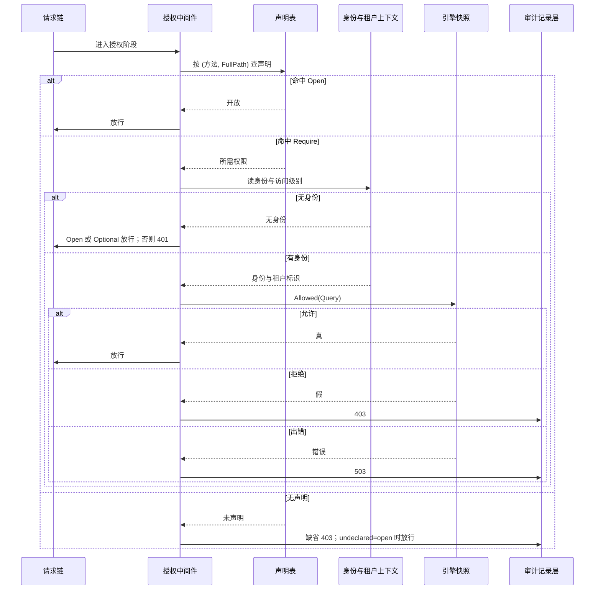
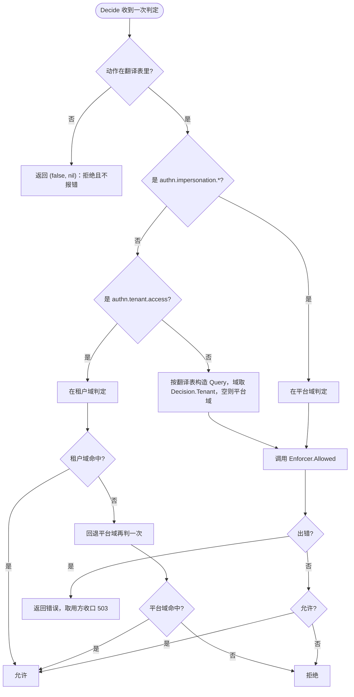
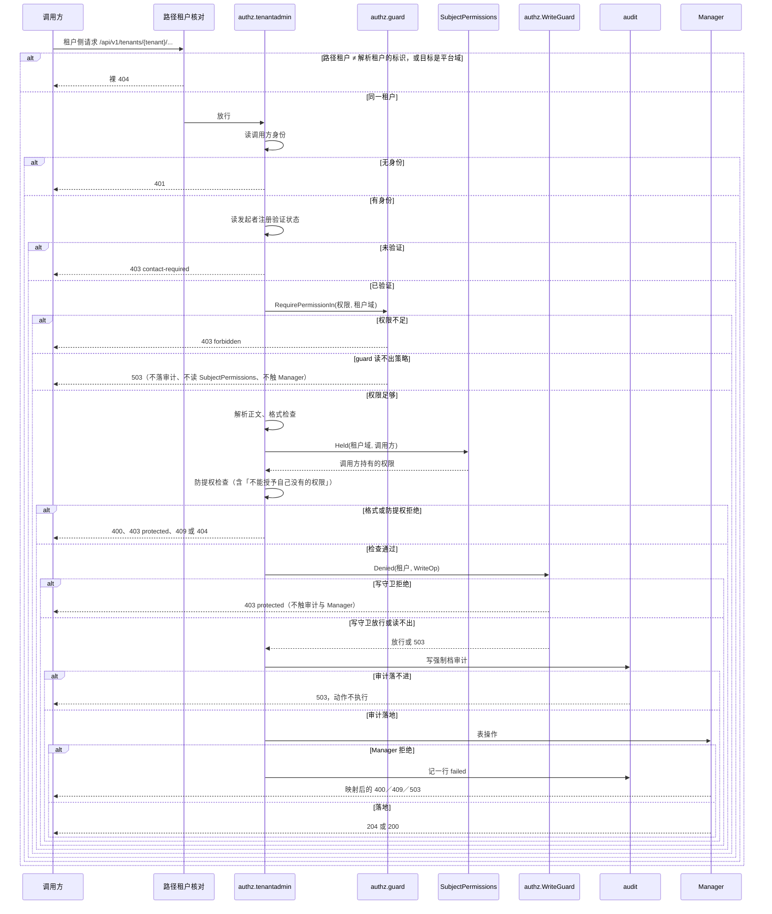

# authz

本模块是请求进入业务之前的一道授权判定：它位于认证与租户解析之后，读网关写进上下文的身份与已解析的[租户](../../glossary.md)，回答这个身份在这个域里对某个资源做某个动作有没有一条匹配的策略行。它拥有策略数据的读写与判定、进程内快照，以及平台管理面、租户管理面与调用方自身权限读取的 HTTP 面。它不认定身份、不管理成员关系、不解析租户；除两个管理面的强制档审计外，它也不写审计行。这些分别归认证、租户与审计。读职责清单之前应持有的一句话心智模型是：授权只把（域，资源，动作）与策略数据比对，身份和租户都是读进来的输入，不是它产生的结论。

第一遍的次序是职责、术语表、外部接口契约、依赖、UML 图、核心数据结构与核心算法与流程：职责与术语表划定边界与词汇，外部接口契约与依赖给出可调用面与装配约束，UML 图给出一条受守路由与一次租户管理面写的判定次序，核心数据结构与核心算法与流程说明策略怎样装载、判定与失效，核心算法与流程的走查先跟一次授予写入落到持久状态的过程。错误与失败语义、并发与事务边界与扩展点属查阅用；实现状态放在最后，用代码锚点核对声称已实现的部分。竞态与边界情形，即快照换指针、撤销的生效延迟、按租户的判底锁，是最后的自检项，与并发与事务边界一并核对。

## 职责

`pkg/authz` 交付**授权**：在已认定的身份与已解析的租户之上，判定这个身份能否对某个资源做某个动作。模型是经典 RBAC：角色到权限，权限按（资源，动作）声明，**一个租户是一个策略域**（[ADR-authz-model](../../adr/adr-authz-model.md)）。引擎桥接 `github.com/casbin/casbin/v3`（[REF-casbin](../../references.md)），策略持久化经 `pkg/db` 由本模块自写的一个薄 adapter 落到自己的表（[ADR-authz-engine](../../adr/adr-authz-engine.md)、[ADR-authz-store](../../adr/adr-authz-store.md)）。

归属本模块的判据是判定所需的输入：还需要资源、动作与策略，而认证事实（凭据、账户、标识、会话、令牌、因素、IdP 配置、冒充记录）不足以单独裁决的，归本模块；只需认证事实即可裁决的归认证。本模块的回答是：这个身份对（域，资源，动作）有没有匹配的策略行。

本功能目录由接口包与子包组成，判据同时是依赖闭包（[ADR-authz-packaging](../../adr/adr-authz-packaging.md)）：

- **根包 `pkg/authz`** 定义接口、数据类型、权限常量、Casbin 模型文本与哨兵；**自身不登记模块**。根包被每一个使用方 import，把第三方库留在根包里会把它带进每一个使用方的闭包，所以根包只依赖标准库。
- **`pkg/authz/policy`（模块 `authz.policy`）** 随迁移建出策略表，迁移不种任何策略行；升级数据迁移撤销平台域以外的 `platform-admin` 角色、授予与绑定；策略数据由宿主经 `Manager` 写入。经薄 adapter 把 Casbin 引擎接到 `pkg/db`，由引擎按（主体，域，资源，动作）做出判定，读出一个主体在一个策略域里实际持有的权限，并把各已登记模块声明的权限汇成目录。`Manager` 交出这些行的读写；账户删除后经生命周期钩子与事件清理其绑定行；移除成员关系时清除该账户在离开租户内的全部绑定（暂停不清、恢复保留）；成员关系守卫在移除前拒绝会让某租户失去最后一条 `tenant-admin` 绑定的移除；移除绑定会让某域不再有租户管理员时拒绝，账户删除收尾的 `ClearAccountBindings` 除外；另随生命周期钩子并立交付 `authn.MemberRoleReader`，一次读出某租户每个账户的角色名；并交付 `authn.InviteRolePolicy`（邀请签发与接受时的角色判定）与 `provisioning.RoleBinder`（邀请接受事务内的绑定写）。它另交付 `TenantOwnerCounter`：读名册的所有者列，回答某账户是否拥有一个仍在服务的业务租户，供账户删除与停用判定；以及 `TxManager` 的 `DeleteTenantPolicyTx`，供组织删除在同一条事务里清掉该租户的授予、绑定与角色。它取用 `pkg/db`，因此把库依赖限制在需要策略存储的装配里。
- **`pkg/authz/guard`（模块 `authz.guard`）** 交付中间件、路由声明登记接口、handler 内判定 API，并**实现 `authn.Decider`**。中间件与 `Decider` 共用同一份声明表与同一处租户读取，拆成两个模块要为它们另立接口。
- **`pkg/authz/admin`（模块 `authz.admin`）** 挂 `/api/v1/system/*` 下的平台管理面路由，不交付功能；它取用 `policy` 的 `Manager`，把平台管理面的依赖与业务判定的依赖分开。
- **`pkg/authz/tenantadmin`（模块 `authz.tenantadmin`）** 挂在 `/api/v1/tenants/{tenant}/*` 下的租户管理面路由，不交付功能；它取用 `policy` 的 `Manager` 与 `Catalog`，把租户域的角色、授权与绑定暴露给该租户的租户管理员，并执行防提权规则。它不取用 `Seeder`，也不取用宿主的 `Reconciler`。
- **`pkg/authz/self`（模块 `authz.self`）** 挂 `/api/v1/authz/me/permissions`，把主体持有的权限读给调用方自身，不交付功能；它取用 `policy` 的 `SubjectPermissions`，因此不需要管理面或强制点。
- **内部实现与测试夹具不构成登记单元。** `pkg/authz/internal/persist` 与 `pkg/authz/internal/policy` 承载不对外暴露的库实现，`pkg/authz/authztest` 提供测试构造夹具；它们都不登记模块，宿主无法在命令树上点名它们。

本模块承接设计中划归授权的各权限点（[ADR-authn-decision-seam](../../adr/adr-authn-decision-seam.md)）：审计的检索与导出、设置的写入接口、租户角色与租户设置的写入接口、口令表主体（`static.*`）的角色以及谁有权冒充谁。它们各自的结构见[承接的权限点](#承接的权限点)。

### 非职责

下列各条例举本模块不承担的事，归属的判据见[职责](#职责)。

- **不做认证，不认定身份。** 谁是调用方由认证的网关认定，本模块只读网关写进上下文的身份；它不读凭据，不解释 `Authorization` 头，也不产生身份。
- **不管理成员关系。** “账户是不是租户的成员”是认证的表 `authn_memberships` 的事实，归 `authn.account`；本模块只按（账户，租户）绑定角色，不读、不写成员关系。平台管理员绑定前的成员资格经宿主提供的 `MembershipChecker` 扩展点询问（见[管理员角色](#管理员角色)），本模块不直接读认证的表。
- **不做租户解析，不读租户名册解释请求的租户。** 请求属于哪个租户由 `tenant.resolve` 认定，本模块读 `tenant.FromContext` 的标识（[tenant](tenant/design-tenant.md)）。平台域的保留值只用于策略裁决，不构成一次租户解析。
- **不把角色放进令牌，也不把它们放进任何凭据。** 访问令牌不带角色（[authn-token](authn/design-authn-token.md)）；角色在请求期由本模块按生效账户读自己的绑定，令牌有效期内的改绑定在换指针窗口与准入层缓存的下一个刷新点生效，延迟有界且不为零，方向与认证的取态一致。
- **不做审计的存储与脱敏。** 判定与拒绝路径经请求级捕获进入审计，审计行的补全、脱敏与存放归 [audit](audit/design-audit.md)；这些路径不调 `Audit.Record`，不写审计表，也不决定明细里遮蔽哪些键。**两个管理面是仅有的例外**：`authz.admin` 与 `authz.tenantadmin` 的每次写在动作之前经强制档审计调用一次 `Audit.Record`（见[管理面](#管理面)与[租户管理面](#租户管理面)），两者目标上都只落这一笔强制行，失败时另补一行 `failed`；遮蔽哪些键仍归 audit。
- **不定义响应体的结构。** 本模块决定拒绝的状态码、`Problem.Type` 与必要的响应头；响应体经入口模块的 `Fail` 写出，结构由入口模块的默认结构或交付 `ErrorResponder` 的模块决定（[http](http/design-http.md)）。
- **写出缺身份时的 401，且它与准入层的无身份 401 一致。** 这条不推翻“不做认证”：它是“路由需要认证而没有身份”的拒绝，与准入层写出的那个 401 是同一个判定，结构也保持相同：同为 `Problem{Status: 401}`（不带 `Type`），头按准入层无身份 401 的同一规则组装（[authn-gate](authn/design-authn-gate.md)）。它出现在这里，因为授权阶段也在网关之内：网关缺席或没守这个端时，授权层是链上唯一还能拒绝匿名请求的层，而准入层只在它自己所守的端上运行；两处写出同一个结构，调用方就不必按“谁拒的”分辨它们的读法（[tenant-admission](tenant/design-tenant-admission.md)、[authn](authn/design-authn.md)）。
- **不实现管理面的访问控制之外的任何业务动作。** `authz.admin` 只把角色、权限授予与角色绑定的读写以及权限目录的读暴露成平台 HTTP 路由；`authz.tenantadmin` 只把同一批表操作与治理集的目录读暴露成租户域 HTTP 路由。写动作本身是 `policy` 的表操作，目录读经 `policy` 的 `Catalog`。
- **不判定一个租户是不是个人租户。** 个人租户的存在归公共模块 [tenant.personal](tenant/design-tenant-personal.md)；本模块经宿主的 `WriteGuard` 与 `WriteSettings` 扩展点得到拒绝，不按标识前缀、名称或权限集自行推断。
- **不替租户管理员决定它可以拥有哪些权限。** 治理集是平台定义的封闭集（见[治理权限与权限矩阵](#治理权限与权限矩阵)）；本模块只按它过滤目录与授予，不把“某模块新声明了一条权限”视为“租户管理员自动获得它”。
- **不决定哪条命令纳入本模块。** 每个模块的 `Prepare` 只表态 `StateEnabled`，永不 `StateAuto`；是否运行是命令树上的决定（[ADR-command-tree](../../adr/adr-command-tree.md)）。

## 术语表

以下术语的含义限于本文档与授权主题的决策记录；它们不进项目术语表。

| 术语 | 英文 | 适用范围 | 定义 |
|---|---|---|---|
| 权限 | permission | 本文档与授权主题的决策记录 | `Permission` 的取值，一个字符串；判定时经[动作到查询的翻译](#动作到查询的翻译)映射到一对（资源，动作）。角色是一组权限的集合。 |
| 角色 | role | 本文档与授权主题的决策记录 | 一个策略域内的权限集合的名字，`Role` 的取值；把一组权限授予一个账户要先经角色间接表达。 |
| 策略域 | domain | 本文档与授权主题的决策记录 | 策略行的归属范围，`Domain` 的取值；一个租户是一个策略域。角色绑定与权限授予都带域。 |
| 平台域 | platform domain | 本文档与授权主题的决策记录 | 策略域 `"system"`，承载平台运营的角色、权限授予与绑定。名册里必须有一个标识相同的租户，启动期核对。 |
| 权限授予 | grant | 本文档与授权主题的决策记录 | 一行 `p` 策略：某个域里的某个角色拥有某个权限。落在 `authz_grants` 表。 |
| 角色绑定 | binding | 本文档与授权主题的决策记录 | 一行 `g` 策略：某个域里的某个账户具有某个角色。落在 `authz_bindings` 表。 |
| 查询 | query | 本文档与授权主题的决策记录 | 一次判定请求 `Query{Subject, Domain, Object, Action}`，交给引擎做匹配。 |
| 条件 | requirement | 本文档与授权主题的决策记录 | 一条路由对权限的要求 `Requirement{Method, Path, Permission}`。 |
| 目录 | catalog | 本文档与授权主题的决策记录 | 已登记模块声明权限清单的并集，与 `authn.Action` 的词表对齐；能力自己携带的权限与模块自有的业务权限都在其中（见[动作到查询的翻译](#动作到查询的翻译)）。 |
| 权限元数据 | permission metadata | 本文档与授权主题的决策记录 | `PermissionMeta` 的取值：一个权限所属的分组与它是否高危；由声明该权限的模块在 `PermissionSpec.Metadata` 里给出。 |
| 角色使用情况 | role usage | 本文档与授权主题的决策记录 | 一个角色在当前租户的 active 成员数与持有该角色的成员列表；只读，由 `Manager.GrantCounts`、`Manager.BindingsOfRole` 与可选的 `AccountIdentityReader` 供给。 |
| 快照 | snapshot | 本文档与授权主题的决策记录 | 进程内一份不可变的全量策略，请求期只读它，不查库。 |
| 治理集 | governed set | 本文档与授权主题的决策记录 | 全部治理权限的集合，由 `Catalog.TenantGoverned()` 读出；`tenant-admin` 的授权恰好是它。治理权限的含义见项目术语表。 |
| 收敛 | reconcile | 本文档与授权主题的决策记录 | 把某个域的 `tenant-admin` 授权集向目标集收敛、并删除调用方列出的废弃项的动作，先补后删；由宿主的 `Reconciler` 排他交付。 |

## 外部接口契约

### 登记单元与名字

| 登记单元 | 模块名 | 交付 | 排他 |
|---|---|---|---|
| `pkg/authz`（根包） | 不登记 | 接口、类型、权限常量、`ModelText`、哨兵 | — |
| `pkg/authz/policy` | `authz.policy` | 表与迁移、薄 adapter、Casbin 引擎、权限目录、`Manager`、`AccountLifecycle`、`authn.MembershipLifecycle`、`authn.MembershipGuard`、`authn.MemberRoleReader`、`authn.InviteRolePolicy`、`provisioning.RoleBinder` | `Enforcer`、`SubjectPermissions`、`Catalog`、`Manager`、`Seeder`、`Reconciler` 各自是；生命周期钩子、守卫、成员角色读、邀请角色判定与事务内绑定写并立 |
| `pkg/authz/guard` | `authz.guard` | 中间件、路由声明登记接口、handler 内 API、实现 `authn.Decider` | 是 |
| `pkg/authz/admin` | `authz.admin` | 平台管理面 HTTP 路由（不交付功能） | — |
| `pkg/authz/tenantadmin` | `authz.tenantadmin` | 租户域管理面 HTTP 路由（不交付功能） | — |
| `pkg/authz/self` | `authz.self` | 调用方自身权限的读取路由（不交付功能） | — |
| `pkg/authz/internal/{persist,policy}`、`pkg/authz/authztest` | 不登记 | 库包与夹具 | — |

每个登记模块的包导出自己的 `ModuleName` 常量，配置与设置的命名空间取同一个取值，管理面模块的 OpenAPI 分组也取同一个名字。名字的每一段只用小写字母、数字与短横线。`policy`、`guard`、`admin`、`self` 与 `tenantadmin` 各带一份 `AGENTS.md`，写它的边界与怎么跑。

**命名空间之间的约束。** 两个模块不得声明同一个输入项路径，也不得一个路径是某模块的叶子而另一个模块的内部节点。`authz` 本身不得是任何模块的叶子。

### 类型与接口

```go
// Permission、Role、Domain 都是字符串类型；Domain 的取值是一个租户标识或平台域。
type Permission string
type Role string
type Domain string

// PlatformDomain 是平台运营的策略域。启动时核对名册里有一个标识为 system
// 的租户，没有则终止启动。
const PlatformDomain Domain = "system"

// 两个管理角色的名字。PlatformAdminRole 只在平台域存在；TenantAdminRole 在
// 每个租户域各一份，是那个租户的最高权限。
const (
	PlatformAdminRole Role = "platform-admin"
	TenantAdminRole   Role = "tenant-admin"
)

// PermissionSpec 是一个模块对自己声明的权限的结构：清单、其中可由租户管理员治理
// 的那些、每个权限的说明文案的 i18n 键，以及每个治理权限的元数据。TenantGoverned
// 必须是 Permissions 的子集；不在子集里的声明权限是平台专属的。
type PermissionSpec struct {
    Permissions     []Permission
    TenantGoverned  []Permission
    DescriptionKeys map[Permission]string
    Metadata        map[Permission]PermissionMeta
}

// PermissionMeta 是声明模块对一个权限的治理描述：管理面把它归入的分组，
// 以及授予它是否会扩大持有者对其他账户或本租户策略的权力。没有元数据的
// 治理权限读作零值，管理面把它归入「其它」分组。
type PermissionMeta struct {
    Group     string
    Dangerous bool
}

// Translation 是一条权限到（资源，动作）的翻译行。
type Translation struct {
    Object string
    Action string
}

// TranslationSpec 是一个模块对自有权限的翻译声明：每条权限一个（资源，动作）行。
type TranslationSpec struct {
    Rows map[Permission]Translation
}

// Query 是一次判定请求。Subject 取身份的被认证账户 Account()：冒充时是被冒充的账户。
type Query struct {
    Subject string
    Domain  Domain
    Object  string
    Action  string
}

// Enforcer 回答一次判定。排他；出错表示引擎或存储不可用，调用方收口 503。
type Enforcer interface {
    Allowed(ctx context.Context, q Query) (bool, error)
}

// SubjectPermissions 读取一个主体在一个策略域里实际持有的权限。排他。
// 出错表示策略快照或存储不可用，调用方收口 503，绝不当作空集。
type SubjectPermissions interface {
    Held(ctx context.Context, domain Domain, subject string) ([]Permission, error)
}

// Catalog 是本模块声明的全部权限、其中可治理的那些、每个权限翻译成的那一对
// （资源，动作），以及每个权限的说明键。排他。
type Catalog interface {
    Declared() []Permission
    // TenantGoverned 读出治理集：全部已声明权限中标记为治理的那些，按权限名升序。
    // 平台管理员不按它收窄；租户管理员的授权恰好是它。
    TenantGoverned() []Permission
    // Governed 报告一条已声明权限是否属于治理集。未声明的权限答假。
    Governed(p Permission) bool
    Has(p Permission) bool
    ObjectAction(p Permission) (object, action string, ok bool)
    // PermissionOf 把策略表里的（资源，动作）对翻回它由哪条已声明权限写出；
    // 没有任何已声明权限翻译到这一对时答 ("", false)。
    PermissionOf(object, action string) (Permission, bool)
    // Metadata 读出声明模块给一条权限的治理元数据；没有给元数据答零值与真，
    // 模块没有声明这条权限答假。
    Metadata(p Permission) (PermissionMeta, bool)
    DescriptionKey(p Permission) (key string, ok bool)
}

// Requirement 是一条路由对权限的要求。
type Requirement struct {
    Method     string
    Path       string
    Permission Permission
}

// Gate 是路由声明登记接口：为一条（方法，路径）登记所需权限或登记为开放。写入窗口是 Init。
type Gate interface {
    Require(method, path string, perm Permission)
    Open(method, path string)
    Covered(method, path string) bool
}

// Binding 是一行角色绑定的读取结构。
type Binding struct {
    Tenant    string
    Account   string
    Role      Role
    GrantedAt time.Time
}

// RoleRecord 是一行角色（authz_roles）的读写结构。Description 是管理面写入的
// 自由文本，DescriptionKey 是宿主种入的内建角色的 i18n 键；两者并存，读取时
// 优先使用 Description。
type RoleRecord struct {
    Tenant         string
    Role           Role
    Builtin        bool
    DescriptionKey string
    Description    string
    CreatedAt      time.Time
}

// RoleDescriptionMax 是一条角色描述允许的字符数上限；超长的管理面写入是 400。
const RoleDescriptionMax = 500

// GrantRecord 是一行权限授予（authz_grants）的读写结构。
type GrantRecord struct {
    Tenant    string
    Role      Role
    Resource  string
    Action    string
    CreatedAt time.Time
}

// Grant 是种入步骤添加给角色的一条权限授予的（资源，动作）对；
// 租户与角色由 SeedGrants 对整组点名。
type Grant struct {
    Resource string
    Action   string
}

// Manager 是策略数据的读写接口，由 authz.policy 交付、authz.admin 取用。
type Manager interface {
    Roles(ctx context.Context, tenant string) ([]RoleRecord, error)
    Grants(ctx context.Context, tenant string, role Role) ([]GrantRecord, error)
    Bindings(ctx context.Context, tenant string) ([]Binding, error)
    BindingsOf(ctx context.Context, tenant, account string) ([]Binding, error)
    // BindingsOfRole 读一个角色在租户内的一页绑定，按账户升序，after 是排他的
    // 账户游标；limit 为正时是页大小，非正时读出游标之后的全部绑定。
    BindingsOfRole(ctx context.Context, tenant string, role Role, after string, limit int) ([]Binding, error)
    // GrantCounts 从一次分组读给出每个角色持有的授权数；没有授权的角色缺席，
    // 调用方读作零。
    GrantCounts(ctx context.Context, tenant string) (map[Role]int, error)
    PutRole(ctx context.Context, r RoleRecord) error
    MarkRoleBuiltin(ctx context.Context, tenant string, role Role) error
    DeleteRole(ctx context.Context, tenant string, role Role) error
    PutGrant(ctx context.Context, g GrantRecord) error
    DeleteGrant(ctx context.Context, g GrantRecord) error
    PutBinding(ctx context.Context, b Binding) error
    DeleteBinding(ctx context.Context, tenant, account string, role Role) error
    ClearAccountBindings(ctx context.Context, tenant, account string) error
}

// AccountIdentity 是宿主对一个账户知道的两件事：展示用的显示名，以及账户是否
// 仍处于 active。
type AccountIdentity struct {
    DisplayName string
    Active      bool
}

// AccountIdentityReader 把角色使用情况读到的账户解析成身份。本能力不持有账户
// 表，因此答案是宿主的接缝；装配不提供它时使用情况仍可读，显示名为空、活动
// 状态未知。读不出答案是错误，调用方按 503 处置，不当作空集或停用集。
type AccountIdentityReader interface {
    Identities(ctx context.Context, tenant string, accounts []string) (map[string]AccountIdentity, error)
}

// Seeder 是宿主的种入接口：它给角色添加它尚未持有的授权，只增不删。由
// authz.policy 排他交付，不在 Manager 上，也不交给任何管理面模块。
type Seeder interface {
    SeedGrants(ctx context.Context, tenant string, role Role, grants []Grant) (int, error)
}

// Reconciler 是宿主的收敛接口：把一个域的 builtin tenant-admin 的授权集收敛到
// 目标集 grants，并删除调用方明确列出的废弃集 retired 中它当前持有的项。
// 先补后删、单事务、返回本次增删的行数；写后重载快照并发布
// authz.policy.changed。它不从权限目录推断废弃项。只有它能删除 builtin 角色的
// 授权。由 authz.policy 排他交付，只交给宿主的种入步骤，不交给任何管理面模块。
// 调用方在收敛之前落一行强制档审计；审计写不进即不收敛。
type Reconciler interface {
    ReconcileGrants(ctx context.Context, tenant string, role Role, grants, retired []Grant) (added, removed int, err error)
}

// WriteSettings 报告一个租户的设置拒绝一次管理写。宿主实现它；它只收紧，
// 不能让 Set 会拒绝的写通过。它只接收租户标识，宿主用它拒绝个人租户的写；
// 设置声明是否把一项暴露给租户，由 settings.tenantadmin 读声明时判定，
// 不在这个接口里。settings.tenantadmin 以它为必需依赖，缺席即启动失败：
// 个人租户的拒绝不能留到运行期才决定有没有。
type WriteSettings interface {
    Denied(ctx context.Context, tenant string) (bool, error)
}
```

上列接口与类型都在根包。根包只依赖标准库，因此它不声明取 `*gin.Context`（[REF-gin](../../references.md)）的接口：handler 内判定 API `Guard` 由此不在根包，而由 `authz.guard` 随中间件一并交付。

接口在根包的对外接口是签名与方法集：加方法与改签名对取用它们的模块、实现了它们的宿主即是不兼容变更。

### 权限常量

权限常量与 `authn.Action` 的字符串**逐一相同**，零翻译：动作的名字就是权限的名字。这条对齐是本模块与认证之间的契约，由[词表对齐守卫](#词表对齐守卫)守住。

```go
// 与 authn.Action 逐一相同：authn.account.read … authn.tenant.access，此处只列其格式。
const (
    PermissionAccountRead      Permission = "authn.account.read"
    PermissionAccountCreate    Permission = "authn.account.create"
    PermissionAccountUpdate    Permission = "authn.account.update"
    PermissionAccountDisable   Permission = "authn.account.disable"
    PermissionAccountDelete    Permission = "authn.account.delete"
    PermissionMembershipManage Permission = "authn.membership.manage"
    PermissionSessionRead      Permission = "authn.session.read"
    PermissionSessionRevoke    Permission = "authn.session.revoke"
    PermissionMFAReset         Permission = "authn.mfa.reset"
    PermissionClientManage     Permission = "authn.client.manage"
    PermissionIDPManage        Permission = "authn.idp.manage"
    PermissionImpersonateStart Permission = "authn.impersonation.start"
    PermissionImpersonationRead Permission = "authn.impersonation.read"
    PermissionImpersonationRevoke Permission = "authn.impersonation.revoke"
    PermissionTenantAccess     Permission = "authn.tenant.access"
)

// 本模块自己的管理面权限。
const (
    PermissionRoleRead   Permission = "authz.role.read"
    PermissionRoleManage Permission = "authz.role.manage"
)

// 承接的权限：审计与平台设置。
const (
    PermissionAuditRead     Permission = "audit.read"
    PermissionAuditExport   Permission = "audit.export"
    PermissionSettingsRead  Permission = "settings.read"
    PermissionSettingsWrite Permission = "settings.write"
)

// 租户管理面的权限码：平台侧与租户侧的同名能力各用一套，互不代用。
const (
    PermissionTenantRoleRead      Permission = "authz.tenant.role.read"
    PermissionTenantRoleManage    Permission = "authz.tenant.role.manage"
    PermissionTenantSettingsRead  Permission = "settings.tenant.read"
    PermissionTenantSettingsWrite Permission = "settings.tenant.write"
    PermissionTenantProfileRead   Permission = "tenant.profile.read"
    PermissionTenantProfileWrite  Permission = "tenant.profile.write"
)
```

**治理集是封闭的。** 一条权限是治理权限，当且仅当它有一个租户域端点、可由租户管理员持有并授予；这与“它在哪里被判定”不是同一件事。治理集是 `authz.tenant.role.read`、`authz.tenant.role.manage`、`settings.tenant.read`、`settings.tenant.write`、`tenant.profile.read`、`tenant.profile.write`、`authn.membership.manage` 与 `authn.idp.manage`。`settings.read`／`settings.write` 与 `authz.role.read`／`authz.role.manage` 是平台侧的码，不因租户侧有同名能力而变成治理权限；`tenant.profile.*` 之外的 `tenant.*` 不因命名归入治理集，`audit.*`、`sms.*`、`authn.account.*`、`authn.session.*`、`authn.mfa.reset`、`authn.client.manage`、`authn.impersonation.*` 与 `authn.tenant.access` 都不是治理权限。`ratelimit.*` 的权限码在本仓库尚未声明；将来声明时也归平台侧，不属于治理集。

**模块在自己的 `PermissionSpec` 里标注治理权限；本能力在 `policy` 的集中声明里标注自己携带的码。** 一个模块把一条权限列进 `TenantGoverned` 而没列进 `Permissions`，是启动期 `ErrUnknownPermission`。治理集取全部已登记模块声明清单的并集，与目录的取材域相同；它不是“本进程运行了哪个模块”的函数。

**治理元数据与治理集在同一份声明里。** `PermissionSpec.Metadata` 给每个治理权限一个分组与一个高危标记；`policy` 为治理集的每一项填写：`authz.tenant.role.read` 与 `authz.tenant.role.manage` 归授权，`authn.membership.manage` 归成员，`authn.idp.manage` 归身份，`settings.tenant.read` 与 `settings.tenant.write` 归设置，`tenant.profile.read` 与 `tenant.profile.write` 归资料。标记为高危的是 `authz.tenant.role.manage`、`authn.membership.manage`、`authn.idp.manage` 与 `settings.tenant.write`：授予它们会扩大持有者对其他账户或本租户策略的权力。目录经 `Catalog.Metadata` 交出这两项，管理面据此分组、标出高危并在授予前要求确认。

上列常量是本能力自己携带的权限。一个模块若拥有本能力未声明的业务权限，以自己的 `PermissionSpec` 声明这份清单、以自己的 `TranslationSpec` 声明每个权限的（资源，动作）行；两者随该模块的资源登记进注册表，`authz.policy` 把清单并入目录，行则并入 `authz.policy` 与 `authz.guard` 各自的 `Init` 所解析的进程翻译（见[动作到查询的翻译](#动作到查询的翻译)与[扩展点](#扩展点)）。**说明文案由声明权限的那个模块自己承载**：它以一份消息目录（`i18n.Catalog` 资源）给出每个权限的 `DescriptionKeys` 条目连同文本，目录随它的资源声明进 i18n 引擎；管理面读到的因此是一句读得懂的话，而不是一条键。声明权限的模块自带文案是唯一的口径：`authz.policy` 自己声明的权限同样如此。

### 承接的权限点

下列各条即本模块承接的全部权限点，由本模块以权限常量与策略行的形式落地；策略数据由宿主经 `Manager` 写入，本模块不在迁移里种任何角色或绑定。

- **审计的检索与导出**：权限 `audit.read` 与 `audit.export`。审计不提供查询接口（[audit](audit/design-audit.md)），检索与导出的端点由审计的检索单元 [audit.admin](audit/design-audit-admin.md) 挂出，两者的判定都经本模块的 handler 内 API 落到 `audit.read` 上；`audit.export` 仍由本模块携带，框架内没有模块询问它，一个按另一份权限判定的导出由宿主自建（[ADR-audit-export](../../adr/adr-audit-export.md)）。
- **设置的写入接口**：权限 `settings.read` 与 `settings.write` 只服务全局层，权限 `settings.tenant.read` 与 `settings.tenant.write` 服务租户层，包括平台侧的 `layer=tenant` 与租户可达前缀下的租户侧。平台员工要在某个租户读写租户层，须在该租户持有对应的租户码（通常经该租户的 `tenant-admin`，即治理集）。设置的写入接口没有访问控制，由宿主经本模块鉴权。
- **租户域的角色**：权限 `authz.tenant.role.read` 与 `authz.tenant.role.manage`，端点由 [authz.tenantadmin](#租户管理面) 挂在 `/api/v1/tenants/{tenant}/*` 下，判定在该租户域。它们与平台侧的 `authz.role.read`／`authz.role.manage` 各翻译、各授予；平台管理员取全量声明集，租户管理员只取治理集。
- **口令表主体（`static.*`）的角色**：本模块只提供结构：保留的平台域 `system`、内建的运营角色以及绑定表；口令表主体的平台角色由宿主写入，不在迁移里种。`Identity.Account().IsStatic()` 的主体读不到任何成员关系，其权限只来自平台域上的绑定。
- **谁有权冒充谁**：权限 `authn.impersonation.start`、`authn.impersonation.read`、`authn.impersonation.revoke`，在平台域上判定。冒充是平台能力：请求路径或正文里的租户是冒充记录被限定的数据，不是策略域，调用方不需要在目标租户持有任何权限；只在目标租户持有 `tenant-admin` 的调用方不通过，平台管理员不必是目标租户的成员。目标必须是目标租户的有效成员这条结构性限制不变。冒充的结构性限制（发起者、目标、参数、并发）由 `authn.impersonation` 核对，本模块在其之上收紧“谁能冒充谁”（[authn-impersonation](authn/design-authn-impersonation.md)）。

### 动作到查询的翻译

`authz.guard` 把一次判定翻成一次 `Enforcer.Allowed` 调用：中间件翻的是路由声明的 `Permission`，`Decider` 翻的是 `Decision.Action`（`authn.Action` 的取值，与权限常量逐一相同）。两条路径用**同一份权限到（资源，动作）映射**给出 `Query.Object` 与 `Query.Action`。下表是这份映射的**内置行**，即本能力自己携带的行；进程的翻译是内置行与**每个已登记模块经 `authz.TranslationSpec` 声明的行**的并集，由 `authz.policy` 或 `authz.guard` 在各自的 `Init` 里解析一次（在登记窗口关闭之前），此后不再改写。两者的解析是注册表的纯函数且写入幂等，结果必是同一份；两个都解析，是因为任何一个都可能单独在场：写策略数据而不守卫任何路由的命令只纳入 `authz.policy`，而 `authz.guard` 要求 HTTP 入口存在，那种命令没有入口可给。一个模块不得与既有行不一致：同一个权限配两行不同的（资源，动作）是启动失败，包在 `authz.ErrUnknownPermission` 里；与既有行一致的行并入同一行、去重。没有任何行覆盖的权限被拒：`Decider` 收到它时返回 `(false, nil)`，路由声明引用它则在启动期以 `ErrUnknownPermission` 终止。`Query.Subject` 取主体的标识：中间件取 `Identity.Account()`，`Decider` 取 `Decision.Actor.Account()`。授权看的是被当作请求方的账户：冒充期间按被冒充账户的权限判定，发起者的权限不生效；限流、审计与设置的归责仍取责任键 `Key()`。

| 权限 | `Query.Object` | `Query.Action` |
|---|---|---|
| `authn.tenant.access` | `tenant` | `access` |
| `authn.account.read` | `account` | `read` |
| `authn.account.create` | `account` | `create` |
| `authn.account.update` | `account` | `update` |
| `authn.account.disable` | `account` | `disable` |
| `authn.account.delete` | `account` | `delete` |
| `authn.membership.manage` | `membership` | `manage` |
| `authn.session.read` | `session` | `read` |
| `authn.session.revoke` | `session` | `revoke` |
| `authn.mfa.reset` | `factor` | `reset` |
| `authn.client.manage` | `client` | `manage` |
| `authn.idp.manage` | `idp` | `manage` |
| `authn.impersonation.start` | `impersonation` | `start` |
| `authn.impersonation.read` | `impersonation` | `read` |
| `authn.impersonation.revoke` | `impersonation` | `revoke` |
| `authz.role.read` | `role` | `read` |
| `authz.role.manage` | `role` | `manage` |
| `audit.read` | `audit` | `read` |
| `audit.export` | `audit` | `export` |
| `settings.read` | `settings` | `read` |
| `settings.write` | `settings` | `write` |
| `authz.tenant.role.read` | `tenant_role` | `read` |
| `authz.tenant.role.manage` | `tenant_role` | `manage` |
| `settings.tenant.read` | `tenant_settings` | `read` |
| `settings.tenant.write` | `tenant_settings` | `write` |
| `tenant.profile.read` | `tenant_profile` | `read` |
| `tenant.profile.write` | `tenant_profile` | `write` |

租户侧的码与平台侧的码翻译到不同的（资源，动作）对：`authz.role.*` 与 `authz.tenant.role.*` 不能共用一个对，否则一条授予会同时满足两个权限，而引擎只匹配对、不匹配权限名。

翻译与[权限目录](#类型与接口)的取材域相同：两者都取**全部已登记模块**（前者取各模块的 `TranslationSpec`、后者取各模块的 `PermissionSpec`），而不是只取本次命令的参与模块。因此两者由同一批登记单元构成，不会因取材域不同而不一致：不会出现一个权限被更宽的目录看到，却被更窄的翻译漏掉的情形。

**域。** 中间件的 `Query.Domain` 取 `tenant.FromContext` 的标识（无租户则 `PlatformDomain`）。`Decider` 的 `Query.Domain` 取 `Decision.Tenant`，其中 `authn.account.*` 在 `Decision.Tenant` 为空时取 `PlatformDomain`；三个 `authn.impersonation.*` 动作无论 `Decision.Tenant` 取什么都在 `PlatformDomain` 判定，那个租户是记录被限定的数据；`authn.tenant.access` 是唯一带平台域回退的动作，见[平台域与跨租户回退](#平台域与跨租户回退)。

**未知动作 fail-closed。** `Decider` 收到的 `Decision.Action` 不在解析出的翻译集里时返回 `(false, nil)`：拒绝而不报错。`Action` 是开放的字符串类型，认证新增一个常量时，本模块在对齐更新之前对它的回答是拒绝，方向取拒绝（[ADR-authz-decision-seam](../../adr/adr-authz-decision-seam.md)）。

### 配置与设置

输入项的完整键表、取值域与缺省值随实现提供；本节写语义。

- **`authz.guard.endpoints`**（配置，字符串列表）：中间件所守的端。**必填、无缺省、不接受 `*`，空清单是 `ErrInvalidConfig`。** 清单的结构同 `tenant.admission.endpoints`；重复的端名并入 `authn.ErrInvalidConfig`：本模块的哨兵表是封闭集，不为配置另立一项（`tenant.admission` 对重复端名用的是它自己的哨兵，那是它的事）。端名在入口模块里不存在时，`authz.guard` 在 `Init` 以 `ErrUnknownEndpoint` 终止启动。
- **`authz.guard.undeclared`**（配置，取值 `closed`/`open`）：未声明路由的缺省处置。**缺省 `closed`**（答 403），取 `open` 时放行并写一行启动 `Warn`。只取主配置源，环境变量与命令行覆盖不改写它：把缺省安全态放到配置的覆盖层一侧，会让一条命令行参数改变哪些路由不需要权限。
- **`authz.policy.load-timeout`**（配置，时长，缺省 `5s`）：启动期全量装载策略的时限。超时即启动失败（`ErrPolicyUnavailable`），不带着半份快照开始服务。
- **`authz.policy.refresh-interval`**（配置，时长，缺省 `0s`）：无事件总线时的周期重载间隔。`0` 表示不重载，负值在启动期以 `authn.ErrInvalidConfig` 拒绝。**它归配置，因为它设定 `Start` 建立的 ticker，改值要重启进程才生效**；周期性重载因此不依赖设置存储，一个只有数据库、没有事件总线也没有设置存储的装配可以直接配置它；宿主要把非零间隔写进配置文件。
- **`authz.admin.endpoints`**（配置，字符串列表）：管理面路由所挂的端，按入口模块自身配置给它们的名字。**必填、无缺省、不接受 `*`**：把管理面路由挂到每个端会挂到公开端上，那里没有网关守它们；只取主配置源。本模块没有自己的失败哨兵，一个跑不了的格式，即空清单、空名、`*`、重名，是 `authn.ErrInvalidConfig`；入口模块不声明的端名是启动期 `ErrUnknownEndpoint`。
- **`authz.tenantadmin.endpoints`**（配置，字符串列表）：租户管理面路由所挂的端，按入口模块自身配置给它们的名字。**必填、无缺省、不接受 `*`**：这组路由要在租户解析与准入层所守的端上，只收 `api` 这类租户可达的端；挂到平台专属的端上，租户管理员就够不到它。只取主配置源。格式不合法与 `authz.admin.endpoints` 同口径：空清单、空名、`*`、重名是 `authn.ErrInvalidConfig`，入口模块不声明的端名是启动期 `ErrUnknownEndpoint`。
- **`authz.self.endpoints`**（配置，字符串列表）：调用方自身权限读取所挂的端，按入口模块自身配置给它们的名字。**必填、无缺省、不接受 `*`**：这条读取属于已认证调用方，挂在没有网关的端上就只剩 handler 自己写的 401；只取主配置源。格式不合法与 `authz.admin.endpoints` 同口径：空清单、空名、`*`、重名是 `authn.ErrInvalidConfig`，入口模块不声明的端名是启动期 `ErrUnknownEndpoint`。

**配置承载启动必须项与改值要重启才生效的项，其余能在运行期生效的值一律归设置**（[ADR-config-scope](../../adr/adr-config-scope.md)）：`endpoints`、`load-timeout` 与 `refresh-interval` 都属配置：`endpoints` 与 `load-timeout` 在装配期或启动装载时就要读出来，`refresh-interval` 设定 `Start` 建立的 ticker，改值要重启进程才生效。**本模块没有设置型的放宽开关**：唯一会放宽的方向是 `undeclared`，它是配置项，改它要重启。

### 对宿主的要求

- **把 `authz.guard`、`authz.policy` 的模块名写进需要授权的命令。** 只挂中间件而不点名 `policy` 时，`guard` 的 `Enforcer` 缺席，本模块判定不可用，全部受守路由答 503；两者要么一起点名，要么都不点。
- **`endpoints` 写成业务端。** 与 `tenant.admission.endpoints` 一致；`authz.guard` 只在它守的端上登记中间件。
- **策略数据由宿主写入。** 迁移只建表，不种角色、不种权限授予、不种绑定；平台域 `system` 的运营角色、口令表主体的绑定、各租户的角色与绑定都经 `Manager` 或管理面路由写入。一个已置 `builtin` 的角色，其授权只经 `Seeder.SeedGrants` 增补、经 `Reconciler.ReconcileGrants` 收敛：`Manager`、`authz.admin` 与 `authz.tenantadmin` 的写路由都拒绝它，两个管理面模块也都不持有这两个能力。
- **`platform-admin` 与 `tenant-admin` 的授权集分开种。** 平台域的 `platform-admin` 取 `Catalog.Declared()` 的全量，永不被治理集收窄；业务租户与 `system` 域的 `tenant-admin` 取 `Catalog.TenantGoverned()` 的全量，由宿主置 `builtin` 并经 `Reconciler` 收敛到当前版本的治理集；个人租户的 `tenant-admin` 取 `(personalBusinessPermissions ∩ Catalog.TenantGoverned()) − personalExcludedPermissions`，不置 `builtin`，也不经 `Reconciler` 收敛；它由 [tenant.personal](tenant/design-tenant-personal.md) 在账户事务内写入，种子跳过个人域。
- **名册里必须有标识为 `system` 的租户。** 平台域的策略行挂在这个标识上；`authz.policy` 在启动时经 `tenant.Catalog` 读名册，没有即以 `ErrPlatformDomainMissing` 终止启动。没有租户模块的装配里没有名册，这条核对不执行。该租户不可停用、不可删除，由名册的写保护拒绝。
- **想让权限随撤销尽快生效的装配里要提供事件总线。** 没有 `event.Bus` 时，策略变更靠 `refresh-interval` 兜底，撤销的生效延迟以它为界。
- **想挂管理面的命令点名 `authz.admin` 并配 `authz.admin.endpoints`。** 不点名时没有 `/api/v1/system/*` 下的任何路由；点名而清单为空、为空名或含 `*` 是 `authn.ErrInvalidConfig`。这条命令还要纳入 `authn.account`：写路由经 `authn.SignupVerification` 读发起者的注册验证状态，缺席时依赖解析以缺提供者终止启动。
- **想挂调用方自身权限读取的命令点名 `authz.self`、配 `authz.self.endpoints`，并把该端纳入网关所守的端。** 不点名时没有 `/api/v1/authz/me/permissions`；点名而清单为空、为空名或含 `*` 是 `authn.ErrInvalidConfig`。端不在网关的准入清单里时路由仍挂出，但没有身份检查之外的准入，任何已认证调用方都能读自己的权限。
- **想挂租户管理面的命令点名 `authz.tenantadmin`、配 `authz.tenantadmin.endpoints`，并把该端纳入租户解析、准入层与授权守卫。** 不点名时没有 `/api/v1/tenants/{tenant}/*` 下的角色路由；点名而清单为空、为空名或含 `*` 是 `authn.ErrInvalidConfig`。这条命令还要纳入 `authn.account`（`authn.SignupVerification`）、`tenant.catalog`（`tenant.Catalog`）与 `authz.policy`（`Manager`、`Catalog`、`SubjectPermissions`），并在装配里提供 `authz.MembershipChecker`；任一必需依赖缺席都在构造前以缺提供者终止启动。**不要给它 `Seeder` 或 `Reconciler`**：前者会打开 builtin 角色的授权增补路径，后者会打开删除路径，两者都只在宿主的种入步骤里。
- **在所有 `ScopeTenants` 路由组上挂路径租户核对。** 路径段里的租户必须等于请求解析出的租户，按标识比较，路径段可以写标识或当前名称；路径段解析不到唯一租户，或解析到另一个租户，都以与一条不存在的租户一致的裸 404 作答。这条前置覆盖新模块与复用的成员、邀请与 SSO 路由组，不靠各 handler 自己记得比对。只挂授权守卫而不挂它时，一个在 A 租户获治理权限的调用方可以靠路径写 B 租户。**平台域的拒绝不在这条共同前置里**：`authz.tenantadmin` 与 `settings.tenantadmin` 另以更严的守卫包裹自己的路由，路径或解析出的租户是 `PlatformDomain` 时答同样的裸 404；成员、邀请与 SSO 路由组管理 `system` 租户本身，以平台域寻址是正当的。
- **个人租户的拒绝由宿主扩展点回答。** 断言 `authz.WriteGuard` 拒绝对个人租户的策略写，并通过独立的 `authz.WriteSettings` 拒绝对个人租户的设置写；`WriteOp` 的封闭三元组不变，设置写不借用 `WriteGrant`。`WriteSettings` 是 `settings.tenantadmin` 的必需依赖，缺席即启动失败；`WriteGuard` 在租户管理面是可选取用，但启用个人租户的装配必须提供它。两个扩展点都只收紧、不放行，读不出答复时调用方按 503 处置。

### 管理面

`authz.admin` 是挂在固定基路径 `/api/v1/system` 下的管理面模块，不交付任何功能接口，只把角色、权限授予与角色绑定的读写以及权限目录的读暴露成 HTTP 路由；写路由的动作是 `policy` 的 `Manager` 的一次表操作，目录读经 `policy` 的 `Catalog`。路由挂在配置 `authz.admin.endpoints` 列出的端上，基路径不做可配置。路由不暴露任何不透明的行标识：每条路由按自然键，即租户、角色、权限、账户，寻址。

**访问控制由本模块在 handler 内做出，不经 `Decider`。** 管理面路由在中间件的声明表里全部登记为开放，好让中间件把请求放行到 handler；handler 先读调用方的身份，再经 `authz.guard` 的 handler 内判定 API 就这条路由的权限问一句，不足即回绝。模块不给自己授予任何权限，只提供目录已经声明的词表。

**判定顺序固定，写与读在判定之后分流。** handler 先读调用方：请求没有身份是 401，只有状态、没有 `Type`，不询问 guard 即返回。写路由随后读发起者的注册验证状态（见下），再向 guard 要本条路由的权限：不足即由 guard 写出它自己的拒绝（拒绝 403、故障 503），并返回。判定之后才分流：写解析正文、跑本条路由的检查（授予的目录核对与翻译、绑定的空账户），再问可选的宿主 `WriteGuard`，落强制档审计，调 `Manager`；读调 `Manager` 并应答。

**宿主写守卫在格式检查之后、审计与 `Manager` 之前。** 角色、授予与绑定的每条写路由都问一次 `authz.WriteGuard`（见[管理员角色](#管理员角色)），把路径里的租户与这次写的类别（`WriteRole`、`WriteGrant`、`WriteBinding`）交给它。答复拒绝即答 403 `urn:speed:authz:protected`，不落强制档审计、不触 `Manager`；答复读不出来时答 503，不按放行处理；装配没有提供这个扩展点时写照旧执行。这个码与强制层的策略拒绝 `urn:speed:authz:forbidden` 分开：被拒的原因是这个域受保护，而不是发起者少了某个权限，沿用 `forbidden` 会让前端与运营者去查一条并不存在的权限。它排在格式检查之后：一个在本路由上就不合法的请求不会让宿主的策略被问到。读路由从不询问它。

**注册验证状态的门控在权限判定之前。** 这条门控执行的是未验证账户不得写管理面这一约束（REQ-platform-admin-017）：写路由（`PUT` 与 `DELETE`）在读完调用方身份之后、权限判定与解析正文、落强制档审计之前，读发起者的注册验证状态（`authn.SignupVerification.SignupStateOf`）：发起者视为未验证（`SignupPending`：有邮箱而没有一条已证明的）时答 403 `contact-required`（`authn.ErrContactRequired`），动作不执行；服务账户与没有任何邮箱的账户（`SignupNone`）豁免，读路由不受这条门控影响。判据与账户怎么创建无关，管理员预置与导入的发起者带着未证明邮箱时同样被拦。读取状态失败答 503，不按放行处理。门控只收紧、不放行：它只多拒绝一类发起者，不改变权限判定本身，也不让任何未通过权限判定的请求通过。这个码属于认证的失败范围，不在本模块 `Problem.Type` 前缀的码集之内。

**判定在平台域做出，与路径里的租户无关。** 管理面路径里的租户是这条路由所作用的行数据的标识，不是判定的域：handler 经 `RequirePermissionIn` 显式指定 `authz.PlatformDomain` 判定（[动作到查询的翻译](#动作到查询的翻译)）。若按请求解析出的租户判定，一个在某租户获授权的调用方就能靠路径里写另一个租户，读或写那个租户的行。没有平台域授权的调用方，路径里写哪个租户都被拒。按 [ADR-http-api-path-scopes](../../adr/adr-http-api-path-scopes.md) 的判据，管理面虽然按租户寻址（`/api/v1/system/tenants/{tenant}/roles`、`/bindings`），但不满足“由该租户治理”，因此与名册、审计、设置和冒充记录同属 `/api/v1/system`，留在 `tenant.resolve` 与 `tenant.admission` 两层之外。

**每次写强制档审计，落在动作之前、事务之外。** 写路由在调用 `Manager` 之前写一行强制档审计；审计写不进则应答 503 且动作不执行。`Manager` 拒绝写时再尽力写一行 `failed`，与允许行以动作标识关联，它自己的失败只记 Error，不改变应答。模块不开自己的事务，它改动的行写在 `Manager` 的事务里。

读路由的权限是 `authz.role.read`，写路由是 `authz.role.manage`。下表是路由的全集（封闭集）：组、方法、路径与每条需要的权限。目录读是唯一一条经 `Catalog.Declared` 而非 `Manager` 的读。

| 组 | 方法 路径 | 权限 |
|---|---|---|
| 目录 | `GET /api/v1/system/permissions` | `authz.role.read` |
| 角色 | `GET /api/v1/system/tenants/:tenant/roles` | `authz.role.read` |
| 角色 | `PUT /api/v1/system/tenants/:tenant/roles/:role` | `authz.role.manage` |
| 角色 | `DELETE /api/v1/system/tenants/:tenant/roles/:role` | `authz.role.manage` |
| 授予 | `GET /api/v1/system/tenants/:tenant/roles/:role/grants` | `authz.role.read` |
| 授予 | `PUT /api/v1/system/tenants/:tenant/roles/:role/grants/:permission` | `authz.role.manage` |
| 授予 | `DELETE /api/v1/system/tenants/:tenant/roles/:role/grants/:permission` | `authz.role.manage` |
| 绑定 | `GET /api/v1/system/tenants/:tenant/bindings` | `authz.role.read` |
| 绑定 | `GET /api/v1/system/tenants/:tenant/bindings/:account` | `authz.role.read` |
| 绑定 | `PUT /api/v1/system/tenants/:tenant/bindings/:account/:role` | `authz.role.manage` |
| 绑定 | `DELETE /api/v1/system/tenants/:tenant/bindings/:account/:role` | `authz.role.manage` |

**读的应答是 200 加一份视图，落地写的应答是 204 无正文。** 视图逐字段从根包的值构造，从不把值原样交给客户端，记录日后新增一个字段不会因为它在就等于出现在应答里。各视图的字段：目录是 `permission`、`description`、`group`、`dangerous`、`grantable`；角色是 `tenant`、`role`、`builtin`、`description`、`permission_count`、`member_count`、`can_manage`、`created_at`；授予是 `tenant`、`role`、`permission`、`resource`、`action`、`created_at`；绑定是 `tenant`、`account`、`role`、`granted_at`。时间字段按 UTC 写出。**授予视图的 `permission` 由 `Catalog.PermissionOf` 从（资源，动作）对反查得出**：客户端因此不必自己维护一张翻译表就能命名与编辑一条授予。一对没有任何已声明权限翻译到的旧授权仍出现在视图里，`permission` 为空串，`resource` 与 `action` 保留，供运营者诊断一条本进程已不认识的行。目录视图的 `description` 是服务端按请求语言渲染好的说明：管理面从目录取该权限的 `DescriptionKey`，经可选的 `i18n.Localizer` 在请求的语言里渲染。装配里没有本地化器时它是空串；声明权限的模块没有给出键时它也是空串；键存在但没有任何消息目录承载它时，本地化器按引擎的回退把键本身写回，客户端照收到的文本显示，不自己解析键。目录视图的 `group` 与 `dangerous` 取 `Catalog.Metadata`；没有元数据的权限答空分组与假，客户端把它归入自己的“其它”分组。`grantable` 是调用者在平台域经 `SubjectPermissions.Held` 实际持有的这条权限，读失败是 503，不按“都不可授予”处理。**各视图里的 `tenant` 是名称**：行上存的是内部标识，视图经可选的 `authz.TenantNameResolver` 换成名称；接口缺席或解析不到时为空串，不回退成标识。

**角色的 `description` 在服务端解析，`member_count` 来自可选的身份接口。** 内建角色且存储的描述键非空时，`description` 是经可选 `i18n.Localizer` 按请求语言渲染的文本，没有本地化器时回退到键；管理面创建的角色原样返回自由文本。视图里的 `description_key` 已移除，不是弃用或保留：旧客户端只读 `description`。`permission_count` 来自一次 `Manager.GrantCounts`；`member_count` 是当前租户持有该角色的 active 成员数，来自一次 `Manager.Bindings` 与一次 `AccountIdentityReader.Identities` 批量读；装配里没有身份接口时该字段为 `null`，不拿绑定数冒充，身份读失败是整个角色列表的 503。`can_manage` 报告调用者在平台域是否持有 `authz.role.manage`，决定客户端是否渲染写控件。

**角色写入的正文只有自由文本描述。** 正文只声明 `description`：它缺席时保留已存的文本，显式空串清除它；`description_key` 已从写入正文中移除，不是弃用或保留，客户端仍发送它时到不了 `Manager`，路由的正文预筛会先把它丢掉。超过 `authz.RoleDescriptionMax` 个字符的 `description` 是 400，发生在写守卫、审计与 `Manager` 之前。`builtin` 是宿主的种入步骤经 `Manager.MarkRoleBuiltin` 置上的冻结标记，不是管理面可写的值：正文里带这个成员不会到达 `Manager`，`PutRole` 收到携带该标记的记录也一律拒绝。标记一旦置上就没有清回的通路，这正是它的含义。标记置上之后，管理面与 `Manager` 都不能改该角色的授权；宿主的种入接口 `Seeder.SeedGrants` 只增不删，是唯一的增补入口（[种入接口](#种入接口)）。

**授出的权限先经目录与翻译，再写。** 一条授予落到 `authz_grants` 的是（资源，动作）对，不是权限本身；目录不持有的权限在 `Manager` 被调用之前就是 400。写入的（资源，动作）由与中间件、`Decider` 共用的那份翻译给出（[动作到查询的翻译](#动作到查询的翻译)）。

**回绝映射是封闭的、fail-closed 的。** 400（`Problem.Type` 为 `urn:speed:authz:bad-request`）：请求在格式上不可读（路径参数或正文）、授予一条目录不持有的权限、写里的角色未知（`ErrUnknownRole`）、租户不符（`ErrTenantMismatch`）、绑定里的账户不是平台租户的有效成员（`ErrPlatformMembershipRequired`）、绑定写里的空账户。409（`Problem.Type` 为 `urn:speed:authz:conflict`）：写试图删除或改动内建角色（`ErrBuiltinRole`），或删除某域最后一条租户管理员绑定（`ErrLastTenantAdmin`）。403 分两种 `Problem.Type`：强制层的策略拒绝（一条受守路由需要权限而引擎匹配为假，或一条未声明路由在 `undeclared=closed` 下被拒）是 `urn:speed:authz:forbidden`；`urn:speed:authz:protected` 覆盖调用方删除自己在某域 `tenant-admin` 的绑定与宿主 `WriteGuard` 的答复拒绝：前者说明这条绑定只能由另一位租户管理员删除，后者说明域受保护，两者都不是权限不足。503：`Manager` 或存储的其余失败、读不出的写守卫与身份接口，以及没落地的强制档审计；503 不带 `Problem.Type`，它说的是一个依赖答不了而不是一个许可结论，成因只进日志。

**管理面以静态[特性](../../glossary.md) `authz.admin` 声明。** `authz.admin` 描述符的 `Resources` 带 `feature.Spec{Name: "authz.admin"}`；这个特性在场，表示本进程挂出上表的管理面路由（[feature](design-feature.md)）。端清单必填、不接受空清单，没有入口模块即 `ErrNoRouter`，所以模块进入启用集、进程有路由器时这组路由无条件挂出，这个管理面不再随配置或装配变化，声明为静态特性符合架构不变量 18（[architecture](../architecture.md#架构不变量)）。

### 租户管理面

`authz.tenantadmin` 挂在租户作用域基路径 `/api/v1/tenants/{tenant}` 下，是一个管理面模块，不交付任何功能接口，只把租户域的角色、权限授予与角色绑定的读写暴露成 HTTP 路由。它与管理面共用 `policy` 的 `Manager` 与 `Catalog`，差别在判定域、权限码与防提权规则：管理面的判定固定在平台域，租户管理面的判定在路径点名的那个租户域。模块不持数据、不持规则，每条路由的动作是一次 `Manager` 调用。

**租户侧的一切请求都在租户可达的前缀下。** `/api/v1/system/*` 是平台专属前缀，生产部署可以不向租户开放；路径在 `/system` 下而判定在租户域的路由不能给租户侧复用。租户侧因此只使用 `/api/v1/tenants/{tenant}/...`，与成员、邀请、SSO 与租户设置同处一个前缀。租户是地址的一部分，不是查询值。

#### 路由

下表是本模块挂出的路由全集（封闭集）：方法、路径与每条需要的权限。读路由问 `authz.tenant.role.read`，写路由问 `authz.tenant.role.manage`；两者都只属于治理集。

| 组 | 方法 路径 | 权限 |
|---|---|---|
| 目录 | `GET /api/v1/tenants/{tenant}/permissions` | `authz.tenant.role.read` |
| 角色 | `GET /api/v1/tenants/{tenant}/roles` | `authz.tenant.role.read` |
| 角色使用情况 | `GET /api/v1/tenants/{tenant}/roles/{role}/bindings` | `authz.tenant.role.read` |
| 角色 | `PUT /api/v1/tenants/{tenant}/roles/{role}` | `authz.tenant.role.manage` |
| 角色 | `DELETE /api/v1/tenants/{tenant}/roles/{role}` | `authz.tenant.role.manage` |
| 授予 | `GET /api/v1/tenants/{tenant}/roles/{role}/grants` | `authz.tenant.role.read` |
| 授予 | `PUT /api/v1/tenants/{tenant}/roles/{role}/grants/{permission}` | `authz.tenant.role.manage` |
| 授予 | `DELETE /api/v1/tenants/{tenant}/roles/{role}/grants/{permission}` | `authz.tenant.role.manage` |
| 绑定 | `GET /api/v1/tenants/{tenant}/bindings` | `authz.tenant.role.read` |
| 绑定 | `GET /api/v1/tenants/{tenant}/bindings/{account}` | `authz.tenant.role.read` |
| 绑定 | `PUT /api/v1/tenants/{tenant}/bindings/{account}/{role}` | `authz.tenant.role.manage` |
| 绑定 | `DELETE /api/v1/tenants/{tenant}/bindings/{account}/{role}` | `authz.tenant.role.manage` |

**目录读只列治理集。** `GET .../permissions` 从 `Catalog.TenantGoverned()` 取权限，逐条经 `DescriptionKey` 取说明键、经 `Metadata` 取分组与高危标记；`grantable` 按调用人经 `SubjectPermissions.Held` 读到的集合给出。应答结构与管理面的目录视图相同。一个不在治理集里的权限不出现在这里，也不能经授予路由写入。

**读的应答是 200 加一份视图，落地写是 204 无正文。** 视图逐字段从根包的值构造，字段与管理面的同名视图相同：目录是 `permission`、`description`、`group`、`dangerous`、`grantable`；角色是 `tenant`、`role`、`builtin`、`description`、`permission_count`、`member_count`、`can_manage`、`created_at`；授予是 `tenant`、`role`、`permission`、`resource`、`action`、`created_at`；绑定是 `tenant`、`account`、`role`、`granted_at`；角色使用情况是 `account`、`display_name`、`active`、`granted_at` 与整页的 `next_cursor`。时间按 UTC 写出。授予的 `permission` 同样由 `Catalog.PermissionOf` 反查，空串表示这一对没有对应的已声明权限；`resource` 与 `action` 留作诊断。租户管理面不提供不透明的行标识，每条路由按自然键寻址。

**角色列表与使用情况读在租户域内自带计数与身份。** 角色列表的 `permission_count` 来自一次 `Manager.GrantCounts`，`member_count` 来自一次 `Manager.Bindings` 加一次 `AccountIdentityReader.Identities` 批量读，只统计 `active=true` 的账户；`can_manage` 取调用人在该租户经 `SubjectPermissions.Held` 读到的 `authz.tenant.role.manage`，读失败是 503。身份接口在 `Init` 可选取用：缺席时 `member_count` 为 `null`、使用情况行的 `display_name` 为空、`active` 为 `null`；身份读失败是整个角色列表或使用情况读的 503，不当作空集或停用集。使用情况读按账户游标分页，`limit` 缺省 50、上限 200，返回的游标是这一页最后一名持有人的账户；一个没有绑定的角色是空页而不是错误。它只读，不提供绑定、解绑或按账户查询的控件。

#### 访问控制

**判定由本模块在 handler 内做出，不经请求中间件的声明判定。** 路由在中间件的声明表里全部登记为开放，好让中间件把请求放行到 handler；handler 先读调用方的身份，再经 `RequirePermissionIn` 就这条路由的权限问一句，判定域是路径点名的那个租户，不是请求解析出的任意域。模块不给自己授予任何权限。

**路径租户必须等于请求解析出的租户。** 请求以标识或当前名称寻址，解析层把名称换成标识写进上下文；这是一层覆盖全部 `ScopeTenants` 路由组的共同前置，由宿主挂在租户作用域的端上，先于该组的 handler 运行：它取出路径里的 `{tenant}` 段，经名册快照解析成唯一的标识，与 `tenant.FromContext` 给出的标识比较，不相等时以裸 404 作答：路径段解析不到唯一租户，或解析到另一个租户，都答这个 404，与一条不存在的租户一致，不透露路径里的租户是否存在。这层前置覆盖租户角色路由与复用的成员、邀请、SSO 路由组；只挂授权守卫而不挂它时，一个在 A 租户获治理权限的调用方可以靠路径里的 B 租户读写 B 的数据。**平台域不是租户管理目标，而共同前置不拒绝它**：`authz.tenantadmin` 与 `settings.tenantadmin` 另套一层更严的守卫，路径或解析出的租户是 `PlatformDomain` 时同样答裸 404；成员、邀请与 SSO 路由组管理 `system` 租户本身，以平台域寻址是正当的。

**判定顺序固定。** handler 先读调用方：请求没有身份是 401，只有状态、没有 `Type`，并带与管理面、准入层一致的 realm 质询，不询问 guard 即返回。写路由随后读发起者的注册验证状态：视为未验证（`SignupPending`）答 403 `contact-required`，读取失败答 503，动作不执行；服务账户与没有任何邮箱的账户（`SignupNone`）豁免。再向 guard 要本条路由的权限：不足即由 guard 写出它自己的 403 或 503。判定之后才分流：写解析正文、做格式检查、跑全部防提权检查、问宿主的 `WriteGuard`、落强制档审计、调 `Manager`；读调 `Manager` 并应答。

**注册验证门控与强制档审计沿用管理面的口径。** 门控只收紧、不放行，判据与账户怎么创建无关；审计落在动作之前、事务之外，写不进即 503 且动作不执行，`Manager` 拒绝写时再尽力写一行 `failed`。每条拒绝路径都不产生一行 `success` 审计：身份、注册验证、权限、格式、防提权、`WriteGuard` 与审计本身任一档拒绝时，动作都没有发生。

**管理面与租户管理面都拒绝读不出的依赖。** `SubjectPermissions`、`MembershipChecker`、`Catalog` 与 `Manager` 的读取失败是 503，不视为空集或放行；空集是一个结论，故障不是。

#### 治理权限与权限矩阵

**平台管理员保持全量，且只在平台域放行。** `platform-admin` 的授权集是 `Catalog.Declared()` 的全部权限，不因治理集收窄；它的判定只发生在平台域，在租户作用域不因这个角色本身放行，调用方要在该租户另有绑定。**租户管理员的授权集分两层。** 业务租户与 `system` 域的 `tenant-admin` 取 `Catalog.TenantGoverned()` 的全量；个人租户的 `tenant-admin` 取 `(personalBusinessPermissions ∩ Catalog.TenantGoverned()) − personalExcludedPermissions`，不置 `builtin`，也不经 `Reconciler` 收敛。平台员工的能力来自 `platform-admin`，`system` 的新成员要成为平台管理员仍需平台域的绑定。**普通成员没有内建授权**：它在一个租户里能做什么由该域里绑定给它的角色给出，而租户侧只能把治理集的子集写进域内角色，因此普通成员最多持有治理集。域内自定义角色由平台侧写入时可以获得任何已声明权限，但平台码只在平台域判定，不使持有者通过平台侧。

| 角色 | 存在的域 | 授权集 | 平台侧 | 租户侧 |
|---|---|---|---|---|
| `platform-admin` | 只在平台域 `system` | `Catalog.Declared()` 全量 | 可用 | 不因本角色放行；调用方要在该租户另有绑定 |
| `tenant-admin`（业务租户） | 业务租户各一份 | `Catalog.TenantGoverned()` 全量；置 `builtin`，经 `Reconciler` 收敛 | 不可用 | 可用 |
| `tenant-admin`（`system`） | `system` | `Catalog.TenantGoverned()` 全量；置 `builtin`，经 `Reconciler` 收敛 | 不因本角色放行；它的角色与绑定经平台域的管理面读写 | 不可用；`system` 是平台域，租户侧路径答裸 404 |
| `tenant-admin`（个人租户） | 个人租户一份 | `(personalBusinessPermissions ∩ Catalog.TenantGoverned()) − personalExcludedPermissions`；不置 `builtin`，不经 `Reconciler` 收敛 | 不可用 | 不可用；个人租户不能经租户侧管理，单人空间：策略写由宿主 `WriteGuard` 拒绝，成员、邀请与 SSO 的管理权限被允许集排除，设置写由宿主的 `WriteSettings` 拒绝 |
| 普通成员 | 被绑定的租户域 | 无内建；由域内角色绑定给出 | 不可用 | 只到治理集 |
| 域内自定义角色 | 一个租户域 | 租户侧写入治理集的子集；平台侧可写任何已声明权限 | 平台码不因租户域绑定而生效 | 由其绑定者持有 |

**平台侧与租户侧两列说的是角色能在那一侧做什么。** 租户侧只在业务租户上成立：`system` 是平台域，租户侧路径答裸 404；个人租户是单人空间，它的策略写由宿主 `WriteGuard` 拒绝。角色在 `system` 域与个人租户里照样存在并持有上表的授权集，只是都不经租户侧管理。

#### 防提权

下列规则在服务端执行，前端隐藏不是边界。每条规则落在一个可命名的检查点，检查点都在强制档审计与 `Manager` 之前。

| 规则 | 落点 | 拒绝 |
|---|---|---|
| 不能创建、改写、删除或授予 `platform-admin` | 角色名无条件检查；`refuseReservedRole` 在平台域放行，租户侧不依赖它 | 403 `urn:speed:authz:protected` |
| 不能创建、改写、删除 `tenant-admin` 的角色行与它的授予 | 角色名无条件检查；业务租户与 `system` 域的 `tenant-admin` 授权集只由宿主的 `Reconciler` 收敛，个人租户的由宿主经 `Seeder` 与 `Manager` 维护 | 403 `urn:speed:authz:protected` |
| 不能授予治理集之外的权限 | `PUT grant` 要求权限 ∈ `Catalog.TenantGoverned()` | 400 `urn:speed:authz:bad-request` |
| 不能授予自己没有的权限 | `PUT grant` 要求权限 ∈ 调用方在该租户域经 `SubjectPermissions.Held` 读到的集合 | 403 `urn:speed:authz:protected` |
| 不能绑定高于自己的角色 | `PUT binding` 要求该角色的全部授予 ⊆ 调用方持有集合 | 403 `urn:speed:authz:protected` |
| 只能绑定该租户的有效成员 | `PUT binding` 经 `authz.MembershipChecker` 核对账户 | 400 `urn:speed:authz:bad-request`；检查器读不出是 503 |
| 不能删最后一个租户管理员 | `Manager.DeleteBinding` 的最后一条规则 | 409 `urn:speed:authz:conflict` |
| 不能删自己的租户管理员绑定 | 绑定删除路由自己检查 | 403 `urn:speed:authz:protected` |
| 不能写个人租户的策略 | 宿主的 `authz.WriteGuard` 在格式与防提权之后被询问 | 403 `urn:speed:authz:protected`；读不出是 503 |
| 不能把平台域当归宿 | 路径段须等于解析出的租户名称；路径或解析出的租户是 `PlatformDomain` 时拒绝 | 裸 404 |
| 跨租户隔离 | 路径租户 == 解析租户名称的共同前置 | 裸 404 |

**授予视图的权限码是前端预检的输入，不是边界。** 租户管理面读出的每条授予带 `permission`；成员管理面的角色绑定面板在发出绑定之前，把目标角色的每条授予与调用方自己的租户权限集比较，空码或未持有的码阻止这次绑定。这条预检只让操作者少发一次必然被拒的写；服务端仍按上表的子集规则与调用方实际持有的权限判定，前端的比较不构成放行。

**子集规则只有一处实现。** `Manager.RoleSubsetHeld(ctx, tenant, role, held)` 读该角色的全部授予，按目录把它们映射回权限名，回答每条是否都在 `held` 里；`held` 读不出来是错误，不当作空集。租户管理面的绑定写与邀请的角色判定都经它，前者把自己的拒绝映射成 `protected`，后者把拒绝映射成邀请自己的问题码。邀请模块不 import 授权目录：它经根包声明的 `authn.InviteRolePolicy` 取用签发时的“调用方能否授予该角色”与接受时的“角色是否仍可授”，由本模块实现并交付（[design-authn-invite](authn/design-authn-invite.md)、[ADR-authn-invitation-role](../../adr/adr-authn-invitation-role.md)）。

**在业务租户的租户侧绑定 `tenant-admin` 是允许的。** 一个租户管理员可以给另一个账户绑定 `tenant-admin`，使该域保持至少一名管理员；这条写仍受子集规则约束（该域的 `tenant-admin` 持有治理集全集，调用方自己持有治理集时子集成立）、最后一条规则与删除自己的规则约束。**`system` 域的 `tenant-admin` 绑定经平台管理面或宿主种入写入**：租户侧拒绝平台域（路径或解析出的租户是 `PlatformDomain` 时答裸 404），平台管理员在 `authz.admin` 里按平台域的 `authz.role.manage` 绑定它，宿主的 `seed` 把预置平台管理员的 `system` 域绑定在种入步骤里写入。个人租户不在其列：它的策略写由宿主 `WriteGuard` 拒绝，而且它是单成员空间。角色行与授予的写入口则受无条件保护：业务租户与 `system` 域的 `tenant-admin` 授权集只由宿主的收敛能力改写，个人租户的则由宿主经 `Seeder` 与 `Manager` 维护。

**回绝映射是封闭的、fail-closed 的。** 400（`urn:speed:authz:bad-request`）：请求在格式上不可读、写里的角色未知（`ErrUnknownRole`）、租户不符（`ErrTenantMismatch`）、授予一条不在治理集里的权限、绑定里的账户不是该租户的有效成员（`MembershipChecker` 答复假，不是可绑定的目标）。409（`urn:speed:authz:conflict`）：写试图删除或改动内建角色（`ErrBuiltinRole`），或删除某域最后一条 `tenant-admin` 绑定（`ErrLastTenantAdmin`）。403（`urn:speed:authz:protected`）：调用方试图授予自己没有的权限、绑定高于自己的角色、把 `platform-admin` 写进租户域（`ErrReservedRole`）、删除自己的 `tenant-admin` 绑定，以及宿主 `WriteGuard` 的拒绝。404（无 `Problem.Type`）：路径段与解析出的租户名称不是同一个，或目标是平台域。503：`Manager`、存储、审计、`SubjectPermissions`、`MembershipChecker`、`AccountIdentityReader` 的其余失败；503 不带 `Problem.Type`，成因只进日志。强制层的策略拒绝仍是 `urn:speed:authz:forbidden`，由 guard 自己写出。

#### 声明与配置

**租户管理面以静态[特性](../../glossary.md) `authz.tenantadmin` 声明。** 描述符的 `Resources` 带 `feature.Spec{Name: "authz.tenantadmin"}`；这个特性在场，表示本进程挂出上表的路由。模块进入启用集、进程有路由器时这组路由无条件挂出，声明为静态特性符合架构不变量 18（[architecture](../architecture.md#架构不变量)）。

模块名、配置命名空间、特性名与 OpenAPI 分组同名，都是 `authz.tenantadmin`。它不声明新的权限码与翻译行：租户侧的权限码由本能力在 `policy` 的集中声明里携带。

### 调用方自身的权限读取

`SubjectPermissions.Held` 回答“这个主体在这个策略域里实际持有哪些权限”：取引擎的隐式权限，即主体在其绑定的每个角色上持有的（资源，动作）对的并集，再经目录的反向查找映射回权限名。同一对经多个角色到达时只出现一次，没有声明权限翻译到的对不进入结果，结果按权限名升序。主体在该域没有绑定时结果为空集。它读的是判定所用的同一份内存快照，请求期不做 IO。未装载快照或引擎报错是 `ErrPolicyUnavailable`，调用方按 503 处置，不能视为空集：空集是一个结论，故障不是。

`authz.self` 是把这个能力暴露成 HTTP 的模块，不交付功能接口。它挂一条路由：

| 方法 路径 | 权限 |
|---|---|
| `GET /api/v1/authz/me/permissions` | 无（开放路由，要求已认证） |

**应答。** 200 加一份视图：`platform` 是主体在平台域 `system` 持有的权限名，`tenant` 是主体在请求解析出的租户域持有的权限名。两个成员恒在，按权限名升序，空结果写 `[]` 而不是 `null`。请求没有解析出租户时 `tenant` 为空：不回退到平台域，否则平台域的同一份答案会以两个名字各出现一次。主体取 `Identity.Account()`，不经路径参数或正文点名。

**访问控制。** 路由不带权限：每个已认证调用方都能读自己的权限，而一条要求权限的路由只能被已经持有该权限的调用方走到，那正是这条读取要回答的问题。路由在声明表上登记为开放，好让强制中间件放行到 handler；认证准入是网关的：路由挂在 `authz.self.endpoints` 列出的端上，受守端上没有豁免登记的路由要求凭据，没有凭据的请求在 handler 之前即被拒。handler 自己在没有身份时写出与其他已认证接口相同的 401：只有状态、没有 `Problem.Type`，挑战为 `Bearer`（[REF-rfc6750](../../references.md)）与 `Cookie`，realm 取该端点的端名。

**失败。** 策略读不出来时答 503，成因只进日志；路由集里没有 403 与 404，因为它不判定权限、也没有寻址对象。模块不持有策略、不缓存结果，也不给自己授予任何权限。

### 对外接口

以下是本模块与其他模块和宿主之间的接口，改动它们改变每一个使用方：

- 根包的接口与方法集：`Enforcer`、`SubjectPermissions`、`Catalog`、`Gate`、`Manager`、`Seeder`、`Reconciler`、`WriteGuard`、`WriteSettings`、`WriteOp`、`TenantAdminCounter`、`TenantOwnerCounter`、`AccountIdentityReader`，以及 `Permission`、`Role`、`Domain`、`Query`、`Requirement`、`PermissionSpec`、`PermissionMeta`、`Translation`、`TranslationSpec`、`Binding`、`Grant`、`AccountIdentity` 的字段与取值。`RoleRecord` 的 `Description` 与 `RoleDescriptionMax` 也在接口上：前端据此限制输入长度，超长写入按 400 拒绝。`Catalog` 的方法集含 `TenantGoverned` 与 `Governed`：前者读治理集，后者回答一条已声明权限是否在治理集里；两者与 `Declared` 取同一个目录，平台管理员不按它们收窄，租户管理员的授权按它们构造。`PermissionSpec` 的 `TenantGoverned` 字段是模块声明治理权限的入口，必须是 `Permissions` 的子集；`Metadata` 字段给出治理权限的分组与高危标记。`Manager` 的方法集含 `ClearAccountBindings(ctx, tenant, account)`：它是宿主账户删除收尾的入口，作用于一个域里的一个账户、跳过最后一条租户管理员规则。策略的事务内写面 `TxManager` 含 `DeleteTenantPolicyTx(ctx, tx, tenant)`：组织删除在墓碑的同一事务里清掉该租户的授予、绑定与角色，不受内建标记与最后一条管理员规则约束。`TenantOwnerCounter.OwnsActiveBusinessTenant(ctx, account)` 读名册的所有者列与状态，回答该账户是否拥有一个仍在服务的业务租户；个人租户由宿主的 `WriteGuard` 排除。它与 `TenantAdminCounter` 并存：前者看所有权，后者看绑定数，账户删除与停用先问所有者、再问最后管理员。`Manager` 的方法集也含 `BindingsOfRole` 与 `GrantCounts`：前者按账户游标读一个角色的一页绑定，后者一次分组读给出每个角色的授权数；两者是角色使用情况的读接口，调用方不必取用每个角色的授权或全租户的逐条绑定。`Manager` 的方法集也含 `RoleSubsetHeld`：它是一处实现的防提权子集规则，租户管理面的绑定写与邀请的角色判定共用；两个调用方各自把“不在子集里”映射成自己的拒绝。`Catalog` 的方法集含 `ObjectAction`：宿主按权限名写策略数据时经它取得（资源，动作）对，而不必取用强制点。它回答的是**进程翻译**里的那一行，与目录各取各的声明：`Has` 为真的权限不保证有行（模块可以只声明 `PermissionSpec` 而不写 `TranslationSpec`，那种模块合法，引用该权限的路由在启动期失败），因此调用方必须读第二个返回值。`Catalog` 的方法集也含 `DescriptionKey`：它回答声明该权限的模块给出的说明键，以及该权限是否被声明：声明了却未给键是合法的，此时第二个返回值为真、键为空。目录只交出键、不交出文本：渲染是 i18n 引擎的职责，管理面把本地化器作为可选能力取用。`Catalog.Metadata` 回答一个权限的分组与高危标记：没有给元数据的回答零值与真，没有声明该权限的回答假，管理面把零值归入“其它”分组。`Seeder` 与 `Reconciler` 都跟 `Manager` 分开是接口的一部分：两个管理面模块都只取用 `Manager`，因此拿不到写 builtin 角色授权集的那两条路径：一条只增，一条先补后删（[种入接口](#种入接口)）。
- `Catalog.Metadata` 的语义：回答声明模块给一条权限的 `PermissionMeta`，第二个返回值报告该权限是否被声明。没有元数据的已声明权限答零值，调用方把它归入“其它”分组并按不可高危处理；未声明的权限答 `(PermissionMeta{}, false)`。
- `AccountIdentityReader` 的语义：`Identities(ctx, tenant, accounts)` 一次解析一批账户，返回以调用方传入的账户串为键的映射；宿主不认识的账户缺席。显示名取宿主对外的名称，活动状态取账户当前是否可用。它是可选取用：缺席时角色使用情况仍可读，显示名为空、活动状态为 `null`；读失败是 503，不是空集。
- `Catalog.PermissionOf` 的语义：把一条授予的（资源，动作）对翻回写出它的那条已声明权限；翻译行唯一，所以答案是这一对的函数；没有任何已声明权限翻译到这一对时答 `("", false)`，调用方保留原对用于诊断。管理面与租户管理面的授予视图都经它给出 `permission` 字段。
- `authn.MemberRoleReader` 的语义：一次读出某租户每个账户的角色名，按账户给出、升序、去重；没有绑定的账户缺席或映射为空切片；空租户是 `ErrInvalidArgument`，不答空映射。它只报角色名、不报授权集，读的是 `Manager.Bindings` 的同一批绑定；`authz.policy` 随生命周期钩子并立交付它，宿主可以另交一个实现。
- `SubjectPermissions.Held` 的语义：主体绑定角色所持 grant 的（资源，动作）对并集，经目录反向查找映射为权限名，去重并按名升序；没有声明权限翻译到的对略去；没有绑定的主体得到空集。它读判定所用的同一份内存快照，不做 IO；快照未装载或引擎报错是 `ErrPolicyUnavailable`，调用方按 503 处置，与空集区分。
- 权限常量的值。新增常量是兼容的；删除、改名或改变既有常量的值是破坏性变更。与 `authn.Action` 的对齐关系属于对外接口。
- `ModelText` 的模型文本，与动作到查询的翻译：内置行（本能力自己携带的行），各模块经 `authz.TranslationSpec` 声明自有翻译行的机制，以及“未被任何行覆盖的权限即拒、模块声明的行与既有行不一致即启动失败”这两条语义；一个模块新声明的行是这份翻译的扩展，不是对已有行的破坏。
- 平台域的保留值 `"system"`。
- 中间件在链上代表的功能标识：描述符的 `Provides` 与中间件的 `Provides` 同为 `(*authz.Gate)(nil)`：链上锚点住在根包（别的模块为排序 import 的是接口包，不是实现子包），而 handler 内判定 API `Guard` 因签名取 `*gin.Context` 落在 `pkg/authz/guard`，它不作为锚点。别的模块据这个标识排序，取值与它所属的阶段属于对外接口，改动它是破坏性变更。
- 配置键 `authz.guard.endpoints`、`authz.guard.undeclared`、`authz.policy.load-timeout`、`authz.policy.refresh-interval`、`authz.admin.endpoints`、`authz.tenantadmin.endpoints`、`authz.self.endpoints`，以及 `Endpoints` 的必填与不接受 `*`。
- 管理面路由的路径与每条路由询问的权限（读 `authz.role.read`、写 `authz.role.manage`）；租户管理面路由的路径与每条路由询问的权限（读 `authz.tenant.role.read`、写 `authz.tenant.role.manage`），含角色使用情况的 `GET .../roles/{role}/bindings`；路由集本身随模块是否被点名变化，不在对外接口内。治理集的成员、`TenantGoverned` 的取值、`Metadata` 的分组与高危标记，以及租户侧目录只列治理集这一条同样在接口上：前端与生成的客户端据它决定哪些权限可以授予、如何分组并标出高危。
- `Reconciler` 的签名与语义：只作用于 builtin `tenant-admin`、目标集与废弃集都由调用方给出、只删除废弃集与当前持有集的交集、先补后删、单事务、返回增删行数、写后重载并发布 `authz.policy.changed`、幂等可重试、调用方在收敛前落强制档审计；它排他交付，只交给宿主的种入步骤，不交给任何管理面模块。
- `WriteSettings` 的签名与语义：`Denied(ctx, tenant)` 只收紧、不放行，读不出答复是 503；它与 `WriteGuard` 分开，`WriteOp` 的封闭三元组不变。
- 调用方自身权限的读取路径 `GET /api/v1/authz/me/permissions`、它的应答成员 `platform` 与 `tenant` 及其含义、`[]` 而非 `null` 的空结果写法，以及它要求已认证、不要求权限这一条；前端与生成的客户端据这些取值分支。
- `authz.admin` 声明的特性名 `authz.admin`，以及 `authz.tenantadmin` 声明的特性名 `authz.tenantadmin`。前端经生成的特性名类型引用它们，改名或撤去是宿主可见的破坏性变更。
- `Problem.Type` 的前缀 `urn:speed:authz:` 与它下面的四个码：403 的策略拒绝 `forbidden`、403 的防提权与宿主写守卫拒绝 `protected`、400 的 `bad-request`、409 的 `conflict`，它们是客户端据以分支的对外接口；管理面与租户管理面的写路由在发起者为未验证账户时另答 403 `contact-required`，这个码不属于该前缀，同样是客户端据以分支的对外接口；租户管理面对路径段与解析出的租户名称不符，以及平台域目标的裸 404 同样在接口上；指标名 `authz.guard.decisions` 与其属性 `outcome` 的取值，以及拒绝状态码的封闭集。

## 依赖

### 模块清单

| 包 | 模块名 | 交付 | 排他 | `Requires` | 在 `Init` 里取用（缺席合法者标 ○） | 表 |
|---|---|---|---|---|---|---|
| `authz/policy` | `authz.policy` | `Enforcer`、`SubjectPermissions`、`Catalog`、`Manager`、`Seeder`、`Reconciler`；`authn.AccountLifecycle`、`authn.MembershipLifecycle`、`authn.MembershipGuard`、`authn.MemberRoleReader`、`authn.InviteRolePolicy`、`provisioning.RoleBinder` | `Enforcer`、`SubjectPermissions`、`Catalog`、`Manager`、`Seeder`、`Reconciler` 各自是；生命周期钩子、守卫、成员角色读、邀请角色判定与事务内绑定写并立 | `db.Database` | `tenant.Catalog` ○、`MembershipChecker` ○、`event.Bus` ○、`log.Logger` ○ | `authz_roles`、`authz_grants`、`authz_bindings` |
| `authz/guard` | `authz.guard` | `Guard`、`Gate`；`authn.Decider` | 各自是 | `Enforcer`、`Catalog` | `SubjectPermissions`、`http.Router`、`tenant` 的上下文读取、`log.Logger` ○、`observability.MeterProvider` ○ | 无 |
| `authz/admin` | `authz.admin` | 无（只挂 `/api/v1/system/*` 下的路由） | — | `Manager`、`Catalog`、`guard.Guard`、`audit.Audit`、`authn.SignupVerification` | `http.Router`、`authz.Gate` ○、`authz.WriteGuard` ○、`i18n.Localizer` ○、`log.Logger` ○ | 无 |
| `authz/tenantadmin` | `authz.tenantadmin` | 无（只挂 `/api/v1/tenants/{tenant}/*` 下的路由） | — | `Manager`、`Catalog`、`SubjectPermissions`、`MembershipChecker`、`guard.Guard`、`audit.Audit`、`authn.SignupVerification` | `http.Router`、`authz.Gate` ○、`authz.WriteGuard` ○、`authz.AccountIdentityReader` ○、`i18n.Localizer` ○、`log.Logger` ○ | 无 |
| `authz/self` | `authz.self` | 无（只挂 `/api/v1/authz/me/permissions`） | — | `SubjectPermissions` | `http.Router`、`authz.Gate` ○、`log.Logger` ○ | 无 |

`authz/guard` 以 `Enforcer` 与 `Catalog` 为必需依赖（各自排他），缺任一个即 `core.ErrMissingProvider`，早于迁移：没有引擎的中间件只能把所有受守路由答成 503，没有目录的路由声明接口核对不了登记的权限。`SubjectPermissions` 可选取用：它在场的装配里用于“目标不持平台权限”这一冒充条件；缺席意味着这个进程没有策略，没有账户持有平台权限，条件自然成立。`Catalog` 是随中间件落地的路由声明接口所读的那一项：decider 不读它，但它与 `Enforcer` 同为必需依赖：一个必需能力没有提供方，无论哪个回调读它，启动都失败。`authn.Decider` 由 `authz.guard` 交付：它是排他功能，取用方（`authn.admin`、`authn.impersonation`、`tenant.admission`）在 `Init` 里以 `Optional` 取用，`authz.guard` 在场即提供了它。`authz.policy` 取 `tenant.Catalog` 只为启动期核对平台域对应的 `system` 租户存在：它是可选取用，没有租户模块的装配里没有名册可核对，这条检查不执行，也不因此启动失败。它另可选取用 `MembershipChecker`：缺席时平台域的 `PlatformAdminRole` 绑定写入以 `ErrMissingMembershipChecker` 拒绝，不按放行处理；装配里没有平台管理员绑定的路径时，缺席不阻碍启动。`authz.admin` 以 `Manager`、`Catalog`、`guard.Guard`、`audit.Audit`、`authn.SignupVerification` 为必需依赖，另可选取用 `authz.TenantNameResolver` 把视图里的租户标识换成名称（缺席时为空，不回退标识）：`Manager` 是它的写入接口、`Catalog` 是授予的核对接口、`guard.Guard` 是它在 handler 内判定所用的 handler 内 API、`audit.Audit` 是强制档审计的落点、`authn.SignupVerification` 是写路由读取发起者注册验证状态的读取接口：审计或注册验证状态任一缺席，都在任何实例构造之前以 `core.ErrMissingProvider` 失败，而不是留到第一次写才发现。入口模块的路由功能 `http.Router` 在 `Init` 里必需，挂管理面路由而没有入口模块是 `ErrNoRouter`；路由声明接口 `authz.Gate`、`i18n.Localizer`、`authz.WriteGuard` 与 `log.Logger` 在 `Init` 里可选取用，没有声明接口的装配里管理面路由不带声明、受守的端把它们按未声明处置，没有本地化器的装配里目录视图的说明是空串，没有写守卫的装配里写路由不经过这一档拒绝。`authz.self` 以 `SubjectPermissions` 为唯一必需依赖；入口模块的路由功能在 `Init` 里必需，挂读取路由而没有入口模块是 `ErrNoRouter`，路由声明接口与日志可选取用。`authz.tenantadmin` 以 `Manager`、`Catalog`、`SubjectPermissions`、`MembershipChecker`、`guard.Guard`、`audit.Audit` 与 `authn.SignupVerification` 为必需依赖：`Manager` 是它的写入接口、`Catalog` 是治理集与授予的核对接口、`SubjectPermissions` 是“不能授予自己没有的权限”的读取接口、`MembershipChecker` 是绑定成员资格的读取接口、`guard.Guard` 是 handler 内判定、`audit.Audit` 是强制档审计的落点、`authn.SignupVerification` 是写路由的注册验证门控：任一缺席都在实例构造之前以 `core.ErrMissingProvider` 失败。它**不取用 `Seeder` 与 `Reconciler`**：这两个能力只在宿主的种入步骤里，管理面拿不到它们。入口模块的路由功能在 `Init` 里必需，挂租户侧路由而没有入口模块是 `ErrNoRouter`；路由声明接口、`WriteGuard`、`AccountIdentityReader`、`i18n.Localizer` 与日志可选取用，缺席时的行为与管理面同口径。`AccountIdentityReader` 缺席时角色列表的 `member_count` 为 `null`、使用情况的显示名为空且活动状态为 `null`；它在场而读不出答案是 503，不按空集处理。

### 依赖方向

- **根包只依赖标准库。** 它被每个使用方 import，第三方的 Casbin 库与 gin、gorm（[REF-gorm](../../references.md)）不出现在根包签名里，也不进根包的非测试 import 闭包。`pkg/authz/deps_test.go` 守住这条断言。
- **库类型只出现在叶子与库包里。** `github.com/casbin/casbin/v3` 落在 `internal/policy` 与 `internal/persist`，gin 落在 `guard`、`admin`、`tenantadmin` 与 `self`，gorm 与 `pkg/db` 落在 `policy`。只有 import 该子包的宿主才背负它（[ADR-module-layout](../../adr/adr-module-layout.md)）。
- **本模块 import `pkg/authn` 根包并交付其中的接口，认证不 import 本模块**（[ADR-authn-scope](../../adr/adr-authn-scope.md)）。`authz/guard` 实现 `authn.Decider`，读 `Identity` 的方法集；方向是授权指向认证。
- **本模块 import `pkg/tenant` 根包取 `tenant.FromContext` 与 `tenant.CrossTenant`，不 import 它的子包。** 准入层交付的 `(*tenant.Admission)(nil)` 是授权阶段内的定序锚点，本模块的中间件用 `After` 指向它（[tenant-admission](tenant/design-tenant-admission.md)）。
- **两个管理面模块 import `pkg/feature` 根包以声明特性，`feature.board` import 本模块的根包以登记开放路由。** `pkg/feature` 根包只依赖标准库，不扩大两个管理面模块的闭包；本模块的任何包都不 import `pkg/feature/board`（[feature](design-feature.md)）。
- **`authz.tenantadmin` 只 import 本模块的根包与 `guard` 子包，不 import `policy`。** 它取用接口 `Manager`、`Catalog`、`SubjectPermissions`、`MembershipChecker`、`WriteGuard` 与 `guard.Guard`，因此一个只挂租户侧的命令不把 Casbin 与策略存储带进来；`policy` 由宿主在命令树上点名。它 import `pkg/authn` 根包读身份与注册验证状态、`pkg/tenant` 根包读 `FromContext`、`pkg/audit` 与 `pkg/http`，不 import 这两个能力的子包。
- 方向满足架构不变量（[architecture](../architecture.md)）：本模块位于 `core`、`config`、`log`、`http`、`observability`、`db`、`event`、`authn`、`tenant` 之上，不被其中任何一个 import。本模块不 import `pkg/settings`：策略参数中塑造启动结构的部分在配置一侧，判定与装载不读设置存储。

## UML 图

下图给出根包的类型、`authz.guard` 的产品所交付的接口，以及它们之间的关系。图中画不出的约束是：`Enforcer` 的实现读进程内快照，请求期不查库；`Decider` 由 `authz.guard` 的产品实现（`var _ authn.Decider = (*product)(nil)`），它与中间件共用同一份 `Gate` 声明表与同一处租户读取；`Query` 由中间件与 `Decider` 两处构造，都被翻成引擎的一次匹配。`SubjectPermissions` 同样由 `authz.policy` 的产品实现，读的是判定所用的同一份快照。

```mermaid
classDiagram
    class Permission
    class Role
    class Domain
    class Query {
        +Subject string
        +Domain Domain
        +Object string
        +Action string
    }
    class Requirement {
        +Method string
        +Path string
        +Permission Permission
    }
    class Enforcer {
        <<interface>>
        +Allowed(ctx, q Query) bool, error
    }
    class SubjectPermissions {
        <<interface>>
        +Held(ctx, domain, subject) []Permission, error
    }
    class Catalog {
        <<interface>>
        +Declared() []Permission
        +TenantGoverned() []Permission
        +Governed(p Permission) bool
        +Has(p Permission) bool
        +ObjectAction(p Permission) object, action, bool
        +PermissionOf(object, action) Permission, bool
        +Metadata(p Permission) PermissionMeta, bool
        +DescriptionKey(p Permission) key, bool
    }
    class Gate {
        <<interface>>
        +Require(method, path, perm)
        +Open(method, path)
        +Covered(method, path) bool
    }
    class Guard {
        <<interface>>
        +Allowed(c, perm) bool, error
        +RequirePermission(c, perm) bool
        +RequirePermissionIn(c, perm, domain) bool
    }
    class Manager {
        <<interface>>
        +Roles(ctx, tenant)
        +Grants(ctx, tenant, role)
        +Bindings(ctx, tenant)
        +BindingsOf(ctx, tenant, account)
        +BindingsOfRole(ctx, tenant, role, after, limit)
        +GrantCounts(ctx, tenant)
        +PutRole(ctx, r)
        +MarkRoleBuiltin(ctx, tenant, role)
        +DeleteRole(ctx, tenant, role)
        +PutGrant(ctx, g)
        +DeleteGrant(ctx, g)
        +PutBinding(ctx, b)
        +DeleteBinding(ctx, tenant, account, role)
        +ClearAccountBindings(ctx, tenant, account)
    }
    class WriteGuard {
        <<interface>>
        +Denied(ctx, tenant, op) bool, error
    }
    class Binding {
        +Tenant string
        +Account string
        +Role Role
        +GrantedAt time.Time
    }
    class Grant {
        +Resource string
        +Action string
    }
    class Seeder {
        <<interface>>
        +SeedGrants(ctx, tenant, role, grants) int, error
    }
    class Reconciler {
        <<interface>>
        +ReconcileGrants(ctx, tenant, role, grants, retired) added, removed, error
    }
    class WriteSettings {
        <<interface>>
        +Denied(ctx, tenant) bool, error
    }
    class AccountIdentity {
        +DisplayName string
        +Active bool
    }
    class AccountIdentityReader {
        <<interface>>
        +Identities(ctx, tenant, accounts) map, error
    }
    class Decider {
        <<interface>>
        +Decide(ctx, d Decision) bool, error
    }
    class guardProduct {
        -gate Gate
        -enforcer Enforcer
    }
    Enforcer --> Query : 入参
    Guard --> Query : 构造
    Requirement --> Permission : 指明
    Gate ..> Requirement : 登记
    Binding --> Role
    Manager --> Binding : 读写
    WriteGuard ..> Manager : 收紧管理面的写
    AccountIdentityReader --> AccountIdentity : 解析
    Manager ..> AccountIdentityReader : 使用情况读的宿主接缝
    Seeder --> Grant : 添加
    Reconciler --> Grant : 增删收敛
    Decider <|.. guardProduct : 实现
    Guard <|.. guardProduct : 交付
    Gate <|.. guardProduct : 交付
    guardProduct --> Enforcer : 判定
    guardProduct --> Gate : 读声明
```



`guardProduct` 未导出，它持有声明表、引擎引用与租户读取（见[请求期判定](#请求期判定)）。模块的一个实例要交付描述符声明的每一项能力，所以 `guardProduct` 同时交付 `Gate`、`Guard` 与 `Decider`，其中 `Gate` 经它持有的声明表委托实现。`Guard` 的写出方法因此名为 `RequirePermission` 而非 `Require`：一个 Go 类型不能有两个同名方法，而产品另要承载 `Gate.Require(method, path, perm)`。`RequirePermissionIn` 是 `RequirePermission` 的显式域形式，供判定域不是请求解析出的租户的 handler 用：管理面把路径里的租户当数据、判定固定在平台域，经它点名域（见[管理面](#管理面)）。`Guard` 与 `Decider` 由 `authz.guard` 交付、都不在根包；`Gate` 与 `Enforcer`、`SubjectPermissions`、`Catalog`、`Manager`、`Seeder`、`Reconciler`、`WriteGuard`、`WriteSettings` 连同各数据类型的定义都在根包。`Seeder` 与 `Reconciler` 是独立于 `Manager` 的两个种入接口，两个管理面模块都不取用它们（[种入接口](#种入接口)）。`WriteGuard` 是宿主实现的可选扩展点：`authz.admin` 与 `authz.tenantadmin` 在 `Init` 里取用它，缺席时装配合法（见[管理员角色](#管理员角色)）。`WriteSettings` 是宿主实现、`settings.tenantadmin` 必需依赖的扩展点：缺席在依赖解析处终止启动。它不触策略表，只在设置写路径上收紧。`AccountIdentityReader` 是宿主实现的可选扩展点：两个管理面在 `Init` 里取用它，把角色使用情况读到的账户解析成显示名与活动状态；缺席时使用情况仍可读，只是显示名为空、活动状态为 `null`，读失败是 503。链上锚点取根包的 `(*authz.Gate)(nil)`：`Guard` 因签名取 `*gin.Context` 落在 `pkg/authz/guard`，不作为锚点。

下图给出一条受守路由从进入授权阶段到 403 或放行的路径。它固定的是读的次序与拒绝的划分：声明先于身份，身份先于租户，引擎出错是 503 而不是 403，未声明路由在缺省下也走 403。



审计记录层在授权阶段之外，本阶段内的拒绝由它看到并记入审计行（[http](http/design-http.md)）。

下图给出 `Decider` 对动作的分派、平台域回退与未知动作的 fail-closed。它固定的是：未知动作走拒绝分支且不报错；三个 `authn.impersonation.*` 动作固定在平台域判定，`Decision.Tenant` 只作为记录被限定的数据被忽略；平台域回退只属于 `authn.tenant.access`，在租户域判空之后发生；其余动作按翻译表构造一次查询，出错是 503。



下图给出一次租户管理面写请求的固定次序。它固定的是拒绝发生在哪一档：路径段与解析出的租户标识不是同一个、或目标是平台域时，请求不进入 handler；身份、注册验证、权限、格式与任一防提权检查拒绝时，都不到宿主写守卫、不落 `success` 审计行、不触 `Manager`；guard 读不出策略时答 503，同样不落审计、不读 `SubjectPermissions`、不触 `Manager`；`SubjectPermissions.Held` 在防提权检查之前读取，它喂给“不能授予自己没有的权限”这条规则。只有全部检查通过之后才写强制档审计，审计落不进是 503 且动作不执行。



## 核心数据结构

### Casbin 模型文本

模型文本是根包的常量 `ModelText`，经 `model.NewModelFromString` 装载。宿主只写策略数据，不写模型文本：模型固定在代码里，见[扩展点](#扩展点)与 [ADR-authz-engine](../../adr/adr-authz-engine.md)。

```
[request_definition]
r = sub, dom, obj, act
[policy_definition]
p = sub, dom, obj, act
[role_definition]
g = _, _, _
[policy_effect]
e = some(where (p.eft == allow))
[matchers]
m = g(r.sub, p.sub, r.dom) && r.dom == p.dom && r.obj == p.obj && r.act == p.act
```

**无通配符、无角色继承、无 deny 行。** 匹配是逐字相等加一条 `g` 的角色解析；拒绝由“无匹配”表达，`policy_effect` 因而是“存在一条 allow 即允许”。`g` 的第三个参数是域，角色解析因此按域进行，一个账户在租户 A 的角色不解析到租户 B 的权限（[ADR-authz-model](../../adr/adr-authz-model.md)）。

### 表与迁移

策略表都归 `authz.policy`，建表迁移在 `pkg/authz/policy/migrations/{sqlite,postgres}/0001_authz_policy.sql`；`0003_role_description.sql` 给 `authz_roles` 加 `description`，并给 `authz_bindings` 加角色使用情况读所用的 `(tenant_id, role, account_id)` 索引。每张表都以 `tenant_id` 领衔主键，都带 `CHECK (tenant_id <> '')`，都不用方言专有类型与函数；`TIMESTAMPTZ`（Postgres）与 `DATETIME`（SQLite）的对照照行本模块自己的建表语句。

**角色描述有两列，管理面只写其中一列。** `description` 是管理面写入的自由文本，`description_key` 是宿主种入的内建角色的 i18n 键。两者并存：内建角色且 `description_key` 非空的，读取时按请求语言渲染该键；其余角色原样返回 `description`。`PutRole` 的 upsert 同时更新两列，管理面 PUT 只写 `description`，宿主的 seed 仍只写 `description_key`。

**升级时的数据迁移只有一个，且按方言各一份。** `0002_tenant_administration.sql`（`sqlite/` 与 `postgres/`）撤销平台域以外每个租户域的 `platform-admin` 角色、它的授予与绑定：旧模型在每个租户域各建一份并绑定该租户的成员，新模型只在平台域建立该角色，残留的副本会继续替业务租户的成员判定平台权限。三条删除各自点名要删的行，重复施加不删任何别的行，空库上是空操作；`tenant-admin` 属于每个域，不被触碰。`0003_role_description.sql` 是建表迁移，只加列与索引，不删行。名册行（`system`）不在这份迁移里：它由宿主的种入路径建立。个人租户的策略也不由这份迁移改写：它们由个人租户的补齐路径维护（[starters](design-starters.md)）。策略数据仍不在这里种入：迁移只撤销旧模型的残留行。

- **`authz_roles(tenant_id, role, builtin, description_key, description, created_at)`**，主键 `(tenant_id, role)`。`builtin` 标记内建角色：管理面不可删除、不可改写，也不可改其授权；宿主的种入接口 `Seeder.SeedGrants` 只增不删。标记只由 `Manager.MarkRoleBuiltin` 置位，置位后没有清回的通路。`description_key` 是内建角色说明文案的 i18n 键，`description` 是管理面写入的自由文本。

```sql
CREATE TABLE authz_roles (
    tenant_id       TEXT NOT NULL CHECK (tenant_id <> ''),
    role            TEXT NOT NULL,
    builtin         BOOLEAN NOT NULL,
    description_key TEXT NOT NULL,
    description     TEXT NOT NULL DEFAULT '',
    created_at      TIMESTAMPTZ NOT NULL,   -- SQLite 方言为 DATETIME
    PRIMARY KEY (tenant_id, role)
);
```

- **`authz_grants(tenant_id, role, resource, action, created_at)`**，主键 `(tenant_id, role, resource, action)`，索引 `(tenant_id, resource, action)`。这一行是 `p` 策略。

```sql
CREATE TABLE authz_grants (
    tenant_id  TEXT NOT NULL CHECK (tenant_id <> ''),
    role       TEXT NOT NULL,
    resource   TEXT NOT NULL,
    action     TEXT NOT NULL,
    created_at TIMESTAMPTZ NOT NULL,        -- SQLite 方言为 DATETIME
    PRIMARY KEY (tenant_id, role, resource, action)
);
CREATE INDEX authz_grants_by_object ON authz_grants (tenant_id, resource, action);
```

- **`authz_bindings(tenant_id, account_id, role, granted_at)`**，主键 `(tenant_id, account_id, role)`，索引 `(tenant_id, role)` 与 `(tenant_id, role, account_id)`。这一行是 `g` 策略。第二个索引服务角色使用情况读：一个角色在租户内的绑定按账户排序后的游标分页。

```sql
CREATE TABLE authz_bindings (
    tenant_id  TEXT NOT NULL CHECK (tenant_id <> ''),
    account_id TEXT NOT NULL,
    role       TEXT NOT NULL,
    granted_at TIMESTAMPTZ NOT NULL,        -- SQLite 方言为 DATETIME
    PRIMARY KEY (tenant_id, account_id, role)
);
CREATE INDEX authz_bindings_by_role ON authz_bindings (tenant_id, role);
CREATE INDEX authz_bindings_by_role_account ON authz_bindings (tenant_id, role, account_id);
```

**`tenant_id` 领衔主键是正确性而不是索引考量**：以账户或角色单独为键，一次写入会在另一个租户的行上冲突并把那一行改写到本方的租户，而语句里没点名别的租户，租户过滤没有可拒绝的对象。这些表都不建指向认证表的外键：跨模块外键让迁移先后成为隐含契约，账户删除后的清理走生命周期钩子与事件（[db](design-db.md)）。

### 薄 adapter

`pkg/authz/internal/persist` 自写一个实现 `github.com/casbin/casbin/v3` 的 `persist.Adapter` 的类型。它把策略行与策略表互转：

| 策略行 | 表 | 字段映射 |
|---|---|---|
| `p` 行 `rule = {role, dom, resource, action}` | `authz_grants` | `rule[0]=role`、`rule[1]=dom=tenant_id`、`rule[2]=resource`、`rule[3]=action` |
| `g` 行 `rule = {account, role, dom}` | `authz_bindings` | `rule[0]=account_id`、`rule[1]=role`、`rule[2]=dom=tenant_id` |

两个行类型住在 `pkg/authz/internal/persist`：`grantRow`（表 `authz_grants`，除嵌入的租户列外是 `Role`、`Resource`、`Action` 与 `CreatedAt`）承载 `p` 行，`bindingRow`（表 `authz_bindings`，除租户列外是 `AccountID`、`Role` 与 `GrantedAt`）承载 `g` 行；两者的租户列都由嵌入的 `tenant.Model` 领衔主键，写时从 `rule` 的 `dom` 段填进去。

- **跨租户标记在构造时施加一次。** `persist.Adapter` 的五个方法（`LoadPolicy`、`SavePolicy`、`AddPolicy`、`RemovePolicy`、`RemoveFilteredPolicy`）都不带 `context.Context`，`Enforcer.LoadPolicy` 也不带，所以“每条语句各自施加标记”在这个接口上无处可写。adapter 因此在构造时取一条会话（`handle.Session(&gorm.Session{Context: tenant.CrossTenant(ctx)})`），此后它发出的每一条语句都带着这个标记。标记是 `tenant.CrossTenant` 定义的上下文事实，一次施加即对随后所有语句成立，这也是该函数的设计意图。`ctx` 是这些语句继承的期限与取消：受配置 `authz.policy.load-timeout` 约束的装载随它结束（[快照与失效](#快照与失效)）。
- **调用方租户在构造时一并绑定：`persist.New(ctx, handle, caller)`。** 一个 adapter 只服务一个租户的写，`caller` 就是那个租户。因此 `authz.policy` 的 `Manager` **每次写各自构造一个绑定该租户的 adapter**；只读的装载（[快照](#快照)的全量读）构造一个 `caller` 为空标识的 adapter，经它的一切写入被拒。
- **写：** 租户列从 `rule` 的 `dom` 段取出并显式写进模型字段；写入前核对它与构造期绑定的 `caller` 一致，不一致即 `ErrTenantMismatch`。会话虽带跨租户标记，策略行的租户仍逐条核对：标记说的是“这次调用意图跨租户”，不是“这条语句写哪个租户都对”。请求路径上的空租户先由 `Manager` 的租户前置检查拒掉：每个 `Manager` 方法在动作之前核对租户非空，空标识以 `ErrTenantMismatch` 收口，管理面据此答 400。过滤插件与表的 `CHECK (tenant_id <> '')` 是不经 `Manager` 的路径上的防线：装插件的句柄上，租户过滤插件拒掉上下文没有租户的语句（[tenant](tenant/design-tenant.md)）；不装插件的句柄（例如只跑迁移的命令）上没有这一层，剩下 `tenant.ID.Value()` 拒绝把空标识绑进语句、表的 `CHECK` 两道。
- **读（`LoadPolicy`）：** 必须**跨租户**读（判定进程持有全部租户的策略），用的就是构造时那条带标记的会话。这是本模块唯一一处对安全敏感表的跨租户读（[并发与事务边界](#并发与事务边界)）。
- **`SavePolicy` 不实现“清表重写”，返回 `ErrNotImplemented`**（adapter 包自带的错误，不是根包哨兵）。本模块只经 `Manager` 逐条增删策略，一次全量重写会在读改写之间抹掉并发写入。

策略落在以真实租户列领衔键的表上，由本模块自写这个 adapter，见 [ADR-authz-store](../../adr/adr-authz-store.md)。

### 快照

`authz.policy` 在 `Start` 把全部策略装载成一份进程内**不可变快照**（原子指针持有），请求期只读它、不查库。`Enforcer` 的实现是“读快照、跑 matcher”，对同一份快照的并发读不加锁。快照的更替见[快照与失效](#快照与失效)。

## 核心算法与流程

### 走查

租户管理员给一个域内角色授予一条权限。初始的持久状态是：`authz_roles` 里有这个角色的一行，`authz_grants` 里没有这条（资源，动作）行；调用方在 `authz_bindings` 里持有自己的角色绑定，该角色在 `authz_grants` 里持有 `authz.tenant.role.manage`。

1. 调用方发出 `PUT /api/v1/tenants/{tenant}/roles/{role}/grants/{permission}`。路径租户核对与请求解析出的租户一致，请求进入 `authz.tenantadmin` 的 handler；此时持久状态不变。
2. handler 读调用方身份，读发起者的注册验证状态；身份与注册验证状态都通过后，经 `RequirePermissionIn` 在路径点名的租户域判定 `authz.tenant.role.manage`。判定读进程内快照，不产生持久变化。
3. handler 校验路径参数并做格式检查：权限属于 `Catalog.TenantGoverned()`，且 `Catalog.ObjectAction` 给出它的（资源，动作）对。随后经 `SubjectPermissions.Held` 读出调用方持有的权限，确认它包含这条权限；可选的 `WriteGuard` 放行。仍无持久变化。
4. handler 在动作之前写一行强制档审计。持久状态新增一行审计记录；审计写不进则请求以 503 结束，`authz_grants` 不变。
5. `Manager.PutGrant` 在一个事务里核对角色存在，然后插入 `authz_grants` 的一行：`tenant_id`、`role`、`resource`、`action` 与 `created_at`。提交之后持久状态是新增的那一行。
6. 本副本换掉策略快照指针，并发布 `authz.policy.changed`。本副本的下一次判定读到含这一行的快照；别的副本在事件到达或 `refresh-interval` 到期后重载。持久状态不再变化。

走查停在这里：授予行已落库，判定的生效范围由快照换指针与事件传播界定。

### 请求期判定

中间件在 `authz.guard.endpoints` 的每个端上登记一层，描述符的 `Provides` 是 `(*authz.Gate)(nil)`（模块描述符另声明排他交付 `(*authn.Decider)(nil)`），`Stage` 声明授权阶段（`StageAuthorize`），阶段内 `After: [(*tenant.Admission)(nil)]`。同一个请求按下表自上而下判定，取第一条命中的行，命中即终止。

| 行 | 条件 | 结果 |
|---|---|---|
| 无路由 | `c.FullPath()` 为空串（没有匹配的路由） | `c.Next()`，交给入口模块的 404 |
| 声明为开放 | `(方法, FullPath)` 命中一条 `Open` 登记 | 放行 |
| 声明为需要权限 | 命中一条 `Require` 登记 | 进入身份与引擎判定 |
| 未声明 | 既没有 `Open` 也没有 `Require` 登记 | `undeclared` 为 `closed`（缺省）：**403** 并记 Error；为 `open`：放行 |
| 无身份 | 进入判定而上下文里没有身份 | `AccessFromContext` 为 `Open` 或 `Optional`：放行；为 `Required` 或 `Unknown`：**401**（见[非职责](#非职责)的结构） |
| 有身份 | 上下文里有身份 | 域取 `tenant.FromContext` 的**标识**（不是名称），无租户则 `PlatformDomain`；构造 `Query{Subject: Identity.Account(), Domain, Object, Action}`；`Allowed` 出错 **503**，为假 **403**，为真放行 |

`Object` 与 `Action` 由与 `Decider` 共用的权限到（资源，动作）映射给出（[动作到查询的翻译](#动作到查询的翻译)），不做字符串拆分。`Query` 交给引擎，与快照里的策略行按 matcher 匹配。

**判定的复杂度**：声明表的查找与上下文的读取是常数时间；快照上的一次匹配随策略行数线性增长（matcher 逐行求值）。请求期不做 IO、不查库。

中间件的每一次判定上报一条指标 `authz.guard.decisions`，属性 `outcome` 取 `allowed`、`denied`、`unguarded`、`unavailable`、`no-identity` 之一，并决定日志级别：**策略给出的拒绝记 Info**（调用方没有这个权限，是日常流量）；`unguarded`（这条路由没有声明权限）、`no-identity`（这个端上链里没有认定身份的层）与 `unavailable`（引擎或存储答不了）各记 Error：它们都不是关于一条凭据的判决，而是要有人去修的配置或故障。

### 快照与失效

- **装载：** `policy.Start` 在全量读策略之后构造快照，受配置 `authz.policy.load-timeout` 约束；超时即启动失败，不带着半份快照提供服务。
- **请求期：** `Enforcer` 读当前原子指针指向的快照，只读、不加锁、不查库。
- **写路径：** 写库并提交，本地换指针（以新快照替换旧快照），再发 `authz.policy.changed` 事件。本地那次写入的生效不依赖事件：换指针在提交之后立即发生。
- **跨副本失效：** 别的副本订阅 `authz.policy.changed`，收到的副本重载快照。没有 `event.Bus` 的装配靠配置 `authz.policy.refresh-interval` 周期重载兜底；间隔为 `0` 时不重载，撤销的生效延迟以别的副本的进程寿命为界。

**撤销的生效延迟由本模块的换指针窗口与准入层的缓存分别界定**（[ADR-authz-cache](../../adr/adr-authz-cache.md)）：

1. **本模块换指针与事件传播的窗口。** 本副本在提交后立即换指针；别的副本要等 `authz.policy.changed` 到达或 `refresh-interval` 到期，这是本模块一侧的上界。
2. **准入层对 `Decider` 答复的 TTL 缓存。** `tenant.admission` 把它从 `Decider` 得到的 `authn.tenant.access` 放行结果按 `tenant.admission.check-ttl` 缓存在进程内（[tenant-admission](tenant/design-tenant-admission.md)），请求不会每次都问到本模块。一条平台级放行被撤销之后，准入层至多在 `check-ttl` 之内仍按缓存放行。这条上界与本模块的一侧无关，它与本模块的上界并存、不叠加取小：一个管本模块自己的快照，一个管准入层的缓存。

### 平台域与跨租户回退

`Decision.Tenant` 为空表示平台域，取保留值 `PlatformDomain`（`"system"`）。平台策略行 `tenant_id = 'system'`，主体可以是账户标识或 `static.<subject>`。跨租户的客服与平台管理员在这种装配里落地：**`Decider` 对 `authn.tenant.access` 在租户域判空之后回退平台域再判一次。**

回退是**唯一的平台域回退分支**：先按 `Decision.Tenant` 构造查询在租户域判一次，无匹配时改用 `PlatformDomain` 判第二次，两次都不匹配即拒绝。三个 `authn.impersonation.*` 动作不在租户域判，只在平台域判一次，`Decision.Tenant` 是被限定的数据；其余动作没有回退：租户级动作只在租户域判，账户级动作只在平台域判。

**平台域由名册中的 `system` 租户承载。** 这个标识同时是名册中的一行，平台域的授予与被授予者的成员关系因此挂在同一个租户标识上。`authz.policy` 在 `Start` 时经 `tenant.Catalog` 核对这个租户存在，不存在即以 `ErrPlatformDomainMissing` 终止启动；该租户不可停用、不可删除，由名册的写保护拒绝。

**平台域的绑定由宿主写，不在迁移里种。** 内建的运营角色只在 `authz_roles` 里建立结构（`builtin=true`，由宿主的种入步骤在其权限写完之后经 `Manager.MarkRoleBuiltin` 置上），谁的账户获得哪个运营角色由宿主经 `Manager.PutBinding` 在 `system` 域写入。角色置上标记之后，进程新声明的一条权限由宿主的种入接口写入该角色（[种入接口](#种入接口)）。

### 管理员角色

**两个管理角色的域是封闭的。** `PlatformAdminRole` 只在平台域建立：`Manager.PutRole` 收到其他域的该角色以 `ErrReservedRole` 拒绝，`Manager.PutBinding` 收到其他域的该角色同样拒绝。`TenantAdminRole` 在每个租户域各一份，平台域也有一份，它是 `system` 租户自己的租户管理员。

**平台管理员的绑定要求成员关系。** `Manager.PutBinding` 在平台域写 `PlatformAdminRole` 之前，经宿主提供的 `MembershipChecker` 核对被绑定账户是 `system` 租户的有效成员；检查器缺席时该写入以 `ErrMissingMembershipChecker` 拒绝，检查器答复不是成员时以 `ErrPlatformMembershipRequired` 拒绝，两者都不按放行处理。`MembershipChecker` 是根包的接口，由宿主经 `authz.policy` 的取用装配，实现通常读 `authn.Memberships`：本模块不 import 认证。检查器是宿主的回答：它可以对本部署自己配置的主体答真，静态凭据表（`static.*`）的主体没有成员关系行，而配置主体与写下绑定的正是同一个部署。

**租户管理员至少保留一个。** `Manager.DeleteBinding` 删除 `TenantAdminRole` 的绑定时，若那是该域的最后一条，以 `ErrLastTenantAdmin` 拒绝。`authz.admin` 的绑定删除路由另拒绝调用方删除自己在某域 `TenantAdminRole` 的绑定，以 403 `urn:speed:authz:protected` 作答：一个租户管理员不能取消自己的管理员权限，要离开由另一个管理员移除。

**判底的两条路径共用一把按租户的锁。** 根包定义 `TenantLock`；`Manager.DeleteBinding` 在数租户管理员绑定之前取它，提交之后释放，`authn.MembershipGuard.CheckMembershipRemoval` 所在的成员关系删除路径取的是同一个对象：本模块的守卫 `Lock` 直接委托给这个 `TenantLock`，宿主自己的守卫必须接同一个对象，两个各锁各的等于没锁。装配没有提供它时，本模块用进程内按租户的默认实现（`authz.InProcessTenantLock`）：单实例无需配置即正确。多副本的正确性由宿主改提供数据库级锁承担：PostgreSQL 上是会话级 advisory lock，SQLite 仍是进程内（[ADR-authn-membership-cleanup](../../adr/adr-authn-membership-cleanup.md)）。锁不可重入：账户删除的收尾与成员关系移除的级联走**不取锁的清理路径**：`Manager.ClearAccountBindings`；不得经 `DeleteBinding`，那会重入自己已持有的锁而死锁。成员关系移除的级联因此不受最后一条租户管理员规则约束，那条规则保护的是仍在服务的租户：移除由成员关系守卫在提交之前拒绝，级联发生在已经允许的移除之后。每个持有中的数据库锁占一条池化连接，删除事务再占一条，N 个并发管理员删除因此至少要 2N+1 条连接，不足时取锁等待并以 503 结束；进程内默认不额外占连接。这是装配级的非保证，写在 [tenant](tenant/design-tenant.md) 的串行化一节。

**被删除的账户经宿主清理路径清空其在某域内的绑定。** `Manager.ClearAccountBindings(ctx, tenant, account)` 删掉该账户在该域内的全部绑定，不受上一条规则约束：那条规则保护的是仍在服务的域，而账户删除收尾要清掉的正是它自己的绑定，其中一条可能恰是该域最后的租户管理员绑定。它作用于一个域与一个账户：同域内其他账户的绑定、该账户在其他域的绑定都不动，角色与授予也不在它的范围内。它是宿主收尾路径而非管理面路由；管理面逐条删除绑定时仍经过最后一条规则。账户删除收尾因此可以让一个仍在服务的域没有租户管理员绑定，这是这条路径的明示例外：域之后要由一条新绑定恢复治理。

**移除成员关系清除该账户在离开的那个租户的全部绑定。** 移除是成员离开，不是暂停：暂停的成员关系保留角色绑定、可以恢复；移除把角色随成员关系一并收回，所以重新加入从零开始。平台域的成员关系同样如此：平台管理员的绑定要求成员关系，成员关系被移除之后，残留的绑定会替一个不再属于平台租户的账户继续判定平台权限。本模块把这条清理实现为 `authn.MembershipLifecycle.MembershipRemoved`：成员关系删除提交之后同步调用，用 `Manager.ClearAccountBindings` 删掉该账户在参数点名租户内的全部绑定并重载快照。清理只作用于那个租户与该账户，其他账户的绑定、该账户在其他租户的绑定、角色与授予都不动。业务租户里的移除因此是安全的：本模块的 `MembershipGuard` 拒绝移除该租户最后一条 `tenant-admin` 绑定，仍在服务的租户因此至少留一名能治理它的管理员。钩子幂等，重复执行不删任何行、不报错。本模块同时订阅 `authn.membership.changed`：变更值是 `removed` 且信封点名的租户非空时执行同一清理，作为提交与钩子之间进程崩掉、或另一个副本没做这次删除的补偿。事件的投递至少一次、可能重复，处理器重复执行不删任何行、不报错；暂停不是移除，不触发清理；没有事件总线的装配里只有同步钩子，没有补偿（[ADR-tenant-administration](../../adr/adr-tenant-administration.md)）。

**成员角色读是可选扩展点，随生命周期钩子并立交付。** `authn.MemberRoleReader` 由本模块的产品实现，描述符把它与 `AccountLifecycle`、`MembershipLifecycle`、`MembershipGuard` 并列在 `Provides` 里，但不排他：一个宿主可以交付自己的实现，成员列表取注册表解析到的那一个。它一次读出某租户每个账户的角色名，升序、去重，复用 `Manager.Bindings` 的读，所以一页成员只有一次策略读，不是每行一次。空租户以 `ErrInvalidArgument` 拒绝而不是答空映射：一个空映射会被调用方读成“这个租户没有角色”，而实际是这次读没有指名任何租户。角色名是租户自己的角色标识，不是授权；该接口不把授权集交给管理面。

**邀请的角色判定与事务内绑定写同样并立交付。** `authn.InviteRolePolicy` 与 `provisioning.RoleBinder` 由本模块的产品实现，描述符把它们并列在 `Provides` 里而不排他：邀请模块取注册表解析到的那一个，一个持有自己策略的宿主可以交付自己的实现，判定与写入的门槛因此由宿主决定。

**移除成员关系前守住租户的最后一个管理员。** 本模块把 `authn.MembershipGuard.CheckMembershipRemoval` 实现为与 `DeleteBinding` 相同的读法：点名租户的 `tenant-admin` 绑定只有一条且属于被移除的账户时，以 `ErrLastTenantAdmin` 拒绝，成员关系不删。检查只读绑定、不看成员是否暂停：规则要的是域内保留一条管理员绑定。它在成员关系删改事务之前询问，不与成员关系存储共用一个事务；宿主路由把拒绝答成 409 `conflict`。`MembershipGuard.Lock` 取的是上一条的 `TenantLock`，`DeleteBinding` 取的也是它。账户删除不走这条守卫，因此它可以把一个租户的最后一个租户管理员一并带走。

```go
// TenantLock serialises the per-tenant writes that decide the
// tenant-administrator floor. The host supplies it; with none,
// InProcessTenantLock is the default.
type TenantLock interface {
	Lock(ctx context.Context, tenant string) (release func(), err error)
}
```

```go
// MembershipChecker reports whether an account is an active member of a tenant.
// The host supplies it; pkg/authz does not import pkg/authn.
type MembershipChecker interface {
	IsMember(ctx context.Context, tenant string, account string) (bool, error)
}
```

**宿主经可选的 `WriteGuard` 收紧管理面的写。** 哪些租户的策略数据不许经管理面改动是宿主的策略，本模块只知道行与权限，因此把它留作扩展点：`authz.admin` 在角色、授予与绑定的每条写路由上，于格式检查之后、强制档审计与 `Manager` 之前问一次 `WriteGuard.Denied(ctx, tenant, op)`，`op` 是 `WriteRole`、`WriteGrant`、`WriteBinding` 之一。答复拒绝时该路由答 403 `urn:speed:authz:protected`，不落审计行、不触表；答复读不出来时答 503，绝不当作放行；装配没有提供它时写按既有方式执行。扩展点只收紧：它不能让 `Manager` 会拒绝的写通过，读路由也从不询问它。宿主的账户删除路径经 `ClearAccountBindings` 直接写表，不经过管理面，因此不受这个扩展点约束。

```go
// WriteGuard reports whether a tenant's policy data rejects a management write.
// The host supplies it; delivering none leaves the writes unguarded by this seam.
type WriteGuard interface {
	Denied(ctx context.Context, tenant string, op WriteOp) (bool, error)
}

// WriteOp names a management write a WriteGuard protects. The set is closed.
type WriteOp int

const (
	WriteRole WriteOp = iota
	WriteGrant
	WriteBinding
)
```

### 种入接口

**`Seeder` 是独立于 `Manager` 的种入能力，由 `authz.policy` 排他交付**（[ADR-authz-seeding](../../adr/adr-authz-seeding.md)）。它只有 `SeedGrants(ctx, tenant, role, grants) (int, error)` 一个方法：给一个已存在的角色（`builtin` 与否都可以）添加它尚未持有的（资源，动作）对，返回本次实际写入的行数。

**它是独立接口而不是 `Manager` 上的一个方法，因为两个管理面只取用 `Manager`。** `authz.admin` 与 `authz.tenantadmin` 的模块声明里都没有 `Seeder`，它们的 handler 也不持有它，因此 `/api/v1/system/*` 与 `/api/v1/tenants/{tenant}/*` 下的任何写路由都触不到这条路径：这不是 handler 里的分支约定，而是由这两个模块拿到的类型决定的（[管理面](#管理面)、[租户管理面](#租户管理面)）。

**种入是幂等且只增的。** 已持有的授予不写、不报错、不计数，所以同一份声明重复种入返回零、不写行、不重载快照、不发 `authz.policy.changed`。它不删除、不改写、不重写时间戳；`builtin` 角色既有的授权因此不会被一次种入撤销。

**一次种入是一个事务，角色检查持行锁。** 与 `Manager` 的写同一把锁：并发的删角色与种入串行化，删角色不会落在检查与写入之间。角色不存在是 `ErrUnknownRole`，空租户是 `ErrTenantMismatch`，都在写任何行之前拒绝。写入经薄 adapter，因此与其它写共用租户核对与行结构。

**`Reconciler` 是第二个种入能力，由 `authz.policy` 排他交付，只交给宿主的种入步骤。** 它只有 `ReconcileGrants(ctx, tenant, role, grants, retired) (added, removed int, err error)` 一个方法，作用于一个域的 builtin `tenant-admin`：把该角色的授权集收敛到目标集 `grants`，并删除它在调用方明确列出的废弃集 `retired` 中当前持有的项，先补后删，返回本次增删的行数。空租户是 `ErrTenantMismatch`；角色不是 `tenant-admin` 时在任何行被读之前以 `ErrReservedRole` 拒绝；`tenant-admin` 不存在是 `ErrUnknownRole`，存在而不是 builtin 是 `ErrReservedRole`。这些拒绝都发生在收敛之前。**调用方在收敛之前落一行强制档审计；审计写不进即不收敛。**

**收敛一次是一个事务，失败整段回滚，写后重载并发布事件。** 增与删在同一事务里完成，任何一步失败即回滚整个事务，集合回到收敛前的状态；重试重新收敛。角色检查持与 `Manager` 相同的行锁；提交后本副本重载快照并发布 `authz.policy.changed`，删除因此对判定立即生效。同一（资源，动作）对同时出现在目标集与废弃集时保留目标集，不删除。没有变化时返回零、不重载、不发布，重复调用幂等。

**收敛只删除调用方明确列出的废弃项。** 删除的对象是 `retired` 与角色当前持有集的交集；一个不在目标集里、也没有列进 `retired` 的（资源，动作）对留在原处。`Reconciler` 不从权限目录推断废弃项：滚动发布期间新旧副本的治理集可能不同，按差集删除会让它们互相清掉对方仍在使用的授予，而一份由版本维护的废弃清单把删除限制在本次版本明确收回的权限上（见[非保证](#非保证)）。

**收敛不改写角色行、不碰绑定、不发授予之外的事件。** 它不设置或清除 builtin 标记，不删除角色，也不动该域里别的角色与绑定；它的写入仍经薄 adapter，与其他写共用租户核对与行结构。宿主在种入步骤里对每个非个人租户的 `tenant-admin` 调一次，使存量的全量授权收敛到当前版本的治理集。

### Decider 的动作分派

`authz.guard` 的产品实现 `authn.Decider`：`var _ authn.Decider = (*product)(nil)`。`Decide` 按[动作到查询的翻译表](#动作到查询的翻译)把 `Decision` 翻成一次 `Enforcer.Allowed`，`Subject` 取 `Decision.Actor.Account()`。它的失败方向：动作不在表里时返回 `(false, nil)`（拒绝且不报错）；引擎出错时返回错误（取用方按 503 处置）；引擎为假时返回 `(false, nil)`。`Decide` 可被多协程并发调用，`ctx` 结束即返回。

`authn.ActionImpersonateStart` 另有一条：目标是平台管理员时拒绝：它在平台域持有任一权限。权限集经 `SubjectPermissions` 读取；读失败是 503，不视为空集。租户管理员不是排除项：目标在一租户持有 `tenant-admin` 只影响冒充期间该租户域的判定，而那里的判定本来就取生效账户。这条与“谁能冒充谁”同属本实现方的判定，authn 只把目标账户与租户交过来。

### 词表对齐守卫

`authn.Action` 的常量与对应的 `authz.Permission` 常量是两份词表，会漂移。守卫在 `pkg/authz` 的测试里断言：

- 每一个 `authn.Action` 常量有一个字符串相同的 `authz.Permission` 常量，且翻译表覆盖它的每一行：两个集合互不缺失、互不多余。
- 中间件与 `Decider` 对同一个权限取同一份映射：中间件按路由声明的 `Permission` 构造的（`Object`，`Action`），与 `Decider` 对字符串相同的 `authn.Action` 构造的一致，不存在第二份推导。
- `policy` 自己声明的权限清单与全部权限常量一一对应，互不缺失、互不多余；目录是各已登记模块声明清单的并集，其中的每条权限都有一条翻译行（本能力自己携带的行，或它的 `TranslationSpec` 行）。
- 每个模块的 `TenantGoverned` 是它自己 `Permissions` 的子集；治理集的每一项都在目录里，且都有翻译行。平台侧的码与租户侧的码分别翻译到不同的（资源，动作）对。

认证新增一个 `Action` 时，这条守卫失败，直到本模块补上对应的权限与翻译行。

### 启动期模型自检

**模型文本写错会静默改变授权方向**（[ADR-authz-engine](../../adr/adr-authz-engine.md)）。一个写错的 matcher 不报错，它只是让某些判定恒真或恒假。`policy.Start` 在装载快照之后、开始服务之前跑一次自检，用一组固定的夹具断言模型的行为：

| 夹具 | 期望 |
|---|---|
| 域 D 的角色 R 有一条权限授予，账户 A 在域 D 绑定 R | `Allowed({A, D, obj, act})` 为真 |
| 域 D 的角色 R 有一条权限授予，账户 A 在**另一个**域 D′ 绑定 R | 为假：域不串 |
| 域 D 的角色 R 有一条权限授予，账户 A 在域 D 绑定 R，查询的 `obj` 或 `act` 与授予不同 | 为假：逐字相等 |
| 账户 A 在域 D 没有绑定 | 为假：无匹配即拒绝 |
| 同一条查询再问一次 | 与第一次相同：判定是纯函数，无副作用 |

自检失败即启动失败（`ErrPolicyUnavailable`）：它与“引擎或存储不可用”同一处置，方向都是不带着一个可能放错人的引擎开始服务。

## 错误与失败语义

本模块自己判定出的失败由下表收口，哨兵是封闭集。调用方以 `errors.Is` 判别，包裹一律用 `%w`。经本模块返回的外部库错误（Casbin 的匹配错误、gorm 的错误）不在此列。

| 哨兵 | 时机 | 触发 | 修复动作 |
|---|---|---|---|
| `ErrNoRouter` | 启动期 | `Init` 里取不到入口模块的路由功能 | 把入口模块的 `ModuleName` 写进这条命令 |
| `ErrUnknownEndpoint` | 启动期 | `endpoints` 里的端名在入口模块里不存在 | 改端名，或在入口模块的配置里声明这个端 |
| `ErrUnknownPermission` | 启动期 | 一条路由登记引用了目录里没有的权限；一条路由声明了一个进程翻译没有行的权限；一个模块的翻译行与已有的行给出不同的（资源，动作）；一个模块的翻译行是空的（资源，动作）；两个模块把同一对（资源，动作）配给不同的权限；一个模块把一条权限标成治理权限却没有把它列进自己的声明清单 | 登记一个声明过的权限并给它一条翻译行，或改掉冲突的模块行 |
| `ErrPlatformDomainMissing` | 启动期 | 经 `tenant.Catalog` 核对出名册里没有标识为 `system` 的租户 | 建立该租户，平台域的策略行挂在它上面 |
| `ErrReservedRole` | 写入期 | `PutRole` 或 `PutBinding` 在平台域以外的域使用 `PlatformAdminRole`；租户管理面的角色或授予写点名 `platform-admin`；`Reconciler` 的目标不是 `TenantAdminRole` 或该角色不是 builtin | 平台管理员只在平台域存在；租户管理员用 `TenantAdminRole`；`tenant-admin` 的授权集只由宿主的收敛接口改写 |
| `ErrLastTenantAdmin` | 写入期 | 删除某域最后一条 `TenantAdminRole` 绑定 | 先绑定另一个账户为租户管理员 |
| `ErrMissingMembershipChecker` | 写入期 | 在平台域写 `PlatformAdminRole` 绑定，而装配没有提供 `MembershipChecker` | 提供 `MembershipChecker`；这条检查 fail-closed |
| `ErrPlatformMembershipRequired` | 写入期 | 在平台域写 `PlatformAdminRole` 绑定，而 `MembershipChecker` 答复该账户不是有效成员 | 先让该账户成为平台租户的成员；检查器答不出来不是这条 |
| `ErrUnknownRole` | 写入期 | `PutGrant`、`PutBinding`、`SeedGrants`、`ReconcileGrants` 里的角色在 `authz_roles` 里不存在 | 先建立角色，或改用已存在的角色 |
| `ErrBuiltinRole` | 写入期 | 试图删除或修改 `builtin=true` 的角色，或经 `Manager` 改其授权；`PutRole` 的记录携带 `builtin` 标记 | 内建角色对两个管理面与 `Manager` 固定；经 `Seeder.SeedGrants` 增补、经 `Reconciler.ReconcileGrants` 收敛。标记由 `Manager.MarkRoleBuiltin` 置位，角色写入不携带它 |
| `ErrTenantMismatch` | 写入期 | adapter 从 `rule` 取出的租户与调用方给的租户不一致 | 一次写入只作用一个租户；核对调用点的租户 |
| `ErrUndeclaredRoute` | 请求期 | 一条路由没有任何声明（既非 `Require` 也非 `Open`），`undeclared=closed` 下拒 | 为那条路由声明权限或登记为开放 |
| `ErrPolicyUnavailable` | 请求期或启动期 | 引擎快照、存储读或启动自检不可用 | 依赖可用即恢复；成因进日志，应答不区分 |

`ErrUnknownPermission` 是启动期配置的哨兵，覆盖六处触发：一条路由登记引用了目录里没有的权限；一条路由声明了一个进程翻译没有行的权限（目录持有它，但没有任何行的（资源，动作）配它）；一个模块的 `TranslationSpec` 行与已有的行给出不同的（资源，动作）；一个模块的行是空的（资源，动作）：引擎按（资源，动作）匹配一个权限，空的一对没有任何授予能分辨地承载它；一个模块的行指着一对已被别的权限占着的（资源，动作）：占位者可能是内置行，也可能是先登记的模块行，而引擎匹配这一对而不匹配权限名，两个权限会因此合成为一个；一个模块把一条权限标成治理权限却没有把它列进自己的 `Permissions`。请求与写入期不产生它：管理面的授予路径先用 `Catalog.Has` 与共用的翻译集核对，目录外的权限（或翻译没有行的权限）在 `Manager` 被调用之前即以 400 拒绝。绑定写里的空账户同属这类格式检查：它在判定之后、`Manager` 之前以 400 拒绝，不是哨兵，因此不并入上表这个封闭集。`WriteSettings` 的拒绝同样不是哨兵：它由设置管理面按宿主扩展点的答复写出 403 `protected`，读不出答复是 503。

### 403 与 503 的分界

- **403** 是策略的拒绝：一条路由需要权限而引擎匹配为假，或一条未声明路由在 `undeclared=closed` 下被拒。它经 `pkg/http` 的 `Fail` 与 `Problem` 写出，`Problem.Type` 是 `urn:speed:authz:forbidden`，`Detail` **只写原因类、不写权限名**：说出被拒的权限会让应答成为探查策略的口子。
- **503** 是依赖不可用：引擎快照损坏、存储读失败、启动自检失败。**引擎或存储不可用一律 503，绝不改判 403。** 把故障读成拒绝会让客户端把一次可恢复的失败当作永久的权限结论，把故障读成放行则更糟。应答不区分是哪个依赖失败，成因只进日志。
- **两个管理面的强制档审计都是 503 的又一来源。** `authz.admin` 与 `authz.tenantadmin` 的写在其强制档审计行没落盘时答 503、动作不执行（见[管理面](#管理面)与[租户管理面](#租户管理面)）：审计是这次写的先决条件，一行记录不下来的改动不做。它与“依赖不可用”同类：503 说的是一个依赖答不了，从不说拒了什么。
- **注册验证状态的门控写 403 `contact-required`，与策略拒绝分开。** 两个管理面的写路由在权限判定之前读发起者的注册验证状态；视为未验证（`SignupPending`：有邮箱而没有一条已证明的）的发起者答这个码，服务账户与没有任何邮箱的账户（`SignupNone`）不受影响，读取失败答 503。它只收紧、不放行，不改变引擎的匹配结论，`Problem.Type` 也不取 `urn:speed:authz:forbidden`。
- **宿主写守卫的拒绝是 403 `protected`，读不出是 503。** 两个管理面的写路由在格式与防提权检查之后问可选的 `WriteGuard`；答复拒绝即 403、`Problem.Type` 为 `urn:speed:authz:protected`（与策略拒绝的 `urn:speed:authz:forbidden` 分开：原因是域受保护或目标被保留，不是权限不足），动作不执行、审计行不落、`Manager` 不被调用；答复读不出来时与引擎不可用同处置：503，绝不改判放行。`WriteGuard` 缺席时没有这一档拒绝；`WriteSettings` 不可选，`settings.tenantadmin` 的装配没有它即启动失败，读不出答复同样是这一档 503。**租户管理面的防提权拒绝也写这个码**：内建角色、调用方没有的权限与高于自己的角色，原因都是目标不允许这次写，不是发起者少了一条权限；授予一条不在治理集里的权限不是这一类，它是请求点名了一个租户侧不可授予的码，按 400 拒绝。
- **路径段与解析出的租户名称不符、或目标是平台域时写裸 404。** 它与一条不存在的租户一致，不带 `Problem.Type`，也不进 `Manager`：这个回答不区分“没有这个租户”与“路径段里的租户与本次请求解析出的租户名称不是同一个”。

### 非保证

以下是本模块声明不保证的性质。每条写清可观察到什么、由哪一层决定；列出的是已识别的情形，不是穷尽。

- **模型 DSL 写错会静默改变授权方向。** 模型文本固定在代码里，宿主改不了它；写错的是本模块的代码，一个错误的 matcher 不报错，只是让某些判定恒真或恒假。缓解是[启动期模型自检](#启动期模型自检)：自检覆盖域隔离、对象与动作的逐字相等、无绑定的拒绝与判定的纯函数性，未覆盖的模型错误（例如 `g` 的域参数写反）在装配里不会被拦住。
- **两份词表会漂移。** `authn.Action` 与 `authz.Permission` 是两份字符串词表，[词表对齐守卫](#词表对齐守卫)在测试里断言它们对齐，但那是构建期的守卫：一个绕过测试的构建，或在认证侧新增动作而本模块未更新时，未知动作走 fail-closed（拒绝），因此方向仍是安全的一侧：代价是一个新动作在被登记之前不可用。
- **`LoadPolicy` 是唯一的跨租户读，且每个副本持有全部租户的策略。** 判定进程要在一次匹配里回答任意租户的查询，所以 `LoadPolicy` 读全部租户的 `authz_grants` 与 `authz_bindings`（用 adapter 构造时那条带跨租户标记的会话，见[薄 adapter](#薄-adapter)），且快照在内存里含全部租户的策略行。这是本模块接受的代价：进程内的策略数据是全租户的，租户隔离对它靠“判定只在请求所属的那个域上进行”，不靠“进程只持有本租户的数据”（[ADR-authz-store](../../adr/adr-authz-store.md)）。
- **撤销的生效延迟由两处窗口分别界定，且都不为零。** 本模块一侧是换指针与事件传播的窗口（无事件总线的装配以 `refresh-interval` 为界），准入层一侧是它对 `Decider` 答复的 `check-ttl` 缓存；一个撤销的平台级放行在准入层至多在 `check-ttl` 内仍被采信。两处上界并存，不是取小。
- **不保证未纳入本模块的端上有任何权限层。** `authz.guard` 只在 `authz.guard.endpoints` 清单列出的端上登记中间件（清单必填、无缺省），清单外的端上全部路由没有权限判定；启动期不失败。察觉靠启动诊断里展开后的受守端名清单。
- **不保证目录里的权限所属的模块在本进程运行。** 目录与翻译取全部已登记模块的声明，`authz.policy` 还无条件声明认证、审计与设置的权限；一个权限在目录里、可以被授予，不表示服务它的接口在本进程挂出。目录是词汇，权限因而可以先于装配变更授予；一个接口在不在由[特性文档](../../glossary.md)回答（[feature](design-feature.md)），管理面的目录读照列目录的全部权限，不按特性收窄。
- **不保证 `system` 之外的域名与租户名册一致。** 本模块只核对 `system` 与名册不冲突；策略行里的租户标识与准入层解析出的标识是否对应，由准入层与宿主负责，本模块只按标识匹配。
- **不保证管理面的调用方是谁。** 管理面路由自己经 handler 内判定 API（`authz.guard` 的 `RequirePermission`，管理面经它的显式域形式在平台域判）判 `authz.role.read`／`authz.role.manage`，身份由网关认定；租户管理面经 `RequirePermissionIn` 在路径点名的租户域判 `authz.tenant.role.read`／`authz.tenant.role.manage`。本模块不给自己授权、只提供词汇（`Gate` 与判定 API），因此“这条管理路由挂在哪、谁来判”仍由宿主装配决定。
- **不保证 `ScopeTenants` 组之外的路由得到路径租户核对。** 这层前置只覆盖 `ScopeTenants` 路由组；平台侧与普通路由不按租户路径寻址，不需要它。一个宿主把租户域路由挂到没有这层前置的路径结构下，路径里的租户就不受这条核对约束，这是装配的缺口，不是本模块能补的。
- **不保证滚动发布期间各副本的治理集一致。** 新旧版本的治理集可能不同；`Reconciler` 只删除调用方列出的废弃项，不按“不在目标集里”推断删除，因此旧副本不会删掉新版本刚声明为治理的授予。旧版本的租户侧不会列出、也不会授予它不认识的权限，直到该副本升级。一份漏列废弃项会留下一条旧授予，一份多列会收回一条仍被使用的权限；这份清单没有类型系统强制。

## 并发与事务边界

- **快照不可变，请求期只读。** `Enforcer` 读当前的原子指针，读到的快照在其生命周期内不被改写；换指针是一次原子写，读到的要么是旧快照要么是新快照，不会是两者的混合。对同一份快照的并发读不加锁。
- **`Decider` 可被并发调用。** `authz.guard` 的产品实现无请求间可变状态，`Decide` 只读快照与入参。
- **写路径串行化在一个事务里。** `Manager` 的每次写入落在自己的事务里：需要先核对角色的写（权限授予、角色绑定、角色改写、删角色）把核对与它守护的行放在同一事务，免得并发写落在两者之间：一条授予或绑定落到刚被删、或刚被改成内建的角色上；然后写库、提交、本副本换指针。**跨模块的写可以共用一个事务，只是由持有事务的一方拥有它。** 调用方已经开事务时（账户建户与删除、组织所有权转移、邀请接受），它经 `TxManager` 的写方法在同一个 `*gorm.DB` 上写策略行，并把返回的快照重读与事件发布闭包放到自己的提交之后；本模块不为这些写另开事务。不在别人事务里的清理仍走生命周期钩子与事件，那是提交之后的补偿，不是事务内的写。
- **删角色即撤销，不留下孤儿行。** `Manager.DeleteRole` 在一个事务里删掉该租户下这个角色的三处行：`authz_grants` 的授予行、`authz_bindings` 的绑定行与 `authz_roles` 的角色行。引擎只从授予表与绑定表判定，从不读 `authz_roles`，所以残留的授予行或绑定行会替一个已不存在的角色继续判定：三行是一个单位，删除就是撤销。另一个租户的同名角色及其行不受影响。
- **`LoadPolicy` 是跨租户读，写是租户域内的写。** 读写都走 adapter 构造时那条带跨租户标记的会话（[薄 adapter](#薄-adapter)）；写仍逐条核对规则里的租户，越出调用方租户的写在 adapter 处被 `ErrTenantMismatch` 拒绝，空租户由[薄 adapter](#薄-adapter) 的三层防线挡下。装载没有请求上下文可用，标记因此不能在调用点施加：Casbin 的 Adapter 接口不带 context。
- **`AccountLifecycle` 与 `MembershipLifecycle` 清理幂等、至少一次。** 账户删除后本模块按账户订阅事件或经钩子清理其绑定行；成员关系删除后经 `MembershipLifecycle` 同步清理平台域绑定，并由成员关系事件补偿。清理没做完时残留的绑定行指向一个已无账户或已离开租户的标识，认证侧读不到该账户，准入层读不到成员关系，可用性不受影响（[authn-account](authn/design-authn-account.md)）。本模块不建指向认证表的外键，清理不依赖外键级联。
- **快照装载不阻塞请求。** `Start` 完成装载之前不接受请求；跨副本重载在后台进行，装载期间旧快照继续服务。

## 扩展点

- **策略数据是数据，不是代码。** 宿主经 `Manager` 或 `authz.admin` 的管理面路由写角色、权限授予与绑定；本模块不在迁移里种任何策略行。这是模型 DSL 固定在代码里的另一面：可插拔的 model.conf 不开放，宿主只提供数据（[ADR-authz-engine](../../adr/adr-authz-engine.md)）。
- **路由声明的登记接口（`Gate`）。** 任何模块在 `Init` 里经 `Gate.Require`/`Gate.Open` 为一条（方法，路径）声明访问级别；`authz.guard` 用它同时服务请求期中间件与 `Decider`。一个模块也可以在自己的 handler 里经 `Guard` 问一句；判定域不是请求解析出的那个时，用它的显式域形式 `RequirePermissionIn` 点名域，`authz.admin` 就经它在平台域判定（见[管理面](#管理面)）。
- **`Gate` 的登记不带端名。** 声明表以（方法，路径）为键，一条登记对本模块所守的每个端同样成立，在不受守的端上不改变任何判定。路由挂在哪个端由部署方配置的模块因此可以无条件登记：`feature.board` 取得到 `Gate` 时以 `Open(GET, "/api/v1/features")` 登记特性文档的读取接口，部署方把它挂到受授权守卫的端上、`authz.guard.undeclared` 为 `closed` 时，这条路由也不被答 403（[feature](design-feature.md)）。
- **`authn.Decider` 由本模块交付。** 宿主若换上自己的实现，`authz.guard` 不再交付它；本模块的中间件与 handler API 不受影响，只有认证侧的管理面与冒充改走宿主的判定。
- **`Catalog` 是权限目录的读取接口。** 需要枚举已登记权限的使用方（例如生成管理面的权限选择器）经它取用，说明文案经它的 `DescriptionKey` 取键。新增一个权限常量即进入目录，登记它的路由随即可引用；未登记的权限引用在启动期以 `ErrUnknownPermission` 终止。
- **模块声明的权限与它们的翻译行（`PermissionSpec`、`TranslationSpec`）。** 一个模块若拥有本能力未声明的业务权限，以自己的 `PermissionSpec` 声明清单、以自己的 `TranslationSpec` 声明每个权限的（资源，动作）行；两者随该模块的资源登记进注册表，`authz.policy` 把清单并入目录，行则并入进程的翻译。声明了权限而不声明其翻译行的模块，会让引用该权限的路由在启动期以 `ErrUnknownPermission` 终止：一条翻译不出的权限没有路由能命名。缺文案目录不是启动失败：i18n 引擎对没有条目的键回退到键本身，那条权限以键的形态显示出来；装配里没有本地化器时，管理面目录视图的说明是空串，客户端只显示权限码。

## 实现状态

下表的状态以代码为准。每一个声称已实现的行给出代码锚点。

| 能力 | 状态 | 代码 |
|---|---|---|
| 根包的类型与判定接口：`Permission`、`Role`、`Domain`、`PermissionSpec`、`Translation`、`TranslationSpec`、`Query`、`Requirement`、`Binding`、`RoleRecord`、`GrantRecord`、`Grant`、`Enforcer`、`SubjectPermissions`、`Catalog`（含 `ObjectAction`、`PermissionOf`、`DescriptionKey`）、`Gate`、`Manager`、`Seeder`、`WriteGuard`、`WriteOp`、`TenantLock` | 已实现 | `pkg/authz/types.go`；`pkg/authz/capabilities.go`；`pkg/authz/tenantlock.go` |
| 权限常量与 `authn.Action` 的对齐、平台域 | 已实现 | `pkg/authz/permissions.go` `PermissionAccountRead` 等、`PlatformDomain` |
| 平台域对应的 `system` 租户的启动期核对 | 已实现 | `pkg/authz/policy/platform.go` `checkPlatformDomain`；`pkg/authz/policy/policy.go` `(*product).begin` |
| 两个管理角色名 `PlatformAdminRole`、`TenantAdminRole` 与它们的域约束 | 已实现 | `pkg/authz/permissions.go` `PlatformAdminRole`、`TenantAdminRole`；`pkg/authz/policy/manager.go` `refuseReservedRole`、`(*product).PutRole`、`(*product).PutBinding` |
| 平台管理员绑定前的 `MembershipChecker` 核对（不是成员时以 `ErrPlatformMembershipRequired` 拒绝）、租户管理员最后一条绑定的拒绝、管理面拒绝调用方移除自己的租户管理员绑定 | 已实现 | `pkg/authz/capabilities.go` `MembershipChecker`；`pkg/authz/policy/policy.go` `(*product).wire`；`pkg/authz/policy/manager.go` `(*product).requirePlatformMember`、`refuseLastTenantAdmin`、`(*product).DeleteBinding`；`pkg/authz/admin/binding.go` `(*product).handleBindingDelete`、`removingOwnBinding` |
| 账户所有者保护与组织删除的策略清理 | 已实现 | `pkg/authz/counter.go` `TenantOwnerCounter`；`pkg/authz/policy/counter.go` `(*product).OwnsActiveBusinessTenant`；`pkg/authz/policy/tx.go` `(*product).DeleteTenantPolicyTx`；`pkg/authz/policy/policy.go` `Module` |
| 按租户的判定锁：根包接口 `TenantLock`、进程内默认实现、`Manager.DeleteBinding` 与 `MembershipGuard.Lock` 共用同一对象 | 已实现 | `pkg/authz/tenantlock.go` `TenantLock`、`InProcessTenantLock`、`NewInProcessTenantLock`；`pkg/authz/policy/manager.go` `(*product).DeleteBinding`；`pkg/authz/policy/lock.go` `(*product).Lock`、`(*product).MembershipLock`；`pkg/authz/policy/binding_lock_test.go` |
| `ModelText` 模型文本常量 | 已实现 | `pkg/authz/model.go` `ModelText` |
| 哨兵 | 已实现 | `pkg/authz/errors.go` `ErrNoRouter`、`ErrUnknownEndpoint`、`ErrUndeclaredRoute`、`ErrUnknownPermission`、`ErrUnknownRole`、`ErrBuiltinRole`、`ErrTenantMismatch`、`ErrPolicyUnavailable` |
| 新哨兵 `ErrPlatformDomainMissing`、`ErrReservedRole`、`ErrLastTenantAdmin`、`ErrMissingMembershipChecker`、`ErrPlatformMembershipRequired` | 已实现 | `pkg/authz/errors.go` `ErrPlatformDomainMissing`、`ErrReservedRole`、`ErrLastTenantAdmin`、`ErrMissingMembershipChecker`、`ErrPlatformMembershipRequired` |
| 模块 `authz.policy` 的登记与各阶段行为（`Prepare`、`New`、`Init`、`Start`、`Stop`） | 已实现 | `pkg/authz/policy/policy.go` `Module` |
| 策略表与按方言的迁移集 | 已实现 | `pkg/authz/policy/migrations/{postgres,sqlite}/0001_authz_policy.sql` |
| 升级时的数据迁移：撤销平台域以外的 `platform-admin` 角色、授予与绑定，重复施加幂等 | 已实现 | `pkg/authz/policy/migrations/{postgres,sqlite}/0002_tenant_administration.sql`；`pkg/authz/policy/migrate_test.go` `TestTheSqliteMigrationWithdrawsThePlatformAdministratorOutsideTheSystemDomain`；`pkg/authz/policy/migrate_postgres_test.go` `TestThePostgresMigrationWithdrawsThePlatformAdministratorOutsideTheSystemDomain` |
| 移除成员关系时清除该账户在离开租户内的全部绑定，暂停不清理（`authn.MembershipLifecycle.MembershipRemoved` 同步执行，订阅 `authn.membership.changed` 按信封租户补偿，均幂等） | 已实现 | `pkg/authz/policy/policy.go` `(*product).wire`；`pkg/authz/policy/lifecycle.go` `(*product).MembershipRemoved`、`onMembershipChanged`、`membershipChangeRemoved`；`pkg/authz/policy/manager.go` `(*product).ClearAccountBindings`；`pkg/authz/policy/membership_cascade_test.go`、`membership_lifecycle_test.go` |
| 成员角色读 `authn.MemberRoleReader`：一次读出某租户每账户的角色名，随生命周期钩子并立交付 | 已实现 | `pkg/authz/policy/member_roles.go` `(*product).MemberRoles`；`pkg/authz/policy/policy.go` `Module`、`var _ authn.MemberRoleReader` |
| 显式移除成员关系前的最后租户管理员检查（`authn.MembershipGuard.CheckMembershipRemoval`，拒绝为 `authn.ErrLastTenantAdmin`） | 已实现 | `pkg/authz/policy/lifecycle.go` `(*product).CheckMembershipRemoval`；`pkg/authz/policy/manager.go` `tenantAdminRows`、`lastTenantAdminAfterRemoval`；`pkg/authz/policy/membership_lifecycle_test.go` |
| 薄 adapter（`persist.Adapter`）、跨租户读与租户核对的写 | 已实现 | `pkg/authz/internal/persist/adapter.go` `Adapter`、`New` |
| Casbin 引擎装载、不可变快照与原子换指针 | 已实现 | `pkg/authz/internal/policy/policy.go` `Snapshot`、`Load`、`Holder`（`Get`/`Swap` 即原子指针的读写） |
| 启动期模型自检与夹具 | 已实现 | `pkg/authz/internal/policy/selftest.go` `SelfCheck`（夹具同包） |
| 权限目录：各已登记模块声明的 `PermissionSpec` 并成一个目录，以及目录对（资源，动作）的正反翻译与每个权限的说明键 | 已实现 | `pkg/authz/policy/catalog.go` `permissions`、`buildCatalog`、`(*catalog).ObjectAction`、`(*catalog).PermissionOf`、`(*catalog).DescriptionKey`（目录类型未导出，读取接口是根包的 `Catalog`） |
| 主体持有权限的读取：快照的隐式权限经目录反向查找映射为权限名，去重并排序，未翻译的对略去 | 已实现 | `pkg/authz/internal/policy/policy.go` `(*Snapshot).Held`；`pkg/authz/policy/policy.go` `(*product).Held`；`pkg/authz/policy/catalog.go` `(*catalog).indexReverse`、`(*catalog).PermissionOf` |
| `Manager` 的策略读写 | 已实现 | `pkg/authz/policy/manager.go` `(*product).Roles` 至 `(*product).ClearAccountBindings`（接口在 `pkg/authz/capabilities.go`） |
| 宿主写守卫 `WriteGuard` 在管理面写路由上的可选扩展点（格式检查之后、审计与 `Manager` 之前；拒绝 403、读不出 503） | 已实现 | `pkg/authz/capabilities.go` `WriteGuard`、`WriteOp`；`pkg/authz/admin/admin.go` `(*product).wire`；`pkg/authz/admin/pipeline.go` `(*product).requireWriteAllowed`；`pkg/authz/admin/writeguard_test.go` |
| 种入接口 `Seeder`：幂等、只增、可写 builtin 角色的授权集 | 已实现 | `pkg/authz/policy/manager.go` `(*product).SeedGrants`、`grantsHeld`（接口在 `pkg/authz/capabilities.go`） |
| `AccountLifecycle` 清理（账户删除、停用与启用钩子） | 已实现 | `pkg/authz/policy/lifecycle.go` `AccountDeleted`、`AccountDisabled`、`AccountEnabled`、`ServiceSecretRevoked`；`pkg/authz/policy/manager_test.go` |
| `authz.policy.changed` 事件发布与订阅、`refresh-interval` 周期重载 | 已实现 | `pkg/authz/policy/policy.go` `wire`（订阅）、`publish`、`reload`、`startRefresh` |
| 配置 `load-timeout` 与 `refresh-interval` 的声明与读取 | 已实现 | `pkg/authz/policy/config.go` |
| 配置 `endpoints`、`undeclared` 的声明与读取 | 已实现 | `pkg/authz/guard/config.go` `schema`、`resolve`、`readConfig` |
| 模块 `authz.guard` 的登记（排他交付 `authn.Decider`） | 已实现 | `pkg/authz/guard/guard.go` `Module`、`ModuleName` |
| 请求期中间件与授权阶段登记 | 已实现 | `pkg/authz/guard/guard.go` `wire`、`middlewareFor`、`handle`、`enforce` |
| 路由声明的登记表实现（`Gate` 的 `Require`/`Open`/`Covered`） | 已实现 | `pkg/authz/guard/gate.go` `gate`、`(*gate).verify`；交付经 `pkg/authz/guard/guard.go` `(*product).Require`、`(*product).Open`、`(*product).Covered` |
| handler 内判定 API `Guard`（`authz.guard` 随中间件交付） | 已实现 | `pkg/authz/guard/guard.go` `Guard`、`(*product).Allowed`、`(*product).RequirePermission`、`(*product).RequirePermissionIn` |
| `authn.Decider` 的实现与未知动作 fail-closed | 已实现 | `pkg/authz/guard/decide.go` `(*product).Decide` |
| 授权主体取生效账户；冒充发起拒绝持有平台域权限的目标 | 已实现 | `pkg/authz/guard/guard.go` `(*product).handle`、`(*product).allowedIn`；`pkg/authz/guard/decide.go` `(*product).Decide`、`(*product).targetHoldsPlatformPermission`；`pkg/authz/self/handler.go` `(*product).handlePermissions` |
| 动作翻译表：内置行、进程级已解析集合与读取 | 已实现 | `pkg/authz/internal/translation/translation.go` `builtin`、`process`、`Lookup`、`Builtin`、`Reset`；解析时机见 `pkg/authz/policy/policy.go` `(*product).wire`、`pkg/authz/guard/guard.go` `(*product).wire`；宿主可见的读取接口 `pkg/authz/capabilities.go` `Catalog.ObjectAction`、`pkg/authz/policy/catalog.go` `(*catalog).ObjectAction` |
| 翻译扩展点：模块经 `authz.TranslationSpec` 声明的行并入进程的翻译，冲突即启动失败 | 已实现 | `pkg/authz/types.go` `Translation`、`TranslationSpec`；`pkg/authz/internal/translation/translation.go` `Resolve`、`process` |
| 403 与 503 的写出、指标 `authz.guard.decisions` 与拒绝日志 | 已实现 | `pkg/authz/guard/respond.go` `outcome`、`forbidden`、`unavailable`、`noIdentity401`；`pkg/authz/guard/guard.go` `conclude`、`registerMetrics` |
| 配置 `authz.admin.endpoints` 的声明与读取 | 已实现 | `pkg/authz/admin/admin.go` `schema`、`resolve`、`readConfig` |
| 配置 `authz.self.endpoints` 的声明与读取 | 已实现 | `pkg/authz/self/self.go` `schema`、`resolve`、`readConfig` |
| 模块 `authz.self` 的读取路由 `GET /api/v1/authz/me/permissions` 与它的 401/503 写出 | 已实现 | `pkg/authz/self/self.go` `Module`、`(*product).wire`；`pkg/authz/self/routes.go` `mount`、`declareOpen`；`pkg/authz/self/handler.go` `(*product).requireIdentity`、`(*product).handlePermissions`、`writeNoIdentity401` |
| `authz.self` 的 operation 声明、`speedhttp.Spec` 资源与片段生成 | 已实现 | `pkg/authz/self/operations.go`；`pkg/authz/self/openapi_generated_test.go`；片段 `pkg/authz/self/openapi/authz.self.json` |
| 模块 `authz.admin` 的管理面路由（角色、权限授予、绑定的读写与权限目录的读） | 已实现 | `pkg/authz/admin/admin.go` `Module`、`newProduct`、`product.wire`、`diagnose`；`pkg/authz/admin/routes.go` `routes`、`mount`、`declareOpen`；`pkg/authz/admin/pipeline.go` `caller`、`require`、`requireWriteAllowed`、`auditRequired`、`answer`；`pkg/authz/admin/catalog.go` `handlePermissionList`；`pkg/authz/admin/views.go` `(*product).permissionViewOf`、`AuthzAdminPermissionView`、`roleView`、`(*product).grantViewOf`、`AuthzAdminGrantView`、`bindingView`；`pkg/authz/admin/role.go` `handleRoleList`、`handleRolePut`、`handleRoleDelete`；`pkg/authz/admin/grant.go` `handleGrantList`、`handleGrantPut`、`handleGrantDelete`；`pkg/authz/admin/binding.go` `handleBindingList`、`handleBindingOf`、`handleBindingPut`、`handleBindingDelete`；`pkg/authz/admin/audit.go` `mandatory`、`failedAudit` |
| 管理面 `authz.admin` 的 operation 声明、`speedhttp.Spec` 资源与片段生成 | 已实现 | `pkg/authz/admin/operations.go`；`pkg/authz/admin/openapi_generated_test.go`；片段 `pkg/authz/admin/openapi/authz.admin.json` |
| 静态特性 `authz.admin` 的 `feature.Spec` 声明 | 已实现 | `pkg/authz/admin/admin.go` `Module`；`pkg/authz/admin/feature_test.go` `TestTheModuleDeclaresTheAuthorizationAdminFeature` |
| 词表对齐守卫与根包依赖守卫 | 已实现 | `pkg/authz/action_parity_test.go`、`pkg/authz/deps_test.go` |
| 授权策略写入接口的注册验证门控（视为 `SignupPending` 时答 403 `contact-required`，经 `SignupVerification.SignupStateOf` 读取） | 已实现 | `pkg/authz/admin/pipeline.go` `(*product).guardRoute`、`(*product).requireVerifiedAccount`；`pkg/authz/admin/routes.go` `routes`；`pkg/authz/admin/gate_test.go` |
| 测试构造夹具 `authztest` | 已实现 | `pkg/authz/authztest/authztest.go`、`pkg/authz/authztest/configreader.go` |
| 治理元数据：`PermissionSpec.TenantGoverned`、`Catalog.TenantGoverned`、`Catalog.Governed`、四个租户侧权限码及其翻译行 | 已实现 | `pkg/authz/types.go` `PermissionSpec.TenantGoverned`；`pkg/authz/policy/catalog.go` `(*catalog).TenantGoverned`、`(*catalog).Governed`；`pkg/authz/policy/policy.go` `(*product).TenantGoverned`、`(*product).Governed`；`pkg/authz/permissions.go` `PermissionTenantRoleRead`、`PermissionTenantRoleManage`、`PermissionTenantSettingsRead`、`PermissionTenantSettingsWrite`；`pkg/authz/internal/translation/translation.go` 的四个租户侧行 |
| `platform-admin` 取全量 `Declared()`、`tenant-admin` 取 `TenantGoverned()` 的种入分流 | 已实现 | `starters/demo/server/seed.go` `seedRosterAdministration`、`seedAdministration`；`starters/demo/server/tenancy.go` `declaredGrants`、`governedGrants`、`retiredTenantAdminGrants` |
| 宿主的收敛接口 `Reconciler`：只收敛 builtin `tenant-admin`、目标集与废弃集由调用方给出、先补后删、单事务、重载快照与发布事件 | 已实现 | `pkg/authz/policy/reconciler.go` `(*product).ReconcileGrants`；`pkg/authz/capabilities.go` `Reconciler`；`starters/demo/server/seed.go` `reconcileTenantAdminGrants` |
| 宿主的设置写守卫 `WriteSettings` | 已实现 | `pkg/authz/capabilities.go` `WriteSettings`；`starters/demo/server/tenancy.go` `settingsWriteGuard`、`settingsWriteGuard.Denied` |
| 租户管理面 `authz.tenantadmin`（路由、判定、防提权、审计、回绝映射） | 已实现 | `pkg/authz/tenantadmin/tenantadmin.go` `Module`、`newProduct`、`(*product).wire`；`pkg/authz/tenantadmin/routes.go` `routes`、`mount`、`declareOpen`；`pkg/authz/tenantadmin/pipeline.go` `(*product).guardRoute`、`requireVerifiedAccount`、`requireWriteAllowed`、`auditRequired`、`failureOf`；`pkg/authz/tenantadmin/escalation.go` 每条防提权检查；`pkg/authz/tenantadmin/role.go`、`grant.go`、`binding.go`、`catalog.go`、`views.go` `(*product).grantViewOf`、`AuthzTenantAdminGrantView`；`pkg/authz/tenantadmin/audit.go` `mandatory`、`failedAudit` |
| 租户管理面的 operation 声明、`speedhttp.Spec` 资源与片段生成 | 已实现 | `pkg/authz/tenantadmin/operations.go`；`pkg/authz/tenantadmin/openapi_generated_test.go`；片段 `pkg/authz/tenantadmin/openapi/authz.tenantadmin.json` |
| 静态特性 `authz.tenantadmin` 的 `feature.Spec` 声明 | 已实现 | `pkg/authz/tenantadmin/tenantadmin.go` `Module`；`pkg/authz/tenantadmin/feature_test.go` |
| 配置 `authz.tenantadmin.endpoints` 的声明与读取 | 已实现 | `pkg/authz/tenantadmin/tenantadmin.go` `schema`、`resolve`、`readConfig`；`pkg/authz/tenantadmin/config_test.go` |
| `ScopeTenants` 路由组的路径租户核对 | 已实现 | `pkg/tenant/pathguard` `New`；`pkg/tenant/resolve/resolve.go` `(*resolver).Guard`；`pkg/authn/mount/mounter.go` `register` |
| 租户管理面对平台域的拒绝 | 已实现 | `pkg/tenant/pathguard` `NewTenantAdmin`；`pkg/tenant/resolve/resolve.go` `(*resolver).GuardTenantAdmin`；`pkg/authz/tenantadmin/routes.go` `mount`；`pkg/settings/tenantadmin/routes.go` `mount` |
| 角色描述自由文本：`RoleRecord.Description`、`RoleDescriptionMax`、`authz_roles.description` 列与 `(tenant_id, role, account_id)` 索引 | 已实现 | `pkg/authz/types.go` `RoleRecord`、`RoleDescriptionMax`；`pkg/authz/policy/manager.go` `(*product).PutRole`；`pkg/authz/policy/migrations/{sqlite,postgres}/0003_role_description.sql`；`pkg/authz/policy/migrate_test.go` |
| 内建角色描述的本地化文案目录 | 已实现 | `pkg/authz/policy/rolelocales.go` `roleMessageCatalog`；`pkg/authz/policy/rolelocales/{zh-CN,en-US}.json`；`pkg/authz/policy/messages.go` |
| 角色视图的 `description`：内建角色经可选本地化器渲染，自定义角色原样返回；`description_key` 已从视图与写入正文移除 | 已实现 | `pkg/authz/tenantadmin/views.go` `roleViewOf`、`roleDescription`；`pkg/authz/admin/views.go` `(*product).roleDescription` |
| 权限治理元数据：`PermissionSpec.Metadata`、`PermissionMeta`、`Catalog.Metadata`、分组与高危标记 | 已实现 | `pkg/authz/types.go` `PermissionSpec`、`PermissionMeta`；`pkg/authz/capabilities.go` `Catalog.Metadata`；`pkg/authz/policy/catalog.go` `declaredPermissions`、`(*catalog).Metadata`；`pkg/authz/policy/policy.go` `(*product).Metadata` |
| 角色使用情况的读接口：`Manager.GrantCounts`、`Manager.BindingsOfRole`、可选的 `AccountIdentityReader` | 已实现 | `pkg/authz/capabilities.go` `Manager`、`AccountIdentityReader`、`AccountIdentity`；`pkg/authz/policy/manager.go` `(*product).GrantCounts`、`BindingsOfRole`；`pkg/authz/types.go` `AccountIdentity` |
| 角色列表的 `permission_count`、`member_count`、`can_manage` 与 active 口径 | 已实现 | `pkg/authz/tenantadmin/role.go` `handleRoleList`、`roleMemberCounts`；`pkg/authz/tenantadmin/views.go` `roleViewOf`；`pkg/authz/admin/views.go` `roleView` |
| 角色使用情况读 `GET /api/v1/tenants/{tenant}/roles/{role}/bindings`：账户游标分页、身份字段、接口缺席时的降级 | 已实现 | `pkg/authz/tenantadmin/binding.go` `handleRoleBindingList`；`pkg/authz/tenantadmin/views.go` `roleBindingViewsOf`、`(*product).accountIdentities`；`pkg/authz/tenantadmin/routes.go` `routes` |
| 授予视图的 `permission` 由 `Catalog.PermissionOf` 反查，无法映射的历史授予保留资源与动作 | 已实现 | `pkg/authz/tenantadmin/views.go` `(*product).grantViewOf`；`pkg/authz/admin/views.go` `(*product).grantViewOf`；`pkg/authz/policy/catalog.go` `(*catalog).PermissionOf` |
| `ErrReservedRole` 在租户管理面的映射 | 已实现 | `pkg/authz/tenantadmin/pipeline.go` `(*product).failureOf`；`pkg/authz/tenantadmin/escalation_test.go` `TestARoleTheManagerRefusesIsMapped` |
