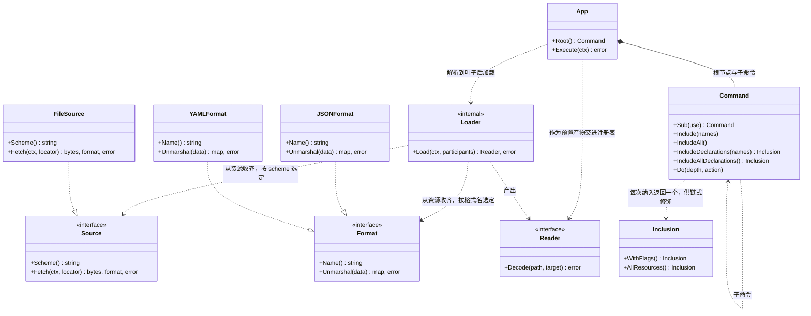
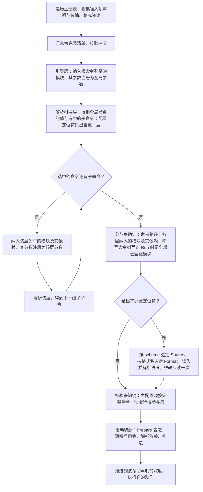

# config

## 职责

`pkg/config` 承载启动必须项的加载，以及命令树的组装：

- 定义输入项声明、传输与格式这些资源类型，遍历注册表收齐它们，汇总为完整的输入项清单并校验冲突。
- 组装命令树。宿主在其上写出子命令，并列举每个命令纳入哪些模块；本模块据此得出每一层的参与集与该层的命令行参数（[ADR-command-tree-2026-09-20](../../adr/adr-command-tree-2026-09-20.md)）。
- 把清单交给解析工具，不自行解析：命令行与命令树交给 pflag 与 cobra，主配置源、环境变量与层叠交给 viper，文本到目标类型的转换交给 mapstructure（[ADR-config-parsing-2026-09-20](../../adr/adr-config-parsing-2026-09-20.md)）。各输入项只从自己声明的来源取值，这一约束由本模块施加在解析工具之上。
- 给出了配置定位符时，按其 scheme 选定主配置源、按格式选定解析器并读入数据；未给出则跳过这一层。
- 向各模块提供按路径取回自己那份值的功能。

根包定义传输与格式扩展点的接口，组装命令树，收集声明并驱动解析工具。具体的传输与格式实现位于子包。

配置的加载由宿主在装配开始之前发起，不是装配流程中的一个阶段（[ADR-assembly-bootstrap-2026-09-20](../../adr/adr-assembly-bootstrap-2026-09-20.md)）。产出的读取面作为预置产物交进注册表，本包自身不注册任何模块：没有先行构造，没有隐含的被依赖关系，注册表中也没有按名称识别它的分支。

### 非职责

- **不承载运行期参数。** 归设置承载的那些参数由[设置模块](design-settings.md)承担；配置与设置的划界判据见 [ADR-config-scope-2026-09-13](../../adr/adr-config-scope-2026-09-13.md)。
- **不提供热重载。** 配置是启动时的快照，变更需要重启进程（[ADR-config-lifecycle-2026-09-13](../../adr/adr-config-lifecycle-2026-09-13.md)）。
- **不合并多个主配置源。** 主源唯一，同层不合并（[ADR-config-source-2026-09-13](../../adr/adr-config-source-2026-09-13.md)）。
- **不实现任何具体的传输与格式。** 文件、远程配置中心、JSON、YAML 均位于子包，按 import 引入。
- **不自行解析命令行、环境变量与配置源。** 解析委托给成熟库；本模块提供的是清单、命令树与读取面（[ADR-config-parsing-2026-09-20](../../adr/adr-config-parsing-2026-09-20.md)）。
- **不定义任何子命令。** 命令树上有哪些命令、每个命令纳入哪些模块，都由宿主写出（[ADR-command-tree-2026-09-20](../../adr/adr-command-tree-2026-09-20.md)）。

## 术语表

以下术语的含义限于本模块，以及配置主题的决策记录。

| 术语 | 英文 | 定义 |
|---|---|---|
| 输入项 | input item | 一个启动期参数。它有一条路径、一组来源与一份元信息，来源可以是主配置源、环境变量、命令行中的任意组合。 |
| 输入项声明 | Schema | 本模块定义的资源类型，承载一个模块的全部输入项。它描述该模块接受哪些键及其类型，同时承载默认值：承载结构体中字段的取值即该字段的默认值。 |
| 配置数据 | config data | 各来源逐层覆盖后得到的完整配置。任何一层都可以缺席，包括主配置源。 |
| 主配置源 | primary config source | 配置数据的来源，形如文件或远程配置中心。一次运行中至多一个，也可以没有。 |
| 配置定位符 | config locator | 指明主配置源的 URI，其 scheme 决定由哪个配置源模块解析。可以不给出，此时没有主配置源。 |

## 外部接口契约

传输扩展点，一个实现对应一个 scheme：

```go
type Source interface {
    Scheme() string
    Fetch(ctx context.Context, locator *url.URL) (data []byte, format string, err error)
}
```

格式扩展点，一个实现对应一种格式：

```go
type Format interface {
    Name() string
    Unmarshal(data []byte) (map[string]any, error)
}
```

传输与格式正交：传输回答"从哪里取得字节"，格式回答"这些字节怎么解析"。文件源与远程配置中心共用同一批格式解析器。

**`Fetch` 的错误归类由实现自己给出**：返回的错误若已能 `errors.Is` 到 `ErrMalformedLocator`、`ErrUndeterminedFormat` 或 `ErrSourceUnavailable`，根包保持该归类；其余一律包成 `ErrSourceUnavailable`。「这个形态我不支持」与「我读不到」都出自同一个返回值，接口上没有别的地方能区分它们，而只有实现知道自己拒绝的是哪一种。不定这条，各子包会各写各的，宿主的 `errors.Is` 也就失去意义。

**两者都以资源声明交付，不作为功能取用。** 子包在自己的 `init` 中注册一个只含 `Resources` 的模块，把实现放进去：

```go
core.ProcessRegistry.Register(core.Module{
    Name:      "config.source.file",
    Resources: []any{fileSource{}},
})
```

资源按可赋值性匹配，`fileSource` 实现了 `Source` 就会被 `core.Resources[Source](reg)` 收到，无需也无法在声明处标注它以哪个接口交付：放进 `[]any` 时接口壳即被抹除。

本模块在加载时用 `core.Resources[Source](reg)` 与 `core.Resources[Format](reg)` 收齐它们。走资源而非功能取用，是因为加载发生在装配开始之前，此刻没有任何实例存在，按功能取用只会取到空集；而资源在 `init` 完成后即确定，任何时刻查询都给出同一结果。传输与格式是无状态的解析器，没有生命周期需求。

两个扩展点的实现都位于子包，按种类分置，避免只从包名分不清它是传输还是格式：

| 子包 | 提供 | 子包自身新增的第三方依赖 |
|---|---|---|
| `config/source/file` | `file://` | 无 |
| `config/format/json` | `json` | 无，标准库 |
| `config/format/yaml` | `yaml` | 有，YAML 解析库 |

这一列计的是子包在根包之上新增的那些。每个子包都经根包的资源类型交付自己的实现，根包的解析工具因而已在它们各自的闭包内（[ADR-config-parsing-2026-09-20](../../adr/adr-config-parsing-2026-09-20.md)）。`config/format/json` 那一行由 `pkg/config/format/json/json_test.go` 守住：它以「标准库 ∪ 本仓库模块 ∪ 根包的当前闭包」为预算扫描该子包，预算之外的一个包即失败，YAML 解析库因而进不来。

JSON 与 YAML 分为两个子包，尽管 YAML 解析器也能解析 JSON：合并会让只用 JSON 的宿主背上 YAML 解析库，而按需引入正是子包划分的用途。格式解析停在这一层，解析出的键值树交给层叠工具，不经由它自己的格式支持。

本模块定义资源类型 `Schema`，模块把它放进描述符的 `Resources` 中。它声明本模块接受哪些输入项、各自从哪些来源取值：

```go
type Schema struct {
    Namespace string            // 本模块在配置数据中的挂载位置，空表示顶层
    Mounts    []Mount           // 承载结构体，可以有多个
    Items     map[string]Item   // 路径 -> 来源与元信息；未列出的取默认
}

type Mount struct {
    Path  string   // 相对命名空间的路径前缀，空表示挂在命名空间根
    Value any      // 承载结构体，字段的当前取值即默认值
}

type Origin uint8

const (
    OriginPrimary Origin = 1 << iota   // 主配置源，文件或远程配置中心
    OriginEnv                          // 环境变量
    OriginFlag                         // 命令行
)

type Item struct {
    Origins     Origin   // 零值表示默认，即 OriginPrimary | OriginEnv
    FlagName    string   // 含 OriginFlag 时必填，不派生
    FlagShort   string   // 短名，可空
    EnvName     string   // 钉死环境变量名；空则按规则派生
    Placeholder string   // 帮助输出中的取值占位符
    Description string
    Required    bool     // 除默认值外无人给值时，Decode 返回错误
    Sensitive   bool     // 不写入日志，帮助输出不回显默认值
}
```

主配置源、环境变量与命令行不是各自独立的机制，而是同一批输入项的不同来源。绝大多数输入项取默认来源，因而根本不必出现在 `Items` 里。

**本包不注册模块。** 读取面由 `Execute` 在装配开始之前产出，随即作为预置产物交进注册表（[core](design-core.md)）：其余模块照常用 `core.Resolve[config.Reader](reg)` 取到它，且**无须在 `Requires` 中声明**——它在第一个模块构造之前就已存在，没有需要排序的东西。第二个 `(*Reader)(nil)` 的提供者在交进注册表时即被判定，不会留到取用时。传输与格式仍走模块机制：各子包在自己的 `init` 中注册一个只含 `Resources` 的模块。

宿主用一个资源声明自己的身份，它先于一切配置读取，无处可从配置获得：

```go
type HostIdentity struct {
    Prefix         string   // 环境变量前缀
    DefaultLocator string   // 配置定位符的默认值
}
```

注册表中至多一个，多于一个即冲突。

模块取自己那份值的接口，按挂载点各解一次。`Prepare` 与 `New` 两个阶段都用它：`Prepare` 据此判断自己能否启动，缺项即启动失败；`New` 据此构造产物。

```go
type Reader interface {
    Decode(path string, target any) error   // path 是完整路径：命名空间加挂载路径
}
```

`path` 是配置数据中的完整路径，不是相对本模块的路径。模块自己拼出它：命名空间与挂载路径都是本模块声明的，无需经由模块名反查。模块名不参与输入项的路径，用它定位路径会多一层与路径无关的间接。

代价是命名空间在声明与取用各出现一次，改动要同步。把它写成常量可以消掉这一处重复。

`Mounts` 中的结构体是**原型**，只用于推导字段结构与默认值，不接收运行期的值。同一原型被两个注册表用到时，它们各自解出的值互不相干。

一个模块的声明与取用：

```go
const ns = "kv"

var (
    defaults      = options{TTL: 5 * time.Minute}
    redisDefaults = redis.Options{PoolSize: 10}
)

config.Schema{
    Namespace: ns,
    Mounts: []config.Mount{
        {Path: "",      Value: &defaults},
        {Path: "redis", Value: &redisDefaults},
    },
    Items: map[string]config.Item{
        "redis.addr":     {Required: true, Description: "Redis 服务地址"},
        "redis.password": {Sensitive: true},
    },
}

// New 中
cfg, err := core.Resolve[config.Reader](reg)
...
var opts options
err = cfg.Decode(ns, &opts)

var ropts redis.Options
err = cfg.Decode(ns+".redis", &ropts)
```

两个模块的命名空间可以相同，只要它们的输入项路径不相交。`Decode` 因此只解出调用方自己声明的那些键，配置数据中同一子树下属于别人的键不视为未知键。

`Items` 的键相对本模块的命名空间，`Decode` 的路径则是完整的。基准不同是因为用途不同：`Items` 声明自己的内部结构，`Decode` 在整份配置数据中定位。

模块通过按功能取用取得 `Reader` 的实例。接口上只有读操作，配置在启动后不再变化；配置不流经注册表，`core` 因此不需要认识任何配置接口。

不组装命令树也可以发起加载：

```go
func Load(ctx context.Context, reg *core.Registry, args []string) (Reader, error)
```

它把全部已注册模块作为参与集，按一份扁平的参数集走完同一趟加载，产出同一个读取面；`Execute` 内部走的就是这一步。用途是取到 `Reader` 而不必驱动一次生命周期，例如某个模块的包外测试。**环境一律取进程自身**：选定主配置源的 `<前缀>_CONFIG` 与各输入项的取值都读进程环境，不由调用方另行传入。层叠工具本来就直读进程环境，另开一个入口只能让其中一半改道，一次运行的主配置源与取值会出自两份不同的环境，而正常路径上看不出来；调用方要改动某个变量，就把它写进进程环境（测试里是 `t.Setenv`）。

宿主在 `main` 中用命令树组装这次运行。命令树是本模块面向宿主的接口，模块看不到它：

```go
func NewApp(reg *core.Registry) *App

func (a *App) Root() *Command
func (a *App) Execute(ctx context.Context) error

func (c *Command) Sub(use string) *Command          // 添加一条子命令
func (c *Command) Do(depth core.Stage, action Action)

// 运行级纳入
func (c *Command) Include(names ...string)
func (c *Command) IncludeAll()

// 静态级纳入：只让声明进入收集范围
func (c *Command) IncludeDeclarations(names ...string) *Inclusion
func (c *Command) IncludeAllDeclarations() *Inclusion

// 修饰，作用于这一次纳入所列的模块
func (i *Inclusion) WithFlags() *Inclusion          // 参数出现在帮助里，仍不判必填
func (i *Inclusion) AllResources() *Inclusion       // 全部声明生效，覆盖消费点的裁定

type Action func(ctx context.Context, reg *core.Registry) error
```

一个宿主的命令树：

```go
app := config.NewApp(core.ProcessRegistry)
app.Root().Include(log.ModuleName)          // 全局：每条命令都有日志

migrate := app.Root().Sub("migrate")
migrate.Include(postgres.ModuleName)        // 运行级：宿主 import 的那个引擎
migrate.IncludeAllDeclarations()            // 静态级：全部，不贡献任何参数
migrate.Do(core.StageMigrate, nil)          // 推进到迁移施加完毕即退出

serve := app.Root().Sub("serve")
serve.IncludeAll()
serve.Do(core.StageServe, nil)              // 推进到底，阻塞等待 ctx 取消

err := app.Execute(ctx)
```

**纳入分两级**（[ADR-command-tree-2026-09-21](../../adr/adr-command-tree-2026-09-21.md)）。运行级纳入的模块被构造与驱动、有资格表态、其输入项出现在这条命令的参数面上；静态级纳入的模块只让它声明的资源进入声明集，不构造、不表态、不展开依赖闭包，其输入项默认不出现在参数面上，且**任何情况下都不判必填**。一个模块同时被两级纳入时按运行级处置。

**施加迁移那条命令只运行级纳入引擎。** 带表的模块依赖数据库，数据库不依赖它们，依赖闭包够不到它们；而迁移集按声明集取材（见 [db](design-db.md)），静态级纳入就够。把它们改成运行级纳入会让它们的全部输入项连同必填项进入这条命令——`migrate` 会因为缺一个 HTTP 监听地址而启动不起来。

**`IncludeAllDeclarations` 是这类命令的推荐写法。** `IncludeAll` 那条代价——参与集重新成为 import 图的函数，而参与集决定帮助输出、可用参数与必填范围——对它不成立，静态级不碰人机界面。逐个列举静态级纳入的模块是另一条路，代价是宿主要维护一份"谁有声明"的清单，漏一个不报错：那一种不进启动诊断。

**`Include` 按模块名纳入。** 模块的身份就是它的名字；宿主 import 了那个包才能纳入它，**登记模块的包因此导出自己的名字常量**供这里引用（见 [core](design-core.md)）。运行级纳入一个模块即一并纳入它构造期依赖的提供者；**交付声明了排他的提供者不在此列**，闭包不替宿主挑，只取命令树上已经写下的那些，一个都没有即该功能缺提供者、启动失败。

**两个修饰只对静态级纳入有意义，因此只有静态级的两个入口返回 `*Inclusion`**，运行级的两个不返回。这条约束交给编译器而不是运行期检查：`Include(x).WithFlags()` 根本编译不过，不必为它新立一条哨兵，也不必让宿主在启动时才发现。

**修饰的粒度是这一次纳入所列的模块**，不是单个模块名。对 `IncludeDeclarations(a, b)` 调用它作用于 `a` 与 `b`；对 `IncludeAllDeclarations()` 调用则作用于全部可用模块——要只对其中一个放开，就分两次纳入，把那一个单独写成一次 `IncludeDeclarations`。

`WithFlags` 让那些模块的输入项出现在帮助输出里并可在命令行上给出，必填仍然不判。

**它服务的是「一个模块都不运行、只报告或校验配置」这一类命令。** 这样一条命令要收齐全部模块的输入项、让操作者在它自己的命令行上给出覆盖值，同时不构造任何模块、不判任何必填。两条现成的路都到不了：只做静态级纳入拿不到参数，操作者无从覆盖；改成运行级纳入则会构造那一批模块，并让必填开始生效——而那恰恰是一条只做报告的命令最不该承受的。`IncludeAllDeclarations().WithFlags()` 配一个不构造任何东西的驱动深度，是这类命令唯一写得出的形状。

判断一个模块的输入项是否该在这一级可见，判据是**这条命令会不会去读它**：报告的读者是操作者，不是那个模块，所以读它的是命令的动作而不是模块的 `Decode`。

**这样的命令今天一个也没有**，本模块不定义子命令，写不写它由宿主决定。这项修饰因此是让那个形状写得出来，而不是当前某处的需要。它带一个必须先认下的代价：模块的必填项在这一级永不判，所以它的参数是一个无人读取的值，给与不给都不改变任何结论——这条代价记在 [ADR-command-tree-2026-09-21](../../adr/adr-command-tree-2026-09-21.md) 里。

`AllResources` 令这一次纳入所列模块的全部声明生效，**覆盖各消费点自己的取材域裁定**（架构不变量 15）。它对每一种资源的后果都要由宿主自己承担：在 `db` 那一侧，它把一个不运行的模块的插件装到数据库句柄上，绕过"没启用就不生效"（见 [db](design-db.md)）；本模块定义的四种资源本就按完整清单收集，不受它影响；接口规格的形状校验同理。

**它够不到同时被运行级纳入的模块。** 一个模块被两级同时纳入时按运行级处置，因而不在静态级的那一份清单里，`AllResources` 对它不生效——它的声明照常按各消费点的取材域裁定。`IncludeAll()` 与 `IncludeAllDeclarations().AllResources()` 同写时，这条命令运行的每一个模块都落在够不到的那一半里，宿主要的是覆盖反而什么都得不到。**这个覆盖的作用面是这条命令不运行的模块**，不是"二进制里的全部模块"。

**`Include` 与 `IncludeDeclarations` 收到一个未登记的名字，一律启动失败**，错误点名是哪条命令写下了它，并可 `errors.Is` 到 `core.ErrUnknownParticipant`（[core](design-core.md)）。两级同样处置：静态级那一侧放行拼错的名字，后果是该模块的声明静默缺席——迁移少建一批表而退出码为零，正是本模块要消灭的那种失效。本模块不为它另立哨兵：名字是否登记由注册表回答，这里补的只是注册表说不出的那一半——是哪条命令要的它。宿主写了常量却没 import 那个包，是一次合法的编译，因而只能在这里报出来。

纳入的是**登记模块的那个包**，不是功能目录。一种功能的多个实现各自登记一个模块，纳入哪个由宿主决定——它 import 了哪些实现，只有它知道；数据库的引擎子包正是这种形态，根包不登记模块，纳入的是 `postgres` 或 `sqlite`。

**`Do` 指定驱动深度与到达之后的动作。** `action` 为空表示到达该深度即是这条命令的全部工作。深度取 `core.StageServe` 时驱动阻塞等待 `ctx` 取消，那是本次变更之前唯一的形态（[ADR-lifecycle-drive-2026-09-20](../../adr/adr-lifecycle-drive-2026-09-20.md)）。已构造的实例由这次驱动负责释放，与深度无关，也与动作是否失败无关；宿主没有需要记得调用的第二步。

**`Execute` 是宿主发起加载的入口。** 解析命令行、读取主配置源、确定参与集、校验，都在它内部按命令树逐层完成；随后它把产出的读取面作为预置产物交进注册表，再按选中那条命令的深度与动作发起驱动。这一切发生在装配开始之前，因而不属于任何一个生命周期阶段（[ADR-assembly-bootstrap-2026-09-20](../../adr/adr-assembly-bootstrap-2026-09-20.md)）。

**稳定性承诺**：`Source` 与 `Format` 是子包作者与根包之间的契约。新增一种传输或格式不修改根包。`App` 与 `Command` 是本模块与宿主之间的契约。

## 依赖

`pkg/config` 依赖 `pkg/core` 与一组解析工具：命令行与命令树用 pflag 与 cobra，主配置源、环境变量与层叠用 viper，文本到目标类型的转换用 mapstructure（[ADR-config-parsing-2026-09-20](../../adr/adr-config-parsing-2026-09-20.md)）。

**这些依赖落在根包上，因而落到每一个声明了配置的模块的下游。** 这是委托解析所付的价钱，换来的是本模块不再自行实现解析。`pkg/core` 不在此列：命令树由宿主写出，解析工具不进 `core`，它不含第三方依赖这条不变量不受影响。

传输与格式的第三方依赖仍然全部位于各自的子包，落入宿主 `go.mod` 的只有实际 import 到的那些——宿主的 `go.sum` 与实际下载则会经被 import 包的测试闭包带上别的子包所绑的库，只有读整图的操作会看到全部子包所绑的库（[ADR-module-packaging-2026-09-22](../../adr/adr-module-packaging-2026-09-22.md)）。

## UML 图



`App` 与 `Command` 是宿主在 `main` 中直接使用的类型：宿主在 `Command` 上写出子命令、列举该层纳入的模块、指定这条命令驱动到哪个阶段并做什么。`Loader` 只与 `Source` 和 `Format` 打交道，不认识任何具体的传输或格式，它本身不出现在对外接口上。图中的实现类位于子包，列出它们是为了标明实现关系的方向：子包依赖根包，根包不依赖子包。同一扩展点可以有多个实现并存，宿主 import 哪个就有哪个。



**收集先于一切。** 不先掌握完整的输入项清单，就无法判断某个来源给出的键是未知键还是拼错的键。清单的收集因此一次完成、覆盖全部已注册模块，与命令无关。

**解析按命令树逐层推进。** 每一层只注册该层纳入的模块的参数，解析出的下一级子命令决定下一层纳入什么。递归终止于没有子命令的那一层，参与集此时才完整（[ADR-command-tree-2026-09-20](../../adr/adr-command-tree-2026-09-20.md)）。

**主配置源整轮只读一次，读在参与集确定之后。** 配置定位符只能出自宿主默认值、环境变量或 `--config`，而 `--config` 是保留的全局参数，因此它在引导层解析完就已确定，不随更深的层改变——读得晚不改变是谁定的它。读在参与集之后，是因为内容的校验要按参与集进行，而读入与校验之间没有别的事可做；语法本身的失败当场报告，连键值树都得不到时推迟没有意义。

传输缺失与格式缺失是同一类失败：定位符点名了一个未编译进二进制的 scheme 或格式。错误信息要给出那个 scheme 或格式名，以及按约定承载它的子包路径（`config/source/<scheme>` 与 `config/format/<名字>`）。**那是约定推出的一条线索，不是保证**：第三方完全可以把实现放在别处，本模块无从枚举有哪些实现，这一点与 `core` 报缺失提供者时只能给出接口所在的包同源（[core](design-core.md)）。

## 核心数据结构

### 命令树与参与集

命令树由宿主写出：每个节点是一条命令，节点上列举该层纳入哪些模块，以及这条命令驱动到哪个阶段、到达之后做什么。声明只有这一侧——模块不知道自己被哪条命令纳入（[ADR-command-tree-2026-09-20](../../adr/adr-command-tree-2026-09-20.md)）。

**参与集是命令路径上各层运行级纳入的模块，连同它们的依赖闭包；不写命令树的调用方走 `Run` 入口时，它是注册表里已登记的每一个模块**（见 [core](design-core.md)）。 运行级纳入一个模块即一并纳入它在 `Requires` 中声明的功能的提供者；**声明排他交付的提供者不在此列**，闭包不替宿主挑，只取命令树上已经写下的那些，一个都没有即该功能缺提供者、启动失败。根命令纳入的模块对每条子命令都有效，这一层的参数因而是全局参数。

**声明集是参与集加上各层静态级纳入的模块。** 静态级纳入不展开依赖闭包——那些模块不构造，没有构造期依赖可言。两级都沿命令路径向下继承。

宿主也可以让一条命令纳入全部可用模块，两级各有自己的"全部"。可用集由 import 决定（[architecture](../architecture.md)），"全部"指的是这一集合，而不是宿主逐一列举出来的那些。

**纳入即承诺启动。** 参与集决定哪些模块执行 `Prepare`，其中每一份都在本次运行中启动，退让只可能出自排他消解（[ADR-module-enablement-2026-09-21](../../adr/adr-module-enablement-2026-09-21.md)）。一条命令纳入某个模块，写下的就是这条命令要它运行；它装不起来即启动失败。静态级纳入不给予表态的资格：那些模块不执行 `Prepare`。

**本模块之内**，参与集决定的是下面这几件，其余一律按完整清单判定：

| 按参与集 | 按完整清单 |
|---|---|
| 这一层命令行上有哪些参数（外加 `WithFlags` 打开的那些静态级模块） | 输入项路径、命令行名与环境变量名的冲突 |
| 帮助输出列出哪些参数（同上） | 主配置源中哪些键是未知键 |
| 哪些模块的必填项会被判到（经各自的 `Decode` 触发，不是一次扫描） | 环境变量前缀下哪些变量算被认领 |
| | 本模块定义的四种资源的收集：`Schema`、`HostIdentity`、`Source`、`Format` |

右列中主配置源那一条最容易写反：一份配置源由各条命令共用，按参与集判定会让它在任何一条命令下都含有未知键。

**必填项只对参与集内的模块判得到，静态级纳入的模块永不判必填**——它不构造，不会去 `Decode`，`WithFlags` 打开参数可见性也不改变这一点。

参与集在本模块之外还决定别的事情——哪些模块有资格表态、消解的取材域、启动诊断的覆盖面，都在 [core](design-core.md) 与 [architecture](../architecture.md) 里。反过来，**不是每一种按模块过滤的机制都按参与集走**：资源声明的取材域由消费点自行裁定（架构不变量 15）。本模块定义的四种资源全部按完整清单收集，判据是它们描述的东西跟着这个二进制走、不跟着这一次命令；**取可用集的消费点不做减法**（架构不变量 15），本模块因此不移除消解落选模块的声明。这一点与"它们的收集跑在装配开始之前、此时还没有启用结果"是两件事：时机决定了此刻无从过滤，判据决定了即便可以过滤也不过滤。把 `Schema` 的收集改按启用结果过滤，一个消解落选的实现其命名空间下的键会立刻变成主配置源里的未知键，同一份配置文件在另一个实现被选中时启动失败。

### 输入项清单

输入项是叶子：一个可以被赋值的标量或容器，嵌套结构体只贡献路径的中间段，本身不是输入项。清单由 `core.Resources[config.Schema](reg)` 得到：每个模块的 `Schema` 贡献一组输入项，挂在它声明的命名空间下；未声明命名空间的模块，其输入项直接落在顶层。清单是此后一切的依据：环境变量名由它派生，各层的命令行参数由它组装，键的合法性按它判定。**清单的收集覆盖全部已注册模块，与本次选中哪条命令无关**；随命令变化的是校验的范围，不是清单本身。

命名空间默认不加，所以输入项不会因模块名不同而自动互斥，冲突是可能的，收集阶段逐一检出：

| 冲突 | 判据 |
|---|---|
| 输入项路径相交 | 一个输入项展开后的路径是另一个的前缀，含完全相同 |
| 命令行长名重名 | 两个输入项的 `FlagName` 相同 |
| 命令行短名重名 | 两个输入项的 `FlagShort` 相同 |
| 环境变量名重名 | 派生名与钉死名相同，或两个钉死名相同 |
| 与保留名冲突 | 命令行长名为 `config` 或 `help`、短名为 `h`，或环境变量名为 `<前缀>_CONFIG`（派生与 `EnvName` 钉死同等对待） |
| 宿主身份不唯一 | 注册表中有多于一个 `HostIdentity` 资源 |
| 传输 scheme 重复 | 两个 `Source` 资源声明同一个 scheme |
| 格式名重复 | 两个 `Format` 资源声明同一个格式名 |

判据取前缀关系而非相等，是因为冲突不止于同名：一个模块的标量输入项落在 `kv.redis`，另一个模块的输入项展开为 `kv.redis.pool-size` 时，同一路径既是叶子又是内部节点，主配置源无法同时表达两者，而两条路径并不相同。

挂载点之间的重叠不单列判据：挂载路径互为前缀是正常形态，根挂载点与具名挂载点并存正是多挂载的典型用法，真正的冲突只在展开后的输入项上体现。

**同一功能的互斥实现也必须划分各自的输入项路径。** 清单收集自全部已注册模块，其中包含本次不会启用的那些，因而两个实现即便永远不会同时运行，它们的声明仍然同时在清单里：内存实现与远程实现若都在 `kv` 下声明 `ttl`，只要都被 import 就是冲突，进程起不来。互斥实现各自挂在自己的命名空间下，或各自加前缀。

命令行与环境变量都处于全局命名空间，它们的重名与输入项路径是否冲突无关：分处不同命名空间的两个输入项，仍可能给出同名的命令行参数。**重名按完整清单判定，与两者是否被同一条命令纳入无关**：同一个名字在不同命令下指不同的东西，代价高于让其中一方改名。

`--config`、`--help`、`-h` 与 `<前缀>_CONFIG` 是保留的名字，模块声明不得占用，否则配置定位符或帮助输出会被静默劫持。`--help` 与 `-h` 由命令行库在每条命令上提供，不出自任何输入项声明。

传输与格式按精确匹配选定，同一个 scheme 或同一个格式名有两个实现时无从取舍，因此在收集阶段即判冲突并点名两个声明它的模块，而不是留到读取主配置源时才发现。

单个声明自身的缺陷不是冲突，归 `ErrInvalidSchema`。**判据是：不涉及第二方，仅凭这一份声明就能判定它不可用。** 符合判据的新情形直接归入该哨兵，不必修订下面这份示例：含 `OriginFlag` 却无 `FlagName`，`FlagShort` 不是单个 ASCII 字符，命令行长名以短横线开头或含等号，标 `Sensitive` 却无 `Description`，键名违反字符集，展开中出现类型环，字符串列表之外的容器声明 `OriginEnv` 或 `OriginFlag`，以及 `Items` 中的键不对应任何叶子——所有输入项都住在承载结构体里且都有路径，`Items: {"redis.addres": ...}` 这样的拼写错误因此是确定的缺陷，不判它就会让一个写错的 `Required` 或 `Sensitive` 静默失效。敏感项必须带说明，是因为帮助输出不回显它的默认值，没有说明读者就完全不知道该给什么。

### 配置数据

**配置是各层叠加的结果，不等同于主配置源的内容。** 一个输入项的值可能来自默认值、主配置源、环境变量或命令行中的任意一层，取到哪个值由覆盖顺序决定，而不由它出自哪一层决定。装配由配置驱动，不由配置源驱动：主配置源缺席时配置照常存在，只是少了一层来源。

配置数据由自低向高的各层覆盖而成，同层不合并：

| 层 | 来源 | 覆盖粒度 |
|---|---|---|
| 默认值 | 承载结构体中字段的当前取值 | 字段 |
| 主配置源 | 配置定位符指向的文件或远程配置中心，可缺席 | 已声明的叶子逐个；容器值整体 |
| 环境变量 | 声明了 `OriginEnv` 的输入项 | 标量条目 |
| 命令行 | 声明了 `OriginFlag` 的输入项 | 标量条目 |

缺少某一来源的输入项跳过该层。不进主配置源的输入项没有那一层，其余照旧。

**主配置源按已声明的叶子逐个覆盖，不整体替换子树。** 嵌套结构体的键集出自输入项声明，每个叶子都是独立的输入项，因此主源给出 `kv.addr` 不会把同一结构体里未给出的 `kv.ttl` 打回零值。映射与结构体列表则整体替换：它们的键不在清单里，逐叶合并无从谈起，而「要改就改那里」正是容器类型基本只接受主配置源的同一条理由。

**配置数据为每个叶子记住它的值来自哪一层。** 必填判定只认主配置源、环境变量与命令行三层，若只留最终值，默认值层总有值这一事实会让「无人给出」与「取到零值」无从区分（见取值与校验）。层叠工具本身不公开某个键的值来自哪一层，这项事实由本模块分别查询三个来源后自行维持，不是工具的保证。

配置数据的顶层键是各模块的配置项，按各自声明的命名空间分布：

```yaml
log-level: info      # 未声明命名空间的模块，配置项直接在顶层

kv:                  # 声明了命名空间 kv 的模块
  addr: localhost:6379
```

配置里没有模块清单。哪些模块运行由宿主在命令树上的纳入决定，配置不参与这项判断，模块名因此完全不出现在配置数据里，也不参与输入项的路径。配置数据的形状由各模块的命名空间声明决定，一个模块改名不会牵动它的配置段。

代价是顶层不再天然互斥。两个模块的配置项落在同一个键上即为冲突，在收集阶段检出。

## 核心算法与流程

### 配置定位符

配置定位符指明主配置源。它必须在读取配置之前就确定，因此不能出自配置本身，取值顺序为：宿主设定的默认值、`<前缀>_CONFIG` 环境变量、`--config` 命令行参数；序列中靠后的覆盖靠前的。

环境变量前缀同样不出自配置：它是宿主身份的一部分，不随运行改变。

`--config` 与 `<前缀>_CONFIG` 都不进入配置数据：它们是保留名，不出自任何输入项声明，只用于选定主配置源。若让它们进去，未知键校验第一个撞上的就是它们自己。

这两项先于一切配置读取，无处可从配置获得，只能由宿主直接给出。宿主把它们作为资源声明，注册一个只含 `Resources` 的模块：

```go
core.ProcessRegistry.Register(core.Module{
    Name:      "host",
    Resources: []any{config.HostIdentity{
        Prefix:         "MYAPP",
        DefaultLocator: "file:///etc/myapp.yaml",
    }},
})
```

走资源而不是包级函数，宿主身份因此随注册表而不是随进程：同一进程内的两个注册表可以各有各的前缀与默认定位符，测试之间不互相干扰。本模块在 `Prepare` 中用 `core.Resources[HostIdentity](reg)` 取它，至多一个，多于一个即冲突。

前缀缺席时，配置定位符的环境变量这一路整体不生效——`<前缀>_CONFIG` 是派生名，没有前缀就没有这个名字，与保留名冲突的那条判据同样不再触发，定位符只能由宿主的默认值或命令行给出。

前缀缺席时派生的环境变量名不生效，**`EnvName` 钉死的名字照常生效**：它本就不由前缀拼出，`NO_COLOR` 这类名字正是为此而设。前缀之下的陌生变量放行并列入诊断，那个扫描域是前缀之下的变量，与钉死名所在的集合并不重合。

默认定位符缺席时主配置源由环境变量或命令行给出，都不给出则没有主配置源。

**scheme 不区分大小写，登记与匹配都按小写的规范形式**（RFC 3986 如此规定）。`Source` 声明的 scheme 由本模块小写化后入表，定位符那一侧的 scheme 经 URI 解析本就已是小写，两侧因此对得上。由此「传输 scheme 重复」这条判据把 `ETCD` 与 `etcd` 视为同一个 scheme，判据的措辞不变，变的只是它涵盖的范围。

定位符是 URI，其 scheme 选定传输：

```
file:///etc/myapp.yaml
file:config.yaml
etcd://10.0.0.1:2379/myapp/config
```

`file://` 接受空 host 与 `localhost`（RFC 8089 把后者等同于本机），其余非空 host 即 `ErrMalformedLocator`。不带斜线的 `file:config.yaml` 解释为相对进程工作目录的路径：定位符是人要在命令行上敲的东西，开发期用相对路径是常见需求，而三斜线的绝对形式表达不了它；这个形态是 URI 语法里现成的位置，不必为此发明新语法。

定位符只能有一个值，主配置源的唯一性因此无需额外校验即成立。

定位符是否可用由选定的 `Source` 判定，不只看它是不是合法 URI：`file://host/path` 形态完整，文件源却不支持远程主机。两者同归 `ErrMalformedLocator`，因为宿主要做的事情是同一件，改掉自己给出的那个定位符。

**主配置源可以缺席。** 宿主身份、环境变量与命令行都没有给出定位符是一种合法配置，此时配置数据少的只是主配置源这一层，默认值、环境变量与命令行照常参与。只用内存实现、参数全部来自命令行的进程因此不需要任何配置文件。

缺席与不可达是两回事：没有给出定位符是合法的，而给出了却读不到（文件不存在、远程不可达）仍然是 `ErrSourceUnavailable`。

### 来源矩阵

每个输入项声明自己从哪些来源取值，组合如下：

| 情形 | `Origins` | 进主配置源 | 补充 |
|---|---|---|---|
| 普通配置项 | 默认 | 是 | 不必出现在 `Items` 里 |
| 只读主配置源，禁止环境变量覆盖 | `OriginPrimary` | 是 | |
| 配置项兼作命令行参数 | `OriginPrimary\|OriginEnv\|OriginFlag` | 是 | 给 `FlagName` |
| 独立命令行参数 | `OriginFlag` | 否 | 给 `FlagName` |
| 独立环境变量 | `OriginEnv` | 否 | 通常给 `EnvName` |
| 命令行加环境变量 | `OriginFlag\|OriginEnv` | 否 | |

不进主配置源的输入项仍然住在承载结构体里，也仍然有路径。路径此时只用于 `Items` 索引与环境变量名派生。

### 格式的选定

`Fetch` 在返回数据的同时给出格式名，格式由该名字精确匹配选定，不做内容嗅探。**格式名同样不区分大小写，登记与匹配都按小写形式**：它出现在定位符的查询参数里由人书写（`?format=YAML`），也出自文件扩展名（`.YAML`），而大小写不是格式的区别。与 scheme 取同一条规矩，也省掉「为什么这两者规矩不同」这个问题。精确匹配说的是不做嗅探、不按优先级竞争，与大小写归一化是两回事。各传输自行决定这个名字从哪来：

- **文件源**按扩展名判定，`.json` 对应 `json`，`.yaml` 与 `.yml` 对应 `yaml`。无法识别的扩展名即失败。
- **远程配置中心**没有扩展名可依，由定位符的查询参数给出，形如 `etcd://10.0.0.1:2379/myapp/config?format=yaml`。未给出即失败。

远程传输自身的连接参数同样只能来自定位符：它在配置读出之前工作，没有配置可读。超时、重试这类非敏感项写进查询参数；**凭据不写进定位符**，定位符会出现在命令行、进程列表与诊断输出中。凭据由该传输实现自行约定的环境变量提供，这是本机制覆盖范围之外的一处，需要由各传输在自己的文档中写明。

扩展名与查询参数都不做猜测。内容嗅探在 JSON 与 YAML 之间尤其不可靠，因为合法的 JSON 同时也是合法的 YAML，嗅错的后果是用另一套语法规则解析同一份数据。

格式名未被任何已 import 的 `Format` 实现认领时，启动失败并指明缺失的 import。

**`Unmarshal` 返回 `map[string]any`，非字符串键一律拒绝，嵌套层也不例外。** YAML 允许 `1: a` 这样的键，顶层放不进返回类型，嵌套层则会让 `map[any]any` 漏进类型转换层。由格式实现在解码后整棵树校验键类型，发现非字符串键即返回错误，根包映射为 `ErrMalformedConfig`。文档级形态一并定死：**多文档流拒绝**，交给库只会解出第一篇而静默丢弃其余，写下的设置毫无效果且无人告知；**经别名自引用的锚点拒绝**，它在库里解析得通并在节点树里留下一个环，而键类型校验要走完整棵树，遇环即无限递归；**同一映射里重复出现的键拒绝**，嵌套层同样——映射只放得下其中一个值，JSON 的标准库留下后一个，YAML 解析库在逐个节点遍历时不做这项检查，一个键下写了两节时，第一节里没有被第二节重写的设置全部退回默认值且无人告知；JSON 文档之后还有数据同样拒绝，理由相同；**空文档与顶层 `null` 视作空映射**，不是失败，JSON 的 `null` 同理——没有内容与内容为空是同一件事，配置数据少的只是这一层。

**同一条路径在主配置源里只给出一次。** 路径可以写成一个含点的键，也可以逐段嵌套，或两者混用，每种写法都落到同一个输入项上；同一份配置源里用两种写法各给一次，就是给同一个输入项两个值，读取时只取得到其中一个。根包在校验未知键时一并判定，归 `ErrMalformedConfig` 并点名两种写法。同一节用两种写法、各自给出不同的输入项不在此列。

YAML 的合并键 `<<` 随之一并拒绝：它的标签是 `!!merge` 而非字符串，落在同一条规则里，而这是有意的。合并键会在文件内部再引入一层叠加，而配置数据的层叠语义已经由来源层定义，必填判定也依赖每个叶子记住它来自哪一层；文件内部多出一个不受本机制管辖的合并来源，那条判定就失去依据。

静默转成字符串会让 `1` 与 `"1"` 再也分不开，而配置键本就限定为小写字母、数字与短横线，数字键无论如何都不是一个合法的键。

### 名字的派生与映射

规则如下，实现不得偏离：

- **字段名到路径**：优先 `config` tag，其次 `json` tag，都没有则字段名转小写短横线，`PoolSize` 成为 `pool-size`。tag 写作 `-` 的字段跳过，与 Go 的通行约定一致；不跳过的话 `json:"-"` 会派生出一个名叫 `-` 的键，它还恰好通过字符集校验，同一结构体里两个这样的字段更会撞成路径相同的冲突，让一份正当的第三方结构体直接起不来。
- **匿名字段内联**，不贡献路径段，与 `encoding/json` 的嵌入语义一致；带显式 `config` 或 `json` tag 的匿名字段则按该名字贡献一段。路径规则整体借自 json tag 的约定，嵌入语义一并借来才不会在第三方结构体上给出两套预期，而嵌入在第三方结构体里很常见。配置键因此限定为小写字母、数字与短横线，收集阶段逐段校验，违反即 `ErrInvalidSchema`。`Namespace` 与 `Mount.Path` 按 `.` 切段后适用同一规则，两者都可以是多段；它们同样进入环境变量名的派生，不受同一约束就会从另一头破坏分层。这条限制是「双下划线分层、单下划线属于键名」得以成立的前提：键名里一旦允许下划线，`a.pool_size` 与 `a.pool-size` 就会派生出同一个环境变量名，而两者路径不同，既不被输入项路径相交覆盖，也不被环境变量名重名的两条判据覆盖。
- **环境变量名**：前缀，加下划线，加完整路径各段以双下划线连接，段内短横线转为单下划线，整体大写。

```
kv.redis.max-conns   ->   MYAPP_KV__REDIS__MAX_CONNS
```

双下划线用于分层，单下划线属于键名，两者不会混淆。`EnvName` 非空时钉死该名，不再派生，`NO_COLOR` 这类约定俗成的名字由此表达。

- **命令行长名不派生**，含 `OriginFlag` 的输入项必须给出 `FlagName`。命令行是人机界面，名字应当刻意选取，而由路径派生出的 `--kv-redis-max-conns` 往往不是想要的那个。
- **命令行语法以命令行库的 POSIX 约定为准**（[ADR-config-parsing-2026-09-20](../../adr/adr-config-parsing-2026-09-20.md)）。短名聚合、`--` 终止符、布尔项省略取值，以及其余每一处行为，一律照该库的语义，本模块不为任何一处另立规则。这里也不逐条复述那份语义：复述出来的是一份会过期的副本，而使用者对命令行的预期本来就来自其他命令行程序，不来自本项目的文档。子命令出自同一条语法。**位置参数一概不接受**：命令携带的信息只有「是哪条命令」和「各输入项取什么值」，`Action` 收到的是上下文与注册表，没有承接位置参数的地方；给出位置参数即报错，由命令行库判定。
- **实现了 `encoding.TextUnmarshaler` 的类型按标量叶子处理，不展开**（类型本身或其指针实现均可）。`time.Time`、`net.IP`、`url.URL` 这类自带字符串表示的结构体若照嵌套结构体展开，只会碰到一片未导出字段，结果是该输入项凭空消失，既不报错也不可配——那正是本设计在别处极力避免的静默失效。这与取值层「`TextUnmarshaler` 交由它自己解析」是同一条规则的两端。
- **不可解码的字段自动跳过**。判据是：该字段无法由任何来源给出，或者展开它得不到可读的默认值。符合判据的字段类型一律跳过，不限于下列这些：未导出字段，函数、通道、接口类型的字段，以及取值为 `nil` 的结构体指针字段，都不进清单，既不出现在配置数据里，也不产生环境变量名或命令行参数。前三类无法由任何来源给出；`nil` 的结构体指针则没有可读出的默认值，展开它只会产出一片无默认值的键。第三方结构体中的连接钩子由函数一类排除，未设置的 TLS 配置指针由 `nil` 一类排除。要让其中某些项可配，把该指针在承载结构体中设为非 `nil`，它随即按嵌套结构体展开，其字段的当前取值即默认值。
  跳过只针对**结构体**指针，因为跳过的是展开这个动作。`*int`、`*bool` 这类指向标量的 nil 指针照常作为叶子进入清单，默认值就是 `nil`，来源给出值时分配一个。
  展开按类型检测环：某个类型在自己的展开路径上再次出现即 `ErrInvalidSchema`，错误文本点名造成环的字段与类型。检测环而不设深度上限，是因为环是确定的缺陷而深度不是：合法的嵌套可以很深，一个凭空选定的上限只会在某天拦住一份正当的声明。同一类型出现在两条不同的分支上不构成环，只有它出现在自己的祖先链上才是。
- **字符串列表之外的容器类型声明 `OriginEnv` 或 `OriginFlag`，在收集阶段即 `ErrInvalidSchema`。** 这是单个声明自身的缺陷：映射与结构体列表没有扁平表达，声明了也给不出值。留到取值时才判，只有那个变量恰好被设值才会暴露，多数情况下是静默失效。
- **字符串列表取到空串即空列表**，不是一个空元素。层与层之间整体替换：命令行给出的列表替换掉主配置源给出的那份，不与它合并。同一层内同一个参数重复出现则按命令行库的语义累积，`--host a --host b` 得到两个元素——层间替换与层内累积不矛盾，前者是覆盖顺序，后者是一次给出多个值的写法。
- **容器类型基本只接受主配置源**，一个例外是字符串列表：它可以从环境变量与命令行以逗号分隔的形式给出，整体替换而非追加。映射、结构体列表等其余容器类型只认主配置源，需要修改时改那里。
  字符串列表开这个口子，是因为主配置源缺席时它也需要能被给出，而分隔符表达在配置领域是通行做法；映射与结构体列表没有同样通行的扁平表达，勉强支持只会产出一套只有本项目认得的语法。
  分隔符不支持转义：元素本身含逗号时，这条扁平表达给不出，只能走主配置源。引入转义等于为一处便利发明一套本项目专有的引号规则，正是开口子时要避免的那件事。

### 帮助输出

帮助由命令行库渲染。本模块不实现渲染，不定义 `--help` 的行为，也不因为帮助被请求而产生任何返回值上的特例（[ADR-config-parsing-2026-09-20](../../adr/adr-config-parsing-2026-09-20.md)）。每条命令各有自己的帮助，其中列出的是这条命令参与集内的输入项所暴露的参数、经 `WithFlags` 打开的那些静态级模块的参数，以及它的子命令。

本模块在把输入项交给命令行库时决定下列各项，排布、去向与退出状态都由库承担：

**说明与占位符随输入项交出。** `Description` 成为参数的说明，`Placeholder` 成为取值的占位名。

**保留参数 `--config` 的占位符是 `LOCATOR`。** 它不出自任何输入项声明，没有 `Placeholder` 可交，而库在没拿到占位符时印的是它自己那一侧的类型名。帮助输出里其余每一条都是 `--log-level LEVEL` 这样的取值名，唯独本模块自己保留的这一条印成 `--config string`，读者看到的是实现细节而不是该给什么。

**默认值写成使用者能原样敲回去的形式，不是 Go 的打印形式。** `5m` 而不是 `300000000000`，字符串列表按逗号分隔的写法而不是 `[a b]`。判据的目标语法是命令行：读者把这一行里的值抄成该参数的命令行取值，应当恰好得到同一个默认值。配置源另有自己的类型系统，同一串文本在那里未必逐字成立（YAML 里 `42` 是数字，一个读自字符串的字段要写成 `"42"`），一份渲染不可能同时对两种语法都逐字为真。

**敏感项不把默认值交给命令行库。** `Sensitive` 的输入项只交出名字与说明，真实的默认值只进入层叠工具的默认层。库会原样打印它收到的默认值，而一个凭据出现在帮助输出里是泄露，因此这一项不交给它。敏感项必须带说明，正是因为这一栏空着时读者无从知道该给什么。

**没有默认值的输入项同样不交。** 标注 `Required` 的项按定义没有默认值；默认值恰好是类型零值的项也不交，这与命令行库对它自己那几个类型的判断一致。两者都关乎读者而不关乎取值：空字符串按可原样敲回的形式渲染出来是一对引号，库随即把它印成一个该项并不拥有的默认值，读者由此读到的是「不给就是空串」，而必填项的实情恰好相反。

**必填项在交出的说明文本里带标记。** 命令行库没有安放这个标记的栏位，而必填项不交默认值，那一栏对它是空的：不标记，一条必填参数与一条默认值为类型零值的可选参数在帮助里读起来毫无分别，而读者要判断的正是这条参数不给会不会连启动都启动不了。库原样打印它收到的说明，标记因此并入交给它的说明文本：

```
--remote-addr HOST:PORT   the address of the greeting service (required)
```

**标记按帮助所属的那条命令判定。** 输入项所属的模块由这条命令运行时带标记；这条命令只为声明而静态级纳入它、经 `WithFlags` 把参数放上命令行时不带——那个模块不构造，不给这个值照样启动得了。同一个输入项在整棵命令树上只有一个取值，各条命令展示的是它的一个侧面：兄弟命令各有各的标记，同一路径上浅层只收集、深层才运行的，深层也有自己的那一面；无论参数写在哪条命令、路径上的哪一层，读到的都是同一个值。

命令行库还自行向命令树挂上 `help` 与 `completion` 两条命令。它们不由宿主写出，也不出自任何模块，是委托解析一并接过来的东西——[ADR-config-parsing-2026-09-20](../../adr/adr-config-parsing-2026-09-20.md) 在后果里记的「帮助输出、shell 补全、子命令的组织由命令行库提供」正是它们。这与本模块不定义任何子命令并不冲突：那一条说的是本模块与宿主的分工，这一句说的是库的贡献。

分组不再由声明表达。命令行库按命令组织参数，一条命令的参数就是它参与集内的那些；这一层划分取代了原先由 `Item` 给出的分组，`migrate` 的帮助里不会出现只有 `serve` 才运行级纳入的那些模块的参数——**而那些模块的迁移照样施加**，参数面与声明的生效面是两件事（见 [db](design-db.md)）。

### 取值与校验

各来源的值按类型转换到目标字段，转换失败即 `ErrTypeMismatch`。转换本身交给 mapstructure，下列各条是本模块施加在它之上的约束，实现不得偏离——每一条都是库的默认行为给不出的：

- **实现了 `encoding.TextUnmarshaler` 的类型交由它自己解析**，`time.Time` 因此按它自己的约定处理，无需本机制另立规则。
- **`time.Duration` 只接受 `time.ParseDuration` 可解的字符串**，`"5m"` 可以，裸数字 `300` 判 `ErrTypeMismatch`。`Duration` 的底层是 `int64` 纳秒，接受裸数字就等于让 `300` 在人眼里是五分钟、在机器上是三百纳秒，而它并不实现 `TextUnmarshaler`，这条规则只能由本机制给出。
- **浮点写入整数字段要求可无损转换**。JSON 没有整数类型，`10` 解出来是 `float64`，写进 `int` 字段是正常用法；而带小数部分或超出目标宽度的值判 `ErrTypeMismatch`，不做截断。

**容器叶子内部的键按同一条字段名规则映射**：`config` tag 优先，其次 `json` tag，否则字段名转小写短横线。结构体列表整体替换，但把它解成目标类型仍然需要一条键到字段的规则，两处用同一条，配置文件里的写法才不分内外。

**规则给出的那个名字是承诺，解码工具多认的拼写不是。** 一个带 `json:"maxConns"` 的字段，规则给出的名字是 `maxConns`；解码工具为了查表也会认 `max-conns` 这类等价拼写，源那样写今天同样取得到值。那是工具的实现细节，不在本模块的承诺之内：声明方不该依赖它，读配置的人也不该从它反推规则。两种拼写同时出现在一节里则是确定的缺陷，本模块拒绝并点名两个键——容器内部的键不参与未知键校验，放行就意味着其中一个值静默消失，而这一节别处不会再有人报它。

**容器叶子内部的键按主配置源的原文交付，不被改写。** 那些键是使用者自己的数据——标签、任意的键值对——不在清单里，也不属于本模块的命名空间；把它们规范化等于改写配置，而不是校正一个本模块拥有的名字。层叠工具会折叠它收到的键，因此容器叶子的值取自主配置源解析出来的原树，而不是取自它。只有主配置源给出容器，这一条之上没有别的层要合并。

**容器叶子内部的键不参与未知键校验**，匹配不到字段的键放行。 映射与结构体列表整体替换，其内部的键按定义就不在清单里，若一并校验，任何映射类型的配置项都会在第一个键上判为未知键而无法使用。同一个事实不能一边用来决定覆盖粒度、一边用来判未知键。

**主配置源或命令行给出了它不接受的键，即启动失败**：清单中没有这个键，或清单中有而该输入项未声明这一来源，两者都是同一件事——这个来源不该给出这个键。后者若放行，等于静默吞掉用户写进配置文件的值，而来源矩阵专门列了三行不进主配置源的情形，正是这类键。错误文本要区分是哪一种。

**两个来源的判定范围相反，这是这套规则里最容易实现反的一处。** 主配置源按**完整清单**判定：一份配置源由各条命令共用，按参与集判会让它在任何一条命令下都含有未知键。命令行按**参与集**判定：这一层压根没有注册那个参数，给出它就是这条命令不接受的东西。

**环境变量层例外：前缀之下不在清单中的变量放行，并在启动诊断中列出。** 主配置源与命令行由宿主逐字写定，出现陌生键只可能是写错；环境变量所在的进程环境却不归宿主独有，编排系统会按服务名注入形如 `<前缀>_PORT`、`<前缀>_SERVICE_HOST` 的变量，把它们判为启动失败，等于让一个与配置无关的部署动作掐死进程。放行而列出，既不夺走察觉的途径，也不把无从控制的环境变成启动条件。层叠工具没有与这条对应的行为——它按需拉取自己关心的变量，不会回头说哪些变量没人要——因此前缀下变量的枚举与比对由本模块自己做。

标注 `Required` 的输入项，在主配置源、环境变量、命令行三层都没有给出它时，`Decode` 返回 `ErrMissingRequired`。**默认值层不算给出**：承载结构体的字段总有取值，若把默认值也算作一个来源，必填与取到零值就无从区分，判定失去依据。**必填的校验发生在 `Decode`，不是先于装配扫描一遍。** 必填项属于各模块自己的声明，缺项与否则由它读自己那份配置时判定；扫描一遍完整清单则会连本次命令没有纳入的模块一并判失败，而它们的必填项与这条命令无关。**静态级纳入的模块不在此列**：它一个回调都不执行，`Decode` 不会被调用，必填因而无从判起——这不是另加的一条规则，是不构造的直接结果。

模块在 `Prepare` 中 `Decode` 自己那份配置，拿到 `ErrMissingRequired` 即报故障、启动终止，错误文本点名缺的是哪一项。必填因而是模块判断自己能否启动的依据，而不是一道先于判断的全局关卡。

未声明 `Prepare` 回调的模块等同于表态 `StateAuto`，它在 `New` 中才首次 `Decode`；缺项在那里同样是启动失败，只是暴露得晚一步，已构造的实例要随之回滚。

**`target` 非法时 panic，不返回错误**：传入非指针、传入 `nil`，或传入的结构体自身成环，都是调用点的编程错误，与数据无关，首次执行即确定暴露，宿主也无从处理——与取用时传入非法功能标识同一判法（[core](design-core.md)）。这类 panic 发生在生命周期驱动途中，回滚因而不会执行；那是编程错误的既定代价，进程本来就要终止，修法是改代码而不是处理错误。

**`target` 的默认值经配置数据的基底层传递，`Decode` 不回查 `Mount` 原型。** 收集阶段已把各 `Mount` 中字段的当前取值铺成配置数据的最低一层，`Decode` 因而只从配置数据取值，调用方传一个零值结构体即可拿到默认值，示例中的 `var opts options` 正是这样得到 `5 * time.Minute` 的。

**`Decode` 的路径在配置数据中不存在时不报错**，`target` 保持调用方传入的内容。已声明的路径必然存在，默认值层已经把它们建立起来；路径不存在只发生在调用方解一条自己没有声明过的路径上。缺的是必填项这件事由 `Required` 单独表达，不靠路径存在与否推断。

每个挂载点各 `Decode` 一次是模块的义务：从不 `Decode` 的挂载点，其下的必填项永远不会被校验。

`Sensitive` 的输入项不写入日志，帮助输出中也不回显其默认值。

## 错误与失败语义

| 哨兵错误 | 触发条件 |
|---|---|
| `ErrMalformedLocator` | 配置定位符不合法：不是合法的 URI，或该 scheme 的 `Source` 不接受这一形态（例如文件源收到 `file://host/path`） |
| `ErrUnknownScheme` | 定位符的 scheme 没有匹配的 `Source` |
| `ErrUndeterminedFormat` | 无法确定数据的格式：文件扩展名不可识别，或远程定位符未给出 `format` 参数 |
| `ErrUnknownFormat` | 格式已确定，但没有匹配的 `Format` |
| `ErrSourceUnavailable` | `Fetch` 失败：文件不存在、远程不可达、权限不足 |
| `ErrMalformedConfig` | 数据无法按选定格式解析，或解析得通而同一个键、同一条路径给出了两次（见格式的选定） |
| `ErrConfigConflict` | 两份声明在同一个全局命名空间上撞车：路径、命令行名、环境变量名、传输 scheme、格式名、宿主身份，判据与示例见输入项清单一节的冲突表 |
| `ErrInvalidSchema` | 单个声明自身的缺陷：不涉及第二方，仅凭这一份声明即可判定不可用（判据与示例见输入项清单一节末尾） |
| `ErrMalformedCommandLine` | 命令行库报告的语法错误，例如某个参数缺少取值。具体形态由该库的语法决定，本模块只做归类，不在此枚举 |
| `ErrUnknownKey` | 主配置源或命令行给出了它不接受的键：清单中没有，或清单中有而未声明这一来源。主配置源按完整清单判定，命令行按参与集判定，环境变量层不触发（见取值与校验） |
| `ErrTypeMismatch` | 来源给出的值无法转换为目标字段的类型 |
| `ErrMissingRequired` | 标注 `Required` 的输入项在主配置源、环境变量与命令行三层中都没有值 |

全部错误都发生在启动期并中止启动流程。帮助的请求与未知的子命令都不在此列：前者由命令行库处理后正常返回，不经由任何哨兵；后者由它报告，本模块不为此另立一个。配置加载不重试：`Fetch` 的重试策略由各 `Source` 实现自行定义，远程配置中心的瞬时不可达属于该实现的职责范围。

## 扩展点

- **`Source`**：新增一种传输，例如远程配置中心。实现位于 `config/source/` 下的子包，以资源声明交付。
- **`Format`**：新增一种格式，例如 TOML。实现位于 `config/format/` 下的子包，以资源声明交付。

扩展点都不要求修改根包。新增实现对既有配置的解析结果没有影响：传输由 scheme 选定，格式由格式名选定，都是精确匹配而非优先级竞争。

第三方结构体可以直接挂载而不必镜像一份，代价是把配置界面的稳定性交给了上游：上游改字段名、增删字段，配置数据的形状随之变化，而这不体现在本模块的代码里。面向使用者的稳定配置界面应当镜像，内部细节或本就预期与上游同步演进的部分直接挂载。

## 实现状态

| 功能 | 状态 | 代码 |
|---|---|---|
| 输入项声明与收集 | 已实现 | `pkg/config/schema.go`、`pkg/config/manifest.go` |
| 冲突判据 | 已实现 | `pkg/config/conflict.go` |
| 命令树与参与集 | 已实现 | `pkg/config/app.go`、`pkg/config/command.go`、`pkg/config/tree.go` |
| 纳入分级与两个修饰 | 已实现 | `pkg/config/command.go` `IncludeDeclarations`、`IncludeAllDeclarations`，`pkg/config/tree.go` `setsOf` |
| 读取面交付 | 已实现 | `pkg/config/load.go`、`pkg/config/app.go`；根包不注册模块，读取面由 `Execute` 作为预置产物交进注册表 |
| 配置定位符 | 已实现 | `pkg/config/locator.go` |
| 命令行与命令树 | 已实现 | `pkg/config/flagbind.go`、`pkg/config/flagvalue.go`、`pkg/config/tree.go` |
| 环境变量层 | 已实现 | `pkg/config/envbind.go` |
| 帮助输出 | 已实现 | 渲染由命令行库承担；`pkg/config/defaultvalue.go` 承载默认值的可回写渲染、敏感项遮蔽与必填标记；各命令各自的参数侧面由 `pkg/config/flagbind.go` `faceOf` 与 `pkg/config/tree.go` `added` 承载 |
| 传输扩展点 | 已实现 | `pkg/config/contract.go` |
| 格式扩展点 | 已实现 | `pkg/config/contract.go` |
| 文件传输实现 | 已实现 | `pkg/config/source/file` |
| JSON 格式实现 | 已实现 | `pkg/config/format/json` |
| YAML 格式实现 | 已实现 | `pkg/config/format/yaml` |
| 层叠与配置数据的产出 | 已实现 | `pkg/config/loader.go`；值来自哪一层由 `pkg/config/provenance.go` 自行维持，主配置源的未知键校验在 `pkg/config/data.go` |
| 取值与类型转换 | 已实现 | `pkg/config/hooks.go` |
| 按路径取值 | 已实现 | `pkg/config/decode.go` |
| 哨兵错误 | 已实现 | `pkg/config/errors.go` |
