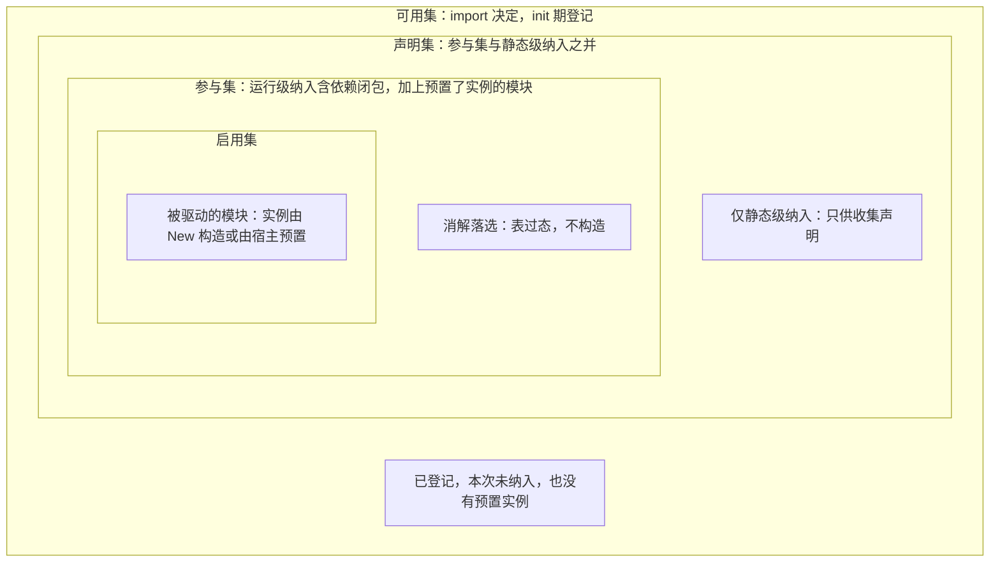
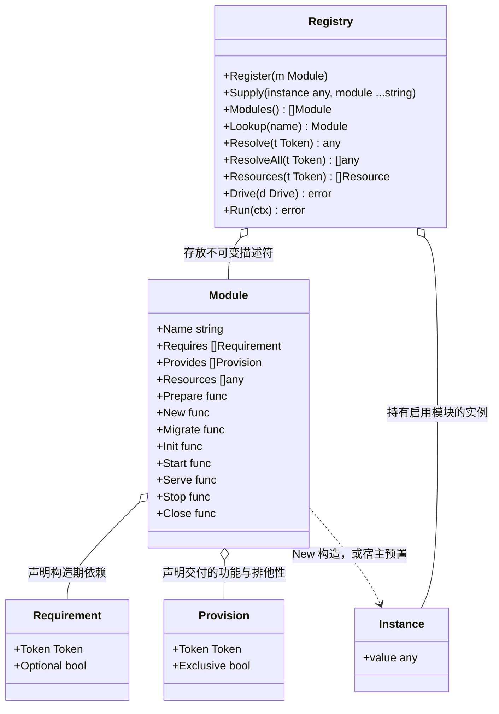
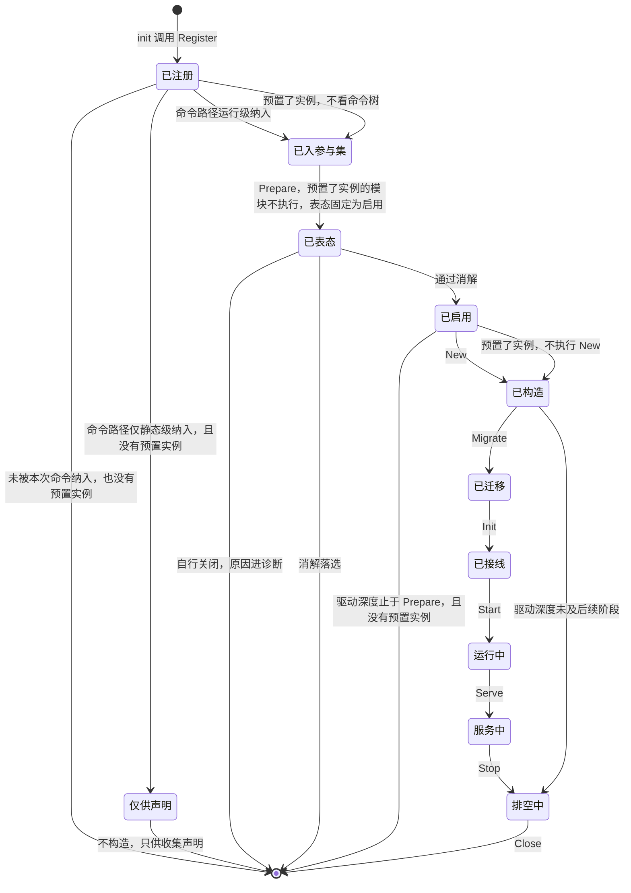
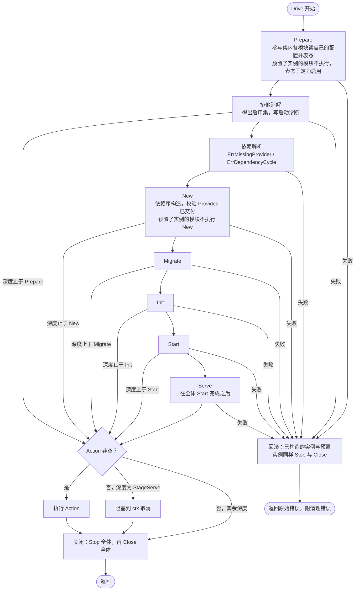
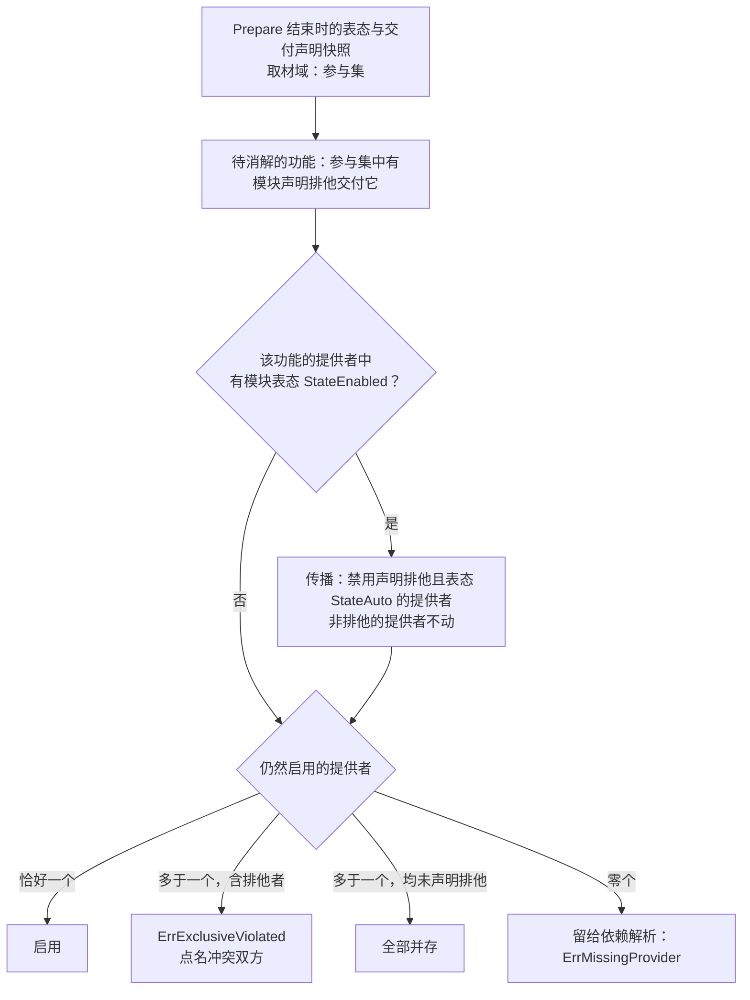
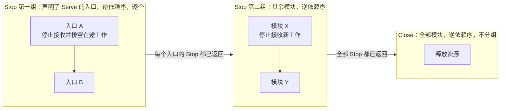

# core

`pkg/core` 位于依赖图的底部，被每一个[模块](../../glossary.md) import：它把模块的描述符、功能与资源收进一个注册表，并按阶段驱动这些模块的生命周期。它只解释注册表自身需要解释的内容：名称、构造期依赖、交付的功能与阶段回调；模块声明的资源由它原样保存，不解释其含义。配置、日志、数据库这些具体能力都由各自的模块承担。读职责清单前可以持有的心智模型是：`core` 是一台不认识任何具体模块与资源的驱动装置，它按模块自己写下的声明决定谁参与、谁启用、以什么次序构造与关闭。

按正文次序，第一遍覆盖职责与其中的核心概念、外部接口契约；依赖、UML 图与核心数据结构是查阅用的；核心算法与流程开头的走查跟一次驱动从登记走到关闭；错误与失败语义、并发与事务边界留作最后自检，覆盖失败路径与并发前提；扩展点说明新增横切机制放在哪里，实现状态只回答某项能力落在代码的哪里。

## 职责

`pkg/core` 承载模块化的基础设施：

- **定义模块契约**：以描述符 `Module` 的字段约束一个模块能声明什么：名称、构造期依赖、交付的功能、资源与各阶段回调；描述符在 `init` 登记后不再变化，注册表此后只按它解释模块。
- **注册**：模块在自身 `init` 中登记到进程级注册表，此后它进入可用集、可按名查到；重名在登记处 panic。
- **预置**：接收宿主在驱动之前人工生成的模块实例，确定它属于哪个已登记模块：宿主给出模块名时以名字为准，否则按实例认领，先比各模块声明的功能，候选不止一个时再比实例类型所在的包与各候选的登记包。
- **查询**：凡注册表自己持有的东西都可被问到：描述符按名称、实例按功能、资源按类型、启用结果按名称，以及遍历全部已登记模块。具体方法见外部接口契约一节，那里是权威。
- **生命周期管理**：按固定阶段驱动模块的回调，并在需要顺序的阶段按依赖关系排序；停机时入口先于其余模块停止。

除模块机制外，`core` 还承载被多个模块共用、且不引入第三方依赖的基础类型与工具。零第三方依赖是这部分内容的准入边界。测试共用的时间倍率也在这里：`pkg/core/coretest` 的 `Scale` 按竞态因子与 `GATE_TIME_SCALE` 放大等待类上界，`Declared` 只按 `GATE_TIME_SCALE` 放大检测行为的上界。该夹具只取标准库，非测试代码不得导入，由 `pkg/core/deps_test.go` 的规则守护。

### 非职责

- **不编码应用形态。** 一个应用可能是 HTTP 服务、gRPC 服务，或者不对外暴露任何入口的后台进程。`core` 驱动阶段，形态由模块与宿主自己决定，驱动入口不认识形态，也不为形态提供选项（[ADR-core-scope](../../adr/adr-core-scope.md)）。
- **不解释任何资源。** 模块声明的资源由 `core` 原样保存并供查询，它不认识其中任何一种的含义。配置 schema、命令行参数、API spec、i18n 资源，各自由需要它的模块定义类型并自行解释。
- **不认识任何具体功能。** `core` 中不出现任何功能接口的类型名。依赖取用借助泛型与反射完成，类型由调用方给出。
- **不提供任何具体功能。** 日志、数据库、键值、事件、HTTP 服务等一律由各自的模块承担。
- **不接管程序入口。** 宿主编写自己的 `main`，`core` 被调用，不调用宿主。
- **不提供运行期参数。** 归设置承载的那些参数由独立模块提供，`core` 不介入；配置与设置的划界判据见 [ADR-config-scope](../../adr/adr-config-scope.md)。

### 核心概念

本节集中说明阅读后文所需的概念。它们的项目级措辞登记在[项目术语表](../../glossary.md)，这里讲的是它们在 `core` 里怎样运作。

**描述符与实例。** 模块向注册表登记的是描述符：名称、构造期依赖、交付的功能、资源与各阶段回调。描述符在 `init` 期写入，此后不变。实例属于一个注册表，模块的阶段回调收到的就是它：由驱动在构造阶段调用 `New` 逐个建立，这样的实例是模块自己的产物；或由宿主在驱动之前预置。

**功能与提供者。** 模块之间不按名字互相取用，按功能取用。功能是一个接口类型，在声明与取用中写成指向它的类型化空指针，称为功能标识。声明交付某功能的模块是它的提供者，同一功能可以有多个提供者。提供者可以在交付声明上标注排他，表示本模块独占该功能。

**预置实例。** 预置实例是实例的另一种产生方式：普通实例由 `New` 在构造阶段生成，预置实例由宿主在驱动之前人工生成，再经 `Supply` 预置到注册表。它属于恰好一个已登记模块：宿主给出模块名时就是那个模块，不给时由注册表按实例认领，先看实例满足哪些模块声明的功能，候选不止一个时再看哪个候选登记自实例类型所在的包（登记包是调用 `Register` 的包）。该模块的 `Prepare` 与 `New` 因而不执行；它不看命令树是否纳入，驱动开始时并入参与集，这次并入的只是它本身，不为它展开依赖闭包，表态固定为 `StateEnabled`；实例自 `Supply` 起就存在，自驱动开始即视为已构造，驱动无论在哪一步结束都对它执行模块声明的 `Stop` 与 `Close`。与普通模块的差别以此为限。配置读取接口是 `config` 模块的预置实例（见 [config](design-config.md)）。规则见外部接口契约一节（[ADR-supplied-instance](../../adr/adr-supplied-instance.md)）。

**四个集合。** 一次运行里哪些模块起作用，随阶段逐级收窄，由四个嵌套的集合表达：



| 集合 | 含义 | 由什么决定 | 确定的时机 | 回答它的查询 |
|---|---|---|---|---|
| 可用集 | 已登记的全部模块，不限于宿主直接 import 的，依赖间接 import 的同样在内 | import | 驱动之前 | `Modules`、`Lookup` |
| 声明集 | 声明会被收集的模块：参与集，加上仅静态级纳入的 | 命令树上的纳入，加上预置了实例的模块 | 第一个 `Prepare` 之前 | `Declaring` |
| 参与集 | 有资格表态的模块 | 命令树上的运行级纳入，经依赖闭包展开；加上预置了实例的模块，不看命令树 | 第一个 `Prepare` 之前 | `Participating` |
| 启用集 | 实例由驱动构造或由宿主预置、走完各阶段的模块：参与集中未被关闭的 | 模块自己的表态，加上排他消解 | 消解完成之后 | `Enablement`，结果非 `StateDisabled` |

纳入分两级，对应两个集合的差别。**运行级纳入**使模块进入参与集：它有资格在 `Prepare` 中表态。**静态级纳入**只使模块进入声明集：它不构造，不表态，不展开依赖闭包，唯一的作用是让它声明的资源进入收集范围。**预置了实例的模块另有一条不经纳入的路**：不看命令树是否纳入它，驱动开始时一律并入参与集，表态固定为 `StateEnabled`（见外部接口契约一节的预置实例）。`Run` 入口没有命令树，也就没有静态级纳入：全部已登记模块都是参与集，声明集等于参与集。

参与集的成员可以自行退出：模块在 `Prepare` 中依据自己的配置表态 `StateDisabled` 并给出原因，即退出本次运行，启用集因此从参与集中减去它；退出也可以来自消解的裁决。预置了实例的模块表态固定为 `StateEnabled`，既不自行退出，消解也淘汰不了它。`Resources` 不对任何集合过滤，按哪个集合取材由消费点自行选定（架构不变量 15）。各集合的组合读法与查询返回值的约定见外部接口契约一节的参与结果查询。

**驱动、阶段与深度。** 驱动是对 `Drive` 或 `Run` 的一次调用：从 `Prepare` 推进到指定的深度，执行 `Action`，再关闭并返回。一个注册表只驱动一次。阶段是生命周期里固定的时机，模块以阶段回调的形式参与。深度是这次驱动推进到的最后一个阶段，之后的阶段不执行；`Stop` 与 `Close` 不是深度，任何一次驱动结束时都要执行。

**表态与消解。** 表态是模块在 `Prepare` 中返回的 `Enablement`：`StateAuto` 与 `StateEnabled` 说明它的排他主张在冲突时如何相让，`StateDisabled` 连同原因说明它本次不运行。预置了实例的模块不执行 `Prepare`，表态固定为 `StateEnabled`。表态收齐之后，注册表做一次消解：只在仍要运行的模块之间处理排他冲突，得出启用集；自行关闭的模块不参与消解，它的排他主张不生效。进入消解的只有待消解的功能，即参与集中未自行关闭的模块里存在模块声明排他地交付它的功能；其余功能的多个提供者照常并存。消解先传播、再裁决，细节见核心算法与流程一节。

**入口与回滚。** 入口是声明了 `Serve` 回调的模块，注册表凭这个字段认出它，不凭名字。入口在停机时先于其余模块停止。回滚是驱动在某个阶段失败之后，对全部已构造的实例执行 `Stop` 与 `Close`，先后与正常停机相同；预置实例自驱动开始即视为已构造，同在其内。

## 外部接口契约

模块机制以注册表的方法为入口，注册、预置、查询与生命周期都在其上。进程级的那一个是包级变量：

```go
var ProcessRegistry = New()   // init 期的注册写入它
func New() *Registry          // 独立实例，其中的模块需手工登记
```

**导出的包级函数只有构造函数与泛型封装两类。** 注册表的构造函数无法是它自己的方法；泛型封装则是语言的限制所致，Go 不允许方法带类型参数，凡要靠类型参数换取类型安全的封装都只能写成自由函数。除构造函数与泛型封装之外不新增导出的包级函数，泛型封装也不得携带方法之外的任何语义。约束的是对外契约：未导出的实现辅助函数不受此限，它们不构成契约，也不构成包级状态。

**注册**。模块在自身 `init` 中调用，写入进程级注册表，重名直接 panic。**登记模块的包导出自己的模块名常量**：命令树按名字纳入模块（见 [config](design-config.md)），预置也可以按名字指定模块（见预置实例），宿主要写出那个名字，让它散落成字符串字面量的话，一次改名会在宿主处静默失配；常量随模块的包走，改名时编译器拦得住每一处引用。另建的注册表不继承这些登记：要装配哪些模块就登记哪些。自注册与导出描述符并不互斥，需要被手工登记的模块可以同时导出一个返回自身描述符的函数：

```go
func (r *Registry) Register(m Module)
```

**驱动开始之后的登记在登记处 panic**，无论出自阶段回调、动作，还是驱动返回之后。描述符与它携带的资源在驱动之前定下，描述符查询与资源查询此后不变这两条承诺都靠这一处守住：放行的话，一个在 `New` 里登记的模块会让同一次运行里前后两次 `Resources` 得出不同的结果，启用结果查询还会把它报成不在这条命令的参与集里。`Supply` 守的是同一条边界：预置实例决定一个模块是否进入参与集，而参与集在驱动开始时就定下，驱动开始之后预置实例同样 panic。需要依赖配置才能决定的东西走运行期交互，见资源查询一节。

**描述符查询**。描述符在 `Run` 之后不再变化，任何阶段都可用：

```go
func (r *Registry) Modules() []Module
func (r *Registry) Lookup(name string) (Module, bool)
```

`Modules` 给出描述符的全集。单提供者的功能可以从这里按 `Provides` 声明反查它出自哪个模块；多提供者的功能反查只能得到候选集合，按名路由要靠功能接口自己提供的名字。按类型收集资源的横切机制走 `Resources`，不走这里。

**实例查询**。实例存在之后才有意义（驱动构造的自 `New` 起，预置的自 `Supply` 起），按功能取：

```go
func (r *Registry) Resolve(t Token) (any, error)              // 要求恰好一个
func (r *Registry) ResolveAll(t Token) []any                  // 取全部
```

功能以类型化空指针指代。方法这一层返回 `any`，取用与断言落在调用点：

```go
v, err := reg.Resolve((*KV)(nil))
kv := v.(KV)
```

`core` 为这两个方法各提供一个自由泛型函数，它们自行构造功能标识并完成断言：

```go
func Resolve[T any](r *Registry) (T, error)
func ResolveAll[T any](r *Registry) []T
```

调用因此写成 `core.Resolve[KV](reg)`。它们换来的是调用点的类型安全，不是少敲几个字符：`Token` 的构造与结果的类型断言都收进了函数里，不再可能写错。

`Resolve` 的匹配域是**声明了该功能的模块**：恰好一个这样的模块已有实例，其实例即结果。已有实例指驱动已为它构造，或宿主已为它预置（见预置实例），取用方不必知道是哪一种。一个模块的实例碰巧实现了某功能却未在 `Provides` 中声明，取用时看不到它，声明因而是唯一权威，装配期校验与运行期取用面对同一个集合。取不到即 `ErrMissingProvider`，可选依赖的读法就是对它做 `errors.Is` 判断，随后走模块自己文档所载的默认行为（[ADR-dependency-resolution](../../adr/adr-dependency-resolution.md)）。缺席是一种合法配置这件事，由声明中的 `Optional` 表达，不需要第二个取用接口。

**一条交付声明与被请求的功能标识，按元素类型相同匹配，不按可赋值性。** 设 `SuperKV` 内嵌 `KV`，交付 `(*SuperKV)(nil)` 的模块与交付 `(*KV)(nil)` 的模块交付的是两个功能，`Resolve[KV]` 只看到后者。

资源查询按资源值与目标类型的关系匹配（目标是接口时按可赋值性，具体类型时按类型同一），见资源查询一节。可赋值性说的是值与它所要满足的类型之间的关系，与一个标识如何匹配另一个标识是两回事（[ADR-capability-token](../../adr/adr-capability-token.md)）。

取用不按 `Requires` 过滤：只要实例已存在就能取到。依赖的依赖不会出现在自己的声明里，而取用它是合法的。`Requires` 的作用是决定构造顺序并在构造之前完成校验，不是限制可见范围。

`ResolveAll` 的匹配域与 `Resolve` 相同：声明了该功能的模块。取其中全部已有实例，一个都没有时返回空切片而非错误。返回的实例不带模块名：若需要按名字路由，那个名字是领域概念，由功能接口自己提供。

**`ResolveAll` 与 `Resources` 的返回一律按模块名字典序。** 登记顺序不可用作依据：`init` 只保证包依赖偏序，同层之间不保证，按登记顺序返回会让结果随构建而变。按名排序与该约束一致，也让依赖它的错误文本（例如配置冲突要点名哪两个模块）在各次构建之间稳定。

**预置实例**。宿主可以在驱动开始之前人工生成某个已登记模块的实例，经 `Supply` 预置到注册表，不由该模块的 `New` 生成（[ADR-supplied-instance](../../adr/adr-supplied-instance.md)）：

```go
func (r *Registry) Supply(instance any, module ...string)
```

**预置实例属于恰好一个已登记模块，满足该模块 `Provides` 声明的全部功能。** 满足的判据与构造之后的交付断言相同：实例可赋值给每一项声明交付的功能（见依赖与顺序一节）。功能清单因此只在 `Module` 里说一次，`Supply` 不收功能标识。这里比的是实例与功能接口之间的可赋值性，与取用时两个功能标识按元素类型相同匹配是两回事（见实例查询）：内嵌 `KV` 的 `SuperKV` 的实现，既满足交付 `SuperKV` 的模块，也满足交付 `KV` 的模块。归属按宿主是否给出模块名确定。

**不给模块名，按实例认领。** 候选是 `Provides` 非空、且实例满足其全部功能的已登记模块。只有一个候选，就是它。候选不止一个时，取登记包等于实例类型所在包的那一个，恰好一个就是它。实例类型所在包指实例的动态类型去掉指针之后的那个命名类型的定义包；登记包是注册表为每个模块记下的、调用 `Register` 的包。例：宿主 import 了全部 KV 后端，`Supply(kv1)` 中的 `kv1` 由 `kv.memory` 的 `New` 生成，类型是 `pkg/kv/memory` 的 `*store`；各 KV 后端交付同一项功能，都是候选，只有 `kv.memory` 登记自 `pkg/kv/memory`，于是由它认领。候选只看实例满足了哪些模块的全部功能，不看宿主要的是哪一个：宿主要的模块声明了多项功能而实例缺其中一项时，它不是候选；别的模块的功能被实例全部满足时，认领在它们之中进行，其中只有一个就归它而不报错，缺的那一项也不被报出：近似候选只在没有候选时报出。要让缺的功能被报出来就指名：实例不满足所指模块的全部功能时，`Supply` panic 并指出缺哪一项。

**给了模块名，以名字为准。** 该模块须已登记，实例须满足它的全部功能；注册表不再按类型交叉核对，名字是宿主的决定。指名时，不声明 `Provides` 的模块同样可以被预置。名字至多一个，写的是登记该模块的包导出的模块名常量（见注册）。空串也算给出了名字，以它为准：没有模块以空串登记（`Register` 拒收空名），`Supply` 因而以模块名未登记 panic，不退回按实例认领。

**按实例认领依赖一条打包惯例：产物类型定义在登记其模块的包里。** 候选不止一个时才用到它，结局取决于实例类型所在的包登记了其中几个：恰好一个，实例就归它：惯例对宿主要的那个候选成立时，这就是它；惯例不成立而那个包登记的是另一个候选时，实例认给那一个而不报错，宿主要的候选只有指名才分得开。一个也没有，或不止一个，`Supply` panic，不替宿主挑选。下列情形里惯例不成立，候选不止一个时须给出模块名（举例，不是穷举）：

- 多个候选共用同一个产物类型：`db.sqlite` 与 `db.postgres` 的产物都是 `*database`，`database` 定义在 `pkg/db`，而它们分别登记自各自的子包，`pkg/db` 不登记模块；
- 候选不是由定义其产物类型的包登记的，例如在宿主的包里手工 `Register`；
- 宿主自己包装的类型：类型定义在宿主的包里。

**一个实例只对应一个模块。** 一个模块至多一个预置实例，同一个对象不能预置给两个模块。“同一个对象”按引用身份判定：实例是指向非零大小类型的非 nil 指针、非 nil 映射或非 nil 通道时，按动态类型与地址一并判定是否同一个，类型不同而地址相同的两个指针（例如结构体与它首个字段的指针）不算同一个。其余实例不作这项检查，结构体一类的值类型、切片与函数值、零大小类型的值与指向它的指针，以及值为 nil 的指针、映射与通道都在此列（取舍见 [ADR-supplied-instance](../../adr/adr-supplied-instance.md)）。这条只约束 `Supply`：两个模块的 `New` 返回同一对象，注册表不检查。检查也只在一个注册表之内：同一个对象预置进两个注册表不受检查，两次驱动各按所属模块的声明对它执行 `Stop` 与 `Close`。一个对象要承担多项功能时，由一个模块在 `Provides` 中声明这些功能。

**它代替该模块的 `Prepare` 与 `New`。** 效果等价于该模块的 `Prepare` 无条件返回 `StateEnabled`、`New` 返回这个实例：`Prepare` 与 `New` 都不执行，声明了它们的模块同样可以被预置。

**预置了实例的模块在驱动开始时并入参与集，表态固定为 `StateEnabled`。** 不看命令树是否纳入它。它因而不会被消解淘汰；与同一功能的别的提供者冲突时，按消解的普通规则处置：别的提供者声明排他而表态 `StateAuto` 的让位；除此之外，双方中只要有一方声明排他，启动就以 `ErrExclusiveViolated` 失败；双方都不声明排他的并存（规则见运行期启用一节）。

**并入不展开依赖闭包。** 闭包由 `Closure` 在驱动之前对命令树点名的模块展开（见依赖闭包），预置了实例的模块在其中与别的模块受同一条规则处置。驱动开始时注册表并入的只是预置了实例的模块本身，不为它再展开：它 `Requires` 中必需的功能，提供者须已在参与集里，否则依赖解析判 `ErrMissingProvider`；标注 `Optional` 的照通则处置，提供者不存在时跳过（见依赖与顺序一节）。

**实例自 `Supply` 起就存在于注册表中**，不等到构造阶段。此后任何阶段的取用都把它算在内，`Prepare` 阶段也不例外：这是实例比构造阶段更早生成的直接结果，取用沿用不按 `Requires` 过滤的通则，没有另立的规则。单值取用的通则同样不变：`Resolve` 要求恰好一个已有实例的声明者，而 `Prepare` 阶段存在的只有预置实例；同一功能另有提供者在构造阶段建立了实例，此后同一个 `Resolve` 得到 `ErrAmbiguousProvider`，`Prepare` 阶段取得到的，构造之后不保证仍取得到。

**预置实例自驱动开始即视为已构造，驱动对它执行所属模块声明的 `Stop` 与 `Close`。** 正常停机、`Action` 失败、任一阶段失败后的回滚都是如此。它与别的实例一样按依赖序进入构造序，位置由 `Requires` 边约束，边之外的先后由注册表排开，不作保证（[ADR-lifecycle-shutdown-order](../../adr/adr-lifecycle-shutdown-order.md)）：自 `Supply` 起就存在，只意味着 `Prepare` 与 `New` 中的取用不必等它，关闭次序仍由 `Requires` 约束，要在自己的 `Stop` 或 `Close` 里用到它的模块，对它声明 `Requires`，预置与否都一样。构造序的逆序是 `Close` 的次序，也是 `Stop` 两组各自组内的次序；`Stop` 另按入口先停分组（见入口单独成一个阶段一节）。驱动在走到它的构造之前就已结束的，它补在构造序的末尾，按最后构造的处理：`Prepare` 阶段就失败的驱动、深度止于 `Prepare` 的驱动，同样关闭它。补到末尾的预置实例不止一个时，彼此按依赖序排列，与构造序是同一条规则：只看它们彼此之间的 `Requires` 与 `Provides`，这一步不做依赖校验；彼此没有依赖关系的，先后不作保证；彼此的依赖成环的（依赖解析以 `ErrDependencyCycle` 失败的驱动，以及没有走到依赖解析、环未被检出的驱动）环上的预置实例同样都关闭，彼此先后不作保证。

**驱动对预置实例做的就是执行这些回调，回调对它做到哪一步由模块决定。** `Stop` 与 `Close` 对不是本模块产物的实例做什么，是模块契约的一部分，写在模块自己的设计文档里：有的对任何满足其功能的实例都释放，数据库模块的 `Close` 经 `Database` 取出句柄来关即是（见 [db](design-db.md)）；有的只处理自己的产物，外来的实例原样留下。取用方接管了所取实例的生命周期时，它对收取到的预置实例同样照常释放，可观测性的装配器关停它收取的每个导出器即是（见 [observability](design-observability.md)）；驱动在它收取之前就结束时，这样的实例没有任何一方释放。被预置的若正是这样的取用方，它的 `New` 不执行，也就不收取别的模块的实例：其中由驱动构造的没有任何一方释放，预置的由宿主释放，可观测性的装配器被预置时导出后端构造的导出器即是（见 [observability](design-observability.md)）。没有回调释放的部分，实例持有的资源由宿主释放，所属模块没有声明 `Stop` 与 `Close` 的即在此列。预置之后驱动没有开始的，实例同样由宿主释放：视为已构造从驱动开始算起；经命令树的执行发起驱动时怎样判断驱动是否开始，见 [config](design-config.md)。

**其余与普通模块无差别。** 描述符，`Requires`（校验、排序，以及 `Closure` 对它的展开），`Provides`，`Resources`，`Migrate` 到 `Close` 的阶段回调，在 `Modules()` 中的出现，`Enablement` 与 `Participating` 的查询，全部照常。阶段回调收到的实例可能不是模块自己的 `New` 构造的，这一点由模块自己负责：回调可以照常处理它、略过它，也可以拒收而返回错误，驱动随之在那一阶段失败。数据库模块的 `Migrate` 拒收不是本模块的 `New` 构造的实例，核对的是来历：宿主自己实现 `Database` 的实例与别的实现的 `New` 构造的实例都在被拒之列；宿主用该模块自己的 `New` 造出、再预置的实例，句柄上带着那次 `New` 收取的插件，照常可用，拒收不核对这些插件与本次运行的启用集是否一致（见 [db](design-db.md)）。事件各实现的 `Start` 只接受自己的产物（见 [event](event/design-event.md)）。拒收落在哪个回调，在它之前的取用就不经过这道检查：推进不到那一阶段的驱动全程如此，更深的驱动里先于那个回调执行的回调同样如此。

**`Supply` 只在以下情形 panic**，都出现在调用处，信息带调用方的包路径：

- 驱动已经开始；
- `instance` 为 nil，指接口值本身为 nil；类型化空指针不算 nil，按它的动态类型参与认领与满足判断，与 `New` 返回类型化空指针时交付断言的判法一致；
- 给了不止一个模块名；
- 给的模块名未登记；
- 实例不满足所指模块的全部功能：信息指出缺哪一项；
- 不给模块名而没有候选：信息列出只满足部分功能的近似候选，并指出各缺哪一项；
- 不给模块名而候选不止一个，按登记包仍不能唯一确定：信息列出各候选及其登记包，提示改用模块名；
- 这一次调用确定的模块已有预置实例，指名与按实例认领同样：信息点名已有的那一次预置与这一次调用；
- 同一个对象已预置给另一个模块，是否同一个按上文的引用身份判定：信息点名两次调用与它已归属的模块。

判据与登记期其余缺陷相同：仅凭这一次调用与注册表已记下的登记和预置即可确定（见错误与失败语义一节）。

**次序：模块先登记，后 `Supply`。** 归属只在 `Supply` 被调用的那一刻、按当时已登记的模块判定；此后登记的模块不参与这次认领，已定的归属不变，`Register` 也不回头检查已有的预置实例。次序写反时，指名的 `Supply` 以模块名未登记 panic；不指名的按调用那一刻已登记的模块认领，没有候选或分不开即 panic，另有唯一可认的候选时实例归它而不报错。进程注册表的登记发生在 `init`，早于宿主在 `main` 中的任何调用，次序由此保证；手工搭建的注册表自己先 `Register`，再 `Supply`。

**没有预置任何实例的注册表照常驱动。** 预置不是装配的前提：带 `New` 的模块照常自己生成实例，测试中只装配一小组模块的注册表往往什么都不预置。声明了 `Provides` 却没有 `New` 的模块，实例只能出自预置：它进入启用集而宿主漏掉预置时，推进到构造阶段的驱动终止，不会静默少一段功能。先到哪一条错误取决于次序：在轮到它构造之前取用它的模块（在 `Prepare` 中取用的，或构造序排在它前面、在 `New` 中取用的）得到 `ErrMissingProvider`；否则轮到它构造时得到 `ErrUndeliveredCapability`。`ErrMissingProvider` 与 `ErrUndeliveredCapability` 的文本都指出它没有 `New`、宿主也没有预置它的实例。深度止于 `Prepare` 的驱动不做依赖解析，也不构造：漏掉的预置只在有模块于 `Prepare` 或动作中取用它时以 `ErrMissingProvider` 暴露，取用方把这个错误返回出去，驱动才失败。

**配置读取接口是预置实例。** 它由宿主在装配开始之前加载生成，属于 `config` 模块：该模块只声明交付读取接口，没有 `New`（见 [config](design-config.md)）。写出命令树的宿主由命令树的执行预置它，那里指名 `config` 模块，名字取自 `pkg/config` 导出的模块名常量，归属因而不取决于注册表里另外登记了哪些模块；**`Run` 不预置任何实例**，读取接口要由 `Run` 的调用方自己 `Supply`（[ADR-drive-entry](../../adr/adr-drive-entry.md)）。

**依赖闭包**。命令树按名字纳入模块，而纳入一个模块要一并纳入它构造期依赖的提供者：

```go
func (r *Registry) Closure(names []string) ([]string, error)
```

按 `Requires` 传递展开，匹配规则与 `Resolve` 相同（元素类型相同，不按可赋值性），结果含输入自身，
去重后按名排序。名字未登记时返回 `ErrUnknownParticipant`。

**非排他**功能的展开取该功能的全部声明提供者，不挑其中一个：哪一个最终启用要到消解之后才知道，而命令树决定的参与集在解析命令行时就得确定。**交付声明了排他的提供者不展开**：同一功能可以有多份声明排他的实现，替宿主挑一份就是替它做决定，而展开规则不引入新的决定；闭包因此不把它们补进参与集，只保留命令树上已经写下的那些，宿主在命令树上点名哪个实现，参与的就是哪个。预置了实例的排他提供者不经点名也在参与集里，与点名的实现之间按消解的普通规则处置（见预置实例）。命令树上一个都没有，也没有为其中哪个预置实例时，该功能缺提供者，留待依赖解析判 `ErrMissingProvider`。**标注 `Optional` 的依赖同样不展开**：它的含义是缺席为一种合法配置，替模块把提供者纳入进来，它就再也不会缺席，而宿主并没有在命令树上列举过它。

展开由命令树这一层完成（[ADR-command-tree](../../adr/adr-command-tree.md)）。`Drive` 收到的因此始终是展开后的完整清单，注册表不再二次展开。`Run` 传给 `Drive` 的是全部已登记模块，那同样是展开后的完整清单：一个模块都不落在集合之外。驱动开始时并入参与集的预置了实例的模块同样不展开（见预置实例）。

**资源查询**。资源是模块对外声明的只读数据，查询同样按类型：

```go
type Resource[T any] struct {
    Module string   // 声明它的模块
    Value  T
}

func (r *Registry) Resources(t Token) []Resource[any]
func Resources[T any](r *Registry) []Resource[T]      // 泛型封装
```

匹配规则与取用一致：**可赋值给目标类型的资源全部返回**。目标是接口时，实现了它的资源都算匹配；目标是具体类型时，只有该类型匹配。同一条规则覆盖两种用法，`config` 因此既能用接口收齐各家传输实现，也能用结构体精确取出自己的声明。

`Resources` 的参数指代的是资源类型，不是功能，写法与功能标识相同但含义不同：功能一定是接口，资源类型可以是任意类型。

查询结果携带模块名。资源是被动数据，没有方法可以自报身份，而使用方几乎总要用到它：冲突报错要指出是哪两个模块，i18n 资源要按模块归类，迁移要记录归属。这与 `ResolveAll` 不带模块名并不矛盾，那里取的是有方法的实例。

`core` 不认识任何资源类型。资源在 `Run` 之前全部就位，此后查询结果不再变化。`config` 用 `core.Resources[config.Schema](reg)` 收集输入项声明，`http` 模块用它收集 API spec，各自定义自己的资源类型并自行解释。

**资源查询不过滤。** `Resources` 遍历全部已登记模块，既不看本次纳入了谁，也不看启用结果：`core` 不认识资源，无从知道某一种该按哪个集合裁断（架构不变量 2）。取材域因此归消费点：它在可用集、声明集、参与集与启用集之间选定，判据与选定的结果写在消费点所属模块的设计文档里（架构不变量 15、[ADR-module-resource-scope](../../adr/adr-module-resource-scope.md)）。要表达声明集或启用集，消费点把下面两个查询组合起来用。

**启用结果查询**。消解完成之后，每个模块的最终结果与原因可按名取得：

```go
func (r *Registry) Enablement(name string) (Enablement, bool)
```

返回的是最终结果：自行关闭的模块表现为 `StateDisabled`，原因是它自己给出的那一条；被消解禁用的模块表现为 `StateDisabled`，原因是消解给出的那一条。**已登记但不在本次参与集里的模块同样表现为 `StateDisabled`**，原因说明它不在这条命令的参与集里：它确实不会运行，而“这个模块这次跑不跑”正是这个查询要答的。`Run` 入口下没有这一档：全部已登记模块都在参与集里。**它不回答“为什么没跑”的成因分类**：自行关闭、消解落选、未被纳入且没有预置实例、只被静态级纳入，落在同一个取值上，原因串则是各自给出的那条。要区分的消费点用下面的参与结果查询取另一半，不比对原因文本。消解尚未发生，以及消解失败时，一律返回 `false`，与查一个未登记的名字相同：它承诺的是最终结果，而最终结果此时并不存在，给出任何值都会被当成结论。尤其不能给出零值表态，那会把“没算出来”读成“表态为 `StateAuto`”。启动诊断固定写 `os.Stderr`，宿主无法重定向它，因为传入一个接收端只能经由 `Run` 的参数或包级设值，两者都被架构不变量排除。这个查询是宿主把同一批信息接进自己日志的合法途径：诊断保证信息不会无人察觉，查询让它可被程序取用。

**参与结果查询**。这次驱动把哪些模块纳到了哪一级，可按名取得：

```go
func (r *Registry) Participating(name string) bool
func (r *Registry) Declaring(name string) bool
func (r *Registry) AllResourcesInForce(name string) bool
```

`Participating` 回答“它在参与集里吗”：运行级纳入的、经依赖闭包进入的与预置了实例的都算；`Declaring` 回答“它在声明集里吗”：参与集与静态级纳入的都算。两者都不回答它是否启用。未登记的名字一律为 `false`。

**两者返回裸布尔，因而把“未登记”“驱动尚未开始”“已登记而本次既未纳入也没有预置实例”压进同一个 `false`。** 这与 `Enablement` 保留第二个返回值的处置相反，取舍不同的理由是：`Enablement` 要交出一个有取值域的结论，给出零值表态会被读成“表态为 `StateAuto`”；而这两个查询交出的就是一个二元事实，第二个返回值只能表达“这个名字我不认识”，那件事 `Modules()` 已经答得了。**代价落在宿主自检上**：把模块名常量拼错后查，得到的 `false` 与“这次它确实不在集合里”完全相同。要区分的自检先查登记，再查纳入。

**两者在时序上与 `Enablement` 不同**：声明集与参与集在 `Prepare` 之前就已确定，这两个查询因而从第一个 `Prepare` 回调起就给出最终答案，而启用结果要等消解。在 `Prepare` 里写出“参与且未禁用”这种判断会恒为真：那时禁用结果还不存在。**驱动开始之前一律为 `false`**：那时还没有“这次命令”，两个集合都不存在，而单个布尔表达不出“还不知道”，那一档由 `Enablement` 的第二个返回值承担。

分成独立的查询，而不是让 `Enablement` 多出几种状态：`EnablementState` 是启用结果的取值域，“未纳入”不是任何模块的表态；而让它对未纳入返回 `false` 会与“最终结果此时并不存在”撞在一起，调用方分不出“还没算”与“没纳入”。两种改法都会让既有的每一处按 `StateDisabled` 判断的代码悄悄改变含义，而那些判断散在各模块里，编译器一处也拦不住。

组合起来给出的读法：

| `Declaring` | `Participating` | `Enablement` | 情形 |
|---|---|---|---|
| `true` | `true` | 非 `StateDisabled` | 在参与集里且启用：运行级纳入的、经依赖闭包进入的，或预置了实例的 |
| `true` | `true` | `StateDisabled` | 在参与集里而未启用：自行关闭或消解落选 |
| `true` | `false` | `StateDisabled`，原因为不在参与集里 | 只被静态级纳入 |
| `false` | `false` | `StateDisabled`，原因为不在参与集里 | 已登记，本次未纳入，也没有预置实例 |

按声明模块的去向过滤的消费点据此裁定自己的取材域（架构不变量 15）：迁移集取声明集，插件安装取启用集（见 [db](design-db.md)）。**判据一律用这几个查询，不得比对禁用原因的文本**：那是写给人看的诊断串，一次文案修订会改变装配行为。

**`AllResourcesInForce` 是宿主对取材域的覆盖**，本身不是一个集合。它只对**仅**被静态级纳入、且那次纳入带了 `AllResources` 的模块答真；对进入参与集的模块一律答假，运行级纳入的、经依赖闭包进入的与预置了实例的都在其内：注册表把它们当作参与者，`DeclaringOnly` 里对它们的调整随之作废（见下文 `Drive` 一节折叠这份清单的规则）。一个消费点读到真时，把该模块的声明当作在册处理，越过它自己那个取材域：这是宿主替消费点作的一次决定，`core` 只转达它，不知道它会被谁读到。

**生命周期**：

```go
type Stage uint8

const (
    StagePrepare Stage = iota
    StageNew
    StageMigrate
    StageInit
    StageStart
    StageServe
)

type Drive struct {
    Depth         Stage      // 推进到这个阶段为止
    Participants  []string   // 运行级纳入的模块连同其依赖闭包，逐个列出；空清单即不纳入任何模块
    DeclaringOnly []Declaration // 仅静态级纳入的那些；与参与集之并是声明集
    Action        func(ctx context.Context, reg *Registry) error
}

// Declaration 是一个只为其声明而被纳入的模块，连同宿主在那次纳入上做的调整。
type Declaration struct {
    Name         string  // 模块登记时用的名字
    AllResources bool    // 它的全部声明生效，覆盖消费点自己的取材域裁定
}

func (r *Registry) Drive(ctx context.Context, d Drive) error
func (r *Registry) Run(ctx context.Context) error
```

`Drive` 推进到 `Depth` 指定的阶段，执行 `Action`，随后关闭并返回，关闭的先后见[阶段](#阶段)一节。它收一份调用方给出的字面清单，列的是运行级纳入的模块连同依赖闭包展开出的提供者，展开在清单交进来之前已经完成（见依赖闭包），服务于写出命令树的宿主（见 [config](design-config.md)）。

`Run` 是 `Drive` 的一种取值，服务于不写命令树的调用方：包外测试与嵌入式宿主（[ADR-drive-entry](../../adr/adr-drive-entry.md)）。它纳入全部已登记模块、没有静态级纳入、没有动作、推进到 `StageServe`，因而阻塞到 `ctx` 取消后关闭。它与 `Drive` 的差别在于：参与集取自注册表自己持有的登记名单，不由调用方给出；没有静态级纳入，`DeclaringOnly` 因此为空，声明集等于参与集。

**`Run` 下没有命令树的执行，配置读取接口因而不是由它预置的。** 调用方要自己把读取接口 `Supply` 进去（包外测试正是这样做的）。`Run` 把全部已登记模块纳入参与集，已登记的 `config` 模块也在其中，而它没有 `New`：没有预置读取接口时启动终止，错误是 `ErrMissingProvider` 或 `ErrUndeliveredCapability`，先到哪一条取决于次序（见预置实例）。`AllResourcesInForce` 在 `Run` 下对每个名字答假：没有静态级纳入，就没有可覆盖的取材域。

**`Stop` 与 `Close` 不在可选深度之列**，`Stage` 因此只到 `StageServe`。`Stop` 与 `Close` 是关闭的回调，任何一次驱动结束时都要执行，不是可以停在那里的位置：把它们做成可选深度，等于允许一次驱动声明自己不释放资源。

`Action` 为空时，`StageServe` 阻塞等待 `ctx` 取消（那是对外提供服务的形态）其余深度到达即进入关闭。`Action` 非空时，它在到达深度之后执行，返回后进入关闭。**取消是正常的停止途径，清理无失败时返回 `nil`**，不返回 `ctx.Err()`：取消由宿主自己发出，把它报成错误会迫使每个宿主去特判一个自己刚刚做出的动作。清理有失败则返回聚合后的清理错误。

**一次驱动是一个不可分割的过程，深度可选不改变这一点**（[ADR-lifecycle-drive](../../adr/adr-lifecycle-drive.md)）：进去就一定会出来，已构造的实例由这次驱动负责释放，无论推进到了哪个阶段，也无论 `Action` 是否失败；预置实例同在其内，驱动对它执行所属模块的回调，回调对它做到哪一步见预置实例。深度因此是一个参数，而不是一组可分别调用的操作：把深度做成可分别调用的操作，会给宿主留下一个可以忘记调用的第二步，忘记的后果是资源不释放。

**未被推进到的阶段，其回调不执行。** 一个只应执行一次的动作若放在靠后的阶段，浅驱动会跳过它，而这种跳过不报错。

`Participants` 由调用方给出，写出命令树的宿主由命令树给出（见 [config](design-config.md)），`Run` 是唯一的例外：它把注册表持有的全部已登记模块填进这份清单。无论哪一种来路，它都是一份字面的名字清单。预置了实例的模块不要求出现在这份清单里：驱动开始时，注册表自行把它们并入参与集。**空清单就是不纳入任何模块**，不解释为全部：打印版本这类命令不纳入任何模块，而若空清单解释为全部，一条忘了列举模块的命令就会把全部已登记模块纳入驱动，构造并启动它们。空清单下，参与集里只有预置了实例的模块。命令树上的“纳入全部”在组装命令树时就展开成具体的名字，`core` 收到的始终是列举结果。`core` 不认识命令，也不解析命令行，更不引入解析命令行所需的依赖。

`DeclaringOnly` 同样是字面清单，列的是**仅**被静态级纳入的模块（[ADR-command-tree-inclusion](../../adr/adr-command-tree-inclusion.md)）。这些模块不被构造，不执行任何阶段回调，不表态，不参与消解，其依赖闭包不展开：它们不构造，没有构造期依赖可言。它们唯一的作用是让自己声明的资源进入声明集，供按声明集取材的消费点收集。两份清单不相交：一个模块同时被两级纳入时按运行级处置，只出现在 `Participants` 里，**它的调整随之作废**：`AllResourcesInForce` 对它答否，声明照常按消费点的取材域裁定。预置了实例的模块一律是参与者，命令树对它的静态级纳入同样按运行级处置，调整同样作废。一个名字写错未登记时同样拒绝，错误是 `ErrUnknownParticipant`。

**命令树上还有第二个调整，它不越过这条边界。** `WithFlags` 决定一个模块的输入项是否出现在那条命令的命令行上，而 `core` 既不写命令行也不认命令：把这件事放进 `Declaration`，得到的是一个这里读不到、也拒绝不了的字段：手工构造 `Drive` 的宿主写它不会有效果也不会有提示，读文档的人还要自己判断这属于哪一种。它因此留在 `config` 那一侧的类型上，由组装命令树的那一步落实；**越过分界线的只有 `AllResourcesInForce` 回答的那一个**。

这条分界本身是 `Drive` 的结构决定的：一次驱动要做什么，是驱动的事；命令行长什么样，是写命令树的人的事。两者共用的只有模块名。

**折叠这份清单是 `core` 的事，命令树不代做。** 两条规则在这里实现一次：重名的条目合并，两条都保留各自的调整（宿主写了两遍就是两个请求，丢掉任一个都无从察觉）；被运行级同时纳入的，以及预置了实例的，按运行级处置，那一份调整随之作废。

归属的理由不是“谁先看到”，而是**这条规则必须在它承重的那一层**。`Drive` 是宿主可以手工构造的契约（包外测试装配一个小注册表时就是这么用的，字段文档也写明一个名字同时出现在两处不是错误）因此一个 `Drive` 的含义不能取决于它是谁构造的。`core` 要给任何 `Drive` 同样的答案；命令树只能对它自己造出来的那些负责。`Participants` 早就是这个结构：命令树展开之后，注册表仍自行排序去重。

代价是命令树交给驱动的是一份**累积**而非折叠过的清单，同一个模块被写几遍就有几条，因此它不能拿这份清单去回答“这个模块被静态级纳入了吗”以外的问题。它自己读这份清单的地方（参数归属、那条未知参数的诊断）都对重复不敏感，两边不会因重复的条目对同一个 `Drive` 得出不同结论。预置了实例的模块不在此列：命令树不知道预置，对它的静态级纳入照静态级处置，注册表把它按运行级处置（见 [config](design-config.md)）。

**字段叫 `DeclaringOnly` 而查询叫 `Declaring`，两者指的不是同一个集合**：字段是差集（仅静态级），查询答的是并集（声明集，参与集与静态级纳入的都算）。命名上把这个差别写进字段名，是因为一个照字段名实现的查询（直接在 `DeclaringOnly` 里找名字）能编译、能跑，而对每一个运行级纳入的模块都答错，按声明集取材的消费点会据此丢掉全部运行级模块的声明。`core` 对这份清单只做两件事：记住它，以及把它与参与集合起来回答 `Declaring`；它不知道声明集会被谁拿去做什么。

宿主的 `main` 因此负责 import 所需模块、声明自己的宿主身份（见 [config](design-config.md)）、发起装配（写出命令树并由它发起驱动，或不写命令树而直接调用 `Run`，见 [ADR-drive-entry](../../adr/adr-drive-entry.md)），以及决定 `ctx` 何时取消。

**对外接口**：`Module` 的字段与 `Registry` 的方法集是模块作者与 `core` 之间的接口，其变更会波及每一个模块。字段集限于注册表自身要解释的内容，横切机制经由 `Resources` 扩展，不改变这个接口。

## 依赖

`core` 不依赖任何模块，也不依赖任何第三方库。它位于依赖图的底部，被每一个模块 import。

这一位置是架构不变量的直接后果：`core` 的任何依赖都会落到每一个宿主的 `go.mod` 中。

## UML 图



描述符与实例在注册表中的地位不同：描述符不可变，随 `init` 登记后不再变化；实例可变，由注册表在生命周期驱动过程中逐阶段建立；预置实例例外，宿主在驱动之前经 `Supply` 预置它。

`Requires` 与 `Provides` 都声明在功能上，不声明在模块身份上。依赖因此指向“谁提供这个接口”而不是“哪个模块”，替换实现不影响依赖方。



本次命令运行级纳入的模块都会执行 `Prepare` 并表态（预置了实例的除外），只有通过消解的进入后续阶段。预置了实例的模块经另一条边进入已入参与集：不看命令树是否纳入它，驱动开始时一律并入参与集，不执行 `Prepare`，表态固定为 `StateEnabled`，实例自预置起就存在，构造阶段不执行 `New`，其余各阶段与普通模块相同。未被纳入且没有预置实例的模块停留在已注册状态：它的 `init` 已执行、代码已编译进二进制，此后不再有回调被调用。只被静态级纳入、也没有预置实例的模块走的是旁边那条：它同样一个回调都不执行，与未被纳入的区别只在于它声明的资源进了声明集，供按声明集取材的消费点收集。自行关闭与消解落选的模块都走完了一次表态，只是结论分别由模块自己与消解给出。**`Run` 入口下未被纳入的已登记模块与只被静态级纳入的模块都不出现**：全部已登记模块都走运行级纳入那条路，声明集等于参与集（[ADR-drive-entry](../../adr/adr-drive-entry.md)）。配置在装配开始之前就已由宿主加载（[ADR-assembly-bootstrap](../../adr/adr-assembly-bootstrap.md)），读取接口是 `config` 模块的预置实例。

图中从已构造直接通往排空中的那条边代表驱动深度：一次驱动推进到它指定的阶段为止，其后的阶段不执行，已构造的实例照常按停机的先后关闭。这条边在 `Migrate`、`Init`、`Start` 之后同样存在，只画出一条是为了让图保持可读。深度止于 `Prepare` 是另一种情形：驱动不构造任何实例，没有预置实例的模块因而没有要关闭的东西，从已启用直接终止：`StagePrepare` 是 `Stage` 的零值，一个忘了写深度的 `Drive` 落在的正是这里。预置了实例的模块在这里照常从已构造走到排空中：实例自驱动开始即视为已构造，关闭时执行它声明的 `Stop` 与 `Close`。

## 核心数据结构

描述符是模块向注册表登记的全部内容：

```go
type Module struct {
    Name      string          // 模块的唯一标识，进程内唯一
    Requires  []Requirement   // 构造期依赖，声明在功能上，必须无环
    Provides  []Provision     // 本模块交付的功能
    Resources []any           // 对外声明的只读资源，core 只保存不解释

    Prepare func(ctx context.Context, reg *Registry) (Enablement, error)
    New     func(ctx context.Context, reg *Registry) (any, error)
    Migrate func(ctx context.Context, reg *Registry, instance any) error
    Init    func(ctx context.Context, reg *Registry, instance any) error
    Start   func(ctx context.Context, reg *Registry, instance any) error
    Serve   func(ctx context.Context, reg *Registry, instance any) error
    Stop    func(ctx context.Context, reg *Registry, instance any) error
    Close   func(ctx context.Context, reg *Registry, instance any) error
}
```

没有 `New` 回调的模块，其后续各阶段收到的 `instance` 是 `nil`；预置了实例的模块除外，它收到的是那个实例。只含 `Resources` 的模块属于没有 `New` 的一类，配置源与格式子包、宿主声明自己身份的那个模块即是：它们不声明 `Provides`，只有宿主指名预置时才会收到实例。这是模块作者与注册表之间契约的一部分：声明了后续阶段却没有 `New` 的模块，必须按 `nil` 处理它；收到的实例是宿主预置的，不是自己的 `New` 构造的，同样由模块自己负责。

**一个注册表只驱动一次**，第二次驱动直接 panic，`Run` 与 `Drive` 同此。走完一次生命周期的注册表其实例部分不可复用，再驱动是调用点的编程错误，与重名登记同类。深度可选不改变这一点：一次浅驱动同样走完了它的进与出，不是“只用掉了前半段”。一个进程要执行两条命令，建两个注册表。

生命周期是描述符的字段，不是实例可选实现的接口。声明式的形态让注册表在驱动之前就能看到每个模块参与哪些阶段，而类型断言只能在驱动到那一步时才发现。

功能在声明与取用中以类型化空指针指代：

```go
// Token 指代一种功能，写作指向该功能接口的类型化空指针，例如 (*KV)(nil)。
type Token = any
```

**`Token` 指代的是功能，不是实例。** 在交付声明、依赖声明与取用三处，它的含义完全一致：提供这种功能。`Resolve` 问的是“谁能提供这个功能”，而不是“把某个特定的实例给我”。同一功能因此可以有多个提供者而不矛盾，按实例身份寻址则不属于这套机制。

类型化空指针是功能的写法，不需要任何构造函数（[ADR-capability-token](../../adr/adr-capability-token.md)）。

代价是 `Token` 的静态类型退化为 `any`，写成 `KV(nil)` 或误传一个实例，编译器都不会拦。注册表因此在 `Register` 中校验每个 `Token` 确为类型化空指针，不合法的当场 panic，与重名冲突同样暴露在登记的那一刻。

**功能标识的元素类型必须是接口**，`Provides` 与 `Requires` 中出现 `(*bytes.Buffer)(nil)` 这类指向具体类型的空指针即 panic。功能是模块之间相互取用的单位，取用方拿到的是一组方法而非一份内存布局；要求接口也让交付校验始终有意义，否则无从判断产物是否实现了所声明的功能。资源标识不受此限：资源是被动数据，其类型可以是任意类型。

**取用时传入非法的功能标识同样 panic，不返回错误。** 非法标识是调用点的编程错误，与数据无关，首次执行即确定地暴露；把它表达成错误，要么迫使 `ResolveAll` 与 `Resources` 为一个只可能因 bug 触发的情形添上错误返回值，要么让文档承诺一种这两个方法的签名给不出的行为。泛型封装自行构造标识，结构不会出错，但元素类型仍可能不是接口，`core.ResolveAll[int]` 因此也是 panic。

交付声明可以标注排他：

```go
type Provision struct {
    Token     Token
    Exclusive bool   // 独占该功能，不容许其他仍然启用的提供者
}

type Requirement struct {
    Token    Token
    Optional bool
}
```

模块在 `Prepare` 中表态自己与他人的排他主张如何相让：

```go
type Enablement struct {
    State  EnablementState
    Reason string   // 未启用的原因：自行关闭时由模块给出，消解禁用时由注册表填写
}

type EnablementState int

const (
    StateAuto     EnablementState = iota   // 零值：不与他人冲突则启用
    StateEnabled                           // 启用
    StateDisabled                          // 本次不运行，附带原因
)
```

表态的取值域覆盖模块对自身配置的取舍：缺的是可以缺席的项，模块表态 `StateDisabled` 并给出原因，本次运行照常成功；缺的是不可缺省的项，模块从 `Prepare` 返回错误，启动终止。两种结局在机制上分开（关闭进入启动诊断，错误终止驱动并回滚）而某项配置属于哪一类由模块自己判断，`core` 不解释原因。零值是 `StateAuto`，未声明 `Prepare` 回调的模块因此等同于表态 `StateAuto`。预置了实例的模块不执行 `Prepare`，表态固定为 `StateEnabled`（见预置实例）。判断依据是模块自己的配置，`config` 此时已经可用，模块在 `Prepare` 中取用它读自己那份配置，与在 `New` 中的读法相同。

模块的声明因此写成：

```go
Requires: []Requirement{{Token: (*KV)(nil)}},
Provides: []Provision{{Token: (*Store)(nil)}},
```

排他是提供方对自身的声明，不是对该功能的全局断言。一个模块无从知道别人会不会也提供同一功能，它只能说明自己要不要独占。因此不存在“各提供者声明必须一致”这类规则：任何一个排他声明在本次启动中被违反，即启动失败。

由此得到的组合是自洽的：都不排他则多个提供者共存；只有一个提供者时排他与否结果相同；有提供者声明排他而该功能在消解之后又不止一个**仍然启用的**提供者，启动失败并点名双方。未启用的提供者不参与，消解的规则见核心算法与流程一节。

`New` 不接收配置。模块在 `New` 中取得配置读取接口，向它查询自己那份配置。读取接口经注册表取得，但注册表只把它当作某个模块交付的一个实例，`core` 不需要认识任何配置接口。

`Resources` 是模块对外声明的全部只读资源，`core` 原样保存、供查询，不认识其中任何一种。资源的类型由需要它的模块定义：

```go
// pkg/config 定义，声明本模块接受哪些输入项
config.Schema{Namespace: "kv", Mounts: ...}

// pkg/http 定义，声明本模块提供哪些 API
http.Spec{...}
```

**资源是静态声明，`Run` 之前确定，此后不变。** 模块的资源随它的描述符在 `init` 期登记；宿主自己的资源在 `main` 中登记。 需要依赖配置才能决定的东西不属于资源，那是运行期交互：模块在 `Init` 阶段取到对方的功能，调它的方法登记。静态声明与动态登记分开，资源查询才能在任何阶段都给出确定结果。

哪些东西留作具名字段、哪些进 `Resources`，判据是注册表自己是否要解释它：`Name`、`Requires`、`Provides` 与阶段回调是排序和驱动所必需的，留在字段上；其余一律是资源（[ADR-module-resources](../../adr/adr-module-resources.md)）。

### 状态一览

状态机图给出取值的封闭集合；下表说明每个取值在运行中的含义。

| 状态 | 一句话含义 | 当前动作（注册表） | 直觉画面 |
|---|---|---|---|
| 已注册 | `init` 已执行，描述符在注册表里，本次运行尚无去向 | 只保存描述符；本次命令未纳入、也没有预置实例时停在这里，此后不再有回调 | 名册上有名字，还没被叫到 |
| 仅供声明 | 只被静态级纳入、也没有预置实例 | 不执行任何回调，只让它声明的资源进入声明集 | 名录里挂着，只为它的清单被读 |
| 已入参与集 | 命令路径运行级纳入，或宿主预置了实例 | 等待 `Prepare` 表态；预置实例不执行 `Prepare`，表态固定为启用 | 点到名了，正等回答来不来 |
| 已表态 | `Prepare` 已返回，消解尚未裁决 | 接受消解：自行关闭或消解落选的在此退出，其余通过 | 举手答了到，等最后点名 |
| 已启用 | 通过消解，本次驱动要构造与驱动它 | 按依赖序等待 `New`；驱动深度止于 `Prepare` 且没有预置实例时直接结束 | 名单定了，还没进屋 |
| 已构造 | `New` 已返回，或实例由宿主预置 | 等待 `Migrate`；驱动深度止于此处时转入排空中 | 人已就位，等下一步指令 |
| 已迁移 | `Migrate` 已返回 | 等待 `Init` | 库表就位 |
| 已接线 | `Init` 已返回 | 等待 `Start` | 线与线接好了 |
| 运行中 | `Start` 已返回，入口尚未开始接流量 | 等待 `Serve` | 机器转起来了，门还没开 |
| 服务中 | `Serve` 已返回，入口开始接受流量 | 等待 `Stop`；停机时入口先于其余模块收到 | 门开了，客人在进 |
| 排空中 | `Stop` 已返回，或驱动深度未及后续阶段 | 等待 `Close` | 门关了，等里面的人走完 |

## 核心算法与流程

### 走查

以一条同时点名内存键值实现与远程键值实现的命令为例，另有一个模块声明键值功能为构造期依赖。驱动开始之前，注册表里只有各模块的描述符，没有实例。`Prepare` 对参与集逐个执行：内存实现表态 `StateAuto`，远程实现表态 `StateEnabled`，取用方表态 `StateAuto`；此时持久下来的只有各模块的表态，实例只有宿主预置的那些。消解以这些表态为快照：远程实现的显式启用触发传播，内存实现声明排他且表态 `StateAuto`，因而被禁用；裁决看到仍然启用的提供者只剩远程实现，键值功能启用，内存实现以消解给出的原因记为 `StateDisabled`。依赖解析为取用方记下指向远程实现的依赖边，仍未构造实例。`New` 按依赖序执行：远程实现建立实例，取用方随后取得它；注册表记录实例，并核对远程实现的交付声明。此后的 `Init`、`Start`、`Serve` 只对启用集执行；停机时 `Stop` 按逆依赖序，`Close` 在全部 `Stop` 返回之后按逆依赖序关闭这些实例。

### 阶段

| 阶段 | 作用 | 顺序 |
|---|---|---|
| `Prepare` | 配置已就位，各模块表态；不能运行的报故障，可缺席的项缺失则自行关闭并给出原因 | 不保证顺序，对本次命令纳入的模块执行，预置了实例的模块不执行 |
| `New` | 构造产物 | 依赖序，预置了实例的模块不执行 |
| `Migrate` | 应用已收齐的迁移集 | 依赖序 |
| `Init` | 接线与发布 | 依赖序 |
| `Start` | 启动自身服务，不接外部流量 | 依赖序 |
| `Serve` | 开始接受外部流量 | 依赖序，且在全体 `Start` 完成之后 |
| `Stop` | 停止接收新工作；入口还要等它已放进来的工作排空 | 声明了 `Serve` 的模块（入口）在前，其余模块在后，两组各按逆依赖序 |
| `Close` | 释放资源 | 全部 `Stop` 返回之后，逆依赖序，不分组 |

一次驱动从 `Prepare` 依次推进到它指定的深度，任一阶段失败则回滚全部已构造的实例并返回。深度为 `StageServe` 时此后阻塞运行，`ctx` 取消时推进 `Stop` 与 `Close`；深度更浅时，动作执行完毕即推进 `Stop` 与 `Close`。



图中把每个阶段的失败汇到同一条回滚路径：回滚与正常关闭是同一套先后，对象是**全部已构造**的实例，预置实例自驱动开始即视为已构造，同在其内，与失败发生在哪个阶段无关。深度止于 `Prepare` 时依赖解析不执行，驱动不构造任何实例，没有预置实例时关闭无物可停；`Action` 非空时它在到达深度之后执行，为空时深度为 `StageServe` 才阻塞等待 `ctx`，其余深度直接关闭；`Action` 的失败同样进入关闭，错误文本以 `core: action:` 起头。关闭的先后见入口单独成一个阶段一节。

**`Stop` 与 `Close` 收到的 context 去掉取消、保留值。** 正常停止的触发方式就是 `ctx` 被取消，把它原样递下去，任何遵守 context 的排空都会立刻返回，而 `Stop` 的职责恰恰是排空；`Run` 只收一个 `ctx`，加第二个参数被不变量排除，因此由注册表在进入停机时剥掉取消。保留值是为了让追踪、租户一类随 context 传递的东西在停机路径上仍然可用。

注册表不对停机施加超时。时长是策略，而它无处可来：`Run` 的参数被不变量排除，`core` 解释一种资源又被“不解释任何资源”排除。`Stop` 与 `Close` 的回调因此必须自己保证有界，这是模块作者与注册表之间契约的一部分。**接受的代价**：一个不肯结束的 `Stop` 会让进程停不下来，而宿主此时阻塞在 `Run` 里，没有补救手段。

`Migrate` 独立成一个阶段，因为迁移要求的时机在别处都放不下（[ADR-lifecycle-stages](../../adr/adr-lifecycle-stages.md)）。它必须在全部产物构造完成之后运行：迁移要写进的那个库，是数据库模块在 `New` 中建立连接之后才可达的。以施加迁移为目的的那条命令把深度定在这里，到达即执行完毕，不再推进到对外提供服务的那几个阶段。

数据库模块在此应用迁移。任何要访问库的模块都必须声明对数据库功能的依赖，因而必然排在它之后。`Migrate` 之后的各阶段面对的都是已迁移的 schema；`New` 整体早于 `Migrate`，所以构造阶段只应建立连接，不应读写数据。

### 配置在驱动之前就位

配置的收集、命令行的解析与配置源的读取，全部发生在驱动开始之前，由宿主经命令树发起（[ADR-assembly-bootstrap](../../adr/adr-assembly-bootstrap.md)）。模块在 `Prepare` 中读到的配置因此已经完整。

**`core` 不认识配置，也不按名称识别任何模块。** 注册表里没有针对哪个具体模块名的分支，也没有哪个模块享有隐含的被依赖关系。配置读取接口是 `config` 模块的预置实例（见 [config](design-config.md)）：命令树的执行预置它时给出的模块名来自 `pkg/config`，注册表按这个名字找到登记项、核对读取接口满足该模块声明的功能，与指名预置任何别的模块走同一条路径；注册表只知道某个模块的实例由宿主预置，不知道那是配置。

**`core` 不解析命令行，也不认识命令。** 它从 `Drive` 收到的只是一份名字清单：运行级纳入的模块，连同已经展开的依赖闭包。命令树住在 `pkg/config` 里，解析命令行所需的依赖随之留在那里，`core` 不含第三方依赖这条不变量因此不受影响。

### 运行期启用由模块自己表态

配置就位之后，`Prepare` 对**本次命令纳入的模块**执行。每个模块依据自己的配置表态：`StateAuto` 与 `StateEnabled` 说明它的排他主张如何相让，`StateDisabled` 连同原因说明它本次不运行；预置了实例的模块是例外，它不执行 `Prepare`，表态固定为 `StateEnabled`（见外部接口契约一节的预置实例）。缺的是可以缺席的配置项，模块表态关闭；缺的是不可缺省的项，或者某项部署前提不满足，模块从 `Prepare` 返回错误，启动终止。可选功能因此能在同一二进制里按部署关闭，而真正的故障仍然立即使启动失败（[ADR-module-enablement](../../adr/adr-module-enablement.md)）。

**`core` 只传播事实。** 模块以什么原因关闭，`core` 原样记入启用结果、写进启动诊断，并在依赖方失败时原样转述；它不解释原因，不区分“预期内的缺席”与“意外”，也不根据原因文本做任何决定。某项配置是否可缺席是模块自己的判断，`core` 没有解释它的知识。

**被关闭的模块从启用集移除。** 它不构造，不执行其后的任何阶段，它声明的功能不在本次运行交付，它的排他主张也不进入消解。关闭一个模块不影响其它不依赖它的模块，它们照常构造、接线与启动。

**`Prepare` 之间不保证顺序。** 这个阶段里模块读自己的配置并表态，取得到的实例只有预置实例，驱动构造的实例都还不存在。依赖序在此既无从建立（启用集尚未确定，依赖图还不是最终形态），也换不来任何东西。模块不得依赖 `Prepare` 的执行顺序，这与描述符不得依赖注册顺序是同一条约束：预置实例在这个阶段谁都取得到，一个模块的 `Prepare` 经它读到另一个模块的 `Prepare` 写下的状态，就是这样的依赖。**判据落在读的一侧，写不受此限**：`Prepare` 写模块自己持有的进程级状态不构成对顺序的依赖；多个模块写同一份状态时最终落到哪个值取决于顺序，这一情形由写它的模块在自己的设计文档中交代。

`Prepare` 中取得到的，只有此时已经存在的实例：驱动构造的实例要到 `New` 阶段才存在，预置实例自 `Supply` 起就存在，`Prepare` 中照常 `Resolve` 得到：这是它比构造阶段更早生成的直接结果，模块正是这样在表态之前读到自己那份配置的。资源不受此限，它们在驱动开始之前即确定，任何时刻查询都给出同一结果：配置的加载正是靠这一点，在比 `Prepare` 更早的时机取得传输与格式的实现。

表态收齐之后，注册表消解排他冲突，得出启用集。消解只看排他交付，非排他功能有多个提供者是正常的：

**待消解的功能**是：参与集中未自行关闭的模块里，存在模块声明排他地交付它。表态与交付声明都取自 `Prepare` 结束时的快照。其余功能的多个提供者照常并存，不参与消解。

**取材域是参与集减去自行关闭的模块，既不是可用集，也不是声明集。** 不在参与集里的模块不执行 `Prepare`，它没有表态可言：按可用集取材就是把它读成一个表态 `StateAuto` 的提供者，一个本次不运行的模块随即把排他主张带进消解，去撞翻参与集里的另一个排他提供者，或是让一个取默认表态的排他实现退让。两种后果都由一个不参与本次运行的模块决定，与架构不变量 8 相悖。自行关闭的模块同理不进取材域：它本次不交付任何功能，排他主张不能由它带进消解。静态级纳入的模块同样不进取材域：它进声明集是为了让自己的资源被收集，而排他交付是运行期的主张，一个不构造的模块没有可以主张的交付。

自行关闭的模块与会消解落选的模块都不在启用集里，区别在于谁下的结论：前者的结论由模块自己给出，后者由消解的裁决给出。两者的原因都写进启动诊断。

消解依次做传播与裁决：

1. **传播**：对每个待消解的功能，若其中有模块表态 `StateEnabled`，禁用该功能中**声明排他且**表态 `StateAuto` 的提供者。
2. **裁决**：对每个待消解的功能，看传播之后仍然启用的提供者。

| 仍然启用的提供者 | 结果 |
|---|---|
| 恰好一个 | 启用 |
| 多于一个，其中至少一个声明排他 | 启动失败，`ErrExclusiveViolated` |
| 多于一个，均未声明排他 | 全部并存 |
| 零个 | 该功能没有提供者，留给依赖解析判定 |



图按功能逐个走一遍：传播只在有显式启用者时发生，且只禁用排他的默认实现；裁决只读传播之后的结果，因此与遍历顺序无关。未声明排他交付的功能不进这张图，其多个提供者照常并存。

**裁决看的是仍然启用的提供者里还有没有排他者，而不是它们的表态形态。** 被传播禁用的排他声明者不运行，它的独占主张随之失效。例：某功能的默认实现声明排他，另外两个非排他的实现显式启用时，默认实现退让，余下两者并存，不是冲突。

**传播只禁用排他的默认实现，不动非排他的。** 退让是排他主张的自我克制：一个默认实现声明排他，等于说“没人显式来我就独占，有人来我就让”。非排他的提供者从未主张独占，也就无所谓让不让，它要么与他人并存，要么因别人仍然生效的独占主张而使整组失败。

若连非排他的默认实现一起禁用，一个注定落选的排他默认实现会连带掐掉它们，而把那个排他实现关掉或干脆不 import 反倒让它们活下来，同一批模块的组合结果取决于一个不运行的模块是否在场。

传播只需一遍。禁用只落在排他的 `StateAuto` 上，而触发条件只看有没有 `StateEnabled`，两者不交互：禁用一个模块既不会让任何功能新获得 `StateEnabled` 提供者，也不会让它失去，因此不存在需要二次传播的连锁。

结果与遍历顺序无关：待消解集与表态都是快照常量，传播的输出是各功能禁用集的并集，裁决只读传播的结果（[ADR-module-enablement](../../adr/adr-module-enablement.md)）。

被关闭的模块（自行关闭或消解禁用）若是某个必需功能的唯一提供者，该功能随之失去提供者。这一情形不在消解中报错，留给依赖解析暴露为 `ErrMissingProvider`，错误文本需指出该提供者被关闭，以及它被关闭的原因。

排他是提供方对自身的声明，因此同一功能的提供者可以一部分排他、一部分不排他。禁用与失败的理由要按实际情形给出：被禁用者的原因是“该功能已有显式启用的提供者”，失败的原因是“仍然启用的提供者中有一个要求独占”。

`StateAuto` 因此让默认实现与显式启用的实现按同一规则参与消解：内存实现排他交付并表态 `StateAuto`，远程实现表态 `StateEnabled`，宿主在命令树上把两者都点名时，由内存让位。

**退让的那一方必须自己声明排他。** 内存实现声明排他、表态 `StateAuto`，才会在远程实现显式启用时让位。若只有远程声明排他而内存没有，传播无人可禁，裁决看到两个提供者且其中有排他者，反而判启动失败。一种功能若本就只该有一个实现生效，它的每个实现都应当声明排他。

多个排他提供者同时留到裁决时选择失败，而不是任选其一或全部禁用（[ADR-module-enablement](../../adr/adr-module-enablement.md)）。

关闭必须给出原因，它随启动诊断写入 `os.Stderr`，每个未启用的模块一行：自行关闭的模块给出自己的原因，消解禁用的模块带上消解给出的原因。**这一轮诊断在消解算出启用集之后写出**，因此消解本身失败时不会有它，此时点名冲突双方的是错误文本。一个模块表态 `StateDisabled` 却没有给出原因时，启动在消解阶段以 `ErrDisabledWithoutReason` 失败：原因正是诊断与依赖方失败要转述的事实。

**诊断有多个写者，因此每行以写出它的那一方起头**，形如 `core: ` 或写出它的模块名加冒号。`core` 写未启用模块及其原因，配置的加载写它自己那部分（例如前缀之下未被认领的环境变量），两者互不认识，只能各写各的；不加这个前缀，宿主在标准错误上就分不出哪一行出自谁。各行按发生时刻写出，配置加载的行因此排在消解结果之前：它整个跑在驱动开始之前。`Run` 入口下命令树的执行不参与，配置的加载因而不执行，`config` 那一路的诊断不写出，每行带前缀的规则照旧。“启动起来了却缺一部分功能且无人察觉”的失败因此没有别的主动信号，一行“模块 X 未启用，原因是……”让宿主在标准错误上直接看到它。

启用集是参与集中未被关闭的模块。不交付任何功能的模块不参与消解，自行未关闭即启用。

启用集确定之后，此后的每个阶段都只对启用集中的模块执行。

### 依赖与顺序

`Requires` 声明构造期依赖，解析在任何模块构造之前完成：每个必需的功能都要有提供者，零个是 `ErrMissingProvider`，依赖图有环是 `ErrDependencyCycle`。**交付声明了排他的提供者不被闭包自动纳入**：一个必需功能的全部提供者都声明排他，而宿主既没有在命令树上点名其中任何一个，也没有为其中哪个预置实例时，这里看到的即为零个提供者，修法是在命令树上点名一个实现，或为其中一个预置实例；没有 `New` 的实现只能预置（见错误与失败语义）。标注 `Optional` 的依赖缺失不构成错误，它的缺席是一种合法配置；提供者存在时可选依赖照常参与构造定序，只有提供者不存在时才跳过。

此时驱动尚未构造任何实例，除预置实例外没有要回滚的东西。

排他冲突不在此重复校验，它已在消解阶段解决：仍然启用的提供者中若还有排他者，该功能只剩它一个。取用时 `Resolve` 对唯一性的要求是另一层保护，覆盖的是非排他功能被当作单值取用的情形。两处都不会静默挑一个。

构造完成后，注册表断言该模块声明的每个 `Provides` 功能都已交付。声明了 `Provides` 却没有 `New` 的模块因此失败，除非宿主为它预置了实例：否则它的 `instance` 是 `nil`，交付不出任何东西，错误指明它没有 `New` 而宿主也没有预置实例。这是有意的：交付的是实例，没有 `New` 的模块声明交付，等于声明它的实例只能由宿主预置。声明与实际交付的偏离在此暴露，而不是留给后续某个取不到依赖的模块去发现。

复杂度与启用集规模及其依赖边数成线性关系。生命周期驱动是启动时的一次性开销。

### 循环依赖

`New` 阶段要求依赖无环，构造顺序才可解。模块之间确实存在相互引用时，不在 `Requires` 中声明这条关系，而在 `Init` 阶段用 `Resolve` 取得对方：`Init` 运行时全部实例都已构造完毕，相互引用在此成立。

拆开 `New` 与 `Init` 正是为了这件事（[ADR-lifecycle-stages](../../adr/adr-lifecycle-stages.md)）。代价是环上的引用不出现在声明里，看不出模块之间有这条关系。

### 入口单独成一个阶段

`Serve` 与 `Start` 分开，因为入口需要的次序是“在所有人之后”，而依赖序给不出它（[ADR-lifecycle-stages](../../adr/adr-lifecycle-stages.md)）。HTTP、gRPC 这类模块在 `Serve` 中开始监听。

`Serve` 回调不得阻塞：`Run` 推进完该阶段才进入运行，就地阻塞会让其后的入口永远得不到调用。监听在独立协程中进行。

**入口也最先停止。** 声明了 `Serve` 回调的模块就是入口，注册表凭这个字段认出它，不凭名字。停机时 `Stop` 先按逆依赖序走遍全部入口，再按逆依赖序走遍其余模块；`Close` 在全部 `Stop` 返回之后按逆依赖序走遍全部模块，不分组（[ADR-lifecycle-shutdown-order](../../adr/adr-lifecycle-shutdown-order.md)）。理由与 `Serve` 自成一个阶段相同：入口放进来的请求可以到达进程中的任何模块，而那些模块与入口之间的构造期依赖要么方向相反，要么根本没有，逆依赖序给不出“先于所有人”。

**不声明 `Serve` 的模块都在每个入口的 `Stop` 返回之后才收到 `Stop`，与它构造在入口的哪一侧无关。** 入口的 `Stop` 因而要等它已经放进来的工作排空才返回，其余模块才能在自己的 `Stop` 里停止接收新工作而不拒掉在途请求的工作（入口模块的做法见 [http](http/design-http.md) 的排空的界）。预置了实例的入口模块也在先停的一组里，但排空是入口模块自己的 `Stop` 做的事：它的 `Stop` 对不是自己产物的实例不排空时（http 即是），那个实例放进来的工作不在这条先后之内，由预置的一方负责；下游模块在自己的文档里依赖这条先后给出的保证，都以此为界。这条先后只覆盖经入口进来的工作：一个不声明 `Serve` 的模块递送给别的模块的工作（事件总线向订阅者交出条目即是）仍按逆依赖序排先后，两者之间没有构造期依赖时，接收的一方可能先停；模块在自己的 `Stop` 之后收到的工作怎样处置，写在它自己的设计文档里。入口之间仍逐个停止，排在后面的入口要等前面的排空结束才开始停止。



各组之间是栅栏：上一组的回调全部返回，下一组才开始。组内按逆依赖序，入口之间同样逐个而不并行。`Stop` 失败不挡住后续的 `Close`，`Close` 的失败聚合后一并返回。

## 错误与失败语义

注册期的错误在登记或预置的那一刻 panic。**判据是：仅凭这一次登记或预置，与注册表此前记下的登记和预置，即可确定的缺陷**，例如模块重名、声明中出现不合法的 `Token`、预置的实例没有模块可认领，以及同一个对象预置给第二个模块。绝大多数登记发生在 `init`，宿主自己的登记与测试的手工登记，连同预置，发生在 `main` 中，都在 `Run` 之前。panic 信息必须指明冲突双方的包路径：可用集由 import 决定，冲突的另一方可能是宿主的某个依赖 import 进来的，不在宿主自己的代码里，只报告模块名不足以定位。

生命周期驱动期间的任何错误都终止启动，不降级、不跳过。哨兵错误如下：

| 哨兵错误 | 触发条件 |
|---|---|
| `ErrMissingProvider` | 必需的功能没有可取用的提供者 |
| `ErrAmbiguousProvider` | `Resolve` 要求唯一，而该功能有多个已有实例的提供者 |
| `ErrExclusiveViolated` | 消解之后同一功能仍有多于一个启用的提供者，其中至少一个声明排他 |
| `ErrDisabledWithoutReason` | 模块在 `Prepare` 中表态 `StateDisabled` 却没有给出原因 |
| `ErrDependencyCycle` | `Requires` 构成的依赖图有环 |
| `ErrUndeliveredCapability` | 构造完成，但声明的 `Provides` 功能未交付 |
| `ErrUnknownParticipant` | 参与集、声明集或闭包展开中出现一个未登记的名字 |

`ErrMissingProvider` 的错误文本要区分成因：没有任何模块交付该功能，修法是 import 一个提供者。文本能给出的是功能接口的类型名与它所在的包，**不是要 import 的那个包**：要 import 的是某个实现子包，而实现子包与接口包一般不同，注册表无从知道存在哪些实现。接口包恰好即实现包的情形有，但那是特例不是通例。其余成因：有模块交付但它排在调用方之后构造，修法是把它声明进 `Requires` 或推迟到 `Init` 再取；提供者被关闭，修法见它被关闭的原因；提供者已登记而本次命令没有纳入它，修法是把它加进需要它的那条命令的纳入；它只被静态级纳入，修法是改为运行级纳入；它声明排他而命令树一个都没有点名，修法见依赖与顺序一节；取用时该功能的提供者都还没有构造（预置实例自 `Supply` 起就存在，不在此列），即驱动尚未开始、正处在 `Prepare`，或这次驱动止于 `Prepare` 而在动作里取用，这时声明 `Requires` 什么也改变不了，文本按所处的时机指出该到哪一步去取；唯一声明它的模块没有 `New`，宿主也没有预置它的实例，文本指出该实例只能由宿主 `Supply`。**这一成因优先于时机、构造次序与纳入**：那个模块在任何时机都不会自己生成实例，把它声明进 `Requires`、推迟到 `New` 或 `Init` 再取都无济于事，纳入它也一样（纳入不给它实例，预置本身就把它并入参与集）文本因此只指向 `Supply`。修法按声明者分别给出：时机、次序与纳入上的修法只给将由 `New` 构造的声明者，没有 `New` 的声明者只给 `Supply`，被关闭的声明者照旧指向它被关闭的原因。判断所需的信息在描述符的交付声明里，注册表现成就有。

**依赖解析给出的这条错误还要点名声明了该 `Requires` 的模块，以及登记它的那个包。** 判据与登记期 panic 的那一条相同：可用集由 import 决定，未被满足的那个模块可能是宿主的某个依赖 import 进来的，不在宿主自己的代码里；只给出功能类型说不出是谁在要它，只给出模块名说不出它从哪来。点名还让另一个修法可用：把那个模块从这条命令里去掉。宿主没打算要的模块，它要的往往是把这个模块去掉，而不是补一个提供者，而不知道模块是谁，这个动作无从下手。对经命令树进入参与集的模块，把这个模块从这条命令里去掉的动作只能落在命令树上：一个模块是否自行关闭由它自己的配置决定，宿主不能靠改配置把它剔出这次装配。**被点名的模块有预置实例时，去掉它的途径是不再预置它**：预置不经命令树，从命令树上去掉它不会让它离开参与集；它要的提供者也不随它展开，须由命令树纳入，或同样预置（见预置实例）。错误文本据注册表记下的预置区分这一情形。`Resolve` 给出的同一条错误不带这一半：注册表不知道是谁在调用它。

任何阶段中途失败时，**全部已构造的实例**执行 `Stop` 与 `Close`，先后与正常停机相同（见[阶段](#阶段)一节），与失败发生在哪个阶段无关，随后返回原始错误。预置实例自驱动开始即视为已构造，同在其内，失败发生在 `Prepare` 时也一样（见预置实例）。只回滚已完成该阶段的模块会漏掉那些早已构造、却尚未走到失败阶段的实例，它们持有的连接与协程无人释放。

由此 `Stop` 与 `Close` 必须容忍 `Init` 或 `Start` 未曾执行：回滚路径上它们会在一个从未启动的实例上被调用。这是模块作者与注册表之间契约的一部分，不是模块可以假设不会发生的情形。

回滚期间的 `Stop` 与 `Close` 失败被聚合并附在原始错误之后，不取代它：终止启动的原因是首个失败，而非清理途中的次生失败。

`Migrate` 已经施加的数据变更不在回滚范围内，也无法回滚。该阶段之前失败不会改动库结构，而该阶段内部失败会留下已施加的部分，这是迁移这件事本身的性质，不是驱动能补上的缺口。

`Stop` 阶段的回调失败不中断该阶段：停止通知失败不能挡住随后的 `Close`。`Close` 阶段的失败被聚合后一并返回。

## 并发与事务边界

注册表的描述符部分在 `Run` 之前写入，此后只读。生命周期驱动本身是单协程的：阶段之间严格有序，同一阶段内按顺序逐个调用回调。

实例部分在驱动完成后可被多协程并发读取。模块实例自身的并发安全由模块负责。

## 扩展点

新增一种跨切面机制不修改 `core`：该机制自己定义一个资源类型，需要声明它的模块把它放进 `Resources`，机制本身用 `core.Resources[T]` 收集。

`config` 走的正是这条路：它定义一个 `config.Schema` 资源类型，`core` 对它一无所知。`http`、`i18n`、迁移等机制同理。

`core` 因此不会随横切机制的增加而膨胀成一组声明位点，`Module` 的字段集保持为“注册表自己要解释的那些”。

## 实现状态

| 功能 | 状态 | 代码 |
|---|---|---|
| 描述符与注册 | 已实现 | `pkg/core/module.go` `Module`，`pkg/core/registry.go` `(*Registry).Register` |
| 功能标识与校验 | 已实现 | `pkg/core/token.go` |
| 描述符与实例查询 | 已实现 | `pkg/core/query.go` `(*Registry).Resolve`、`(*Registry).ResolveAll`、`(*Registry).instancedAmongLocked`、`(*Registry).nothingBuiltLocked`，`pkg/core/generic.go` `Resolve`、`ResolveAll` |
| 资源查询 | 已实现 | `pkg/core/query.go` |
| 预置实例 | 已实现 | `pkg/core/supply.go` `(*Registry).Supply`、`(*Registry).namedModuleLocked`、`(*Registry).claimedModuleLocked`、`typePackage`、`objectOf`，`pkg/core/registry.go` `Registry` |
| 启用表态与排他消解 | 已实现 | `pkg/core/run.go` `(*Registry).prepare`、`(*Registry).isSupplied`，`pkg/core/enablement.go` `resolveEnablement` |
| 依赖解析与顺序 | 已实现 | `pkg/core/depgraph.go` `(*Registry).Closure`、`planConstruction`、`newDependencyGraph`、`missingProviderError`、`fixingActions`、`lackingNewAmong`，`pkg/core/registry.go` `(*Registry).origins` |
| 生命周期驱动与回滚 | 已实现 | `pkg/core/run.go` `(*Registry).Drive`、`(*Registry).advance`、`(*Registry).withSupplied`、`(*Registry).construct`、`assertDelivered`，`pkg/core/stage.go` `callbackFor`，`pkg/core/rollback.go` `(*Registry).shutdown`、`(*Registry).constructionOrder` |
| 停机先后：入口先停，`Close` 在全部 `Stop` 之后 | 已实现 | `pkg/core/rollback.go` `(*Registry).shutdown`、`(*Registry).constructionOrder`、`(*Registry).entryPointsFirst`，`pkg/core/depgraph.go` `dependencyOrder` |
| 启动诊断 | 已实现 | `pkg/core/diagnostics.go` |
| 哨兵错误 | 已实现 | `pkg/core/errors.go` |
| 纳入分级与参与结果查询 | 已实现 | `pkg/core/query.go` `(*Registry).Participating`、`(*Registry).Declaring`、`(*Registry).AllResourcesInForce`，`pkg/core/run.go` `(*Registry).recordDeclarationSets`、`(*Registry).withSupplied` |
| 测试时间倍率夹具 `coretest` | 已实现 | `pkg/core/coretest/coretest.go` `Scale`、`Declared`；`pkg/core/deps_test.go` `TestNoProductionCodeImportsCoretest` |
