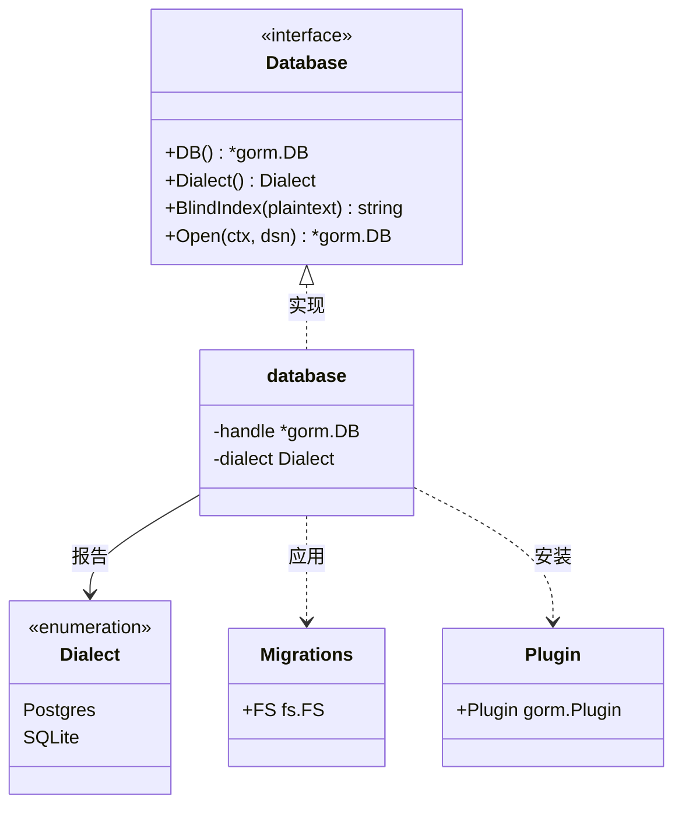
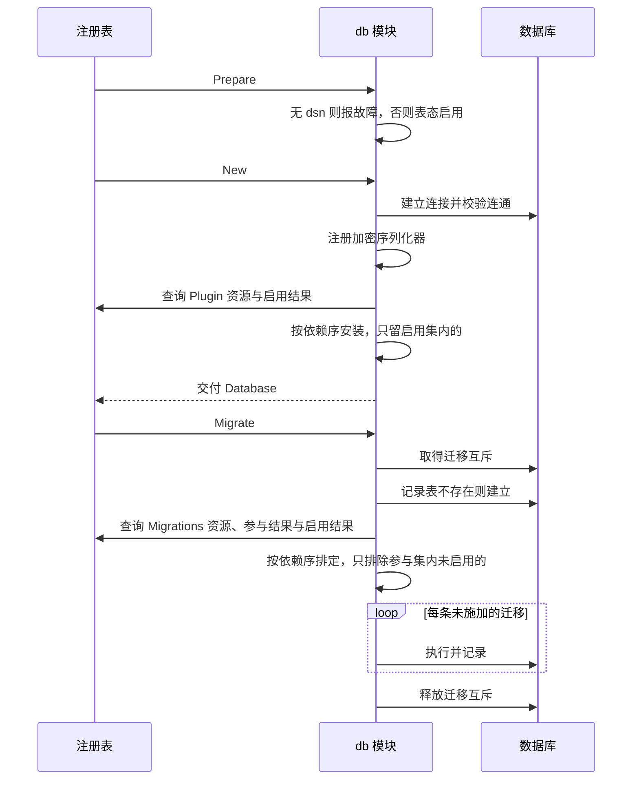

# db

## 职责

- 依据配置建立到数据库的连接，交付给需要访问库的模块。
- 承担不需要上层概念的语句级横切能力：软删除与字段级加密（[ADR-db-scope-2026-09-14](../../adr/adr-db-scope-2026-09-14.md)）。
- 安装各模块声明的 GORM 插件，装完才交付连接。
- 收齐各模块声明的迁移集，在 `Migrate` 阶段按依赖序应用，并记录已施加的部分使重复启动幂等。
- 提供自建额外连接的途径，供访问配置给出的那个库之外的库。
- 提供在有界等待内取一条连接的途径，供模块在交给它的句柄上发出自己的语句（[ADR-db-waits-2026-09-29](../../adr/adr-db-waits-2026-09-29.md)）。
- 关闭连接，释放连接池中的全部连接。

本功能目录由接口包与实现子包组成：`pkg/db` 根包提供功能接口、资源类型与各子包共用的逻辑，自身不注册模块；`pkg/db/postgres` 与 `pkg/db/sqlite` 各注册一个模块，模块名为 `db.postgres` 与 `db.sqlite`，交付同一个功能并各自声明排他。模块名是它在诊断输出与启用结果查询中的身份，与它的配置命名空间同名。下文的"本模块"指其中被启用的那一个。

本功能目录是 GORM 的封装，接口面直接用 `*gorm.DB` 表达（[ADR-module-packaging-2026-09-14](../../adr/adr-module-packaging-2026-09-14.md)）。查询构造、模型映射、关联加载与事务 API 都由 GORM 提供，本模块不在其上另加一层。

### 非职责

一种横切能力落在本模块之内还是之外，判据是它除了这条语句本身，还需不需要一个产生于依赖图上层的概念（[ADR-db-scope-2026-09-14](../../adr/adr-db-scope-2026-09-14.md)）。

- **不认识租户，不按租户过滤。** 按租户过滤要知道当前是哪个租户，而租户标识产生于本模块之上。租户隔离由[租户模块](design-tenant.md)实现，它定义自己的模型约定并声明相应的插件，经本模块的插件扩展点接入。
- **不提供审计。** 它要知道操作者是谁、记录写到哪里去，两者都产生于本模块之上，同样经插件扩展点接入。
- **软删除不记录删除者。** 删除时间本模块自己就能给出，删除者是操作者身份，落在判据的另一边；需要它的宿主在自己的插件里补。
- **不定义事务传播机制。** 事务由调用方用 GORM 自己的 API 开启，本模块不提供跨模块传递事务句柄的通道。
- **不承载运行期可变的参数。** 判据是该值是否在数据库可用之前就被需要；连接信息在其列，随后可调的参数不在（[ADR-config-scope-2026-09-13](../../adr/adr-config-scope-2026-09-13.md)）。
- **额外的连接不进装配面。** 经 `Open` 建立的连接不由本模块持有、不施加迁移、不参与依赖定序，也无法被别的模块按功能取用；它是调用方自己的东西（[ADR-db-multiplicity-2026-09-14](../../adr/adr-db-multiplicity-2026-09-14.md)）。
- **不编写任何迁移。** 表属于声明它们的模块，本模块只应用。
- **不提供反向迁移。** 迁移只有前进方向。撤销一次已施加的变更，由声明它的模块写一条新的前进迁移完成，本模块不认识"回退到某个版本"这件事。

## 外部接口契约

**交付的功能**。功能标识的元素类型必须是接口，而 `*gorm.DB` 是具体类型，因此交付的是一个窄接口，由它给出句柄：

```go
type Dialect string

const (
    Postgres Dialect = "postgres"
    SQLite   Dialect = "sqlite"
)

type Database interface {
    DB() *gorm.DB
    Dialect() Dialect
    BlindIndex(plaintext string) string
    Open(ctx context.Context, dsn string) (*gorm.DB, error)
}

func Close(*gorm.DB) error

func OpenedFrom(*gorm.DB) (*gorm.DB, bool)

func Connection(ctx context.Context, handle *gorm.DB, wait time.Duration, fn func(session *gorm.DB) error) error
```

`DB` 返回的句柄已装好按本模块取材域收取的插件（见插件的安装）。`Dialect` 供调用方在原生 SQL 上按方言分支——占位符写法与函数名在方言之间有差异，GORM 的查询构造器屏蔽了这部分，绕过它写的语句没有。方言的取值同时是迁移集中子目录的名字，新增一种方言即在这个集合里增加一个取值。

实现子包的交付声明写作 `Provides: []core.Provision{{Token: (*Database)(nil), Exclusive: true}}`，排他即由此而来。

取用写作 `core.Resolve[db.Database](reg)`。访问库的模块在 `Requires` 中声明 `(*db.Database)(nil)`，因而排在本模块之后构造，此后每个阶段也都排在本模块之后，它自己的 `Migrate` 回调在迁移施加之后运行。依赖方的 `New` 不在其列：全部模块的 `New` 都早于第一个 `Migrate` 回调（见 [core](design-core.md)），首次启动时在 `New` 里读写自己的表会碰上表还不存在，读写库的工作要放在它自己的 `Migrate` 回调或其后的阶段里。

**额外的连接**。配置给出的那个库经模块机制交付，是唯一能被 `Requires` 声明和 `Resolve` 取用的；访问别的库——只读副本、另一个系统的库、一次性的数据来源——用 `Open` 自建。

自建的连接与交付的那个装配一致：同一个方言，同样装好已声明的插件与加密序列化器。换一个库不会因此失去它们，代价是连不了另一种引擎的库——那要求那个引擎的实现也被启用，而排他不允许。

它沿用同一份连接池参数：`max-open-conns` 这些输入项作用于本模块建立的每一个连接，不只是交付的那个。需要别的池形状的调用方，这里没有旋钮。定位符指向只属于单条连接的库时例外，见配置一节。

`Open` 收到的定位符为空白时判 `ErrConnectFailed`，与交付侧的 `dsn` 是同一条规则：一个连接必须说得出它连的是哪个库。**采纳的读法**：空白即拒绝。**考虑过而放弃的读法**：定位符原样交给驱动；放弃的理由是空白串在两个驱动那里都不是"没有库"。PostgreSQL 的驱动用进程环境里的 `PG*` 变量、本机套接字与进程用户补全它，连上的是环境指向的那个库；`glebarez/sqlite` 为池里的每条连接各开一个临时库，一条连接上建的表在另一条上不存在。两种结果都是拿着一个可用句柄、连着一个没人点名的库，全程不报错（[ADR-db-multiplicity-2026-09-14](../../adr/adr-db-multiplicity-2026-09-14.md)）。要一个临时库的调用方写 `:memory:`，这样的句柄按配置一节的例外只开一条连接。

它不施加任何迁移。迁移集是各模块声明给配置那个库的，第二个库的 schema 由调用方保证，缺表的表现是运行期的查询失败。

插件自己的表也只在配置的那个库里，所以自建的连接比交付的那个多带一样东西：一个标记，记着它是从哪个交付句柄建出的。`OpenedFrom` 读这个标记——对自建连接派生出的每个会话（`WithContext`、`Session`、事务）答出那个交付句柄，对交付句柄本身及其会话、对不经本模块 `Open` 建出的句柄不作答。插件实例被多个句柄、乃至同一进程里的多个注册表共用，从一个会话上读不出它的来历，这个回答因而由建出连接的本模块给出。在语句所在的会话上写入自己的表的插件据它把那一行写到交付的库里，审计的语句捕获即是（见 [audit](design-audit.md) 的语句级捕获）。标记在安装已声明的插件之前装上，插件的 `Initialize` 同样问得到。

**采纳的读法**：标记放在句柄的插件表里。派生出的每个会话都按引用共用这张表，标记因而跟着连接走。**考虑过而放弃的读法**：放在句柄自身的上下文里，或放在语句的设置里；放弃的理由是调用方一次 `WithContext` 就换掉了上下文，一条新语句就换掉了设置，`OpenedFrom` 随之答不出，插件把那一行写到一个没有施加迁移的库上，全程不报错。

它也不由本模块持有：自建的连接有自己的连接池，与交付的那个互不相干，调用方在自己的 `Close` 阶段用包级的 `Close` 释放它。`Close` 是包级函数而不是 `Database` 的方法，因为关闭一个句柄用不到本模块的任何状态；它可重入，重复调用不报错，传入 nil 同样返回 nil——`Open` 失败时调用方那条 `defer` 照样会执行，让它报错等于要求每个调用点先判一次空，而那个错误没有补救动作：没有连接要释放，正是关闭想达到的状态。漏关就是连接泄漏，本模块无从代为释放。

**有界的连接**。模块替调用方在库上发出的语句——插件写自己的行，订阅方在发布方的协程里读表，经交付句柄读表作答的调用——可能在调用方开着的事务里、或在它迭代结果集的循环里被调到。那时调用方占着池里的连接：只开一条连接的库上占着唯一的那条（见配置一节），更大的池在每条连接都被这样占着时处境相同。这样一条语句去池里取连接，等的是调用方，而调用方在等它返回，一直等到语句的 `ctx` 到期，没有时限就永远等下去。这类语句经 `Connection` 取连接（[ADR-db-waits-2026-09-29](../../adr/adr-db-waits-2026-09-29.md)）。

`Connection` 在 `wait` 之内从句柄背后的连接池里取一条连接，在钉住这条连接的会话上、在 `ctx` 下运行 `fn`；由这个会话派生的会话与事务——`WithContext`、`Session`、`Begin`、`Transaction` 与事务里的保存点——都在这条连接上。GORM 在句柄打开时的那个池上建出的东西不在：以 `PrepareStmt` 派生的会话，以及事务的 `DB` 交回的 `*sql.DB`。它们的语句像句柄上的任何语句一样去那个池里取连接，这段等待没有界，只开一条连接的库上等的正是 `fn` 占着的那条连接。取不到连接时返回的错误包着 `context.DeadlineExceeded`，而调用方自己的 `ctx` 还没结束，调用方据此把界到了与自己的取消分开。`ctx` 带着更早的期限时，界随它收短。

句柄的 `ConnPool` 是 `*sql.DB`，或经 `gorm.GetDBConnector` 交出一个——GORM 的预编译语句池就是——都从那个池里取，不论是不是本模块打开的，宿主用 `gorm.Open` 自建的句柄、测试替身交出的句柄都算。句柄已经在一条连接上时——一个事务，一个已钉住的会话，`fn` 自己拿到的会话也在其内——`fn` 就在这个句柄上运行，什么也不等。`ConnPool` 包装了连接池、却不经 `GetDBConnector` 交出它时，本模块认不出背后的池，`fn` 同样在这个句柄上运行，它的语句取连接的等待没有界；宿主的包装实现 `GetDBConn`，就在界内。

**界只管取连接。** `fn` 的语句等别的连接占着的锁，照引擎自己的设置等，本模块不读、不设、不放回任何等锁设置（见并发与事务边界）：SQLite 上每一条语句至多等连接的忙等时限，驱动默认 5 秒，定位符可改，`ctx` 结束不了这段等待；PostgreSQL 上等到 `ctx` 结束，或由会话的 `lock_timeout`（一条语句等的每一把锁各计一次）、`statement_timeout`（整条语句）结束，两者都来自定位符或服务端，都不设时一直等到锁放开。一次调用的等锁不合计：`fn` 发几条语句，每条各按上面的规矩等。等锁到时，那条语句以引擎自己的错误失败，SQLite 的 `SQLITE_BUSY`，PostgreSQL 的 `lock_not_available` 或语句超时。

**界是失败而不是答案**（[ADR-db-waits-2026-09-29](../../adr/adr-db-waits-2026-09-29.md)）。只开一条连接的库上、调用方的事务里，经 `Connection` 的调用等满 `wait` 才失败，这段时间里调用方的事务与那条连接都被占着；一次本可以据表作答的调用，这时得到的是一个既不是答案、也不是拒绝的失败。要它作答，调用方先放开占着的连接：提交事务、关掉结果集。调用方的事务占着的是锁而不是连接时，经 `Connection` 的语句等的同样是调用方，只是这一段不在界内：SQLite 文件库上等满忙等时限才失败，替调用方写的事务在开启时就等这把写锁（定位符让事务以 `DEFERRED` 开启时，先读后写的那一种当即失败，见并发与事务边界），PostgreSQL 上写调用方写过的那一行，`ctx` 没有期限、会话又没有 `lock_timeout` 与 `statement_timeout` 时永远等下去。

`fn` 返回或 panic 之后，它在这条连接上开着的事务都在这条连接上回滚，没关的结果集都关掉，连接再回到池里；panic 照旧传给调用方。`fn` 要提交的事务得在返回之前提交。`fn` 的会话钉在一个包装了那条连接的连接池上，它的 `Statement.ConnPool` 不是 `*sql.Conn`，事务开启后语句都在那个 `*sql.Tx` 上，保存点与回滚到保存点照 GORM 的写法。`fn` 自己的错误原样返回。`wait` 不为正时拒绝，句柄为 nil 时同样拒绝，`fn` 都不运行。

**软删除**。GORM 自带软删除：模型带 `gorm.DeletedAt` 字段即生效，查询自动排除已删除的行，`Delete` 改为写入删除时间而不是物理删除，`Unscoped()` 绕过这层过滤。本模块封装 GORM，这件事因而随句柄一并交付，模型按 GORM 的约定声明即可；本模块不另造一套标记接口，也不在其上加一层。

物理删除仍然是 `Unscoped().Delete`，本模块不对它设门槛——谁可以物理删除是权限问题，由认识操作者的那一层决定。

**约束拒绝**。一条语句被唯一约束（主键在内）拒绝时，本模块打开的每个句柄——交付的与 `Open` 自建的——交回的错误上 `errors.Is(err, gorm.ErrDuplicatedKey)` 成立；被外键拒绝时 `errors.Is(err, gorm.ErrForeignKeyViolated)` 成立。两个引擎上是同一条判断，宿主据此把业务唯一键的冲突答成冲突应答，不必 import 驱动（[ADR-db-errors-2026-09-28](../../adr/adr-db-errors-2026-09-28.md)）。

驱动自己的错误留在同一条错误链上，错误文本也是驱动的原文：`errors.As` 仍取得到 PostgreSQL 的 `*pgconn.PgError`，被违反的约束名就在它上面。这条保证覆盖经 GORM 报回错误的每一条路：模型路径的插入、更新与删除、`Exec`、以 `Raw` 写的 `INSERT … RETURNING` 经 `Scan` 读取、事务里的语句，以及延迟检查的外键在 `COMMIT` 时的拒绝。

只分类这两类。检查约束、非空约束、写了表里没有的列，这些拒绝在两个引擎上都保持驱动错误原样，不带任何一个 GORM 哨兵。经 `Row` 的 `Scan`、以及宿主自己迭代 `Rows` 时由 `rows.Err()` 报出的错误来自 database/sql，不经 GORM，也不带分类；要分类就用 `Scan`、`Find` 这类由 GORM 收尾的方法读结果。

哪些驱动错误属于这两类由方言判断，实现子包经 `Spec.ConstraintViolation` 交给本模块。

**字段级加密**。模型字段标注 `gorm:"serializer:encrypted"` 即落库前加密、读出后解密，密钥来自配置。序列化器由本模块注册到 GORM，时机与插件安装相同：建立连接之后、交付句柄之前。

**采纳的读法**：注册到 GORM 的序列化器是全局的、且不持有任何状态；本实例的密钥由每次装配安装的一条注入回调放进语句的上下文，序列化器从那里取。这个形状由 GORM 定死——`schema.RegisterSerializer` 写的是进程级的一张表，而序列化器接口的方法拿到的是一个字段与一个上下文，拿不到 `*gorm.DB`。**考虑过而放弃的读法**：把序列化器做成按实例的；放弃的理由是 GORM 里没有这个形态，此路不通。

这条机制有一个必须交代的后果：同进程里两个各自装配的数据库、各持不同根密钥时会不会互相串。不会，且由构造保证——进程级那张表里存的是一个空结构体，没有任何实例状态可串；密钥随每条语句的上下文到达，语句由哪个句柄发出就带哪个句柄的密钥。

**序列化器只在 GORM 经模型字段读写一个值时起作用**，而 GORM 为同一列的写入与读出另有不经模型字段的路径。本模块在写入、查询与取结果集的回调链上补上这个缺口，规则是：指明了模型的语句，要么加解密正确，要么拒绝并点名字段；不把明文写进加密列，也不把密文当作值交出去。不指明模型的语句见下文的边界。

写入侧，经模型本身的写入（`Create`、`Save`、以模型为参数的 `Updates`）由 GORM 调用序列化器。以值而不是以模型给出的写入——`Update(列, 值)`、`Updates(map)`、`UpdateColumn` 与 `UpdateColumns`、从 map 或 map 切片 `Create`、`ON CONFLICT DO UPDATE` 按值给出的赋值、调用方自己写的 `SET` 子句——GORM 原样绑定，本模块在生成 SQL 之前把其中落到加密列的值封装为密文，`Select` 与 `Omit` 排除掉的列不动。更新用的 map 在一份副本上封装，调用方的 map 全程只读：GORM 更新时只读这个 map，同一个 map 因而可以交给并发的多次更新，把密文写进它会让另一次更新把密文当作值再封装一遍。插入用的 map 就地封装、在 SQL 生成之后恢复成原来的明文，因为 GORM 插入之后要把生成的主键写回调用方的 map，这份写回照常保留；同一个 map 交给并发的插入，本来就因 GORM 的这次写回而不安全。落到加密列上而本模块封装不了的值一律拒绝：SQL 表达式与子查询由数据库求值，求值发生在本模块能加密之后；指向不加密列的列引用把那一列的原文带进来。指向另一个加密列的列引用照常放行，例如 upsert 取插入值的 `excluded` 列，那一列本来就是密文。以另一个结构体给出的 `Updates` 按那个结构体自己的字段取值，其中写到加密列而不带 `serializer:encrypted` 的字段会被拒绝：该不该加密由那个结构体的声明决定，本模块只能指出它漏了。

值落到哪一列，按语句所在引擎解析列名的方式判断，而不只按 GORM 认得的名字（[ADR-db-encryption-2026-09-29](../../adr/adr-db-encryption-2026-09-29.md)）。GORM 按字段名、列名与命名策略解析 map 的键和赋值的列，解析不了的原样写进 SQL，随后决定它是哪一列的是数据库。GORM 写模型的列、写它解析出的列名都加引号，模型的一列因此就是字段声明的那个列名。两个引擎解析语句里的名字各有规则：

- SQLite 比较标识符只折叠 ASCII 字母的大小写，带不带引号都如此。
- PostgreSQL 把不带引号的标识符的 ASCII 字母折成小写，带引号的按引号里的内容原样认，两者都只保留前 63 字节。

判据是：列名去掉引号之后的最后一段，按语句所在引擎的规则与某个加密列的列名相同，就按那一列封装。规则按引擎写在接口包里（`namesColumn`），语句所在的引擎从句柄上的引擎标记读出；没有给出规则的引擎取两条规则之并，一个名字按其中任一条与加密列的列名相同，就认作那一列。在 SQLite 上，`Updates(map[string]any{"eMaIl": v})`、键写成带引号的列名、列为原样文本的 `SET` 子句都落到加密列上，本模块同样封装它们。在 PostgreSQL 上，GORM 加了引号的 `EMAIL` 与自带引号的 `"EMAIL"` 是另一列，照原值写入；原样写入、不带引号的 `EMAIL` 折成 `email`，按加密列封装；与加密列的列名前 63 字节相同的长名字同样落到加密列上。原样文本不是标识符的——表达式、函数调用、PostgreSQL 的 `U&"…"` 转义写法——本模块不解析 SQL，判断不了它落到哪一列，在带加密字段的模型上一律拒绝并点名那一列：它可能正是加密列，放行就是把明文写进去。以另一个结构体给出的 `Updates` 同样按它实际写出的列名判断，那个结构体的字段列名被语句所在引擎读作加密列时，照样被拒绝。

模型自己也可能在加密字段之外另有一个不带标签的字段，列名被语句所在引擎读作那个加密列：在 SQLite 上，例如只差大小写；在 PostgreSQL 上只差大小写的两个列名是两列，各写各的，不在此列。经模型结构体的写入把这两个字段写成同一条语句里的两列，SQLite 插入时留第一个值、更新时留最后一个，哪个落进加密列取决于字段的声明次序，明文因而可能被存下。写出这样一个字段的模型写入——从模型插入（`ON CONFLICT` 在内）、`Save`、以模型类型的结构体为参数的 `Updates` 与 `UpdateColumns`——一律拒绝，并点名两个字段；`Select` 与 `Omit` 把它排除在外的照常执行，写出与否按 GORM 的取舍判断：插入经 GORM 绑定每一列的那个字段写出每个未被排除的列，默认值由数据库给出的字段——绑定到列与否——只在有一行给了它值时写出；更新写出被 `Select` 点名的与值不为零的。以 map 按这个字段写入不在此列：那一列在语句里只有这一个值，按上面的判据封装。

两个字段声明同一个列名时——嵌入结构体里有一个与模型自己的字段同列的字段，就是这样——GORM 把这一列绑定到其中一个：路径更短的那个，路径一样长时先声明的那个。这一列此后只经它读写，另一个字段不写出，也就不是这一列的第二个值；默认值由数据库给出、又有一行给了它值的除外，那时它被写出，按上一段拒绝。字段名相同的两个字段在报错里以它们在模型里的路径区分，例如 `Customer.Email` 与 `Customer.Contact.Email`。

加密字段也可能输掉它的列：GORM 把那一列绑定到一个不带标签的字段，序列化器从不运行。经模型写入时存下的是那个字段的明文；按值写入即便由本模块封装，GORM 也把写入的值设回调用方模型上那个不带标签的字段；读出时库里的内容——密文在内——被当作那个字段的值交出。经这个模型写到或读到这一列的语句因此一律拒绝，写入的各种形态与扫进模型的读取都在其内，报错点名加密字段与 GORM 绑定的那个字段；避开这一列的语句照常执行。

读取侧，扫描进模型、或进一个对应字段带同一标签的结构体，由序列化器解密。查询链上目标在执行前已知的读取——`Find`、`First`、`Take`、`Pluck` 这一类——若会把加密列扫进 map、扫进对应字段不带标签的结构体、或扫进字符串这样的单值，就拒绝执行并点名字段。读不读这一列依据语句上写明的选择来判断：`Select`、`Omit` 与 `Pluck` 给出的列；避开加密列的读取照常执行。选择里只是一个列名的一项，按 GORM 写进语句的形式、以写入侧同一条引擎规则判断——在 PostgreSQL 上 `Pluck` 一个只与加密列差大小写的字段，读的是另一列，照常执行；写在表达式里的列名按字面找，宁可判为读到。没写选择时，map 与另一个结构体按 GORM 的做法视为读取全部列。

以别名、或在表达式里读到加密列时，结果列换了名字，GORM 按那个名字找接收它的字段：`Select("id, email AS email_index")` 把密文扫进模型自己那个不带标签的字段，扫进模型也不例外。选择里的这样一项，本模块按它的结果列可能叫的名字——调用方写下的别名，写不写 `AS` 都算，`clause.Column` 上单独给出的别名也算；以及函数名，那是 PostgreSQL 给不带别名的函数调用起的列名——在目标结构体上找字段，模型本身与另一个结构体都如此。找到的字段能装文本而不带同一标签时，拒绝并点名字段；装不了文本的字段——计数、长度、是否为 NULL——照常接收。

`Row`、`Rows` 与 `Scan` 把结果集交给调用方自己挑的目标，挑目标发生在本模块最后一个回调之后，语句上看不出列会扫进哪里：扫进模型由序列化器解密，扫进字符串、map 或不带标签的结构体得到的是密文，而且都报告成功。这三个调用经过模型、又读到加密列时一律拒绝并点名字段，扫进模型本身也在其内；选择避开了加密列的照常执行，读不读依据的仍是语句上写明的选择，没写选择视为读取全部列。**采纳的读法**：看不见目标的路径上，读到加密列即拒绝。代价是经模型的 `Scan` 与 `Rows` 连扫进模型的读取也用不了，要改用 `Find`、`First`、`Take` 或 `FindInBatches`——它们在执行前就把目标放在语句上，由查询链上的判断核对。**考虑过而放弃的读法**：在这些路径上写明边界、照常执行；放弃的理由是那正是把密文当作值交出去而不报错的形态。**另一种考虑过而放弃的读法**：在这些目标上就地解密；放弃的理由是 map、接口值、各种扫描器类型这些目标形状是开放的，逐一改写等于在 GORM 的扫描之外另造一套，而拒绝把读取引回 GORM 为序列化器设计的那条路，并在报错里说出那条路。

`Row` 没有自己的错误返回值：它交回 GORM 行链那一步留在语句上的行，而语句已经失败时那一步不产出行，调用方的 `Scan` 对空指针取值而 panic，说不出原因。被拒绝的 `Row` 因此交回一行专门报出拒绝的结果：它的 `Scan` 与 `Err` 都以拒绝的错误失败并点名字段，扫描的目标不被写入。这一行不到达任何库，也不占连接池里的连接，只开一条连接的库在那条连接被占着时同样立即作答。**采纳的读法**：经交回的那一行报出。**考虑过而放弃的读法**：以拒绝的错误值 panic；放弃的理由是普通调用走得到的 panic 要每个调用点都 recover 才继续得下去，而同一个读取经 `Rows` 与 `Scan` 报的是错误。**另一种考虑过而放弃的读法**：把语句改写成一个绑定即失败的取值、交给 GORM 照常执行；放弃的理由是那样仍要从池里取一条连接，连接被调用方占着时拒绝要等到 `ctx` 到期才报出，报的还是超时而不是拒绝。

不指明模型的语句在本模块够不到的地方：原生 SQL（`Raw`、`Exec`），以及只用 `Table` 给出表名的语句。本模块不解析 SQL，这些语句上也没有可查的模型，无从知道哪一列是加密列：读出的是库里存的密文，写入的是调用方给的值——`Table("contacts").Updates(map)` 把明文写进加密列，这一行此后经模型读不出来。读写加密列的语句因此要指明模型，用 `Model`，或以模型本身为参数。

`ScanRows` 不走任何回调链，它为扫描新建的语句只带发起它的句柄自身的上下文。本模块因此把密钥也放在交付句柄与每个自建句柄自身的上下文上，在这些句柄上、以及在产生结果集的那个句柄上，`ScanRows` 照常解密；经模型读到加密列的 `Rows` 已被拒绝，这里说的是原生 SQL 与只给表名的结果集。调用方用 `WithContext` 换掉了上下文的句柄不在其列，在那里 `ScanRows` 报错，并指出应在哪个句柄上调用。

加密字段参与不了等值查询——同一明文每次加密的结果不同，`WHERE col = ?` 匹配不上。需要按这样的字段查找时，模型另带一个盲索引列，存放明文的确定性摘要，查询针对那一列。

摘要由 `BlindIndex` 算出。它是 `Database` 的方法而不是包级函数，因为它要用到密钥，而密钥随实例而来——包级设值被架构不变量排除。

未提供根密钥时装配照常完成（见配置一节），而 `BlindIndex` 因此没有可用的子密钥：这时它 panic，而不是返回空摘要或用一个零值密钥去算。**采纳的读法**：没有子密钥就拒绝作答，缺口暴露在调用点上。**考虑过而放弃的读法**：返回空串、或用零值密钥算；放弃的理由是两者都是静默失效的教科书形态——写入侧算出的摘要在补上密钥之后全体作废，而现场看不出任何异常，等到按那一列查不到东西时，已经离写下它的那一行很远。

**盲索引列由写入方自己填。** 序列化器作用于单个字段，写不了第二列，本模块因此不会替模型填上它。漏填不报错：那一列留空，按它做的等值查询查不到任何行，而行本身已经正常写进去了——失效的形态是查不到，不是报错。

`BlindIndex` 对传入的字符串原样计算，不做任何规范化。大小写、空白、电话号码的写法这类差异因而必须由调用方在写入与查询两侧以同样的方式抹平；两侧不一致时，摘要不同，查询同样是查不到而不是报错。

字段加密与盲索引不共用密钥，两者各自使用从配置的那一份根密钥确定性派生出的子密钥；宿主因而只管一个根密钥，用途之间互相隔离。

密钥轮换时，退役的根密钥继续用于解密，旧密文因而仍然可读。盲索引没有这条退路：一列摘要只在一个密钥下匹配得上，换了根密钥就要把每一行重算一遍，这件事不由本模块触发。

多副本部署里，换根密钥要分两次发布。配置只在启动时读取，滚动重启期间新旧副本同时在跑：已经把新密钥设为 `encryption-key` 的副本写出的行，还在旧配置上的副本打不开。所以先在所有副本上把新密钥加进 `encryption-retired-keys`，此时它只解密、不写入；全部换完之后，再把它改为 `encryption-key`、把旧密钥挪进退役列表。盲索引从第二次发布起按新密钥计算，已有的摘要在逐行重写之前都匹配不上，这段时间里按盲索引查找查不到那些行。

**迁移集资源**。带表的模块声明它：

```go
type Migrations struct {
    FS fs.FS   // 按方言分子目录，每个子目录内是该方言的迁移文件
}
```

子目录名即方言名。不含当前方言子目录的声明视为该方言下零条迁移，不是错误——一个只支持某一种方言的模块由此表达它不支持另一种。

声明的类型是一个结构体，而不是 `fs.FS` 本身。资源查询按可赋值性匹配：`embed.FS` 满足 `fs.FS`，而国际化资源、模板资源这类声明大多也是 `embed.FS`，以 `fs.FS` 为资源类型会把它们一并收成迁移集。

**插件资源**。承担语句级横切能力的模块声明它：

```go
type Plugin struct {
    Plugin gorm.Plugin
}
```

本模块原样安装，不解释其内容。

同样包一层结构体，理由与 `Migrations` 相同而强度不同：`gorm.Plugin` 要求 `Initialize(*gorm.DB) error`，无关声明不易意外满足它，包装在这里主要是让资源的声明形态一致。

一条声明里没有可安装的东西——nil 接口，或带类型的 nil 指针（`db.Plugin{Plugin: (*T)(nil)}`，普通 nil 判据挡不住）——在收集阶段判 `ErrPluginFailed` 并点名声明它的模块，此时连接都还没开。**采纳的读法**：收集阶段拒绝并点名模块。**考虑过而放弃的读法**：放任到 GORM 第一次调用上 panic；放弃的理由是 panic 起不到点名模块的作用，它报不出是哪个模块把这条声明交出来的。

**稳定性承诺**。`Database`、`Migrations`、`Plugin` 与 `Connection` 是本模块与其他模块之间的契约，约束拒绝落在 `gorm.ErrDuplicatedKey` 与 `gorm.ErrForeignKeyViolated` 上这一条同属契约。`*gorm.DB` 出现在契约面上，GORM 的不兼容升级因此直达依赖方，这是封装型模块接受的代价（[ADR-module-packaging-2026-09-14](../../adr/adr-module-packaging-2026-09-14.md)）。

**配置**。输入项由各实现子包模块声明，**各自挂在自己的命名空间下**：`db.postgres` 与 `db.sqlite`。互斥的实现必须划分各自的输入项路径——清单收集自全部已注册模块，包含本次不会启用的那些，同一路径上的两份声明只要都被 import 就是冲突，且这个冲突在收集阶段检出，早于排他消解（见 [config](design-config.md)）。分开之后，同时 import 多个实现是常态：两份实现各自声明排他，依赖闭包因而不替宿主挑，只取命令树上已经写下的那些。宿主在运行级纳入里点名 `db.postgres` 或 `db.sqlite`，用哪个方言就是哪一个，未点名的实现不进参与集；点名的那个必须配好它的连接信息才能启动，两个都点名即排他冲突、启动失败，一个都没点名而又有模块依赖数据库功能时缺提供者、启动失败。

每个命名空间下的输入项相同：

| 键 | 作用 | 默认值 |
|---|---|---|
| `dsn` | 连接定位符，标为敏感 | 无 |
| `max-open-conns` | 连接池的最大连接数 | 25 |
| `max-idle-conns` | 连接池保留的空闲连接数 | 5 |
| `conn-max-lifetime` | 一条连接的最长寿命 | 30 分钟 |
| `encryption-key` | 派生加密与盲索引子密钥的当前根密钥，不短于 14 字节，标为敏感 | 无 |
| `encryption-retired-keys` | 仍用于解密的退役根密钥，标为敏感 | 空 |

需要跨进程互斥的实现另有一项 `migration-lock-timeout`，默认 5 分钟，含义见迁移的应用一节；不需要互斥的实现不声明它。它必须为正：零或负的时限让等待只尝试一次，首次启动时除了拿到互斥的那个副本，其余都立即放弃，`Prepare` 因此拒绝它并点名该键。

连接池参数作用于本模块打开的每一个连接，只有一种例外：定位符指向的库只属于打开它的那条连接，SQLite 的内存库与临时库都是如此。这样的句柄只开一条连接、永不替换，不管池参数怎么写。池里每条连接打开的会是各自的库，迁移落在钉住的那一条上，其余连接上的请求找不到表；只开一条是这种定位符唯一说得通的形状。代价是这个句柄上的语句排成一队：那条连接被一个事务或一个没关闭的结果集占着时，同一句柄上的另一条语句要等它归还。在事务回调里、或在迭代 `Rows` 的循环里经外层句柄再发一条语句，因此会一直等到那条语句的 `ctx` 到期，没有时限就一直等下去；事务里的语句要走事务句柄。模块替调用方发出的语句不知道调用方是否正占着这条连接，经 `Connection` 取连接，等不到时在界内失败（见外部接口契约的有界的连接）。认出这类定位符是方言的事，由实现子包经 `Spec.ConnectionScoped` 交给本模块。SQLite 实现照驱动交给 SQLite 的样子、照 SQLite 自己解析 URI 的方式读定位符：驱动把第一个问号之后当作自己的参数，不是 `file:` URI 的定位符在那里截断，`file:` URI 整个交给 SQLite，交出的名字与驱动参数里的 VFS 都是 C 字符串，在第一个 NUL 处结束；SQLite 读到 `#` 为止，名字、参数名与取值里的 `%HH` 先解码，转义出的 NUL 截断它所在的部分，名字为空的参数连同取值跳过，同名参数取最后一个，经哪个 VFS 打开看 URI 的 `vfs` 参数，没有时看驱动参数里的。只属于打开它的那条连接的库按这个读法是：空文件名的临时库；不在共享缓存模式下的内存库，即 `:memory:`（`%3Amemory%3A` 解码后同样是）或 `mode=memory`；不在共享缓存模式下、经 `memdb` VFS 打开的库，名字只有一个字符或不以斜杠、反斜杠开头。名字长于一个字符、以斜杠或反斜杠开头的 `memdb` 库在进程里的连接之间共用，照配置开池。

**SQLite 实现拒绝把连接放进共享缓存模式的定位符**（[ADR-db-waits-2026-09-29](../../adr/adr-db-waits-2026-09-29.md)）：按上面的读法最后一个 `cache` 参数为 `shared` 的 `file:` URI，内存库（`file::memory:?cache=shared`）、`memdb` 库与文件都在其内，写在 `#` 之后的参数不算；临时库不进共享缓存，不在其内；不是 `file:` URI 的定位符，参数由驱动截掉，不进共享缓存。交付的库与 `Open` 自建的连接一样，都以 `ErrConnectFailed` 失败，错误点明共享缓存模式而不回显定位符。共享缓存里，一条连接等缓存里另一条连接占着的表锁，驱动经 `sqlite3_unlock_notify` 一直等到那条连接的事务结束，忙等时限与上下文都结束不了这段等待，任何界在那里都不成立：替调用方发出的语句在调用方的事务之外取了另一条连接，就会一直等调用方。只属于进程自己的内存库写 `:memory:`，本模块只为它开一条连接；多条连接共用的库用文件。

`dsn` 不写入日志，帮助输出也不回显——它承载凭据。各方言的 `dsn` 形态本就不同，服务器地址与文件路径不是一回事，键名随实现分开与此一致。

`encryption-key` 未提供时序列化器照常注册，此后任何一次加解密都失败。本模块无从在启动时判断这是不是缺陷：哪些模型带加密字段，GORM 要到第一次用到那个模型才解析，而那发生在启动之后。

根密钥提供了却用不了时，装配失败并点名该输入项，而不是照常启动、用到时才失败。退役列表里短于 112 位的一项在 FIPS 140-only 模式下被 `hkdf.Key` 拒绝派生，属于这一类。**采纳的读法**：装配期失败。**考虑过而放弃的读法**：照常启动；放弃的理由是那等于带着一个静默什么都不做的加密，而操作者本来有两个动作可做——换一个更长的密钥，或退出那个模式。

`encryption-key` 短于 112 位（14 字节）时装配失败并点名该输入项，不论是否处于 FIPS 140-only 模式。这个下限是 NIST SP 800-131A 定的最低安全强度，也是 `hkdf.Key` 在 FIPS 140-only 模式下对输入的要求，两种模式因此接受同一批根密钥。更短的根密钥照样派生得出子密钥，可逐个试遍它那个长度的取值就能找到它，封装在它下面的列等于明文，而每一次写入都报告成功。下限只约束当前根密钥：退役的根密钥只解密、不写入，拒绝一个短的退役密钥，等于让正在换掉它的部署读不出它封装过的行。

只含空白字符的 `encryption-key`，以及退役列表里为空或只含空白的一项，同样判装配失败并点名该输入项。它们派生得出子密钥，可谁都猜得到，封装在它下面的列等于明文，而每一次写入都报告成功；模板替换成空白留下的正是这样的值。除此之外根密钥逐字节使用，两端的空白也算在内：裁掉它会改变每一个密钥带尾随换行的部署的子密钥，已封装的列随之全部打不开。两个副本的密钥差一个字节时，失败出现在第一行打不开的数据上，不是静默的。

`dsn` 未提供时启动失败，错误点名该输入项，而不是照常启动：被运行级纳入的模块必须启动。数据库功能排他交付，依赖闭包不替宿主挑，这个实现只在宿主点名它时才进参与集——点名即承诺，连接信息不可省（不写命令树的调用方走 `Run` 入口，已登记的每个数据库实现都在参与集里，两个引擎都登记时这条命令启动不起来，没有「不写进命令树」这一步），不需要数据库就不把任何实现写进命令树，写进来就必须把它配好（[ADR-module-enablement-2026-09-21](../../adr/adr-module-enablement-2026-09-21.md)）。

只含空白字符的 `dsn` 等同未提供，同样启动失败并点名该键。**采纳的读法**：空白即未提供。**考虑过而放弃的读法**：把空白串算作提供了；放弃的理由是失败会挪到驱动，报出来的是驱动自己的语法错误，而不是那个被写空的键——操作者拿到的线索指向了错误的地方。

**日志**。交付的句柄与自建的连接都携带 GORM 的默认 logger。**采纳的读法**：维持默认 logger。**考虑过而放弃的读法**：把 GORM 的 logger 接到 [log](design-log.md) 模块上，或把它作为一项配置交出去；放弃的理由：维持现状是在知悉下列代价之后作出的取舍，本模块不为它另编技术理由。

代价原样写在这里：SQL 错误与慢 SQL（阈值 200ms）经标准库 `log` 写**标准输出**，绕过日志模块；`First`、`Take`、`Last` 查不到行也按错误打印，连同整条语句；慢 SQL 把整条语句连同注释原文照发，一次并发迁移中，施加方的标准输出上出现过整份迁移文件的正文。本模块不交出替换它的口子，`gorm.Config` 在 `openHandle` 里构造。依赖方可以在自己的语句上换掉它：`DB().Session(&gorm.Session{Logger: ...})` 只作用于由这个会话派生的语句。直接改交付句柄上的 `Logger` 不受支持：那份配置由每个模块的语句共用，交付之后再改，会与在途的语句竞争，也与此后句柄只读相悖。

## 依赖

`pkg/db` 根包 import GORM、`pkg/core` 与 `pkg/config`：GORM 出现在接口面上，`core` 用于资源与实例查询，`config` 用于声明输入项。

实现子包 import 根包与自己那个方言的驱动，`pkg/db/postgres` 与 `pkg/db/sqlite` 互不 import。驱动不出现在接口面上，换一个实现子包不改变任何依赖方的代码。

SQLite 实现子包绑定纯 Go 的驱动。**采纳的读法**：`github.com/glebarez/sqlite`。**考虑过而放弃的读法**：GORM 官方那个走 cgo 的 `gorm.io/driver/sqlite`；放弃的理由是它会把 C 工具链变成使用这个方言的构建前提，并让 `CGO_ENABLED=0` 的宿主用不了这个方言——cgo 落在 import 了它的那个包的构建上，而驱动只在一个子包内部，换掉它不改任何依赖方的一行代码。

迁移的应用与插件的安装是各实现子包共用的逻辑，位于根包；实现子包自身不写任何阶段回调，它交出的是一份 `Spec`，四个回调一律由 `NewModule` 写出并对所有实现同形。方言特定的部分是驱动的打开、连接池的设置、约束拒绝的识别、迁移的跨进程互斥，以及 SQLite 事务的开启与被拒提交的回滚。

方向满足架构不变量：本功能目录位于 `core` 与 `config` 之上、全部访问库的模块之下，不 import 其中任何一个。承担插件能力的模块 import 根包，根包不反向 import 它们——它不认识任何一种插件实现的能力。

## UML 图

下图给出交付面与资源类型的关系。`Database` 是唯一被取用的功能，`database` 代表实现子包中满足它的类型，每个子包各有一个；`Migrations` 与 `Plugin` 由别的模块声明、由本模块消费，箭头方向因而与取用相反。图中画不出的约束是时机：插件在 `New` 内安装完毕，早于任何依赖方的构造；迁移在 `Migrate` 中应用，早于任何依赖方自己的 `Migrate` 及其后各阶段，依赖方的 `New` 则在它之前。



下图给出装配期的次序。它要固定的是：连接建立与插件安装同在 `New` 内完成，取用方不存在拿到未装插件句柄的路径；迁移在全部产物构造完成之后才施加，失败的构造不会改动库结构；访问库的模块依赖本模块的功能，因而排在它之后，它们自己的 `Migrate` 回调都在迁移施加之后运行。只声明迁移集、自己不访问库的模块没有这条依赖，其回调与本模块的相对次序不保证——它的表照常建立，因为建表由本模块统一完成，与该模块自己是否有回调无关。



## 核心数据结构

**迁移记录表**。一行记录一条已施加的迁移，主键是声明它的模块名与文件名两列的组合。模块名从资源查询结果中取得——资源是被动数据，无法自报身份，归属由查询结果携带。

该表自身用一条无条件可重入的建表语句创建，应用迁移时表不存在才执行，不经由任何模块的迁移集。它没有能被自己追踪的时机：读它才能知道哪些迁移已施加，而它得先存在（[ADR-db-migration-2026-09-14](../../adr/adr-db-migration-2026-09-14.md)）。建表语句不使用任何方言特有的语法，因而不分方言。

**方言**。取值是一个封闭集合，每个实现子包固定其中一个。运行时用哪一种由参与集决定：import 了哪些子包决定有哪些可选，宿主在命令树上点名的那个决定谁被构造，而配好它的连接信息是它启动的前提。两个都点名而都配好连接信息时，两者都表态启用，消解判启动失败，而不是由配置在两者之间择一。

## 核心算法与流程

### 本模块自身的阶段行为

以下是实现子包模块的阶段行为，各子包相同。

`Prepare` 表态：自己命名空间下的 `dsn` 已提供则表态启用，没有则报故障并点名该键，启动终止。

`New` 建立连接，随后注册加密序列化器并安装插件，都在本阶段内完成。本阶段只建立连接，不读写数据：其余模块的构造仍可能失败，而失败的启动不该已经改动过库结构。连接的建立与连通性校验绑定到本阶段收到的 `ctx`，宿主要给它设时限就设在发起驱动时传入的那个 `ctx` 上；本模块不另立一个连接超时的输入项，驱动自己的超时参数写在 `dsn` 里。GORM 打开时自带一次不接受 `ctx` 的连通性检查，碰上一个接受了连接却一直不回话的服务器，它会一直等下去；本模块关掉那次检查。PostgreSQL 的驱动打开时不建立连接，第一次触及连接的因此就是绑定 `ctx` 的那一次。SQLite 的驱动打开时自己查一次库的版本，那一次不带 `ctx`，打开的是本地文件，不在网络上等待。`Open` 在运行期建立的连接同样绑定调用方传入的 `ctx`。

`Migrate` 应用迁移集。

`Close` 关闭连接池。`Stop` 无动作——排空是各模块对自己在途工作的责任，连接在 `Close` 中统一释放。`Close` 可重入：回滚路径会在一个从未走到 `Init` 的实例上调用它。

### 插件的安装

**本消费点的取材域是启用集**（架构不变量 15）。从 `core.Resources[db.Plugin](reg)` 取得声明，只留启用集内的：消解落选、未被本次命令纳入、只被静态级纳入，三种情形一律不安装。**采纳的读法**：插件改写的是本次运行发出的每一条语句，它所描述之物的生命周期就是这次运行，一个本次不运行的模块没有行为可言。**这与迁移集的取材域不同**——那里取的是声明集，只排除参与集内未启用的（见迁移的应用）；两者分家的判据是库结构比一次运行长寿，而插件不是。**考虑过而放弃的读法**：按 `core.Resources` 的字面取全部声明而不过滤，那个查询遍历全部已注册模块、不看启用结果；放弃的理由是这样会让一个从未构造的模块的声明仍然生效，在"没启用就不生效"上开一个洞，且这个洞不报错——插件照常安装成功，没有任何一处会说它来自一个没有运行的模块。

宿主可以用 `AllResources` 令某个静态级纳入的模块全部声明生效，那会把这个模块的插件也装上（见 [config](design-config.md)）。那是宿主写下的一次显式覆盖，不改变本消费点的默认取材域。

这条读法有一份必须看得见的代价：一个只声明插件、自己不访问库的模块未进入本次启用集时，它提供的那项横切能力静默消失，依赖方随后发出的语句在无人过滤、无人审计的状态下照常执行。这是"没启用就不生效"的应有之义，不是缺陷——它不在启用集里，本模块就没有向它要过那项能力；把它当作缺陷，等于要求本模块去安装一个从未运行的模块的声明。

资源查询按模块名字典序返回，而安装次序影响 GORM 回调链的次序，因此按声明它们的模块的依赖序重排：依赖序由各模块 `Requires` 构成的偏序给出，从 `reg.Modules()` 得到。同层之间没有依赖关系，仍按模块名字典序，使结果在各次构建之间稳定。

注册到同一处理器的多个插件，其相互次序由它们所属模块之间的依赖声明决定；没有这条声明就没有次序保证。

迁移的应用走交付的那个句柄，插件在它之前已经装好。施加迁移时的每一条语句——记录表的查找、建立与读写，每个迁移文件的正文——因而都经过已安装插件在原生 SQL 与 `Row` 两条回调链上的回调。一个注册在这两条链上、拒绝某类语句的插件，同样会拒绝迁移，那次启动以 `ErrMigrationFailed` 结束。

### 迁移的应用

记录表不存在时建立它，随后读出其中已施加的条目。先查再建，是因为 PostgreSQL 执行这条建表语句时先检查在该模式下建表的权限、再看表在不在：每次都执行，就等于要求每一条深度越过 `Migrate` 的命令都持有 DDL 权限。施加迁移用一个角色、提供服务用另一个只能读写行的角色，是最小权限部署的常规形态；先查再建之后，全部迁移都已施加的那次运行只读记录表、不改任何东西，服务角色需要的只是对记录表的读权限，取互斥用的咨询锁不需要另行授权。还有未施加的迁移时，这样的角色照样施加不了，失败为 `ErrMigrationFailed` 并点名那个文件，补救动作是先跑施加迁移的那条命令。

**本消费点的取材域是声明集**（架构不变量 15）。从 `core.Resources[db.Migrations](reg)` 取得全部声明，**先只留声明集内的**——本次命令没有纳入的模块，两级都没有，其表不建；**再排除其中运行级纳入了、而后消解落选的模块**，那是这次装配自己给出的否定（[ADR-module-enablement-2026-09-21](../../adr/adr-module-enablement-2026-09-21.md)）。只被静态级纳入的模块没有表态，留在集合里，其表照常建立。

**采纳的读法**：库结构跟着这个二进制走，比任何一次运行长寿，所以取材域比启用集宽；而建哪些表仍是宿主写得出的一件事，所以取材域不是可用集。施加迁移的那条命令按设计只运行级纳入数据库引擎（见 [config](design-config.md) 的命令树示例）：带表的模块依赖引擎，引擎不依赖它们，依赖闭包够不到它们，它们必然落在那条命令的参与集之外——**因此那条命令要把它们静态级纳入，`IncludeAllDeclarations` 是推荐写法**。**考虑过而放弃的读法**：与插件一样按启用结果一刀切；放弃的理由是那会让 `migrate` 一张表都不建，而且成功退出、退出码为零，也不进启动诊断——功能缺失要到运行期的查询失败才暴露。**另一种考虑过而放弃的读法**：取可用集，凡已登记模块的表一律建；放弃的理由是那让"这条命令建哪些表"不再能从宿主代码上读出，两级纳入也就没有了任何消费者——宿主写不写静态级纳入，结果一字不差。

判定因此是三个查询的组合：`reg.Declaring` 说这个模块在不在本次声明集里，不在即跳过；在其中而 `reg.Participating` 为真时，再看 `reg.Enablement` 的裁决，为禁用才排除（见 [core](design-core.md)）。**不得省掉第一个查询**——省掉它，取材域就退化成可用集，而那正是上面否决的第二种读法；**也不得改用比对禁用原因文本的写法**，那是写给人看的诊断串，一次文案修订会改变建表行为。

这条读法有三份必须看得见的代价。其一，**运行级纳入一个带表的模块，就要求它启动**：进了参与集就得真能启动，配置不齐时启动失败，那条命令根本走不到施加迁移这一步；同一个二进制下，只纳入引擎、其余走静态级纳入的 `migrate` 起得来，把全部模块都运行级纳入的那条，则要它们全都配好、全都启动。以施加迁移为目的的命令因此只运行级纳入引擎，其余走静态级。其二，**静态级纳入漏写一个带表模块，它的表不建，而这件事不报错**：那一种不进启动诊断（见 [architecture](../architecture.md) 的可观测性）。`IncludeAllDeclarations` 存在正是为了让宿主不必维护那份清单。其三，**不同命令可以收到不同的迁移集**：一条深度越过 `Migrate` 而没有写静态级纳入的 `serve`，其声明集等于参与集，它施加的迁移比 `migrate` 少。记录表按模块名与文件名去重、不记是哪条命令施加的，因此先跑这样的 `serve` 再跑 `migrate`，同一批迁移会分两批施加，批与批之间的次序不再是依赖序——依赖序只在一次收集之内成立（[ADR-db-migration-2026-09-14](../../adr/adr-db-migration-2026-09-14.md)）。**深度越过 `Migrate` 的命令因此要与 `migrate` 写同一份静态级纳入。**

按依赖序排定模块，模块内按迁移文件名的字典序排定。文件名因此是模块内顺序的唯一依据，`0001_` 这样的前缀是让字典序与预期顺序一致的手段。

一个模块的两条 `Migrations` 声明里出现同名文件时，在收集阶段判 `ErrMigrationFailed` 并点名该文件，在任何一条迁移施加之前拒绝。**采纳的读法**：收集阶段拒绝。**考虑过而放弃的读法**：靠记录表的主键撞出来；放弃的理由是主键由模块名与文件名两列组成，重名的那一条会被当成已施加而静默跳过——文件里的语句一条也不跑，而记录表看起来是完整的（[ADR-db-migration-2026-09-14](../../adr/adr-db-migration-2026-09-14.md)）。

只读取与当前方言同名的子目录，**其中只能有扩展名为 `.sql` 的常规文件**。出现子目录，或出现别的扩展名，都是 `ErrMigrationFailed` 并点名那一项：范围放开会让一个放错位置的说明文件被送进数据库执行，而只挑 `.sql`、其余一概忽略，又会让一个扩展名写错的迁移被静默跳过，表建不出来要到运行期才发现。白名单之外的东西是错误，不是可以忽略的东西。

一个迁移文件可以含多条语句。建表连着建索引是一条迁移的自然形态，拆成两个文件只是把同一件事分散。实现子包负责把文件里的语句全部执行，用驱动支持多语句的执行途径达成，**不自行切分 SQL 文本**——切分要正确处理字符串字面量与函数体里的分号，那是本模块不该承担的解析工作。

逐条比对记录表，未施加的执行并记录，已施加的跳过。一条迁移的执行与它的记录落在同一个事务里，"执行了但没记上"因而不会发生。

**这条保证依赖方言把 DDL 纳入事务**，PostgreSQL 与 SQLite 都如此。不具备这一点的方言，DDL 在事务之外生效而记录随事务回滚，留下一条已施加却没有记录的迁移；下一次启动重做它，重做一条已经生效的建表语句会失败，失败暴露在那一次启动而非施加的当时。方言是否把 DDL 纳入事务，因而是实现子包的准入条件。

它还依赖迁移文件自己不结束这个事务。文件里的 `COMMIT`、`ROLLBACK` 或 `BEGIN` 与本模块开的事务落在同一条连接上：`COMMIT` 把它之前的语句连同事务一起提交，其后的语句不再在事务里，此后一旦失败，已提交的部分留下而记录没有写上，下一次启动重做时在已存在的对象上失败，两个方言上都是如此。本模块不解析迁移文件，无从在执行前认出这类语句，这因此是对迁移文件的要求：一个文件是一个事务里的内容，事务的边界由本模块给出。

**整个应用过程在一次跨进程互斥之下进行**，从建立记录表起，到最后一条迁移施加完毕为止。多副本部署首次启动时，多个进程同时走到这一步：没有互斥，它们各自读记录表都得到"未施加"，随后第二个进程的建表语句因对象已存在而失败，该副本启动不起来。互斥把它们排成队列，后到的进程等前一个做完，此时它读到的记录表已是完整的，无事可做。

互斥的作用域是一个数据库：同一个数据库上的任意两个进程互斥，不同数据库互不相干。标识是固定的，不随装配派生——同一个数据库上跑两套彼此独立的装配时，它们的首次迁移因而排在同一把锁上。代价是排队，而迁移是启动期一次性的；让标识随会话状态（模式搜索路径一类）派生，会使互斥的范围取决于连接怎么配，那比排队危险。

**整个应用过程钉在同一条物理连接上**：取得互斥、建立记录表、逐条施加、释放互斥，都走从池里借来的那一条，中途不还。互斥是会话级的，与那条连接同生死，钉住它才谈得上"取得与释放在应用过程的两端"。

钉住的是同一条，迁移期间因而只占用池中一条连接，而不是两条——锁与迁移语句不争连接，它们本来就在一起。`max-open-conns` 取 1 的池由此照常跑得起来：那是宿主写得出的合法配置，让它变成一次启动挂起，等于用一个没写下来的容量下限去接住它。

互斥由方言实现提供，取得与释放都在应用过程的两端，不在任何一条迁移自己的事务里面——会话级的锁跨事务保持，那条连接上的每一次 BEGIN 与 COMMIT 都不影响它。它协调进程之间的次序，不改变一条迁移执行与记录的原子性。等待是有界的：超过 `migration-lock-timeout` 仍未取得即 `ErrMigrationLockTimeout`，而不是无限等下去，一个卡住的副本因此不会让其余副本一起挂起。

**释放互斥失败终止启动**，即便此前每一条迁移都已成功施加。互斥是会话级的：释放失败而进程照常跑下去，锁就留到这个会话结束，而那可能是进程的整个生命周期——其余副本会一路挂到自己的时限。终止启动让进程退出，会话随之结束，锁一定被释放。

释放失败的成因不加区分。最常见的那种——持锁会话已被服务端断开——其实锁已经随会话没了，终止启动是误杀；但要认出这一种，得依赖驱动对连接状态的报告，认错一次的代价是其余副本全部挂起，而认对省下的只是一次重启就能过去的启动失败。

不出现在多副本部署中的方言不需要互斥。多个进程共享一个 SQLite 文件不是它的部署形态，为它加一道互斥，防的是这个方言在受支持的装配里够不到的风险。

**本模块不报告"本次施加了哪几条"。** 施加与跳过只发生在应用过程内部，交付之后两个副本看到的记录表、表与数据完全一致，因此任何事后观察都对称——一条没跑的迁移与一条跑过的迁移，在库上留下的痕迹由记录表抹平。**采纳的读法**：可观察量由宿主经迁移文件自行建立——迁移自己的末尾记下执行它的会话身份（`current_setting('application_name')`），依赖方读回后与自己的会话身份比对；代价是迁移文件承担了宿主记账。**考虑过而放弃的读法**：让引擎在启动诊断里报告本次施加的条数；放弃的理由是启动诊断只有"未启用的模块及原因"一个通道，且它在消解与配置加载期写出、早于本模块之外的任何构造，而迁移在 `Migrate` 阶段、迟于这一切；本模块不依赖 [log](design-log.md)，走日志那条路要新增一条模块依赖；而"本次施加了哪几条"在每进程各报一个计数时两个副本各报 1，分不出是谁跑的，记录表里那一行反而报得出两个会话都跑过。

## 错误与失败语义

启动期的失败一律终止启动。本模块自己判定的失败对应以下哨兵错误，每条都保持穿过它的错误链完好，包裹一律用 `%w`：

| 哨兵错误 | 触发条件 |
|---|---|
| `ErrConnectFailed` | 驱动打开失败，连通性校验未通过，`Open` 收到空白定位符，或 SQLite 的定位符把连接放进共享缓存模式 |
| `ErrPluginFailed` | 一个已声明的插件安装失败，或一条插件声明里没有可安装的东西 |
| `ErrMigrationFailed` | 一条迁移执行失败，迁移记录表读写失败，迁移目录含非 `.sql` 项，同一模块的两条声明里有同名迁移文件，或释放互斥失败 |
| `ErrMigrationLockTimeout` | 超时仍未取得迁移互斥 |

每条错误的文本给出修复动作所需的信息。`ErrConnectFailed` 点名方言与失败的环节，**不回显定位符本身，也从不含口令**：它承载凭据，且会出现在诊断输出中。驱动给出的原因原样保留，那就是诊断；PostgreSQL 的驱动在其中写出它尝试的用户名、库名与地址，不写口令。这一条同样用于 `Open` 在运行期建立连接失败——补救动作与启动期相同，都是检查那个定位符与它指向的服务，因而不另立一条。`ErrMigrationFailed` 落在某一条迁移上时，点名声明它的模块与文件名——要修的是声明它的那个模块，而本模块无从知道该怎么改它；落在记录表的读写上时没有这样一条可点名，文本给出失败的操作。这些共用一条哨兵，因为宿主的补救动作同属一类。释放互斥失败时，文本要写明迁移已经全部施加、失败落在释放上——不这么写，操作者会照着这条哨兵去查迁移文件，而迁移根本没有问题。`ErrMigrationLockTimeout` 单列，是因为它的补救动作不同：要查的是另一个副本为何迟迟没有做完，或者这个时限给得是否太短，而不是去改哪一条迁移。

以上都是启动期的失败。加解密在运行期发生：密钥缺失、密文损坏、密钥与密文不匹配，以及字段级加密一节拒绝的那些读写，都在那时暴露，由 GORM 把错误带回调用点；被拒绝的 `Row` 经它交回的那一行报出（见字段级加密一节）。本模块不为它们另立哨兵——启动期的哨兵表供宿主在启动失败时分类，而运行期的错误落在具体那一次查询上，由发出它的代码处理。约束拒绝也是运行期的错误，同样不进这张表：它落在 GORM 已有的两个哨兵上（见外部接口契约的约束拒绝）。

`Migrate` 中途失败会留下已施加的部分。该部分不在回滚范围内，也无法回滚：注册表的回滚只驱动 `Stop` 与 `Close`，而数据变更不因此撤销。这是迁移这件事本身的性质。

本次命令运行级纳入了而消解落选的模块，其表不建，而一个已启用模块的迁移可能引用它们。这类引用在启动时表现为 `ErrMigrationFailed`，不在声明时暴露——本模块不解析迁移文件的内容，无从预先判断一条语句引用了什么。只被静态级纳入的模块不落在这条代价里：它们不表态，表照常建立。未被本次命令纳入的模块另有一种失败形态——它根本不在取材域里，表不建而且没有任何一处会说（见迁移的应用）。

## 并发与事务边界

`*gorm.DB` 底层持有连接池，可被多协程并发使用，本模块不在其上另加锁。加密序列化器同样会被多协程并发调用，它不持有可变状态：注册进 GORM 的那个序列化器是空结构体，密钥随每条语句的上下文到达，取出后只读。

装配期的建立连接、安装插件与应用迁移都发生在生命周期驱动的单协程中，此后句柄只读。

本模块不定义事务传播机制。事务由调用方用 GORM 自己的 API 开启，事务句柄在调用方内部传递；跨模块传递一个进行中的事务不在本模块的契约内。声明了插件的模块要自己保证其回调在事务内外行为一致——本模块不区分句柄当前是否处在事务中。

一次提交被拒绝，这个事务就没有生效，它占用的连接回到池里时不在任何事务之中，不论被拒绝的原因是什么。SQLite 在拒绝 `COMMIT` 时让事务继续开着，以便应用修好再提交或稍后重试：延迟检查的外键在提交时发现违反是一种，提交在忙等时限内等不到写锁（回滚日志模式下另一个读者的事务占着共享锁）而以 `SQLITE_BUSY` 结束是另一种。database/sql 却在提交返回之后就把连接还回池里。本模块的 SQLite 实现因此在提交被拒绝时一律在同一条连接上回滚这个事务，再把连接交还；调用方收到的仍是提交的拒绝。不回滚的话，此后落到这条连接上的语句都报告成功却从不提交：别的连接看不见它们，连接关闭时一并丢失，在它上面开下一个事务则直接失败。PostgreSQL 在拒绝提交时自己结束事务，不需要这一步；它的驱动也不把停在事务里的连接交出去：提交出错而会话不在空闲状态时关闭这条连接，从池里取出的连接仍在事务里时丢弃它。

**一条语句执行之前的等待，各段由不同的东西结束。** 它先等池里的一条连接，这段等待由语句的 `ctx` 界定，没有时限就一直等；只开一条连接的库上，调用方的事务或未关闭的结果集占着那条连接时，同一句柄上的另一条语句等的是它们（见配置一节）。它再等别的连接占着的锁：SQLite 在驱动里按连接上的忙等时限反复重试，驱动给每条连接设 5 秒，定位符里的 `_pragma=busy_timeout(n)` 可改；语句的 `ctx` 到期打断不了这段等待，驱动在上下文结束时发出的中断到不了忙等的重试，语句等满忙等时限才以 `SQLITE_BUSY` 失败。忙等时限按一条语句计，一条语句里先后等的锁都在它之内；一次调用发几条语句，就可能各等一个。共享缓存模式下的表锁连忙等时限也不看，SQLite 实现因而不打开那种定位符（见配置一节）。PostgreSQL 的等锁随 `ctx` 结束，会话的 `lock_timeout` 另给每一把锁一个界，一条先后等几把锁的语句各等一个；`statement_timeout` 给整条语句一个界；两者来自定位符、角色与库的默认值或服务端配置，服务端默认都不设。本模块不改动这些设置：`Connection` 只给取连接设界，它的语句照上面的规矩等锁（见外部接口契约的有界的连接）。

**SQLite 实现以 `IMMEDIATE` 开启事务**（[ADR-db-waits-2026-09-29](../../adr/adr-db-waits-2026-09-29.md)）。事务在开启时就要写锁，照忙等时限等，先读后写的事务因此在别的连接写着时等待，与 PostgreSQL 上同样的事务一样，全部提交或等满忙等时限才失败，不会因为先读过而当即失败。开启的语句由实现子包发出，不经驱动。定位符的 `_txlock` 参数指明别的开启方式时照它：取第一个，`deferred`、`immediate`、`exclusive` 不分大小写，不认得的值拒绝打开，定位符带不带 `_time_format` 都如此。以只读方式开启的事务（`sql.TxOptions{ReadOnly: true}`）以 `DEFERRED` 开启，不论定位符怎么写；最后一个 `mode` 参数为 `ro`、又没写 `_txlock` 的 `file:` 定位符上的事务同样以 `DEFERRED` 开启。以 `IMMEDIATE` 开启的事务只读不写也占着写锁，同一个文件库上两个这样的事务一个等另一个结束；只读的工作以只读方式开启事务，或者不开事务。以 `DEFERRED` 开启的事务读过之后再写，写锁在别的连接手里时 SQLite 不等，当即以 `SQLITE_BUSY` 拒绝，WAL 日志模式下同样如此。GORM 为一次写入开的事务里，开启时等别的写者放开写锁，回滚日志模式下提交时还要等读者读完，一次写入因此至多等两个忙等时限。

迁移的事务边界见迁移的应用一节：一条迁移的执行与记录同属一个事务，条与条之间不是。进程之间的协调也在那里——同一个库上同时启动的多个进程，其迁移过程互斥。

## 扩展点

**插件。** 语句级的横切能力经此接入：声明一条 `Plugin` 资源，本模块在交付句柄之前安装它。这是[租户隔离](design-tenant.md)、[审计](design-audit.md)这类需要上层概念的能力作用于本模块所交付句柄的唯一途径，也是本模块把它们排除在自身职责之外的前提（[ADR-db-scope-2026-09-14](../../adr/adr-db-scope-2026-09-14.md)）。

本模块不校验插件装对了：它不认识插件的内容，一个声明了却对某类模型不生效的插件，在这里表现为安装成功。这一层的校验属于声明该插件的模块。

**插件建议可被多次 `Initialize`，本模块不校验这一点。** `Open` 自建的连接复用同一批插件实例，而 GORM 的 `Use` 对每个句柄各调一次 `Initialize`：一个把首个 `*gorm.DB` 捕获进闭包的插件，在第二个句柄上表现为安装成功而不生效。**采纳的读法**：写作建议而非要求。**考虑过而放弃的读法**：把"须可重复 `Initialize`"写成硬要求并由本模块校验；放弃的理由是插件是外部类型，本模块没有可观察面判断一个插件是否可重复初始化——写一条验不了的契约等于不写。代价是：不满足这条建议的插件，失效形态是静默的，判定它是否满足留在声明方那一侧。

**方言实现。** 新增一种方言即新增一个实现子包，绑定该方言的驱动，交付 `Database`；接口包在此增加 `Dialect` 的一个取值，并在 `namesColumn` 里给出这个引擎解析标识符的规则，功能接口与资源类型都不变。规则不经 `Spec` 交给本模块：加密列的判断发生在只拿得到语句的回调里，规则写在接口包，由句柄上的引擎标记选出。没有给出规则的引擎取 SQLite 与 PostgreSQL 两条规则之并，按其中任一条与加密列同名的名字都认作加密列（见字段级加密、[ADR-db-encryption-2026-09-29](../../adr/adr-db-encryption-2026-09-29.md)）：在那个引擎上，一个其实指向别的列的名字会被封装或拒绝，而明文不会写进加密列。各模块的迁移集增加一个同名子目录即支持该方言，不增加则视为不支持。方言实现要满足这些：把 DDL 纳入事务，否则迁移的执行与记录不再原子；能一次执行含多条语句的迁移文件，而不要求本模块切分 SQL 文本；出现在多副本部署中的，还要提供跨进程互斥。都见迁移的应用一节。此外它要经 `Spec.ConstraintViolation` 认出唯一约束与外键的拒绝，`NewModule` 拒绝不给出这一项的 `Spec`：少了它，同一种拒绝在这个方言上就认不出来（见外部接口契约的约束拒绝）。方言的定位符里有等锁连忙等时限、语句超时与上下文都结束不了的形态时，实现子包在自己的 `Dialector` 里拒绝它，不交给本模块打开，SQLite 的共享缓存即是（见配置一节）。

## 实现状态

| 能力 | 状态 | 代码 |
|---|---|---|
| 连接的建立与关闭 | 已实现 | `pkg/db/open.go` `openHandle`、`pkg/db/db.go` `Close` |
| 只属于单条连接的库 | 已实现 | `pkg/db/module.go` `Spec.ConnectionScoped`、`pkg/db/sqlite/locator.go` `connectionScoped`、`readLocator`、`sqliteURI` |
| 共享缓存定位符的拒绝 | 已实现 | `pkg/db/sqlite/sqlite.go` `Dialector`、`sharesCache`、`refusedDialector`、`pkg/db/sqlite/locator.go` `readLocator` |
| 额外连接的自建 | 已实现 | `pkg/db/handle.go` `(*database).Open` |
| 额外连接的来历 | 已实现 | `pkg/db/plugins.go` `OpenedFrom`、`markOpened` |
| 有界的连接 | 已实现 | `pkg/db/connection.go` `Connection`、`pooledOn`、`pinnedConn` |
| 软删除 | 已实现 | 由 GORM 提供，随 `pkg/db/handle.go` `(*database).DB` 交付 |
| 字段级加密与盲索引 | 已实现 | `pkg/db/serializer.go` `installEncryption`、`pkg/db/crypto.go` `deriveSubkey`、`pkg/db/handle.go` `(*database).BlindIndex` |
| 不经模型字段的读写 | 已实现 | `pkg/db/encryptedwrites.go` `sealUpdate`、`sealCreate`、`refuseUnsealedStruct`、`refuseSpelledInsert`、`insertWrites`、`shadowingField`、`pkg/db/encryptedreads.go` `guardReads`、`guardRowReads`、`refusedRow`、`refuseRenamedRead`、`mentions`、`pkg/db/identifiers.go` `sealedTarget`、`namesColumn` |
| 约束拒绝的识别 | 已实现 | `pkg/db/constraints.go` `classifyingDialector`、`installRowClassification`、`pkg/db/sqlite/sqlite.go` `constraintViolation`、`pkg/db/postgres/postgres.go` `constraintViolation` |
| SQLite 事务的开启方式 | 已实现 | `pkg/db/sqlite/transactions.go` `transactionConn.BeginTx`、`pkg/db/sqlite/locator.go` `beginStatement` |
| SQLite 被拒提交的回滚 | 已实现 | `pkg/db/sqlite/transactions.go` `transaction.Commit` |
| 插件的安装 | 已实现 | `pkg/db/plugins.go` `collectPlugins`、`installPlugins`、`pkg/db/handle.go` `newDatabase` |
| 迁移的收齐与应用 | 已实现 | `pkg/db/migrate.go` `collectMigrations`、`applyMigrations` |
| 迁移的跨进程互斥 | 已实现 | `pkg/db/migrate.go` `MigrationLock`、`pkg/db/postgres/lock.go` `NewMigrationLock` |
| PostgreSQL 实现子包 | 已实现 | `pkg/db/postgres/module.go` `Module` |
| SQLite 实现子包 | 已实现 | `pkg/db/sqlite/sqlite.go` `Module` |
