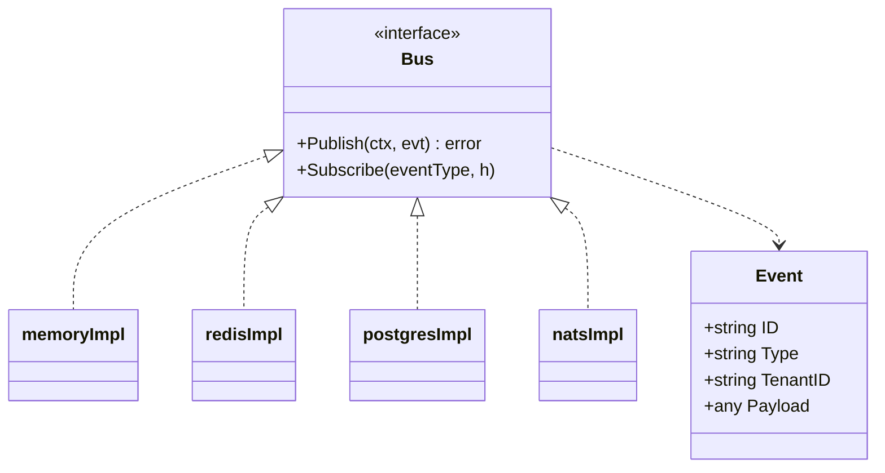
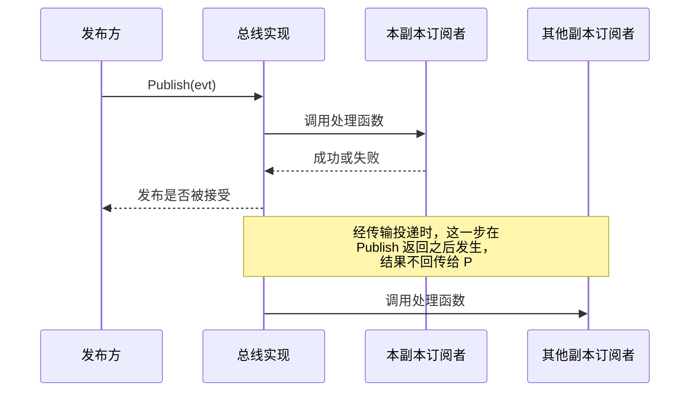

# event

## 职责

本模块交付**事件总线**：一个模块发布一个领域事实，另一个模块按类型订阅它，两者之间不需要相互认识。它是横切能力——审计与可观测性——取得领域事实的统一入口：这类能力订阅总线即可拿到全部事件，不必耦合每一个产生事件的模块（[ADR-event-scope-2026-09-21](../../adr/adr-event-scope-2026-09-21.md)）。

实现有多个，绑定不同后端：进程内、Redis、PostgreSQL、NATS JetStream。**功能排他交付**：同一个进程里恰好一个实现生效。

订阅方通常不能 import 发布方的包——跨模块 import 一个具体类型会把依赖方向倒转。载荷因此以**结构化**方式读取：订阅方按字段名经序列化往返取它需要的字段，不做类型断言。

### 非职责

- **不校验事件类型名。** 类型名是发布方与订阅方之间的约定字符串，没有注册面，也不在启动期检查有没有对应的发布方。发布方可以在运行期任意时刻出现。
- **不承诺投递次数与顺序。** 跨副本恰好一次、按发布顺序投递，都是实现与其后端的事。需要顺序的调用方在载荷里携带序号自行处理。
- **不替订阅方去重。** 事件带着一个标识（见"事件标识"），要只处理一次的订阅方按它自己去重；本模块不记录见过的标识，也不拦截重复的投递。
- **不承诺订阅者失败回传发布方。** 承诺的下界见"错误与失败语义"。
- **不做事件的持久化与重放。** 某些实现的后端让已发布的事件跨重启留存，那是那个实现的性质，不是接口承诺，也不构成重放能力。
- **不按租户过滤。** 事件携带租户标识，按它分流归订阅方。
- **不校验载荷的结构。** 载荷是不透明的，读不出来时订阅方自行决定丢弃还是记录。
- **不做事件模式的版本管理。** 载荷的形状随发布方演进，兼容性由发布方与订阅方约定。
- **不认识租户模块。** 租户标识在本模块是字符串，不引用租户模块的类型。

## 外部接口契约

### 交付的功能

```go
// 功能标识为 (*Bus)(nil)。
type Bus interface {
    // Publish 把 evt 交给总线。返回 nil 表示发布已被接受，
    // 不表示任何订阅者已收到或已处理完成。
    Publish(ctx context.Context, evt Event) error

    // Subscribe 为类型名精确等于 eventType 的事件登记 h。
    Subscribe(eventType string, h Handler)
}

type Event struct {
    // ID 是这个事件的标识，幂等消费方按它去重。发布方留空时由 Publish 赋予。
    ID string

    // Type 是路由键。匹配是精确字符串比较，不解释通配符与前缀。
    Type string

    // TenantID 是事件所属的租户。系统级事件留空。
    TenantID string

    // Payload 是事件数据。订阅方按约定读取，不做类型断言。
    Payload any
}

type Handler func(ctx context.Context, evt Event) error
```

**排他交付。** 多于一个实现表态启用即启动失败。各实现都声明排他，依赖闭包展开事件功能时因而不替宿主挑，只取命令树上已经写下的那些：宿主在运行级纳入里点名哪个实现，启用的就是哪个，未点名的实现不进参与集；一个都没点名而又有模块依赖事件功能时，该功能缺提供者，启动失败。

### 事件标识

**标识是幂等消费方去重的键**（[ADR-event-delivery-2026-09-28](../../adr/adr-event-delivery-2026-09-28.md)）。总线不承诺投递次数：经传输投递的实现把每个事件广播给每个副本，后端可能重投，发布方可能重发，一个效果不止于本副本的订阅者——共享库里每个事件一行、一次对外回调、一份投影——据此认出第二次到达的是同一个事件。两个标识相同的事件，在订阅方看来就是同一个事件投递了两次。

| 发布时的 `ID` | 订阅者收到的 |
|---|---|
| 空 | `Publish` 在事件离开发布调用之前赋予的一个：RFC 9562 第 7 版 UUID 的规范文本形式（`NewID`） |
| 非空 | 原样，不检查形状 |

两种情形下，同一个事件的每个订阅者——同一副本的、其他副本的、任何一种实现下的——收到同一个值；后端重投的条目带着同一个值。由本模块赋予的标识彼此不同，且时间上晚生成的排序在后；发布方自设的，唯一性由发布方负责。

**`Publish` 不回传赋予的标识。** 需要在发布之前知道它的发布方——要把它与自己的写入记在一起，或在一次读不出结果的失败之后重发同一个事件——用 `NewID` 或自己的键先设好；留空重发的是一个新事件。

### 载荷的读取

订阅方拿到的载荷有两种形状，取决于投递路径：同进程投递是发布方自己的具体值，经传输投递是传输解出来的结构。两种形状下都按字段名读取：

| 辅助 | 用途 |
|---|---|
| 解码为字段表 | 读顶层字段，任一形状不可用时报 false，不 panic |
| 按候选名取字符串 | 依次尝试若干个拼写（序列化标签、结构体字段名），取第一个非空字符串 |
| 按候选名取布尔 | 同上，区别是 false 是一个有意义的值，只有缺失或非布尔才继续尝试 |
| 解码为具名类型 | 订阅方能命名自己的形状时直接解，且要向上报出失败时用它 |

**数在两种形状下读出同一个值。** 经传输投递的实现把载荷里的每一个数保留为它的十进制文本（`json.Number`），不转成浮点数；解码为具名类型时，整数无论多大都与同进程投递得到的一致。解码为字段表时，两种形状下的数都是浮点数，2^53 以内的整数精确，超出的会被舍入；要读出更大的整数——标识、以分计的金额——的订阅方解码为具名类型。

**这一组辅助是容错的**：读不出来的载荷报 false 或返回解码错误，绝不 panic，绝不返回部分值。订阅方与发布方的契约是"读不出就丢弃并记录"，因此探询路径上没有可上报的错误。

**载荷是发布方写的数据，本模块既不检查也不剥离它。** 订阅方可以把顶层字段原样写进自己的信号面，可观测性正是把每一个顶层字段写成一个跨度属性；因此把凭据放进载荷，就是把凭据送进那个面。把凭据挡在载荷之外是发布方的义务：本模块没有一条规则能替它做这件事，载荷里有什么，订阅方就读得到什么。

### 稳定性承诺

- **投递下界（见"错误与失败语义"）** 是接口承诺，实现不得弱于它。
- **类型名的匹配规则是精确比较**，不是前缀，不是大小写不敏感。
- **`Subscribe` 只对调用之后发布的事件生效**，不补发此前已发布的事件。
- **事件标识原样到达每一个订阅者**，在每个副本、每种实现下都是同一个值。
- **一个订阅者失败不阻止同一事件的其余订阅者被调用。** 返回错误与 panic 都算失败，两者都不回到发布方。

## 依赖

| 依赖 | 用途 |
|---|---|
| `pkg/core` | 注册描述符、交付功能 |
| `pkg/config` | 声明本模块的输入项 |
| `pkg/log` | 可选依赖。实现自己要报告的事——订阅者失败、后端读取故障——写进装配的日志，记录因而服从装配配置的去处、格式与脱敏；装配里没有日志功能时，写日志模块的进程默认记录器 |
| 共享单元（见下） | Redis 实现与 PostgreSQL 实现各自的使用：客户端的类型与连接构造、连接池的构造 |

**不依赖任何业务模块，与键值功能同处依赖图的底层。** 租户标识是字符串而非租户模块的类型：本模块的根包被每一个发布方 import，参照租户包的类型会让它转而 import 租户的包。代价不是一份第三方依赖——租户的接口包只引标准库——而是总线对某个具体功能的接口面的依赖；而本模块只需要一个字符串（[ADR-event-scope-2026-09-21](../../adr/adr-event-scope-2026-09-21.md)）。

Redis 实现与键值模块的 Redis 实现共用一个封装该客户端的共享单元，PostgreSQL 实现与键值模块的 PostgreSQL 实现共用一个封装连接池构造的共享单元；各实现子包的集成用例所用的服务器夹具（`pkg/internal/pgpool/pgtest`、`pkg/internal/natstest`、`pkg/internal/redis/redistest`）同属共享单元，理由与形态见 [ADR-shared-backend-unit-2026-09-21](../../adr/adr-shared-backend-unit-2026-09-21.md)。

## UML 图

图里是接口与它的实现，以及发布方与订阅方经由总线的关系。图看不出的约束：实现之间互斥；订阅方**不能**命名发布方的类型，因而只能结构化读取载荷；跨副本投递发生在 `Publish` 返回之后。



一次发布的路径，其分支由实现决定：



## 核心数据结构

| 概念 | 类型 | 说明 |
|---|---|---|
| 事件 | `Event` | 标识、路由键、租户标识、不透明载荷 |
| 处理函数 | `Handler` | 收到一个事件，返回它自己处理是否成功 |
| 类型名 | `string` | 约定字符串，精确匹配 |

**`Event` 是值类型，按值传递。** 订阅者拿到的是一次投递的副本，改动它本身不影响发布方。**载荷是接口值，副本与它共享所指之物**：进程内实现把发布方的具体值原样交出，载荷里的映射、切片与指针因而是同一份，就地把载荷里某个键改写会落到发布方与其余订阅者身上，双方都不报错。要在订阅方改载荷，先自己拷一份。

## 核心算法与流程

### 本模块的阶段行为

| 阶段 | 行为 |
|---|---|
| `Prepare` | 各实现 `Decode` 自己那份配置；读出部署前提输入项，与自身性质不符即启动失败，错误点名是哪一项输入 |
| `New` | 建立与后端的连接。从这里到 `Start` 之前，发布被拒绝，`Publish` 返回 `ErrNotStarted` |
| `Init` | 各模块在这一阶段订阅 |
| `Start` | 订阅表在此冻结；开始接受发布。经传输投递的实现在此定下本副本的读取位置并启动读取协程。读取与调用订阅者所用的上下文取自这一阶段收到的上下文，带着它的值而不随它取消 |
| `Stop` | 停止接受发布，此后 `Publish` 返回 `ErrClosed`；读取协程不再从后端取新条目，已经取到的在宽限期内交给订阅者并确认。正在运行的订阅者在未被取消的上下文上跑完；宽限期（10 秒）耗尽时它的上下文被取消，再等 1 秒后 `Stop` 返回错误，说明有投递被截断 |
| `Close` | 未经 `Stop` 时先执行它；Redis 与 NATS 实现删除以本进程命名的消费组与持久消费者，宿主配置了名字的保留，Redis 实现只从中删去本进程的消费者；关闭连接 |

### 订阅的登记与生效

**订阅表在本模块实现的 `Start` 回调里冻结**（`pkg/event/memory/memory.go` `start`，各实现同形）。驱动逐个阶段推进，`Migrate` 与 `Init` 都整体早于 `Start`，所以冻结发生时每个模块的 `Init` 都已执行完毕；从 `Migrate` 回调发出的登记同样早于冻结，因而被接受。

**登记的时机是各模块自己的 `Init`。** 冻结之后到达的订阅有两条去路，取哪一条是实现自己的承诺，写在实现的文档里：在调用点被拒绝，或者登记成功而漏掉冻结之前发布的全部事件，且无从得知自己漏了什么。现有各实现都取前一条（`pkg/event/internal/dispatch/dispatch.go` `Table.Subscribe` 在表已冻结时 panic）。

**发布从 `Start` 起才被接受。** 订阅表在各模块的 `Init` 里逐个填起来，此前的一次发布只会到达恰好已经登记的那部分订阅者，其余的漏掉而无人知道；拒绝它（`ErrNotStarted`）是让这个错误在调用点可见的唯一位置。启动期要宣告什么的模块在自己的 `Start` 里发布：依赖事件功能的模块排在实现之后，它的 `Start` 晚于实现的 `Start`。

**读取位置在 `Start` 返回之前定下。** 一个在 `Init` 里登记的订阅者，其实现 `Start` 返回之后由任何副本发布的事件，都落在本副本的读取范围之内（投递次数仍不承诺，见"错误与失败语义"）。`Init` 与 `Start` 之间由其他副本发布的事件，各实现的去向不同：Redis 与 NATS 实现的消费组与持久消费者在 `Start` 才建立，位置在建立时的末尾，这段窗口里的事件不投递给本副本；PostgreSQL 实现的起点在 `New` 取定，这段窗口里的事件在 `Start` 之后投递——起点是数据库那一刻的快照，此前已提交的条目不属于本副本，此后提交的都属于，当时尚在进行中的事务写下的也在内，取起点不写任何一行；进程内实现没有其他副本。一个在 `Init` 读取状态、再靠订阅来跟进变化的订阅方，要在自己的 `Start` 里再读一次，才能盖住这段窗口。

**每个订阅者都收到一份独立的投递。** 同一类型有多个订阅者时，一个处理函数的失败不影响其余的处理函数被调用，也不影响它们收到的载荷。

### 投递路径

进程内实现在发布方的协程上依次调用订阅者，所以 `Publish` 返回时它们都已处理完毕。这不是接口承诺——经传输投递的实现做不到——而它们的失败不回传，与任何实现一样。

经传输投递的实现把事件写入其后端，并由每个副本自己的读取协程投递。**投递给本副本订阅者与投递给其他副本订阅者走的是同一条路径**，因此它们在时间上都不早于 `Publish` 返回；发布方无从得知任何一次调用的结果。

## 错误与失败语义

### 投递承诺的下界

接口承诺以下各条，全部实现都满足（[ADR-event-delivery-2026-09-21](../../adr/adr-event-delivery-2026-09-21.md)）：

- `Publish` 返回 nil 表示这次发布已被总线接受。不表示任何订阅者已收到或已处理完成。
- `Publish` 返回非 nil 表示发布**没有被接受**，且失败发生在交给总线的那一步：载荷不可序列化、连接不可用、总线不在接受发布的阶段。不表示某个订阅者处理失败。
- 订阅者的失败不回传发布方。

**实现可以更强，且必须在自己的文档里写明强在哪。** 进程内实现在发布方的协程上依次调用每一个订阅者，所以 `Publish` 返回时它们都已处理完毕；调用方不得依赖这一点，因为经传输投递的实现做不到。**订阅者的失败在任何实现里都不回传**，理由见 [ADR-event-delivery-2026-09-21](../../adr/adr-event-delivery-2026-09-21.md)。

| 情形 | 表现 |
|---|---|
| 载荷不可序列化 | `Publish` 失败，事件不投递给任何人 |
| 连接不可用 | `Publish` 失败 |
| 总线尚未到达 `Start` | `Publish` 返回 `ErrNotStarted`，事件不投递给任何人 |
| 总线已进入 `Stop` 或已关闭 | `Publish` 返回 `ErrClosed`，事件不投递给任何人 |
| `Stop` 的宽限期耗尽 | 仍在运行的订阅者的上下文被取消；本副本已取到而未交出的条目不再投递，`Stop` 返回错误 |
| 某订阅者返回错误 | 其余订阅者照常被调用；发布方看不到这个错误 |
| 某订阅者 panic | 与返回错误同等处置：实现接住它并记录，其余订阅者照常被调用；发布方看不到它，进程内实现下也不沿发布方的协程上抛 |
| 订阅了无人发布的类型 | 不报错，也不产生任何信号 |
| 同一个事件到达多次（广播到每个副本、后端重投、发布方带同一标识重发） | 每一次到达带着同一个标识；按它去重归订阅方 |
| 订阅的类型多于配置的连接池（Redis 实现） | 发布不受影响：每个类型一个读取协程，各占读取专用客户端的一条连接，不取发布所用的连接池；本实现保持的连接数是配置的池大小加上订阅的类型数 |
| 进程未经 `Close` 就退出（Redis、NATS 实现） | NATS 实现以本进程命名的持久消费者在无人拉取 24 小时后由服务器删除；Redis 实现以本进程命名的消费组留在流上，由运维删除 |
| 与服务器的连接断开（NATS 实现） | 不限次数地重连，每两秒一次；断开与恢复各写一条日志。断开期间发布失败，读取协程每个取数等待重试一次 |
| 持久消费者或流在运行中消失（NATS 实现） | 读取协程重新建立它们，从流的末尾读起，消失期间发布的事件不投递给本副本；发布时发现流不在，重建流后再发一次，此前没有流收下它，不会重复 |
| 多个副本同时在一个空库上启动（PostgreSQL 实现） | 建表在事务级咨询锁下依次进行，每个副本都启动成功 |
| 连接串带首尾空白（PostgreSQL 实现） | 监听会话取连接池解析后的配置，与每一次发布落在同一个库 |
| 监听会话丢失（PostgreSQL 实现） | 读取协程以同一份配置重新取一条监听会话，随即读一遍表；取不到时每个轮询间隔重试一次，其间只靠读表投递 |

### 订阅方读取载荷

载荷读不出来时，订阅方丢弃并记录这条事件。它没有可上报的对象——发布方收不到订阅者的失败，而这条事件已经投递完毕。

**发布方改一个字段名会静默断开订阅。** 两者之间没有共享的静态类型，没有编译期检查，也没有运行期的模式校验。

## 并发与事务边界

- `Publish` 与 `Subscribe` 不从同一处调用：`Publish` 进请求协程，`Subscribe` 只出现在冻结之前的启动期回调里（`Migrate` 与 `Init`）。
- 实现必须保证订阅表冻结之后的读取是并发安全的。
- 处理函数在实现自己的协程上被调用（进程内实现即发布方的协程），它不得假设自己与发布方在同一协程，也不得假设与其他处理函数在同一协程。**它收到的上下文同样由实现给出**：进程内实现在发布方交给 `Publish` 的那个上下文上调用，传输投递的实现用一个自己的、不带发布方上下文的上下文调用。后者带着实现 `Start` 时收到的上下文里的值，不随驱动的取消而结束：宿主一开始停机就取消驱动的上下文，早于任何模块的 `Stop`，而投递要持续到实现自己的 `Stop`，那时仍在运行的订阅者也在这个上下文上跑完，只有 `Stop` 的宽限期耗尽才取消它。一个把父跨度从回调收到的上下文里取出的订阅方，因而在两种实现下得到不同的父子关系——进程内实现挂在发布方此时所处的跨度之下，传输实现自成一条追踪的根。
- 本模块不开事务。一次发布是独立的，不与调用方自己的事务绑定。

## 扩展点

**新增一种后端即新增一个实现子包。** 以下各条是准入条件的全部：

- 必须在 `Prepare` 中 `Decode` 自己那份配置，并在其中判断部署前提；前提不满足即启动失败，错误点名是哪一项输入。
- 必须排他交付：`Exclusive` 非空，且交付的功能标识为 `(*Bus)(nil)`。
- 必须挂在 `event.<后端>` 专属的配置命名空间下。
- 必须满足投递承诺的下界（订阅者 panic 的处置包括在内），且把超出下界的部分写进自己的文档——尤其是跨副本投递的语义（广播到每个副本，还是消费者组式的负载均衡）。
- 必须按本模块的阶段行为接受与拒绝发布，并在 `Stop` 里有界地结束投递。订阅表、阶段、标识的赋予、订阅者的隔离调用与读取协程的生命周期由各实现共用的一处承担（`pkg/event/internal/dispatch`），新实现经它取得这些性质，而不是各写一份。
- 必须把事件标识原样带过后端，让每个副本的订阅者收到同一个值。
- 必须通过共享的一致性套件；在副本之间传递事件的实现还要通过其中跨副本的那一部分。

## 实现状态

| 能力 | 状态 | 代码 |
|---|---|---|
| 接口与根包 | 已实现 | `pkg/event/event.go` `Bus`、`Event`、`ErrNotStarted`、`ErrClosed`、载荷读取辅助；`pkg/event/id.go` `NewID`；`pkg/event/module.go` `Spec`、`NewModule` |
| 订阅表、阶段与标识的赋予 | 已实现 | `pkg/event/internal/dispatch/dispatch.go` `Table`、`Grace`、`Stamp` |
| 内存实现 | 已实现 | `pkg/event/memory/memory.go` `Module`、`stance`、`start` |
| 一致性套件 | 已实现 | `pkg/event/internal/bussuite/bussuite.go` `AssertConforms`、`AssertReplicated` |
| Redis 实现 | 已实现 | `pkg/event/redis/redis.go` `Module`、`bus`、`readerClient` |
| PostgreSQL 实现 | 已实现 | `pkg/event/postgres/postgres.go` `Module`、`bus` |
| NATS JetStream 实现 | 已实现 | `pkg/event/nats/nats.go` `Module`、`bus` |
